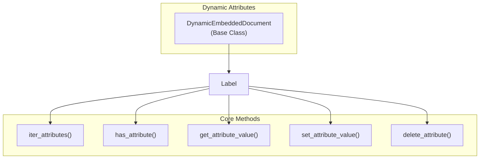
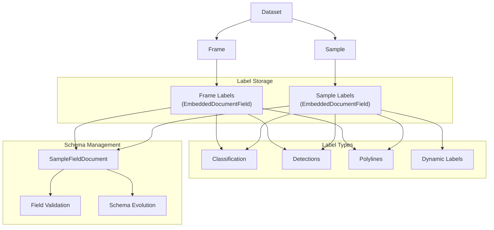

<!-- source: DeepWiki mcp.deepwiki.com · repo voxel51/fiftyone · page 2.3 Labels and Fields · fetched 2026-10-21 -->

# Labels and Fields

Relevant source files

The following files were used as context for generating this wiki page:

- [fiftyone/__public__.py](fiftyone/__public__.py)
- [fiftyone/core/aggregations.py](fiftyone/core/aggregations.py)
- [fiftyone/core/clips.py](fiftyone/core/clips.py)
- [fiftyone/core/collections.py](fiftyone/core/collections.py)
- [fiftyone/core/dataset.py](fiftyone/core/dataset.py)
- [fiftyone/core/document.py](fiftyone/core/document.py)
- [fiftyone/core/expressions.py](fiftyone/core/expressions.py)
- [fiftyone/core/fields.py](fiftyone/core/fields.py)
- [fiftyone/core/frame.py](fiftyone/core/frame.py)
- [fiftyone/core/labels.py](fiftyone/core/labels.py)
- [fiftyone/core/odm/dataset.py](fiftyone/core/odm/dataset.py)
- [fiftyone/core/odm/document.py](fiftyone/core/odm/document.py)
- [fiftyone/core/odm/embedded_document.py](fiftyone/core/odm/embedded_document.py)
- [fiftyone/core/odm/mixins.py](fiftyone/core/odm/mixins.py)
- [fiftyone/core/odm/sample.py](fiftyone/core/odm/sample.py)
- [fiftyone/core/odm/utils.py](fiftyone/core/odm/utils.py)
- [fiftyone/core/patches.py](fiftyone/core/patches.py)
- [fiftyone/core/sample.py](fiftyone/core/sample.py)
- [fiftyone/core/stages.py](fiftyone/core/stages.py)
- [fiftyone/core/video.py](fiftyone/core/video.py)
- [fiftyone/core/view.py](fiftyone/core/view.py)
- [tests/unittests/aggregation_tests.py](tests/unittests/aggregation_tests.py)
- [tests/unittests/dataset_tests.py](tests/unittests/dataset_tests.py)
- [tests/unittests/odm_tests.py](tests/unittests/odm_tests.py)
- [tests/unittests/patches_tests.py](tests/unittests/patches_tests.py)
- [tests/unittests/video_tests.py](tests/unittests/video_tests.py)
- [tests/unittests/view_tests.py](tests/unittests/view_tests.py)

This document covers FiftyOne's label and field system, which provides the foundation for storing structured data and annotations within datasets. Labels represent semantic annotations (classifications, detections, etc.) while fields define the data types and validation rules for dataset attributes.

For information about dataset-level operations and management, see [Datasets and Sample Collections](#2.1). For details about the database persistence layer, see the ODM documentation in the core system overview.

## Overview

FiftyOne's label and field system provides a flexible foundation for storing and manipulating structured data in computer vision datasets. The system consists of two main components:

- **Labels**: Semantic annotations that represent different types of computer vision tasks (classifications, object detections, segmentations, etc.)
- **Fields**: Type definitions and validation rules that govern how data is stored and accessed within samples

Both systems are tightly integrated with FiftyOne's document-based persistence layer and provide dynamic schema capabilities for evolving dataset structures.

### Label System Architecture

```mermaid
graph TB
    Label["Label<br/>(Base Class)"]
    
    subgraph "Simple Labels"
        Classification["Classification"]
        Regression["Regression"]
        Segmentation["Segmentation"]
        Heatmap["Heatmap"]
    end
    
    subgraph "Structured Labels"
        Detection["Detection"]
        Polyline["Polyline"]
        Keypoint["Keypoint"]
        TemporalDetection["TemporalDetection"]
        GeoLocation["GeoLocation"]
    end
    
    subgraph "List Labels"
        Classifications["Classifications"]
        Detections["Detections"]
        Polylines["Polylines"]
        Keypoints["Keypoints"]
        TemporalDetections["TemporalDetections"]
        GeoLocations["GeoLocations"]
    end
    
    subgraph "Mixins"
        _HasID["_HasID"]
        _HasLabelList["_HasLabelList"]
        _HasAttributesDict["_HasAttributesDict"]
        _HasMedia["_HasMedia"]
        _HasInstance["_HasInstance"]
    end
    
    Label --> Classification
    Label --> Regression
    Label --> Detection
    Label --> Segmentation
    Label --> Heatmap
    Label --> Polyline
    Label --> Keypoint
    Label --> TemporalDetection
    Label --> GeoLocation
    
    Label --> Classifications
    Label --> Detections
    Label --> Polylines
    Label --> Keypoints
    Label --> TemporalDetections
    Label --> GeoLocations
    
    _HasID --> Detection
    _HasID --> Classification
    _HasID --> Regression
    
    _HasLabelList --> Classifications
    _HasLabelList --> Detections
    _HasLabelList --> Polylines
    
    _HasAttributesDict --> Detection
    _HasMedia --> Detection
    _HasInstance --> Detection
```

Sources: [fiftyone/core/labels.py:50-1134]()

### Field System Architecture  

```mermaid
graph TB
    Field["Field<br/>(Base Class)"]
    
    subgraph "Primitive Fields"
        StringField["StringField"]
        IntField["IntField"] 
        FloatField["FloatField"]
        BooleanField["BooleanField"]
        DateField["DateField"]
        DateTimeField["DateTimeField"]
        ObjectIdField["ObjectIdField"]
    end
    
    subgraph "Collection Fields"
        ListField["ListField"]
        DictField["DictField"]
        ArrayField["ArrayField"]
        VectorField["VectorField"]
    end
    
    subgraph "Document Fields"
        EmbeddedDocumentField["EmbeddedDocumentField"]
        EmbeddedDocumentListField["EmbeddedDocumentListField"]
        ReferenceField["ReferenceField"]
    end
    
    subgraph "Specialized Fields"
        ClassesField["ClassesField"]
        MaskTargetsField["MaskTargetsField"]
        KeypointsField["KeypointsField"]
        PolylinePointsField["PolylinePointsField"]
        FrameNumberField["FrameNumberField"]
        FrameSupportField["FrameSupportField"]
    end
    
    Field --> StringField
    Field --> IntField
    Field --> FloatField
    Field --> BooleanField
    Field --> DateField
    Field --> DateTimeField
    Field --> ObjectIdField
    
    Field --> ListField
    Field --> DictField
    Field --> ArrayField
    Field --> VectorField
    
    Field --> EmbeddedDocumentField
    Field --> EmbeddedDocumentListField
    Field --> ReferenceField
    
    Field --> ClassesField
    Field --> MaskTargetsField
    Field --> KeypointsField
    Field --> PolylinePointsField
    Field --> FrameNumberField
    Field --> FrameSupportField
```

Sources: [fiftyone/core/fields.py:481-2358]()

## Label Types and Hierarchy

### Base Label Class

The `Label` class serves as the foundation for all annotation types in FiftyOne. It provides core functionality for custom attributes and serialization.

The base `Label` class extends `DynamicEmbeddedDocument` to support dynamic attributes, allowing users to add custom metadata to any label instance without modifying the schema.

Sources: [fiftyone/core/labels.py:50-133]()

### Classification Labels

Classification labels represent categorical predictions or ground truth labels for entire samples or specific regions.

Key characteristics:
- `label`: string classification value
- `confidence`: optional confidence score in [0, 1]
- `logits`: optional raw model outputs
- Inherits ID and tagging capabilities via `_HasID`

The `Classifications` class contains lists of `Classification` instances for multi-label scenarios.

Sources: [fiftyone/core/labels.py:410-436]()

### Detection Labels

Detection labels represent object instances with bounding boxes and optional segmentation masks.

```mermaid
graph TB
    Detection["Detection"]
    
    subgraph "Core Attributes"
        label["label: str"]
        bounding_box["bounding_box: [x,y,w,h]"]
        confidence["confidence: float"]
        index["index: int"]
    end
    
    subgraph "Segmentation"
        mask["mask: numpy.ndarray"]
        mask_path["mask_path: str"]
        has_mask["has_mask()"]
        get_mask["get_mask()"]
        import_mask["import_mask()"]
        export_mask["export_mask()"]
    end
    
    subgraph "Instance Tracking"
        instance["instance: Instance"]
        instance_id["instance_id"]
    end
    
    subgraph "Custom Attributes"
        attributes["attributes: Dict[Attribute]"]
        iter_attributes["iter_attributes()"]
    end
    
    Detection --> label
    Detection --> bounding_box
    Detection --> confidence
    Detection --> index
    
    Detection --> mask
    Detection --> mask_path
    Detection --> has_mask
    Detection --> get_mask
    Detection --> import_mask
    Detection --> export_mask
    
    Detection --> instance
    Detection --> instance_id
    
    Detection --> attributes
    Detection --> iter_attributes
```

Detection objects support both in-memory masks (numpy arrays) and disk-based masks (file paths), with utilities to convert between representations.

Sources: [fiftyone/core/labels.py:438-575]()

### Geometric Labels

FiftyOne supports various geometric annotation types for complex spatial relationships.

**Polylines**: Represent polygons, polylines, and complex shapes
- `points`: list of (x,y) coordinate lists  
- `closed`: whether shapes are closed polygons
- Support for filled regions and confidence values

**Keypoints**: Represent articulated objects and pose estimation
- `points`: list of (x,y) keypoint coordinates
- `confidence`: per-keypoint confidence values
- Integration with skeleton definitions for connectivity

Sources: [fiftyone/core/labels.py:576-970](), [fiftyone/core/labels.py:971-1134]()

## Field Types and Validation

### Primitive Field Types

FiftyOne provides comprehensive primitive field types with built-in validation:

| Field Type | Purpose | Validation |
|------------|---------|------------|
| `StringField` | Text data | Optional regex patterns, choices |
| `IntField` | Integer numbers | Min/max bounds, choices |
| `FloatField` | Floating point | Min/max bounds, NaN handling |
| `BooleanField` | True/false values | Boolean validation |
| `DateField` | Date values | Date format validation |
| `DateTimeField` | Timestamps | DateTime validation with timezone |
| `ObjectIdField` | MongoDB ObjectIds | ObjectId format validation |

Sources: [fiftyone/core/fields.py:481-850]()

### Collection Field Types

Collection fields manage structured data and relationships:

**ListField**: Manages ordered collections
- Supports nested field validation via `field` parameter
- Automatic type coercion for elements
- Length constraints and uniqueness validation

**DictField**: Manages key-value mappings  
- Optional field type for values via `field` parameter
- Support for nested document structures
- Dynamic key validation

**ArrayField**: Optimized for numerical arrays
- Integration with NumPy arrays
- Efficient serialization for large arrays
- Shape and dtype validation

Sources: [fiftyone/core/fields.py:851-1200]()

### Document Field Types

Document fields manage complex embedded objects:

**EmbeddedDocumentField**: Embeds document instances
- `document_type`: specifies embedded document class
- Full validation of nested document structure
- Support for dynamic document types

**EmbeddedDocumentListField**: Lists of embedded documents  
- Combines list and document validation
- Efficient batch operations
- Support for heterogeneous document types

Sources: [fiftyone/core/fields.py:1201-1500]()

## Schema Management

### Field Schema Definition

Dataset schemas are dynamically managed through field metadata stored in MongoDB. Each field contains comprehensive metadata:

```mermaid
graph TB
    SampleFieldDocument["SampleFieldDocument"]
    
    subgraph "Field Metadata"
        name["name: str"]
        ftype["ftype: str"]
        embedded_doc_type["embedded_doc_type: str"]
        subfield["subfield: str"] 
        fields["fields: List[SampleFieldDocument]"]
        db_field["db_field: str"]
        description["description: str"]
        info["info: Dict"]
        read_only["read_only: bool"]
        created_at["created_at: datetime"]
    end
    
    subgraph "Schema Operations"
        to_field["to_field()"]
        from_field["from_field()"]
        get_field_schema["get_field_schema()"]
        add_sample_field["add_sample_field()"]
        delete_sample_field["delete_sample_field()"]
    end
    
    SampleFieldDocument --> name
    SampleFieldDocument --> ftype
    SampleFieldDocument --> embedded_doc_type
    SampleFieldDocument --> subfield
    SampleFieldDocument --> fields
    SampleFieldDocument --> db_field
    SampleFieldDocument --> description
    SampleFieldDocument --> info
    SampleFieldDocument --> read_only
    SampleFieldDocument --> created_at
    
    SampleFieldDocument --> to_field
    SampleFieldDocument --> from_field
    SampleFieldDocument --> get_field_schema
    SampleFieldDocument --> add_sample_field
    SampleFieldDocument --> delete_sample_field
```

Sources: [fiftyone/core/odm/dataset.py:58-160]()

### Dynamic Schema Evolution

FiftyOne supports dynamic schema evolution, allowing fields to be added, modified, and removed without data migration:

**Implied Field Creation**: When setting values on non-existent fields, FiftyOne automatically infers appropriate field types and updates the schema.

**Field Validation**: All field types implement comprehensive validation that runs during assignment and persistence operations.

**Schema Constraints**: Fields support constraints like `read_only`, `required`, and `unique` that are enforced at the document level.

Sources: [fiftyone/core/odm/mixins.py:129-202]()

### Field Filtering and Selection

FiftyOne provides powerful schema introspection and filtering capabilities:

```mermaid
graph TB
    get_field_schema["get_field_schema()"]
    
    subgraph "Filter Options"
        ftype_filter["ftype: Field class filter"]
        embedded_doc_filter["embedded_doc_type: Document filter"]
        subfield_filter["subfield: Subfield type filter"]
        read_only_filter["read_only: Read-only constraint"]
        info_keys_filter["info_keys: Info metadata filter"]
        created_after_filter["created_after: Creation date filter"]
    end
    
    subgraph "Output Options"
        include_private["include_private: bool"]
        flat["flat: bool (flatten nested)"]
        unwind["unwind: bool (traverse lists)"]
        mode["mode: before|after|both"]
    end
    
    get_field_schema --> ftype_filter
    get_field_schema --> embedded_doc_filter
    get_field_schema --> subfield_filter
    get_field_schema --> read_only_filter
    get_field_schema --> info_keys_filter
    get_field_schema --> created_after_filter
    
    get_field_schema --> include_private
    get_field_schema --> flat
    get_field_schema --> unwind
    get_field_schema --> mode
```

This filtering system enables sophisticated schema analysis and field selection for views and data operations.

Sources: [fiftyone/core/fields.py:177-297](), [fiftyone/core/odm/mixins.py:207-296]()

## Integration with Datasets

### Sample and Frame Fields

FiftyOne distinguishes between sample-level and frame-level fields for video datasets:

**Sample Fields**: Attributes that apply to entire samples
- Stored in the main sample document
- Include metadata like `filepath`, `tags`, and custom annotations
- Managed via dataset's `sample_fields` schema

**Frame Fields**: Attributes that apply to individual video frames  
- Stored in separate frame collection
- Include temporal annotations like frame-level detections
- Managed via dataset's `frame_fields` schema

Sources: [fiftyone/core/dataset.py:1131-1142](), [fiftyone/core/dataset.py:1134-1141]()

### Label Integration Patterns

Labels integrate seamlessly with the dataset field system through several key patterns:

**Embedded Document Fields**: Most label types are stored as `EmbeddedDocumentField` instances, allowing full validation and nested structure support.

**Label Lists**: Collection labels like `Detections` use `EmbeddedDocumentListField` to manage lists of individual label instances.

**Custom Attributes**: All labels support dynamic attributes that automatically extend the schema when new attributes are encountered.

Sources: [fiftyone/core/dataset.py:1869-1950](), [fiftyone/core/sample.py:147-287]()

## Persistence and Document System

### Document Mixins

The label and field system leverages a sophisticated mixin architecture for persistence:

**DatasetMixin**: Provides core dataset document functionality
- Field name management and validation
- Schema introspection and filtering  
- Integration with MongoDB collections

**NoDatasetMixin**: Supports standalone documents not attached to datasets
- Used for samples before dataset insertion
- Provides same interface with in-memory storage

Sources: [fiftyone/core/odm/mixins.py:55-350]()

### Serialization and Storage

Labels and fields use BSON serialization for efficient MongoDB storage:

**Value Serialization**: Complex types like NumPy arrays, ObjectIds, and embedded documents are automatically serialized using MongoDB-compatible BSON encoding.

**Schema Persistence**: Field schemas are stored as embedded documents within dataset metadata, enabling schema versioning and evolution tracking.

**Validation Pipeline**: Field validation occurs at multiple levels - during assignment, before persistence, and during deserialization.

Sources: [fiftyone/core/odm/utils.py:200-450](), [fiftyone/core/odm/document.py:24-150]()

### Performance Optimizations

The system includes several performance optimizations for large-scale datasets:

**Lazy Loading**: Complex labels and nested structures are loaded on-demand to reduce memory usage.

**Batch Operations**: Field operations support efficient batch processing for bulk updates and schema migrations.

**Index Management**: Automatic index creation for commonly queried label attributes and field paths.

Sources: [fiftyone/core/collections.py:80-235](), [fiftyone/core/dataset.py:2500-2600]()

---

