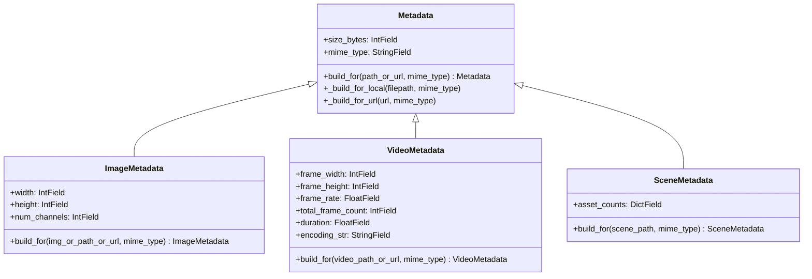
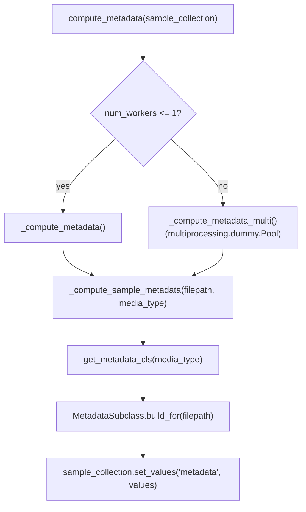
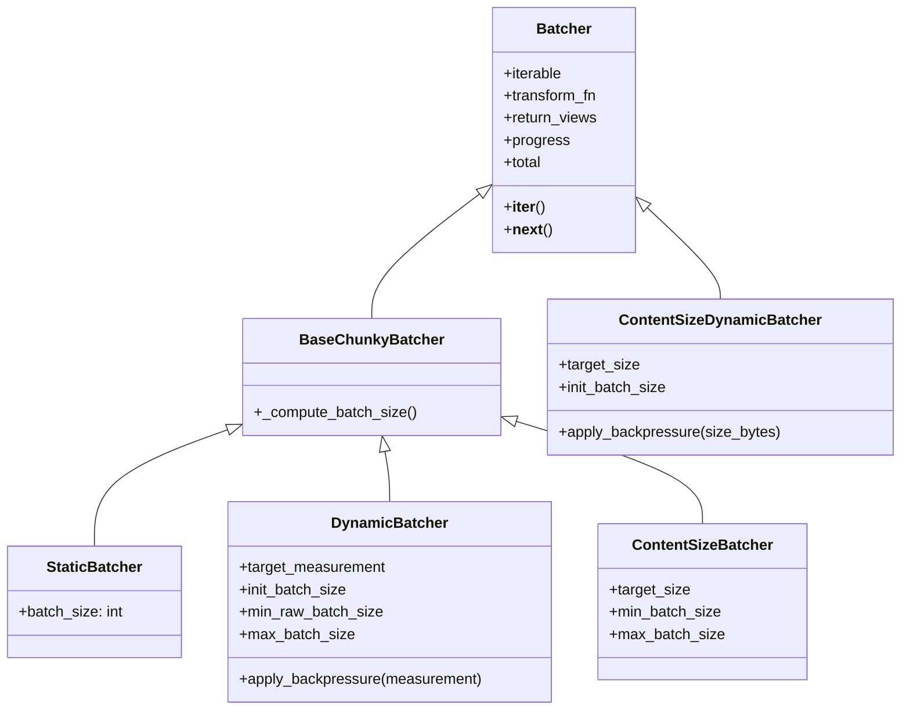
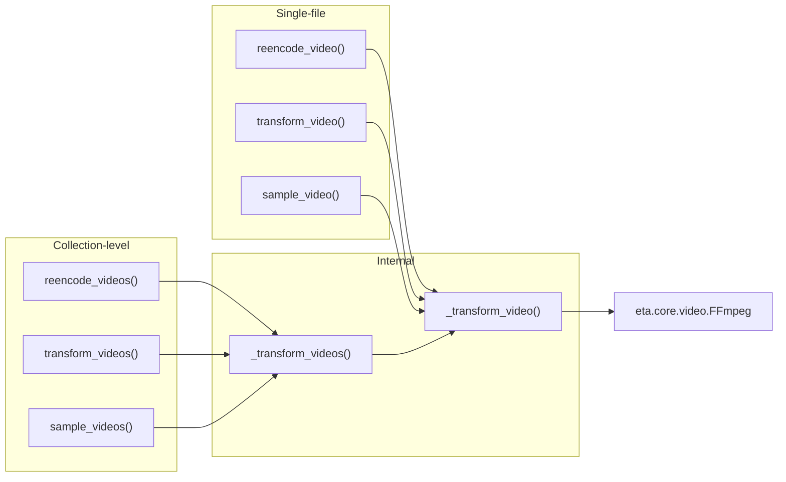
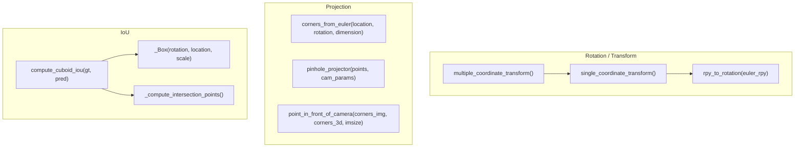
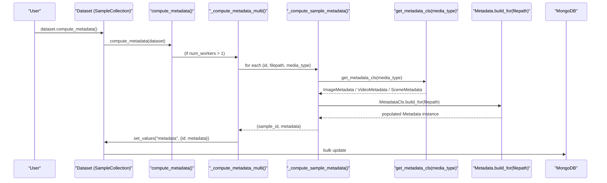

<!-- source: DeepWiki mcp.deepwiki.com · repo voxel51/fiftyone · page 2.4 Core Utilities and Metadata · fetched 2026-10-21 -->

# Core Utilities and Metadata

<details>
<summary>Relevant source files</summary>

The following files were used as context for generating this wiki page:

- [fiftyone/core/metadata.py](fiftyone/core/metadata.py)
- [fiftyone/core/storage.py](fiftyone/core/storage.py)
- [fiftyone/core/utils.py](fiftyone/core/utils.py)
- [fiftyone/utils/data/base.py](fiftyone/utils/data/base.py)
- [fiftyone/utils/image.py](fiftyone/utils/image.py)
- [fiftyone/utils/utils3d.py](fiftyone/utils/utils3d.py)
- [fiftyone/utils/video.py](fiftyone/utils/video.py)
- [tests/intensive/collections_tests.py](tests/intensive/collections_tests.py)
- [tests/intensive/evaluation_tests.py](tests/intensive/evaluation_tests.py)
- [tests/intensive/merge_tests.py](tests/intensive/merge_tests.py)
- [tests/intensive/session_tests.py](tests/intensive/session_tests.py)
- [tests/intensive/video_tests.py](tests/intensive/video_tests.py)
- [tests/intensive/view_tests.py](tests/intensive/view_tests.py)
- [tests/unittests/metadata_tests.py](tests/unittests/metadata_tests.py)
- [tests/unittests/utils3d_tests.py](tests/unittests/utils3d_tests.py)
- [tests/unittests/utils_tests.py](tests/unittests/utils_tests.py)

</details>


This page covers the shared utility infrastructure and media metadata system in FiftyOne. It includes the `fiftyone/core/utils.py` utility library, the `fiftyone/core/metadata.py` class hierarchy, video processing utilities in `fiftyone/utils/video.py`, image utilities in `fiftyone/utils/image.py`, 3D geometry utilities in `fiftyone/utils/utils3d.py`, and file storage helpers in `fiftyone/core/storage.py`.

For information about the label types and field schema system, see [Labels and Fields](#2.3). For the Dataset and SampleCollection APIs that call `compute_metadata()`, see [Datasets and Sample Collections](#2.1).

---

## Metadata Class Hierarchy

Every FiftyOne sample has an optional `metadata` field populated with an instance of a `Metadata` subclass. The class used depends on the sample's media type.

**Metadata class hierarchy diagram**



Sources: [fiftyone/core/metadata.py:31-301]()

All four classes inherit from `DynamicEmbeddedDocument`, making them embeddable MongoDB documents with dynamic field support (see [Labels and Fields](#2.3) for the ODM layer).

### Class Details

| Class | Media Type | Key Fields |
|---|---|---|
| `Metadata` | generic / URL | `size_bytes`, `mime_type` |
| `ImageMetadata` | `image` | + `width`, `height`, `num_channels` |
| `VideoMetadata` | `video` | + `frame_width`, `frame_height`, `frame_rate`, `total_frame_count`, `duration`, `encoding_str` |
| `SceneMetadata` | `3d` | + `asset_counts` (dict of file extension → count) |

### `build_for()` Factory Methods

Each class exposes a `build_for()` classmethod that accepts a local file path or HTTP URL:

- `Metadata.build_for(path_or_url)` — reads file size and guesses MIME type.
- `ImageMetadata.build_for(img_or_path_or_url)` — additionally reads pixel dimensions via `get_image_info()`, which uses PIL's `Image.open()`. JPEG EXIF orientation is handled to return display dimensions, not raw storage dimensions. [fiftyone/core/metadata.py:489-537]()
- `VideoMetadata.build_for(video_path_or_url)` — delegates to `eta.core.video.VideoStreamInfo.build_for()` via ffprobe. [fiftyone/core/metadata.py:193-217]()
- `SceneMetadata.build_for(scene_path)` — parses the `.fo3d` scene to enumerate all referenced asset files and accumulates their sizes. [fiftyone/core/metadata.py:220-300]()

URL requests use `ResponseStream` (from `fiftyone/core/utils.py`) to stream response content without full buffering.

### `get_metadata_cls()`

[fiftyone/core/metadata.py:403-419]()

Returns the correct `Metadata` subclass for a given media type string. Used internally to dispatch `build_for()` calls.

```
fom.IMAGE    → ImageMetadata
fom.VIDEO    → VideoMetadata
fom.THREE_D  → SceneMetadata
(other)      → Metadata
```

---

## Computing Metadata for Collections

**Metadata computation flow diagram**



Sources: [fiftyone/core/metadata.py:422-654]()

`compute_metadata()` is the public entry point. It:

1. Calls `fou.recommend_thread_pool_workers()` to choose parallelism.
2. For group datasets, selects all group slices with `select_group_slices(_allow_mixed=True)` before iterating.
3. Internally uses `_compute_metadata()` (single-threaded) or `_compute_metadata_multi()` (thread pool via `multiprocessing.dummy`).
4. Persists results in batches of 1000 samples via `sample_collection.set_values("metadata", ...)`.
5. After completion, counts and logs samples still missing metadata.

`compute_sample_metadata()` handles a single `Sample` object and calls `sample.save()` if the sample is already in the database.

---

## Core Utilities (`fiftyone/core/utils.py`)

### Dependency and Import Management

| Function | Purpose |
|---|---|
| `ensure_package(requirement_str)` | Checks pip package is installed (by package name) |
| `ensure_import(requirement_str)` | Checks module is importable; enforces version constraints |
| `ensure_tf(eager)` | Verifies TensorFlow; optionally enables eager execution |
| `ensure_tfds()` | Verifies `tensorflow>=1.15` + `tensorflow_datasets` |
| `ensure_torch()` | Verifies `torch` + `torchvision` |
| `install_package(requirement_str)` | Runs `python -m pip install <requirement>` |
| `load_requirements(path)` | Reads `requirements.txt`, strips comments |
| `ensure_requirements(path)` | Calls `ensure_package` for each line |

Sources: [fiftyone/core/utils.py:369-514]()

All checking functions accept an `error_level` parameter:
- `0` → raise on failure
- `1` → log warning
- `2` → ignore

`handle_error(error, error_level)` dispatches between these three behaviors.

The `_REQUIREMENT_ERROR_SUFFIX` string appended to error messages points users to `fiftyone.config.requirement_error_level`. [fiftyone/core/utils.py:87-91]()

### Lazy Module Loading

`lazy_import(module_name)` and `LazyModule` defer an `import` statement until the module attribute is first accessed. This is used throughout the codebase to avoid importing heavy optional dependencies (e.g., `open3d`) at module load time.

[fiftyone/core/utils.py:734-797]()

Example usage in `fiftyone/utils/utils3d.py`:
```
o3d = fou.lazy_import("open3d", callback=lambda: fou.ensure_package("open3d"))
```

### Progress Tracking

`ProgressBar` extends `eta.core.utils.ProgressBar` and integrates with `fiftyone.config.show_progress_bars`. [fiftyone/core/utils.py:952-998]()

Key behavioral differences:
- If `progress` is a callable, it's used as a callback invoked on each iteration update.
- In notebook contexts (`foc.is_notebook_context()`), `max_width=90` is forced.
- `iters_str` defaults to `"samples"`.

`report_progress(progress, n=None, dt=None)` wraps a callback so it is invoked at `n` equally-spaced increments or every `dt` seconds. [fiftyone/core/utils.py:1001-1089]()

### Batching System

**Batcher class hierarchy**



Sources: [fiftyone/core/utils.py:1092-1500]()

`get_default_batcher(iterable, **kwargs)` returns the appropriate batcher based on `fiftyone.config.default_batcher`:

| Config value | Batcher type | Governing config key |
|---|---|---|
| `"static"` | `StaticBatcher` | `batcher_static_size` |
| `"latency"` | `DynamicBatcher` | `batcher_target_latency` |
| `"size"` | `ContentSizeBatcher` | `batcher_target_size_bytes` |

`Batcher` is a context manager and iterator. When used with a `SampleCollection` and `return_views=True`, each batch is yielded as a `DatasetView` rather than a list. Progress bars are only rendered when the batcher is entered as a context manager (`with batcher:`).

### Context Managers

**`LoggingLevel`** — temporarily changes the level of a `logging.Logger`: [fiftyone/core/utils.py:693-731]()

```python
with fou.LoggingLevel(logging.ERROR, logger="fiftyone"):
    ...
```

**`ResourceLimit`** — temporarily changes a `resource` module RLIMIT value (Unix only): [fiftyone/core/utils.py:881-949]()

```python
with fou.ResourceLimit("RLIMIT_NOFILE", soft=4096):
    ...
```

### Field and Path Utilities

`split_frame_fields(fields)` partitions a list or dict of field names into two groups: sample-level fields and frame-level fields (those prefixed with `"frames."`). The `"frames."` prefix is stripped from the returned frame fields. [fiftyone/core/utils.py:170-218]()

### String and Format Utilities

| Function | Purpose |
|---|---|
| `pprint(obj)` / `pformat(obj)` | Pretty-print using `pprintpp` if available, else `pprint` |
| `indent_lines(s, indent, skip)` | Indents lines in a string |
| `justify_headings(elements, width)` | Pads heading strings for alignment |
| `fill_patterns(string)` | Substitutes ETA config patterns |
| `load_xml_as_json_dict(xml_path)` | Parses XML to dict via `xmltodict` |
| `to_slug(name)` | Converts a string to a URL-safe slug |
| `validate_hex_color(color)` | Validates `#RRGGBB` or `#RGB` format |
| `validate_color(color)` | Validates hex or CSS named color |
| `get_module_name(path, base_path)` | Converts a file path to a dotted module name |

Sources: [fiftyone/core/utils.py:140-327]()

### Worker Pool Utilities

`recommend_thread_pool_workers(num_workers)` and `recommend_process_pool_workers(num_workers)` return appropriate worker counts based on CPU count and the provided hint. Used by `compute_metadata()`, image transform functions, and download helpers. [fiftyone/core/utils.py]()

---

## Video Utilities (`fiftyone/utils/video.py`)

**Video utility function map**



Sources: [fiftyone/utils/video.py:29-718]()

### Collection-Level Functions

All three collection-level functions validate their input via `fov.validate_video_collection()` and delegate to `_transform_videos()`.

**`reencode_videos(sample_collection, ...)`**
Re-encodes all videos as H.264 MP4s. Default ffmpeg command:
```
ffmpeg -loglevel error -vsync 0 -i $INPUT \
       -c:v libx264 -preset medium -crf 23 -pix_fmt yuv420p -vsync 0 -an \
       $OUTPUT
```
[fiftyone/utils/video.py:89-177]()

**`transform_videos(sample_collection, fps, min_fps, max_fps, size, min_size, max_size, ...)`**
Applies any combination of frame rate resampling, resolution resizing, and optional re-encoding. [fiftyone/utils/video.py:180-294]()

**`sample_videos(sample_collection, frames_patt, frames, fps, ...)`**
Extracts frames as image files into per-video directories. The default `frames_patt` is constructed from `fiftyone.config.default_sequence_idx + fiftyone.config.default_image_ext`. When `save_filepaths=True`, the output frame paths are written to frame-level fields. [fiftyone/utils/video.py:297-447]()

### Single-File Functions

| Function | Key parameters |
|---|---|
| `reencode_video(input_path, output_path)` | `verbose`, `**kwargs` for `FFmpeg` |
| `transform_video(input_path, output_path)` | `fps`, `min_fps`, `max_fps`, `size`, `min_size`, `max_size`, `reencode` |
| `sample_video(input_path, output_patt)` | `frames`, `fps`, `max_fps`, `size`, `original_frame_numbers` |

### Utility Functions

**`extract_clip(video_path, output_path, support, timestamps, metadata, fast)`**
Clips a video by frame range (`support`) or time range (`timestamps`). When `fast=True`, uses a two-pass strategy (stream copy then decode) for speed at the cost of accuracy. Converts frame range to timestamps using `etaf.frame_number_to_timestamp()` if `VideoMetadata` is provided. [fiftyone/utils/video.py:29-86]()

**`sample_frames_uniform(frame_rate, total_frame_count, support, fps, max_fps, always_sample_last)`**
Returns a list of frame numbers computed via uniform subsampling. Returns `None` if all frames should be sampled. [fiftyone/utils/video.py:601-670]()

**`concat_videos(input_paths, output_path)`**
Concatenates videos using ffmpeg's concat demuxer via a temporary `input_list.txt` file. [fiftyone/utils/video.py:673-690]()

**`exact_frame_count(input_path)`**
Runs ffprobe with `-count_frames` to get an exact frame count. This decodes the entire video and is slow. [fiftyone/utils/video.py:693-717]()

> **Note:** `reencode_videos`, `transform_videos`, and `sample_videos` do **not** update the `metadata` field after transformation. Call `sample_collection.compute_metadata(overwrite=True)` explicitly after any transformation.

---

## Image Utilities (`fiftyone/utils/image.py`)

The image utility module mirrors the structure of the video utility module, with collection-level and single-file variants.

| Function | Description |
|---|---|
| `read(path_or_url, include_alpha, flag)` | Reads image as numpy RGB array via `eta.core.image.read()` |
| `write(img, path)` | Writes numpy array to file via `eta.core.image.write()` |
| `reencode_images(sample_collection, ext, ...)` | Re-encodes all images in collection to `ext` |
| `transform_images(sample_collection, size, ...)` | Resizes/re-encodes images; supports parallel workers |
| `reencode_image(input_path, output_path)` | Single image re-encode |
| `transform_image(input_path, output_path, size, ...)` | Single image resize/transform |

Sources: [fiftyone/utils/image.py:22-266]()

`_transform_images()` uses `fou.recommend_process_pool_workers()` to decide between single-process and multi-process operation. Multi-process execution uses `multiprocessing.Pool`.

---

## 3D Utilities (`fiftyone/utils/utils3d.py`)

### Coordinate and Geometry Functions

**3D utility function map**



Sources: [fiftyone/utils/utils3d.py:116-645]()

**`rpy_to_rotation(euler_rpy)`** — Converts `[roll, pitch, yaw]` Euler angles to a `scipy.spatial.transform.Rotation` using `R.from_euler("zyx", [yaw, pitch, roll])`. [fiftyone/utils/utils3d.py:428-439]()

**`corners_from_euler(location, rotation, dimension)`** — Computes 8 corner points of a 3D cuboid given center, RPY rotation, and `[length, width, height]`. Returns a `3x8` numpy array. [fiftyone/utils/utils3d.py:538-566]()

**`pinhole_projector(points, cam_params, normalize)`** — Projects a `3xN` array of 3D points to 2D using a `3x3` or `4x4` intrinsics matrix from `cam_params["intrinsics"]`. Assumes x-right, y-down, z-forward camera convention. [fiftyone/utils/utils3d.py:569-610]()

**`point_in_front_of_camera(corners_img, corners_3d, imsize)`** — Checks that all projected corners fall within image bounds and have positive z-depth. Returns `True` only when all corners are visible and in front of the camera. [fiftyone/utils/utils3d.py:613-645]()

**`multiple_coordinate_transform(points, euler_rpy, transformation_sequence, forward_transform_flags)`** — Applies a sequence of `(translation, rotation_matrix)` transformations to a point and its orientation. Each step calls `single_coordinate_transform()`. Orientation is tracked via quaternion composition. [fiftyone/utils/utils3d.py:442-489]()

### Cuboid IoU

**`compute_cuboid_iou(gt, pred, gt_crowd)`** computes the 3D volumetric IoU between two `Detection` instances that represent 3D cuboids (with `.rotation`, `.location`, `.dimensions` attributes). [fiftyone/utils/utils3d.py:116-150]()

The internal `_Box` class computes vertices by applying rotation and translation to a scaled unit box (`_UNIT_BOX`). Intersection volume is computed via `scipy.spatial.ConvexHull` on the intersection polygon set computed with the Sutherland-Hodgman algorithm. [fiftyone/utils/utils3d.py:153-425]()

### Scene Asset Paths

**`get_scene_asset_paths(scene_paths, abs_paths, skip_failures, progress)`** — Parses `.fo3d` scene files and returns a dict mapping scene paths to lists of referenced asset paths. Uses `fos.run()` for parallel execution. [fiftyone/utils/utils3d.py:706-747]()

### Orthographic Projection

**`OrthographicProjectionMetadata`** is a `DynamicEmbeddedDocument` that stores the output of an orthographic projection of a 3D point cloud onto a 2D image plane. [fiftyone/utils/utils3d.py:648-671]()

| Field | Type | Description |
|---|---|---|
| `filepath` | `StringField` | Path to the projected image on disk |
| `min_bound` | `ListField(FloatField)` | `[xmin, ymin]` in projection plane coordinates |
| `max_bound` | `ListField(FloatField)` | `[xmax, ymax]` in projection plane coordinates |
| `normal` | `ListField(FloatField)` | Normal vector of projection plane (default `[0,0,1]`) |
| `width` | `IntField` | Image width in pixels |
| `height` | `IntField` | Image height in pixels |

**`compute_orthographic_projection_images(samples, size, output_dir, ...)`** — Computes top-down (or arbitrary normal) orthographic projections of point clouds and writes them as images. Supports group datasets via `in_group_slice` / `out_group_slice`. Results are stored in `metadata_field` (default `"orthographic_projection_metadata"`) on each sample. Requires `open3d`, loaded lazily via `fou.lazy_import()`. [fiftyone/utils/utils3d.py:750+]()

---

## File Storage Utilities (`fiftyone/core/storage.py`)

`fiftyone/core/storage.py` provides a thin local-filesystem abstraction that mirrors cloud storage APIs (for potential extensibility).

**Key components:**

| Symbol | Purpose |
|---|---|
| `FileSystem` enum | Enumerates available backends; currently only `FileSystem.LOCAL` |
| `normalize_path(path)` | `os.path.abspath(os.path.expanduser(path))` |
| `TempDir` | Context manager that creates and deletes a `tempfile.mkdtemp()` dir |
| `open_file(path, mode)` | Opens a local file; supported modes: `r`, `rb`, `w`, `wb` |
| `open_files(paths, mode)` | Batch open, returns `FileCollection` (a list with `__exit__` cleanup) |
| `read_file(path, binary)` | Reads a file to string or bytes |
| `read_files(paths, binary)` | Parallel batch read |
| `write_file(str_or_bytes, path)` | Writes bytes to path, creating parent dirs |
| `run(fn, tasks, progress)` | Runs a function over a list of tasks with optional progress |

Sources: [fiftyone/core/storage.py:34-400]()

Path manipulation functions (`join`, `abspath`, `isabs`, `normpath`, `realpath`, `sep`) are thin wrappers over `os.path` equivalents, matching the API of cloud storage providers.

`make_temp_dir(basedir)` creates a temporary directory under `fiftyone.config.default_dataset_dir` by default. `TempDir` wraps it as a context manager that deletes the directory on exit.

---

## Data Utilities (`fiftyone/utils/data/base.py`)

**`map_values(sample_collection, path, map, progress)`** — Maps field values to new values across all samples and saves to the database immediately (as opposed to `SampleCollection.map_values()` which creates a view). Handles label fields, list fields, and frame fields. When the collection edits an existing field (e.g., via `set_field()`), it falls back to `_map_values_on_edited_field()` to correctly handle view semantics. [fiftyone/utils/data/base.py:29-213]()

**Image/video directory parsing:**

| Function | Returns |
|---|---|
| `parse_images_dir(dataset_dir, recursive)` | List of image paths filtered by MIME type |
| `parse_videos_dir(dataset_dir, recursive)` | List of video paths filtered by MIME type |
| `parse_image_classification_dir_tree(dataset_dir)` | `(samples, classes)` from `<class>/<image>` directory tree |

**`download_images(image_urls, output_dir, num_workers)`** — Downloads images from URLs using thread pool. Filenames are derived from URL basenames. [fiftyone/utils/data/base.py:343-389]()

Sources: [fiftyone/utils/data/base.py]()

---

## How These Components Interact

**End-to-end metadata computation sequence**



Sources: [fiftyone/core/metadata.py:422-654]()

---

