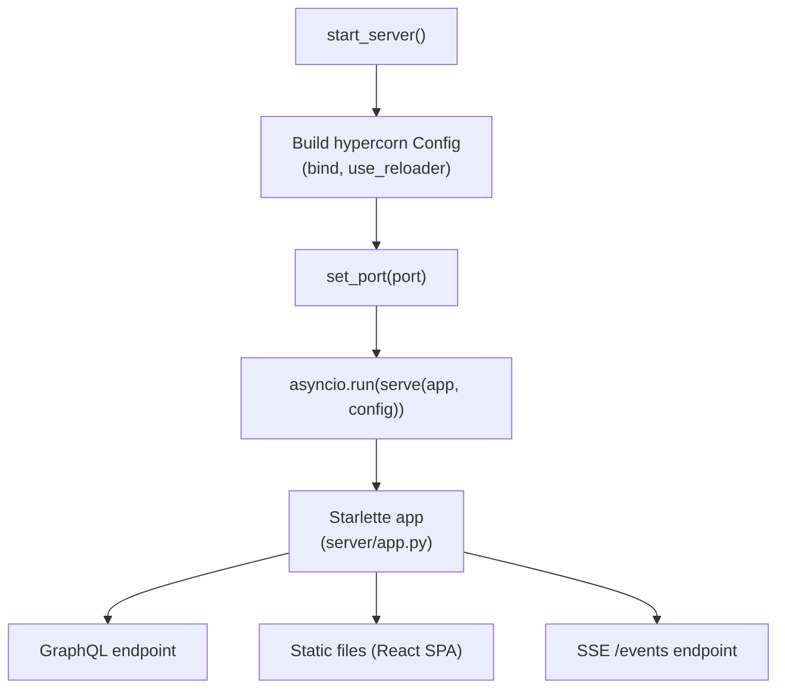
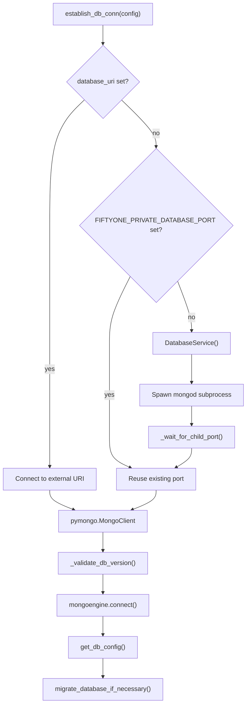
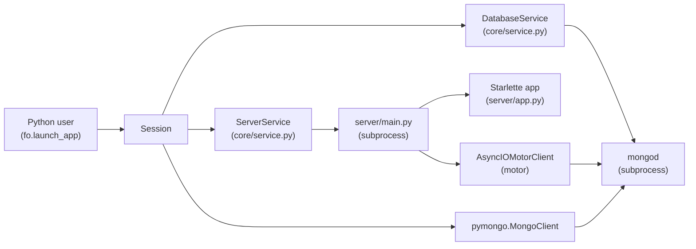
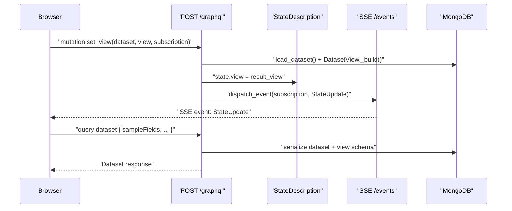
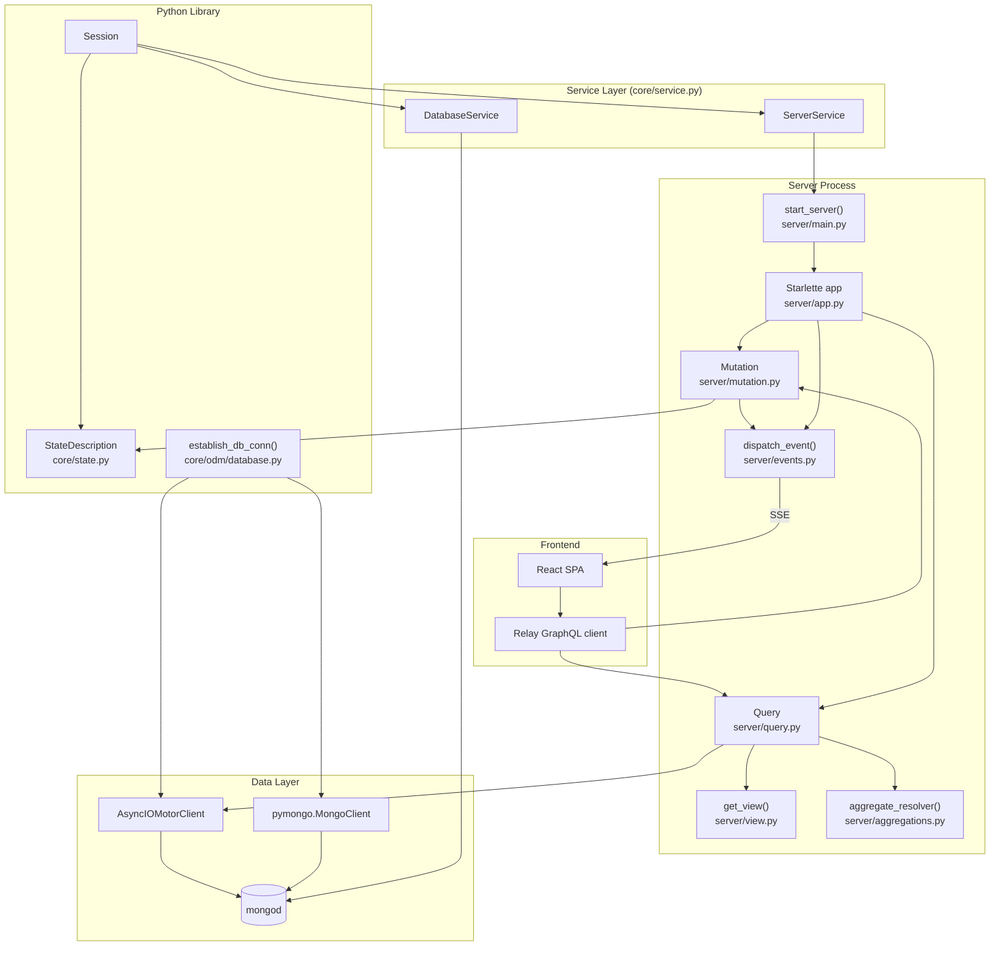

<!-- source: DeepWiki mcp.deepwiki.com · repo voxel51/fiftyone · page 3 Server Architecture · fetched 2026-10-21 -->

# Server Architecture

Relevant source files

The following files were used as context for generating this wiki page:

- [app/packages/core/src/components/Sidebar/Sidebar.tsx](app/packages/core/src/components/Sidebar/Sidebar.tsx)
- [app/packages/state/src/hooks/index.ts](app/packages/state/src/hooks/index.ts)
- [app/packages/state/src/recoil/aggregations.test.ts](app/packages/state/src/recoil/aggregations.test.ts)
- [app/packages/state/src/recoil/aggregations.ts](app/packages/state/src/recoil/aggregations.ts)
- [app/packages/state/src/recoil/atoms.ts](app/packages/state/src/recoil/atoms.ts)
- [app/packages/state/src/recoil/groups.ts](app/packages/state/src/recoil/groups.ts)
- [app/packages/state/src/recoil/labels.ts](app/packages/state/src/recoil/labels.ts)
- [app/packages/state/src/recoil/schema.ts](app/packages/state/src/recoil/schema.ts)
- [app/packages/state/src/recoil/selectors.ts](app/packages/state/src/recoil/selectors.ts)
- [app/packages/state/src/recoil/sidebar.ts](app/packages/state/src/recoil/sidebar.ts)
- [app/packages/state/src/recoil/types.ts](app/packages/state/src/recoil/types.ts)
- [app/schema.graphql](app/schema.graphql)
- [fiftyone/__init__.py](fiftyone/__init__.py)
- [fiftyone/constants.py](fiftyone/constants.py)
- [fiftyone/core/odm/__init__.py](fiftyone/core/odm/__init__.py)
- [fiftyone/core/odm/database.py](fiftyone/core/odm/database.py)
- [fiftyone/core/service.py](fiftyone/core/service.py)
- [fiftyone/core/state.py](fiftyone/core/state.py)
- [fiftyone/core/uid.py](fiftyone/core/uid.py)
- [fiftyone/server/aggregations.py](fiftyone/server/aggregations.py)
- [fiftyone/server/main.py](fiftyone/server/main.py)
- [fiftyone/server/mutation.py](fiftyone/server/mutation.py)
- [fiftyone/server/query.py](fiftyone/server/query.py)
- [fiftyone/server/view.py](fiftyone/server/view.py)
- [tests/unittests/server_view_tests.py](tests/unittests/server_view_tests.py)

This page describes the FiftyOne backend server: how it starts, manages the MongoDB connection, serves the web application, and synchronizes state with the frontend. Subsystem details are covered in:

- [Server Infrastructure and Session Management](#3.1) — Starlette/Hypercorn internals, `DatabaseService` lifecycle, `StateDescription`, and the `Session` API
- [GraphQL API and Query System](#3.2) — Strawberry schema definitions, query/mutation resolvers, aggregation endpoints, and view reconstruction

---

## Overview

The FiftyOne server is an async Python web application served by **Hypercorn** (an ASGI server) using **Starlette** as the application framework. It exposes a **Strawberry GraphQL** API consumed by the React frontend, manages a MongoDB connection, and maintains a singleton `StateDescription` object that represents the shared state between all connected clients and the Python `Session` API.

The server is launched in one of two ways:

1. **Via Python**: A `Session` object calls `fo.launch_app()`, which creates a `ServerService` that spawns the server as a subprocess.
2. **Directly**: Running `python fiftyone/server/main.py` or invoking the `fiftyone app launch` CLI command.

---

## Server Startup

The `start_server()` function in [fiftyone/server/main.py:35-64]() is the canonical entry point.

| Parameter | Default source | Description |
|---|---|---|
| `port` | `fo.config.default_app_port` | TCP port to bind |
| `address` | `fo.config.default_app_address` | Network interface to bind |
| `dataset` | `None` | Dataset path to append to browser URL |
| `clean_start` | `False` | Delete all datasets before starting |
| `open_browser` | `False` | Open a browser window on startup |

On startup, the function:
1. Builds a Hypercorn `Config` with the bind address/port.
2. Calls `set_port(port)` (from `fiftyone/server/events.py`) to register the port for the event system.
3. Sets `config.use_reloader = foc.DEV_INSTALL` to enable hot reloading in development.
4. Calls `asyncio.run(serve(app, config))` to enter the async event loop.

The `app` object is imported from `fiftyone/server/app.py` and is the Starlette application instance that mounts all route handlers.

**Server startup flow:**

Sources: [fiftyone/server/main.py:35-64](), [fiftyone/constants.py:59-63]()

---

## MongoDB Connection

MongoDB connectivity is established by `establish_db_conn()` in [fiftyone/core/odm/database.py:168-240](). It supports two modes:

| Mode | Condition | Mechanism |
|---|---|---|
| **Managed** | `fo.config.database_uri` is unset | Starts a `DatabaseService` subprocess running `mongod` |
| **External** | `fo.config.database_uri` is set | Connects directly to the provided URI |

### DatabaseService

`DatabaseService` in [fiftyone/core/service.py:223-292]() is a `MultiClientService` subclass that manages a bundled `mongod` binary. It starts `mongod` with `--port 0` (OS-assigned port) and discovers the assigned port via `_wait_for_child_port()`. The port is stored in the environment variable `FIFTYONE_PRIVATE_DATABASE_PORT` so that subsequent processes in the same session can attach to the same instance without starting a new one.

Multiple Python processes can register with the same `DatabaseService` via IPC. When the last client disconnects, `_delete_non_persistent_datasets_if_allowed()` runs cleanup.

### Client Singletons

Three module-level singletons in `fiftyone/core/odm/database.py` hold the connection state:

| Variable | Type | Purpose |
|---|---|---|
| `_client` | `pymongo.MongoClient` | Synchronous client for Python library operations |
| `_async_client` | `AsyncIOMotorClient` | Async client for server request handlers |
| `_db_service` | `DatabaseService` | Reference to the managed `mongod` process |

The helper functions `get_db_conn()` and `get_async_db_conn()` are the standard access points used throughout the codebase for synchronous and asynchronous database access, respectively.

### Validation and Migrations

After connecting, `establish_db_conn()`:
1. Validates `mongod` version against `MONGODB_MIN_VERSION = Version("6.0")` ([fiftyone/constants.py:104]()).
2. Checks that `db_config.type` matches `foc.CLIENT_TYPE = "fiftyone"` ([fiftyone/constants.py:17]()).
3. Runs `fom.migrate_database_if_necessary()` to apply any pending schema migrations.

**MongoDB connection flow:**

Sources: [fiftyone/core/odm/database.py:168-240](), [fiftyone/core/service.py:223-292]()

---

## Shared State: StateDescription

`StateDescription` in [fiftyone/core/state.py:34-207]() is the singleton object that represents the complete, shared application state. It is read by GraphQL query resolvers and written by mutation handlers and the Python `Session` API.

### Fields

| Field | Type | Description |
|---|---|---|
| `dataset` | `Dataset` | Currently active dataset (or `None`) |
| `view` | `DatasetView` | Active view pipeline (or `None` for full dataset) |
| `config` | `AppConfig` | Application configuration |
| `color_scheme` | `ColorScheme` | Active color scheme |
| `selected` | `List[str]` | Sample IDs currently selected in the UI |
| `selected_labels` | `List[dict]` | Labels currently selected in the UI |
| `spaces` | `Space` | Workspace panel layout |
| `group_slice` | `str` | Active slice name for grouped datasets |
| `sample_id` | `str` | Active sample (expanded modal) |
| `field_visibility_stage` | `dict` | Active field visibility filter stage |

### Serialization

`StateDescription.serialize()` produces a JSON-compatible dict used by mutation handlers to dispatch `StateUpdate` events to the frontend. It includes the dataset name, serialized view stages, field schemas (`sample_fields`, `frame_fields`), color scheme, and spaces configuration.

`StateDescription.from_dict()` reconstructs the object from a serialized dict, including re-loading the `Dataset` from MongoDB and rebuilding the `DatasetView` from its serialized stages via `fov.DatasetView._build()`.

Sources: [fiftyone/core/state.py:34-207]()

---

## Service Architecture

The full service dependency graph, from a Python user's perspective:

`ServerService` [fiftyone/core/service.py:295-367]() starts the server subprocess by running `sys.executable main.py --port <port>`. It then calls `_wait_for_child_port(port=port)` to block until the server is ready before returning control to the caller.

Sources: [fiftyone/core/service.py:56-367](), [fiftyone/server/main.py:35-64]()

---

## GraphQL API

The GraphQL schema is implemented with **Strawberry** (`strawberry-graphql`). The two root types are:

| Root type | Class | File |
|---|---|---|
| `Query` | `Query` | `fiftyone/server/query.py` |
| `Mutation` | `Mutation` | `fiftyone/server/mutation.py` |

The complete generated schema is in `app/schema.graphql`.

### Query

The `Query` class in [fiftyone/server/query.py:401-571]() extends `fosa.AggregateQuery` and provides resolvers including:

| Field | Description |
|---|---|
| `dataset(name)` | Load a dataset with optional saved view or staged view |
| `datasets` | Paginated list of datasets |
| `samples(...)` | Paginated sample results with filters |
| `aggregations(form)` | Run field aggregations |
| `config` | Current `AppConfig` |
| `saved_views(dataset_name)` | List saved views for a dataset |
| `schema_for_view_stages(...)` | Compute field schema for a given view |

### Mutation

The `Mutation` class in [fiftyone/server/mutation.py:68-466]() handles state-changing operations. Each mutation that modifies global state calls `dispatch_event()` to push a `StateUpdate` to connected clients:

| Mutation | Effect |
|---|---|
| `set_dataset` | Switch active dataset |
| `set_view` | Apply a new view pipeline |
| `set_selected` | Update selected sample IDs |
| `set_selected_labels` | Update selected labels |
| `create_saved_view` | Save a named view |
| `delete_saved_view` | Remove a saved view |
| `set_spaces` | Update workspace layout |
| `set_sidebar_groups` | Persist sidebar group ordering |

For detailed resolver documentation, see [GraphQL API and Query System](#3.2).

---

## Frontend-Backend State Synchronization

The frontend communicates with the server using two mechanisms:

1. **GraphQL over HTTP** (`/graphql`) — for queries and mutations, managed by the Relay client in the React app.
2. **Server-Sent Events (SSE)** (`/events`) — for real-time push notifications from server to browser.

When a mutation modifies state, the following sequence occurs:

The `subscription` parameter is a UUID generated by the frontend (`stateSubscription` selector in `app/packages/state/src/recoil/selectors.ts`). It scopes events to a specific browser tab or Python session, allowing multiple independent clients to coexist.

Sources: [fiftyone/server/mutation.py:198-277](), [fiftyone/core/state.py:94-144](), [app/packages/state/src/recoil/selectors.ts:65-72]()

---

## Full Component Map

The diagram below maps architectural roles to their primary code entities:

Sources: [fiftyone/server/main.py](), [fiftyone/server/query.py](), [fiftyone/server/mutation.py](), [fiftyone/core/service.py](), [fiftyone/core/state.py](), [fiftyone/core/odm/database.py]()

---

