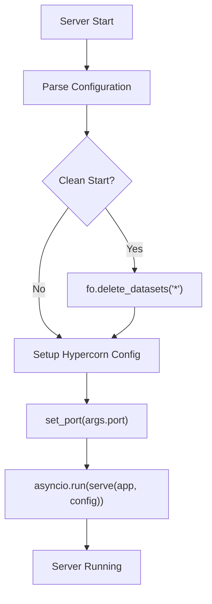
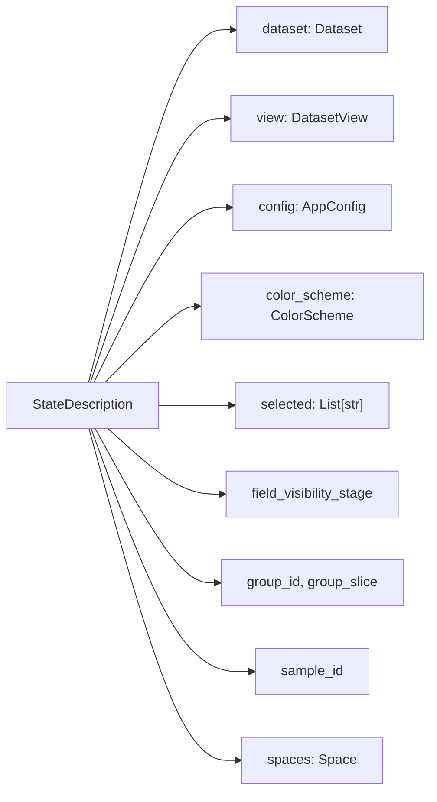
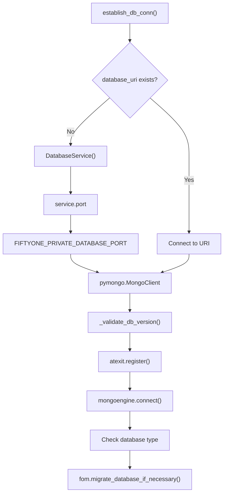
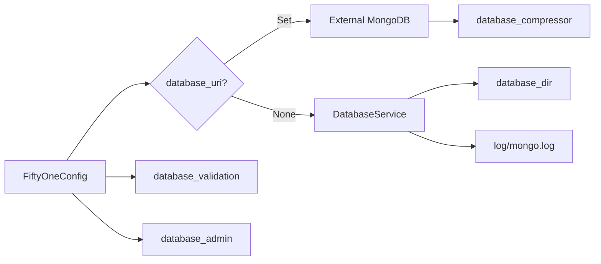

<!-- source: DeepWiki mcp.deepwiki.com · repo voxel51/fiftyone · page 3.1 Server Infrastructure and Session Management · fetched 2026-10-21 -->

# Server Infrastructure and Session Management

<details>
<summary>Relevant source files</summary>

The following files were used as context for generating this wiki page:

- [app/packages/app/src/index.tsx](app/packages/app/src/index.tsx)
- [app/packages/state/src/hooks/useScreenshot.ts](app/packages/state/src/hooks/useScreenshot.ts)
- [fiftyone/__init__.py](fiftyone/__init__.py)
- [fiftyone/constants.py](fiftyone/constants.py)
- [fiftyone/core/context.py](fiftyone/core/context.py)
- [fiftyone/core/odm/__init__.py](fiftyone/core/odm/__init__.py)
- [fiftyone/core/odm/database.py](fiftyone/core/odm/database.py)
- [fiftyone/core/service.py](fiftyone/core/service.py)
- [fiftyone/core/session/client.py](fiftyone/core/session/client.py)
- [fiftyone/core/session/events.py](fiftyone/core/session/events.py)
- [fiftyone/core/session/notebooks.py](fiftyone/core/session/notebooks.py)
- [fiftyone/core/session/session.py](fiftyone/core/session/session.py)
- [fiftyone/core/session/templates.py](fiftyone/core/session/templates.py)
- [fiftyone/core/state.py](fiftyone/core/state.py)
- [fiftyone/core/uid.py](fiftyone/core/uid.py)
- [fiftyone/server/main.py](fiftyone/server/main.py)
- [fiftyone/server/routes/event.py](fiftyone/server/routes/event.py)
- [fiftyone/server/routes/events.py](fiftyone/server/routes/events.py)

</details>


This document covers FiftyOne's server infrastructure, session management, and database connectivity systems. It explains how the FiftyOne server starts up, manages client sessions, handles state synchronization between frontend and backend, and establishes database connections.

For information about the GraphQL API and query system that runs on top of this infrastructure, see [GraphQL API and Query System](#3.2).

## Server Startup Process

FiftyOne's server infrastructure is built around an ASGI application using Hypercorn as the server implementation. The main server entry point handles configuration, service initialization, and application lifecycle management.

### Main Server Entry Point

The server startup process begins in [fiftyone/server/main.py:1-51](), which:

- Configures the Hypercorn ASGI server with address and port settings
- Sets up debug logging based on configuration
- Optionally performs clean startup by deleting existing datasets
- Launches the Starlette application imported from `fiftyone.server.app`



**Server Startup Sequence**
Sources: [fiftyone/server/main.py:33-50]()

### Environment and Configuration

The server sets several environment variables during startup:
- `FIFTYONE_SERVER=1` - Identifies the process as a FiftyOne server
- Optionally disables services via `FIFTYONE_DISABLE_SERVICES`
- Configures database port via `FIFTYONE_PRIVATE_DATABASE_PORT`

Sources: [fiftyone/server/main.py:17-21](), [fiftyone/core/config.py:371-372]()

## Service Architecture

FiftyOne uses a service-oriented architecture where different components are managed as independent services that can be started, stopped, and coordinated.

### Service Base Classes

The service system is built around several base classes defined in [fiftyone/core/service.py:56-222]():

```mermaid
graph TD
    Service["`Service`<br/>Base service interface"] 
    MultiClientService["`MultiClientService`<br/>Supports multiple clients"]
    DatabaseService["`DatabaseService`<br/>MongoDB management"]
    ServerService["`ServerService`<br/>Web server management"]
    
    Service --> MultiClientService
    MultiClientService --> DatabaseService
    Service --> ServerService
```

**Service Class Hierarchy**
Sources: [fiftyone/core/service.py:56-368]()

### Database Service

The `DatabaseService` manages MongoDB instances and handles database lifecycle:

- **Executable Discovery**: Locates `mongod` executable in `fiftyone.db.bin`
- **Process Management**: Starts MongoDB with custom configuration
- **Port Management**: Uses dynamic port allocation (port 0)
- **Multi-client Support**: Allows multiple FiftyOne processes to share database

Key characteristics:
- Service name: `"db"`
- Allows headless operation
- Uses `sudo` in Colab/Databricks environments
- Configurable database directory and log paths

Sources: [fiftyone/core/service.py:223-293]()

### Server Service

The `ServerService` manages the FiftyOne web server:

- **Version Checking**: Detects existing server instances
- **Port Binding**: Waits for successful port binding
- **Client Coordination**: Handles multiple client connections

Sources: [fiftyone/core/service.py:295-368]()

## Session State Management

FiftyOne maintains synchronized state between the frontend application and backend services through the `StateDescription` class and related mechanisms.

### State Description Structure

The `StateDescription` class [fiftyone/core/state.py:34-208]() manages all aspects of session state:



**State Description Components**
Sources: [fiftyone/core/state.py:38-67]()

### State Serialization

The state management system provides bidirectional serialization for client-server communication:

**Serialization Process**:
- Converts complex objects to JSON-serializable dictionaries
- Handles dataset/view references by name and serialized stages
- Includes field schemas for both sample and frame fields
- Preserves color schemes, visibility settings, and workspace configurations

**Deserialization Process**:
- Reconstructs dataset objects from names
- Rebuilds views from serialized stage definitions
- Restores configuration objects and workspace layouts

Sources: [fiftyone/core/state.py:94-207]()

### Field Schema Management

The session state includes comprehensive field schema information:

```python
# Sample fields serialization
d["sample_fields"] = [
    asdict(field) for field in serialize_fields(
        collection.get_field_schema(flat=True)
    )
]

# Frame fields serialization  
d["frame_fields"] = [
    asdict(field) for field in serialize_fields(
        collection.get_frame_field_schema(flat=True)
    )
]
```

The `serialize_fields` function [fiftyone/core/state.py:221-263]() converts MongoDB field definitions into structured data including field types, paths, embedded document types, and metadata.

Sources: [fiftyone/core/state.py:117-128](), [fiftyone/core/state.py:221-263]()

## Database Connectivity

FiftyOne's database connectivity system manages both synchronous and asynchronous connections to MongoDB, handles connection pooling, and provides database lifecycle management.

### Connection Management

The database connection system uses global connection objects and provides both sync and async access:



**Database Connection Establishment**
Sources: [fiftyone/core/odm/database.py:168-239]()

### Connection Pooling

The system maintains global connection objects:
- `_client`: Synchronous PyMongo client
- `_async_client`: Asynchronous Motor client  
- `_connection_kwargs`: Shared connection parameters

Connection functions provide access:
- `get_db_client()`: Returns sync MongoDB client
- `get_db_conn()`: Returns sync database connection
- `get_async_db_client()`: Returns async Motor client
- `get_async_db_conn()`: Returns async database connection

Sources: [fiftyone/core/odm/database.py:52-56](), [fiftyone/core/odm/database.py:468-525]()

### Database Configuration

The database system uses a configuration document to track database version and client type compatibility:

```python
@dataclasses.dataclass(init=False)
class DatabaseConfigDocument:
    version: str  # Database schema version
    type: str     # Client type (e.g., "fiftyone")
```

This ensures compatibility between different FiftyOne client versions and prevents schema conflicts.

Sources: [fiftyone/core/odm/database.py:75-143]()

### Connection Options and Timezone Handling

The system supports various MongoDB connection options:
- **Compression**: Configurable via `database_compressor` (zstd, zlib, snappy)
- **Timezone Awareness**: Automatic timezone conversion using `CodecOptions`
- **Validation**: Optional database version validation

Sources: [fiftyone/core/odm/database.py:511-525](), [fiftyone/core/config.py:66-80]()

## Configuration Management

FiftyOne's configuration system provides centralized management of server, database, and application settings through environment variables and configuration files.

### Configuration Classes

The configuration system uses several specialized classes:

- **`FiftyOneConfig`**: Core FiftyOne settings including database, directories, and performance options
- **`AppConfig`**: Application-specific settings for UI behavior, themes, and visualization
- **`AnnotationConfig`**: Configuration for external annotation tool integrations

Sources: [fiftyone/core/config.py:59-380](), [fiftyone/core/config.py:388-597]()

### Server-Specific Configuration

Key server configuration options include:

| Setting | Environment Variable | Default | Purpose |
|---------|---------------------|---------|----------|
| `default_app_port` | `FIFTYONE_DEFAULT_APP_PORT` | `5151` | Server listening port |
| `default_app_address` | `FIFTYONE_DEFAULT_APP_ADDRESS` | `localhost` | Server bind address |
| `database_uri` | `FIFTYONE_DATABASE_URI` | `None` | MongoDB connection string |
| `database_name` | `FIFTYONE_DATABASE_NAME` | `fiftyone` | Database name |
| `singleton_cache` | `FIFTYONE_SINGLETON_CACHE` | `True` | Object caching (disabled for server) |

Sources: [fiftyone/core/config.py:207-218](), [fiftyone/core/config.py:371-372]()

### Database Connection Configuration



**Database Configuration Options**
Sources: [fiftyone/core/config.py:66-98]()

The server automatically disables singleton caching when `FIFTYONE_SERVER=1` is set, optimizing for multi-client scenarios where object caching could cause stale data issues.

Sources: [fiftyone/core/config.py:371-372]()

---

