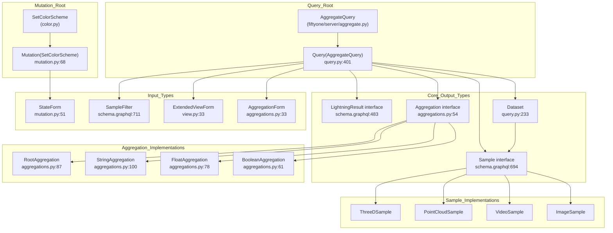
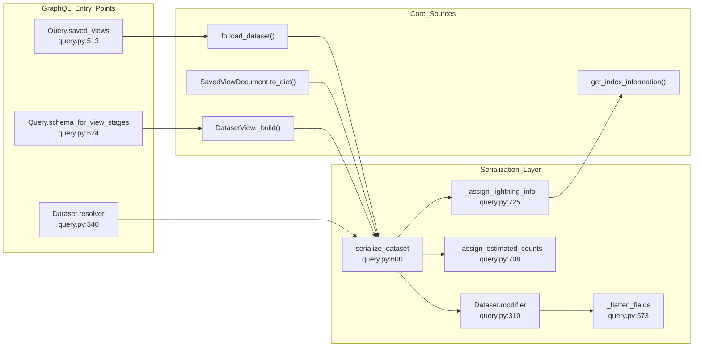
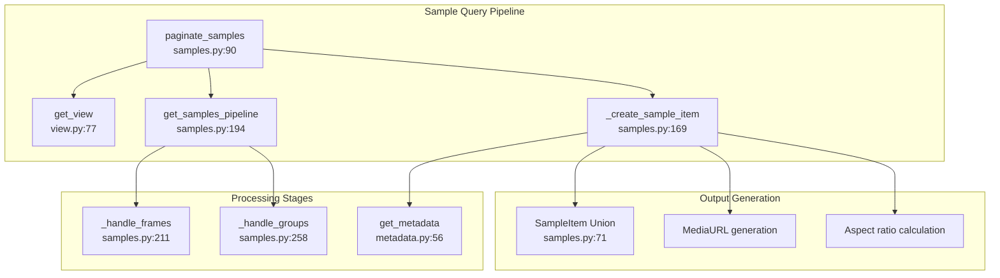
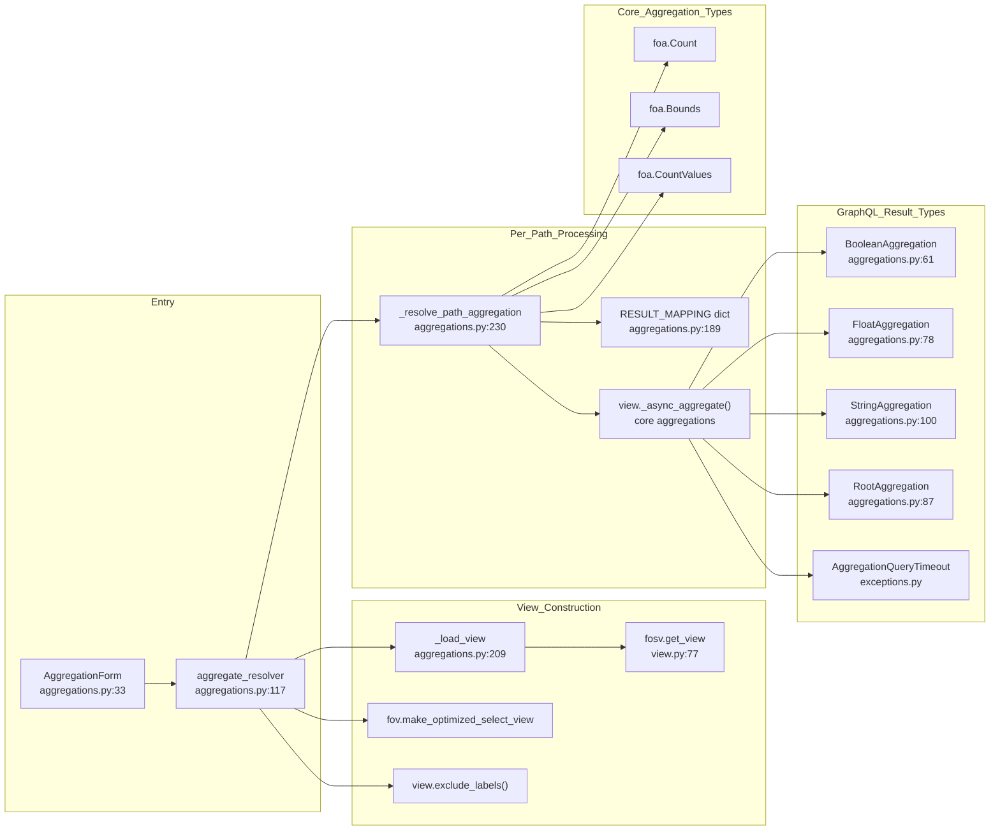
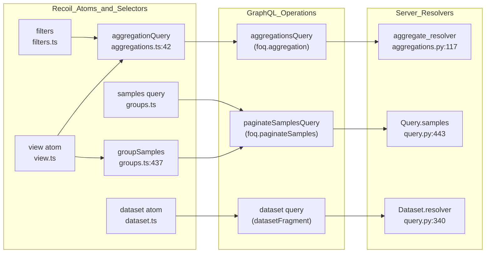

<!-- source: DeepWiki mcp.deepwiki.com · repo voxel51/fiftyone · page 3.2 GraphQL API and Query System · fetched 2026-10-21 -->

# GraphQL API and Query System

Relevant source files

The following files were used as context for generating this wiki page:

- [app/packages/core/src/components/Sidebar/Sidebar.tsx](app/packages/core/src/components/Sidebar/Sidebar.tsx)
- [app/packages/state/src/hooks/index.ts](app/packages/state/src/hooks/index.ts)
- [app/packages/state/src/recoil/aggregations.test.ts](app/packages/state/src/recoil/aggregations.test.ts)
- [app/packages/state/src/recoil/aggregations.ts](app/packages/state/src/recoil/aggregations.ts)
- [app/packages/state/src/recoil/atoms.ts](app/packages/state/src/recoil/atoms.ts)
- [app/packages/state/src/recoil/groups.ts](app/packages/state/src/recoil/groups.ts)
- [app/packages/state/src/recoil/labels.ts](app/packages/state/src/recoil/labels.ts)
- [app/packages/state/src/recoil/schema.ts](app/packages/state/src/recoil/schema.ts)
- [app/packages/state/src/recoil/selectors.ts](app/packages/state/src/recoil/selectors.ts)
- [app/packages/state/src/recoil/sidebar.ts](app/packages/state/src/recoil/sidebar.ts)
- [app/packages/state/src/recoil/types.ts](app/packages/state/src/recoil/types.ts)
- [app/schema.graphql](app/schema.graphql)
- [fiftyone/server/aggregations.py](fiftyone/server/aggregations.py)
- [fiftyone/server/mutation.py](fiftyone/server/mutation.py)
- [fiftyone/server/query.py](fiftyone/server/query.py)
- [fiftyone/server/view.py](fiftyone/server/view.py)
- [tests/unittests/server_view_tests.py](tests/unittests/server_view_tests.py)

This document covers FiftyOne's GraphQL API layer, which serves as the primary interface between the web frontend and the Python backend. The system provides real-time queries for datasets, samples, aggregations, and metadata through a comprehensive GraphQL schema and resolver architecture.

For information about the underlying data models and persistence layer, see [Core Data Model](#2). For details about the frontend state management that consumes this API, see [Frontend Architecture](#4).

## Schema Architecture

The GraphQL API is built using Strawberry GraphQL and defines a comprehensive schema for querying FiftyOne datasets and samples. The schema is organized around several core types that mirror the backend data structures.

**GraphQL type hierarchy and key file locations**

The schema defines two main entry points: the `Query` type for data retrieval and the `Mutation` type for state changes. Real-time updates use a separate SSE event system (see page 3.1), not GraphQL subscriptions. The `Query` class in [fiftyone/server/query.py:401-571]() inherits from `AggregateQuery` (defined in `fiftyone/server/aggregate.py`), which provides the legacy `aggregate` field. The `Mutation` class in [fiftyone/server/mutation.py:68-479]() inherits from `SetColorScheme` for color scheme operations.

Sources: [app/schema.graphql:616-667](), [fiftyone/server/query.py:401-571](), [fiftyone/server/mutation.py:68-479](), [fiftyone/server/aggregations.py:53-115]()

## Core Query System Components

The query system is built around several key resolver components that handle different aspects of data retrieval and processing.

### Dataset Resolver

The `Dataset` resolver serves as the primary entry point for dataset queries, handling serialization of dataset metadata, field schemas, and view configurations.

**`Dataset` serialization pipeline**

`Dataset.resolver` [fiftyone/server/query.py:340-354]() calls `serialize_dataset` [fiftyone/server/query.py:600-705]() which:
1. Loads the dataset via `fo.load_dataset()` and optionally a saved view by slug.
2. Builds a `DatasetView` from the serialized stages in the request.
3. Calls `Dataset.modifier` [fiftyone/server/query.py:310-338]() to flatten MongoDB document fields (`_flatten_fields`), convert mask targets, and normalize brain methods/evaluations.
4. Serializes the field schema from the resolved view (not just the base dataset).
5. Assigns estimated document counts and MongoDB index information.

Additional dataset-related query fields on `Query`:

| Field | Description | Location |
|-------|-------------|----------|
| `dataset` | Full dataset metadata for a given name + view | [query.py:435]() |
| `datasets` | Paginated list of all datasets | [query.py:436-440]() |
| `saved_views` | Saved views for a dataset | [query.py:513-521]() |
| `schema_for_view_stages` | Field schema after applying view stages | [query.py:524-570]() |
| `stage_definitions` | Available view stage definitions for the UI | [query.py:502]() |

Sources: [fiftyone/server/query.py:310-354](), [fiftyone/server/query.py:513-570](), [fiftyone/server/query.py:600-731]()

### Sample Pagination System

The sample pagination system handles efficient querying and streaming of large sample collections with support for filtering, sorting, and metadata resolution.

The pagination system uses MongoDB aggregation pipelines for efficient data retrieval and supports complex filtering through the view system. Media metadata is resolved asynchronously for optimal performance.

Sources: [fiftyone/server/samples.py:90-167](), [fiftyone/server/view.py:77-161](), [fiftyone/server/samples.py:194-264](), [fiftyone/server/metadata.py:56-136]()

### Aggregation Query System

The aggregation system provides statistical summaries and field value distributions for dataset analysis and filtering UI components. There are two aggregation endpoints on `Query`:

- `aggregations(form: AggregationForm!)` — The primary endpoint used by the frontend. Defined in [fiftyone/server/aggregations.py]() and referenced from `Query` at [fiftyone/server/query.py:402]().
- `aggregate(datasetName, view, aggregations, ...)` — A legacy endpoint provided by the `AggregateQuery` base class in `fiftyone/server/aggregate.py`.

**`aggregate_resolver` execution path**

`_resolve_path_aggregation` [fiftyone/server/aggregations.py:230-330]() determines which core aggregations to run based on field type using `RESULT_MAPPING` [fiftyone/server/aggregations.py:189-207](). For each path, it always runs `foa.Count` and conditionally adds `foa.Bounds` (numeric/date fields) or `foa.CountValues` (boolean/string fields). When `query_performance` is enabled, it skips the extra aggregations and passes an index `hint` to `foa.Count`.

The `max_query_time` parameter (in seconds) is converted to milliseconds for MongoDB's `maxTimeMS` option. On timeout, each path returns an `AggregationQueryTimeout` result rather than raising an exception.

Sources: [fiftyone/server/aggregations.py:117-186](), [fiftyone/server/aggregations.py:189-330](), [fiftyone/server/query.py:401-403]()

## View System and Filtering

The view system provides a filtering and transformation layer that sits between the GraphQL resolvers and the underlying MongoDB collections. Two primary entry points exist in [fiftyone/server/view.py]():

- `load_view` [fiftyone/server/view.py:40-74]() — async, used by mutations and the operator framework. Accepts an `ExtendedViewForm` input type.
- `get_view` [fiftyone/server/view.py:77-161]() — sync (with `awaitable=True` option), used by query resolvers and aggregations.

### View Construction Pipeline

**`get_view` and `get_extended_view` execution path**

```mermaid
graph TB
    subgraph "Entry_Points"
        LoadView["load_view()\nview.py:40"]
        GetView["get_view()\nview.py:77"]
    end
    subgraph "Base_View_Construction"
        BuildView["DatasetView._build(dataset, stages)\ncore/view.py"]
        LoadSaved["dataset.load_saved_view(view_name)"]
        GetDynGroup["view.get_dynamic_group(dynamic_group)"]
        HandleGroup["handle_group_filter()\nview.py:265"]
        MakeOptSelect["fov.make_optimized_select_view()"]
    end
    subgraph "Extended_View_via_get_extended_view"
        GetExtView["get_extended_view()\nview.py:163"]
        ExtendView["extend_view()\nview.py:247"]
        MatchTags["view.match_tags()"]
        MatchLabelTags["_match_label_tags()\nview.py:965"]
        ProjPagination["_project_pagination_paths()\nview.py:375"]
        AddLabelTagCounts["_add_labels_tags_counts()\nview.py:352"]
    end
    subgraph "Filter_Stage_Generation"
        MakeMatch["_make_match_stage()\nview.py:416"]
        MakeFieldFilter["_make_field_filter_stages()\nview.py:445"]
        MakeLabelFilter["_make_label_filter_stages()\nview.py:473"]
        IterPaths["_iter_paths()\nview.py:523"]
    end
    subgraph "Emitted_ViewStages"
        MatchS["fosg.Match"]
        FilterLabelsS["fosg.FilterLabels"]
        SetFieldS["fosg.SetField"]
        FilterKeypointsS["fosg.FilterKeypoints"]
        SelectFieldsS["fosg.SelectFields"]
    end

    LoadView --> GetView
    GetView --> BuildView
    GetView --> LoadSaved
    GetView --> GetDynGroup
    GetView --> HandleGroup
    GetView --> MakeOptSelect
    GetView --> GetExtView
    GetExtView --> ExtendView
    GetExtView --> MatchTags
    GetExtView --> MatchLabelTags
    GetExtView --> MakeMatch
    GetExtView --> MakeFieldFilter
    GetExtView --> MakeLabelFilter
    GetExtView --> ProjPagination
    ProjPagination --> SelectFieldsS
    GetExtView --> AddLabelTagCounts
    MakeMatch --> IterPaths
    MakeFieldFilter --> IterPaths
    MakeLabelFilter --> IterPaths
    MakeMatch --> MatchS
    MakeFieldFilter --> SetFieldS
    MakeLabelFilter --> FilterLabelsS
    MakeLabelFilter --> FilterKeypointsS
```

`get_extended_view` [fiftyone/server/view.py:163-244]() applies App-defined filter specifications on top of a base view. The `filters` dict from the frontend is parsed by `_iter_paths` [fiftyone/server/view.py:523-552]() which classifies paths as label fields or primitive fields, then dispatches to `_make_match_stage`, `_make_field_filter_stages`, or `_make_label_filter_stages`.

When `pagination_data=True`, `_project_pagination_paths` [fiftyone/server/view.py:375-413]() excludes `DictField` values for grid performance and adds a `SelectFields` stage. `_add_labels_tags_counts` [fiftyone/server/view.py:352-372]() accumulates label tag counts into `_label_tags` for display in the sidebar.

`extend_view` [fiftyone/server/view.py:247-262]() processes the `extended_stages` dict (keyed by fully-qualified class name, e.g. `"fiftyone.core.stages.SortBySimilarity"`) and reconstructs stage objects via `fosg.ViewStage._from_dict`.

Sources: [fiftyone/server/view.py:40-161](), [fiftyone/server/view.py:163-262](), [fiftyone/server/view.py:352-552]()

## Mutation Resolvers

The `Mutation` type in [fiftyone/server/mutation.py:68-479]() is the primary mechanism for state changes. It inherits from `SetColorScheme` [fiftyone/server/color.py]() which adds `set_color_scheme` and `set_dataset_color_scheme`. All mutations accept a `subscription` string and optional `session` string, which are used to route `dispatch_event` calls to the correct SSE subscriber (see page 3.1).

| Mutation | Description | Location |
|----------|-------------|----------|
| `set_dataset` | Loads a dataset, resets view/selection/spaces state | [mutation.py:83-110]() |
| `set_view` | Builds a view from stages + `StateForm`, dispatches `StateUpdate` | [mutation.py:199-277]() |
| `create_saved_view` | Saves a named view, returns `SavedView` | [mutation.py:280-328]() |
| `delete_saved_view` | Deletes a saved view by name | [mutation.py:331-368]() |
| `update_saved_view` | Updates name/description/color of a saved view | [mutation.py:372-421]() |
| `set_group_slice` | Changes active group slice | [mutation.py:112-119]() |
| `set_sample` | Sets focused sample/group | [mutation.py:122-134]() |
| `set_sidebar_groups` | Persists sidebar group paths to `dataset.app_config` | [mutation.py:136-169]() |
| `set_selected` | Updates selected sample IDs | [mutation.py:172-181]() |
| `set_selected_labels` | Updates selected label IDs | [mutation.py:184-196]() |
| `set_spaces` | Updates panel layout `Space` | [mutation.py:423-433]() |
| `set_field_visibility_stage` | Applies field visibility filter stage | [mutation.py:70-80]() |
| `search_select_fields` | Returns field paths matching a meta-filter | [mutation.py:436-466]() |

`set_view` [fiftyone/server/mutation.py:199-277]() is the most complex mutation. It:
1. Optionally loads a saved view if `saved_view_slug` is provided.
2. Otherwise, calls `get_view` with stages, filters, extended stages, and group slice from the `StateForm`.
3. Handles a special case for group datasets with conversion stages (e.g. `ToClips`, `ToPatches`).
4. Calls `_build_result_view` [fiftyone/server/mutation.py:469-478]() to apply `sample_ids` selection and `add_stages`.
5. Dispatches `fose.StateUpdate` to synchronize state with the frontend.

Sources: [fiftyone/server/mutation.py:68-479]()

## Frontend Integration

The GraphQL API integrates with the React frontend through a state management system built on Recoil and Relay.

### Query Integration Pattern

The frontend uses `graphQLSelectorFamily` (from `recoil-relay`) to declare queries as Recoil selectors. When selector dependencies (e.g. `view`, `filters`, `datasetName`) change, the selector automatically re-runs the GraphQL query.

**Frontend query atoms and their GraphQL operations**

`aggregationQuery` [app/packages/state/src/recoil/aggregations.ts:42-120]() assembles an `AggregationForm` from Recoil state (view stages, filters, group slices, hidden labels, sample IDs) and dispatches it to the server. The `aggregation` selector family [app/packages/state/src/recoil/aggregations.ts:145-176]() looks up a specific path's result from the batch response.

Dataset field schemas are surfaced as Recoil atoms via `graphQLSyncFragmentAtom` — for example, `flatSampleFields` [app/packages/state/src/recoil/atoms.ts:146-159]() and `flatFrameFields` [app/packages/state/src/recoil/atoms.ts:166-179]() read from GraphQL fragment data and are used throughout the schema selectors.

Sources: [app/packages/state/src/recoil/aggregations.ts:42-120](), [app/packages/state/src/recoil/atoms.ts:146-184](), [app/packages/state/src/recoil/groups.ts:437-469]()

## Query Optimization and Performance

The system includes several optimization strategies for handling large datasets and complex queries efficiently.

### Performance Features

| Feature | Implementation | Location |
|---------|----------------|----------|
| Query timeouts | `maxQueryTime` parameter with `ExecutionTimeout` handling | [fiftyone/server/aggregations.py:165-172]() |
| Index hints | `hint` parameter passed to MongoDB aggregations | [fiftyone/server/samples.py:129]() |
| Field projection | `_project_pagination_paths` for grid performance | [fiftyone/server/view.py:375-413]() |
| Cursor-based pagination | Connection pattern with cursor management | [fiftyone/server/samples.py:149-166]() |
| Async operations | `asyncio.gather` for parallel metadata resolution | [fiftyone/server/samples.py:140-147]() |

### Caching Strategy

The server uses multiple per-request cache layers to avoid redundant computations during sample pagination:

- **Metadata cache** — per-request dict passed through `get_metadata` in `fiftyone/server/metadata.py`, avoiding repeated filesystem or database calls for the same sample.
- **URL cache** — per-request dict for resolved media URLs.
- **Dataset cache** — a short-lived TTL cache in `fiftyone/server/utils.py` (`load_and_cache_dataset`) that avoids reloading the dataset object for every sample in a batch.

Sources: [fiftyone/server/samples.py](), [fiftyone/server/metadata.py](), [fiftyone/server/utils.py]()

## Error Handling and Timeouts

The GraphQL API implements comprehensive error handling for query timeouts, data validation, and system failures.

### Timeout Management

The system provides configurable query timeouts to prevent long-running operations from blocking the application:

- `AggregationQueryTimeout` for aggregation queries that exceed limits
- `QueryTimeout` for sample pagination queries  
- `ExecutionTimeout` handling at the MongoDB level with automatic error conversion

Query performance can be monitored through the `query_performance` flag, which enables optimization hints and timeout enforcement.

Sources: [fiftyone/server/exceptions.py](), [fiftyone/server/aggregations.py:165-172](), [fiftyone/server/query.py:462-480]()

---

