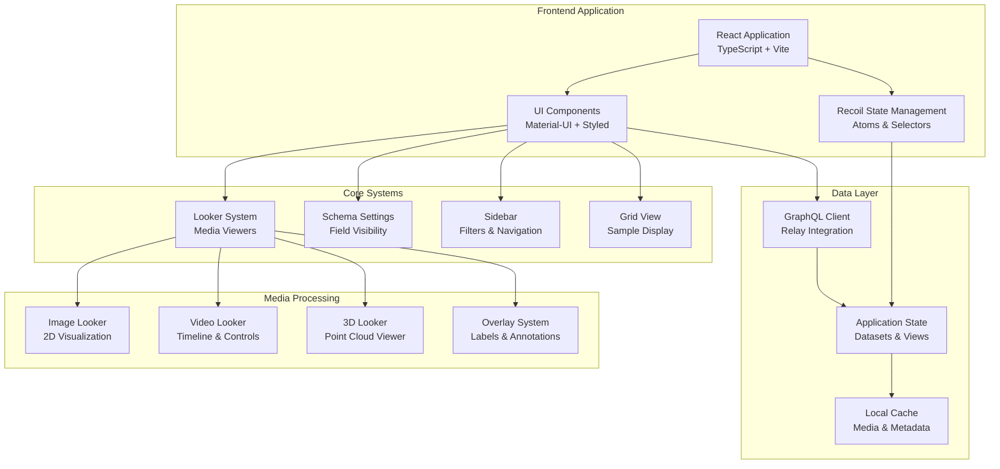
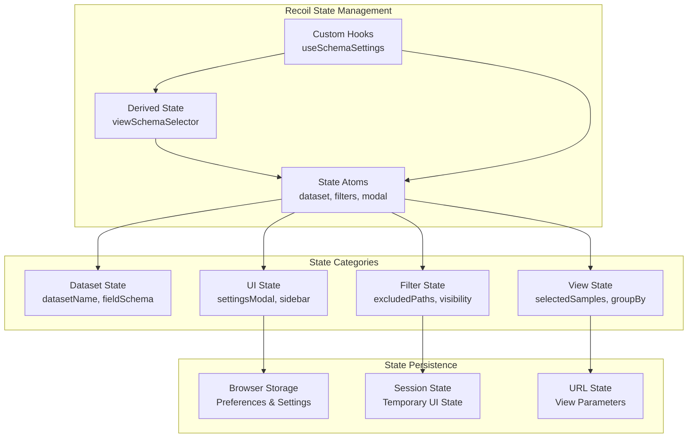
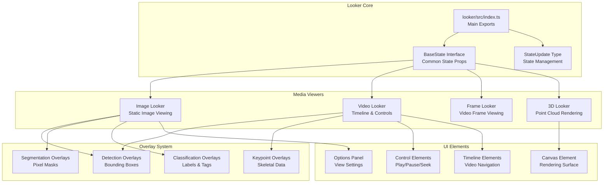
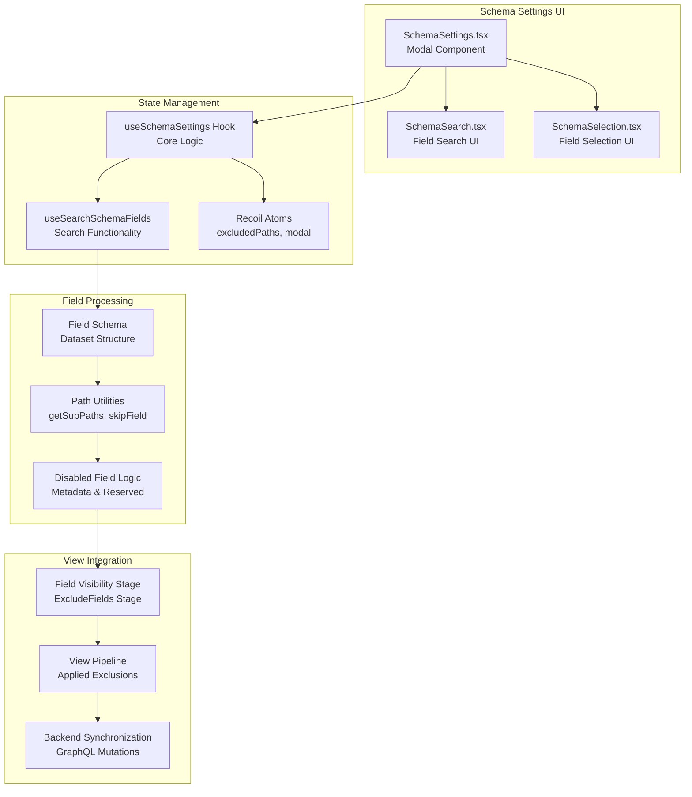
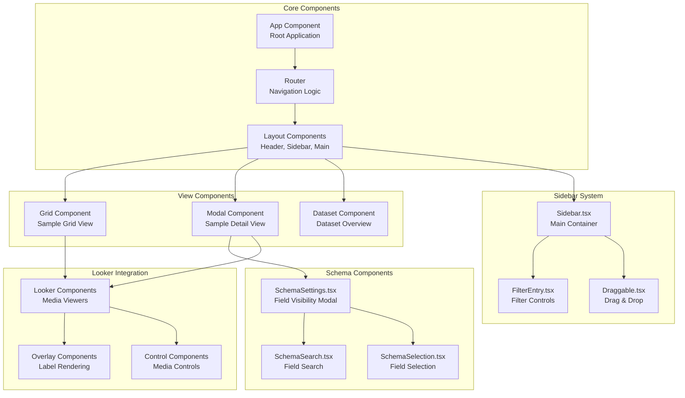
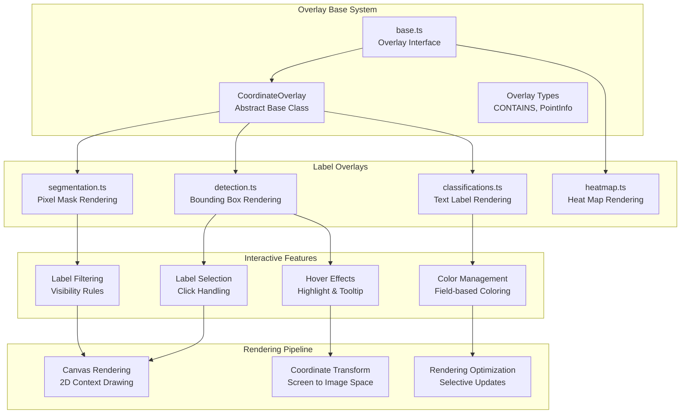
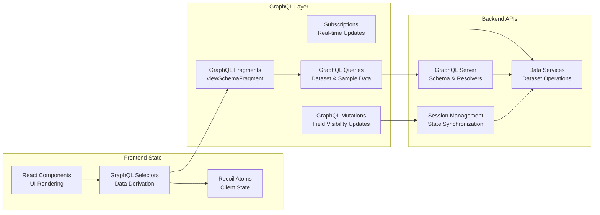

<!-- source: DeepWiki mcp.deepwiki.com · repo voxel51/fiftyone · page 4 Frontend Architecture · fetched 2026-10-21 -->

# Frontend Architecture

Relevant source files

The following files were used as context for generating this wiki page:

- [app/package.json](app/package.json)
- [app/packages/aggregations/package.json](app/packages/aggregations/package.json)
- [app/packages/app/index.html](app/packages/app/index.html)
- [app/packages/app/package.json](app/packages/app/package.json)
- [app/packages/app/vite.config.ts](app/packages/app/vite.config.ts)
- [app/packages/components/package.json](app/packages/components/package.json)
- [app/packages/core/package.json](app/packages/core/package.json)
- [app/packages/embeddings/package.json](app/packages/embeddings/package.json)
- [app/packages/flashlight/package.json](app/packages/flashlight/package.json)
- [app/packages/looker-3d/package.json](app/packages/looker-3d/package.json)
- [app/packages/looker/package.json](app/packages/looker/package.json)
- [app/packages/map/package.json](app/packages/map/package.json)
- [app/packages/operators/package.json](app/packages/operators/package.json)
- [app/packages/plugins/package.json](app/packages/plugins/package.json)
- [app/packages/relay/package.json](app/packages/relay/package.json)
- [app/packages/state/package.json](app/packages/state/package.json)
- [app/packages/utilities/package.json](app/packages/utilities/package.json)
- [app/yarn.lock](app/yarn.lock)
- [package/db/setup.py](package/db/setup.py)
- [package/desktop/setup.py](package/desktop/setup.py)
- [setup.py](setup.py)

## Purpose and Scope

This document covers the frontend architecture of the FiftyOne web application, including the React-based user interface, state management systems, media viewing components, and client-side data processing. The frontend is responsible for rendering datasets, managing user interactions, and providing visualization tools for computer vision data.

For backend server architecture and GraphQL APIs, see [Server Architecture](#3). For data model and persistence layers, see [Core Data Model](#2).

## Frontend System Overview

The FiftyOne frontend is built as a modern React application with TypeScript, featuring a component-based architecture with centralized state management and specialized media viewing capabilities.

Sources: [app/packages/looker/src/index.ts:1-29](), [app/packages/state/src/hooks/useSchemaSettings.ts:1-376](), [app/packages/core/src/components/Sidebar/Sidebar.tsx:1-50]()

## State Management Architecture

The frontend uses Recoil for state management, providing a reactive state system with atoms, selectors, and hooks. The state is organized around core entities like datasets, samples, and UI preferences.

### Core State Hooks

The `useSchemaSettings` hook manages field visibility and schema-related state:

- **Field Management**: Controls which fields are visible in the UI
- **Search Integration**: Handles field search and filtering
- **Exclusion Logic**: Manages excluded field paths for different view types
- **Tab State**: Controls between selection and filter rule modes

Sources: [app/packages/state/src/hooks/useSchemaSettings.ts:28-375](), [app/packages/state/src/recoil/schemaSettings.atoms.ts:1-50]()

## Looker System Architecture

The Looker system provides media viewing capabilities for different media types with overlay support for annotations and labels.

### Media State Management

Each media type extends the base state with specific properties:

- **ImageState**: Basic zoom and pan controls
- **VideoState**: Frame navigation, playback controls, buffering
- **FrameState**: Individual frame viewing with frame-specific options
- **ThreeDState**: 3D rendering controls and camera positioning

Sources: [app/packages/looker/src/state.ts:1-525](), [app/packages/looker/src/overlays/detection.ts:1-372](), [app/packages/looker/src/overlays/segmentation.ts:1-287]()

## Schema Settings System

The schema settings system manages field visibility and provides advanced filtering capabilities for dataset fields.

### Field Visibility Logic

The system implements sophisticated field visibility rules:

- **Reserved Fields**: System fields like `id`, `filepath`, `metadata` are always disabled
- **Nested Fields**: Supports showing/hiding nested object properties
- **View-Specific Rules**: Different rules for patches, clips, and frame views
- **Search Integration**: Real-time field search with nested field support

Sources: [app/packages/core/src/components/Schema/SchemaSettings.tsx:1-263](), [app/packages/state/src/hooks/useSchemaSettings.utils.ts:1-310]()

## Component Architecture

The frontend follows a hierarchical component structure with clear separation of concerns between presentation and logic.

### Sidebar Architecture

The sidebar implements a sophisticated drag-and-drop interface for field management:

- **Entry Types**: Different entry types for groups, paths, empty states, and inputs
- **Interactive Items**: Draggable items with spring animations
- **Measurement System**: Dynamic height calculation and positioning
- **Event Handling**: Keyboard navigation and mouse interactions

Sources: [app/packages/core/src/components/Sidebar/Sidebar.tsx:24-153](), [app/packages/core/src/components/Sidebar/Entries/FilterEntry.tsx:1-160]()

## Media Overlay System

The overlay system renders labels and annotations over media content with interactive capabilities.

### Overlay Rendering Process

Each overlay type implements specific rendering logic:

- **Detection**: Renders bounding boxes with labels and confidence scores
- **Segmentation**: Displays pixel-level masks with color coding
- **Classification**: Shows text labels with background styling
- **Heatmap**: Renders intensity maps with customizable coloring

Sources: [app/packages/looker/src/overlays/base.ts:1-172](), [app/packages/looker/src/overlays/detection.ts:80-356](), [app/packages/looker/src/overlays/segmentation.ts:29-287]()

## Frontend-Backend Integration

The frontend integrates with the backend through GraphQL queries and real-time subscriptions.

The frontend maintains synchronized state with the backend through:

- **Fragment-based Queries**: Reusable GraphQL fragments for consistent data fetching
- **Optimistic Updates**: Immediate UI updates with backend synchronization
- **Session Persistence**: Maintains view state across browser sessions
- **Real-time Sync**: Live updates when data changes on the server

Sources: [app/packages/state/src/hooks/useSchemaSettings.ts:17-26](), [app/packages/core/src/components/Schema/SchemaSettings.tsx:225-231]()

---

