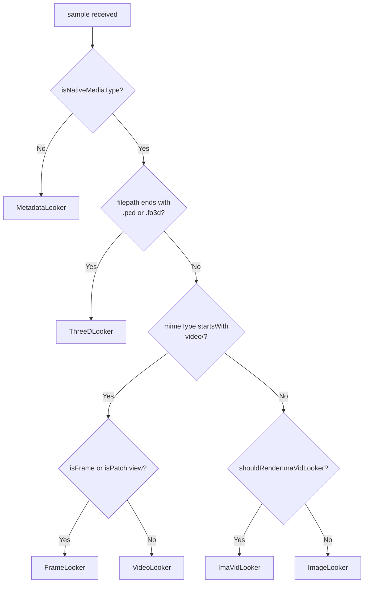
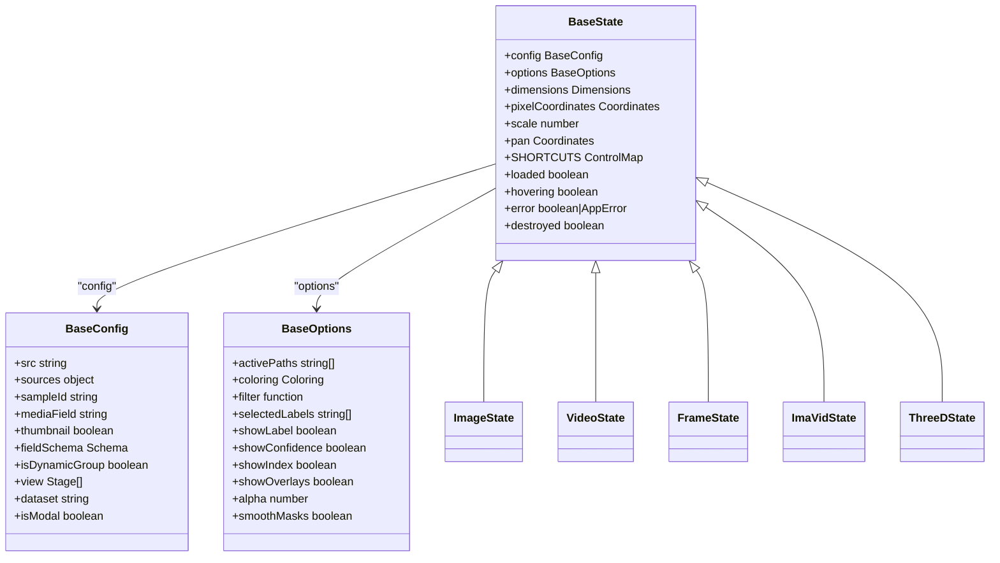
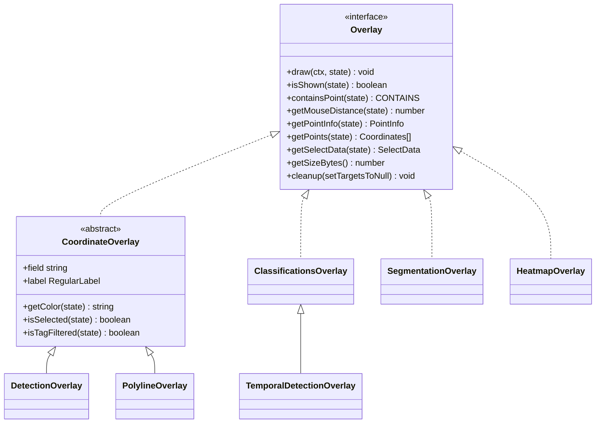
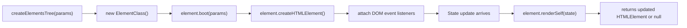
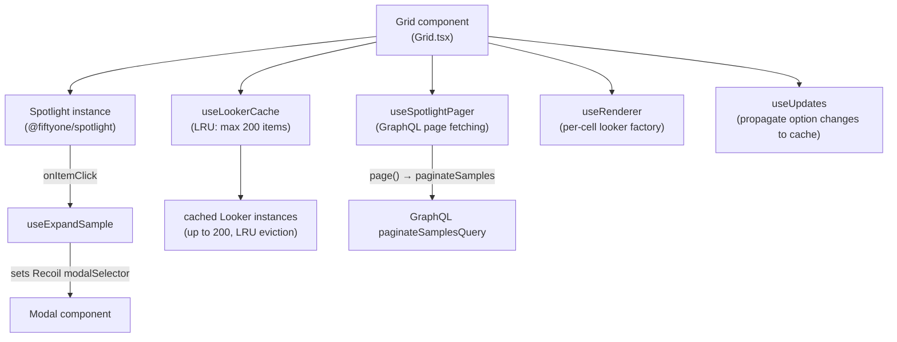
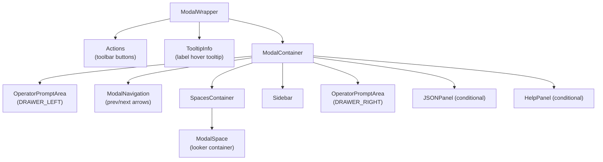
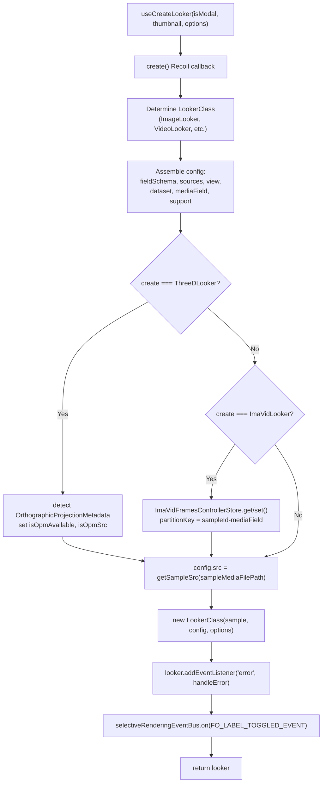

<!-- source: DeepWiki mcp.deepwiki.com · repo voxel51/fiftyone · page 4.1 Media Viewing and the Looker System · fetched 2026-10-21 -->

# Media Viewing and the Looker System

<details>
<summary>Relevant source files</summary>

The following files were used as context for generating this wiki page:

- [app/packages/core/src/components/Grid/Grid.tsx](app/packages/core/src/components/Grid/Grid.tsx)
- [app/packages/core/src/components/Grid/useRefreshers.ts](app/packages/core/src/components/Grid/useRefreshers.ts)
- [app/packages/core/src/components/Modal/Group/DynamicGroup/pagination/index.tsx](app/packages/core/src/components/Modal/Group/DynamicGroup/pagination/index.tsx)
- [app/packages/core/src/components/Modal/Group/DynamicGroup/useDynamicGroupSamples.ts](app/packages/core/src/components/Modal/Group/DynamicGroup/useDynamicGroupSamples.ts)
- [app/packages/core/src/components/Modal/Modal.tsx](app/packages/core/src/components/Modal/Modal.tsx)
- [app/packages/core/src/components/Modal/ModalNavigation.tsx](app/packages/core/src/components/Modal/ModalNavigation.tsx)
- [app/packages/core/src/components/Modal/hooks.ts](app/packages/core/src/components/Modal/hooks.ts)
- [app/packages/core/src/components/Sidebar/Entries/PathValueEntry.tsx](app/packages/core/src/components/Sidebar/Entries/PathValueEntry.tsx)
- [app/packages/looker/src/constants.ts](app/packages/looker/src/constants.ts)
- [app/packages/looker/src/elements/common/actions.ts](app/packages/looker/src/elements/common/actions.ts)
- [app/packages/looker/src/elements/common/controls.module.css](app/packages/looker/src/elements/common/controls.module.css)
- [app/packages/looker/src/elements/common/controls.ts](app/packages/looker/src/elements/common/controls.ts)
- [app/packages/looker/src/elements/common/looker.module.css](app/packages/looker/src/elements/common/looker.module.css)
- [app/packages/looker/src/elements/common/looker.ts](app/packages/looker/src/elements/common/looker.ts)
- [app/packages/looker/src/elements/common/options.module.css](app/packages/looker/src/elements/common/options.module.css)
- [app/packages/looker/src/elements/common/options.ts](app/packages/looker/src/elements/common/options.ts)
- [app/packages/looker/src/elements/frame.ts](app/packages/looker/src/elements/frame.ts)
- [app/packages/looker/src/elements/image.ts](app/packages/looker/src/elements/image.ts)
- [app/packages/looker/src/elements/index.ts](app/packages/looker/src/elements/index.ts)
- [app/packages/looker/src/elements/util.ts](app/packages/looker/src/elements/util.ts)
- [app/packages/looker/src/elements/video.module.css](app/packages/looker/src/elements/video.module.css)
- [app/packages/looker/src/elements/video.ts](app/packages/looker/src/elements/video.ts)
- [app/packages/looker/src/index.ts](app/packages/looker/src/index.ts)
- [app/packages/looker/src/overlays/base.ts](app/packages/looker/src/overlays/base.ts)
- [app/packages/looker/src/overlays/classifications.ts](app/packages/looker/src/overlays/classifications.ts)
- [app/packages/looker/src/overlays/detection.ts](app/packages/looker/src/overlays/detection.ts)
- [app/packages/looker/src/overlays/heatmap.ts](app/packages/looker/src/overlays/heatmap.ts)
- [app/packages/looker/src/overlays/polyline.ts](app/packages/looker/src/overlays/polyline.ts)
- [app/packages/looker/src/overlays/segmentation.ts](app/packages/looker/src/overlays/segmentation.ts)
- [app/packages/looker/src/state.ts](app/packages/looker/src/state.ts)
- [app/packages/looker/src/util.ts](app/packages/looker/src/util.ts)
- [app/packages/looker/src/zoom.ts](app/packages/looker/src/zoom.ts)
- [app/packages/state/src/hooks/useCreateLooker.ts](app/packages/state/src/hooks/useCreateLooker.ts)
- [app/packages/state/src/hooks/useExpandSample.ts](app/packages/state/src/hooks/useExpandSample.ts)
- [app/packages/state/src/hooks/useSetExpandedSample.ts](app/packages/state/src/hooks/useSetExpandedSample.ts)
- [app/packages/state/src/recoil/dynamicGroups.test.ts](app/packages/state/src/recoil/dynamicGroups.test.ts)
- [app/packages/state/src/recoil/dynamicGroups.ts](app/packages/state/src/recoil/dynamicGroups.ts)
- [app/packages/state/src/recoil/modal.ts](app/packages/state/src/recoil/modal.ts)
- [app/packages/state/src/recoil/pathData/groups.ts](app/packages/state/src/recoil/pathData/groups.ts)

</details>


## Purpose and Scope

This document describes the `@fiftyone/looker` package and its integration with `@fiftyone/core` for rendering media samples with label overlays. It covers the Looker class hierarchy, the overlay rendering pipeline, the element tree model, keyboard control system, the sample Grid, and the expanded-sample Modal.

For 3D-specific rendering (FO3D, PixiJS-based 2D engine), see [4.3](#4.3) and [4.2](#4.2). For Recoil-based frontend state management and schema visibility, see [4.4](#4.4).

---

## Looker Types

`AbstractLooker<State>` (exported from `@fiftyone/looker`) is the base class. Six concrete subclasses are selected at runtime based on sample media type and the current view context.

| Looker Class | Media Type | Context |
|---|---|---|
| `ImageLooker` | `image` | Still image files |
| `VideoLooker` | `video` | Native video files |
| `FrameLooker` | `video` (frame/patches view) | Frames or patches view of a video dataset |
| `ImaVidLooker` | image sequence | Ordered dynamic groups rendered as playable video |
| `ThreeDLooker` | `point-cloud` / `3d` | `.pcd` or `.fo3d` files |
| `MetadataLooker` | non-native types | Datasets with custom media types |

The selection logic runs inside the `create` callback in `useCreateLooker` [app/packages/state/src/hooks/useCreateLooker.ts:89-136]().

**Looker Type Selection Logic**



Sources: [app/packages/state/src/hooks/useCreateLooker.ts:89-136]()

---

## State Model

Every looker type owns a `State` object that contains a `config` (static, set at construction) and `options` (dynamic, updated during the looker's lifetime). The full type tree is defined in `app/packages/looker/src/state.ts`.

**State, Config, and Options Hierarchy**



Sources: [app/packages/looker/src/state.ts:171-347]()

### State Extensions by Looker Type

| State Type | Additional Fields |
|---|---|
| `VideoState` | `frameNumber`, `duration`, `playing`, `seeking`, `buffers`, `buffering`, `fragment`, `lockedToSupport` |
| `ImaVidState` | `currentFrameNumber`, `totalFrames`, `bufferManager: BufferManager`, `buffering`, `seekBarHovering` |
| `FrameState` | `duration` |

| Config Type | Additional Fields |
|---|---|
| `VideoConfig` | `enableTimeline`, `frameRate`, `support?: [number, number]` |
| `ImaVidConfig` | `frameStoreController: ImaVidFramesController`, `firstFrameNumber`, `frameRate` |
| `ThreeDConfig` | `isOpmAvailable: boolean`, `isFo3d: boolean` |
| `FrameConfig` | `frameRate`, `frameNumber` |

Sources: [app/packages/looker/src/state.ts:233-424]()

The `StateUpdate<State>` function type is the primary way looker internals mutate state: it accepts either a partial state object or a function `(previousState) => partialState`, with an optional post-update callback that receives the final state and current overlays [app/packages/looker/src/state.ts:434-441]().

---

## Overlay System

Overlays are drawn onto a `<canvas>` element positioned over the media element. Each overlay instance corresponds to one label object from a FiftyOne field on the sample.

### Overlay Interface and Class Hierarchy



Sources: [app/packages/looker/src/overlays/base.ts:88-172]()

### Overlay Implementations

| Class | File | Draws | Hit-Test Strategy |
|---|---|---|---|
| `DetectionOverlay` | `overlays/detection.ts` | Bounding box stroke, label text, instance mask bitmap, 3D convex hull fill | Rectangle + label header region |
| `SegmentationOverlay` | `overlays/segmentation.ts` | Full-image mask `ImageBitmap` | Typed array pixel lookup |
| `HeatmapOverlay` | `overlays/heatmap.ts` | Full-image heatmap `ImageBitmap` | Typed array pixel lookup |
| `ClassificationsOverlay` | `overlays/classifications.ts` | Text badges in top-left corner | Stored badge bounding boxes |
| `TemporalDetectionOverlay` | `overlays/classifications.ts` | Same, filtered by `support` frame range | Same |
| `PolylineOverlay` | `overlays/polyline.ts` | Path stroke, optional fill | Distance from nearest line segment |

Sources: [app/packages/looker/src/overlays/detection.ts](), [app/packages/looker/src/overlays/segmentation.ts](), [app/packages/looker/src/overlays/classifications.ts](), [app/packages/looker/src/overlays/polyline.ts](), [app/packages/looker/src/overlays/heatmap.ts]()

### CONTAINS Enum

`containsPoint` returns a `CONTAINS` enum to determine hover priority when multiple overlays stack:

```
CONTAINS.NONE    = 0  — cursor not on this overlay
CONTAINS.CONTENT = 1  — cursor inside label area
CONTAINS.BORDER  = 2  — cursor on label border (takes precedence)
```

Sources: [app/packages/looker/src/overlays/base.ts:12-16]()

### Dense Mask Rendering Pipeline

For `DetectionOverlay` (with instance masks), `SegmentationOverlay`, and `HeatmapOverlay`:

1. Raw typed array buffer (`OverlayMask`) arrives with the label data
2. A `LookerWorker` (spawned via `createWorker`) processes the buffer off the main thread and creates an `ImageBitmap`
3. The bitmap is stored on `label.mask.bitmap` or `label.map.bitmap`
4. The `_renderStatus` field on the label transitions from `RENDER_STATUS_PENDING` → `RENDER_STATUS_PAINTED`
5. `draw()` calls `ctx.drawImage(bitmap, x, y, w, h)` to composite it

The `cleanup()` method on each overlay calls `bitmap.close()` to release GPU memory.

Sources: [app/packages/looker/src/overlays/detection.ts:107-148](), [app/packages/looker/src/overlays/detection.ts:219-236](), [app/packages/looker/src/util.ts:446-511]()

---

## Element Tree System

Each looker constructs a tree of `BaseElement<State>` instances mirroring the DOM structure. The tree is built once with `createElementsTree` and updated reactively as state changes.

### BaseElement Lifecycle



Sources: [app/packages/looker/src/elements/util.ts:42-70]()

Each `BaseElement` exposes a `getEvents()` method returning DOM event handlers that call `update(stateChange)` or `dispatchEvent(type, detail)`. Events use `AbortController` signal for cleanup.

### Image Looker Element Tree

```mermaid
graph TD
    LookerElement --> ImageElement
    LookerElement --> CanvasElement
    LookerElement --> ErrorElement
    LookerElement --> TagsElement
    LookerElement --> ThumbnailSelectorElement
    LookerElement --> ControlsElement
    LookerElement --> OptionsPanelElement
    ControlsElement --> PlusElement["PlusElement (zoom in)"]
    ControlsElement --> MinusElement["MinusElement (zoom out)"]
    ControlsElement --> CropToContentButtonElement
    ControlsElement --> ToggleOverlaysButtonElement
    ControlsElement --> JSONButtonElement
    ControlsElement --> OptionsButtonElement
    ControlsElement --> HelpButtonElement
    OptionsPanelElement --> ShowConfidenceOptionElement
    OptionsPanelElement --> ShowLabelOptionElement
    OptionsPanelElement --> ShowTooltipOptionElement
    OptionsPanelElement --> ShowIndexOptionElement
    OptionsPanelElement --> OnlyShowHoveredOnLabelOptionElement
```



Sources: [app/packages/looker/src/elements/index.ts:98-145]()

### Video Looker Additional Elements

The video element tree adds to the image tree:

| Element Class | Role |
|---|---|
| `VideoElement` | Manages pooled `<video>` via `acquirePlayer()` / `acquireThumbnailer()` |
| `SeekBarElement` | `<input type="range">` for timeline scrubbing with buffer-fill progress |
| `SeekBarThumbElement` | Draggable seek thumb overlay |
| `PlayButtonElement` | Toggles play/pause; shows buffering spinner |
| `TimeElement` | Displays current frame string or timestamp |
| `PLAYBACK_RATE` | Icon + range slider for playback speed (0.1x–2x) |
| `VOLUME` | Mute icon + range slider for volume |
| `SupportLockButtonElement` | Lock/unlock playback to clip `support` range; only shown when `config.support` is set |
| `LoaderBar` | Shimmer loading bar shown in thumbnail mode while buffering |

Sources: [app/packages/looker/src/elements/index.ts:147-210](), [app/packages/looker/src/elements/video.ts]()

### Key Element Class Summary

| Class | File | Role |
|---|---|---|
| `LookerElement` | `elements/common/looker.ts` | Root `<div>`, keyboard event dispatch, highlight border |
| `CanvasElement` | `elements/common/` | `<canvas>` for all overlay drawing; resizes to media dimensions |
| `ImageElement` | `elements/image.ts` | `` with up to 10 load retries using linear backoff |
| `VideoElement` | `elements/video.ts` | Pooled `<video>` with canvas poster fallback |
| `FrameElement` | `elements/frame.ts` | Seeks a shared video to a specific frame, copies to a `<canvas>` |
| `ControlsElement` | `elements/common/controls.ts` | Bottom toolbar grid; hidden entirely in thumbnail mode |

Sources: [app/packages/looker/src/elements/common/looker.ts](), [app/packages/looker/src/elements/image.ts](), [app/packages/looker/src/elements/frame.ts]()

---

## Controls and Keyboard Shortcuts

Keyboard and mouse interactions use a `Control<State>` interface defined in `app/packages/looker/src/state.ts`:

```typescript
interface Control<State extends BaseState> {
  eventKeys?: string | string[];
  eventKeyType?: ControlEventKeyType;  // KEY_DOWN or HOLD
  title: string;
  shortcut: string;
  action: Action<State>;
  afterAction?: Action<State>;        // called on key-up for HOLD-type
  alwaysHandle?: boolean;             // fires even if shouldHandleKeyEvents=false
}
```

Controls are grouped into `ControlMap` objects and stored on `BaseState.SHORTCUTS`:

| Shortcut Map | Content |
|---|---|
| `COMMON_SHORTCUTS` | Escape, zoom in/out, crop to content, reset zoom, toggle controls, JSON panel, help, rotate labels, toggle overlays (`Shift` hold) |
| `VIDEO_SHORTCUTS` | `COMMON` + play/pause (`Space`), next/prev frame (`>/<`), seek to % (`0–9`), mute (`m`), support lock (`l`) |
| `IMAVID_SHORTCUTS` | `COMMON` + no-op next/prev frame (handled externally by the playback timeline) |

On each `keydown`, `LookerElement` looks up `event.key` in `state.SHORTCUTS` and calls `control.action(update, dispatchEvent, key, shiftKey)` [app/packages/looker/src/elements/common/looker.ts:22-50]().

Sources: [app/packages/looker/src/elements/common/actions.ts:372-708]()

---

## The Sample Grid

`Grid` in `app/packages/core/src/components/Grid/Grid.tsx` renders sample thumbnails as a virtual, justified grid using the `@fiftyone/spotlight` package.

### Grid Component Architecture



Sources: [app/packages/core/src/components/Grid/Grid.tsx]()

### Grid Configuration Parameters

| Parameter | Default / Source |
|---|---|
| `MAX_INSTANCES` | `200` — max cached looker instances across all rows |
| `MAX_ROWS` | `200` — max rows Spotlight maintains in DOM |
| `spacing` | `gridSpacing` Recoil atom |
| `maxItemsSizeBytes` | `maxGridItemsSizeBytes` atom ÷ 2 |
| `rowAspectRatioThreshold` | `zoom` from `useZoomSetting` (`gridCrop` atom) |
| `scrollbar` | `true` |

Sources: [app/packages/core/src/components/Grid/Grid.tsx:30-121]()

The cache uses `getSizeBytes()` (delegated to each overlay's `getSizeBytes()`) to enforce the memory budget. When the budget is exceeded, the least-recently-used looker instances are destroyed.

---

## The Modal (Expanded Sample View)

When a sample is clicked, `Modal` renders via `ReactDOM.createPortal` into the `#modal` DOM element.

### Modal Component Layout



Sources: [app/packages/core/src/components/Modal/Modal.tsx:273-318]()

### Modal Looker Lifecycle

`Modal` keeps `activeLookerRef` (`useRef<fos.Lookers>`) pointing to the active looker. When `setActiveLookerRef(looker)` is called by `ModalSpace`:

1. A `"close"` event listener is attached to the looker (`modalCloseHandler`)
2. `currentModalUniqueIdJotaiAtom` is set to `"${groupId}-${sampleId}"` for instance-coloring cross-linking
3. Tooltip event handlers are registered

On modal close, `selectiveRenderingEventBus.removeAllListeners()` is called and `currentModalUniqueIdJotaiAtom` is reset to `""`.

Sources: [app/packages/core/src/components/Modal/Modal.tsx:110-142](), [app/packages/core/src/components/Modal/Modal.tsx:245-271]()

### Modal Keyboard Shortcuts

| Key | Action |
|---|---|
| `Escape` | Unlock tooltip → exit fullscreen → close modal |
| `f` | Toggle fullscreen |
| `s` | Toggle sidebar |
| `x` | Select/deselect current sample |
| `ArrowLeft` | Previous sample |
| `ArrowRight` | Next sample |

Sources: [app/packages/core/src/components/Modal/Modal.tsx:198-227](), [app/packages/core/src/components/Modal/ModalNavigation.tsx:145-160]()

### Sample Navigation

`ModalNavigation` uses `createDebouncedNavigator` with a 150ms debounce. Each navigation call:
1. Saves pending annotation edits
2. Exits annotation edit mode
3. Clears undo history (`clearUndo`)
4. Calls `selectiveRenderingEventBus.removeAllListeners()`
5. Calls `setModal(sample)` with the new sample

Sources: [app/packages/core/src/components/Modal/ModalNavigation.tsx:85-143]()

---

## The `useCreateLooker` Factory Hook

`useCreateLooker` bridges the Recoil state world with the imperative Looker API. It returns a ref holding the `create` callback.

### Factory Pipeline



Sources: [app/packages/state/src/hooks/useCreateLooker.ts:89-283]()

### Key Recoil Dependencies

The `create` callback is re-created when any of these change:

- `fieldSchema` / `frameFieldSchema` — sample and frame field schemas
- `mediaField` — selected media field name
- `selected` — set of selected sample IDs (controls `options.selected`)
- `isClip`, `isFrame`, `isPatch` — view type flags
- `shouldRenderImaVidLooker` — whether dynamic group is an image sequence
- `view`, `dataset` — current view pipeline and dataset name

Sources: [app/packages/state/src/hooks/useCreateLooker.ts:283-308]()

---

## ImaVid Looker (Image-as-Video)

`ImaVidLooker` renders ordered dynamic groups — sequences of image samples — as a playable video. It is activated when `shouldRenderImaVidLooker` is true in the Recoil state.

### Frame Buffer Architecture

`ImaVidFramesController` (at `app/packages/looker/src/lookers/imavid/controller.ts`) manages frame fetching:
- Fetches pages of frames from the server using the Relay environment
- Uses a `BufferManager` to track which frame ranges are buffered
- Stores frame data accessible by the `ImaVidLooker` via `frameStoreController` in config

`ImaVidFramesControllerStore` is a `Map` keyed by `"${sampleId}-${mediaField}"`. It prevents re-creating controllers on repeated renders of the same sequence.

Sources: [app/packages/state/src/hooks/useCreateLooker.ts:198-255](), [app/packages/looker/src/state.ts:380-418]()

---

## Video Player Pooling

The browser limits concurrent `HTMLVideoElement` instances. FiftyOne uses `acquirePlayer()` and `acquireThumbnailer()` to borrow from shared pools:

- **Thumbnail mode**: `acquireThumbnailer()` borrows a video element, seeks to the poster frame (or `support[0]` for clips), draws to a `<canvas>`, then releases the element immediately.
- **Hover play (thumbnail)**: After a 500ms delay, `acquirePlayer()` is called. On `mouseleave`, the player is released and the canvas poster is displayed.
- **Full (modal) playback**: Player is held for the lifetime of the looker.

The `releaseVideo()` method on `VideoElement` handles race conditions between pending play/pause promises and release requests using `waitingToPause`, `waitingToPlay`, and `waitingToRelease` flags.

Sources: [app/packages/looker/src/elements/video.ts:603-663](), [app/packages/looker/src/elements/video.ts:749-797]()

---

## Zoom and Pan

Pan and zoom are tracked in `BaseState` as `scale` (number) and `pan` (`Coordinates`). Key utility functions in `app/packages/looker/src/util.ts`:

| Function | Purpose |
|---|---|
| `clampScale` | Prevents zoom below `zoomPad` ratio or below `MIN_PIXELS` (16px) per dimension |
| `snapBox` | Constrains pan so the image never leaves the window |
| `getRenderedScale` | Computes actual pixel scale from window dimensions and image dimensions |
| `getFitRect` | Letterboxes/pillarboxes a bounding box to fit an aspect ratio |

When `state.zoomToContent` is set to `true`, the looker automatically computes the bounding box of all visible overlay points (via `POINTS_FROM_FO` in `zoom.ts`) and adjusts `scale` and `pan` to fit them in view.

Sources: [app/packages/looker/src/util.ts:340-406](), [app/packages/looker/src/zoom.ts]()

---

## Coloring System

Label colors are resolved at draw time from the `Coloring` object in `BaseOptions`:

| `coloring.by` | Color Assignment |
|---|---|
| `COLOR_BY.FIELD` | One color per field, deterministically from `coloring.pool` + `coloring.seed` + field name |
| `COLOR_BY.VALUE` | Color from `coloring.targets`, indexed by label class value |
| `COLOR_BY.INSTANCE` | Color derived from `label.instance._id` |

**Mask target mapping** (`MaskTargets`) for segmentation and heatmap overlays:

- `IntMaskTargets`: integer pixel value → label string (`{ "1": "cat" }`)
- `RgbMaskTargets`: hex color → `{ label: string, intTarget: number }` (for RGB masks)

`SegmentationOverlay` builds a reverse map (`rgbMaskTargetsReverseMap`) from int target → color + label for efficient tooltip lookups.

Sources: [app/packages/looker/src/state.ts:18-30](), [app/packages/looker/src/state.ts:119-132](), [app/packages/looker/src/overlays/segmentation.ts:113-130]()

---

## Selective Rendering Event Bus

`selectiveRenderingEventBus` (exported from `@fiftyone/looker`) is a lightweight event bus for cross-component communication that bypasses the Recoil update cycle:

- **`FO_LABEL_TOGGLED_EVENT`**: Fired when a label is shift-clicked in the modal to select/deselect it. `useCreateLooker` subscribes each new looker to this event via the `AbortController` signal so the handler is cleaned up automatically.
- The bus is fully cleared (`removeAllListeners()`) whenever the modal closes or navigates to a new sample, preventing stale handlers from accumulating.

Sources: [app/packages/core/src/components/Modal/Modal.tsx:136-139](), [app/packages/state/src/hooks/useCreateLooker.ts:276-281]()

---

