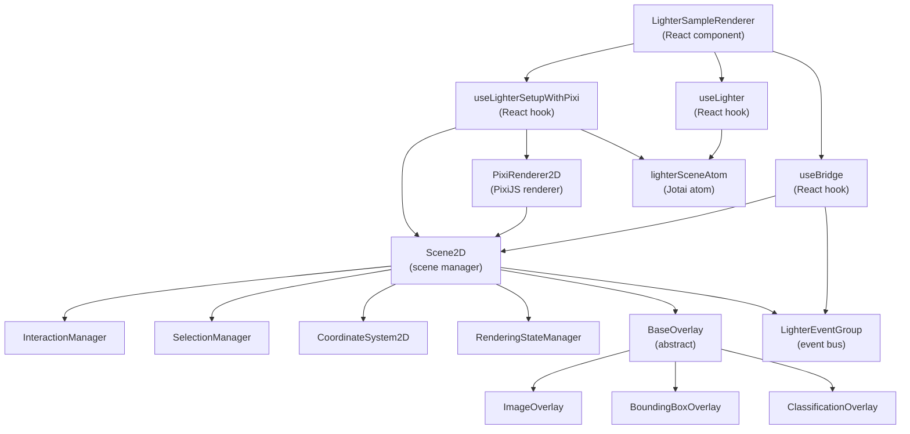
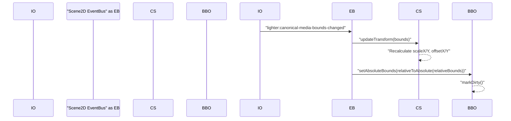
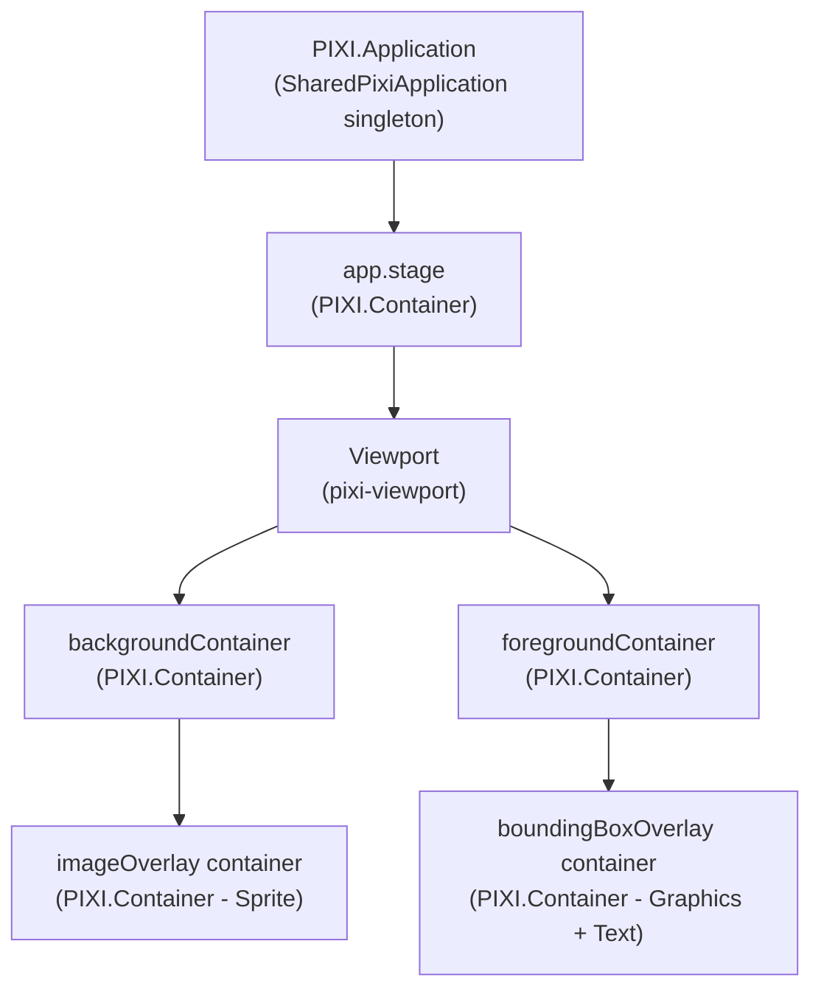
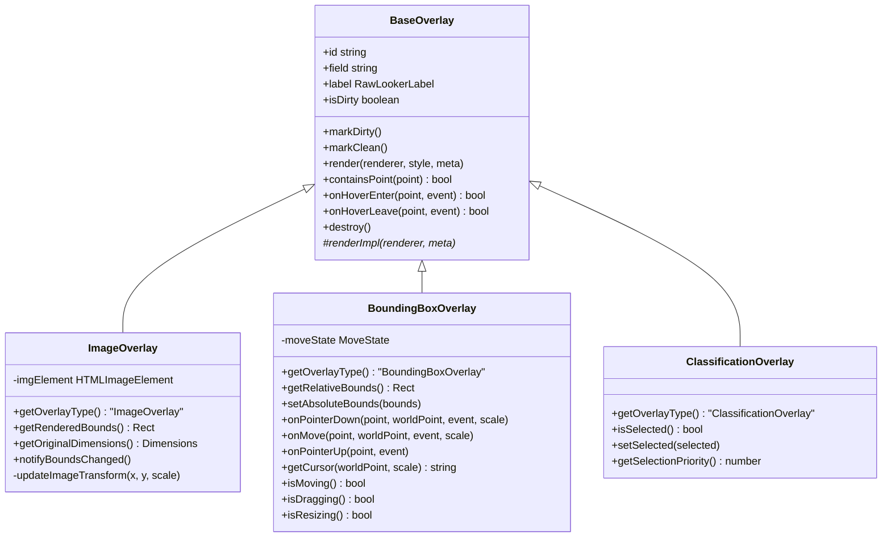
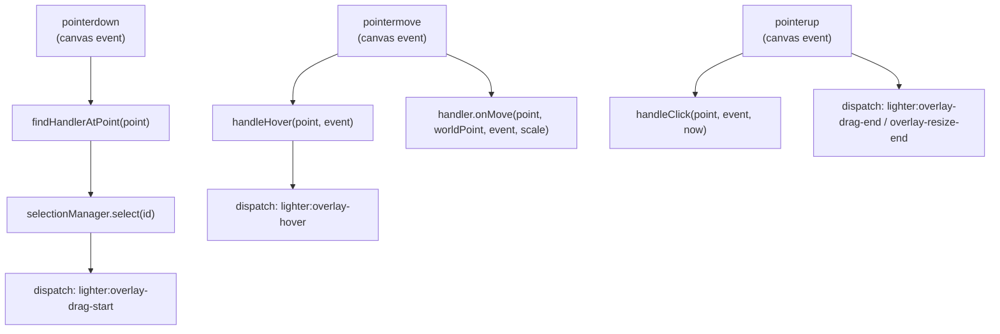
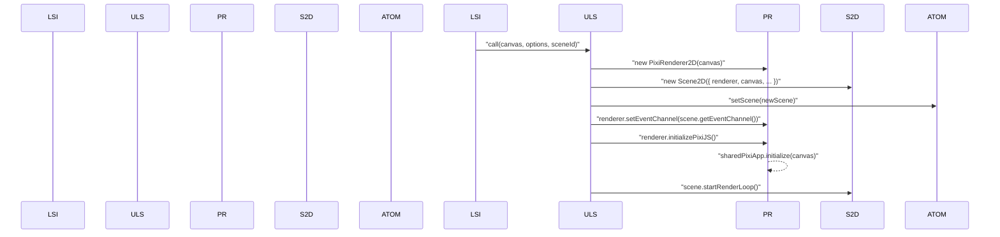
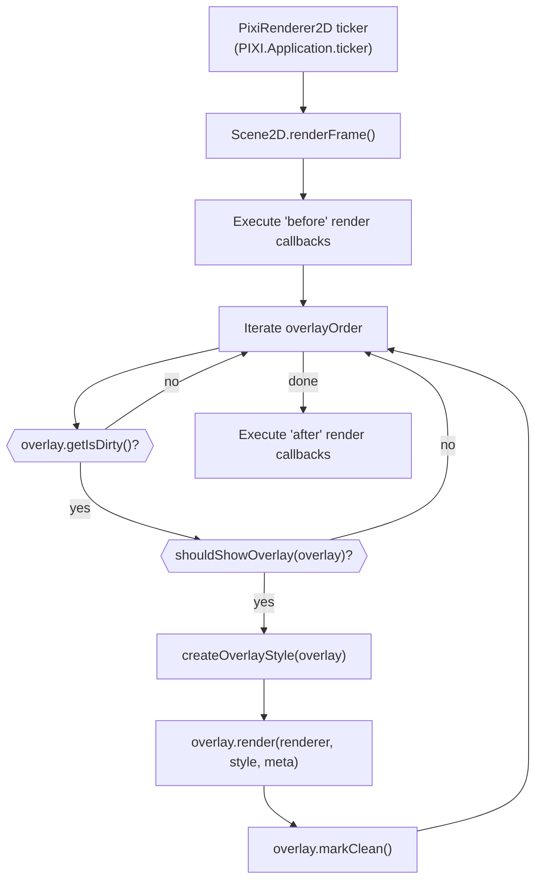

<!-- source: DeepWiki mcp.deepwiki.com · repo voxel51/fiftyone · page 4.2 Lighter Rendering Engine · fetched 2026-10-21 -->

# Lighter Rendering Engine

<details>
<summary>Relevant source files</summary>

The following files were used as context for generating this wiki page:

- [app/packages/core/src/components/Modal/Lighter/LighterSampleRenderer.tsx](app/packages/core/src/components/Modal/Lighter/LighterSampleRenderer.tsx)
- [app/packages/core/src/components/Modal/Lighter/useBridge.ts](app/packages/core/src/components/Modal/Lighter/useBridge.ts)
- [app/packages/core/src/components/Modal/Lighter/useLighterTooltipEventHandler.ts](app/packages/core/src/components/Modal/Lighter/useLighterTooltipEventHandler.ts)
- [app/packages/core/src/components/Modal/ModalLooker.tsx](app/packages/core/src/components/Modal/ModalLooker.tsx)
- [app/packages/core/src/components/Modal/Sidebar/Annotate/Confirmation/useConfirmDelete.tsx](app/packages/core/src/components/Modal/Sidebar/Annotate/Confirmation/useConfirmDelete.tsx)
- [app/packages/core/src/components/Modal/VideoLooker.tsx](app/packages/core/src/components/Modal/VideoLooker.tsx)
- [app/packages/core/src/components/Modal/use-key-events.ts](app/packages/core/src/components/Modal/use-key-events.ts)
- [app/packages/core/src/components/Modal/use-looker.ts](app/packages/core/src/components/Modal/use-looker.ts)
- [app/packages/core/src/components/Modal/utils.ts](app/packages/core/src/components/Modal/utils.ts)
- [app/packages/lighter/README.md](app/packages/lighter/README.md)
- [app/packages/lighter/package.json](app/packages/lighter/package.json)
- [app/packages/lighter/src/commands/AddOverlayCommand.ts](app/packages/lighter/src/commands/AddOverlayCommand.ts)
- [app/packages/lighter/src/commands/UpdateLabelCommand.ts](app/packages/lighter/src/commands/UpdateLabelCommand.ts)
- [app/packages/lighter/src/constants.ts](app/packages/lighter/src/constants.ts)
- [app/packages/lighter/src/core/Scene2D.ts](app/packages/lighter/src/core/Scene2D.ts)
- [app/packages/lighter/src/events/index.ts](app/packages/lighter/src/events/index.ts)
- [app/packages/lighter/src/index.ts](app/packages/lighter/src/index.ts)
- [app/packages/lighter/src/interaction/InteractionManager.ts](app/packages/lighter/src/interaction/InteractionManager.ts)
- [app/packages/lighter/src/interaction/InteractiveDetectionHandler.ts](app/packages/lighter/src/interaction/InteractiveDetectionHandler.ts)
- [app/packages/lighter/src/overlay/BaseOverlay.ts](app/packages/lighter/src/overlay/BaseOverlay.ts)
- [app/packages/lighter/src/overlay/BoundingBoxOverlay.ts](app/packages/lighter/src/overlay/BoundingBoxOverlay.ts)
- [app/packages/lighter/src/overlay/ClassificationOverlay.ts](app/packages/lighter/src/overlay/ClassificationOverlay.ts)
- [app/packages/lighter/src/overlay/ImageOverlay.ts](app/packages/lighter/src/overlay/ImageOverlay.ts)
- [app/packages/lighter/src/react/index.ts](app/packages/lighter/src/react/index.ts)
- [app/packages/lighter/src/react/useLighter.ts](app/packages/lighter/src/react/useLighter.ts)
- [app/packages/lighter/src/react/useLighterEventBus.ts](app/packages/lighter/src/react/useLighterEventBus.ts)
- [app/packages/lighter/src/react/useLighterSetup.ts](app/packages/lighter/src/react/useLighterSetup.ts)
- [app/packages/lighter/src/renderer/PixiRenderer2D.ts](app/packages/lighter/src/renderer/PixiRenderer2D.ts)
- [app/packages/lighter/src/renderer/Renderer2D.ts](app/packages/lighter/src/renderer/Renderer2D.ts)
- [app/packages/lighter/src/selection/SelectionManager.ts](app/packages/lighter/src/selection/SelectionManager.ts)
- [app/packages/lighter/src/types.ts](app/packages/lighter/src/types.ts)
- [app/packages/lighter/src/utils/colorMapping.ts](app/packages/lighter/src/utils/colorMapping.ts)
- [app/packages/lighter/tsconfig.json](app/packages/lighter/tsconfig.json)

</details>


This page documents the `@fiftyone/lighter` package: a 2D rendering engine built on PixiJS used for displaying FiftyOne samples with interactive annotation overlays. It covers the `Scene2D` scene manager, the overlay type hierarchy, the `InteractionManager` and `SelectionManager`, the PixiJS rendering backend, and how the system integrates with the React application via `useBridge` and related hooks.

For the older Canvas/WebGL rendering path used in the grid and non-annotation modal views, see [Media Viewing and the Looker System](#4.1). For the 3D visualization system, see [3D Visualization](#4.3).

---

## Purpose and Scope

Lighter is activated when the modal viewer is in **annotate mode** (`ModalMode.ANNOTATE`). In this mode, `ModalLooker` renders `LighterSampleRenderer` instead of the standard looker. Lighter supports:

- Rendering a sample image via an HTML `` element positioned behind a PixiJS canvas
- Rendering label overlays (bounding boxes, classifications) via PixiJS graphics
- Interactive drag, resize, and creation of bounding box annotations
- Selection, hover, and tooltip state synchronized with FiftyOne's Recoil/Jotai state
- Undo/redo via the `@fiftyone/commands` command bus

Sources: [app/packages/core/src/components/Modal/ModalLooker.tsx:99-113](), [app/packages/lighter/README.md:1-40]()

---

## Package Layout

The `@fiftyone/lighter` package lives at `app/packages/lighter` and is organized as follows:

| Directory | Contents |
|---|---|
| `src/core/` | `Scene2D`, `CoordinateSystem2D`, `RenderingStateManager`, `SceneConfig` |
| `src/overlay/` | `BaseOverlay`, `ImageOverlay`, `BoundingBoxOverlay`, `ClassificationOverlay`, `OverlayFactory` |
| `src/renderer/` | `Renderer2D` interface, `PixiRenderer2D`, `MockRenderer2D`, `SharedPixiApplication` |
| `src/interaction/` | `InteractionManager`, `InteractiveDetectionHandler` |
| `src/selection/` | `SelectionManager`, `Selectable` interface |
| `src/commands/` | `AddOverlayCommand`, `RemoveOverlayCommand`, `MoveOverlayCommand`, `TransformOverlayCommand`, `UpdateLabelCommand` |
| `src/events/` | `LighterEventGroup` type definitions |
| `src/react/` | `useLighter`, `useLighterSetupWithPixi`, `useLighterEventBus`, `useLighterEventHandler` |
| `src/utils/` | `colorMapping`, `color`, `geometry` |

Sources: [app/packages/lighter/src/index.ts:1-82](), [app/packages/lighter/package.json:1-37]()

---

## High-Level Architecture

**Lighter System — Component Relationships**



Sources: [app/packages/lighter/src/core/Scene2D.ts:147-187](), [app/packages/core/src/components/Modal/Lighter/LighterSampleRenderer.tsx:37-136](), [app/packages/lighter/src/react/useLighterSetup.ts:32-93]()

---

## Scene2D

`Scene2D` ([app/packages/lighter/src/core/Scene2D.ts:147-327]()) is the central orchestrator. It is instantiated by `useLighterSetupWithPixi` and stored in the Jotai atom `lighterSceneAtom`.

### Responsibilities

- Maintains the overlay registry (`Map<string, BaseOverlay>`) and the ordered render list (`overlayOrder: string[]`)
- Owns a `CoordinateSystem2D` for converting between relative `[0, 1]` label coordinates and absolute canvas pixel coordinates
- Owns an `InteractionManager` and `SelectionManager`
- Drives the render loop via `startRenderLoop()`, which registers a tick handler on `PixiRenderer2D`
- Listens to scene-scoped events via an isolated `eventChannel` (a random string) to prevent cross-scene event leakage
- Manages undo/redo via `CommandContextManager` from `@fiftyone/commands`

### Configuration

`Scene2D` is constructed with a `Scene2DConfig`:

```
{
  canvas: HTMLCanvasElement,
  renderer: Renderer2D,
  resourceLoader: ResourceLoader,
  options: SceneOptions,   // activePaths, showOverlays, alpha
  sceneId: string
}
```

### Overlay Ordering

The render order is recalculated by `recalculateOverlayOrder()` whenever the cursor moves or overlay options change. The algorithm:

1. Groups overlays into bins keyed by `overlay.field`, ordered by `activePaths`
2. Separates overlays that contain the current cursor point (`contained`) from those that don't (`outside`)
3. Renders `contained` last (topmost), so hovered overlays appear on top
4. Supports **rotation** (cycling through overlapping overlays) via `ArrowUp`/`ArrowDown` keys

The canonical media overlay (the `ImageOverlay`) is always placed first (bottommost).

### TypeGuards

`TypeGuards` ([app/packages/lighter/src/core/Scene2D.ts:54-98]()) is a static object of type narrowing functions:

| Guard | Purpose |
|---|---|
| `isHoverable` | Checks for `getTooltipInfo`, `onHoverEnter`, `onHoverLeave` |
| `isSelectable` | Checks for `id`, `isSelected`, `setSelected` |
| `isSpatial` | Checks for `getRelativeBounds`, `setAbsoluteBounds` |
| `isTransformable` | Checks for `getPosition`, `setPosition`, `getBounds`, `setBounds` |
| `isMovable` | Checks for `id` + transform methods |
| `isInteractionHandler` | Checks for `id`, `containsPoint`, `markDirty` |

Sources: [app/packages/lighter/src/core/Scene2D.ts:54-327]()

---

## Coordinate System

`CoordinateSystem2D` ([app/packages/lighter/src/core/CoordinateSystem2D.ts]()) implements the `CoordinateSystem` interface. It tracks a `TransformMatrix` (`scaleX`, `scaleY`, `offsetX`, `offsetY`) that maps label-space coordinates `[0, 1]` to canvas pixel coordinates.

The transform is updated whenever the canonical media (the `ImageOverlay`) changes bounds. The `ImageOverlay` emits `lighter:canonical-media-bounds-changed`, which triggers `coordinateSystem.updateTransform(event.bounds)` in `Scene2D` followed by `updateAllSpatialOverlays()` to reproject all `Spatial` overlays into pixel space.

**Coordinate Transform Flow**



Sources: [app/packages/lighter/src/core/Scene2D.ts:190-207](), [app/packages/lighter/src/overlay/ImageOverlay.ts:397-403](), [app/packages/lighter/src/types.ts:169-181]()

---

## Renderer Layer

### `Renderer2D` Interface

`Renderer2D` ([app/packages/lighter/src/renderer/Renderer2D.ts:57-179]()) defines the drawing contract, decoupling overlays from the PixiJS implementation. Key methods:

| Method | Description |
|---|---|
| `drawRect(bounds, style, containerId)` | Renders a rectangle with optional stroke/fill/dash |
| `drawText(text, position, options, containerId)` | Renders a text label with background |
| `drawLine(start, end, style, containerId)` | Renders a line segment |
| `drawHandles(bounds, width, color, containerId)` | Renders resize corner handles |
| `drawScrim(bounds, canonicalMediaBounds, containerId)` | Renders a selection scrim overlay |
| `hitTest(point, containerId?)` | Returns true if a canvas point intersects a container |
| `dispose(containerId)` | Destroys a container and all its children |
| `screenToWorld(screenPoint)` | Converts screen coords to viewport world coords |
| `getScale()` | Returns current viewport zoom scale |

### `PixiRenderer2D`

`PixiRenderer2D` ([app/packages/lighter/src/renderer/PixiRenderer2D.ts:33-940]()) is the production implementation:

- Uses a **singleton** `SharedPixiApplication` (one `PIXI.Application` per page) to avoid multiple WebGL contexts
- Creates a `pixi-viewport` `Viewport` inside the PIXI stage that supports drag, pinch, and wheel zoom
- Maintains two child containers within the viewport: `backgroundContainer` (for sprites/images) and `foregroundContainer` (for graphics, text)
- Each overlay is allocated a named `PIXI.Container` (`containerId = overlay.id`); `dispose(containerId)` calls `container.destroy({ children: true })`
- Emits `lighter:zoomed` and `lighter:viewport-moved` events when the viewport transforms change

**PixiRenderer2D Container Hierarchy**



Sources: [app/packages/lighter/src/renderer/PixiRenderer2D.ts:33-114](), [app/packages/lighter/src/renderer/Renderer2D.ts:57-179]()

---

## Overlay Types

**Overlay Type Hierarchy**



Sources: [app/packages/lighter/src/overlay/BaseOverlay.ts:22-393](), [app/packages/lighter/src/overlay/ImageOverlay.ts:39-489](), [app/packages/lighter/src/overlay/BoundingBoxOverlay.ts:72-750](), [app/packages/lighter/src/overlay/ClassificationOverlay.ts:28-125]()

### `BaseOverlay`

[app/packages/lighter/src/overlay/BaseOverlay.ts:22-393]()

Abstract base class implementing `InteractionHandler`. All overlays:
- Have a unique `id`, a `field` (the FiftyOne field path), and a typed `label`
- Track `isDirty` to signal the render loop to re-render
- Lazily initialize an `EventDispatcher` for the scene's `eventChannel`
- Call `emitLoaded()` at the end of successful rendering

### `ImageOverlay`

[app/packages/lighter/src/overlay/ImageOverlay.ts:39-489]()

Also implements `CanonicalMedia`. Unlike other overlays, it renders via an HTML `` element inserted into the DOM **before** the PixiJS canvas, using CSS `transform: translate(...) scale(...)` to track the viewport. This avoids CORS issues that would arise from loading images as PixiJS textures.

Key behaviors:
- `setRenderer()` creates the `` element and attaches a `ResizeObserver` on the parent container
- Subscribes to `lighter:viewport-moved` to call `updateImageTransform(x, y, scale)` and keep the image in sync with the PixiJS viewport
- On load, emits `lighter:canonical-media-bounds-changed` to trigger coordinate system update

### `BoundingBoxOverlay`

[app/packages/lighter/src/overlay/BoundingBoxOverlay.ts:72-750]()

Implements `Movable`, `Selectable`, `BoundedOverlay`, `Spatial`, and `Hoverable`. State machine for `moveState`:

| State | Meaning |
|---|---|
| `"NONE"` | Not interacting |
| `"DRAGGING"` | Being moved as a whole |
| `"SETTING"` | Being created from scratch (draw-to-create) |
| `"RESIZE_N/NE/E/SE/S/SW/W/NW"` | Being resized from an edge/corner |

Renders a rectangle via `renderer.drawRect()`, optional scrim/handles when selected, and a label text badge via `renderer.drawText()`.

### `ClassificationOverlay`

[app/packages/lighter/src/overlay/ClassificationOverlay.ts:28-125]()

Renders a text tab badge at the top-left corner of the canonical media bounds using `renderer.drawText()` with `anchor: { vertical: "top" }`. Multiple classification overlays stack vertically using `offset: { bottom: renderMeta.overlayIndex }`.

### `OverlayFactory`

`OverlayFactory` is a registry of overlay constructors. A pre-configured singleton `overlayFactory` is exported from `src/index.ts` and used by `LighterSampleRenderer` to instantiate overlays:

```
overlayFactory.create<ImageOptions, ImageOverlay>("image", { src: mediaUrl, maintainAspectRatio: true })
```

Sources: [app/packages/lighter/src/index.ts:32](), [app/packages/core/src/components/Modal/Lighter/LighterSampleRenderer.tsx:64-72]()

---

## Interaction System

### `InteractionManager`

[app/packages/lighter/src/interaction/InteractionManager.ts:187-940]()

Attached to the canvas element, `InteractionManager` translates raw pointer/keyboard DOM events into overlay-level interaction calls. It owns no rendering state; overlays call `markDirty()` themselves.

**Event handling pipeline:**



**Handler selection priority** (in `findHandlerAtPoint`):

1. **Currently selected** handlers take precedence
2. Among selectables, the one with the highest `getSelectionPriority()` wins
3. Topmost by render order (last in `handlers[]`) as a fallback

**Drag vs. click disambiguation** uses two gates:
- **Spatial gate**: pointer moved > `CLICK_THRESHOLD` (10 px)
- **Temporal gate**: pointer held down > `DRAG_TIME_THRESHOLD` (500 ms)

Either condition alone classifies the gesture as a drag.

The `InteractiveDetectionHandler` is a special handler inserted into the handler list during "QuickDraw" mode. It always reports `containsPoint() = true` and uses `MoveState.SETTING` to draw a new bounding box from scratch.

Sources: [app/packages/lighter/src/interaction/InteractionManager.ts:187-504](), [app/packages/lighter/src/interaction/InteractiveDetectionHandler.ts:16-130]()

---

## Selection System

`SelectionManager` ([app/packages/lighter/src/selection/SelectionManager.ts:27-230]()) maintains the set of selected overlay IDs and coordinates with the `Selectable` interface.

- Only one overlay can be selected at a time (`multipleSelection = false`)
- `select(id)` deselects the previous selection before selecting the new one
- Emits `lighter:overlay-select` and `lighter:selection-cleared` events via the scene event bus
- `BoundingBoxOverlay` and `ClassificationOverlay` both implement `Selectable`

The `Selectable` interface requires: `id`, `isSelected()`, `setSelected(bool)`, `toggleSelected()`, and `getSelectionPriority(): number`.

Priority constants from `constants.ts`:

| Overlay | Priority |
|---|---|
| `ClassificationOverlay` | 15 |
| `BoundingBoxOverlay` | 10 |
| `ImageOverlay` | 0 |

Sources: [app/packages/lighter/src/selection/SelectionManager.ts:27-230](), [app/packages/lighter/src/constants.ts:5-9]()

---

## Event System

All inter-component communication within a scene uses `LighterEventGroup` events dispatched over a scene-scoped `eventChannel`. The channel ID is a random string generated per `Scene2D` instance, preventing events from leaking across concurrent scenes.

**Selected events from `LighterEventGroup`:**

| Event | Payload | Emitter | Consumer |
|---|---|---|---|
| `lighter:overlay-added` | `{ id, overlay }` | `Scene2D.addOverlay` | `useBridge` |
| `lighter:overlay-removed` | `{ id }` | `Scene2D.removeOverlay` | `useBridge` |
| `lighter:overlay-hover` | `{ id, point }` | `InteractionManager` | `useLighterTooltipEventHandler` |
| `lighter:overlay-unhover` | `{ id, point }` | `InteractionManager` | `useLighterTooltipEventHandler` |
| `lighter:overlay-drag-end` | `{ id, startBounds, absoluteBounds, ... }` | `InteractionManager` | `Scene2D` → `MoveOverlayCommand` |
| `lighter:overlay-establish` | `{ id, overlay, absoluteBounds }` | `InteractionManager` | `Scene2D` → `AddOverlayCommand`, `useBridge` |
| `lighter:canonical-media-bounds-changed` | `{ bounds }` | `ImageOverlay` | `Scene2D` |
| `lighter:scene-options-changed` | `{ activePaths, showOverlays, alpha }` | `useLighterSetupWithPixi` | `Scene2D` |
| `lighter:zoomed` | `{ scale }` | `PixiRenderer2D` | `InteractionManager` (marks all dirty) |
| `lighter:viewport-moved` | `{ x, y, scale }` | `PixiRenderer2D` | `ImageOverlay` |
| `lighter:command-executed` | `{ commandId, isUndoable, command }` | `CommandContextManager` | `useBridge` |

Sources: [app/packages/lighter/src/events/index.ts:1-130]()

---

## React Integration

### Initialization: `useLighterSetupWithPixi`

[app/packages/lighter/src/react/useLighterSetup.ts:32-93]()

Called by `LighterSampleRenderer` (via `LighterSetupImpl`). Accepts a stable `HTMLCanvasElement`, a `LighterOptions` object, and a `sceneId`.

**Initialization sequence:**



When `sceneId` changes (e.g., navigating to a new sample), the old `Scene2D` is destroyed (`scene.destroy()`) and a new one is created.

Options changes (e.g., `activePaths` update) dispatch `lighter:scene-options-changed` without recreating the scene.

### Accessing the Scene: `useLighter`

[app/packages/lighter/src/react/useLighter.ts:18-111]()

Reads `lighterSceneAtom` and exposes stable imperative callbacks:

- `addOverlay(overlay, withUndo?)`
- `removeOverlay(id, withUndo?)`
- `getOverlay(id)`
- `transformOverlay(id, options)`
- `registerRenderCallback(callback)`
- `overlayFactory` (the shared `OverlayFactory` instance)

Callbacks use a `sceneRef` pattern to avoid stale closure captures while remaining stable across renders.

### State Bridge: `useBridge`

[app/packages/core/src/components/Modal/Lighter/useBridge.ts:41-256]()

`useBridge` is the two-way adapter between Lighter's event system and FiftyOne's state management (Recoil + Jotai + annotation event bus). It is called inside `LighterSetupImpl`.

**FiftyOne → Lighter:**

| Annotation Event | Action |
|---|---|
| `annotation:sidebarValueUpdated` | Executes `UpdateLabelCommand` on the overlay |
| `annotation:sidebarLabelHover` | Dispatches `lighter:do-overlay-hover` |
| `annotation:sidebarLabelUnhover` | Dispatches `lighter:do-overlay-unhover` |

**Lighter → FiftyOne:**

| Lighter Event | Action |
|---|---|
| `lighter:overlay-added` | Calls `addLabelToSidebar(...)` |
| `lighter:overlay-removed` | Calls `removeLabelFromSidebar(...)`, clears editing state |
| `lighter:overlay-establish` | Dispatches `annotation:canvasDetectionOverlayEstablish` |
| `lighter:overlay-undone` | Executes `DeleteAnnotationCommand` |
| `lighter:command-executed` | Updates sidebar data via `save(newLabel)` |

Additionally, `useBridge` calls `scene.updateColorMappingContext(context)` whenever the FiftyOne color scheme changes, then marks all overlays dirty to trigger recoloring.

### Tooltip Handler: `useLighterTooltipEventHandler`

[app/packages/core/src/components/Modal/Lighter/useLighterTooltipEventHandler.ts:20-155]()

Listens for `lighter:overlay-hover`, `lighter:overlay-unhover`, and `lighter:overlay-hover-move`. On hover, it reads `overlay.getTooltipInfo()` (defined by the `Hoverable` interface) and writes to `fos.tooltipDetail` Recoil atom, positioning the tooltip using canvas-relative coordinates.

### `LighterSampleRenderer` Component

[app/packages/core/src/components/Modal/Lighter/LighterSampleRenderer.tsx:37-136]()

Top-level React component. Renders an outer `<div>` container, then inside it renders `LighterSetupImpl` once the container ref and `sceneId` are ready.

`LighterSetupImpl` reads `activePaths` from `activeLabelSchemas` (Jotai atom) rather than Recoil's filtered paths, to include newly created annotation fields that haven't yet propagated to the GraphQL schema cache.

A shared singleton `singletonCanvas` manages the `HTMLCanvasElement`, passed into `useLighterSetupWithPixi`.

---

## Command System (Undo/Redo)

Lighter integrates with `@fiftyone/commands` `CommandContextManager` for undo/redo. Commands implement the `Undoable` interface (`execute()` / `undo()`).

| Command | Description |
|---|---|
| `AddOverlayCommand` | Adds an overlay; undo removes it and dispatches `lighter:overlay-undone` |
| `RemoveOverlayCommand` | Removes an overlay; undo re-adds it |
| `MoveOverlayCommand` | Records start/end bounds; undo restores previous bounds |
| `TransformOverlayCommand` | Applies scale/position transform; undo restores old bounds |
| `UpdateLabelCommand` | Updates overlay label data; undo restores prior label |

`Scene2D` listens for `lighter:overlay-drag-end` and `lighter:overlay-resize-end` to push `MoveOverlayCommand` onto the undo stack, and for `lighter:overlay-establish` to push `AddOverlayCommand`.

Sources: [app/packages/lighter/src/commands/AddOverlayCommand.ts:16-80](), [app/packages/lighter/src/commands/UpdateLabelCommand.ts:14-54](), [app/packages/lighter/src/core/Scene2D.ts:244-305]()

---

## Render Loop

**Render loop flow per frame:**



`shouldShowOverlay` returns false when `showOverlays` is false or the overlay's field is not in `activePaths`. `createOverlayStyle` resolves the overlay color from `ColorMappingContext` (using `getOverlayColor` from `colorMapping.ts`) or falls back to `generateColorFromId` for a deterministic HSL color.

Sources: [app/packages/lighter/src/core/Scene2D.ts:908-980](), [app/packages/lighter/src/utils/colorMapping.ts:34-80]()

---

