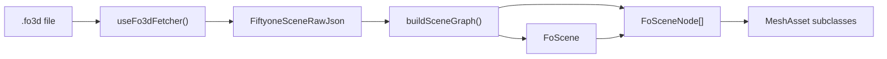
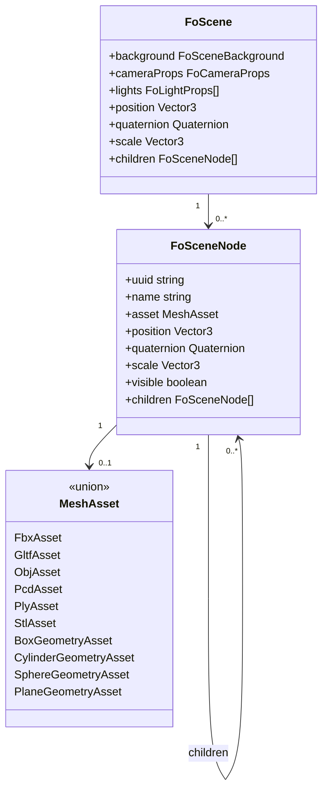
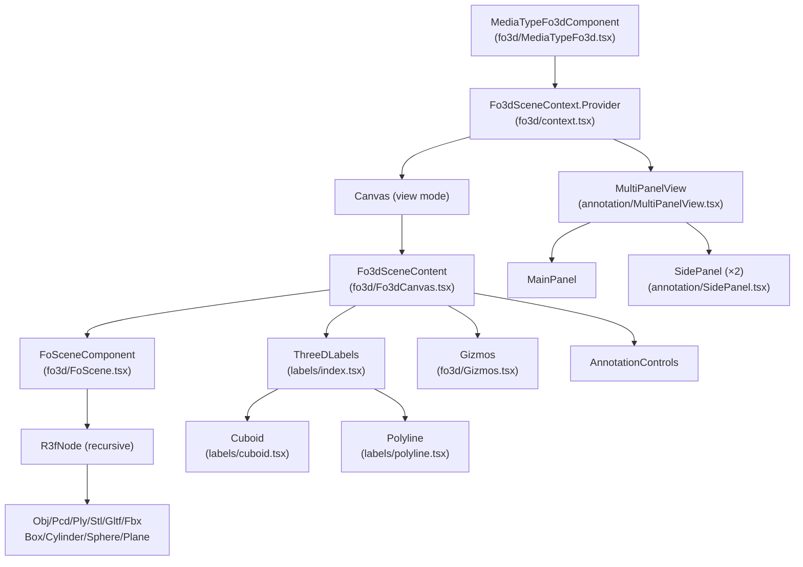
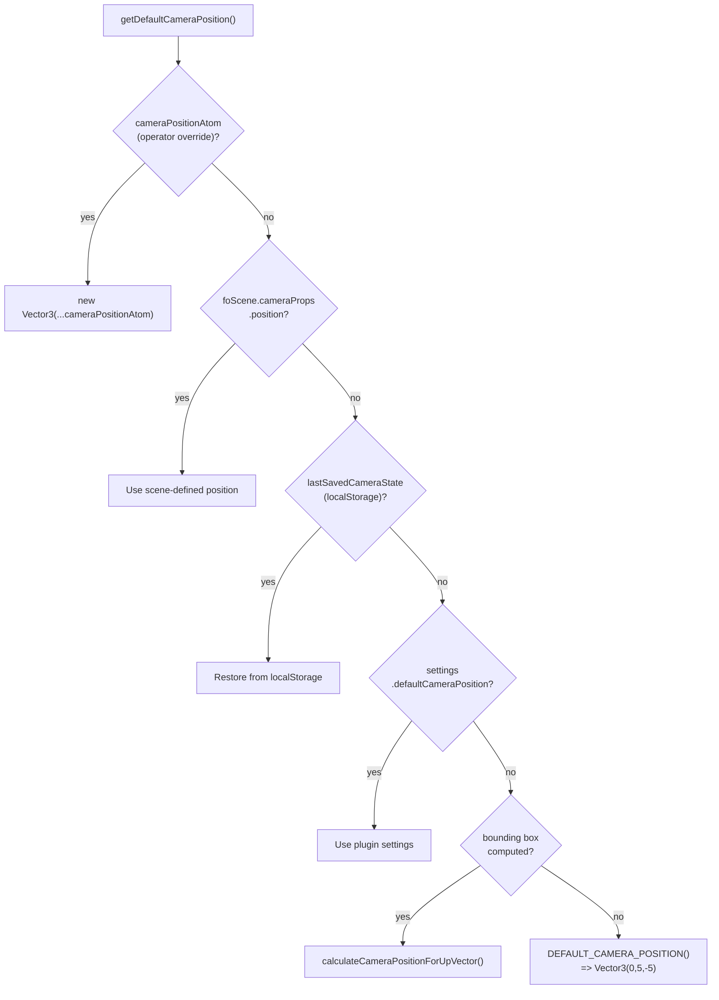
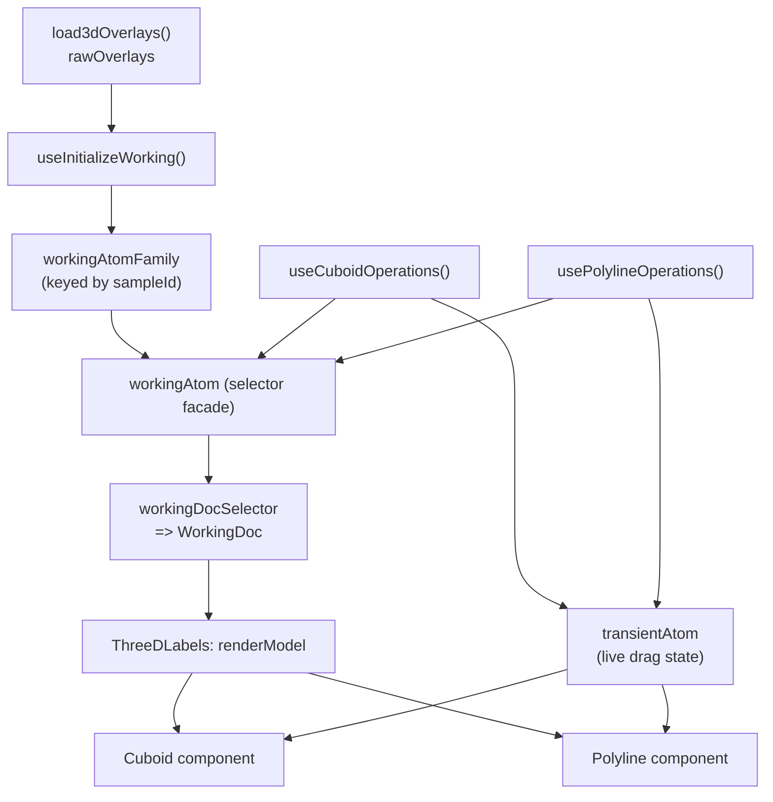

<!-- source: DeepWiki mcp.deepwiki.com · repo voxel51/fiftyone · page 4.3 3D Visualization · fetched 2026-10-21 -->

# 3D Visualization

Relevant source files

The following files were used as context for generating this wiki page:

- [app/packages/core/src/components/Modal/Sidebar/Annotate/Edit/Position3d.tsx](app/packages/core/src/components/Modal/Sidebar/Annotate/Edit/Position3d.tsx)
- [app/packages/looker-3d/src/StatusBar.tsx](app/packages/looker-3d/src/StatusBar.tsx)
- [app/packages/looker-3d/src/annotation/AnnotationPlane.tsx](app/packages/looker-3d/src/annotation/AnnotationPlane.tsx)
- [app/packages/looker-3d/src/annotation/CreateCuboidRenderer.tsx](app/packages/looker-3d/src/annotation/CreateCuboidRenderer.tsx)
- [app/packages/looker-3d/src/annotation/Crosshair3D.tsx](app/packages/looker-3d/src/annotation/Crosshair3D.tsx)
- [app/packages/looker-3d/src/annotation/GlobalCursorCoordinator.tsx](app/packages/looker-3d/src/annotation/GlobalCursorCoordinator.tsx)
- [app/packages/looker-3d/src/annotation/MainPanel.tsx](app/packages/looker-3d/src/annotation/MainPanel.tsx)
- [app/packages/looker-3d/src/annotation/MultiPanelView.tsx](app/packages/looker-3d/src/annotation/MultiPanelView.tsx)
- [app/packages/looker-3d/src/annotation/PolylinePointMarker.tsx](app/packages/looker-3d/src/annotation/PolylinePointMarker.tsx)
- [app/packages/looker-3d/src/annotation/SegmentPolylineRenderer.tsx](app/packages/looker-3d/src/annotation/SegmentPolylineRenderer.tsx)
- [app/packages/looker-3d/src/annotation/SidePanel.tsx](app/packages/looker-3d/src/annotation/SidePanel.tsx)
- [app/packages/looker-3d/src/annotation/annotation-toolbar/CoordinateInputs.tsx](app/packages/looker-3d/src/annotation/annotation-toolbar/CoordinateInputs.tsx)
- [app/packages/looker-3d/src/annotation/annotation-toolbar/useAnnotationActions.tsx](app/packages/looker-3d/src/annotation/annotation-toolbar/useAnnotationActions.tsx)
- [app/packages/looker-3d/src/annotation/store/index.ts](app/packages/looker-3d/src/annotation/store/index.ts)
- [app/packages/looker-3d/src/annotation/store/labelResolution.test.ts](app/packages/looker-3d/src/annotation/store/labelResolution.test.ts)
- [app/packages/looker-3d/src/annotation/store/labelResolution.ts](app/packages/looker-3d/src/annotation/store/labelResolution.ts)
- [app/packages/looker-3d/src/annotation/store/operations.ts](app/packages/looker-3d/src/annotation/store/operations.ts)
- [app/packages/looker-3d/src/annotation/store/renderModel.ts](app/packages/looker-3d/src/annotation/store/renderModel.ts)
- [app/packages/looker-3d/src/annotation/store/store.test.ts](app/packages/looker-3d/src/annotation/store/store.test.ts)
- [app/packages/looker-3d/src/annotation/store/transient.ts](app/packages/looker-3d/src/annotation/store/transient.ts)
- [app/packages/looker-3d/src/annotation/store/types.ts](app/packages/looker-3d/src/annotation/store/types.ts)
- [app/packages/looker-3d/src/annotation/store/working.ts](app/packages/looker-3d/src/annotation/store/working.ts)
- [app/packages/looker-3d/src/annotation/types.ts](app/packages/looker-3d/src/annotation/types.ts)
- [app/packages/looker-3d/src/annotation/useCuboidAnnotation.tsx](app/packages/looker-3d/src/annotation/useCuboidAnnotation.tsx)
- [app/packages/looker-3d/src/annotation/usePolylineAnnotation.tsx](app/packages/looker-3d/src/annotation/usePolylineAnnotation.tsx)
- [app/packages/looker-3d/src/annotation/useSetEditingToExisting3dLabel.tsx](app/packages/looker-3d/src/annotation/useSetEditingToExisting3dLabel.tsx)
- [app/packages/looker-3d/src/annotation/useSetEditingToNewCuboid.tsx](app/packages/looker-3d/src/annotation/useSetEditingToNewCuboid.tsx)
- [app/packages/looker-3d/src/annotation/useSyncWorkingToSidebar.ts](app/packages/looker-3d/src/annotation/useSyncWorkingToSidebar.ts)
- [app/packages/looker-3d/src/annotation/utils/polyline-utils.test.ts](app/packages/looker-3d/src/annotation/utils/polyline-utils.test.ts)
- [app/packages/looker-3d/src/annotation/utils/polyline-utils.ts](app/packages/looker-3d/src/annotation/utils/polyline-utils.ts)
- [app/packages/looker-3d/src/constants.ts](app/packages/looker-3d/src/constants.ts)
- [app/packages/looker-3d/src/fo3d/Annotation3d.tsx](app/packages/looker-3d/src/fo3d/Annotation3d.tsx)
- [app/packages/looker-3d/src/fo3d/Fo3dCanvas.tsx](app/packages/looker-3d/src/fo3d/Fo3dCanvas.tsx)
- [app/packages/looker-3d/src/fo3d/FoScene.tsx](app/packages/looker-3d/src/fo3d/FoScene.tsx)
- [app/packages/looker-3d/src/fo3d/MediaTypeFo3d.tsx](app/packages/looker-3d/src/fo3d/MediaTypeFo3d.tsx)
- [app/packages/looker-3d/src/fo3d/context.tsx](app/packages/looker-3d/src/fo3d/context.tsx)
- [app/packages/looker-3d/src/fo3d/scene-controls/SceneControls.tsx](app/packages/looker-3d/src/fo3d/scene-controls/SceneControls.tsx)
- [app/packages/looker-3d/src/fo3d/utils.ts](app/packages/looker-3d/src/fo3d/utils.ts)
- [app/packages/looker-3d/src/hooks/use-3d-annotation.ts](app/packages/looker-3d/src/hooks/use-3d-annotation.ts)
- [app/packages/looker-3d/src/hooks/use-camera-views.ts](app/packages/looker-3d/src/hooks/use-camera-views.ts)
- [app/packages/looker-3d/src/hooks/use-cursor-bounds.ts](app/packages/looker-3d/src/hooks/use-cursor-bounds.ts)
- [app/packages/looker-3d/src/hooks/use-empty-canvas-interaction.ts](app/packages/looker-3d/src/hooks/use-empty-canvas-interaction.ts)
- [app/packages/looker-3d/src/hooks/use-fo3d.ts](app/packages/looker-3d/src/hooks/use-fo3d.ts)
- [app/packages/looker-3d/src/hooks/use-mesh-material-controls.ts](app/packages/looker-3d/src/hooks/use-mesh-material-controls.ts)
- [app/packages/looker-3d/src/hooks/use3dAnnotationEventHandlers.ts](app/packages/looker-3d/src/hooks/use3dAnnotationEventHandlers.ts)
- [app/packages/looker-3d/src/index.ts](app/packages/looker-3d/src/index.ts)
- [app/packages/looker-3d/src/labels/DragGate3D.tsx](app/packages/looker-3d/src/labels/DragGate3D.tsx)
- [app/packages/looker-3d/src/labels/cuboid.tsx](app/packages/looker-3d/src/labels/cuboid.tsx)
- [app/packages/looker-3d/src/labels/index.tsx](app/packages/looker-3d/src/labels/index.tsx)
- [app/packages/looker-3d/src/labels/merge-utils.test.ts](app/packages/looker-3d/src/labels/merge-utils.test.ts)
- [app/packages/looker-3d/src/labels/merge-utils.ts](app/packages/looker-3d/src/labels/merge-utils.ts)
- [app/packages/looker-3d/src/labels/polyline.tsx](app/packages/looker-3d/src/labels/polyline.tsx)
- [app/packages/looker-3d/src/labels/shared/hooks.ts](app/packages/looker-3d/src/labels/shared/hooks.ts)
- [app/packages/looker-3d/src/types.ts](app/packages/looker-3d/src/types.ts)
- [app/packages/looker-3d/src/utils.test.ts](app/packages/looker-3d/src/utils.test.ts)
- [app/packages/looker-3d/src/utils.ts](app/packages/looker-3d/src/utils.ts)
- [app/packages/state/src/hooks/useTooltip.ts](app/packages/state/src/hooks/useTooltip.ts)
- [app/packages/state/src/hooks/useTooltip.utils.ts](app/packages/state/src/hooks/useTooltip.utils.ts)

This page documents the FO3D scene format, the frontend rendering pipeline for `.fo3d` samples, the `useFo3d` hook, the `FoScene` type hierarchy, camera control behavior, and the 3D annotation tools for cuboids and polylines. It covers the `app/packages/looker-3d` package exclusively.

For 2D image/video rendering, see [4.1 Media Viewing and the Looker System](#4.1). For the Lighter 2D engine (PixiJS), see [4.2 Lighter Rendering Engine](#4.2).

---

## The FO3D Format

A `.fo3d` file is a JSON document describing a 3D scene. It is the `filepath` stored in a FiftyOne sample whose media type is `fo3d`. The file is fetched over HTTP by the frontend and parsed into a typed scene graph.

The raw JSON is described by the `FiftyoneSceneRawJson` type in [app/packages/looker-3d/src/utils.ts:75-84]().

**Top-level fields:**

| Field | Type | Description |
|---|---|---|
| `background` | `FoSceneBackground \| null` | Solid color, equirectangular image, or cubemap |
| `camera` | `FoCameraProps` | Default camera position, look-at, up axis, fov, near, far |
| `lights` | `FoLightProps[]` | Ambient, point, directional, and spot lights |
| `_type` | string | Must be `"Scene"` |
| `position` | `[x, y, z]` | Root position |
| `quaternion` | `[x, y, z, w]` | Root rotation |
| `scale` | `[x, y, z]` | Root scale |
| `children` | `FoSceneRawNode[]` | Scene nodes |

Each `FoSceneRawNode` carries the same transform fields plus a `_type` discriminator identifying the asset class (e.g. `"PcdPointCloud"`, `"FbxMesh"`, `"BoxGeometry"`), and a `defaultMaterial` object.

**Supported `_type` values and their resolved asset classes:**

| `_type` suffix | Asset class | Key path field |
|---|---|---|
| `FbxMesh` | `FbxAsset` | `fbxPath` |
| `GltfMesh` | `GltfAsset` | `gltfPath` |
| `ObjMesh` | `ObjAsset` | `objPath`, `mtlPath` |
| `StlMesh` | `StlAsset` | `stlPath` |
| `PlyMesh` | `PlyAsset` | `plyPath` |
| `PointCloud` | `PcdAsset` | `pcdPath` |
| `BoxGeometry` | `BoxGeometryAsset` | width, height, depth |
| `CylinderGeometry` | `CylinderGeometryAsset` | radiusTop, radiusBottom, height… |
| `SphereGeometry` | `SphereGeometryAsset` | radius, widthSegments… |
| `PlaneGeometry` | `PlaneGeometryAsset` | width, height |

Sources: [app/packages/looker-3d/src/utils.ts:18-84](), [app/packages/looker-3d/src/hooks/use-fo3d.ts:13-130]()

---

## Scene Parsing: `useFo3d`

**FO3D scene parse data flow**

Sources: [app/packages/looker-3d/src/hooks/use-fo3d.ts:218-433]()

`useFo3d(url, filepath, fo3dRoot)` is the primary parsing hook. It:

1. Calls `useFo3dFetcher` to fetch and cache the JSON.
2. Strips any `preTransformed*` attributes (enterprise-only; not used in OSS).
3. Stores the raw data in `fos.fo3dContent` (a Recoil atom).
4. Runs `buildSceneGraph` recursively to convert each `FoSceneRawNode` into a typed `FoSceneNode` with concrete `MeshAsset` instances and Three.js `Vector3`/`Quaternion` objects.
5. Resolves relative `background.image` and `background.cube` paths against `fo3dRoot`.
6. Returns `{ foScene: FoScene | null, isLoading: boolean }`.

**`FoScene` and `FoSceneNode` types**

Sources: [app/packages/looker-3d/src/hooks/use-fo3d.ts:192-208](), [app/packages/looker-3d/src/utils.ts:18-84]()

---

## Component Architecture

**3D rendering component hierarchy**

Sources: [app/packages/looker-3d/src/fo3d/MediaTypeFo3d.tsx:82-747](), [app/packages/looker-3d/src/fo3d/Fo3dCanvas.tsx:96-184](), [app/packages/looker-3d/src/fo3d/FoScene.tsx:246-297](), [app/packages/looker-3d/src/annotation/MultiPanelView.tsx:1-50]()

### `MediaTypeFo3dComponent`

Declared in [app/packages/looker-3d/src/fo3d/MediaTypeFo3d.tsx:82-747](), this is the top-level React component mounted when a sample has media type `fo3d`. Its responsibilities:

- Resolves the `.fo3d` URL from `fos.fo3dSample` and `fos.selectedMediaField`.
- Calls `useFo3d` to parse the scene.
- Manages scene-level state: `upVector`, `lookAt`, bounding box via `useFo3dBounds`, camera position precedence, `autoRotate`, `raycastPrecision`, `hoverMetadata`.
- Provides `Fo3dSceneContext` to all descendants.
- Switches between single-canvas view mode and `MultiPanelView` when `mode === "annotate"`.
- Renders `AnnotationToolbar` when a cuboid or polyline annotation mode is active.

### `Fo3dSceneContext`

Defined in [app/packages/looker-3d/src/fo3d/context.tsx:16-58](), this React context carries shared 3D scene state:

| Field | Type | Description |
|---|---|---|
| `isSceneInitialized` | boolean | True once first camera position is set |
| `upVector` | `Vector3 \| null` | World "up" direction, persisted to localStorage |
| `sceneBoundingBox` | `Box3 \| null` | Computed from loaded assets |
| `cursorBounds` | `Box3 \| null` | Annotation cursor movement limits |
| `fo3dRoot` | string | Base URL for resolving relative asset paths |
| `autoRotate` | boolean | Enables OrbitControls auto-rotation |
| `raycastPrecision` | number | 1–10 scale controlling ray hit area |
| `pointCloudSettings` | `Fo3dPointCloudSettings` | `{ enableTooltip }` |
| `pluginSettings` | `Looker3dSettings` | Settings from `usePluginSettings("3d")` |

### `Fo3dSceneContent`

Declared in [app/packages/looker-3d/src/fo3d/Fo3dCanvas.tsx:96-173](), this is the R3F tree rendered inside the `<Canvas>` element. It mounts:

- `PerspectiveCameraDrei` — defaults from `foScene.cameraProps` (fov, near, far, aspect).
- `CameraControls` (from `@react-three/drei`) or `OrbitControls` when `autoRotate` is on.
- `SceneControls` — a `leva` debug panel with scene-level controls.
- `Gizmos` — axis helper and grid.
- `FoSceneComponent` — renders the scene graph.
- `ThreeDLabels` — renders cuboid/polyline overlays.
- `FrustumCollection` — frustum visualization (if any).
- `AnnotationControls` — cuboid/polyline creation renderers when in annotate mode.

### `FoSceneComponent` and `R3fNode`

`FoSceneComponent` in [app/packages/looker-3d/src/fo3d/FoScene.tsx:246-297]() builds a `leva` visibility map from the parsed scene, then renders `SceneR3f`, which walks the `FoScene.children` array and renders each as an `R3fNode`.

`R3fNode` (lines 184–224) checks the visibility map and calls `getAssetJsx` to dispatch to the correct Three.js component:

| Asset class | R3F component | File |
|---|---|---|
| `ObjAsset` | `<Obj>` | `fo3d/mesh/Obj` |
| `PcdAsset` | `<Pcd>` | `fo3d/point-cloud/Pcd` |
| `PlyAsset` | `<Ply>` | `fo3d/mesh/Ply` |
| `StlAsset` | `<Stl>` | `fo3d/mesh/Stl` |
| `GltfAsset` | `<Gltf>` | `fo3d/mesh/Gltf` |
| `FbxAsset` | `<Fbx>` | `fo3d/mesh/Fbx` |
| `BoxGeometryAsset` | `<Box>` | `fo3d/shape/Box` |
| `CylinderGeometryAsset` | `<Cylinder>` | `fo3d/shape/Cylinder` |
| `SphereGeometryAsset` | `<Sphere>` | `fo3d/shape/Sphere` |
| `PlaneGeometryAsset` | `<Plane>` | `fo3d/shape/Plane` |

Each node is wrapped in `<AssetErrorBoundary>` and `<Suspense>`.

Sources: [app/packages/looker-3d/src/fo3d/FoScene.tsx:41-182](), [app/packages/looker-3d/src/fo3d/FoScene.tsx:184-244]()

---

## Camera System

### Position Priority

`getDefaultCameraPosition()` in [app/packages/looker-3d/src/fo3d/MediaTypeFo3d.tsx:324-401]() resolves the initial camera position through a priority chain.

**Camera position priority chain**

Sources: [app/packages/looker-3d/src/fo3d/MediaTypeFo3d.tsx:324-401](), [app/packages/looker-3d/src/fo3d/utils.ts:26-63](), [app/packages/looker-3d/src/utils.ts:600-670]()

Camera state is persisted to `localStorage` keyed as `${datasetName}-fo3d-camera-position` via `saveCameraState` / `getSavedCameraState` in [app/packages/looker-3d/src/fo3d/utils.ts:26-63]().

### Up Vector

The up vector determines which axis is "up" for the scene. It is resolved in `getDefaultUpVector()` [app/packages/looker-3d/src/fo3d/MediaTypeFo3d.tsx:125-162]():

1. `foScene.cameraProps.up` string (`"X"`, `"Y"`, `"Z"`, `"-X"`, `"-Y"`, `"-Z"`)
2. `settings.defaultUp` from plugin settings
3. Default: `new Vector3(0, 1, 0)` (Y-up)

The up vector is persisted to localStorage as `fo3d-up-vector`.

### Camera View Events

Three window-level custom events drive programmatic camera changes (dispatched by `StatusBar` actions):

| Event constant | Effect |
|---|---|
| `SET_TOP_VIEW_EVENT` | Moves camera above scene bounding box along up vector |
| `SET_EGO_VIEW_EVENT` | Moves camera to a ~5° angled perspective view (`"pov"` mode) |
| `SET_ZOOM_TO_SELECTED_EVENT` | Zooms and re-centers on the selected 3D label |

Sources: [app/packages/looker-3d/src/constants.ts:17-19](), [app/packages/looker-3d/src/fo3d/MediaTypeFo3d.tsx:505-549]()

### Mouse Controls

Mouse button bindings update dynamically based on keyboard state tracked in `keyState` [app/packages/looker-3d/src/fo3d/MediaTypeFo3d.tsx:204-265]():

| Keys held | Left-button drag |
|---|---|
| None | Rotate (`CameraControlsImpl.ACTION.ROTATE`) |
| Shift | Truck (pan) |
| Ctrl | Dolly (zoom) |

Camera controls are disabled entirely during active cuboid creation, polyline segmentation, or transform drag operations.

---

## Point Cloud Shading

Point cloud assets (`PcdAsset`, `PlyAsset` with `isPcd=true`) are shaded according to `FoPointcloudMaterialProps.shadingMode`:

| `shadingMode` | Description |
|---|---|
| `"height"` | Color mapped along the scene's up axis |
| `"intensity"` | Uses scalar intensity attribute from PCD file |
| `"rgb"` | Uses per-point RGB color attributes |
| `"custom"` | Solid `customColor` |

The colorscale for height/intensity shading uses the red-to-blue gradient defined in `DEFAULT_PCD_SHADING_GRADIENTS_RED_TO_BLUE` [app/packages/looker-3d/src/constants.ts:77-92]().

Sources: [app/packages/looker-3d/src/hooks/use-fo3d.ts:184-191]()

---

## 3D Label Overlays

`ThreeDLabels` in [app/packages/looker-3d/src/labels/index.tsx:59-374]() is responsible for rendering all 3D annotations on a sample. It:

1. Calls `load3dOverlays(sampleMap, selectedLabels, [], schema)` to extract raw label data.
2. Computes per-label colors via `getLabelColor`.
3. Filters labels by `pathFilter` and, in annotate mode, by `annotationSchemas`.
4. In annotate mode, reads from `workingAtom` (the working store) instead of raw overlays.
5. Renders `Cuboid` components for `Detection3D` labels and `Polyline` components for `Polyline3D` labels, each wrapped in a `DragGate3D` (suppresses click if pointer has moved more than `DRAG_GATE_THRESHOLD_PX`).

### `Cuboid` Component

Declared in [app/packages/looker-3d/src/labels/cuboid.tsx:32-289]().

- Renders a `lineSegments2` edge outline using `LineSegmentsGeometry` (from `three/examples/jsm`) and a transparent `meshBasicMaterial` volume for click detection.
- Applies `useLegacyCoordinates` adjustment: legacy data stored location as top-center; new format stores geometric center.
- Supports translate, rotate, and scale transforms via `Transformable` / `TransformControls` when selected.
- Shows a wireframe complementary-color overlay when selected for annotation.
- `userData.labelId` is set via `FO_USER_DATA.LABEL_ID` for scene traversal lookup.

### `Polyline` Component

Declared in [app/packages/looker-3d/src/labels/polyline.tsx:30-293]().

- Renders each segment with `LineDrei` from `@react-three/drei`.
- When `closed=true`, adds a closing segment from last to first point per segment.
- When `filled=true`, creates `MeshBasicMaterial` + `createFilledPolygonMeshes` for polygon fill.
- Has point markers (selectable spheres) when selected for annotation.
- Supports whole-polyline translation via `Transformable`.

Sources: [app/packages/looker-3d/src/labels/index.tsx](), [app/packages/looker-3d/src/labels/cuboid.tsx](), [app/packages/looker-3d/src/labels/polyline.tsx]()

---

## Annotation Tools

When `mode === "annotate"` (set by the annotation operator), `MediaTypeFo3dComponent` switches to `MultiPanelView` and renders `AnnotationToolbar`.

### Multi-Panel Layout

`MultiPanelView` in [app/packages/looker-3d/src/annotation/MultiPanelView.tsx]() creates a CSS grid with three panels:

- **Main panel** (`MainPanel`): perspective camera, same as single-canvas view.
- **Side-top panel** (`SidePanel`, `panelId="side-top"`): orthographic camera, default view `"Front"`.
- **Side-bottom panel** (`SidePanel`, `panelId="side-bottom"`): orthographic camera, default view `"Right"`.

Each `SidePanel` (in [app/packages/looker-3d/src/annotation/SidePanel.tsx]()) uses `OrthographicCamera` + `MapControls` (pan/zoom only, no rotate), and supports view switching via a dropdown: Top, Bottom, Left, Right, Front, Back, or an Image Slice (if available from camera sensor data).

A `RaycastService` per panel intercepts pointer events and computes world-space intersection points using the annotation plane for vertex placement.

A `Crosshair3D` component renders a synchronized crosshair indicator in orthographic panels to help with spatial alignment across views.

### Annotation Toolbar

`AnnotationToolbar` renders `AnnotationActionGroup[]` returned by `useAnnotationActions` in [app/packages/looker-3d/src/annotation/annotation-toolbar/useAnnotationActions.tsx]().

**Action groups:**

| Group | Actions |
|---|---|
| `edit-actions` | Field selector (active annotation field), Deselect (Esc) |
| `polyline-actions` | New Segment, Edit Segments, Snap Close Automatically |
| `cuboid-actions` | Create Cuboid (toggle creation mode) |
| `general-actions` | Delete (Delete key), Toggle Annotation Plane |
| `transform-actions` | Translate, Rotate, Scale |
| `coordinate-inputs` | XYZ numeric inputs for selected point or annotation plane |

### Cuboid Creation

`CreateCuboidRenderer` in [app/packages/looker-3d/src/annotation/CreateCuboidRenderer.tsx]() implements a 3-click workflow:

1. **Click 1**: Sets center position (raycasted against annotation plane).
2. **Click 2**: Sets orientation direction (defines rotation from center).
3. **Click 3**: Commits width; height/depth use defaults.

The created cuboid is written to `workingAtom` via `useCuboidOperations().createCuboid`.

### Polyline Creation

`SegmentPolylineRenderer` in [app/packages/looker-3d/src/annotation/SegmentPolylineRenderer.tsx]() implements interactive vertex placement:

- Each click adds a vertex (raycasted against the annotation plane).
- A "rubber band" dashed line follows the cursor from the last placed vertex.
- **Double-click**: Commits segment without the duplicate vertex.
- **Click near first vertex** (within `SNAP_TOLERANCE = 0.5`): Closes the loop.
- **Delete/Backspace**: Removes last placed vertex.
- **Escape**: Cancels active segment.
- Completed segments are added to an existing polyline (multi-segment support) or create a new label.

Sources: [app/packages/looker-3d/src/constants.ts:103](), [app/packages/looker-3d/src/annotation/SegmentPolylineRenderer.tsx]()

### Annotation Plane

`AnnotationPlane` provides a manipulable transparent plane to constrain vertex placement to a 2D surface. Its state lives in `annotationPlaneAtom` which holds `{ enabled, position, quaternion, showX, showY, showZ }`. Raycasting in `RaycastService` and `SegmentPolylineRenderer` uses `getPlaneFromPositionAndQuaternion()` [app/packages/looker-3d/src/utils.ts:336-351]() to compute the Three.js `Plane` for intersection testing.

---

## Annotation State: Working Store

**Annotation data flow**

Sources: [app/packages/looker-3d/src/annotation/store/working.ts](), [app/packages/looker-3d/src/annotation/store/operations.ts]()

### `workingAtomFamily` and `workingAtom`

Defined in [app/packages/looker-3d/src/annotation/store/working.ts:47-82]().

- `workingAtomFamily` is a Recoil `atomFamily` keyed by `sampleId`. Each sample has its own `WorkingState: { doc: WorkingDoc, initialized: boolean }`.
- `workingAtom` is a `selector` that automatically reads/writes the family entry for `fos.currentSampleId`.
- `WorkingDoc` has `labelsById: Record<LabelId, ReconciledDetection3D | ReconciledPolyline3D>` and `deletedIds: Set<LabelId>`.

### Initialization and Patching

`useInitializeWorking(rawOverlays)` [app/packages/looker-3d/src/annotation/store/working.ts:125-244]():

- On first entering annotate mode, populates `labelsById` from `rawOverlays`.
- On subsequent re-renders where `rawOverlays` changes (coloring, schema, filter), patches the working store: updates colors, removes labels no longer in schema (unless `isNew` or soft-deleted), adds newly available labels.
- `useResetWorkingOnModeChange` clears the store when leaving annotate mode.

### Transient Store

A separate `transientAtom` holds live drag preview state (position/dimension/quaternion deltas) without writing to the undoable working store. The `Cuboid` and `Polyline` components read from `transientAtom` for smooth real-time drag feedback, then `finalizeCuboidDrag` / `finalizePolylineDrag` in `operations.ts` commits the final delta to `workingAtom` as an undoable operation via `usePushUndoable`.

### Undo/Redo

All label mutations in `useCuboidOperations` and `usePolylineOperations` [app/packages/looker-3d/src/annotation/store/operations.ts]() use `createPushAndExec(key, execFn, undoFn)` from `@fiftyone/commands` `usePushUndoable(KnownContexts.ModalAnnotate)`, registering both the forward and undo functions in the undo history.

---

## Plugin Settings: `Looker3dSettings`

The 3D viewer reads plugin settings via `usePluginSettings<Looker3dSettings>("3d")`. Relevant fields:

| Setting | Effect |
|---|---|
| `defaultUp` | `[x,y,z]` up vector override |
| `defaultCameraPosition` | `{x,y,z}` initial camera position |
| `useLegacyCoordinates` | Shifts cuboid Y by `-0.5 * height` |
| `overlay.rotation` | Global euler rotation applied to all overlays |
| `overlay.itemRotation` | Per-item euler rotation fallback |

Sources: [app/packages/looker-3d/src/fo3d/MediaTypeFo3d.tsx:91-162](), [app/packages/looker-3d/src/labels/index.tsx:71-181]()

---

