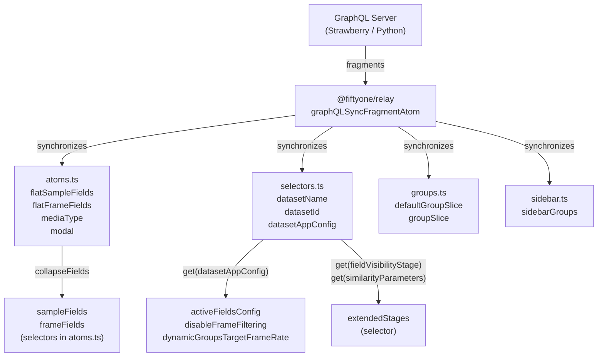
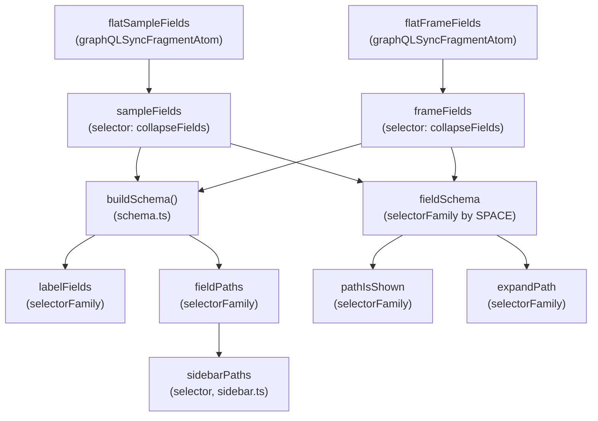
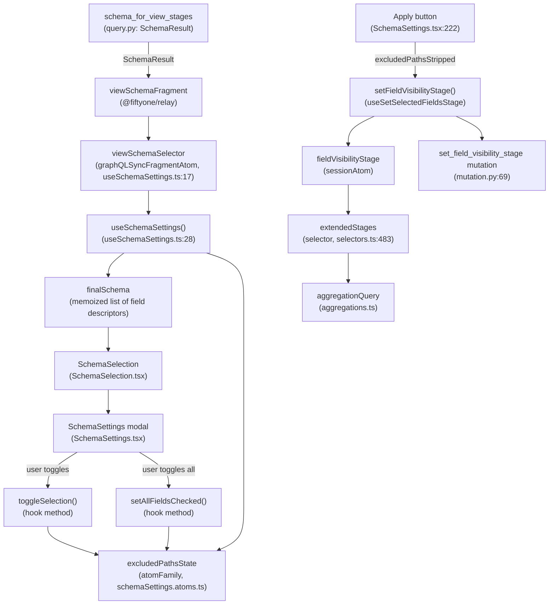
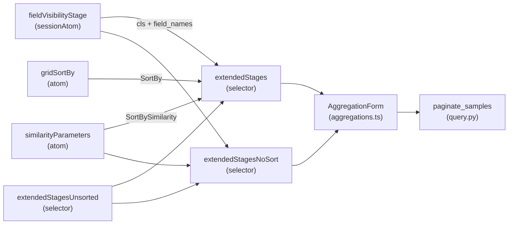
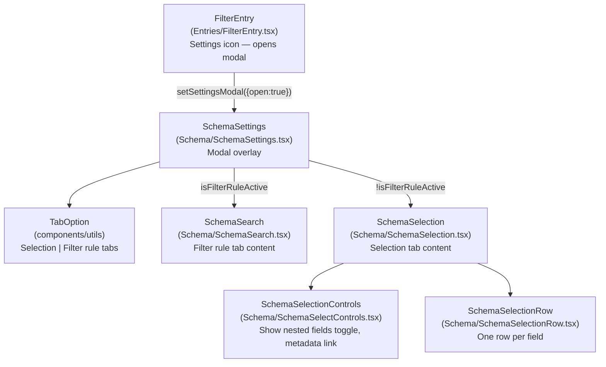

<!-- source: DeepWiki mcp.deepwiki.com · repo voxel51/fiftyone · page 4.4 State Management and Schema Settings · fetched 2026-10-21 -->

# State Management and Schema Settings

<details>
<summary>Relevant source files</summary>

The following files were used as context for generating this wiki page:

- [app/packages/app/src/components/DatasetSelector.tsx](app/packages/app/src/components/DatasetSelector.tsx)
- [app/packages/app/src/useSetters/onSetFieldVisibilityStage.ts](app/packages/app/src/useSetters/onSetFieldVisibilityStage.ts)
- [app/packages/core/src/components/Schema/SchemaSearch.tsx](app/packages/core/src/components/Schema/SchemaSearch.tsx)
- [app/packages/core/src/components/Schema/SchemaSearchHelp.tsx](app/packages/core/src/components/Schema/SchemaSearchHelp.tsx)
- [app/packages/core/src/components/Schema/SchemaSelectControls.tsx](app/packages/core/src/components/Schema/SchemaSelectControls.tsx)
- [app/packages/core/src/components/Schema/SchemaSelection.tsx](app/packages/core/src/components/Schema/SchemaSelection.tsx)
- [app/packages/core/src/components/Schema/SchemaSettings.tsx](app/packages/core/src/components/Schema/SchemaSettings.tsx)
- [app/packages/core/src/components/Sidebar/Entries/FilterEntry.tsx](app/packages/core/src/components/Sidebar/Entries/FilterEntry.tsx)
- [app/packages/core/src/components/Sidebar/Sidebar.tsx](app/packages/core/src/components/Sidebar/Sidebar.tsx)
- [app/packages/looker/src/elements/common/tags.ts](app/packages/looker/src/elements/common/tags.ts)
- [app/packages/looker/src/elements/imavid/frame-count.ts](app/packages/looker/src/elements/imavid/frame-count.ts)
- [app/packages/state/src/hooks/index.ts](app/packages/state/src/hooks/index.ts)
- [app/packages/state/src/hooks/useSchemaSettings.ts](app/packages/state/src/hooks/useSchemaSettings.ts)
- [app/packages/state/src/hooks/useSchemaSettings.utils.test.ts](app/packages/state/src/hooks/useSchemaSettings.utils.test.ts)
- [app/packages/state/src/hooks/useSchemaSettings.utils.ts](app/packages/state/src/hooks/useSchemaSettings.utils.ts)
- [app/packages/state/src/recoil/aggregations.test.ts](app/packages/state/src/recoil/aggregations.test.ts)
- [app/packages/state/src/recoil/aggregations.ts](app/packages/state/src/recoil/aggregations.ts)
- [app/packages/state/src/recoil/atoms.ts](app/packages/state/src/recoil/atoms.ts)
- [app/packages/state/src/recoil/groups.ts](app/packages/state/src/recoil/groups.ts)
- [app/packages/state/src/recoil/labels.ts](app/packages/state/src/recoil/labels.ts)
- [app/packages/state/src/recoil/schema.ts](app/packages/state/src/recoil/schema.ts)
- [app/packages/state/src/recoil/schemaSettings.atoms.test.ts](app/packages/state/src/recoil/schemaSettings.atoms.test.ts)
- [app/packages/state/src/recoil/schemaSettings.atoms.ts](app/packages/state/src/recoil/schemaSettings.atoms.ts)
- [app/packages/state/src/recoil/selectors.ts](app/packages/state/src/recoil/selectors.ts)
- [app/packages/state/src/recoil/sidebar.ts](app/packages/state/src/recoil/sidebar.ts)
- [app/packages/state/src/recoil/types.ts](app/packages/state/src/recoil/types.ts)
- [app/packages/utilities/src/index.ts](app/packages/utilities/src/index.ts)
- [app/schema.graphql](app/schema.graphql)
- [app/vite.config.ts](app/vite.config.ts)
- [fiftyone/server/aggregations.py](fiftyone/server/aggregations.py)
- [fiftyone/server/mutation.py](fiftyone/server/mutation.py)
- [fiftyone/server/query.py](fiftyone/server/query.py)
- [fiftyone/server/view.py](fiftyone/server/view.py)
- [tests/unittests/server_view_tests.py](tests/unittests/server_view_tests.py)

</details>


## Purpose and Scope

This document covers the Recoil-based frontend state management architecture in the FiftyOne App (`@fiftyone/state`), with a focus on the schema settings subsystem: field visibility controls, the `useSchemaSettings` hook, and the `SchemaSettings` UI component.

This document is scoped to the **client-side** state layer. For server-side state synchronization and the `StateDescription` shared object, see [3.1](#3.1). For the GraphQL API that feeds data into this layer, see [3.2](#3.2). For how schema fields are defined and stored in the Python core, see [2.3](#2.3).

---

## Recoil State Architecture Overview

The FiftyOne frontend uses [Recoil](https://recoiljs.org/) as its primary state management library. State is distributed across multiple files in `app/packages/state/src/recoil/`, each scoped to a domain.

A key architectural pattern is `graphQLSyncFragmentAtom` (from `@fiftyone/relay`), which bridges a Relay GraphQL fragment to a Recoil atom. When the Relay store updates (e.g., after a query response), the atom's value is automatically synchronized. This avoids manual subscription management and keeps server data and Recoil in sync.

**Atom/Selector Architecture — Key Modules**



Sources: [app/packages/state/src/recoil/atoms.ts:1-415](), [app/packages/state/src/recoil/selectors.ts:1-200](), [app/packages/state/src/recoil/groups.ts:1-100]()

---

## Core Atom Categories

The table below maps major Recoil atoms by domain to their defining module.

| Domain | Atoms / Selectors | Module |
|---|---|---|
| Dataset schema | `flatSampleFields`, `sampleFields`, `flatFrameFields`, `frameFields` | `atoms.ts` |
| Dataset identity | `datasetName`, `datasetId`, `mediaType` | `selectors.ts` |
| App config | `datasetAppConfig`, `activeFieldsConfig`, `disableFrameFiltering` | `selectors.ts` |
| Selection | `selectedSamples`, `selectedLabels`, `hiddenLabels` | `atoms.ts` |
| UI state | `modal`, `fullscreen`, `loading`, `theme`, `isSidebarFilterMode` | `atoms.ts` |
| Schema settings | `schemaSearchTerm`, `schemaSelectedSettingsTab`, `settingsModal`, `allFieldsCheckedState`, `excludedPathsState`, `expandedPathsState`, `showNestedFieldsState`, `fieldVisibilityStage` | `schemaSettings.atoms.ts` |
| Extended stages | `extendedStages`, `extendedStagesNoSort`, `extendedStagesUnsorted` | `selectors.ts` |
| Aggregations | `aggregationQuery`, `aggregations`, `aggregation` | `aggregations.ts` |

`flatSampleFields` and `flatFrameFields` are `graphQLSyncFragmentAtom` instances backed by the `sampleFieldsFragment` and `frameFieldsFragment` GraphQL fragments respectively. Their selectors `sampleFields` and `frameFields` run `collapseFields` to reconstruct the nested tree from the flat server representation.

Sources: [app/packages/state/src/recoil/atoms.ts:131-184](), [app/packages/state/src/recoil/atoms.ts:381-384](), [app/packages/state/src/recoil/selectors.ts:23-55](), [app/packages/state/src/recoil/selectors.ts:130-163]()

---

## Schema Settings Atoms

All atoms and derived selectors specific to the schema settings panel live in `app/packages/state/src/recoil/schemaSettings.atoms.ts`.

**Tab system:**

```ts
TAB_OPTIONS_MAP = { SELECTION: "Selection", FILTER_RULE: "Filter rule" }
```

| Atom / Selector | Type | Purpose |
|---|---|---|
| `schemaSearchTerm` | `atom<string>` | Current text in the schema search box |
| `schemaSelectedSettingsTab` | `atom<string>` | Active tab: `"Selection"` or `"Filter rule"` |
| `showNestedFieldsState` | `atom<boolean>` | Whether nested sub-fields are shown |
| `settingsModal` | `atom<{open: boolean} \| null>` | Controls field visibility modal open/close |
| `allFieldsCheckedState` | `atom<boolean>` | Tracks if all fields are currently checked |
| `expandedPathsState` | `atom<{} \| null>` | Tree expansion state for field paths |
| `excludedPathsState` | `atomFamily` keyed by params | Per-dataset `Set<string>` of hidden field paths |
| `fieldVisibilityStage` | `sessionAtom` | The serialized `ExcludeFields` stage to be sent to server |
| `isFieldVisibilityActive` | `selector<boolean>` | True when `fieldVisibilityStage` has non-empty `field_names` |
| `excludedPathsStrippedState` | `selector<string[]>` | `excludedPaths` with `frames.` prefix removed for server consumption |

`fieldVisibilityStage` is a `sessionAtom` (session-scoped, resets on dataset change) with shape `{ cls: string, kwargs: { field_names: string[] } }`.

Sources: [app/packages/state/src/recoil/schemaSettings.atoms.ts:17-51]()

---

## The `useSchemaSettings` Hook

`useSchemaSettings` in `app/packages/state/src/hooks/useSchemaSettings.ts` is the central orchestrator for the schema settings panel. It is consumed by both `SchemaSettings.tsx` and `FilterEntry.tsx`.

**Schema data acquisition:**

The hook uses a `viewSchemaSelector` — a `graphQLSyncFragmentAtom` backed by `foq.viewSchemaFragment` — to read the current view's schema from the Relay store:

```
viewSchemaSelector → data.schemaForViewStages → { fieldSchemaRaw, frameFieldSchema }
```

These are keyed by path using `lodash.keyBy` to produce `fieldSchema` and `viewSchema` dictionaries, then merged into `combinedSchema`.

[app/packages/state/src/hooks/useSchemaSettings.ts:17-91]()

**`finalSchema` computation:**

`finalSchema` is a memoized list of field descriptor objects, each carrying:

| Field | Description |
|---|---|
| `path` | Dot-separated field path |
| `count` | Nesting depth |
| `isSelected` | Whether the field is currently visible |
| `pathLabelFinal` | Display label (full or leaf) |
| `skip` | Result of `skipField()` — should not be rendered |
| `disabled` | Result of `disabledField()` — cannot be toggled |
| `info`, `description`, `name` | Field metadata from schema |

It filters out paths that should be skipped, applies nesting filters, and sorts enabled fields before disabled ones.

[app/packages/state/src/hooks/useSchemaSettings.ts:145-250]()

**Key returned functions:**

| Function | Behavior |
|---|---|
| `toggleSelection(path, checked)` | Adds/removes a path and all its sub-paths from `excludedPaths` |
| `setAllFieldsChecked(val)` | Checks or unchecks all fields; respects `includeNestedFields` |
| `resetExcludedPaths()` | Clears `excludedPaths` for the current dataset |
| `setIncludeNestedFields(val)` | Updates the nested fields search filter |

`toggleSelection` uses `getSubPaths` from `useSchemaSettings.utils.ts` to compute all descendant paths that should be toggled together.

[app/packages/state/src/hooks/useSchemaSettings.ts:264-338]()

---

## Field Visibility Utility Functions

`app/packages/state/src/hooks/useSchemaSettings.utils.ts` provides pure utility functions used by `useSchemaSettings` and schema selectors.

| Function | Signature | Purpose |
|---|---|---|
| `skipField(path, schema)` | `(string, {}) → boolean` | Returns `true` if the field type should be hidden entirely (e.g., unsupported types, internal sub-fields) |
| `disabledField(path, schema, ...)` | `(string, ...) → boolean` | Returns `true` if the field cannot be toggled (e.g., `id`, `filepath`, view-specific locked paths) |
| `getSubPaths(path, schema, mediaType, frameSchema)` | `(...) → Set<string>` | Returns the given path plus all descendant paths in the schema |
| `getPath(path, mediaType, frameSchema)` | `(...) → string` | Prefixes with `frames.` for video frame fields |

`skipField` checks against `SKIP_FIELD_TYPES` (array, dict, vector fields) and also skips internal label sub-fields like `bounding_box` and `index` that are not user-configurable.

`disabledField` permanently disables `id`, `filepath`, `tags`, `metadata` and view-specific paths like `sample_id` in patches/clips views.

Sources: [app/packages/state/src/hooks/useSchemaSettings.utils.ts:39-250]()

---

## Schema-related Selectors

`app/packages/state/src/recoil/schema.ts` provides selectors used throughout the sidebar and overlay systems.

**Schema Selector Architecture**



Sources: [app/packages/state/src/recoil/schema.ts:40-160](), [app/packages/state/src/recoil/atoms.ts:146-184]()

Key selectors from `schema.ts`:

| Selector | Purpose |
|---|---|
| `fieldSchema(space)` | Schema dict for `SAMPLE` or `FRAME` space |
| `buildSchema(sampleFields, frameFields)` | Merges sample + frame fields into unified schema with `frames.*` prefix |
| `pathIsShown(path)` | Whether a given path is currently displayed in the sidebar |
| `labelFields({space})` | All label-type field paths for a space |
| `expandPath(path)` | Resolves a label field path to its child label list path |
| `filterPaths(paths, schema)` | Filters out paths not present in schema |

---

## Field Visibility Data Flow

**Schema Settings Flow: From Server to Applied Stage**



Sources: [app/packages/state/src/hooks/useSchemaSettings.ts:17-122](), [app/packages/state/src/recoil/selectors.ts:483-515](), [app/packages/core/src/components/Schema/SchemaSettings.tsx:220-234](), [fiftyone/server/mutation.py:69-79]()

**Apply action detail:**

When the user clicks Apply in `SchemaSettings.tsx`, the handler:

1. Calls `resetAttributeFilters()` — clears `filters`, `modalFilters`, `attributeVisibility`, `modalAttributeVisibility`
2. Calls `setFieldVisibilityStage({ cls: "fiftyone.core.stages.ExcludeFields", kwargs: { field_names: excludedPathsStripped } })`
3. Closes the modal

`excludedPathsStripped` is computed by `excludedPathsStrippedState` — it reads the `Set<string>` from `excludedPathsState` for the current dataset, converts it to an array, and strips the `frames.` prefix from frame field paths (the server expects raw frame field names).

When Reset is clicked:
1. `resetFieldVisibilityStage()` — resets `fieldVisibilityStage` to `null`
2. `resetExcludedPaths()` — sets `excludedPaths` to `{ [datasetName]: new Set() }`
3. Clears search state

Sources: [app/packages/core/src/components/Schema/SchemaSettings.tsx:78-257]()

---

## Integration with Extended Stages

The `extendedStages` selector in `selectors.ts` is the central place where field visibility, similarity search, and sort parameters are combined before being sent to the server.



`extendedStages` is used in most aggregation queries. `extendedStagesNoSort` is used for aggregations where sort order is not relevant (e.g., counting).

The field visibility stage is serialized as:
```
{ "fiftyone.core.stages.ExcludeFields": { "field_names": [...], "_allow_missing": true } }
```

This matches the Python `ExcludeFields` view stage constructor, which is applied server-side to drop fields from the projection.

Sources: [app/packages/state/src/recoil/selectors.ts:450-542](), [app/packages/state/src/recoil/aggregations.ts:42-120]()

---

## Server-Side Schema Queries

The frontend obtains view-specific schema data through the `schema_for_view_stages` GraphQL query defined in `fiftyone/server/query.py`.

**`SchemaResult` type** ([fiftyone/server/query.py:395-398]()):

| Field | Type | Description |
|---|---|---|
| `field_schema` | `List[SampleField]` | Flat list of sample-level fields for the given view |
| `frame_field_schema` | `List[SampleField]` | Flat list of frame-level fields (video only) |

The query ([fiftyone/server/query.py:524-570]()):
1. Loads the dataset
2. If `view_stages` are provided, reconstructs the view with `DatasetView._build`
3. Calls `get_field_schema(flat=True)` and (for video) `get_frame_field_schema(flat=True)`
4. Returns serialized fields via `serialize_fields`

This query is used rather than the `Dataset.sample_fields` field when the schema needs to reflect the current view's filtered/modified schema (e.g., after a `ToPatches` or `ToFrames` stage).

The `_flatten_fields` helper ([fiftyone/server/query.py:573-593]()) recursively flattens nested field trees into a dot-separated path list, which is what the frontend expects.

The `DatasetAppConfig` type ([fiftyone/server/query.py:218-230]()) also includes an `active_fields` field of type `ActiveFields` (`{ exclude: bool, paths: [str] }`), which represents the dataset-level default field visibility configured in the Python `DatasetAppConfig`. This is separate from the session-level `fieldVisibilityStage`.

Sources: [fiftyone/server/query.py:218-230](), [fiftyone/server/query.py:395-398](), [fiftyone/server/query.py:524-593]()

---

## `SchemaSettings` UI Component

`SchemaSettings` (`app/packages/core/src/components/Schema/SchemaSettings.tsx`) renders as a fixed modal overlay with two tabs.

**Component hierarchy:**



Sources: [app/packages/core/src/components/Schema/SchemaSettings.tsx:48-262](), [app/packages/core/src/components/Schema/SchemaSelection.tsx:10-65](), [app/packages/core/src/components/Schema/SchemaSearch.tsx:13-100](), [app/packages/core/src/components/Sidebar/Entries/FilterEntry.tsx:22-158]()

**Tab behavior:**

| Tab | Content | State Used |
|---|---|---|
| `Selection` | `SchemaSelection` — checkbox list of fields | `finalSchema`, `excludedPaths`, `toggleSelection` |
| `Filter rule` | `SchemaSearch` — metadata-based search using `useSearchSchemaFields` | `searchTerm`, `searchResults`, `searchMetaFilter` |

In Filter rule mode, the Apply button is disabled if `searchTerm` is empty or `searchResults` is empty. When applied, the search results are sent to the server via the `search_select_fields` mutation ([fiftyone/server/mutation.py:435-466]()), which calls `dataset.select_fields(meta_filter=meta_filter)` and returns the matching field paths. These paths are then used to configure `fieldVisibilityStage`.

**Sidebar filter/visibility mode:**

`FilterEntry.tsx` also manages the `isSidebarFilterMode` atom, which toggles the sidebar between:
- **Filter mode** (`isSidebarFilterMode = true`): sidebar widgets filter samples
- **Visibility mode** (`isSidebarFilterMode = false`): sidebar widgets toggle label overlay visibility

This is independent of the field visibility (schema) system but displayed in the same sidebar header area.

Sources: [app/packages/core/src/components/Sidebar/Entries/FilterEntry.tsx:22-158](), [app/packages/state/src/recoil/atoms.ts:381-384]()

---

## Dataset-Level vs. Session-Level Field Visibility

There are two distinct field visibility mechanisms that can coexist:

| Mechanism | Scope | Storage | Atom |
|---|---|---|---|
| `DatasetAppConfig.active_fields` | Dataset-level default | MongoDB | `activeFieldsConfig` (from `datasetAppConfig`) |
| `fieldVisibilityStage` | Session-level | In-memory (`sessionAtom`) | `fieldVisibilityStage` (schemaSettings.atoms.ts) |

`activeFieldsConfig` is a `graphQLSyncFragmentAtom` backed by `datasetAppConfigFragment`. It reflects `DatasetAppConfig.activeFields` from the server — a persistent, dataset-wide configuration. The session-level `fieldVisibilityStage` overrides or supplements this during a session and is computed into `extendedStages` at query time.

The `computeActiveFields` function (in `app/packages/state/src/activeFields.ts`, imported by `schema.ts`) merges these two sources to determine the final set of active fields used when deciding `pathIsShown`.

Sources: [app/packages/state/src/recoil/selectors.ts:130-148](), [app/packages/state/src/recoil/schema.ts:92-109]()

---

