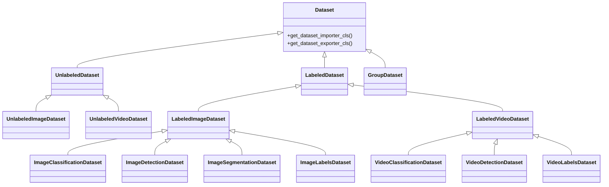
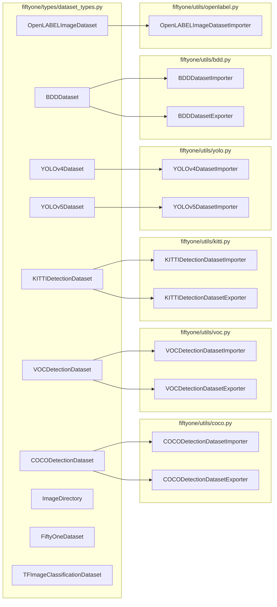
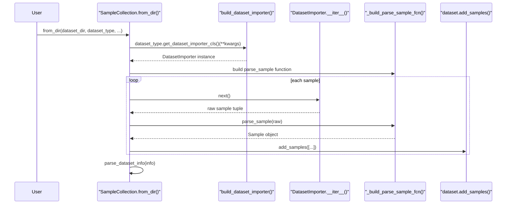
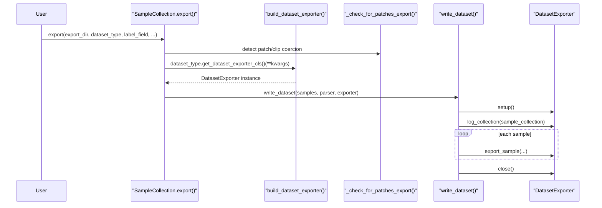
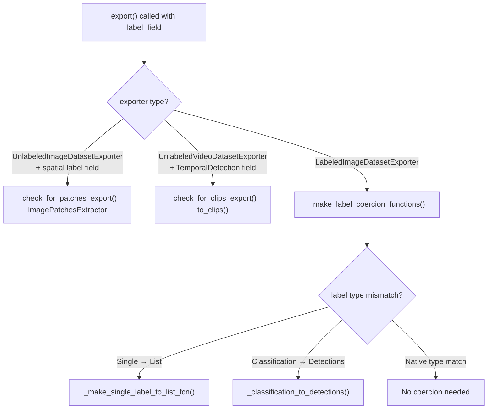

<!-- source: DeepWiki mcp.deepwiki.com · repo voxel51/fiftyone · page 5 Data Processing and I/O · fetched 2026-10-21 -->

# Data Processing and I/O

Relevant source files

The following files were used as context for generating this wiki page:

- [docs/source/user_guide/export_datasets.rst](docs/source/user_guide/export_datasets.rst)
- [fiftyone/types/dataset_types.py](fiftyone/types/dataset_types.py)
- [fiftyone/utils/bdd.py](fiftyone/utils/bdd.py)
- [fiftyone/utils/coco.py](fiftyone/utils/coco.py)
- [fiftyone/utils/data/exporters.py](fiftyone/utils/data/exporters.py)
- [fiftyone/utils/data/importers.py](fiftyone/utils/data/importers.py)
- [fiftyone/utils/data/parsers.py](fiftyone/utils/data/parsers.py)
- [fiftyone/utils/geojson.py](fiftyone/utils/geojson.py)
- [fiftyone/utils/kitti.py](fiftyone/utils/kitti.py)
- [fiftyone/utils/openlabel.py](fiftyone/utils/openlabel.py)
- [fiftyone/utils/tf.py](fiftyone/utils/tf.py)
- [fiftyone/utils/voc.py](fiftyone/utils/voc.py)
- [fiftyone/utils/yolo.py](fiftyone/utils/yolo.py)
- [tests/unittests/import_export_tests.py](tests/unittests/import_export_tests.py)
- [tests/unittests/utils/__init__.py](tests/unittests/utils/__init__.py)
- [tests/unittests/utils/openlabel.py](tests/unittests/utils/openlabel.py)

This page provides an overview of FiftyOne's data import, export, and format conversion capabilities. It covers the architecture that ties dataset format types to their importer and exporter implementations, the core pipeline that moves data between disk and FiftyOne datasets, and the catalog of built-in format support.

For detailed documentation of the `DatasetImporter` and `DatasetExporter` base classes, the full list of supported formats, and how to implement custom importers/exporters, see [Import and Export Systems](#5.1). For information about downloading and loading public benchmark datasets through the Dataset Zoo, see [Dataset Zoo](#5.2).

---

## Architecture Overview

FiftyOne's I/O system is organized around three interconnected layers:

1. **Dataset Types** (`fiftyone/types/dataset_types.py`): Python classes that act as format identifiers. Each type exposes `get_dataset_importer_cls()` and `get_dataset_exporter_cls()` to return the concrete importer/exporter for that format.
2. **Importers / Exporters** (`fiftyone/utils/data/importers.py`, `fiftyone/utils/data/exporters.py`): Base class hierarchies that define the iteration and writing protocols.
3. **Format Utilities** (`fiftyone/utils/coco.py`, `fiftyone/utils/yolo.py`, `fiftyone/utils/voc.py`, etc.): Format-specific parsing and serialization logic.

The primary entry points for end users are `SampleCollection.from_dir()` (import) and `SampleCollection.export()` (export), which delegate through this layered system.

**Dataset type hierarchy**

Sources: [fiftyone/types/dataset_types.py:1-217]()

---

## Dataset Type Registry

Each concrete dataset type class in `fiftyone/types/dataset_types.py` links a logical format name to specific importer and exporter classes. The registration is done by overriding `get_dataset_importer_cls()` and `get_dataset_exporter_cls()`.

**Format → Importer/Exporter mapping**

Sources: [fiftyone/types/dataset_types.py:243-700]()

---

## Importer Classes

All importers derive from one of the following abstract bases in `fiftyone/utils/data/importers.py`:

| Base Class | Iteration Contract | Use Case |
|---|---|---|
| `BatchDatasetImporter` | `import_samples(dataset, ...)` | Imports directly into a dataset in one shot |
| `GenericSampleDatasetImporter` | Yields `Sample` objects | FiftyOne's own format, arbitrary fields |
| `GroupDatasetImporter` | Yields `{name: Sample}` dicts | Multi-slice grouped datasets |
| `UnlabeledImageDatasetImporter` | Yields `(image_path, metadata)` | Image directories with no labels |
| `UnlabeledVideoDatasetImporter` | Yields `(video_path, metadata)` | Video directories with no labels |
| `LabeledImageDatasetImporter` | Yields `(image_path, metadata, label)` | Labeled image datasets |
| `LabeledVideoDatasetImporter` | Yields `(video_path, metadata, label, frames)` | Labeled video datasets |

The `build_dataset_importer()` function [fiftyone/utils/data/importers.py:579-660]() constructs the correct importer instance given a `dataset_type` object, passing through format-specific keyword arguments.

The `import_samples()` function [fiftyone/utils/data/importers.py:54-177]() is the core driver. It:
1. Invokes `_build_parse_sample_fcn()` to generate a `parse_sample` function appropriate for the importer type.
2. Iterates the importer, constructing `Sample` objects.
3. Feeds samples into `dataset.add_samples()`.
4. Optionally calls `parse_dataset_info()` to store format-level metadata (classes, license info, etc.) on the dataset.

**Import pipeline**

Sources: [fiftyone/utils/data/importers.py:54-177](), [fiftyone/utils/data/importers.py:404-576](), [fiftyone/utils/data/importers.py:579-660]()

---

## Exporter Classes

All exporters derive from one of the following abstract bases in `fiftyone/utils/data/exporters.py`:

| Base Class | Writing Contract | Use Case |
|---|---|---|
| `BatchDatasetExporter` | `export_samples(collection)` | Exports a whole collection at once |
| `GenericSampleDatasetExporter` | `export_sample(sample)` per-sample | FiftyOne's own format |
| `GroupDatasetExporter` | `export_sample(group)` per-group | Grouped datasets |
| `UnlabeledImageDatasetExporter` | `export_sample(image, metadata)` | Images without labels |
| `UnlabeledVideoDatasetExporter` | `export_sample(video, metadata)` | Videos without labels |
| `LabeledImageDatasetExporter` | `export_sample(image, label, metadata)` | Labeled images |
| `LabeledVideoDatasetExporter` | `export_sample(video, label, metadata, frames)` | Labeled videos |

The `export_samples()` function [fiftyone/utils/data/exporters.py:51-373]() is the main driver. It:
1. Calls `build_dataset_exporter()` to instantiate the correct exporter.
2. Selects the appropriate `SampleParser` based on the exporter type.
3. Detects patch exports (spatial label fields with unlabeled image exporters) and clip exports (temporal label fields with video exporters), transparently converting the collection.
4. Calls `write_dataset()` to drive the actual writing loop.

**Export pipeline**

Sources: [fiftyone/utils/data/exporters.py:51-373](), [fiftyone/utils/data/exporters.py:376-465](), [fiftyone/utils/data/exporters.py:468-528]()

---

## Sample Parsers

`SampleParser` classes in `fiftyone/utils/data/parsers.py` act as adapters that convert arbitrary external sample representations into the form that FiftyOne's dataset-level functions expect. The key hierarchy:

| Parser | Produces |
|---|---|
| `UnlabeledImageSampleParser` | `(image_path, metadata)` |
| `LabeledImageSampleParser` | `(image_path, metadata, label)` |
| `UnlabeledVideoSampleParser` | `(video_path, metadata)` |
| `LabeledVideoSampleParser` | `(video_path, metadata, label, frames)` |

FiftyOne ships concrete implementations like `FiftyOneLabeledImageSampleParser`, `FiftyOneUnlabeledImageSampleParser`, `FiftyOneUnlabeledVideoSampleParser`, and others in `fiftyone/utils/data/parsers.py`. The convenience functions `add_images()`, `add_labeled_images()`, `add_videos()`, and `add_labeled_videos()` also live in this module and accept parser instances directly [fiftyone/utils/data/parsers.py:27-99]().

Sources: [fiftyone/utils/data/parsers.py:1-220]()

---

## Built-in Format Support

| Dataset Type | Module | Importer | Exporter | Label Types |
|---|---|---|---|---|
| `ImageDirectory` | `fiftyone.utils.data` | `ImageDirectoryImporter` | `ImageDirectoryExporter` | None (media only) |
| `VideoDirectory` | `fiftyone.utils.data` | `VideoDirectoryImporter` | `VideoDirectoryExporter` | None (media only) |
| `MediaDirectory` | `fiftyone.utils.data` | `MediaDirectoryImporter` | `MediaDirectoryExporter` | None (media only) |
| `ImageClassificationDirectoryTree` | `fiftyone.utils.data` | `ImageClassificationDirectoryTreeImporter` | `ImageClassificationDirectoryTreeExporter` | `Classification` |
| `FiftyOneImageClassificationDataset` | `fiftyone.utils.data` | `FiftyOneImageClassificationDatasetImporter` | `FiftyOneImageClassificationDatasetExporter` | `Classifications` |
| `TFImageClassificationDataset` | `fiftyone.utils.tf` | `TFImageClassificationDatasetImporter` | `TFImageClassificationDatasetExporter` | `Classification` (TFRecords) |
| `COCODetectionDataset` | `fiftyone.utils.coco` | `COCODetectionDatasetImporter` | `COCODetectionDatasetExporter` | `Detections`, `Polylines`, `Keypoints` |
| `VOCDetectionDataset` | `fiftyone.utils.voc` | `VOCDetectionDatasetImporter` | `VOCDetectionDatasetExporter` | `Detections` |
| `KITTIDetectionDataset` | `fiftyone.utils.kitti` | `KITTIDetectionDatasetImporter` | `KITTIDetectionDatasetExporter` | `Detections` |
| `YOLOv4Dataset` | `fiftyone.utils.yolo` | `YOLOv4DatasetImporter` | `YOLOv4DatasetExporter` | `Detections`, `Polylines` |
| `YOLOv5Dataset` | `fiftyone.utils.yolo` | `YOLOv5DatasetImporter` | `YOLOv5DatasetExporter` | `Detections`, `Polylines` |
| `BDDDataset` | `fiftyone.utils.bdd` | `BDDDatasetImporter` | `BDDDatasetExporter` | `Detections`, `Polylines` |
| `OpenLABELImageDataset` | `fiftyone.utils.openlabel` | `OpenLABELImageDatasetImporter` | — | `Detections`, `Keypoints`, `Polylines` |
| `OpenLABELVideoDataset` | `fiftyone.utils.openlabel` | `OpenLABELVideoDatasetImporter` | — | `Detections`, `Keypoints`, `Polylines` |
| `FiftyOneDataset` | `fiftyone.utils.data` | `FiftyOneDatasetImporter` | `FiftyOneDatasetExporter` | All types |
| `GeoJSONDataset` | `fiftyone.utils.geojson` | `GeoJSONDatasetImporter` | `GeoJSONDatasetExporter` | `GeoLocation`, `GeoLocations` |
| `TFObjectDetectionDataset` | `fiftyone.utils.tf` | `TFObjectDetectionDatasetImporter` | `TFObjectDetectionDatasetExporter` | `Detections` (TFRecords) |
| `CVATImageDataset` | `fiftyone.utils.cvat` | `CVATImageDatasetImporter` | `CVATImageDatasetExporter` | Multi-label |
| `OpenImagesV6Dataset` | `fiftyone.utils.openimages` | `OpenImagesV6DatasetImporter` | — | Detections, classifications |
| `OpenImagesV7Dataset` | `fiftyone.utils.openimages` | `OpenImagesV7DatasetImporter` | — | Detections, classifications |

Sources: [fiftyone/types/dataset_types.py:243-700](), [fiftyone/utils/data/importers.py:1-50](), [fiftyone/utils/data/exporters.py:1-50]()

---

## Label Type Coercion During Export

The export pipeline in `export_samples()` [fiftyone/utils/data/exporters.py:209-364]() performs several automatic coercions to reduce friction:

### Single labels to list types
If the exporter expects a list type (e.g., `Detections`) but the field holds a single instance (e.g., `Detection`), the export wraps the value in a single-element list. This is handled by `_make_single_label_to_list_fcn()` [fiftyone/utils/data/exporters.py:799-806]().

### Classification as Detections
If the exporter expects `Detections` but the field holds `Classification`, each classification is converted to a `Detection` with a bounding box spanning the entire image via `_classification_to_detections()` [fiftyone/utils/data/exporters.py:809-822]().

### Object patch exports
When exporting to an unlabeled image format (`UnlabeledImageDatasetExporter`) but a spatial label field is provided (`Detection`, `Detections`, `Polyline`, `Polylines`), the pipeline automatically extracts image patches per object. This is detected by `_check_for_patches_export()` [fiftyone/utils/data/exporters.py:531-599]() and uses `ImagePatchesExtractor` from `fiftyone/utils/patches.py`.

### Video clip exports
When exporting to a video format with a `TemporalDetection` or `TemporalDetections` label field, video clips are extracted automatically. Detected by `_check_for_clips_export()` [fiftyone/utils/data/exporters.py:602-681]().

Sources: [fiftyone/utils/data/exporters.py:531-681](), [fiftyone/utils/data/exporters.py:684-796](), [fiftyone/utils/data/exporters.py:799-822]()

---

## Format-Specific Helpers

Beyond the importer/exporter classes, several modules expose standalone helper functions for working with specific formats without going through the full import/export pipeline:

- **`fiftyone/utils/coco.py`**: `add_coco_labels()` — adds COCO-format annotations directly to an existing collection; `load_coco_detection_annotations()` — parses a COCO JSON file; `COCOObject` — intermediate representation of one COCO annotation.
- **`fiftyone/utils/yolo.py`**: `add_yolo_labels()` — adds YOLO-format `.txt` files to an existing collection; `load_yolo_annotations()` — parses a single YOLO text file.
- **`fiftyone/utils/geojson.py`**: `load_location_data()` — merges GeoJSON `FeatureCollection` geometry data into a collection's location field by matching on filename.
- **`fiftyone/utils/tf.py`**: `from_images_dir()`, `from_images()`, `write_tf_records()` — utilities for creating `tf.data.Dataset` objects and writing TFRecords.

Sources: [fiftyone/utils/coco.py:44-262](), [fiftyone/utils/yolo.py:30-206](), [fiftyone/utils/geojson.py:26-158](), [fiftyone/utils/tf.py:34-214]()

---

## Media Export Modes

All importer/exporter pairs that handle media files support a consistent `export_media` parameter controlling how media is transferred:

| Value | Behavior |
|---|---|
| `True` | Copy media files to the output directory |
| `False` | Do not export media (labels-only export) |
| `"move"` | Move media files to the output directory |
| `"symlink"` | Create symlinks in the output directory |
| `"manifest"` | Write a `data.json` mapping UUIDs to source paths |

The `rel_dir` parameter, accepted by most exporters, strips a common prefix from input filepaths to produce nested output paths that mirror the input directory structure.

Sources: [fiftyone/utils/data/exporters.py:51-210](), [fiftyone/utils/coco.py:635-760](), [fiftyone/utils/voc.py:212-290]()

---

## Relationship to Adjacent Systems

- **Core Data Model** (see [Core Data Model](#2)): The I/O system creates and populates `Sample` and `Dataset` objects defined in the core layer.
- **Labels and Fields** (see [Labels and Fields](#2.3)): Importers produce `fiftyone.core.labels.Label` instances; exporters consume them. The coercion logic depends on the label type hierarchy.
- **Model Evaluation** (see [Model Integration and Evaluation](#6)): Evaluation workflows often import ground-truth data in one of these formats.
- **Dataset Zoo** (see [Dataset Zoo](#5.2)): Zoo loaders are built on top of the importer infrastructure, using `DatasetImporter` subclasses internally.
- **CLI** (see [Command Line Interface](#10)): The `fiftyone convert` and `fiftyone datasets export` commands wrap `export_samples()` and `import_samples()`.

---

