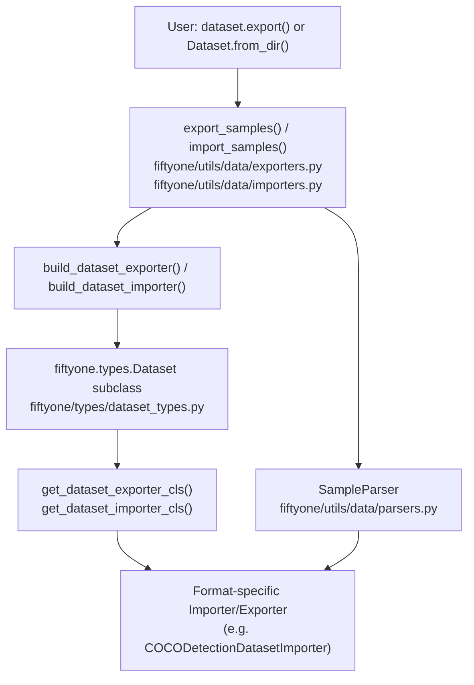
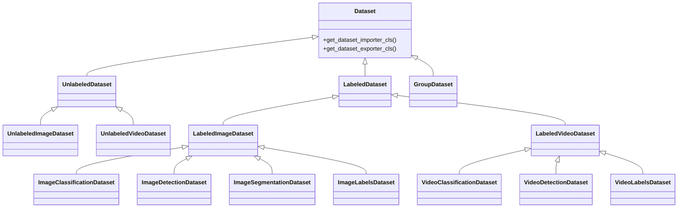
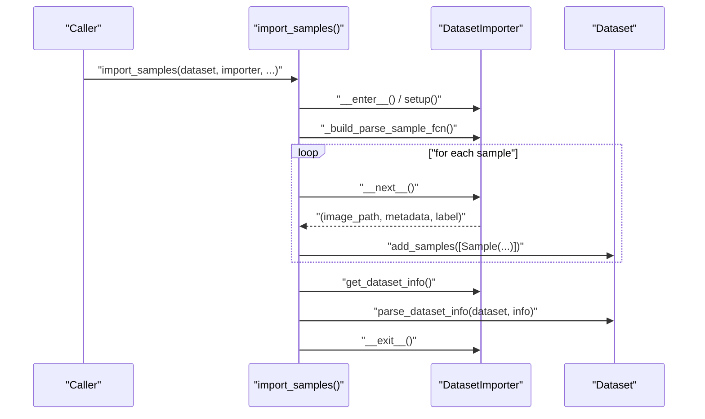
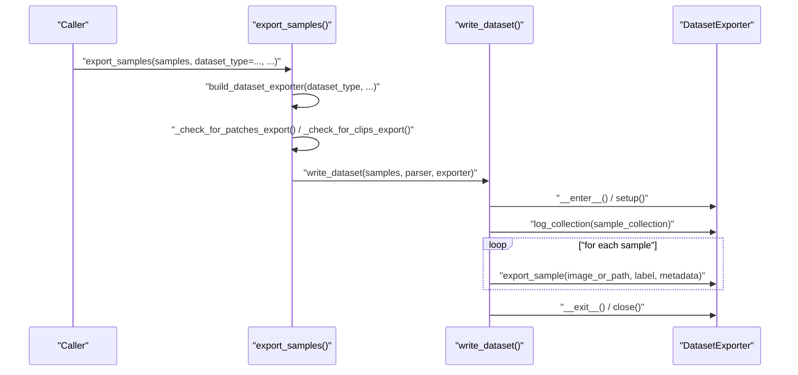
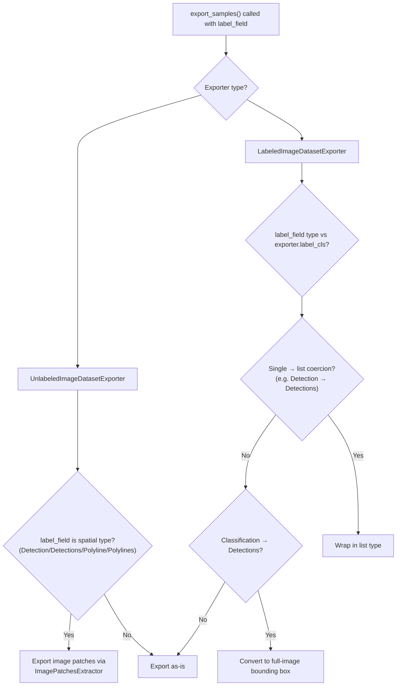
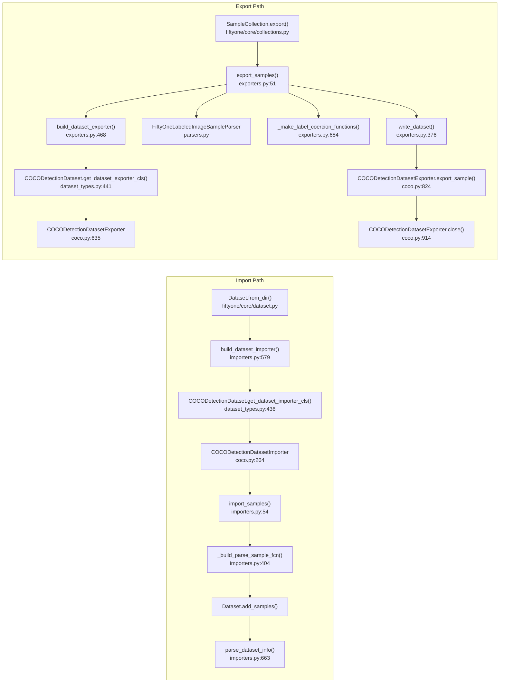

<!-- source: DeepWiki mcp.deepwiki.com · repo voxel51/fiftyone · page 5.1 Import and Export Systems · fetched 2026-10-21 -->

# Import and Export Systems

<details>
<summary>Relevant source files</summary>

The following files were used as context for generating this wiki page:

- [docs/source/user_guide/export_datasets.rst](docs/source/user_guide/export_datasets.rst)
- [fiftyone/types/dataset_types.py](fiftyone/types/dataset_types.py)
- [fiftyone/utils/bdd.py](fiftyone/utils/bdd.py)
- [fiftyone/utils/coco.py](fiftyone/utils/coco.py)
- [fiftyone/utils/data/exporters.py](fiftyone/utils/data/exporters.py)
- [fiftyone/utils/data/importers.py](fiftyone/utils/data/importers.py)
- [fiftyone/utils/data/parsers.py](fiftyone/utils/data/parsers.py)
- [fiftyone/utils/geojson.py](fiftyone/utils/geojson.py)
- [fiftyone/utils/kitti.py](fiftyone/utils/kitti.py)
- [fiftyone/utils/openlabel.py](fiftyone/utils/openlabel.py)
- [fiftyone/utils/tf.py](fiftyone/utils/tf.py)
- [fiftyone/utils/voc.py](fiftyone/utils/voc.py)
- [fiftyone/utils/yolo.py](fiftyone/utils/yolo.py)
- [tests/unittests/import_export_tests.py](tests/unittests/import_export_tests.py)
- [tests/unittests/utils/__init__.py](tests/unittests/utils/__init__.py)
- [tests/unittests/utils/openlabel.py](tests/unittests/utils/openlabel.py)

</details>


This page documents FiftyOne's data import and export infrastructure: the abstract base classes that define the import/export contract, the dataset type registry that maps format names to concrete implementations, and the built-in format support (COCO, YOLO, VOC, KITTI, BDD, OpenLABEL, GeoJSON, TFRecords, and others).

For information about the Dataset Zoo (loading curated public datasets by name), see [Dataset Zoo](#5.2). For information about annotation platform integrations (CVAT, Labelbox, etc.), see [External Annotation Tool Integration](#7.1).

---

## Architecture Overview

FiftyOne's I/O system has three layers:

1. **Dataset Type Registry** — `fiftyone.types.Dataset` subclasses. Each type class carries pointers to the importer and exporter classes for that format.
2. **DatasetImporter / DatasetExporter** — Abstract base classes that define the lifecycle contract for reading and writing. Format-specific classes implement these.
3. **SampleParser** — Intermediate adapters used internally during export to extract label fields from FiftyOne `Sample` objects before handing them to the exporter.

The user-facing entry points are `SampleCollection.export()` and `Dataset.from_dir()`, which delegate to `export_samples()` and `import_samples()` respectively.



Sources: [fiftyone/utils/data/exporters.py:51-374](), [fiftyone/utils/data/importers.py:54-177](), [fiftyone/types/dataset_types.py:11-36]()

---

## Dataset Type Registry

Every supported format is represented by a subclass of `fiftyone.types.Dataset` defined in `fiftyone/types/dataset_types.py`. Each type class implements two methods:

| Method | Returns |
|---|---|
| `get_dataset_importer_cls()` | The `DatasetImporter` class for this format |
| `get_dataset_exporter_cls()` | The `DatasetExporter` class for this format |

The abstract base hierarchy in `dataset_types.py` mirrors the kind of data each format supports:



Sources: [fiftyone/types/dataset_types.py:11-241]()

### Concrete Type → Importer/Exporter Mapping

| `fiftyone.types` class | Importer | Exporter | Module |
|---|---|---|---|
| `ImageDirectory` | `ImageDirectoryImporter` | `ImageDirectoryExporter` | `fiftyone.utils.data` |
| `VideoDirectory` | `VideoDirectoryImporter` | `VideoDirectoryExporter` | `fiftyone.utils.data` |
| `MediaDirectory` | `MediaDirectoryImporter` | `MediaDirectoryExporter` | `fiftyone.utils.data` |
| `ImageClassificationDirectoryTree` | `ImageClassificationDirectoryTreeImporter` | `ImageClassificationDirectoryTreeExporter` | `fiftyone.utils.data` |
| `VideoClassificationDirectoryTree` | `VideoClassificationDirectoryTreeImporter` | `VideoClassificationDirectoryTreeExporter` | `fiftyone.utils.data` |
| `FiftyOneImageClassificationDataset` | `FiftyOneImageClassificationDatasetImporter` | `FiftyOneImageClassificationDatasetExporter` | `fiftyone.utils.data` |
| `FiftyOneImageDetectionDataset` | `FiftyOneImageDetectionDatasetImporter` | `FiftyOneImageDetectionDatasetExporter` | `fiftyone.utils.data` |
| `FiftyOneTemporalDetectionDataset` | `FiftyOneTemporalDetectionDatasetImporter` | `FiftyOneTemporalDetectionDatasetExporter` | `fiftyone.utils.data` |
| `FiftyOneDataset` | `FiftyOneDatasetImporter` | `FiftyOneDatasetExporter` | `fiftyone.utils.data` |
| `COCODetectionDataset` | `COCODetectionDatasetImporter` | `COCODetectionDatasetExporter` | `fiftyone.utils.coco` |
| `VOCDetectionDataset` | `VOCDetectionDatasetImporter` | `VOCDetectionDatasetExporter` | `fiftyone.utils.voc` |
| `KITTIDetectionDataset` | `KITTIDetectionDatasetImporter` | `KITTIDetectionDatasetExporter` | `fiftyone.utils.kitti` |
| `YOLOv4Dataset` | `YOLOv4DatasetImporter` | `YOLOv4DatasetExporter` | `fiftyone.utils.yolo` |
| `YOLOv5Dataset` | `YOLOv5DatasetImporter` | `YOLOv5DatasetExporter` | `fiftyone.utils.yolo` |
| `BDDDataset` | `BDDDatasetImporter` | `BDDDatasetExporter` | `fiftyone.utils.bdd` |
| `OpenLABELImageDataset` | `OpenLABELImageDatasetImporter` | — | `fiftyone.utils.openlabel` |
| `OpenLABELVideoDataset` | `OpenLABELVideoDatasetImporter` | — | `fiftyone.utils.openlabel` |
| `OpenImagesV6Dataset` | `OpenImagesV6DatasetImporter` | — | `fiftyone.utils.openimages` |
| `OpenImagesV7Dataset` | `OpenImagesV7DatasetImporter` | — | `fiftyone.utils.openimages` |
| `TFImageClassificationDataset` | `TFImageClassificationDatasetImporter` | `TFImageClassificationDatasetExporter` | `fiftyone.utils.tf` |
| `TFObjectDetectionDataset` | `TFObjectDetectionDatasetImporter` | `TFObjectDetectionDatasetExporter` | `fiftyone.utils.tf` |
| `GeoJSONDataset` | `GeoJSONDatasetImporter` | `GeoJSONDatasetExporter` | `fiftyone.utils.geojson` |

Sources: [fiftyone/types/dataset_types.py:243-650](), [fiftyone/utils/coco.py:264-265](), [fiftyone/utils/yolo.py:209-210](), [fiftyone/utils/voc.py:27-28](), [fiftyone/utils/kitti.py:33-34](), [fiftyone/utils/bdd.py:27-28](), [fiftyone/utils/openlabel.py:35-36]()

---

## DatasetImporter

### Abstract Base Classes

All importers live in `fiftyone/utils/data/importers.py`. The class hierarchy determines what each `__next__()` call returns and how `import_samples()` processes that output.

```mermaid
classDiagram
    class DatasetImporter {
        +dataset_dir
        +shuffle
        +seed
        +max_samples
        +has_dataset_info: bool
        +setup()
        +get_dataset_info()
        +__iter__()
        +__next__()
        +__len__()
    }
    class BatchDatasetImporter {
        +import_samples(dataset, tags, progress)
    }
    class GenericSampleDatasetImporter {
        +has_sample_field_schema: bool
        +get_sample_field_schema()
    }
    class GroupDatasetImporter {
        +group_field: str
        +get_group_media_types()
    }
    class UnlabeledImageDatasetImporter {
        +has_image_metadata: bool
        +__next__() returns "(image_path, image_metadata)"
    }
    class UnlabeledVideoDatasetImporter {
        +has_video_metadata: bool
        +__next__() returns "(video_path, video_metadata)"
    }
    class UnlabeledMediaDatasetImporter {
        +__next__() returns "(filepath, metadata)"
    }
    class LabeledImageDatasetImporter {
        +label_cls
        +has_image_metadata: bool
        +__next__() returns "(image_path, image_metadata, label)"
    }
    class LabeledVideoDatasetImporter {
        +label_cls
        +frame_labels_cls
        +__next__() returns "(video_path, video_metadata, label, frames)"
    }
    class ImportPathsMixin {
        +_parse_data_path()
        +_parse_labels_path()
        +_load_data_map()
    }

    DatasetImporter <|-- BatchDatasetImporter
    DatasetImporter <|-- GenericSampleDatasetImporter
    DatasetImporter <|-- GroupDatasetImporter
    DatasetImporter <|-- UnlabeledImageDatasetImporter
    DatasetImporter <|-- UnlabeledVideoDatasetImporter
    DatasetImporter <|-- UnlabeledMediaDatasetImporter
    DatasetImporter <|-- LabeledImageDatasetImporter
    DatasetImporter <|-- LabeledVideoDatasetImporter
```



Sources: [fiftyone/utils/data/importers.py:404-576]()

### Importer Lifecycle



Sources: [fiftyone/utils/data/importers.py:54-177]()

### Key Top-Level Functions

| Function | Location | Purpose |
|---|---|---|
| `import_samples(dataset, dataset_importer, ...)` | importers.py:54 | Add samples from an importer to a dataset |
| `merge_samples(dataset, dataset_importer, ...)` | importers.py:180 | Merge samples from an importer into an existing dataset |
| `build_dataset_importer(dataset_type, **kwargs)` | importers.py:579 | Instantiate an importer from a `fiftyone.types.Dataset` type |
| `parse_dataset_info(dataset, info)` | importers.py:663 | Apply dataset-level info (classes, mask targets, etc.) to the dataset |

`build_dataset_importer()` calls `dataset_type.get_dataset_importer_cls()` and constructs the importer by matching `**kwargs` to the constructor signature. Any unused kwargs emit a warning.

Sources: [fiftyone/utils/data/importers.py:579-660](), [fiftyone/utils/data/importers.py:663-740]()

### `ImportPathsMixin`

Most format-specific importers mix in `ImportPathsMixin` to get standardized path resolution. This mixin provides:

- `_parse_data_path(dataset_dir, data_path, default)` — resolves where media files live; supports directory names, absolute paths, JSON manifests, or dicts.
- `_parse_labels_path(dataset_dir, labels_path, default)` — resolves where label files live.
- `_load_data_map(data_path, ...)` — builds a `{uuid: filepath}` map from a directory or JSON manifest.

Sources: [fiftyone/utils/data/importers.py:404-576]()

---

## DatasetExporter

### Abstract Base Classes

All exporters live in `fiftyone/utils/data/exporters.py`.

```mermaid
classDiagram
    class DatasetExporter {
        +export_dir
        +setup()
        +log_collection(sample_collection)
        +close()
    }
    class BatchDatasetExporter {
        +export_samples(sample_collection, progress)
    }
    class GenericSampleDatasetExporter {
        +export_sample(sample)
    }
    class GroupDatasetExporter {
        +export_sample(sample, group)
    }
    class UnlabeledImageDatasetExporter {
        +export_media
        +requires_image_metadata: bool
        +export_sample(image_or_path, metadata)
    }
    class UnlabeledVideoDatasetExporter {
        +export_media
        +export_sample(video_path, metadata)
    }
    class UnlabeledMediaDatasetExporter {
        +export_sample(filepath, metadata)
    }
    class LabeledImageDatasetExporter {
        +label_cls
        +requires_image_metadata: bool
        +export_sample(image_or_path, label, metadata)
    }
    class LabeledVideoDatasetExporter {
        +label_cls
        +frame_labels_cls
        +export_sample(video_path, label, frames, metadata)
    }
    class ExportPathsMixin {
        +_parse_data_path()
        +_parse_labels_path()
    }

    DatasetExporter <|-- BatchDatasetExporter
    DatasetExporter <|-- GenericSampleDatasetExporter
    DatasetExporter <|-- GroupDatasetExporter
    DatasetExporter <|-- UnlabeledImageDatasetExporter
    DatasetExporter <|-- UnlabeledVideoDatasetExporter
    DatasetExporter <|-- UnlabeledMediaDatasetExporter
    DatasetExporter <|-- LabeledImageDatasetExporter
    DatasetExporter <|-- LabeledVideoDatasetExporter
```



Sources: [fiftyone/utils/data/exporters.py:468-1000]()

### Exporter Lifecycle



Sources: [fiftyone/utils/data/exporters.py:209-465]()

### Key Top-Level Functions

| Function | Location | Purpose |
|---|---|---|
| `export_samples(samples, export_dir, dataset_type, ...)` | exporters.py:51 | Main export entry point |
| `write_dataset(samples, sample_parser, dataset_exporter, ...)` | exporters.py:376 | Lower-level write dispatch |
| `build_dataset_exporter(dataset_type, **kwargs)` | exporters.py:468 | Instantiate an exporter from a `fiftyone.types.Dataset` type |

The `export_media` parameter passed to exporters controls how media is handled:

| `export_media` value | Effect |
|---|---|
| `True` | Copy media files to the output directory |
| `False` | Do not export media (labels only) |
| `"move"` | Move media files to the output directory |
| `"symlink"` | Create symlinks in the output directory |
| `"manifest"` | Write a `data.json` UUID→filepath manifest |

Sources: [fiftyone/utils/data/exporters.py:51-528]()

---

## SampleParser

`SampleParser` classes (in `fiftyone/utils/data/parsers.py`) bridge a FiftyOne `Sample` object to the tuple format expected by the exporter. They are instantiated internally by `export_samples()` and are not typically used directly.

| Parser class | Output |
|---|---|
| `FiftyOneUnlabeledImageSampleParser` | `(image_path, image_metadata)` |
| `FiftyOneUnlabeledVideoSampleParser` | `(video_path, video_metadata)` |
| `FiftyOneUnlabeledMediaSampleParser` | `(filepath, metadata)` |
| `FiftyOneLabeledImageSampleParser` | `(image_path, image_metadata, label)` |
| `FiftyOneLabeledVideoSampleParser` | `(video_path, video_metadata, label, frames)` |

The `FiftyOneLabeledImageSampleParser` accepts an optional `label_fcn` callback that applies label coercion before the label is passed to the exporter.

Sources: [fiftyone/utils/data/parsers.py:1-100](), [fiftyone/utils/data/exporters.py:300-365]()

---

## Label Coercion During Export

`export_samples()` automatically coerces labels to match what the target exporter expects. This is implemented in `_make_label_coercion_functions()` in `exporters.py`.



| Coercion | Condition | Result |
|---|---|---|
| Single → list | `Detection` field with exporter expecting `Detections` | Wraps in `Detections(detections=[label])` |
| Classification → Detections | `Classification` field with exporter expecting `Detections` | Creates `Detection` with `bounding_box=[0, 0, 1, 1]` |
| Patches export | Spatial label field + unlabeled image exporter | Extracts patches via `ImagePatchesExtractor` |
| Clips export | `TemporalDetection` field + unlabeled video exporter | Extracts video clips via `to_clips()` |

Sources: [fiftyone/utils/data/exporters.py:531-796]()

---

## Format-Specific Implementations

### COCO (`fiftyone/utils/coco.py`)

**Import:** `COCODetectionDatasetImporter` reads a single `labels.json` that follows COCO annotation format. It supports filtering by `classes`, `image_ids`, `label_types`, and `max_samples` during import. The `setup()` method calls `load_coco_detection_annotations()` to parse the JSON and build in-memory maps.

**Export:** `COCODetectionDatasetExporter` accumulates image dicts and annotation dicts across `export_sample()` calls, then writes the full `labels.json` in `close()`.

**Intermediate object:** `COCOObject` represents a single COCO annotation with methods `to_detection()`, `to_polyline()`, `to_keypoints()`, and `from_label()`.

**Standalone helper:** `add_coco_labels(sample_collection, label_field, labels_or_path, categories, ...)` can add COCO annotations to an existing collection without a full import cycle.

Label types supported: `detections`, `segmentations` (as `Detections` with masks or `Polylines`), `keypoints`.

Sources: [fiftyone/utils/coco.py:264-973](), [fiftyone/utils/coco.py:44-262]()

### YOLO (`fiftyone/utils/yolo.py`)

**YOLOv4:** `YOLOv4DatasetImporter` / `YOLOv4DatasetExporter`. Reads from a directory where each image has a paired `.txt` file. Class names come from an `obj.names` file. The image list file (`images.txt`) determines which samples are loaded.

**YOLOv5:** `YOLOv5DatasetImporter` / `YOLOv5DatasetExporter`. Uses a `dataset.yaml` configuration file that declares class names and split paths.

**Standalone helper:** `add_yolo_labels(sample_collection, label_field, labels_path, classes, ...)` matches YOLO `.txt` files to existing samples by filename.

Each YOLO `.txt` row format:
- Detections: `<class_id> <x_center> <y_center> <width> <height>`
- Instances/polylines: `<class_id> <x1> <y1> <x2> <y2> ...`

Sources: [fiftyone/utils/yolo.py:1-400]()

### VOC (`fiftyone/utils/voc.py`)

`VOCDetectionDatasetImporter` / `VOCDetectionDatasetExporter`. Labels are per-image XML files. The importer calls `load_voc_detection_annotations()` for each sample. The exporter renders XML using a Jinja2 template. Supports `extra_attrs` to include non-standard VOC fields.

Sources: [fiftyone/utils/voc.py:27-400]()

### KITTI (`fiftyone/utils/kitti.py`)

`KITTIDetectionDatasetImporter` / `KITTIDetectionDatasetExporter`. Labels are per-image `.txt` files with space-delimited rows. The standard KITTI fields (`type`, `truncated`, `occluded`, `alpha`, `bbox`, `dimensions`, `location`, `rotation_y`) are loaded as first-class attributes; additional columns become `extra_attrs`.

Sources: [fiftyone/utils/kitti.py:33-400]()

### BDD (`fiftyone/utils/bdd.py`)

`BDDDatasetImporter` / `BDDDatasetExporter`. Reads a single `labels.json` file in Berkeley DeepDrive format. Each sample's annotation dict contains `labels` for detections, polylines, and classification attributes. The `_parse_bdd_annotation()` helper converts BDD label dicts to FiftyOne label objects.

Sources: [fiftyone/utils/bdd.py:27-400]()

### OpenLABEL (`fiftyone/utils/openlabel.py`)

`OpenLABELImageDatasetImporter` / `OpenLABELVideoDatasetImporter`. Reads the ASAM OpenLABEL JSON schema. Supports `detections`, `segmentations`, and `keypoints` label types. Segmentations can be loaded as `Polylines` (`use_polylines=True`) or dense-mask `Detections`. An optional `skeleton` / `skeleton_key` pair enables keypoint skeleton resolution.

`SegmentationType` is an enum (`INSTANCE`, `POLYLINE`, `SEMANTIC`) used internally to control how segmentation data is parsed.

Sources: [fiftyone/utils/openlabel.py:27-400]()

### GeoJSON (`fiftyone/utils/geojson.py`)

`GeoJSONDatasetImporter` / `GeoJSONDatasetExporter`. Reads/writes GeoJSON `FeatureCollection` documents. The `filename` property in each feature's `properties` is used to match features to FiftyOne samples.

**Standalone helper:** `load_location_data(samples, geojson_or_path, location_field, ...)` loads geo data into a `GeoLocation` or `GeoLocations` field of an existing collection.

`to_geo_json_geometry(label)` converts a `GeoLocation` or `GeoLocations` label to a GeoJSON geometry dict.

Sources: [fiftyone/utils/geojson.py:1-200]()

### TFRecords (`fiftyone/utils/tf.py`)

`TFImageClassificationDatasetImporter` / `TFImageClassificationDatasetExporter` and `TFObjectDetectionDatasetImporter` / `TFObjectDetectionDatasetExporter`. TFRecords must be unpacked into an `images_dir` before import; `build_dataset_importer()` automatically sets this directory when it is not provided.

`TFRecordsWriter` is a context-manager helper class for writing sharded TFRecord files.

Sources: [fiftyone/utils/tf.py:216-400](), [fiftyone/utils/data/importers.py:611-630]()

---

## Import/Export Lifecycle Diagram (with Code Entities)

This diagram maps the full call chain for a typical labeled image import and export, naming all concrete code entities involved.



Sources: [fiftyone/utils/data/importers.py:54-660](), [fiftyone/utils/data/exporters.py:51-528](), [fiftyone/types/dataset_types.py:426-444](), [fiftyone/utils/coco.py:264-973]()

---

## Python API Entry Points

```python
# Import
dataset = fo.Dataset.from_dir(
    dataset_dir="/path/to/data",
    dataset_type=fo.types.COCODetectionDataset,
    label_types="detections",
)

# Export
dataset.export(
    export_dir="/path/for/export",
    dataset_type=fo.types.COCODetectionDataset,
    label_field="ground_truth",
)

# Labels-only export (no media copy)
dataset.export(
    dataset_type=fo.types.COCODetectionDataset,
    labels_path="/path/for/labels.json",
    label_field="ground_truth",
    abs_paths=True,
)

# Merge from disk into existing dataset
dataset.merge_dir(
    dataset_dir="/path/to/new-data",
    dataset_type=fo.types.COCODetectionDataset,
)
```

Sources: [docs/source/user_guide/export_datasets.rst:28-167]()

The CLI equivalents use `fiftyone datasets export` and `fiftyone convert`. See [Command Line Interface](#10) for full CLI documentation.

---

## Implementing a Custom Importer or Exporter

To add a new format:

1. **Define the type class** — Create a subclass of the appropriate `fiftyone.types.Dataset` base (e.g., `LabeledImageDataset`) and implement `get_dataset_importer_cls()` and/or `get_dataset_exporter_cls()`.

2. **Implement the importer** — Subclass `LabeledImageDatasetImporter` (or another base as appropriate) and mix in `ImportPathsMixin`. Implement:
   - `setup()` — parse file lists, load any index files
   - `__len__()` — return total sample count
   - `__next__()` — return `(image_path, image_metadata, label)`
   - `label_cls` property — declare the returned label type(s)
   - `has_dataset_info` / `get_dataset_info()` — optionally return dataset-level metadata

3. **Implement the exporter** — Subclass `LabeledImageDatasetExporter` and mix in `ExportPathsMixin`. Implement:
   - `setup()` — initialize accumulators
   - `log_collection(sample_collection)` — capture collection-level info
   - `export_sample(image_or_path, label, metadata)` — process one sample
   - `close()` — write any accumulated output files
   - `label_cls` property — declare accepted label type(s)

Sources: [fiftyone/utils/data/importers.py:404-576](), [fiftyone/utils/data/exporters.py:684-796]()

---

