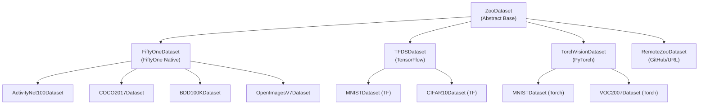
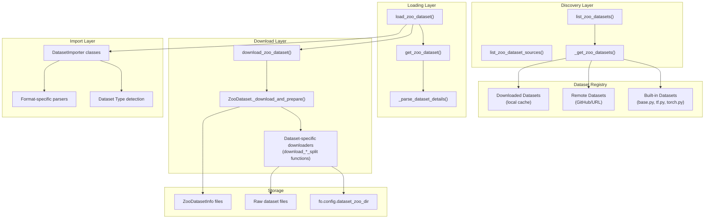
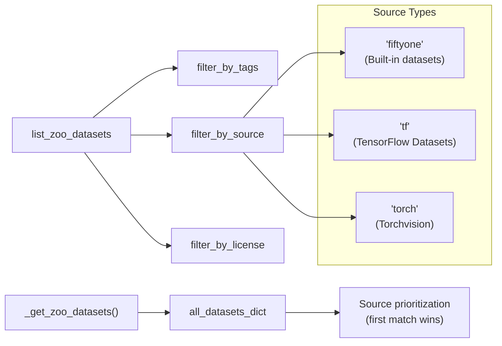
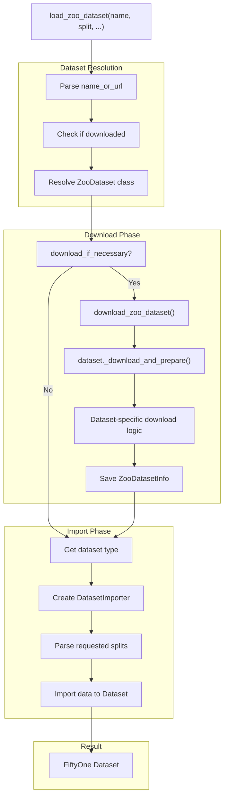
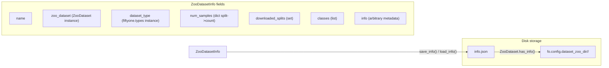

<!-- source: DeepWiki mcp.deepwiki.com · repo voxel51/fiftyone · page 5.2 Dataset Zoo · fetched 2026-10-21 -->

# Dataset Zoo

<details>
<summary>Relevant source files</summary>

The following files were used as context for generating this wiki page:

- [docs/source/images/dataset_zoo/kinetics.png](docs/source/images/dataset_zoo/kinetics.png)
- [docs/source/images/dataset_zoo/places-validation.png](docs/source/images/dataset_zoo/places-validation.png)
- [docs/source/images/dataset_zoo_coco_2017.png](docs/source/images/dataset_zoo_coco_2017.png)
- [docs/source/integrations/activitynet.rst](docs/source/integrations/activitynet.rst)
- [docs/source/integrations/coco.rst](docs/source/integrations/coco.rst)
- [docs/source/integrations/open_images.rst](docs/source/integrations/open_images.rst)
- [fiftyone/utils/activitynet.py](fiftyone/utils/activitynet.py)
- [fiftyone/utils/aws.py](fiftyone/utils/aws.py)
- [fiftyone/utils/cityscapes.py](fiftyone/utils/cityscapes.py)
- [fiftyone/utils/imagenet.py](fiftyone/utils/imagenet.py)
- [fiftyone/utils/kinetics.py](fiftyone/utils/kinetics.py)
- [fiftyone/utils/lfw.py](fiftyone/utils/lfw.py)
- [fiftyone/utils/openimages.py](fiftyone/utils/openimages.py)
- [fiftyone/utils/places.py](fiftyone/utils/places.py)
- [fiftyone/utils/youtube.py](fiftyone/utils/youtube.py)
- [fiftyone/zoo/__init__.py](fiftyone/zoo/__init__.py)
- [fiftyone/zoo/datasets/__init__.py](fiftyone/zoo/datasets/__init__.py)
- [fiftyone/zoo/datasets/base.py](fiftyone/zoo/datasets/base.py)
- [fiftyone/zoo/datasets/tf.py](fiftyone/zoo/datasets/tf.py)
- [fiftyone/zoo/datasets/torch.py](fiftyone/zoo/datasets/torch.py)

</details>


The Dataset Zoo is FiftyOne's system for discovering, downloading, and loading pre-built datasets. It provides a unified interface to access popular computer vision datasets from various sources including the FiftyOne community, TensorFlow Datasets, and PyTorch's Torchvision, while supporting partial downloads and custom remote datasets.

For information about importing and exporting custom dataset formats, see [Import and Export Systems](#5.1).

## System Architecture

The Dataset Zoo is built around a hierarchical class structure that abstracts different dataset sources and provides consistent APIs for dataset discovery, downloading, and loading.

### Core Class Hierarchy



Sources: [fiftyone/zoo/datasets/__init__.py:630-803](), [fiftyone/zoo/datasets/base.py:37-41](), [fiftyone/zoo/datasets/tf.py:32-37](), [fiftyone/zoo/datasets/torch.py:36-41]()

### System Components and Data Flow



Sources: [fiftyone/zoo/datasets/__init__.py:36-81](), [fiftyone/zoo/datasets/__init__.py:261-476](), [fiftyone/zoo/datasets/__init__.py:174-238](), [fiftyone/zoo/datasets/__init__.py:806-942]()

## Core Dataset Classes

### ZooDataset Base Class

The `ZooDataset` class ([fiftyone/zoo/datasets/__init__.py:806-942]()) defines the interface all zoo datasets must implement.

**Abstract properties** (must be overridden):

| Property | Type | Purpose |
|---|---|---|
| `name` | `str` | Unique string identifier (e.g., `"coco-2017"`) |
| `license` | `str` | License name or URL |
| `tags` | `tuple` | Classification tags, e.g., `("image", "detection")` |
| `supported_splits` | `tuple` or `None` | Available splits, e.g., `("train", "validation", "test")` |

**Optional properties** (with defaults):

| Property | Default | Purpose |
|---|---|---|
| `supports_partial_downloads` | `False` | Whether subset filtering is supported |
| `requires_manual_download` | `False` | Whether the user must download source files manually |
| `importer_kwargs` | `{}` | Default kwargs forwarded to the `DatasetImporter` |
| `has_splits` | derived | `True` if `supported_splits` is not `None` |

**Key methods**:

| Method | Purpose |
|---|---|
| `download_and_prepare(dataset_dir, split, splits, cleanup)` | Public entry point; iterates splits and calls `_download_and_prepare()` |
| `_download_and_prepare(dataset_dir, scratch_dir, split)` | Abstract; returns `(dataset_type, num_samples, classes)` |
| `_load_dataset(dataset, dataset_dir, split)` | Used by `RemoteZooDataset` subclasses that bypass the standard importer |
| `load_info(dataset_dir)` / `save_info(dataset_dir, info)` | Read/write the `info.json` metadata file for a downloaded dataset |
| `has_info(dataset_dir)` | Check whether a dataset directory has a valid `info.json` |
| `get_split_dir(dataset_dir, split)` | Return the per-split subdirectory path |

Sources: [fiftyone/zoo/datasets/__init__.py:806-942]()

### FiftyOneDataset

`FiftyOneDataset` ([fiftyone/zoo/datasets/base.py:38-41]()) is the marker base class for all natively-provided zoo datasets. Subclasses include comprehensive download utilities:
- Partial downloads filtered by classes, sample counts, image IDs, label types
- Intelligent caching — already-downloaded files are reused across invocations
- Multi-threaded image/video downloading via `num_workers`
- Source-file passthrough for datasets like ActivityNet and ImageNet that may require manual downloads

### External Dataset Integration

**`TFDSDataset`** ([fiftyone/zoo/datasets/tf.py:32-37]()): Wraps `tensorflow_datasets` via `tfds.load()`. Raises a clear error if `tensorflow` or `tensorflow_datasets` are not installed.

**`TorchVisionDataset`** ([fiftyone/zoo/datasets/torch.py:36-41]()): Wraps `torchvision.datasets`. Raises a clear error if `torch` or `torchvision` are not installed.

Several datasets (e.g., MNIST, CIFAR-10, ImageNet) are available from both TF and Torch backends. When both are installed, a source-priority ordering determines which backend is used by default.

## Available Datasets

The tables below list datasets provided through each source. `★` marks datasets that support partial downloads (i.e., `supports_partial_downloads = True`). `†` marks datasets that require a manual download step.

### FiftyOne Built-in Datasets

| Dataset Name | Class (in `base.py`) | Tags | Splits | Approx. Size |
|---|---|---|---|---|
| `activitynet-100` ★ | `ActivityNet100Dataset` | video, temporal-detection | train, test, validation | 223 GB |
| `activitynet-200` ★ | `ActivityNet200Dataset` | video, temporal-detection | train, test, validation | 500 GB |
| `bdd100k` † | `BDD100KDataset` | image, multilabel, automotive | train, validation, test | 7.10 GB |
| `caltech101` | `Caltech101Dataset` | image, classification | — | 138.60 MB |
| `caltech256` | `Caltech256Dataset` | image, classification | — | 1.16 GB |
| `cityscapes` † | `CityscapesDataset` | image, multilabel, automotive | train, validation, test | 11.80 GB |
| `coco-2014` ★ | `COCO2014Dataset` | image, detection, segmentation | train, validation, test | 37.57 GB |
| `coco-2017` ★ | `COCO2017Dataset` | image, detection, segmentation | train, validation, test | 25.20 GB |
| `open-images-v6` ★ | `OpenImagesV6Dataset` | image, detection, segmentation | train, validation, test | ~561 GB |
| `open-images-v7` ★ | `OpenImagesV7Dataset` | image, detection, segmentation | train, validation, test | ~561 GB |
| `kinetics-400` ★ | `Kinetics400Dataset` | video, classification | train, validation, test | ~450 GB |
| `kinetics-600` ★ | `Kinetics600Dataset` | video, classification | train, validation, test | ~750 GB |
| `kinetics-700` ★ | `Kinetics700Dataset` | video, classification | train, validation, test | ~700 GB |
| `kinetics-700-2020` ★ | `Kinetics7002020Dataset` | video, classification | train, validation, test | ~700 GB |
| `hmdb51` | `HMDB51Dataset` | video, classification | train, test | 2.16 GB |
| `ucf101` | `UCF101Dataset` | video, classification | train, test | 6.48 GB |
| `lfw` | `LabeledFacesInTheWildDataset` | image, classification | train, test | 173 MB |
| `places` ★ | `Places365Dataset` | image, classification | train, validation, test | ~105 GB |
| `fiw` | `FIWDataset` | image, classification | train, validation, test | — |
| `kitti` | `KITTIDataset` | image, detection | train, validation | 12 GB |
| `sama-coco` | `SamaCOCODataset` | image, detection, segmentation | train, validation | — |
| `quickstart` | `QuickstartDataset` | image, detection | — | ~23 MB |
| `quickstart-video` | `QuickstartVideoDataset` | video, detection | — | ~35 MB |
| `quickstart-geo` | `QuickstartGeoDataset` | image, classification | — | — |

Sources: [fiftyone/zoo/datasets/base.py:1-35](), [fiftyone/zoo/datasets/base.py:38-41]()

### TensorFlow Datasets Backend

| Dataset Name | Class (in `tf.py`) | Tags | Splits |
|---|---|---|---|
| `mnist` | `MNISTDataset` | image, classification | train, test |
| `fashion-mnist` | `FashionMNISTDataset` | image, classification | train, test |
| `cifar10` | `CIFAR10Dataset` | image, classification | train, test |
| `cifar100` | `CIFAR100Dataset` | image, classification | train, test |
| `imagenet-2012` † | `ImageNet2012Dataset` | image, classification | train, validation |
| `voc-2007` | `VOC2007Dataset` | image, detection | train, validation, test |
| `voc-2012` | `VOC2012Dataset` | image, detection | train, validation |
| `kitti` | `KITTIDataset` | image, detection | train, validation |
| `coco-2017` ★ | `COCO2017Dataset` | image, detection | train, validation, test |

Sources: [fiftyone/zoo/datasets/tf.py:32-392]()

### PyTorch (Torchvision) Backend

| Dataset Name | Class (in `torch.py`) | Tags | Splits |
|---|---|---|---|
| `mnist` | `MNISTDataset` | image, classification | train, test |
| `fashion-mnist` | `FashionMNISTDataset` | image, classification | train, test |
| `cifar10` | `CIFAR10Dataset` | image, classification | train, test |
| `cifar100` | `CIFAR100Dataset` | image, classification | train, test |
| `imagenet-2012` † | `ImageNet2012Dataset` | image, classification | train, validation |
| `coco-2014` | `COCO2014Dataset` | image, detection | train, validation |
| `coco-2017` | `COCO2017Dataset` | image, detection | train, validation |
| `voc-2007` | `VOC2007Dataset` | image, detection | train, validation, test |
| `voc-2012` | `VOC2012Dataset` | image, detection | train, validation |
| `kitti` | `KITTIDataset` | image, detection | train, validation |

Sources: [fiftyone/zoo/datasets/torch.py:36-400]()

## Dataset Discovery and Sources

### Discovery API



The system supports filtering datasets by:
- **Tags**: Content type filters like `["image", "detection"]`
- **Source**: Backend source like `"tf"` or `"torch"`  
- **License**: License requirements for compliance

Sources: [fiftyone/zoo/datasets/__init__.py:36-126](), [fiftyone/zoo/datasets/__init__.py:1085-1185]()

### Remote Dataset Support

The Dataset Zoo supports loading datasets from remote sources:

| Source Type | Format | Example |
|---|---|---|
| GitHub Repository | `https://github.com/<user>/<repo>` | Public/private repos with GITHUB_TOKEN |
| GitHub Branch/Commit | `https://github.com/<user>/<repo>/tree/<branch>` | Specific git references |
| GitHub Shorthand | `<user>/<repo>[/<ref>]` | Simplified GitHub syntax |
| Archive URL | `https://example.com/dataset.zip` | Direct archive downloads |

Remote datasets require a `fiftyone.yml` metadata file defining the dataset configuration.

Sources: [fiftyone/zoo/datasets/__init__.py:174-238](), [fiftyone/zoo/datasets/__init__.py:1186-1234]()

## Download and Loading Workflow



Sources: [fiftyone/zoo/datasets/__init__.py:261-476](), [fiftyone/zoo/datasets/__init__.py:174-238]()

## Dataset-Specific Download Systems

### Partial Download Support

Many FiftyOne datasets support sophisticated partial download capabilities:

**COCO Dataset Example**:
```python
# Load 50 random validation samples with segmentations for cats and dogs
dataset = foz.load_zoo_dataset(
    "coco-2017",
    split="validation", 
    label_types=["segmentations"],
    classes=["cat", "dog"],
    max_samples=50,
    shuffle=True
)
```

**Open Images Example**: 
```python
# Load specific image IDs with multiple label types
dataset = foz.load_zoo_dataset(
    "open-images-v7",
    split="validation",
    label_types=["detections", "classifications", "points"],
    image_ids=["abc123", "def456"],
    only_matching=True
)
```

Sources: [fiftyone/zoo/datasets/base.py:810-1000](), [fiftyone/zoo/datasets/base.py:1780-1950](), [docs/source/integrations/coco.rst:67-113]()

### Download Utilities

**ActivityNet**: Uses `download_activitynet_split()` with YouTube video downloading and local source file processing.

**Open Images**: Uses `download_open_images_split()` with AWS S3 integration and sophisticated class/attribute filtering.

**Kinetics**: Uses `download_kinetics_split()` with both AWS S3 tar downloads and individual YouTube video fallbacks.

Sources: [fiftyone/utils/activitynet.py:26-125](), [fiftyone/utils/openimages.py:666-816](), [fiftyone/utils/kinetics.py:26-113]()

## Key API Functions

### Primary User APIs

| Function | Purpose | Key Parameters |
|---|---|---|
| `load_zoo_dataset()` | Load dataset into FiftyOne | `name_or_url`, `split`, `max_samples`, `classes` |
| `download_zoo_dataset()` | Download without loading | `name_or_url`, `splits`, `overwrite` |  
| `list_zoo_datasets()` | List available datasets | `tags`, `source`, `license` |
| `find_zoo_dataset()` | Get dataset directory path | `name_or_url`, `split` |

### Management APIs

| Function | Purpose |
|---|---|
| `list_downloaded_zoo_datasets()` | Show cached datasets |
| `delete_zoo_dataset()` | Remove downloaded data |
| `load_zoo_dataset_info()` | Access dataset metadata |
| `get_zoo_dataset()` | Get ZooDataset instance |

Sources: [fiftyone/zoo/datasets/__init__.py:261-476](), [fiftyone/zoo/datasets/__init__.py:36-81](), [fiftyone/zoo/datasets/__init__.py:479-529]()

## Dataset Information Management

### ZooDatasetInfo Class

`ZooDatasetInfo` ([fiftyone/zoo/datasets/__init__.py:943-1084]()) persists metadata about a downloaded dataset to disk as `info.json` inside the dataset's root directory under `fo.config.dataset_zoo_dir`.

**ZooDatasetInfo fields and on-disk persistence**



Key capabilities:
- `is_split_downloaded(split)` — check whether a specific split has been downloaded
- `get_zoo_dataset()` — reconstruct the originating `ZooDataset` instance
- `get_dataset_type()` — return the `fiftyone.types` instance needed to select the correct `DatasetImporter`

`list_downloaded_zoo_datasets()` ([fiftyone/zoo/datasets/__init__.py:139-171]()) walks `fo.config.dataset_zoo_dir` looking for directories containing a valid `info.json`, using `ZooDataset.has_info()` and `ZooDataset.load_info()` to enumerate the cache.

Sources: [fiftyone/zoo/datasets/__init__.py:943-1084](), [fiftyone/zoo/datasets/__init__.py:139-171]()

## Extension Points

### Creating Custom Zoo Datasets

To add a new built-in dataset, inherit from `FiftyOneDataset` and implement:

1. **Properties**: `name`, `license`, `tags`, `supported_splits`
2. **Download Logic**: `_download_and_prepare()` method  
3. **Format Integration**: Return appropriate `dataset_type` and metadata

Example structure:
```python
class CustomDataset(FiftyOneDataset):
    @property
    def name(self):
        return "custom-dataset"
        
    def _download_and_prepare(self, dataset_dir, scratch_dir, split):
        # Download logic
        # Return (dataset_type, num_samples, classes)
```

### Remote Dataset Development

Create remote datasets by:
1. Publishing dataset code to GitHub repository
2. Including `fiftyone.yml` with dataset metadata
3. Implementing `RemoteZooDataset` subclass
4. Loading via `load_zoo_dataset("https://github.com/user/repo")`

Sources: [fiftyone/zoo/datasets/base.py:37-41](), [fiftyone/zoo/datasets/__init__.py:1186-1234]()

---

