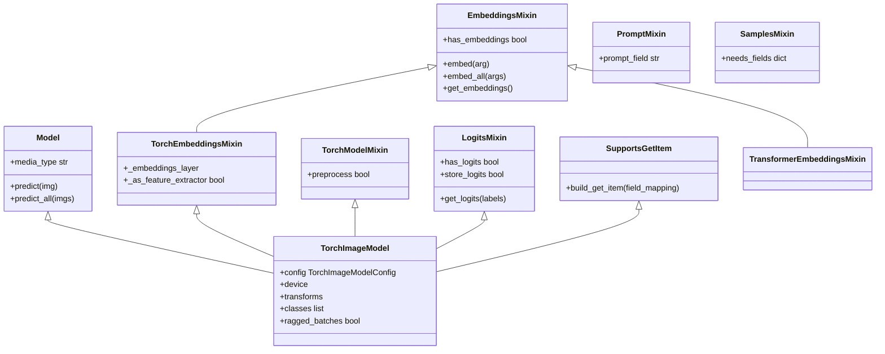
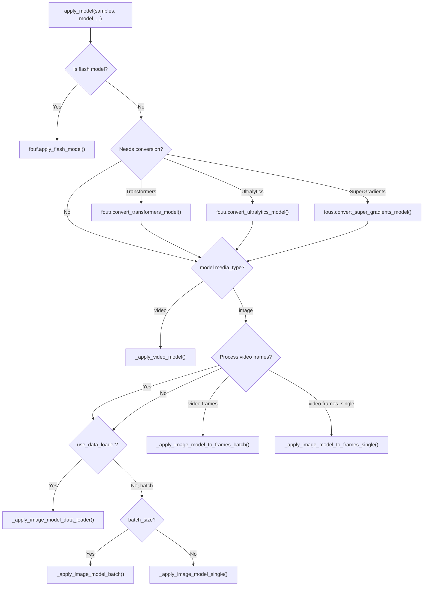
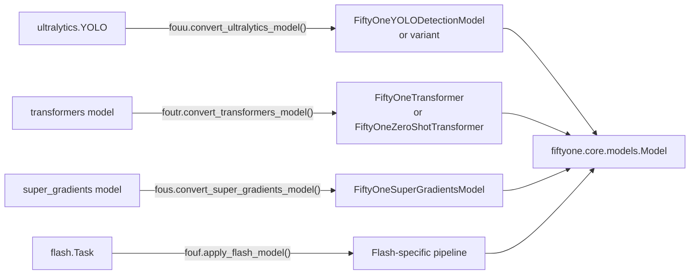
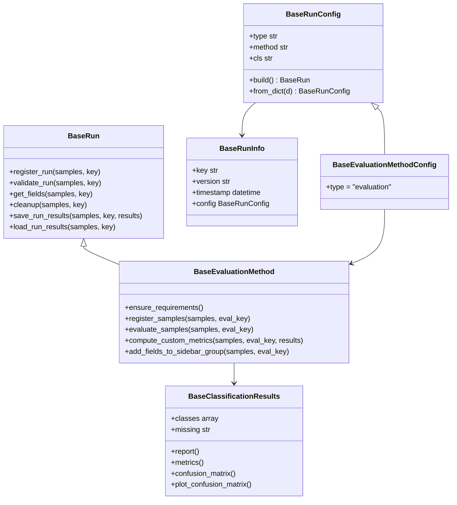
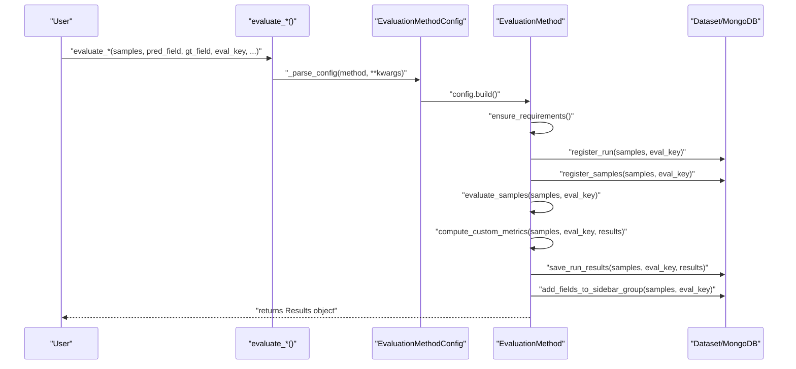
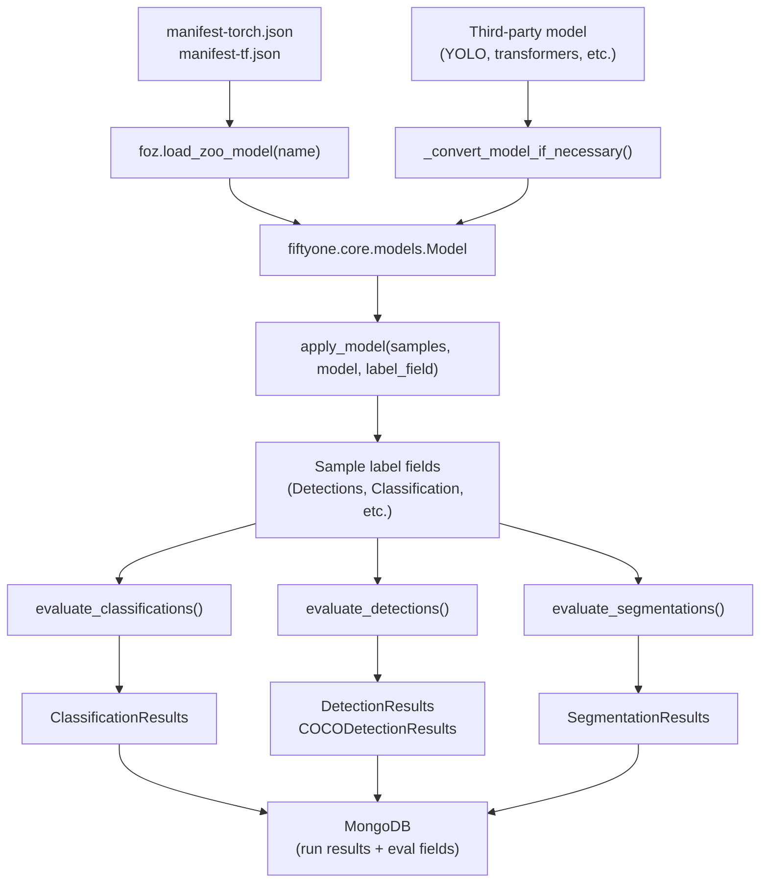

<!-- source: DeepWiki mcp.deepwiki.com · repo voxel51/fiftyone · page 6 Model Integration and Evaluation · fetched 2026-10-21 -->

# Model Integration and Evaluation

<details>
<summary>Relevant source files</summary>

The following files were used as context for generating this wiki page:

- [docs/scripts/make_model_zoo_docs.py](docs/scripts/make_model_zoo_docs.py)
- [docs/source/images/integrations/ultralytics_open_world_boxes.png](docs/source/images/integrations/ultralytics_open_world_boxes.png)
- [docs/source/integrations/mongodb.rst](docs/source/integrations/mongodb.rst)
- [docs/source/integrations/pytorch_hub.rst](docs/source/integrations/pytorch_hub.rst)
- [docs/source/integrations/ultralytics.rst](docs/source/integrations/ultralytics.rst)
- [fiftyone/core/models.py](fiftyone/core/models.py)
- [fiftyone/core/odm/runs.py](fiftyone/core/odm/runs.py)
- [fiftyone/core/odm/views.py](fiftyone/core/odm/views.py)
- [fiftyone/core/runs.py](fiftyone/core/runs.py)
- [fiftyone/migrations/revisions/v0_19_0.py](fiftyone/migrations/revisions/v0_19_0.py)
- [fiftyone/utils/clip/__init__.py](fiftyone/utils/clip/__init__.py)
- [fiftyone/utils/clip/model.py](fiftyone/utils/clip/model.py)
- [fiftyone/utils/clip/tokenizer.py](fiftyone/utils/clip/tokenizer.py)
- [fiftyone/utils/clip/zoo.py](fiftyone/utils/clip/zoo.py)
- [fiftyone/utils/eval/__init__.py](fiftyone/utils/eval/__init__.py)
- [fiftyone/utils/eval/activitynet.py](fiftyone/utils/eval/activitynet.py)
- [fiftyone/utils/eval/base.py](fiftyone/utils/eval/base.py)
- [fiftyone/utils/eval/classification.py](fiftyone/utils/eval/classification.py)
- [fiftyone/utils/eval/coco.py](fiftyone/utils/eval/coco.py)
- [fiftyone/utils/eval/detection.py](fiftyone/utils/eval/detection.py)
- [fiftyone/utils/eval/openimages.py](fiftyone/utils/eval/openimages.py)
- [fiftyone/utils/eval/regression.py](fiftyone/utils/eval/regression.py)
- [fiftyone/utils/eval/segmentation.py](fiftyone/utils/eval/segmentation.py)
- [fiftyone/utils/iou.py](fiftyone/utils/iou.py)
- [fiftyone/utils/labels.py](fiftyone/utils/labels.py)
- [fiftyone/utils/open_clip.py](fiftyone/utils/open_clip.py)
- [fiftyone/utils/sam.py](fiftyone/utils/sam.py)
- [fiftyone/utils/sam2.py](fiftyone/utils/sam2.py)
- [fiftyone/utils/super_gradients.py](fiftyone/utils/super_gradients.py)
- [fiftyone/utils/torch.py](fiftyone/utils/torch.py)
- [fiftyone/utils/transformers.py](fiftyone/utils/transformers.py)
- [fiftyone/utils/ultralytics.py](fiftyone/utils/ultralytics.py)
- [fiftyone/zoo/models/__init__.py](fiftyone/zoo/models/__init__.py)
- [fiftyone/zoo/models/manifest-tf.json](fiftyone/zoo/models/manifest-tf.json)
- [fiftyone/zoo/models/manifest-torch.json](fiftyone/zoo/models/manifest-torch.json)
- [fiftyone/zoo/models/torch.py](fiftyone/zoo/models/torch.py)
- [pylintrc](pylintrc)
- [tests/intensive/model_zoo_tests.py](tests/intensive/model_zoo_tests.py)
- [tests/misc/torch_tests.py](tests/misc/torch_tests.py)
- [tests/unittests/evaluation_tests.py](tests/unittests/evaluation_tests.py)
- [tests/unittests/get_item_tests.py](tests/unittests/get_item_tests.py)
- [tests/unittests/label_tests.py](tests/unittests/label_tests.py)
- [tests/unittests/torch_dataset_tests.py](tests/unittests/torch_dataset_tests.py)
- [tests/unittests/utils/test_sam2.py](tests/unittests/utils/test_sam2.py)

</details>


This page provides an overview of FiftyOne's model application and evaluation subsystems. It covers the abstract model interface, how models are applied to datasets, the evaluation framework's run/config pattern, and the evaluation protocols available for classification, detection, and segmentation tasks.

- For details on the Model Zoo manifest files, `load_zoo_model`, and specific third-party integrations, see [Model Zoo and Application](#6.1).
- For a full reference on evaluation protocols, IoU utilities, and result storage, see [Model Evaluation Framework](#6.2).
- For information on importing and exporting datasets that evaluation results may depend on, see [Import and Export Systems](#5.1).

---

## Model Abstraction Layer

All FiftyOne-compatible models implement the `Model` base class defined in [fiftyone/core/models.py](). Models communicate their capabilities through a set of mixins.

### Core Class Hierarchy

**Model class hierarchy and mixin system**



Sources: [fiftyone/core/models.py:1-50](), [fiftyone/utils/torch.py:329-402](), [fiftyone/utils/torch.py:657-720]()

---

### Key Model Interfaces

| Mixin / Class | Role | Key Attribute/Method |
|---|---|---|
| `Model` | Base interface for all models | `media_type`, `predict()`, `predict_all()` |
| `EmbeddingsMixin` | Models that expose vector embeddings | `embed()`, `embed_all()`, `has_embeddings` |
| `LogitsMixin` | Models that expose class logits | `has_logits`, `store_logits`, `get_logits()` |
| `PromptMixin` | Models that accept visual prompts | `prompt_field` |
| `SupportsGetItem` | Models using `torch.utils.data.DataLoader` | `build_get_item()` |
| `SamplesMixin` | Models that need access to the full `Sample` object | `needs_fields` |
| `TorchModelMixin` | Torch-specific inference control | `preprocess` |

Sources: [fiftyone/core/models.py:45-310]()

---

### `TorchImageModel` and `TorchImageModelConfig`

`TorchImageModel` ([fiftyone/utils/torch.py:657-719]()) is the standard wrapper for running PyTorch models. It is configured via `TorchImageModelConfig` ([fiftyone/utils/torch.py:403-596]()), which accepts:

| Config Field | Purpose |
|---|---|
| `entrypoint_fcn` | Function that constructs the raw `torch.nn.Module` |
| `entrypoint_args` | Arguments for the entrypoint function |
| `output_processor_cls` | Class that converts raw model output to FiftyOne labels |
| `embeddings_layer` | Named layer whose output is exposed as embeddings |
| `image_mean`, `image_std` | Preprocessing normalization |
| `image_dim`, `image_size` | Preprocessing resize target |
| `confidence_thresh` | Confidence filter applied to predictions |
| `labels_path` | Path to a text file mapping class indices to label strings |
| `device` | Device string, e.g., `"cuda:0"`, `"cpu"`, `"mps"` |

**Output processors** (defined in [fiftyone/utils/torch.py]()) convert raw model tensors to FiftyOne label types:

| Output Processor | Output Label Type |
|---|---|
| `ClassifierOutputProcessor` | `Classification` |
| `DetectorOutputProcessor` | `Detections` |
| `SemanticSegmenterOutputProcessor` | `Segmentation` |
| `InstanceSegmenterOutputProcessor` | `Detections` (with masks) |
| `KeypointDetectorOutputProcessor` | `Keypoints` |

Sources: [fiftyone/utils/torch.py:403-596](), [fiftyone/utils/torch.py:657-950]()

---

## Applying Models to Datasets

The primary entrypoint for running models is the `apply_model` function in [fiftyone/core/models.py:53-310](), which is also exposed as `SampleCollection.apply_model()`.

**`apply_model` dispatch logic**



Sources: [fiftyone/core/models.py:53-310]()

### Compute Embeddings

`compute_embeddings` (also on `SampleCollection`) calls `apply_model` internally, routing through the same dispatch logic, but stores float array output in a specified field instead of label objects. The model must implement `EmbeddingsMixin` with `has_embeddings == True`.

---

## Third-Party Model Integrations

FiftyOne auto-detects model types from third-party frameworks at runtime via helper predicates in [fiftyone/core/models.py:313-343]() and converts them to `Model`-compatible wrappers.

**Third-party model conversion flow**



Sources: [fiftyone/core/models.py:313-343](), [fiftyone/utils/ultralytics.py:28-55](), [fiftyone/utils/transformers.py:44-79](), [fiftyone/utils/super_gradients.py]()

### Integration Summary

| Framework | Conversion Function | Supported Tasks |
|---|---|---|
| Ultralytics (YOLO, RT-DETR) | `convert_ultralytics_model()` | Detection, segmentation, classification, OBB, pose |
| HuggingFace Transformers | `convert_transformers_model()` | Classification, detection, segmentation, depth, pose, zero-shot |
| OpenCLIP | `TorchOpenClipModel` | Zero-shot classification, embeddings |
| SAM / SAM2 | `SegmentAnythingModel`, `SegmentAnything2ImageModel`, `SegmentAnything2VideoModel` | Segmentation (prompted, automatic) |
| PyTorch Hub | `load_torch_hub_image_model()` | Any task supported by `TorchImageModel` |
| Torchvision | `TorchvisionImageModel` | Classification, segmentation, detection, keypoints |
| SuperGradients | `convert_super_gradients_model()` | Detection |
| Lightning Flash | `apply_flash_model()` | Various |

Sources: [fiftyone/utils/transformers.py:44-79](), [fiftyone/utils/ultralytics.py:28-55](), [fiftyone/utils/open_clip.py](), [fiftyone/utils/sam.py](), [fiftyone/zoo/models/torch.py]()

---

## Model Zoo

The FiftyOne Model Zoo provides pre-configured models loadable via `foz.load_zoo_model()`. Models are defined in manifest JSON files:

- [fiftyone/zoo/models/manifest-torch.json]() — PyTorch/Torchvision models
- [fiftyone/zoo/models/manifest-tf.json]() — TensorFlow models

Each manifest entry specifies:

| Manifest Field | Purpose |
|---|---|
| `base_name` | Unique model identifier |
| `default_deployment_config_dict` | Full config dict including `type` and model-specific args |
| `manager.config.url` | Download URL for model weights |
| `requirements.packages` | Required Python packages |
| `tags` | Searchable tags (e.g., `"classification"`, `"embeddings"`, `"torch"`) |

The `HasZooModel` mixin ([fiftyone/zoo/models/__init__.py]()) is mixed into config classes like `TorchvisionImageModelConfig` to handle weight downloading before model instantiation.

Sources: [fiftyone/zoo/models/__init__.py](), [fiftyone/zoo/models/torch.py](), [fiftyone/zoo/models/manifest-torch.json:1-60]()

---

## Evaluation Framework

All evaluation runs share a common infrastructure built on the `BaseRun` / `BaseRunConfig` / `BaseRunInfo` pattern defined in [fiftyone/core/runs.py]().

### Run Infrastructure



Sources: [fiftyone/core/runs.py:26-203](), [fiftyone/utils/eval/base.py]()

---

### Evaluation Entrypoints

The three primary evaluation entrypoints are methods on `SampleCollection`, delegating to functions in `fiftyone/utils/eval/`:

| Entrypoint Function | Module | Task |
|---|---|---|
| `evaluate_classifications()` | [fiftyone/utils/eval/classification.py:34-134]() | Classification |
| `evaluate_detections()` | [fiftyone/utils/eval/detection.py:33-241]() | Object detection, polylines, keypoints, temporal |
| `evaluate_segmentations()` | [fiftyone/utils/eval/segmentation.py:36-138]() | Semantic segmentation |
| `evaluate_regressions()` | [fiftyone/utils/eval/regression.py]() | Regression |

All entrypoints follow the same lifecycle:



Sources: [fiftyone/utils/eval/classification.py:34-134](), [fiftyone/utils/eval/detection.py:33-241](), [fiftyone/utils/eval/segmentation.py:36-138]()

---

### Classification Evaluation

Defined in [fiftyone/utils/eval/classification.py](). Three built-in methods:

| Method String | Config Class | Description |
|---|---|---|
| `"simple"` | `SimpleEvaluationConfig` | Direct label comparison per sample |
| `"top-k"` | `TopKEvaluationConfig` | Top-k accuracy using stored logits |
| `"binary"` | `BinaryEvaluationConfig` | Binary classification with thresholding |

When `eval_key` is provided, a boolean `eval_key` field is written to each sample (or frame). `ClassificationResults` wraps `sklearn.metrics` to produce confusion matrices, precision/recall reports, and interactive plots.

Sources: [fiftyone/utils/eval/classification.py:262-370]()

---

### Detection Evaluation

Defined in [fiftyone/utils/eval/detection.py](). Three built-in protocols:

| Method String | Config Class | Default For |
|---|---|---|
| `"coco"` | `COCOEvaluationConfig` | Spatial detections, polylines, keypoints |
| `"open-images"` | `OpenImagesEvaluationConfig` | Open Images-style with class hierarchies |
| `"activitynet"` | `ActivityNetEvaluationConfig` | `TemporalDetections` |

When `eval_key` is provided, the following fields are populated per object and per sample:

```
# Per-object
object.<eval_key>        # "tp", "fp", or "fn"
object.<eval_key>_id     # matched object ID
object.<eval_key>_iou    # matching IoU value

# Per-sample
sample.<eval_key>_tp     # int
sample.<eval_key>_fp     # int
sample.<eval_key>_fn     # int
```

Sources: [fiftyone/utils/eval/detection.py:82-241]()

---

### COCO Detection Evaluation

`COCOEvaluation` ([fiftyone/utils/eval/coco.py:121-251]()) matches predictions to ground truths in descending confidence order, requiring a minimum IoU. When `compute_mAP=True`, it sweeps over IoU thresholds (default 0.50:0.95:0.05) and returns `COCODetectionResults`, which provides:

| Method | Description |
|---|---|
| `mAP(classes=None)` | COCO-style mean average precision |
| `mAR(classes=None)` | COCO-style mean average recall |
| `plot_pr_curves(classes, iou_thresh)` | Precision-recall curves (Plotly or Matplotlib) |

Sources: [fiftyone/utils/eval/coco.py:253-480]()

---

### Segmentation Evaluation

Defined in [fiftyone/utils/eval/segmentation.py](). The default method `"simple"` performs pixelwise comparison. When `eval_key` is provided, the following fields are written per sample:

```
sample.<eval_key>_accuracy
sample.<eval_key>_precision
sample.<eval_key>_recall
```

`SegmentationResults` provides per-class accuracy, mean IoU (mIoU), and confusion matrix visualizations.

Sources: [fiftyone/utils/eval/segmentation.py:36-138]()

---

### IoU Utilities

The `fiftyone/utils/iou.py` module provides `compute_ious()`, which dispatches to the appropriate geometry calculation based on the label type:

| Label Type | IoU Method |
|---|---|
| `Detection` (bounding box) | `_compute_bbox_ious()` |
| `Detection` (instance mask) | `_compute_mask_ious()` |
| `Polyline` (filled) | `_compute_polygon_ious()` via Shapely |
| `Polyline` (unfilled) | `_compute_polyline_similarities()` (OKS-style) |
| `Keypoint` | `_compute_keypoint_similarities()` (OKS) |
| `TemporalDetection` | `compute_segment_ious()` |

The `sparse=True` mode returns a dict `{pred.id: [(gt.id, iou), ...]}` for efficient matching in COCO evaluation.

Sources: [fiftyone/utils/iou.py:30-156]()

---

### Evaluation Result Persistence

Results are stored in MongoDB alongside the dataset document via `BaseRun.save_run_results()` and reloaded by `BaseRun.load_run_results()`. The key is a user-supplied string (e.g., `"eval"`) that must be a valid Python identifier.

Existing runs can be managed with:

| Method | Description |
|---|---|
| `dataset.list_evaluations()` | List all eval keys |
| `dataset.get_evaluation_info(eval_key)` | Return stored `BaseRunInfo` |
| `dataset.load_evaluation_results(eval_key)` | Load results object |
| `dataset.delete_evaluation(eval_key)` | Delete run fields and stored results |
| `dataset.rename_evaluation(eval_key, new_key)` | Rename run and associated fields |

Sources: [fiftyone/core/runs.py:299-500]()

---

## System Overview

**Full model integration and evaluation flow**



Sources: [fiftyone/core/models.py](), [fiftyone/zoo/models/__init__.py](), [fiftyone/utils/eval/classification.py](), [fiftyone/utils/eval/detection.py](), [fiftyone/utils/eval/segmentation.py](), [fiftyone/core/runs.py]()

---

