<!-- source: DeepWiki mcp.deepwiki.com · repo voxel51/fiftyone · page 6.1 Model Zoo and Application · fetched 2026-10-21 -->

# Model Zoo and Application

<details>
<summary>Relevant source files</summary>

The following files were used as context for generating this wiki page:

- [docs/scripts/make_model_zoo_docs.py](docs/scripts/make_model_zoo_docs.py)
- [docs/source/images/dataset_zoo_coco_2017.png](docs/source/images/dataset_zoo_coco_2017.png)
- [docs/source/images/integrations/ultralytics_open_world_boxes.png](docs/source/images/integrations/ultralytics_open_world_boxes.png)
- [docs/source/integrations/mongodb.rst](docs/source/integrations/mongodb.rst)
- [docs/source/integrations/pytorch_hub.rst](docs/source/integrations/pytorch_hub.rst)
- [docs/source/integrations/ultralytics.rst](docs/source/integrations/ultralytics.rst)
- [fiftyone/core/models.py](fiftyone/core/models.py)
- [fiftyone/utils/cityscapes.py](fiftyone/utils/cityscapes.py)
- [fiftyone/utils/clip/__init__.py](fiftyone/utils/clip/__init__.py)
- [fiftyone/utils/clip/model.py](fiftyone/utils/clip/model.py)
- [fiftyone/utils/clip/tokenizer.py](fiftyone/utils/clip/tokenizer.py)
- [fiftyone/utils/clip/zoo.py](fiftyone/utils/clip/zoo.py)
- [fiftyone/utils/imagenet.py](fiftyone/utils/imagenet.py)
- [fiftyone/utils/lfw.py](fiftyone/utils/lfw.py)
- [fiftyone/utils/open_clip.py](fiftyone/utils/open_clip.py)
- [fiftyone/utils/sam.py](fiftyone/utils/sam.py)
- [fiftyone/utils/sam2.py](fiftyone/utils/sam2.py)
- [fiftyone/utils/super_gradients.py](fiftyone/utils/super_gradients.py)
- [fiftyone/utils/torch.py](fiftyone/utils/torch.py)
- [fiftyone/utils/transformers.py](fiftyone/utils/transformers.py)
- [fiftyone/utils/ultralytics.py](fiftyone/utils/ultralytics.py)
- [fiftyone/zoo/__init__.py](fiftyone/zoo/__init__.py)
- [fiftyone/zoo/models/__init__.py](fiftyone/zoo/models/__init__.py)
- [fiftyone/zoo/models/manifest-tf.json](fiftyone/zoo/models/manifest-tf.json)
- [fiftyone/zoo/models/manifest-torch.json](fiftyone/zoo/models/manifest-torch.json)
- [fiftyone/zoo/models/torch.py](fiftyone/zoo/models/torch.py)
- [pylintrc](pylintrc)
- [tests/intensive/model_zoo_tests.py](tests/intensive/model_zoo_tests.py)
- [tests/misc/torch_tests.py](tests/misc/torch_tests.py)
- [tests/unittests/get_item_tests.py](tests/unittests/get_item_tests.py)
- [tests/unittests/torch_dataset_tests.py](tests/unittests/torch_dataset_tests.py)
- [tests/unittests/utils/test_sam2.py](tests/unittests/utils/test_sam2.py)

</details>


This document covers FiftyOne's Model Zoo system and the model application infrastructure. The Model Zoo provides pre-built models from various frameworks, while the application system handles running inference on datasets with these models.

For information about model evaluation and metrics computation, see [Model Evaluation Framework](#6.2). For information about the datasets used with these models, see [Dataset Zoo](#5.2).

## Purpose and Scope

The Model Zoo and Application system encompasses:

- **Model Zoo**: A registry of pre-configured models from popular ML frameworks
- **Model Application**: Infrastructure for applying models to FiftyOne datasets 
- **Framework Integration**: Wrappers for PyTorch, Ultralytics, HuggingFace, and other frameworks
- **Output Processing**: Converting model outputs to FiftyOne label formats
- **Specialized Models**: Support for unique architectures like Segment Anything and CLIP

## System Architecture

The Model Zoo system consists of manifest files that define available models, wrapper classes that provide a unified interface, and an application pipeline that handles inference execution.

### Manifest Structure

Each model in the zoo is described by a JSON entry in one of the manifest files under `fiftyone/zoo/models/`. The primary manifests are `manifest-torch.json` and `manifest-tf.json`, discoverable via the glob pattern `manifest-*.json`.

Each manifest entry has the following fields:

| Field | Type | Purpose |
|---|---|---|
| `base_name` | string | Unique model identifier (used as the model name) |
| `base_filename` | string | Local filename for cached weights |
| `version` | string or null | Optional version tag |
| `description` | string | Human-readable description |
| `source` | string | URL to model source |
| `author` | string | Model author |
| `license` | string | License identifier (e.g., `"Apache 2.0"`) |
| `size_bytes` | integer | Size of model weights file |
| `manager` | object | Download configuration (`type` + `config.url`) |
| `default_deployment_config_dict` | object | Model class (`type`) and its init config |
| `requirements` | object | `packages` list and `cpu`/`gpu` support flags |
| `tags` | array | Searchable tags (e.g., `"torch"`, `"classification"`, `"embeddings"`) |
| `training_data` | array | Training dataset references |
| `date_added` | string | Registration date |

The `default_deployment_config_dict` is the most important field — it specifies the Python class that wraps the model and its full configuration. For example, for AlexNet:

```
"type": "fiftyone.zoo.models.torch.TorchvisionImageModel",
"config": {
    "entrypoint_fcn": "torchvision.models.alexnet.alexnet",
    "entrypoint_args": {"weights": "AlexNet_Weights.DEFAULT"},
    "output_processor_cls": "fiftyone.utils.torch.ClassifierOutputProcessor",
    "embeddings_layer": "<classifier.6",
    ...
}
```

Sources: [fiftyone/zoo/models/manifest-torch.json:1-60](), [fiftyone/zoo/models/manifest-tf.json:1-50]()

### Model Zoo Architecture

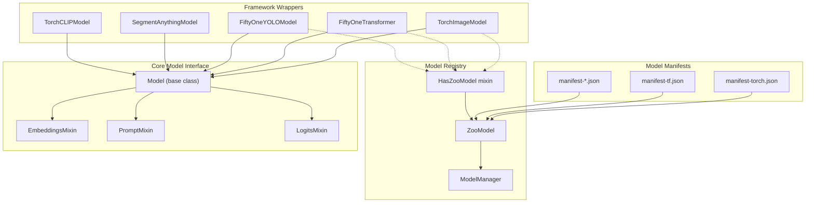

**`load_zoo_model` Resolution Flow**

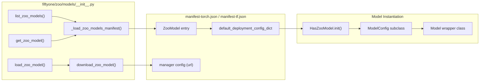

Sources: [fiftyone/zoo/models/__init__.py:36-400](), [fiftyone/zoo/models/manifest-torch.json:1-60]()

## Model Application Pipeline

The model application system processes datasets through a unified pipeline that handles different model types, batch processing, and output formatting.

### Application Workflow

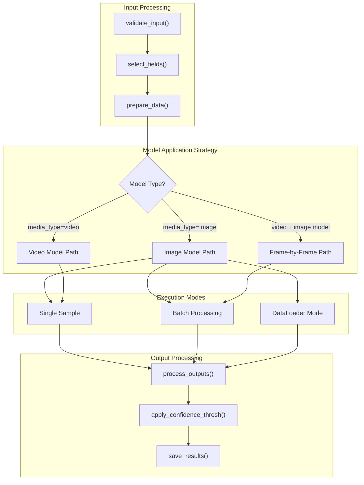

**Core Application Function**

The `apply_model` function in [fiftyone/core/models.py:52-292]() serves as the main entry point for model application. It handles model type detection, execution strategy selection, and result processing.

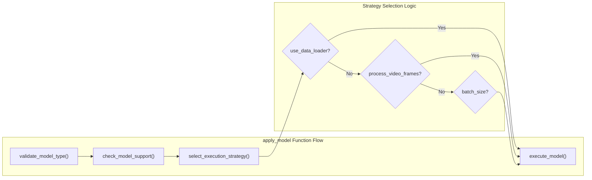

Sources: [fiftyone/core/models.py:52-292](), [fiftyone/core/models.py:446-519]()

## Embedding Extraction via `compute_embeddings`

Beyond prediction, models that implement `EmbeddingsMixin` (i.e., `model.has_embeddings == True`) can be used to extract vector embeddings for each sample. This is called via `SampleCollection.compute_embeddings()`.

The `TorchEmbeddingsMixin` class in `fiftyone/utils/torch.py` provides the embedding extraction implementation for PyTorch models. Two mechanisms are supported:

| Mechanism | How it works |
|---|---|
| `embeddings_layer` (string) | Attaches a `SaveLayerTensor` hook to the named layer; the saved tensor is returned after each forward pass. Prepend `"<"` to capture the layer's *input* instead of its output. |
| `as_feature_extractor=True` | Uses `torchvision.models.feature_extraction.create_feature_extractor()` to build a submodel that returns the named layer's output directly. |

The `embeddings_layer` is declared in the manifest's `default_deployment_config_dict`. For example, AlexNet declares `"embeddings_layer": "<classifier.6"`, which captures the input to the final classifier layer.

**Embedding Extraction Data Flow**

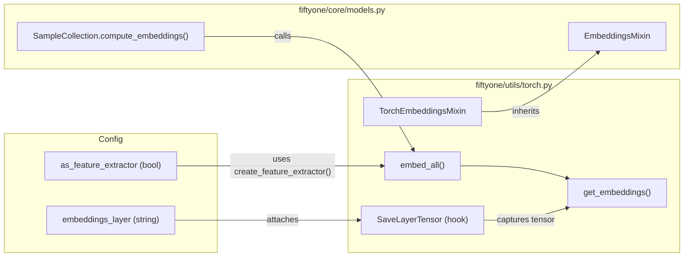

Sources: [fiftyone/utils/torch.py:329-401](), [fiftyone/utils/torch.py:344-388]()

## Framework Integrations

FiftyOne integrates with major ML frameworks through dedicated wrapper classes that provide unified interfaces while preserving framework-specific functionality.

### PyTorch Integration

The PyTorch integration centers around the `TorchImageModel` class and supporting utilities.

**PyTorch Model Hierarchy**

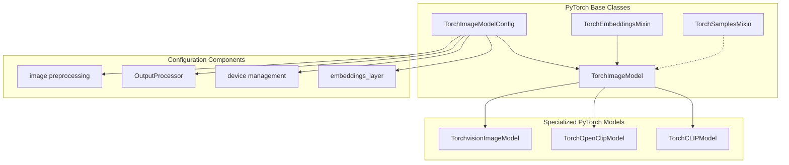

**PyTorch Hub Integration**

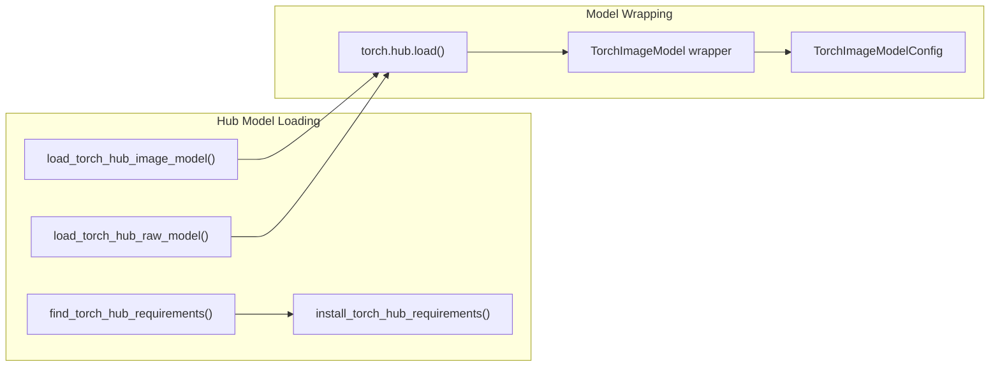

The `TorchvisionImageModel` class in `fiftyone/zoo/models/torch.py` extends `TorchImageModel` and monkey-patches `load_state_dict_from_url` so that model weights are stored in `fo.config.model_zoo_dir` rather than the Torch Hub cache. This is done via `_make_load_state_dict_from_url_monkey_patcher` in [fiftyone/zoo/models/torch.py:74-95]().

The `HasZooModel` mixin (from `fiftyone/zoo/models/__init__.py`) is mixed into config classes like `TorchvisionImageModelConfig`. It provides:
- `init(d)`: processes the config dict, resolving the model path
- `download_model_if_necessary()`: downloads weights to `fo.config.model_zoo_dir` if absent

Sources: [fiftyone/utils/torch.py:51-114](), [fiftyone/zoo/models/torch.py:25-96](), [fiftyone/utils/torch.py:657-718]()

### Ultralytics Integration

The Ultralytics integration supports YOLO models through automatic model type detection and specialized output processing.

The entry point for automatic model conversion is `_convert_model_if_necessary()` in `fiftyone/core/models.py`, which calls `convert_ultralytics_model()` when it detects a model from the `ultralytics.*` module namespace.

**Ultralytics Model Conversion (`fiftyone/utils/ultralytics.py`)**

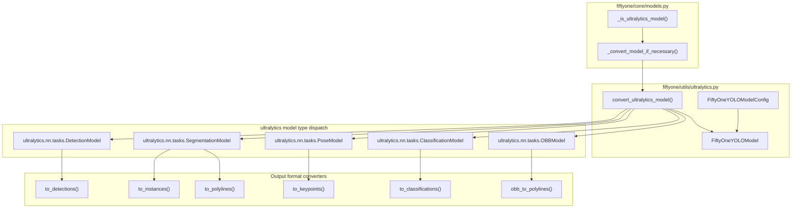

Sources: [fiftyone/utils/ultralytics.py:28-56](), [fiftyone/core/models.py:321-343](), [fiftyone/utils/ultralytics.py:496-608]()

### HuggingFace Transformers Integration

The Transformers integration handles diverse model types through automatic task detection and specialized configurations.

**Transformers Model Support**

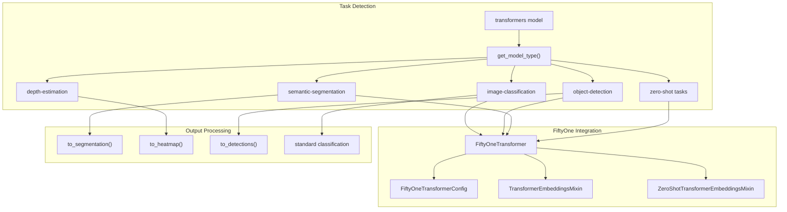

The `FiftyOneTransformerConfig` in `fiftyone/utils/transformers.py` uses `transformers.AutoConfig.from_pretrained()` and `transformers.AutoProcessor.from_pretrained()` for automatic processor/config loading. The `name_or_path` field maps to a HuggingFace model identifier. Embedding extraction is handled by `TransformerEmbeddingsMixin`, which supports multiple output key strategies: `pooler_output`, `last_hidden_state`, and `hidden_states`.

Zero-shot models use `FiftyOneZeroShotTransformerConfig` and mix in `ZeroShotTransformerEmbeddingsMixin` and `ZeroShotTransformerPromptMixin` to support text-image similarity via `get_image_features()`.

Sources: [fiftyone/utils/transformers.py:44-80](), [fiftyone/utils/transformers.py:256-380](), [fiftyone/utils/transformers.py:566-625]()

## Specialized Model Types

FiftyOne provides specialized support for advanced model architectures that require unique handling for prompts, embeddings, or multi-modal inputs.

### Segment Anything Models

The Segment Anything integration supports both SAM and SAM2 models with prompt-based segmentation and automatic mask generation.

**SAM Model Architecture**

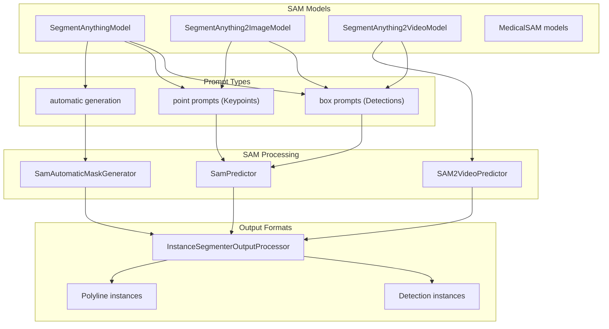

SAM models in the manifest use `fiftyone.utils.sam.SegmentAnythingModel` as their deployment type. SAM2 models use either `fiftyone.utils.sam2.SegmentAnything2ImageModel` or `fiftyone.utils.sam2.SegmentAnything2VideoModel`, depending on whether the model handles static images or video frames.

The prompt field is passed via `apply_model(..., prompt_field="ground_truth")`. The `SegmentAnythingModel.predict_all()` in `fiftyone/utils/sam.py` reads the prompt field from samples to extract box or keypoint prompts, then dispatches to either `SamPredictor` (prompted) or `SamAutomaticMaskGenerator` (unprompted).

Sources: [fiftyone/utils/sam.py:50-160](), [fiftyone/utils/sam2.py:1-50](), [fiftyone/zoo/models/manifest-torch.json:114-260]()

### CLIP Models

CLIP models provide zero-shot classification and embedding capabilities through text-image similarity computation.

**CLIP Integration Architecture**

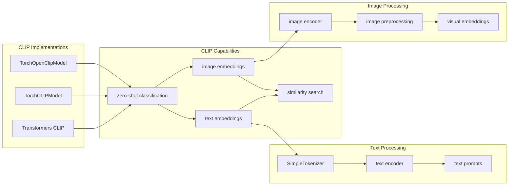

Both CLIP implementations inherit from `fom.PromptMixin`, which provides `embed_prompt()` and `embed_prompts()` for text embedding. The `can_embed_prompts` property returns `True` for both, enabling similarity search and zero-shot classification workflows.

For `TorchOpenClipModel`, text features are cached in `_text_features` after the first forward pass; `_get_text_features()` tokenizes class prompts and encodes them using `open_clip.get_tokenizer()`.

Sources: [fiftyone/utils/open_clip.py:29-205](), [fiftyone/utils/clip/zoo.py:31-167]()

## Output Processing Pipeline

The output processing system converts raw model predictions into FiftyOne label formats while handling confidence thresholding and format standardization.

**Output Processor Hierarchy**

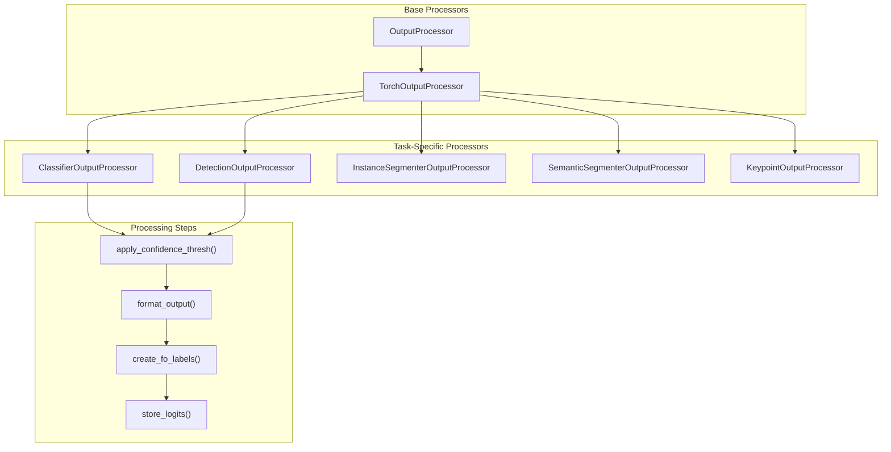

Sources: [fiftyone/utils/torch.py:1200-1800](), [fiftyone/core/models.py:696-728](), [fiftyone/utils/torch.py:900-1000]()

---

