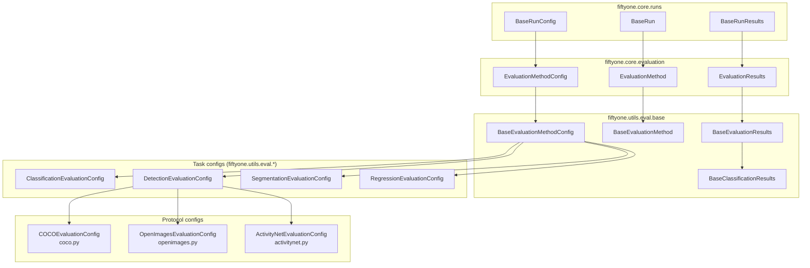
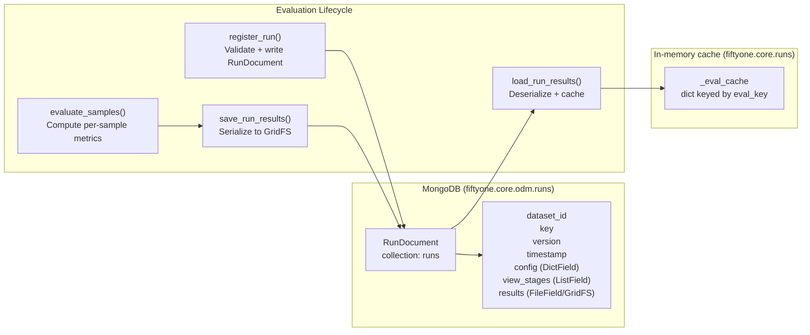
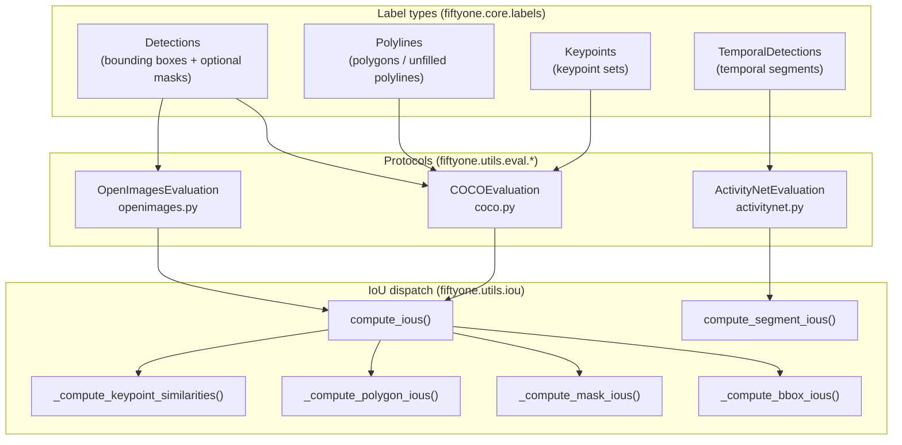
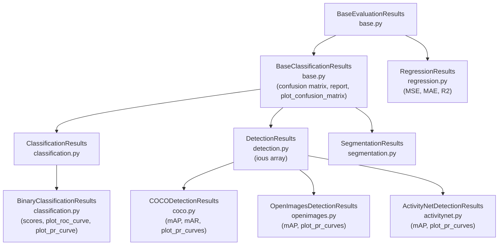

<!-- source: DeepWiki mcp.deepwiki.com · repo voxel51/fiftyone · page 6.2 Model Evaluation Framework · fetched 2026-10-21 -->

# Model Evaluation Framework

<details>
<summary>Relevant source files</summary>

The following files were used as context for generating this wiki page:

- [fiftyone/core/odm/runs.py](fiftyone/core/odm/runs.py)
- [fiftyone/core/odm/views.py](fiftyone/core/odm/views.py)
- [fiftyone/core/runs.py](fiftyone/core/runs.py)
- [fiftyone/migrations/revisions/v0_19_0.py](fiftyone/migrations/revisions/v0_19_0.py)
- [fiftyone/utils/eval/__init__.py](fiftyone/utils/eval/__init__.py)
- [fiftyone/utils/eval/activitynet.py](fiftyone/utils/eval/activitynet.py)
- [fiftyone/utils/eval/base.py](fiftyone/utils/eval/base.py)
- [fiftyone/utils/eval/classification.py](fiftyone/utils/eval/classification.py)
- [fiftyone/utils/eval/coco.py](fiftyone/utils/eval/coco.py)
- [fiftyone/utils/eval/detection.py](fiftyone/utils/eval/detection.py)
- [fiftyone/utils/eval/openimages.py](fiftyone/utils/eval/openimages.py)
- [fiftyone/utils/eval/regression.py](fiftyone/utils/eval/regression.py)
- [fiftyone/utils/eval/segmentation.py](fiftyone/utils/eval/segmentation.py)
- [fiftyone/utils/iou.py](fiftyone/utils/iou.py)
- [fiftyone/utils/labels.py](fiftyone/utils/labels.py)
- [tests/unittests/evaluation_tests.py](tests/unittests/evaluation_tests.py)
- [tests/unittests/label_tests.py](tests/unittests/label_tests.py)

</details>


## Purpose and Scope

The Model Evaluation Framework provides a comprehensive system for evaluating model predictions against ground truth labels in FiftyOne. This framework supports multiple evaluation tasks including classification, detection, segmentation, and regression, with various evaluation protocols tailored to different domains and benchmarks.

For information about model application and inference pipelines, see [Model Zoo and Application](#6.1). For details about annotation workflows that generate ground truth data, see [External Annotation Tool Integration](#7.1).

## Architecture Overview

The evaluation framework follows a hierarchical design with base classes providing common functionality and task-specific implementations handling domain-specific metrics and protocols.

### Evaluation Framework Architecture

The following diagram shows the full class hierarchy from storage primitives up to task-specific evaluation protocols.

**Class hierarchy from runs framework to evaluation implementations**



Sources: [fiftyone/utils/eval/base.py:188-206](), [fiftyone/utils/eval/classification.py:136-158](), [fiftyone/utils/eval/detection.py:244-282](), [fiftyone/utils/eval/coco.py:30-119](), [fiftyone/core/runs.py:56-105]()

## Base Evaluation Framework

### Configuration and Method Base Classes

The framework is built on three core base classes that provide common evaluation functionality:

**BaseEvaluationMethodConfig** serves as the configuration base, defining common parameters like custom metrics and handling credential loading:

```python
# Key configuration methods
@property
def type(self):
    """The type of evaluation (classification, detection, etc.)"""
    
@property  
def method(self):
    """The name of the specific evaluation method"""
    
def build(self):
    """Builds the evaluation method instance"""
```

**BaseEvaluationMethod** provides the core evaluation workflow including run registration, sample processing, and results generation:

```python
# Core evaluation workflow methods  
def register_run(self, samples, key):
    """Registers evaluation run with dataset"""
    
def register_samples(self, samples, eval_key):
    """Prepares dataset schema for evaluation"""
    
def evaluate_samples(self, samples, eval_key=None):
    """Performs the actual evaluation"""
    
def compute_custom_metrics(self, samples, eval_key, results):
    """Computes user-defined custom metrics"""
```

**BaseEvaluationResults** handles result storage, metrics computation, and visualization generation.

Sources: [fiftyone/utils/eval/base.py:188-206](), [fiftyone/utils/eval/base.py:201-255](), [fiftyone/utils/eval/base.py:640-850]()

### Integration with Dataset Runs Framework

Evaluations are tracked through FiftyOne's runs framework. Each evaluation run is persisted to MongoDB as a `RunDocument`, with large result blobs stored in GridFS.

**Evaluation run storage and lifecycle**



`RunDocument` stores the serialized `BaseRunConfig` in its `config` field and the serialized results blob in `results` (GridFS). The `view_stages` field captures the view pipeline if evaluation was run on a `DatasetView`.

Sources: [fiftyone/core/odm/runs.py:21-33](), [fiftyone/core/runs.py:299-324](), [fiftyone/core/runs.py:556-665](), [fiftyone/core/runs.py:667-737]()

### Subset Views

`get_subset_view()` in `fiftyone/utils/eval/base.py` is a helper that resolves a subset definition dict into a filtered `DatasetView`. Subset definitions can specify filtering by:

| `type` | Filter Mechanism |
|--------|-----------------|
| `"view"` | Named saved view on the dataset |
| `"field"` | Sample-level field value or expression |
| `"attribute"` | Label attribute value or expression |

Compound subsets are expressed as a list of such dicts and are applied in order. This is used internally by evaluation methods that need to scope metrics to a subset of data.

Sources: [fiftyone/utils/eval/base.py:34-185]()

## Task-Specific Evaluation Methods

### Classification Evaluation

Classification evaluation supports three main approaches:

| Method | Config Class | Description |
|--------|--------------|-------------|
| `simple` | `SimpleEvaluationConfig` | Direct label comparison |
| `top-k` | `TopKEvaluationConfig` | Top-k accuracy evaluation using logits |
| `binary` | `BinaryEvaluationConfig` | Binary classification with TP/FP/TN/FN |

**Simple Evaluation** compares predicted and ground truth labels directly:

```python
# Key evaluation logic in SimpleEvaluation.evaluate_samples()
ytrue, ypred, confs = samples.values([gt, pred, pred_conf])
results = ClassificationResults(
    samples, config, eval_key, ytrue, ypred, confs=confs
)
```

**Top-K Evaluation** requires logits and evaluates whether the ground truth appears in the top-k predictions:

```python
# Requires logits field to be populated
logits = samples.values([pred_field + ".logits"])
confs, correct = _evaluate_top_k(ytrue, ypred, logits, k, targets_map)
```

**Binary Evaluation** provides detailed TP/FP/TN/FN analysis for two-class problems and populates evaluation status on each sample.

Sources: [fiftyone/utils/eval/classification.py:278-366](), [fiftyone/utils/eval/classification.py:395-507](), [fiftyone/utils/eval/classification.py:591-724]()

### Detection Evaluation

Detection evaluation supports multiple spatial data types and evaluation protocols.

**Detection label types, protocols, and IoU dispatch in `fiftyone/utils/iou.py`**



`compute_ious()` in [fiftyone/utils/iou.py:30-156]() dispatches to the correct backend based on label type and configuration flags (`use_masks`, `use_boxes`). For keypoints and unfilled polylines, object keypoint similarity is used instead of standard IoU.

The detection evaluation workflow:

1. **Sample Registration** (`DetectionEvaluation.register_samples()`): Declares schema fields for TP/FP/FN counts at both sample and object level.
2. **Per-sample Object Matching** (`evaluate()`): Matches predictions to ground truth objects via IoU, writing results directly onto labels.
3. **Results Aggregation** (`generate_results()`): Computes precision/recall metrics; for COCO, optionally performs an IoU sweep to generate mAP and PR curves.

Fields populated when `eval_key` is provided:

| Field | Level | Type | Description |
|-------|-------|------|-------------|
| `<eval_key>_tp` | sample | `IntField` | True positive count |
| `<eval_key>_fp` | sample | `IntField` | False positive count |
| `<eval_key>_fn` | sample | `IntField` | False negative count |
| `<label_list>.<eval_key>` | object | `StringField` | `"tp"`, `"fp"`, or `"fn"` |
| `<label_list>.<eval_key>_id` | object | `StringField` | ID of matched counterpart |
| `<label_list>.<eval_key>_iou` | object | `FloatField` | IoU with matched object |

Sources: [fiftyone/utils/eval/detection.py:33-148](), [fiftyone/utils/eval/detection.py:295-434](), [fiftyone/utils/iou.py:30-157]()

### IoU Utilities

`fiftyone/utils/iou.py` provides standalone IoU utilities beyond evaluation:

| Function | Description |
|----------|-------------|
| `compute_ious(preds, gts, ...)` | Pairwise IoU matrix or sparse dict between predicted and ground truth objects |
| `compute_segment_ious(preds, gts)` | Pairwise temporal IoU for `TemporalDetection` objects |
| `compute_max_ious(sample_collection, label_field, ...)` | Populates a `max_iou` attribute on each label recording its highest overlap with any other label |
| `compute_bbox_iou(gt, pred)` | Single-pair bounding box IoU |
| `find_duplicates(sample_collection, label_field, ...)` | Returns IDs of duplicate labels above an IoU threshold; supports `"simple"` and `"greedy"` deduplication methods |

Sources: [fiftyone/utils/iou.py:30-183](), [fiftyone/utils/iou.py:185-373](), [fiftyone/utils/iou.py:489-524]()

### Segmentation Evaluation

Segmentation evaluation performs pixelwise comparison of semantic masks with support for boundary evaluation:

**SimpleEvaluation** provides the core segmentation evaluation with options for:
- Full mask evaluation vs boundary-only evaluation (`bandwidth` parameter)
- Dice coefficient computation (`compute_dice` parameter) 
- Multiple averaging strategies for precision/recall (`average` parameter)

The evaluation process handles mask resizing automatically when prediction and ground truth dimensions don't match.

Sources: [fiftyone/utils/eval/segmentation.py:36-138](), [fiftyone/utils/eval/segmentation.py:323-366]()

### Regression Evaluation  

Regression evaluation computes error metrics between predicted and ground truth continuous values:

**SimpleEvaluation** supports various error metrics:
- Mean Squared Error (MSE)
- Mean Absolute Error (MAE) 
- R² coefficient of determination
- Custom sklearn-compatible metrics

The evaluation handles missing data gracefully and provides both sample-level and aggregate metrics.

Sources: [fiftyone/utils/eval/regression.py:36-133](), [fiftyone/utils/eval/regression.py:140-180]()

## Evaluation Protocols

### COCO-Style Evaluation

COCO evaluation implements the standard COCO detection evaluation protocol with the following features:

**Matching Strategy**: 
- Predictions matched to ground truth in descending confidence order
- IoU threshold determines matches (`iou` parameter)
- Classwise matching optional (`classwise` parameter)
- Crowd object support (`iscrowd` parameter)

**mAP Computation** (when `compute_mAP=True`):
- Multiple IoU thresholds (default: 0.5:0.05:0.95)
- Precision-recall curve generation
- AP computation across IoU thresholds and classes

```python
# Key COCO evaluation configuration
config = COCOEvaluationConfig(
    pred_field="predictions",
    gt_field="ground_truth", 
    iou=0.5,
    classwise=True,
    compute_mAP=True,
    iou_threshs=[0.5, 0.55, ..., 0.95]
)
```

Sources: [fiftyone/utils/eval/coco.py:30-119](), [fiftyone/utils/eval/coco.py:121-250](), [fiftyone/utils/eval/coco.py:710-835]()

### Open Images Evaluation  

Open Images evaluation extends COCO-style evaluation with:
- **Hierarchical labels**: Support for label hierarchies and expansion
- **Image-level labels**: Positive/negative image-level annotations
- **Group detection**: Handling of group annotations

### ActivityNet Evaluation

ActivityNet evaluation specializes in temporal detection with:
- **Temporal IoU**: Segment overlap computation for temporal detections
- **mAP over time**: Precision-recall curves across temporal IoU thresholds

Sources: [fiftyone/utils/eval/openimages.py:24-142](), [fiftyone/utils/eval/activitynet.py:28-98]()

## Results and Metrics

### Results Classes Hierarchy

`BaseClassificationResults` is the common base for all label-matching tasks (classification, detection, and segmentation) since they all reduce to comparing ground truth labels against predicted labels. `RegressionResults` uses `BaseEvaluationResults` directly since it compares numeric values.

**Results class hierarchy (fiftyone.utils.eval.*)**



### Key Metrics by Task Type

| Task | Primary Metrics | Visualization |
|------|----------------|---------------|
| Classification | Accuracy, Precision, Recall, F1 | Confusion Matrix |
| Binary Classification | ROC-AUC, PR-AUC, Precision, Recall | ROC/PR Curves |
| Detection | mAP, mAR, IoU distribution | PR Curves |
| Segmentation | Pixel Accuracy, Mean IoU, Dice | Per-class metrics |
| Regression | MSE, MAE, R² | Scatter plots |

### Interactive Plotting Integration

Results classes integrate with FiftyOne's plotting framework to generate interactive visualizations:

```python
# Example plotting methods available on results
results.plot_confusion_matrix()  # Classification
results.plot_pr_curve()          # Binary classification  
results.plot_pr_curves()         # COCO detection
results.print_report()           # All task types
```

Sources: [fiftyone/utils/eval/base.py:640-850](), [fiftyone/utils/eval/classification.py:751-902](), [fiftyone/utils/eval/coco.py:253-460]()

## Custom Metrics Framework

The evaluation framework supports custom metrics through a plugin-like system:

**Custom Metric Definition**:
```python
# Custom metrics can be defined as:
custom_metrics = [
    "custom_metric_name",  # Use default parameters
    {"custom_metric": {"param": "value"}},  # With parameters  
]
```

**Implementation Requirements**:
- Custom metrics must be registered evaluation operators
- Must implement `execute()` method with samples and results parameters
- Can store results in dataset fields or return computed values

**Integration Points**:
- `compute_custom_metrics()` called after main evaluation
- `get_custom_metric_fields()` handles field cleanup and renaming
- Custom metric results cached with evaluation results

Sources: [fiftyone/utils/eval/base.py:208-254](), [fiftyone/utils/eval/base.py:430-520]()

---

