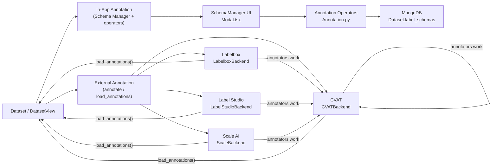
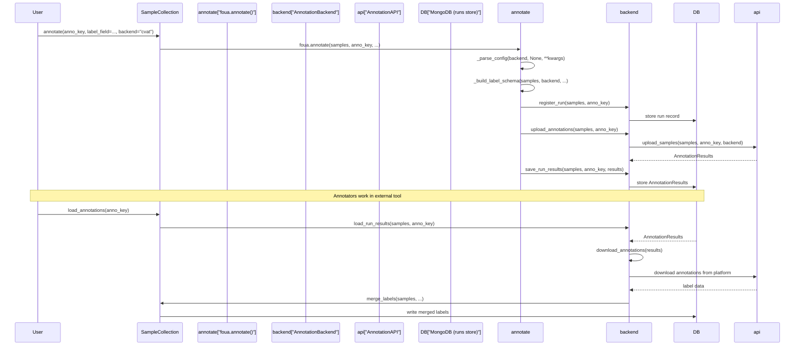
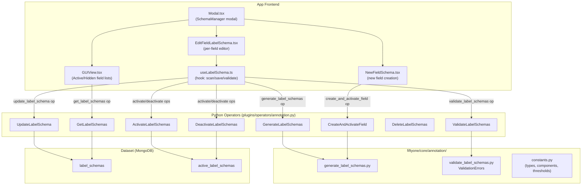

<!-- source: DeepWiki mcp.deepwiki.com · repo voxel51/fiftyone · page 7 Annotation Systems · fetched 2026-10-21 -->

# Annotation Systems

<details>
<summary>Relevant source files</summary>

The following files were used as context for generating this wiki page:

- [app/packages/core/src/components/Modal/Sidebar/Annotate/SchemaManager/ActiveFieldsSection.tsx](app/packages/core/src/components/Modal/Sidebar/Annotate/SchemaManager/ActiveFieldsSection.tsx)
- [app/packages/core/src/components/Modal/Sidebar/Annotate/SchemaManager/EditFieldLabelSchema/EditFieldLabelSchema.tsx](app/packages/core/src/components/Modal/Sidebar/Annotate/SchemaManager/EditFieldLabelSchema/EditFieldLabelSchema.tsx)
- [app/packages/core/src/components/Modal/Sidebar/Annotate/SchemaManager/EditFieldLabelSchema/GUIContent/AddAttributeCard.tsx](app/packages/core/src/components/Modal/Sidebar/Annotate/SchemaManager/EditFieldLabelSchema/GUIContent/AddAttributeCard.tsx)
- [app/packages/core/src/components/Modal/Sidebar/Annotate/SchemaManager/EditFieldLabelSchema/GUIContent/AddClassCard.tsx](app/packages/core/src/components/Modal/Sidebar/Annotate/SchemaManager/EditFieldLabelSchema/GUIContent/AddClassCard.tsx)
- [app/packages/core/src/components/Modal/Sidebar/Annotate/SchemaManager/EditFieldLabelSchema/GUIContent/AttributeCard.tsx](app/packages/core/src/components/Modal/Sidebar/Annotate/SchemaManager/EditFieldLabelSchema/GUIContent/AttributeCard.tsx)
- [app/packages/core/src/components/Modal/Sidebar/Annotate/SchemaManager/EditFieldLabelSchema/GUIContent/AttributeFormContent.tsx](app/packages/core/src/components/Modal/Sidebar/Annotate/SchemaManager/EditFieldLabelSchema/GUIContent/AttributeFormContent.tsx)
- [app/packages/core/src/components/Modal/Sidebar/Annotate/SchemaManager/EditFieldLabelSchema/GUIContent/AttributesSection.tsx](app/packages/core/src/components/Modal/Sidebar/Annotate/SchemaManager/EditFieldLabelSchema/GUIContent/AttributesSection.tsx)
- [app/packages/core/src/components/Modal/Sidebar/Annotate/SchemaManager/EditFieldLabelSchema/GUIContent/CardActions.tsx](app/packages/core/src/components/Modal/Sidebar/Annotate/SchemaManager/EditFieldLabelSchema/GUIContent/CardActions.tsx)
- [app/packages/core/src/components/Modal/Sidebar/Annotate/SchemaManager/EditFieldLabelSchema/GUIContent/ClassesSection.tsx](app/packages/core/src/components/Modal/Sidebar/Annotate/SchemaManager/EditFieldLabelSchema/GUIContent/ClassesSection.tsx)
- [app/packages/core/src/components/Modal/Sidebar/Annotate/SchemaManager/EditFieldLabelSchema/GUIContent/ComponentTypeButton.tsx](app/packages/core/src/components/Modal/Sidebar/Annotate/SchemaManager/EditFieldLabelSchema/GUIContent/ComponentTypeButton.tsx)
- [app/packages/core/src/components/Modal/Sidebar/Annotate/SchemaManager/EditFieldLabelSchema/GUIContent/EditAction.tsx](app/packages/core/src/components/Modal/Sidebar/Annotate/SchemaManager/EditFieldLabelSchema/GUIContent/EditAction.tsx)
- [app/packages/core/src/components/Modal/Sidebar/Annotate/SchemaManager/EditFieldLabelSchema/GUIContent/ListDefaultInput.tsx](app/packages/core/src/components/Modal/Sidebar/Annotate/SchemaManager/EditFieldLabelSchema/GUIContent/ListDefaultInput.tsx)
- [app/packages/core/src/components/Modal/Sidebar/Annotate/SchemaManager/EditFieldLabelSchema/GUIContent/PrimitiveFieldContent.tsx](app/packages/core/src/components/Modal/Sidebar/Annotate/SchemaManager/EditFieldLabelSchema/GUIContent/PrimitiveFieldContent.tsx)
- [app/packages/core/src/components/Modal/Sidebar/Annotate/SchemaManager/EditFieldLabelSchema/GUIContent/RangeInput.tsx](app/packages/core/src/components/Modal/Sidebar/Annotate/SchemaManager/EditFieldLabelSchema/GUIContent/RangeInput.tsx)
- [app/packages/core/src/components/Modal/Sidebar/Annotate/SchemaManager/EditFieldLabelSchema/GUIContent/ValuesList.tsx](app/packages/core/src/components/Modal/Sidebar/Annotate/SchemaManager/EditFieldLabelSchema/GUIContent/ValuesList.tsx)
- [app/packages/core/src/components/Modal/Sidebar/Annotate/SchemaManager/EditFieldLabelSchema/GUIContent/index.tsx](app/packages/core/src/components/Modal/Sidebar/Annotate/SchemaManager/EditFieldLabelSchema/GUIContent/index.tsx)
- [app/packages/core/src/components/Modal/Sidebar/Annotate/SchemaManager/EditFieldLabelSchema/GUIContent/useAttributeForm.ts](app/packages/core/src/components/Modal/Sidebar/Annotate/SchemaManager/EditFieldLabelSchema/GUIContent/useAttributeForm.ts)
- [app/packages/core/src/components/Modal/Sidebar/Annotate/SchemaManager/EditFieldLabelSchema/Header.tsx](app/packages/core/src/components/Modal/Sidebar/Annotate/SchemaManager/EditFieldLabelSchema/Header.tsx)
- [app/packages/core/src/components/Modal/Sidebar/Annotate/SchemaManager/EditFieldLabelSchema/JSONEditor.tsx](app/packages/core/src/components/Modal/Sidebar/Annotate/SchemaManager/EditFieldLabelSchema/JSONEditor.tsx)
- [app/packages/core/src/components/Modal/Sidebar/Annotate/SchemaManager/EditFieldLabelSchema/useLabelSchema.ts](app/packages/core/src/components/Modal/Sidebar/Annotate/SchemaManager/EditFieldLabelSchema/useLabelSchema.ts)
- [app/packages/core/src/components/Modal/Sidebar/Annotate/SchemaManager/Footer.tsx](app/packages/core/src/components/Modal/Sidebar/Annotate/SchemaManager/Footer.tsx)
- [app/packages/core/src/components/Modal/Sidebar/Annotate/SchemaManager/GUIView.tsx](app/packages/core/src/components/Modal/Sidebar/Annotate/SchemaManager/GUIView.tsx)
- [app/packages/core/src/components/Modal/Sidebar/Annotate/SchemaManager/HiddenFieldsSection.tsx](app/packages/core/src/components/Modal/Sidebar/Annotate/SchemaManager/HiddenFieldsSection.tsx)
- [app/packages/core/src/components/Modal/Sidebar/Annotate/SchemaManager/Modal.tsx](app/packages/core/src/components/Modal/Sidebar/Annotate/SchemaManager/Modal.tsx)
- [app/packages/core/src/components/Modal/Sidebar/Annotate/SchemaManager/NewFieldSchema/NewFieldSchema.tsx](app/packages/core/src/components/Modal/Sidebar/Annotate/SchemaManager/NewFieldSchema/NewFieldSchema.tsx)
- [app/packages/core/src/components/Modal/Sidebar/Annotate/SchemaManager/NoActiveSchema.tsx](app/packages/core/src/components/Modal/Sidebar/Annotate/SchemaManager/NoActiveSchema.tsx)
- [app/packages/core/src/components/Modal/Sidebar/Annotate/SchemaManager/constants.ts](app/packages/core/src/components/Modal/Sidebar/Annotate/SchemaManager/constants.ts)
- [app/packages/core/src/components/Modal/Sidebar/Annotate/SchemaManager/hooks.ts](app/packages/core/src/components/Modal/Sidebar/Annotate/SchemaManager/hooks.ts)
- [app/packages/core/src/components/Modal/Sidebar/Annotate/SchemaManager/state.ts](app/packages/core/src/components/Modal/Sidebar/Annotate/SchemaManager/state.ts)
- [app/packages/core/src/components/Modal/Sidebar/Annotate/SchemaManager/utils.ts](app/packages/core/src/components/Modal/Sidebar/Annotate/SchemaManager/utils.ts)
- [app/packages/core/src/components/Modal/Sidebar/Annotate/useCreateAnnotationLabel.ts](app/packages/core/src/components/Modal/Sidebar/Annotate/useCreateAnnotationLabel.ts)
- [docs/source/_static/images/integrations/labelstudio.png](docs/source/_static/images/integrations/labelstudio.png)
- [docs/source/integrations/cvat.rst](docs/source/integrations/cvat.rst)
- [docs/source/integrations/labelbox.rst](docs/source/integrations/labelbox.rst)
- [docs/source/integrations/labelstudio.rst](docs/source/integrations/labelstudio.rst)
- [docs/source/user_guide/annotation.rst](docs/source/user_guide/annotation.rst)
- [fiftyone/core/annotation/__init__.py](fiftyone/core/annotation/__init__.py)
- [fiftyone/core/annotation/constants.py](fiftyone/core/annotation/constants.py)
- [fiftyone/core/annotation/generate_label_schemas.py](fiftyone/core/annotation/generate_label_schemas.py)
- [fiftyone/core/annotation/utils.py](fiftyone/core/annotation/utils.py)
- [fiftyone/core/annotation/validate_label_schemas.py](fiftyone/core/annotation/validate_label_schemas.py)
- [fiftyone/core/validation.py](fiftyone/core/validation.py)
- [fiftyone/utils/annotations.py](fiftyone/utils/annotations.py)
- [fiftyone/utils/cvat.py](fiftyone/utils/cvat.py)
- [fiftyone/utils/labelbox.py](fiftyone/utils/labelbox.py)
- [fiftyone/utils/labelstudio.py](fiftyone/utils/labelstudio.py)
- [fiftyone/utils/scale.py](fiftyone/utils/scale.py)
- [plugins/operators/annotation.py](plugins/operators/annotation.py)
- [tests/intensive/cvat_tests.py](tests/intensive/cvat_tests.py)
- [tests/intensive/labelbox_tests.py](tests/intensive/labelbox_tests.py)
- [tests/intensive/labelstudio_tests.py](tests/intensive/labelstudio_tests.py)
- [tests/intensive/scale_tests.py](tests/intensive/scale_tests.py)
- [tests/unittests/annotation/dataset_label_schemas_tests.py](tests/unittests/annotation/dataset_label_schemas_tests.py)
- [tests/unittests/annotation/generate_label_schemas_tests.py](tests/unittests/annotation/generate_label_schemas_tests.py)
- [tests/unittests/annotation/validate_label_schemas_tests.py](tests/unittests/annotation/validate_label_schemas_tests.py)

</details>


This page gives an overview of FiftyOne's two annotation subsystems: **external annotation tool integration** and **in-app annotation with label schema management**. Both subsystems share the concept of a _label schema_ — a structured description of which fields, label types, classes, and attributes are available for annotation.

For detailed documentation on external backend integrations (CVAT, Labelbox, Label Studio, Scale AI), see [External Annotation Tool Integration](#7.1).  
For documentation on the in-app Schema Manager, annotation operators, and `generate_label_schemas`, see [In-App Annotation and Label Schema Management](#7.2).

---

## Two Annotation Paths



*Sources: [fiftyone/utils/annotations.py:65-261](), [fiftyone/utils/cvat.py:1-50](), [fiftyone/utils/labelbox.py:1-50](), [fiftyone/utils/labelstudio.py:1-50](), [fiftyone/utils/scale.py:1-30](), [plugins/operators/annotation.py:1-336](), [app/packages/core/src/components/Modal/Sidebar/Annotate/SchemaManager/Modal.tsx:1-50]()*

---

## External Annotation Integration

External annotation sends samples (and optionally existing labels) to a third-party platform, allows human annotators to work there, then pulls the results back into the FiftyOne dataset.

### Core API

| Function / Method | Location | Purpose |
|---|---|---|
| `annotate()` | [fiftyone/utils/annotations.py:65]() | Upload samples + labels to a backend; returns `AnnotationResults` |
| `SampleCollection.annotate()` | Core collection API | Convenience wrapper calling `foua.annotate()` |
| `SampleCollection.load_annotations()` | Core collection API | Download finished annotations and merge into dataset |
| `SampleCollection.load_annotation_results()` | Core collection API | Reload `AnnotationResults` for an existing run |
| `SampleCollection.delete_annotation_run()` | Core collection API | Remove run record (not labels) from dataset |
| `connect_to_api()` | [fiftyone/utils/annotations.py:37]() | Directly instantiate a backend `AnnotationAPI` |

The `anno_key` string passed to `annotate()` uniquely identifies an annotation run. It follows the same `BaseRun` storage pattern used by the evaluation framework (see [Model Evaluation Framework](#6.2)).

### Backend Class Hierarchy

**Figure: AnnotationBackend class hierarchy mapped to modules**

```mermaid
classDiagram
  class AnnotationBackendConfig {
    +name: str
    +label_schema: dict
    +media_field: str
    +build() AnnotationBackend
    +load_credentials()
  }
  class AnnotationBackend {
    +config: AnnotationBackendConfig
    +supported_media_types: list
    +supported_label_types: list
    +supported_attr_types: list
    +upload_annotations(samples, anno_key) AnnotationResults
    +download_annotations(results) dict
    +register_run(samples, anno_key)
    +save_run_results(samples, anno_key, results)
    +connect_to_api() AnnotationAPI
  }
  class AnnotationAPI {
    +upload_samples(samples, anno_key, backend)
    +download_annotations(results)
    +launch_editor(url)
  }
  class AnnotationResults {
    +id_map: dict
    +backend: AnnotationBackend
    +cleanup()
    +launch_editor()
  }

  AnnotationBackendConfig <|-- CVATBackendConfig
  AnnotationBackendConfig <|-- LabelboxBackendConfig
  AnnotationBackendConfig <|-- LabelStudioBackendConfig
  AnnotationBackendConfig <|-- ScaleBackendConfig

  AnnotationBackend <|-- CVATBackend
  AnnotationBackend <|-- LabelboxBackend
  AnnotationBackend <|-- LabelStudioBackend
  AnnotationBackend <|-- ScaleBackend

  AnnotationAPI <|-- CVATAnnotationAPI
  AnnotationAPI <|-- LabelboxAnnotationAPI
  AnnotationAPI <|-- LabelStudioAnnotationAPI
  AnnotationAPI <|-- ScaleAnnotationAPI

  AnnotationResults <|-- CVATAnnotationResults
  AnnotationResults <|-- LabelboxAnnotationResults
  AnnotationResults <|-- LabelStudioAnnotationResults
  AnnotationResults <|-- ScaleAnnotationResults
```



*Sources: [fiftyone/utils/annotations.py:273-303](), [fiftyone/utils/cvat.py](), [fiftyone/utils/labelbox.py:54-212](), [fiftyone/utils/labelstudio.py:47-200](), [fiftyone/utils/scale.py]*

### Supported Backends

| Backend | Module | Config | API Class | Key Auth Env Vars |
|---|---|---|---|---|
| CVAT | `fiftyone/utils/cvat.py` | `CVATBackendConfig` | `CVATAnnotationAPI` | `FIFTYONE_CVAT_USERNAME`, `FIFTYONE_CVAT_PASSWORD` |
| Labelbox | `fiftyone/utils/labelbox.py` | `LabelboxBackendConfig` | `LabelboxAnnotationAPI` | `FIFTYONE_LABELBOX_API_KEY` |
| Label Studio | `fiftyone/utils/labelstudio.py` | `LabelStudioBackendConfig` | `LabelStudioAnnotationAPI` | `FIFTYONE_LABEL_STUDIO_API_KEY` |
| Scale AI | `fiftyone/utils/scale.py` | `ScaleBackendConfig` | `ScaleAnnotationAPI` | Scale API key |

The active backend is selected via the `backend` parameter to `annotate()`. The default is controlled by `fiftyone.annotation_config.default_backend` (env var: `FIFTYONE_ANNOTATION_DEFAULT_BACKEND`). Backend configs are registered under `fiftyone.annotation_config.backends`.

Backend selection and config instantiation are handled by `_parse_config()` in [fiftyone/utils/annotations.py:273-302]().

### Annotation Workflow

**Figure: `annotate()` and `load_annotations()` call sequence**



*Sources: [fiftyone/utils/annotations.py:65-261](), [fiftyone/utils/cvat.py:386-434]()*

### Label Schema for External Backends

The `label_schema` dict passed to `annotate()` defines what to annotate. `_build_label_schema()` in [fiftyone/utils/annotations.py:381-568]() constructs this from the convenience parameters (`label_field`, `label_type`, `classes`, `attributes`, etc.).

```python
# Verbose form accepted by annotate()
label_schema = {
    "new_field": {
        "type": "detections",           # one of _LABEL_TYPES_MAP keys
        "classes": ["cat", "dog"],
        "attributes": {
            "occluded": {
                "type": "radio",
                "values": [True, False],
                "default": False,
            }
        },
    },
    "existing_field": {
        # label_type inferred from field; classes inferred from dataset
        "allow_additions": True,
        "allow_deletions": True,
        "allow_label_edits": True,
        "allow_spatial_edits": True,
    },
}
```

Supported label type strings (from `_LABEL_TYPES_MAP` at [fiftyone/utils/annotations.py:306-320]()):

| Type String | FiftyOne Label Class |
|---|---|
| `"classification"` | `fol.Classification` |
| `"classifications"` | `fol.Classifications` |
| `"detections"` / `"instances"` | `fol.Detections` |
| `"polylines"` / `"polygons"` | `fol.Polylines` |
| `"keypoints"` | `fol.Keypoints` |
| `"segmentation"` | `fol.Segmentation` |
| `"scalar"` | Primitive field types |

---

## In-App Annotation

In-app annotation allows users to create and edit labels directly in the FiftyOne App without leaving the interface. It targets image and 3D scene datasets, and is driven by the **Annotation Schema** — a per-dataset configuration stored in `Dataset.label_schemas` and `Dataset.active_label_schemas` in MongoDB.

### Supported Media and Label Types

From [fiftyone/core/annotation/constants.py:171-200]():

| Media Type | Supported Label Types |
|---|---|
| `image` | `Classification`, `Classifications`, `Detection`, `Detections` |
| `3d` | `Classification`, `Classifications`, `Detection`, `Detections`, `Polyline`, `Polylines` |
| `group` | Slices matching above types |

Primitive fields (`BooleanField`, `FloatField`, `IntField`, `StringField`, `DateField`, `DictField`, `ListField` subtypes) are also supported in the Annotation Schema.

### In-App Annotation Architecture

**Figure: In-app annotation — frontend operators mapped to Python backend**



*Sources: [plugins/operators/annotation.py](), [fiftyone/core/annotation/generate_label_schemas.py](), [fiftyone/core/annotation/validate_label_schemas.py](), [app/packages/core/src/components/Modal/Sidebar/Annotate/SchemaManager/Modal.tsx](), [app/packages/core/src/components/Modal/Sidebar/Annotate/SchemaManager/EditFieldLabelSchema/useLabelSchema.ts]()*

### Annotation Operators

All operators are registered in [plugins/operators/annotation.py]() and are `unlisted` (not shown in the main operator palette — they are called programmatically by the Schema Manager UI).

| Operator Class | `config.name` | Action |
|---|---|---|
| `GetLabelSchemas` | `get_label_schemas` | Returns all field schemas and active fields for the dataset |
| `GenerateLabelSchemas` | `generate_label_schemas` | Scans dataset samples to infer a schema for a field |
| `UpdateLabelSchema` | `update_label_schema` | Saves a validated schema for one field |
| `ValidateLabelSchemas` | `validate_label_schemas` | Validates schema dict(s) against the field type |
| `ActivateLabelSchemas` | `activate_label_schemas` | Adds fields to `active_label_schemas` |
| `DeactivateLabelSchemas` | `deactivate_label_schemas` | Removes fields from `active_label_schemas` |
| `DeleteLabelSchemas` | `delete_label_schemas` | Removes schema entries for fields |
| `SetActiveLabelSchemas` | `set_active_label_schemas` | Replaces `active_label_schemas` entirely |
| `CreateAndActivateField` | `create_and_activate_field` | Adds a new sample field, generates its schema, activates it |
| `ListValidAnnotationFields` | `list_valid_annotation_fields` | Lists all fields eligible for in-app annotation |

*Sources: [plugins/operators/annotation.py:19-335]()*

### In-App Annotation Schema Format

The in-app schema format is defined in [fiftyone/core/annotation/constants.py]() and validated by `validate_label_schemas()` in [fiftyone/core/annotation/validate_label_schemas.py]().

**For label-type fields** (`Detections`, `Classification`, etc.):

```python
{
    "type": "detections",          # label type name (lower-cased class name)
    "classes": ["cat", "dog"],     # ordered list of classes
    "attributes": [                # list (not dict) of attribute configs
        {
            "name": "occluded",
            "type": "bool",
            "component": "toggle",  # UI widget
        },
        {
            "name": "severity",
            "type": "int",
            "component": "slider",
            "range": [0, 10],
        }
    ],
    "read_only": False,
}
```

**For primitive fields** (`StringField`, `IntField`, etc.):

```python
{
    "type": "str",           # schema type string
    "component": "dropdown", # UI widget
    "values": ["a", "b"],    # allowed values (required for dropdown/radio)
    "read_only": False,
}
```

**Component types by data type** (from [fiftyone/core/annotation/constants.py:63-106]()):

| Data Type | Available UI Components |
|---|---|
| `bool` | `toggle`, `checkbox` |
| `str` | `text`, `radio`, `dropdown` |
| `int`, `float` | `text`, `radio`, `dropdown`, `slider` |
| `list<str/int/float>` | `text`, `dropdown`, `checkboxes` |
| `date`, `datetime` | `datepicker` |
| `dict` | `json` |

### Schema Manager UI

The Schema Manager is a modal panel rendered by [app/packages/core/src/components/Modal/Sidebar/Annotate/SchemaManager/Modal.tsx](). It presents two sections:

- **Active fields** — managed by `ActiveFieldsSection.tsx`; supports drag-and-drop reordering via `set_active_label_schemas`
- **Hidden fields** — managed by `HiddenFieldsSection.tsx`; fields eligible for activation

Clicking the ✏️ icon on a field opens `EditFieldLabelSchema.tsx`, which uses the `useLabelSchema` hook ([app/packages/core/src/components/Modal/Sidebar/Annotate/SchemaManager/EditFieldLabelSchema/useLabelSchema.ts]()). This hook manages:

- **Scanning** — calls `generate_label_schemas` operator to impute schema from sample data
- **Validation** — calls `validate_label_schemas` operator on JSON edits
- **Saving** — calls `update_label_schema` then activates/deactivates the field
- **Discard** — reverts unsaved edits

The editor supports two modes (toggled by `ToggleSwitch`):
- **GUI** — rendered by `GUIContent/index.tsx` with `ClassesSection`, `AttributesSection`, and `PrimitiveFieldContent` sub-components
- **JSON** — rendered by `JSONEditor.tsx` with live validation via `validate_label_schemas`

*Sources: [app/packages/core/src/components/Modal/Sidebar/Annotate/SchemaManager/hooks.ts](), [app/packages/core/src/components/Modal/Sidebar/Annotate/SchemaManager/EditFieldLabelSchema/useLabelSchema.ts](), [app/packages/core/src/components/Modal/Sidebar/Annotate/SchemaManager/EditFieldLabelSchema/EditFieldLabelSchema.tsx]()*

---

## Shared Concepts

### Annotation Configuration

Both subsystems read from `fiftyone.annotation_config` (backed by `~/.fiftyone/annotation_config.json`). For external backends, this stores credentials and backend registration. For in-app annotation, the relevant state is stored directly on the `Dataset` document in MongoDB (`label_schemas`, `active_label_schemas`).

### Label Schema as a Shared Abstraction

The external annotation `label_schema` (a flat dict keyed by field name, with `type`/`classes`/`attributes` as dict) and the in-app Annotation Schema (same keys, but `attributes` as an ordered array with `name` fields and `component` selectors) are related but not identical. The in-app format adds:

- `component` — specifies the UI widget for editing
- `range` — defines slider bounds for numeric types
- Attributes as an ordered array (to support drag-and-drop reordering)

The `generate_label_schemas()` function ([fiftyone/core/annotation/generate_label_schemas.py]()) bridges between the two by scanning existing FiftyOne field schemas and observed data to produce a valid in-app schema.

---

## Subsystem Pages

| Page | Content |
|---|---|
| [External Annotation Tool Integration](#7.1) | `AnnotationBackend`/`AnnotationAPI` abstraction, `annotate()`/`load_annotations()` internals, CVAT/Labelbox/Label Studio/Scale AI backend implementations |
| [In-App Annotation and Label Schema Management](#7.2) | `generate_label_schemas`, `validate_label_schemas`, Schema Manager UI, annotation operators, label schema format details |

---

