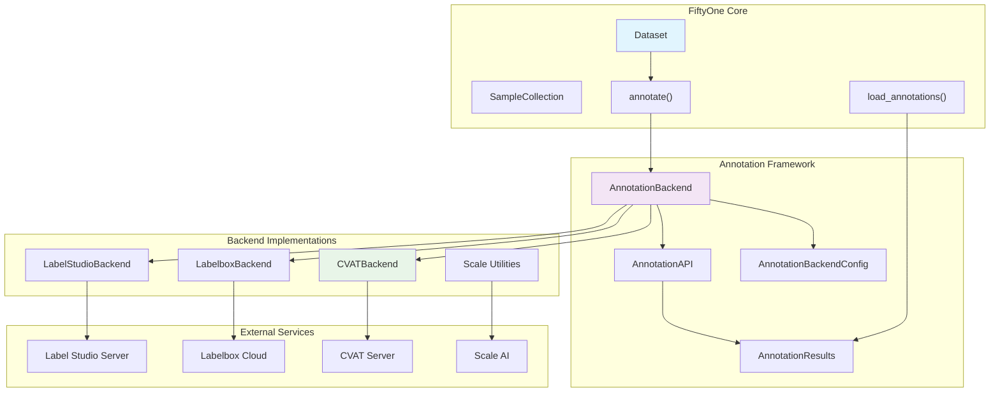
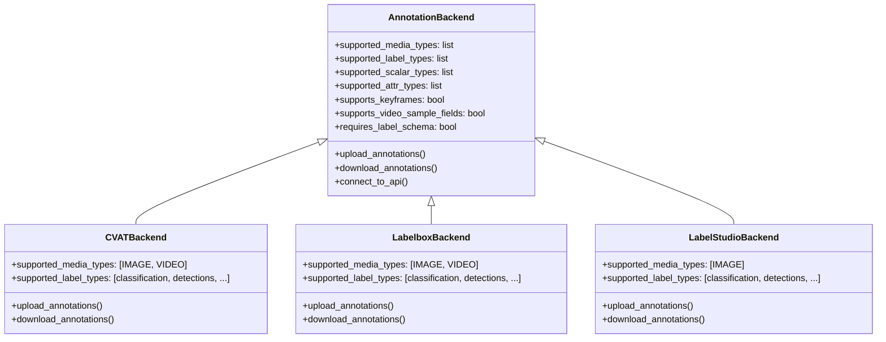
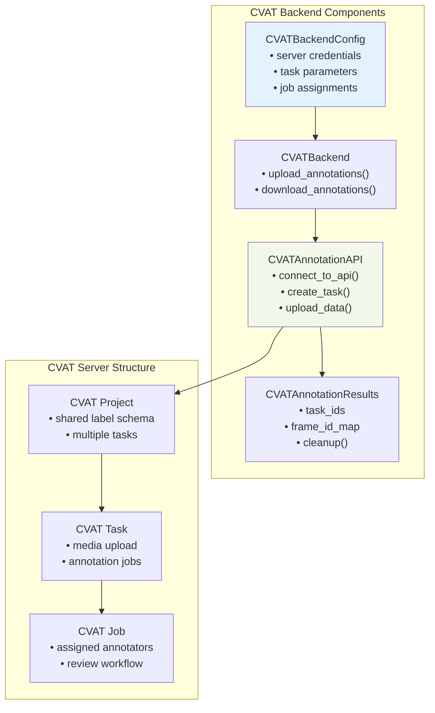
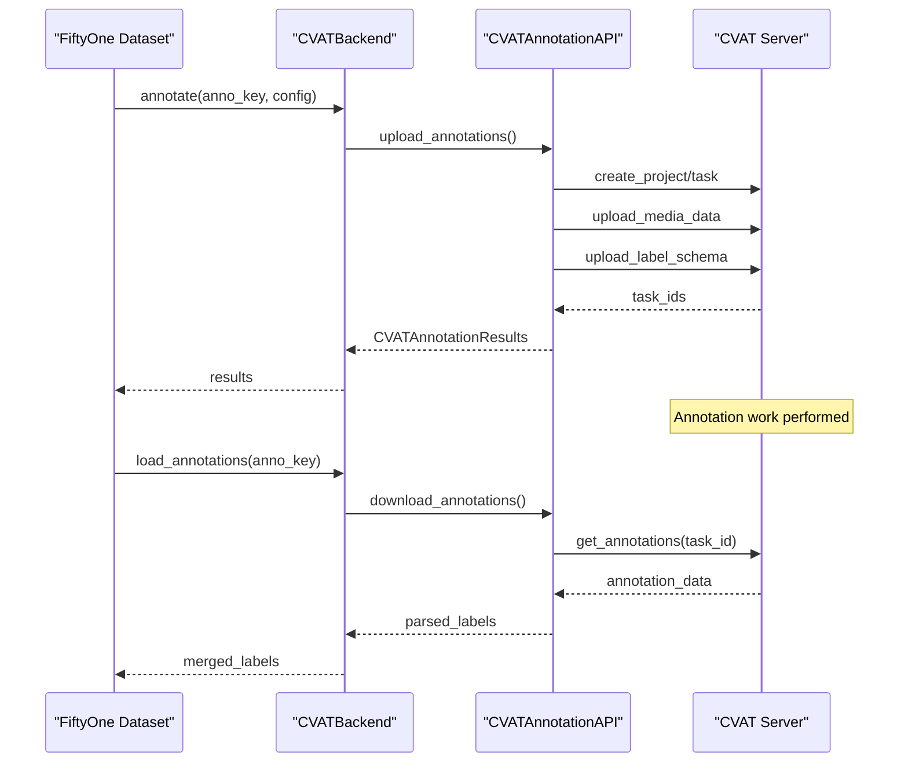
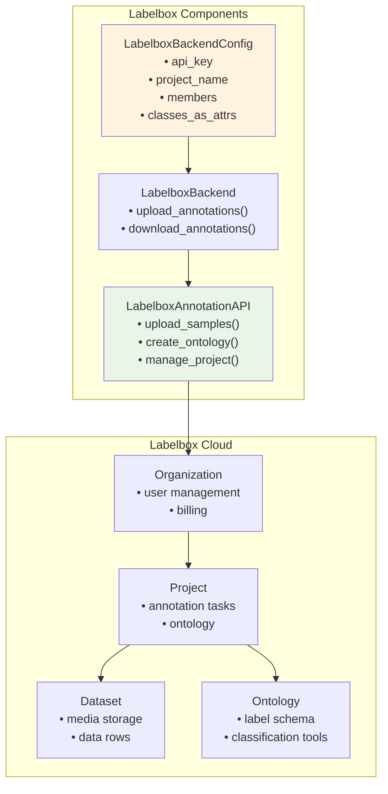
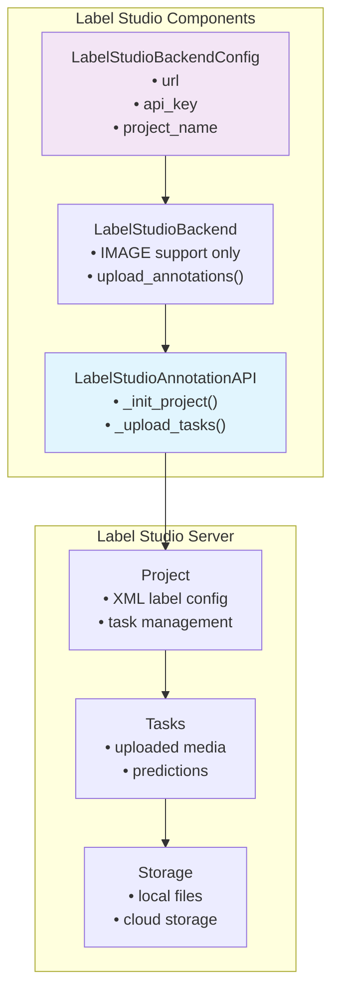
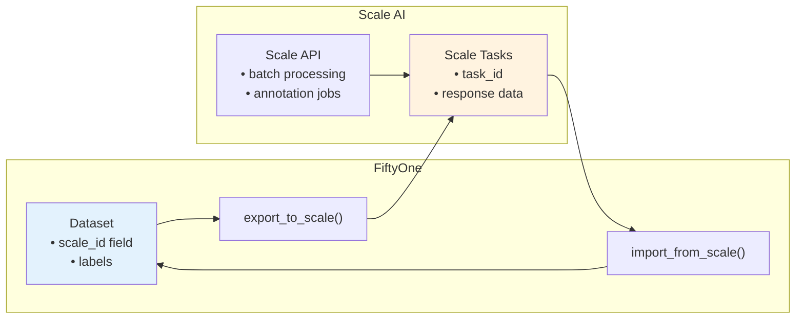

<!-- source: DeepWiki mcp.deepwiki.com · repo voxel51/fiftyone · page 7.1 External Annotation Tool Integration · fetched 2026-10-21 -->

# External Annotation Tool Integration

<details>
<summary>Relevant source files</summary>

The following files were used as context for generating this wiki page:

- [docs/source/_static/images/integrations/labelstudio.png](docs/source/_static/images/integrations/labelstudio.png)
- [docs/source/integrations/cvat.rst](docs/source/integrations/cvat.rst)
- [docs/source/integrations/labelbox.rst](docs/source/integrations/labelbox.rst)
- [docs/source/integrations/labelstudio.rst](docs/source/integrations/labelstudio.rst)
- [docs/source/user_guide/annotation.rst](docs/source/user_guide/annotation.rst)
- [fiftyone/core/validation.py](fiftyone/core/validation.py)
- [fiftyone/utils/annotations.py](fiftyone/utils/annotations.py)
- [fiftyone/utils/cvat.py](fiftyone/utils/cvat.py)
- [fiftyone/utils/labelbox.py](fiftyone/utils/labelbox.py)
- [fiftyone/utils/labelstudio.py](fiftyone/utils/labelstudio.py)
- [fiftyone/utils/scale.py](fiftyone/utils/scale.py)
- [tests/intensive/cvat_tests.py](tests/intensive/cvat_tests.py)
- [tests/intensive/labelbox_tests.py](tests/intensive/labelbox_tests.py)
- [tests/intensive/labelstudio_tests.py](tests/intensive/labelstudio_tests.py)
- [tests/intensive/scale_tests.py](tests/intensive/scale_tests.py)

</details>


This document covers FiftyOne's annotation backend system that enables seamless integration with external annotation tools for labeling datasets. The system provides a unified interface for uploading samples, managing annotation workflows, and importing completed labels back into FiftyOne datasets.

For information about the core annotation workflows and API usage, see [User Guide: Annotation](#10). For details about dataset import/export formats, see [Data Processing and I/O](#5).

## Overview

FiftyOne's external annotation tool integration enables users to:
- Upload datasets to external annotation platforms
- Configure label schemas and annotation tasks
- Track annotation progress and manage workflows
- Import completed annotations back into FiftyOne
- Support multiple annotation backends through a common interface

The system currently supports four major annotation backends:
- **CVAT** (Computer Vision Annotation Tool) - Full-featured open-source platform
- **Labelbox** - Cloud-based annotation service with advanced project management
- **Label Studio** - Lightweight open-source annotation server
- **Scale AI** - Professional annotation service (import/export only)

## Architecture Overview



Sources: [fiftyone/utils/annotations.py:37-302](), [docs/source/user_guide/annotation.rst:1-50]()

## Core Framework Components

The annotation system is built around several key abstractions that provide a common interface across different backends.

### AnnotationBackend Base Class

The `AnnotationBackend` class defines the core interface that all annotation backends must implement:



Sources: [fiftyone/utils/annotations.py:273-302](), [fiftyone/utils/cvat.py:1740-1800](), [fiftyone/utils/labelbox.py:123-213]()

### Configuration and API Classes

Each backend uses a configuration class and API client for managing server connections:

| Backend | Config Class | API Class | Key Features |
|---------|--------------|-----------|--------------|
| CVAT | `CVATBackendConfig` | `CVATAnnotationAPI` | Project/task management, full label support |
| Labelbox | `LabelboxBackendConfig` | `LabelboxAnnotationAPI` | Ontology management, cloud storage |
| Label Studio | `LabelStudioBackendConfig` | `LabelStudioAnnotationAPI` | Local deployment, XML configs |

Sources: [fiftyone/utils/cvat.py:1620-1700](), [fiftyone/utils/labelbox.py:54-122](), [fiftyone/utils/labelstudio.py:47-91]()

## CVAT Integration

CVAT is the most comprehensive annotation backend, supporting the full range of FiftyOne's label types and media formats.

### CVAT Backend Architecture



Sources: [fiftyone/utils/cvat.py:1620-1740](), [fiftyone/utils/cvat.py:1800-2000]()

### CVAT Label Schema Support

CVAT supports the most comprehensive set of label types and features:

| Label Type | Support Level | Key Features |
|------------|---------------|--------------|
| Classifications | Full | Single and multi-label |
| Detections | Full | Bounding boxes with attributes |
| Instances | Full | Instance segmentation masks |
| Polylines/Polygons | Full | Vector annotations |
| Keypoints | Full | Pose estimation |
| Segmentation | Full | Semantic segmentation |
| Video Tracks | Full | Temporal object tracking |

### CVAT Import/Export Flow

The CVAT integration handles both upload and download of annotations:



Sources: [fiftyone/utils/cvat.py:49-289](), [fiftyone/utils/cvat.py:1800-1900]()

### CVAT Data Format Conversion

CVAT uses its own XML-based annotation format that requires conversion to/from FiftyOne labels:

**Import Process:**
- Download CVAT XML annotations via API
- Parse XML using `CVATImageAnnotationReader` / `CVATVideoAnnotationReader`
- Convert to FiftyOne label objects using format converters
- Merge labels back into dataset samples

**Export Process:**
- Extract FiftyOne labels from samples  
- Convert to CVAT format using `CVATImage` / `CVATTrack` objects
- Generate XML using `CVATImageAnnotationWriter` / `CVATVideoAnnotationWriter`
- Upload via CVAT API

Sources: [fiftyone/utils/cvat.py:465-815](), [fiftyone/utils/cvat.py:1000-1200]()

## Labelbox Integration

Labelbox provides a cloud-based annotation platform with sophisticated project management and ontology features.

### Labelbox Backend Architecture



Sources: [fiftyone/utils/labelbox.py:54-190](), [fiftyone/utils/labelbox.py:214-300]()

### Labelbox Data Management

Labelbox uses a different data model than CVAT:

- **DataRows**: Individual media items with global keys (mapped to FiftyOne sample IDs)  
- **Projects**: Annotation workflows with defined ontologies
- **Ontologies**: Label schemas defining classification and annotation tools
- **Batches**: Groups of DataRows sent for annotation

### Labelbox Export Versions

Labelbox supports two export format versions:

| Version | API Version | Features |
|---------|-------------|----------|
| V1 | Legacy | Basic label export |
| V2 | Current | Advanced features, better data structure |

The export version is configurable via `LabelboxBackendConfig.export_version`.

Sources: [fiftyone/utils/labelbox.py:47-52](), [fiftyone/utils/labelbox.py:295-300]()

## Label Studio Integration

Label Studio provides a lightweight, self-hosted annotation server with XML-based configuration.

### Label Studio Architecture



Sources: [fiftyone/utils/labelstudio.py:47-163](), [fiftyone/utils/labelstudio.py:200-280]()

### Label Studio Configuration Generation

Label Studio uses XML templates to define annotation interfaces. The system automatically generates these from FiftyOne label schemas:

**XML Template Generation:**
- Convert FiftyOne label types to Label Studio control types
- Generate `<View>` XML with appropriate input controls  
- Map label classes to `<Choice>` or `<Label>` elements
- Configure annotation tools (rectangles, polygons, brushes, etc.)

**Example Mapping:**
- `detections` → `<RectangleLabels>`  
- `classifications` → `<Choices choice="multiple">`
- `segmentation` → `<BrushLabels>`

Sources: [fiftyone/utils/labelstudio.py:680-800](), [tests/intensive/labelstudio_tests.py:36-220]()

## Scale AI Integration

Scale AI uses a different integration pattern focused on batch import/export rather than live annotation sessions.

### Scale Integration Pattern



The Scale integration supports:
- **General Image Annotation**: Object detection, classification
- **Semantic Segmentation**: Pixel-level labeling  
- **General Video Annotation**: Frame-by-frame labeling
- **Video Playbook**: Temporal annotation workflows

Sources: [fiftyone/utils/scale.py:35-254](), [fiftyone/utils/scale.py:257-400]()

## Configuration Management

FiftyOne provides a centralized configuration system for managing annotation backend settings.

### Annotation Config Structure

The annotation configuration is stored at `~/.fiftyone/annotation_config.json`:

```json
{
    "default_backend": "cvat",
    "backends": {
        "cvat": {
            "config_cls": "fiftyone.utils.cvat.CVATBackendConfig", 
            "url": "https://app.cvat.ai",
            "username": "...",
            "password": "..."
        },
        "labelbox": {
            "config_cls": "fiftyone.utils.labelbox.LabelboxBackendConfig",
            "url": "app.labelbox.com",
            "api_key": "..."
        }
    }
}
```

### Environment Variable Support

All backends support environment variable configuration:

| Backend | Environment Variables |
|---------|----------------------|
| CVAT | `FIFTYONE_CVAT_URL`, `FIFTYONE_CVAT_USERNAME`, `FIFTYONE_CVAT_PASSWORD` |
| Labelbox | `FIFTYONE_LABELBOX_URL`, `FIFTYONE_LABELBOX_API_KEY` |  
| Label Studio | `FIFTYONE_LABELSTUDIO_URL`, `FIFTYONE_LABELSTUDIO_API_KEY` |

Sources: [docs/source/user_guide/annotation.rst:234-388](), [fiftyone/utils/annotations.py:273-302]()

## Error Handling and Validation

The annotation system includes comprehensive validation and error handling:

### Media Type Validation
- Check that backend supports the dataset's media type
- Handle grouped datasets with appropriate slice selection
- Validate label field types against backend capabilities

### Label Schema Validation  
- Ensure required fields are provided for new label types
- Validate class lists and attribute specifications
- Check spatial label compatibility with video frame fields

### Connection Handling
- Automatic credential prompting for missing authentication
- Server connectivity testing during setup
- Graceful handling of network timeouts and API errors

Sources: [fiftyone/utils/annotations.py:196-270](), [fiftyone/core/validation.py:52-90]()

---

