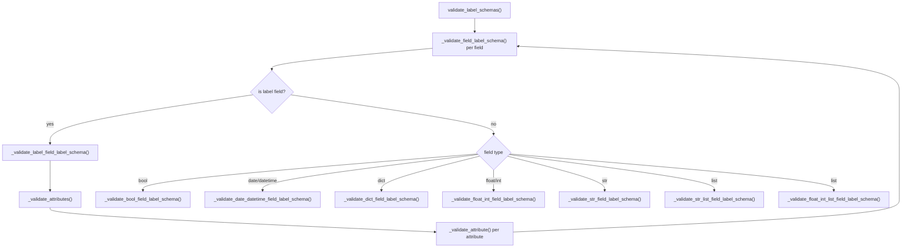
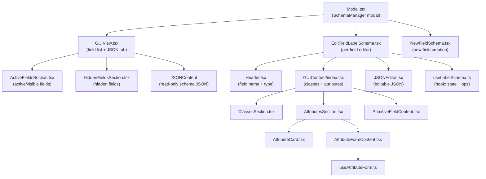
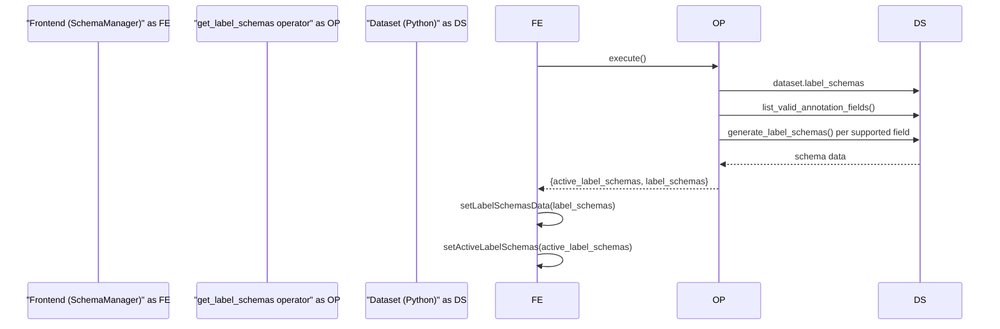
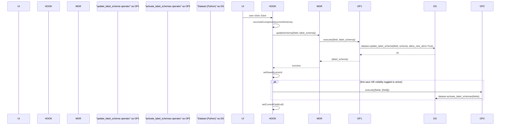

<!-- source: DeepWiki mcp.deepwiki.com · repo voxel51/fiftyone · page 7.2 In-App Annotation and Label Schema Management · fetched 2026-10-21 -->

# In-App Annotation and Label Schema Management

<details>
<summary>Relevant source files</summary>

The following files were used as context for generating this wiki page:

- [app/packages/core/src/components/Modal/Sidebar/Annotate/SchemaManager/ActiveFieldsSection.tsx](app/packages/core/src/components/Modal/Sidebar/Annotate/SchemaManager/ActiveFieldsSection.tsx)
- [app/packages/core/src/components/Modal/Sidebar/Annotate/SchemaManager/EditFieldLabelSchema/EditFieldLabelSchema.tsx](app/packages/core/src/components/Modal/Sidebar/Annotate/SchemaManager/EditFieldLabelSchema/EditFieldLabelSchema.tsx)
- [app/packages/core/src/components/Modal/Sidebar/Annotate/SchemaManager/EditFieldLabelSchema/GUIContent/AddAttributeCard.tsx](app/packages/core/src/components/Modal/Sidebar/Annotate/SchemaManager/EditFieldLabelSchema/GUIContent/AddAttributeCard.tsx)
- [app/packages/core/src/components/Modal/Sidebar/Annotate/SchemaManager/EditFieldLabelSchema/GUIContent/AddClassCard.tsx](app/packages/core/src/components/Modal/Sidebar/Annotate/SchemaManager/EditFieldLabelSchema/GUIContent/AddClassCard.tsx)
- [app/packages/core/src/components/Modal/Sidebar/Annotate/SchemaManager/EditFieldLabelSchema/GUIContent/AttributeCard.tsx](app/packages/core/src/components/Modal/Sidebar/Annotate/SchemaManager/EditFieldLabelSchema/GUIContent/AttributeCard.tsx)
- [app/packages/core/src/components/Modal/Sidebar/Annotate/SchemaManager/EditFieldLabelSchema/GUIContent/AttributeFormContent.tsx](app/packages/core/src/components/Modal/Sidebar/Annotate/SchemaManager/EditFieldLabelSchema/GUIContent/AttributeFormContent.tsx)
- [app/packages/core/src/components/Modal/Sidebar/Annotate/SchemaManager/EditFieldLabelSchema/GUIContent/AttributesSection.tsx](app/packages/core/src/components/Modal/Sidebar/Annotate/SchemaManager/EditFieldLabelSchema/GUIContent/AttributesSection.tsx)
- [app/packages/core/src/components/Modal/Sidebar/Annotate/SchemaManager/EditFieldLabelSchema/GUIContent/CardActions.tsx](app/packages/core/src/components/Modal/Sidebar/Annotate/SchemaManager/EditFieldLabelSchema/GUIContent/CardActions.tsx)
- [app/packages/core/src/components/Modal/Sidebar/Annotate/SchemaManager/EditFieldLabelSchema/GUIContent/ClassesSection.tsx](app/packages/core/src/components/Modal/Sidebar/Annotate/SchemaManager/EditFieldLabelSchema/GUIContent/ClassesSection.tsx)
- [app/packages/core/src/components/Modal/Sidebar/Annotate/SchemaManager/EditFieldLabelSchema/GUIContent/ComponentTypeButton.tsx](app/packages/core/src/components/Modal/Sidebar/Annotate/SchemaManager/EditFieldLabelSchema/GUIContent/ComponentTypeButton.tsx)
- [app/packages/core/src/components/Modal/Sidebar/Annotate/SchemaManager/EditFieldLabelSchema/GUIContent/EditAction.tsx](app/packages/core/src/components/Modal/Sidebar/Annotate/SchemaManager/EditFieldLabelSchema/GUIContent/EditAction.tsx)
- [app/packages/core/src/components/Modal/Sidebar/Annotate/SchemaManager/EditFieldLabelSchema/GUIContent/ListDefaultInput.tsx](app/packages/core/src/components/Modal/Sidebar/Annotate/SchemaManager/EditFieldLabelSchema/GUIContent/ListDefaultInput.tsx)
- [app/packages/core/src/components/Modal/Sidebar/Annotate/SchemaManager/EditFieldLabelSchema/GUIContent/PrimitiveFieldContent.tsx](app/packages/core/src/components/Modal/Sidebar/Annotate/SchemaManager/EditFieldLabelSchema/GUIContent/PrimitiveFieldContent.tsx)
- [app/packages/core/src/components/Modal/Sidebar/Annotate/SchemaManager/EditFieldLabelSchema/GUIContent/RangeInput.tsx](app/packages/core/src/components/Modal/Sidebar/Annotate/SchemaManager/EditFieldLabelSchema/GUIContent/RangeInput.tsx)
- [app/packages/core/src/components/Modal/Sidebar/Annotate/SchemaManager/EditFieldLabelSchema/GUIContent/ValuesList.tsx](app/packages/core/src/components/Modal/Sidebar/Annotate/SchemaManager/EditFieldLabelSchema/GUIContent/ValuesList.tsx)
- [app/packages/core/src/components/Modal/Sidebar/Annotate/SchemaManager/EditFieldLabelSchema/GUIContent/index.tsx](app/packages/core/src/components/Modal/Sidebar/Annotate/SchemaManager/EditFieldLabelSchema/GUIContent/index.tsx)
- [app/packages/core/src/components/Modal/Sidebar/Annotate/SchemaManager/EditFieldLabelSchema/GUIContent/useAttributeForm.ts](app/packages/core/src/components/Modal/Sidebar/Annotate/SchemaManager/EditFieldLabelSchema/GUIContent/useAttributeForm.ts)
- [app/packages/core/src/components/Modal/Sidebar/Annotate/SchemaManager/EditFieldLabelSchema/Header.tsx](app/packages/core/src/components/Modal/Sidebar/Annotate/SchemaManager/EditFieldLabelSchema/Header.tsx)
- [app/packages/core/src/components/Modal/Sidebar/Annotate/SchemaManager/EditFieldLabelSchema/JSONEditor.tsx](app/packages/core/src/components/Modal/Sidebar/Annotate/SchemaManager/EditFieldLabelSchema/JSONEditor.tsx)
- [app/packages/core/src/components/Modal/Sidebar/Annotate/SchemaManager/EditFieldLabelSchema/useLabelSchema.ts](app/packages/core/src/components/Modal/Sidebar/Annotate/SchemaManager/EditFieldLabelSchema/useLabelSchema.ts)
- [app/packages/core/src/components/Modal/Sidebar/Annotate/SchemaManager/Footer.tsx](app/packages/core/src/components/Modal/Sidebar/Annotate/SchemaManager/Footer.tsx)
- [app/packages/core/src/components/Modal/Sidebar/Annotate/SchemaManager/GUIView.tsx](app/packages/core/src/components/Modal/Sidebar/Annotate/SchemaManager/GUIView.tsx)
- [app/packages/core/src/components/Modal/Sidebar/Annotate/SchemaManager/HiddenFieldsSection.tsx](app/packages/core/src/components/Modal/Sidebar/Annotate/SchemaManager/HiddenFieldsSection.tsx)
- [app/packages/core/src/components/Modal/Sidebar/Annotate/SchemaManager/Modal.tsx](app/packages/core/src/components/Modal/Sidebar/Annotate/SchemaManager/Modal.tsx)
- [app/packages/core/src/components/Modal/Sidebar/Annotate/SchemaManager/NewFieldSchema/NewFieldSchema.tsx](app/packages/core/src/components/Modal/Sidebar/Annotate/SchemaManager/NewFieldSchema/NewFieldSchema.tsx)
- [app/packages/core/src/components/Modal/Sidebar/Annotate/SchemaManager/NoActiveSchema.tsx](app/packages/core/src/components/Modal/Sidebar/Annotate/SchemaManager/NoActiveSchema.tsx)
- [app/packages/core/src/components/Modal/Sidebar/Annotate/SchemaManager/constants.ts](app/packages/core/src/components/Modal/Sidebar/Annotate/SchemaManager/constants.ts)
- [app/packages/core/src/components/Modal/Sidebar/Annotate/SchemaManager/hooks.ts](app/packages/core/src/components/Modal/Sidebar/Annotate/SchemaManager/hooks.ts)
- [app/packages/core/src/components/Modal/Sidebar/Annotate/SchemaManager/state.ts](app/packages/core/src/components/Modal/Sidebar/Annotate/SchemaManager/state.ts)
- [app/packages/core/src/components/Modal/Sidebar/Annotate/SchemaManager/utils.ts](app/packages/core/src/components/Modal/Sidebar/Annotate/SchemaManager/utils.ts)
- [app/packages/core/src/components/Modal/Sidebar/Annotate/useCreateAnnotationLabel.ts](app/packages/core/src/components/Modal/Sidebar/Annotate/useCreateAnnotationLabel.ts)
- [fiftyone/core/annotation/__init__.py](fiftyone/core/annotation/__init__.py)
- [fiftyone/core/annotation/constants.py](fiftyone/core/annotation/constants.py)
- [fiftyone/core/annotation/generate_label_schemas.py](fiftyone/core/annotation/generate_label_schemas.py)
- [fiftyone/core/annotation/utils.py](fiftyone/core/annotation/utils.py)
- [fiftyone/core/annotation/validate_label_schemas.py](fiftyone/core/annotation/validate_label_schemas.py)
- [plugins/operators/annotation.py](plugins/operators/annotation.py)
- [tests/unittests/annotation/dataset_label_schemas_tests.py](tests/unittests/annotation/dataset_label_schemas_tests.py)
- [tests/unittests/annotation/generate_label_schemas_tests.py](tests/unittests/annotation/generate_label_schemas_tests.py)
- [tests/unittests/annotation/validate_label_schemas_tests.py](tests/unittests/annotation/validate_label_schemas_tests.py)

</details>


This page documents the in-app annotation system: how label schemas are defined, generated, validated, and managed through the Schema Manager UI. It covers the Python-side schema data model, the operator layer that bridges backend and frontend, and the React component tree that implements the Schema Manager modal.

For integration with **external annotation platforms** (CVAT, Labelbox, etc.) see page [7.1](#7.1). For general field and label type definitions see page [2.3](#2.3). For the operator framework that the annotation operators use see page [9.1](#9.1).

---

## What Is a Label Schema?

A **label schema** is a per-field configuration dictionary that describes how a dataset field should be presented to annotators. It specifies:

- **`type`** — the semantic data type (e.g. `"str"`, `"float"`, `"detections"`)
- **`component`** — the UI widget to render (e.g. `"radio"`, `"dropdown"`, `"slider"`, `"toggle"`)
- **`classes`** — for label fields, the allowed class names
- **`attributes`** — for label fields, sub-field schemas (list of attribute config dicts)
- **`values`** / **`range`** — allowed values or numeric range for constrained inputs
- **`default`** — optional default value when creating a new label
- **`read_only`** — whether annotators can modify the field

Example schema for a `detections` field (from `generate_label_schemas` docs):

```json
{
  "ground_truth": {
    "type": "detections",
    "component": "text",
    "attributes": [
      { "name": "confidence", "type": "float", "component": "text" },
      { "name": "id", "type": "id", "component": "text", "read_only": true }
    ]
  }
}
```

---

## Python-Side Schema System

### Constants

All type names, component names, setting keys, and constraint sets are defined in `fiftyone/core/annotation/constants.py`.

**Supported types:**

| Constant | Value | Field class |
|---|---|---|
| `BOOL` | `"bool"` | `BooleanField` |
| `DATE` | `"date"` | `DateField` |
| `DATETIME` | `"datetime"` | `DateTimeField` |
| `DICT` | `"dict"` | `DictField` |
| `FLOAT` | `"float"` | `FloatField` |
| `INT` | `"int"` | `IntField` / `FrameNumberField` |
| `STR` | `"str"` | `StringField` |
| `STR_LIST` | `"list<str>"` | `ListField[StringField]` |
| `INT_LIST` | `"list<int>"` | `ListField[IntField]` |
| `FLOAT_LIST` | `"list<float>"` | `ListField[FloatField]` |
| `ID` | `"id"` | `ObjectIdField` / `UUIDField` |

**Component ↔ type compatibility:**

| Type | Allowed components |
|---|---|
| `bool` | `checkbox`, `toggle` (default) |
| `date` / `datetime` | `datepicker` |
| `dict` | `json` |
| `float` / `int` | `dropdown`, `radio`, `slider`, `text` (default) |
| `str` | `dropdown`, `radio`, `text` |
| `list<str>` | `checkboxes`, `dropdown`, `text` |
| `list<int>` / `list<float>` | `checkboxes`, `dropdown`, `text` |
| `id` | `text` (must be `read_only`) |

The `VALUES_COMPONENTS` set (`{checkboxes, dropdown, radio}`) requires a `values` list. `slider` requires a `range: [min, max]` list.

The `CHECKBOXES_OR_RADIO_THRESHOLD = 5` constant controls automatic component selection: ≤5 classes → `radio`, >5 → `dropdown`.

Sources: [fiftyone/core/annotation/constants.py:1-220]()

---

### Schema Generation: `generate_label_schemas`

**`generate_label_schemas(sample_collection, fields=None, scan_samples=True)`** in `fiftyone/core/annotation/generate_label_schemas.py` inspects a dataset's field schema and optionally scans sample values to produce schemas automatically.

Key behaviors:

- When `scan_samples=True` and a `float`/`int` field has distinct finite bounds, the component defaults to `slider` with a `range`.
- For `str` fields: ≤5 distinct values → `radio`; >5 and ≤1000 → `dropdown`; >1000 or 0 → `text`.
- For label fields (e.g. `Detections`), it traverses sub-fields to produce the `attributes` list.
- Embedded document fields (e.g. `metadata.height`) are traversed one level deep.

The function returns either a single field's schema dict (when `fields` is a scalar) or a dict keyed by field name.

Sources: [fiftyone/core/annotation/generate_label_schemas.py:1-210]()

---

### Schema Validation: `validate_label_schemas`

**`validate_label_schemas(sample_collection, label_schema, allow_new_attrs=False, allow_new_fields=False, fields=None)`** in `fiftyone/core/annotation/validate_label_schemas.py` validates a schema dict against the dataset.

It raises `ValidationErrors` (a subclass of `ExceptionGroup`) on failure, collecting all errors across fields.

**Internal validation hierarchy:**



The validations check:

- Field existence (unless `allow_new_fields=True`)
- Field support status
- Type/component compatibility
- `read_only` consistency with field definition
- `values` list types and deduplication
- `range` ordering and type
- `default` validity (within range/values if specified)
- Attribute name uniqueness, non-configurability of `bounding_box`/`points`

Sources: [fiftyone/core/annotation/validate_label_schemas.py:1-712]()

---

### Supported Label Types

Not all `Label` subclasses are supported for in-app annotation. From `fiftyone/core/annotation/constants.py`:

- **Always supported:** `Classification`, `Classifications`
- **Supported for `image` media:** `Detection`, `Detections`
- **Supported for `3d` media:** `Detection`, `Detections`, `Polyline`, `Polylines`
- **Unsupported:** `GeoLocation`, `GeoLocations`, `TemporalDetection`, `TemporalDetections`
- **Supported media types:** `image`, `3d`, `group`

Sources: [fiftyone/core/annotation/constants.py:171-220]()

---

## Annotation Operators

All in-app annotation operators live in `plugins/operators/annotation.py`. They are all `unlisted=True` (not shown in the operator palette) and are called programmatically from the frontend.

**Operator registry:**

| Operator class | `name` | Purpose |
|---|---|---|
| `GetLabelSchemas` | `get_label_schemas` | Returns all field schemas, types, and `active_label_schemas` |
| `GenerateLabelSchemas` | `generate_label_schemas` | Calls `dataset.generate_label_schemas()` with optional sample limit |
| `ValidateLabelSchemas` | `validate_label_schemas` | Runs `validate_label_schemas()`, returns error list |
| `UpdateLabelSchema` | `update_label_schema` | Calls `dataset.update_label_schema()` for a single field |
| `ActivateLabelSchemas` | `activate_label_schemas` | Calls `dataset.activate_label_schemas(fields)` |
| `DeactivateLabelSchemas` | `deactivate_label_schemas` | Calls `dataset.deactivate_label_schemas(fields)` |
| `DeleteLabelSchemas` | `delete_label_schemas` | Calls `dataset.delete_label_schemas(fields)` |
| `SetActiveLabelSchemas` | `set_active_label_schemas` | Sets `dataset.active_label_schemas` and saves |
| `CreateAndActivateField` | `create_and_activate_field` | Creates a new field, sets its schema, activates it |
| `ListValidAnnotationFields` | `list_valid_annotation_fields` | Returns valid annotation fields from `foau.list_valid_annotation_fields()` |

`GetLabelSchemas` is the bootstrap operator: it returns a dict per field containing `default_label_schema`, `read_only`, `type`, `unsupported`, and `label_schema` (if one was saved).

`CreateAndActivateField` handles the "New field" flow: it calls `dataset.add_sample_field()`, calls `dataset.update_label_schema()`, then `dataset.activate_label_schemas(field_name, prepend=True)`.

Sources: [plugins/operators/annotation.py:1-336]()

---

## Schema Manager UI

The Schema Manager is a modal dialog rendered inside the sample modal sidebar. It is rendered as a portal into a `#annotation` DOM element.

### Component Hierarchy

**Schema Manager component tree:**



Sources: [app/packages/core/src/components/Modal/Sidebar/Annotate/SchemaManager/Modal.tsx:1-227](), [app/packages/core/src/components/Modal/Sidebar/Annotate/SchemaManager/GUIView.tsx:1-135](), [app/packages/core/src/components/Modal/Sidebar/Annotate/SchemaManager/EditFieldLabelSchema/EditFieldLabelSchema.tsx:1-189]()

---

### Navigation Model

The modal uses a flat state machine controlled by two Jotai atoms: `currentField` (which field is being edited, or `null`) and `isNewFieldMode` (whether the "New field" creation flow is active).

```mermaid
stateDiagram-v2
  [*] --> "GUIView (field list)"
  "GUIView (field list)" --> "EditFieldLabelSchema" : "user clicks edit on a field\n(sets currentField atom)"
  "GUIView (field list)" --> "NewFieldSchema" : "user clicks New field\n(sets isNewFieldMode atom)"
  "EditFieldLabelSchema" --> "GUIView (field list)" : "back button\n(sets currentField = null)"
  "NewFieldSchema" --> "GUIView (field list)" : "back / discard / create\n(sets isNewFieldMode = false)"
```

Sources: [app/packages/core/src/components/Modal/Sidebar/Annotate/SchemaManager/Modal.tsx:44-102]()

---

### GUIView: Active and Hidden Fields

`GUIView` renders a `ToggleSwitch` between **GUI** and **JSON** tabs.

The **GUI tab** shows:

- **`ActiveFieldsSection`** — The ordered list of fields currently enabled for annotation. Fields can be drag-reordered; order is persisted via the `set_active_label_schemas` operator. Each row shows field name, type, attribute count, a `Read-only` pill if applicable, and an edit button.
- **`HiddenFieldsSection`** — The collapsible list of all other annotation-eligible fields not in the active set. Fields marked `unsupported` show a pill. Fields with a saved schema show an edit button; unsupported fields have no action.

Both sections support multi-selection for bulk activate/deactivate via the footer's "Move N to visible/hidden" button.

The **JSON tab** shows the full schema data as a read-only Monaco code editor.

Sources: [app/packages/core/src/components/Modal/Sidebar/Annotate/SchemaManager/GUIView.tsx:1-135](), [app/packages/core/src/components/Modal/Sidebar/Annotate/SchemaManager/ActiveFieldsSection.tsx:1-246](), [app/packages/core/src/components/Modal/Sidebar/Annotate/SchemaManager/HiddenFieldsSection.tsx:1-200]()

---

### EditFieldLabelSchema: Per-Field Editor

`EditFieldLabelSchema` renders the editor for a single field. It uses the `useLabelSchema` hook for all logic.

**Layout:**

1. **Header** — read-only `field name` and `field type` inputs
2. **Read-only toggle** — sets `read_only` in the schema
3. **Schema section** — `ToggleSwitch` between **GUI** and **JSON** tabs plus a **Scan** button
4. **Errors** — validation error display
5. **Footer** — Visible field toggle (after first save), Discard button, Save button

**GUI tab** dispatches on field type:
- **Primitive fields** (Bool, Int, Float, Str, Date, etc.) → `PrimitiveFieldContent`, which shows component selector buttons (`ComponentTypeButton`), `ValuesList`, and `RangeInput`.
- **Label fields** (Detections, Classification, etc.) → `ClassesSection` + `AttributesSection`.

**JSON tab** — `JSONEditor`, a Monaco editor that calls `validate_label_schemas` on every change and highlights errors.

Sources: [app/packages/core/src/components/Modal/Sidebar/Annotate/SchemaManager/EditFieldLabelSchema/EditFieldLabelSchema.tsx:1-189]()

---

### `useLabelSchema` Hook

`useLabelSchema(field)` in `EditFieldLabelSchema/useLabelSchema.ts` is the central logic hook for the per-field editor. It composes several internal hooks:

| Internal hook | Responsibility |
|---|---|
| `useCurrentLabelSchema` | Resolves current (draft) → saved → default schema priority |
| `useDefaultLabelSchema` | Reads `data.default_label_schema` from `labelSchemaData` atom |
| `useSavedLabelSchema` | Reads/writes `data.label_schema` in `labelSchemaData` atom |
| `useVisibility` | Tracks pending `active`/`hidden` toggle state |
| `useReadOnly` | Gets/toggles `read_only` in current schema |
| `useConfigUpdate` | Provides `updateClassOrder` and `updateConfig` callbacks |
| `useSave` | Calls `update_label_schema` operator, then activates/deactivates field |
| `useScan` | Calls `generate_label_schemas` operator with optional sample limit |
| `useValidate` | Calls `validate_label_schemas` operator on JSON parse, manages error state |
| `useDiscard` | Resets current schema to saved/default, increments `editorKey` |

The returned `hasChanges` flag is `true` if the current schema differs from the saved schema, or if there are validation errors, or if visibility was toggled.

On component unmount, `currentLabelSchema.remove(field)` is called to clean up draft state, so re-opening the field shows the saved state.

Sources: [app/packages/core/src/components/Modal/Sidebar/Annotate/SchemaManager/EditFieldLabelSchema/useLabelSchema.ts:1-347]()

---

### NewFieldSchema: New Field Creation

`NewFieldSchema` in `NewFieldSchema/NewFieldSchema.tsx` is a single-step form for creating a new dataset field and immediately activating it.

**Form fields:**

1. **Field name** — validated against existing field names and a regex `[a-zA-Z_][a-zA-Z0-9_]*`
2. **Field category toggle** — `label` or `primitive`
3. **Type dropdown** — label types (`detections`, `classification`, etc.) or primitive types (`str`, `int`, `float`, …)
4. **Label field config** — `ClassesSection` + `AttributesSection` (pre-populated with default attributes for the chosen type)
5. **Primitive field config** — `PrimitiveFieldContent`

On submit it calls the `create_and_activate_field` operator, then refreshes schema data via `get_label_schemas`.

Default attributes for each label type are defined in `constants.ts`:
- `detections` (2D): `id`, `tags`, `confidence`, `index`, `mask_path`
- `detections` (3D): `id`, `tags`, `confidence`, `index`
- `classification`: `id`, `tags`, `confidence`
- `polylines`: `id`, `tags`, `confidence`, `closed`, `filled`, `index`

Sources: [app/packages/core/src/components/Modal/Sidebar/Annotate/SchemaManager/NewFieldSchema/NewFieldSchema.tsx:1-411](), [app/packages/core/src/components/Modal/Sidebar/Annotate/SchemaManager/constants.ts:80-127]()

---

## State Management

The Schema Manager uses **Jotai** atoms for local state (not Recoil, which is used for the broader FiftyOne app state). Atoms are defined in `state.ts` and `../state.ts` (the parent `Annotate` module's state file).

**Data flow from server to UI:**



**Key atoms:**

| Atom | Location | Purpose |
|---|---|---|
| `labelSchemasData` | `../state` | Full map of field name → `{default_label_schema, label_schema, type, read_only, unsupported}` |
| `activeLabelSchemas` | `../state` | Ordered list of active field names |
| `activePaths` | `../state` | New-system active paths (falls back to `activeLabelSchemas`) |
| `currentField` | `../state` | Currently-selected field for editing (`null` = list view) |
| `labelSchemaData(field)` | `../state` | Per-field atom family derived from `labelSchemasData` |
| `fieldType(field)` | `../state` | Per-field type string (e.g. `"Detections"`) |
| `fieldAttributeCount(field)` | `../state` | Derived attribute count |
| `isNewFieldMode` | `SchemaManager/state` | Whether "New field" form is visible |
| `selectedActiveFields` | `SchemaManager/state` | Set of selected active field names (for bulk ops) |
| `selectedHiddenFields` | `SchemaManager/state` | Set of selected hidden field names |
| `currentLabelSchema(field)` | `EditFieldLabelSchema/state` | Per-field draft schema (cleared on unmount) |
| `draftJsonContent` | `SchemaManager/state` | Draft JSON string for full-schema JSON editor |
| `jsonValidationErrors` | `SchemaManager/state` | Validation errors from full-schema JSON editor |

Sources: [app/packages/core/src/components/Modal/Sidebar/Annotate/SchemaManager/state.ts:1-100](), [app/packages/core/src/components/Modal/Sidebar/Annotate/SchemaManager/hooks.ts:1-700]()

---

## Operator ↔ Component Data Flow

**End-to-end flow for saving a field schema:**



Sources: [app/packages/core/src/components/Modal/Sidebar/Annotate/SchemaManager/EditFieldLabelSchema/useLabelSchema.ts:139-206]()

---

## Component Reconciliation

When saving, `reconcileComponent(config)` in `utils.ts` auto-adjusts the `component` field to remain consistent with `classes`:

- If `classes` is present and `component === "text"` → switches to `"radio"` (≤5 classes) or `"dropdown"` (>5 classes)
- If `classes` is absent and `component` is `"radio"` or `"dropdown"` → strips `classes` key and resets to `"text"`

The threshold `CLASSES_COMPONENT_THRESHOLD = 5` mirrors `CHECKBOXES_OR_RADIO_THRESHOLD` in `constants.py`.

Sources: [app/packages/core/src/components/Modal/Sidebar/Annotate/SchemaManager/utils.ts:588-612](), [app/packages/core/src/components/Modal/Sidebar/Annotate/SchemaManager/constants.ts:323-323]()

---

## Schema Scanning

Clicking **Scan** in the per-field editor calls the `generate_label_schemas` operator. For large datasets (sample count exceeds `queryPerformanceMaxSearch`), the `useIsLargeDataset` hook sets a scan limit passed as the `limit` parameter to the operator.

The operator creates a view via `ctx.dataset.limit(limit)` before calling `generate_label_schemas`, keeping the scan fast on large datasets.

Sources: [app/packages/core/src/components/Modal/Sidebar/Annotate/SchemaManager/EditFieldLabelSchema/useLabelSchema.ts:208-236](), [plugins/operators/annotation.py:76-96]()

---

## Attribute Form

`AttributeFormContent` + `useAttributeForm` implement the form for adding and editing label attributes.

**Form fields:**
- **Name** (text input, read-only when editing)
- **Attribute type** (`Select` dropdown from `ATTRIBUTE_TYPE_OPTIONS`)
- **Read-only toggle**
- **Input type** (component buttons from `COMPONENT_OPTIONS[type]`)
- **Values list** (when component requires it: `radio`, `dropdown`, `checkboxes`)
- **Range** (min/max, when component is `slider`)
- **Default** (optional; `ListDefaultInput` for list types, text `Input` otherwise)

Validation is performed by `getAttributeFormErrors(formData)` in `utils.ts`, which calls `validateValues`, `validateRange`, `validateScalarDefault`, and `validateListDefault`.

Sources: [app/packages/core/src/components/Modal/Sidebar/Annotate/SchemaManager/EditFieldLabelSchema/GUIContent/AttributeFormContent.tsx:1-244](), [app/packages/core/src/components/Modal/Sidebar/Annotate/SchemaManager/EditFieldLabelSchema/GUIContent/useAttributeForm.ts:1-187](), [app/packages/core/src/components/Modal/Sidebar/Annotate/SchemaManager/utils.ts:528-577]()

---

## Python Dataset API for Label Schemas

The following methods are available on `Dataset` / `SampleCollection` objects (backed by the above modules):

| Method | Description |
|---|---|
| `dataset.generate_label_schemas(fields, scan_samples)` | Generate schemas; wraps `generate_label_schemas()` |
| `dataset.validate_label_schemas(schema, ...)` | Validate schemas; wraps `validate_label_schemas()` |
| `dataset.update_label_schema(field, schema, ...)` | Store a schema for a field |
| `dataset.label_schemas` | Dict of stored label schemas |
| `dataset.active_label_schemas` | Ordered list of active field names |
| `dataset.activate_label_schemas(fields, prepend)` | Add fields to active list |
| `dataset.deactivate_label_schemas(fields)` | Remove fields from active list |
| `dataset.delete_label_schemas(fields)` | Delete stored schemas |

Sources: [fiftyone/core/annotation/__init__.py:1-50](), [plugins/operators/annotation.py:19-335]()

---

