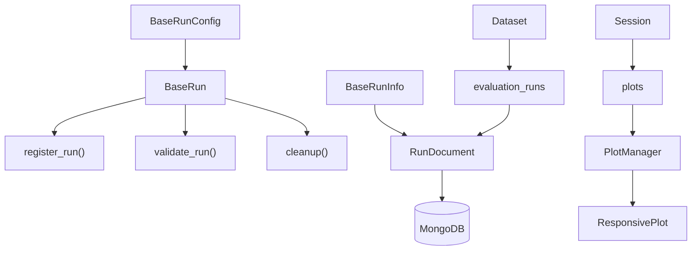
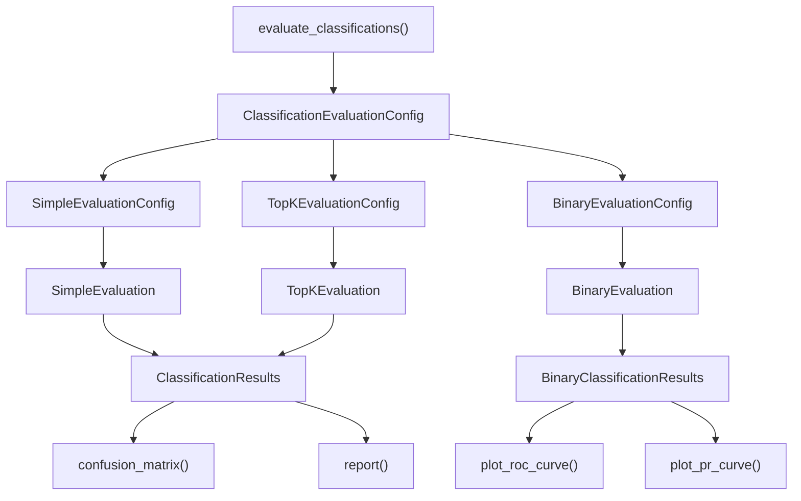
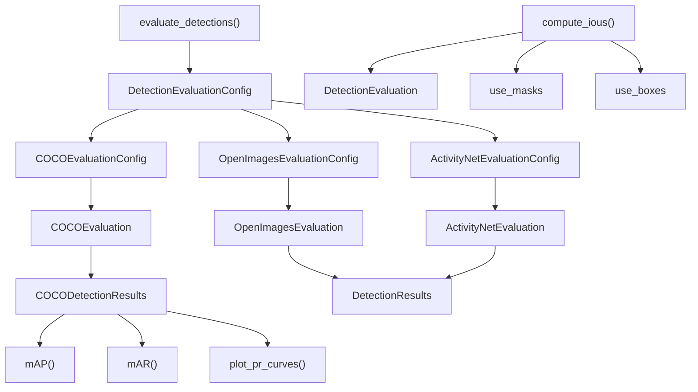
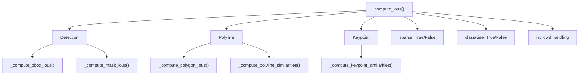
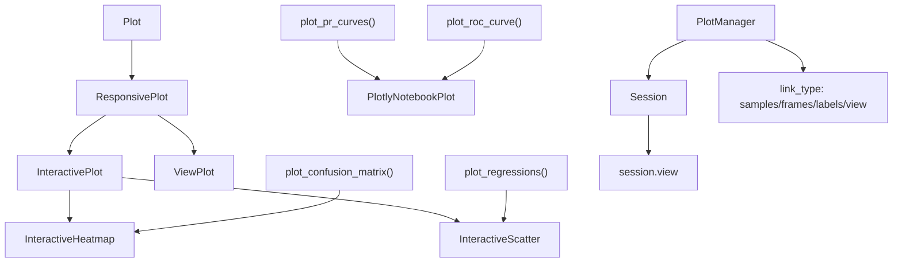
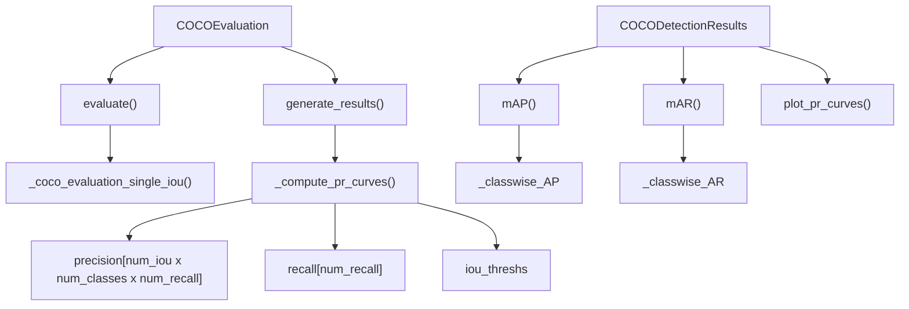
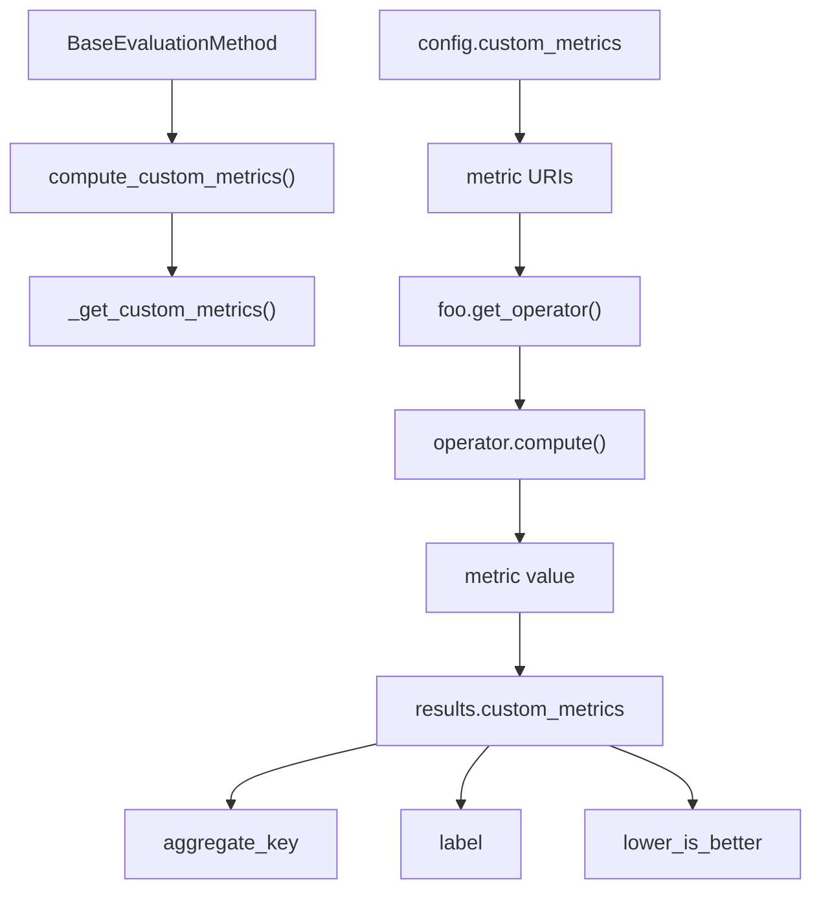
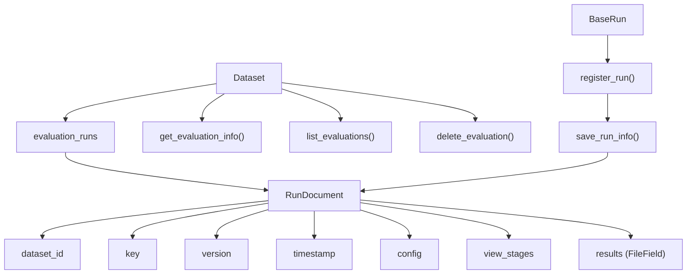
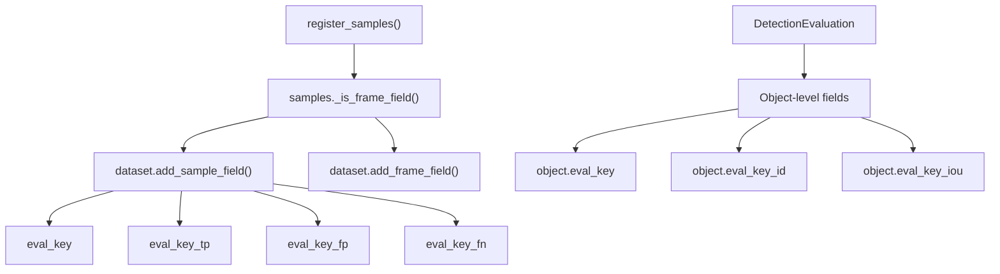

<!-- source: DeepWiki mcp.deepwiki.com · repo voxel51/fiftyone · page 8 Visualization and Analysis · fetched 2026-10-21 -->

# Analysis and Evaluation

Relevant source files

The following files were used as context for generating this wiki page:

- [fiftyone/__public__.py](fiftyone/__public__.py)
- [fiftyone/core/aggregations.py](fiftyone/core/aggregations.py)
- [fiftyone/core/clips.py](fiftyone/core/clips.py)
- [fiftyone/core/collections.py](fiftyone/core/collections.py)
- [fiftyone/core/dataset.py](fiftyone/core/dataset.py)
- [fiftyone/core/document.py](fiftyone/core/document.py)
- [fiftyone/core/expressions.py](fiftyone/core/expressions.py)
- [fiftyone/core/fields.py](fiftyone/core/fields.py)
- [fiftyone/core/frame.py](fiftyone/core/frame.py)
- [fiftyone/core/labels.py](fiftyone/core/labels.py)
- [fiftyone/core/odm/dataset.py](fiftyone/core/odm/dataset.py)
- [fiftyone/core/odm/document.py](fiftyone/core/odm/document.py)
- [fiftyone/core/odm/embedded_document.py](fiftyone/core/odm/embedded_document.py)
- [fiftyone/core/odm/mixins.py](fiftyone/core/odm/mixins.py)
- [fiftyone/core/odm/sample.py](fiftyone/core/odm/sample.py)
- [fiftyone/core/odm/utils.py](fiftyone/core/odm/utils.py)
- [fiftyone/core/patches.py](fiftyone/core/patches.py)
- [fiftyone/core/plots/__init__.py](fiftyone/core/plots/__init__.py)
- [fiftyone/core/plots/base.py](fiftyone/core/plots/base.py)
- [fiftyone/core/plots/manager.py](fiftyone/core/plots/manager.py)
- [fiftyone/core/plots/matplotlib.py](fiftyone/core/plots/matplotlib.py)
- [fiftyone/core/plots/plotly.py](fiftyone/core/plots/plotly.py)
- [fiftyone/core/plots/utils.py](fiftyone/core/plots/utils.py)
- [fiftyone/core/plots/views.py](fiftyone/core/plots/views.py)
- [fiftyone/core/sample.py](fiftyone/core/sample.py)
- [fiftyone/core/stages.py](fiftyone/core/stages.py)
- [fiftyone/core/video.py](fiftyone/core/video.py)
- [fiftyone/core/view.py](fiftyone/core/view.py)
- [tests/unittests/aggregation_tests.py](tests/unittests/aggregation_tests.py)
- [tests/unittests/dataset_tests.py](tests/unittests/dataset_tests.py)
- [tests/unittests/odm_tests.py](tests/unittests/odm_tests.py)
- [tests/unittests/patches_tests.py](tests/unittests/patches_tests.py)
- [tests/unittests/video_tests.py](tests/unittests/video_tests.py)
- [tests/unittests/view_tests.py](tests/unittests/view_tests.py)

The Analysis and Evaluation system in FiftyOne provides comprehensive tools for evaluating machine learning models and analyzing dataset quality. This system includes evaluation methods for classification, detection, segmentation, and regression tasks, along with visualization capabilities and run management infrastructure.

For information about data processing and format conversion, see [Data Processing](#5). For model integration and application workflows, see [Model Integration](#6).

## Evaluation Framework Architecture

The evaluation system is built on a hierarchical framework that provides consistent interfaces across different evaluation types while allowing specialized implementations for specific tasks.

### Core Evaluation Architecture

```mermaid
graph TD
    BaseEvaluationMethodConfig["BaseEvaluationMethodConfig"] --> ClassificationEvaluationConfig["ClassificationEvaluationConfig"]
    BaseEvaluationMethodConfig --> DetectionEvaluationConfig["DetectionEvaluationConfig"] 
    BaseEvaluationMethodConfig --> SegmentationEvaluationConfig["SegmentationEvaluationConfig"]
    BaseEvaluationMethodConfig --> RegressionEvaluationConfig["RegressionEvaluationConfig"]
    
    BaseEvaluationMethod["BaseEvaluationMethod"] --> ClassificationEvaluation["ClassificationEvaluation"]
    BaseEvaluationMethod --> DetectionEvaluation["DetectionEvaluation"]
    BaseEvaluationMethod --> SegmentationEvaluation["SegmentationEvaluation"]
    BaseEvaluationMethod --> RegressionEvaluation["RegressionEvaluation"]
    
    DetectionEvaluation --> COCOEvaluation["COCOEvaluation"]
    DetectionEvaluation --> OpenImagesEvaluation["OpenImagesEvaluation"]
    DetectionEvaluation --> ActivityNetEvaluation["ActivityNetEvaluation"]
    
    BaseEvaluationResults["BaseEvaluationResults"] --> ClassificationResults["ClassificationResults"]
    BaseEvaluationResults --> DetectionResults["DetectionResults"]
    BaseEvaluationResults --> SegmentationResults["SegmentationResults"]
    BaseEvaluationResults --> RegressionResults["RegressionResults"]
    
    DetectionResults --> COCODetectionResults["COCODetectionResults"]
```

Sources: [fiftyone/utils/eval/base.py:188-252](), [fiftyone/utils/eval/classification.py:136-159](), [fiftyone/utils/eval/detection.py:244-293](), [fiftyone/utils/eval/coco.py:30-120]()

### Run Management System

Sources: [fiftyone/core/runs.py:205-323](), [fiftyone/core/odm/runs.py:21-34](), [fiftyone/core/plots/manager.py:27-77]()

## Evaluation Types and Methods

### Classification Evaluation

The classification evaluation system supports standard accuracy-based evaluation, top-k evaluation, and binary classification scenarios.

Sources: [fiftyone/utils/eval/classification.py:33-134](), [fiftyone/utils/eval/classification.py:261-367](), [fiftyone/utils/eval/classification.py:575-724]()

### Detection Evaluation

Detection evaluation includes multiple specialized methods for different evaluation protocols, with COCO-style evaluation being the most comprehensive.

Sources: [fiftyone/utils/eval/detection.py:33-242](), [fiftyone/utils/eval/coco.py:121-250](), [fiftyone/utils/eval/openimages.py:24-142](), [fiftyone/utils/iou.py:30-157]()

### IoU Computation Framework

Sources: [fiftyone/utils/iou.py:30-157](), [fiftyone/utils/iou.py:479-530](), [fiftyone/utils/iou.py:159-183]()

## Visualization and Plotting

### Plot Types and Hierarchy

Sources: [fiftyone/core/plots/base.py:19-84](), [fiftyone/core/plots/plotly.py:47-123](), [fiftyone/core/plots/manager.py:27-77]()

### Evaluation Results Visualization

| Plot Type | Function | Purpose | Interactive |
|-----------|----------|---------|-------------|
| Confusion Matrix | `plot_confusion_matrix()` | Classification accuracy visualization | Yes (cell selection) |
| PR Curves | `plot_pr_curves()` | Precision-recall analysis | No |
| ROC Curve | `plot_roc_curve()` | Binary classification performance | No |
| Regression Plot | `plot_regressions()` | Regression predictions vs ground truth | Yes (point selection) |

Sources: [fiftyone/core/plots/base.py:19-84](), [fiftyone/core/plots/plotly.py:427-516](), [fiftyone/core/plots/plotly.py:617-703]()

## Metrics and Computation

### COCO Evaluation Metrics

The COCO evaluation system provides comprehensive detection evaluation with mAP computation across multiple IoU thresholds.

Sources: [fiftyone/utils/eval/coco.py:121-250](), [fiftyone/utils/eval/coco.py:253-480](), [fiftyone/utils/eval/coco.py:710-835]()

### Custom Metrics Framework

The evaluation system supports custom metrics through an operator-based framework that integrates with the broader FiftyOne operator system.

Sources: [fiftyone/utils/eval/base.py:224-277](), [fiftyone/utils/eval/base.py:208-222]()

## Integration with Dataset Management

### Evaluation Run Storage

Sources: [fiftyone/core/runs.py:299-323](), [fiftyone/core/runs.py:555-608](), [fiftyone/core/odm/runs.py:21-34]()

### Field Management and Schema Updates

The evaluation system automatically manages dataset schema updates when evaluation runs are registered, adding necessary fields for storing evaluation results.

Sources: [fiftyone/utils/eval/detection.py:307-379](), [fiftyone/utils/eval/classification.py:285-306](), [fiftyone/utils/eval/segmentation.py:181-216]()

---

