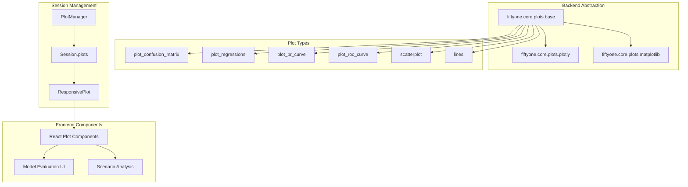
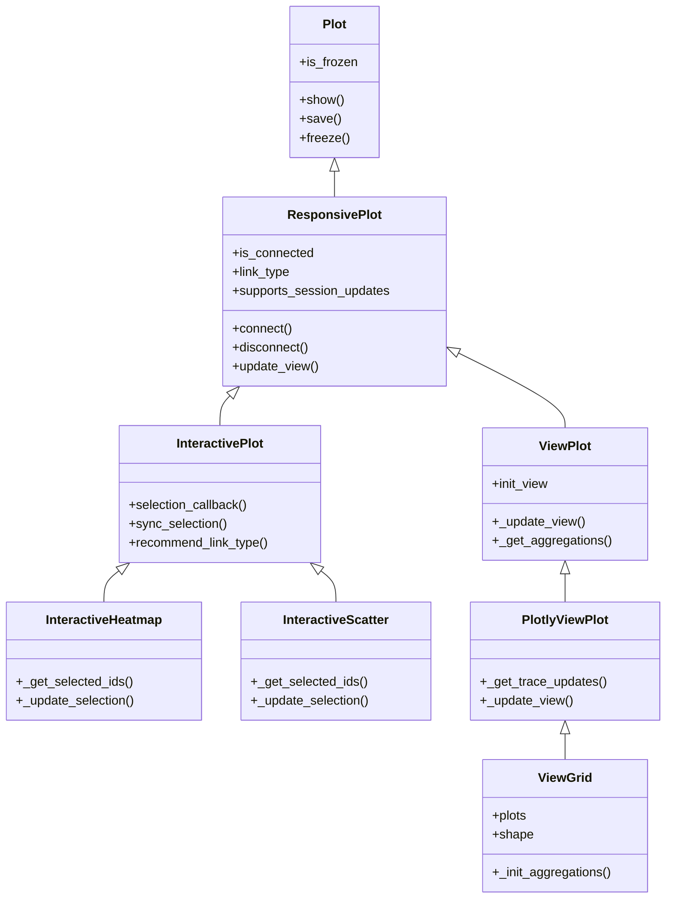
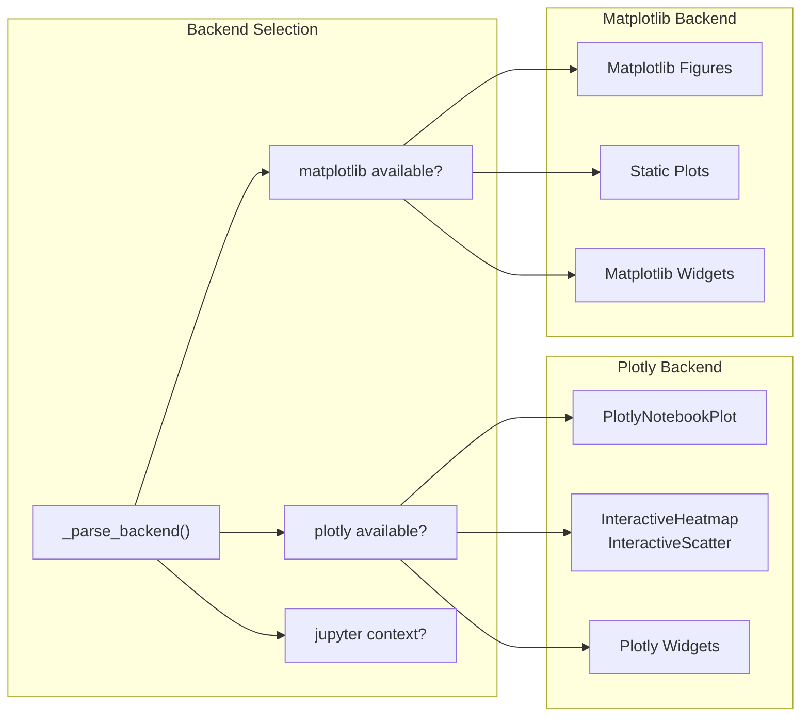
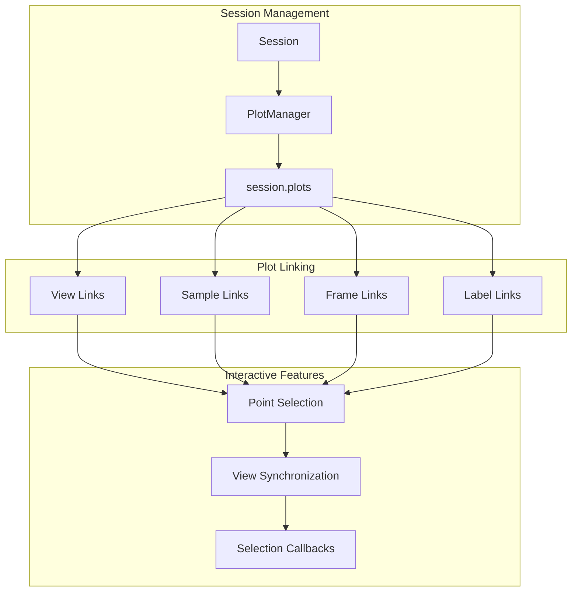
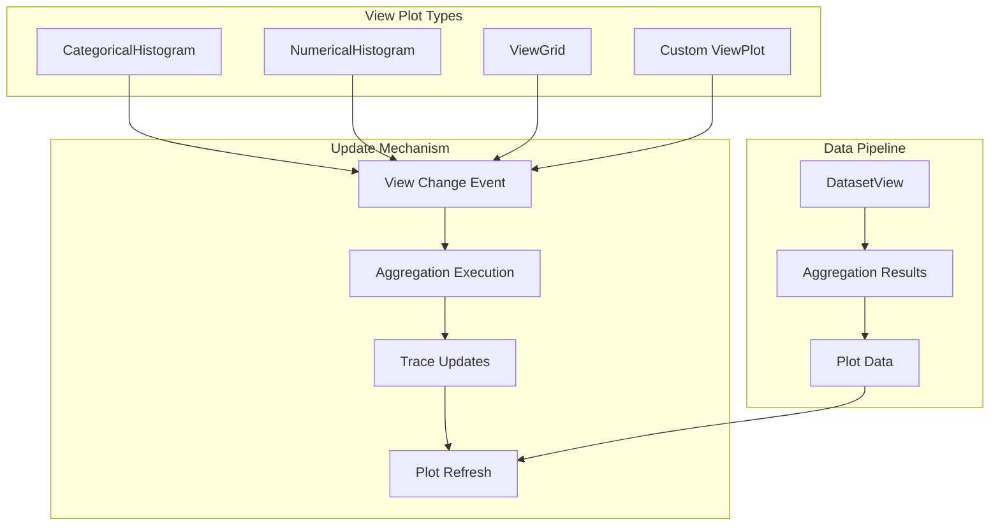
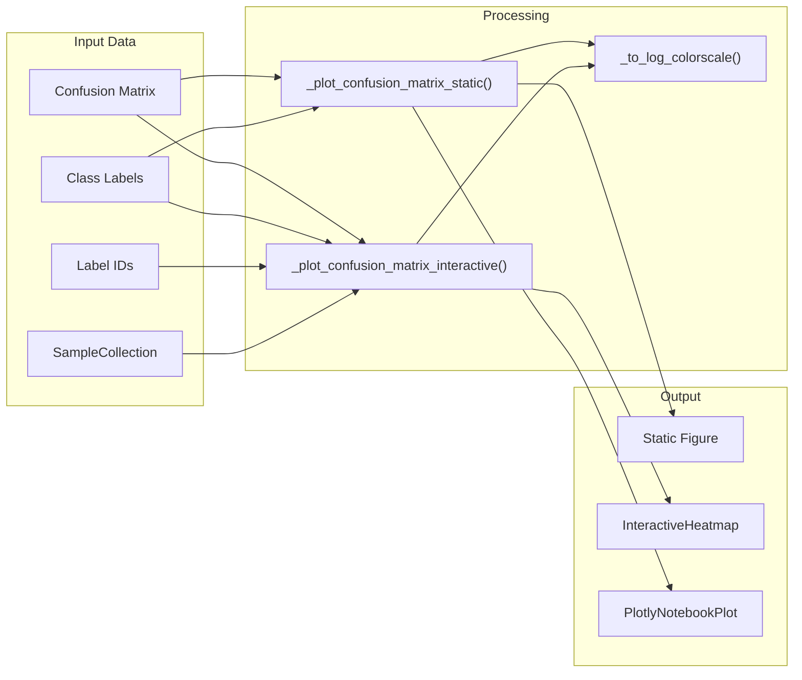
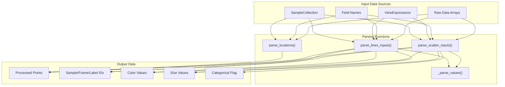

<!-- source: DeepWiki mcp.deepwiki.com · repo voxel51/fiftyone · page 8.1 Interactive Plotting and Aggregations · fetched 2026-10-21 -->

# Interactive Plotting Framework

<details>
<summary>Relevant source files</summary>

The following files were used as context for generating this wiki page:

- [app/packages/core/src/components/Sidebar/Sidebar.tsx](app/packages/core/src/components/Sidebar/Sidebar.tsx)
- [app/packages/state/src/hooks/index.ts](app/packages/state/src/hooks/index.ts)
- [app/packages/state/src/recoil/aggregations.test.ts](app/packages/state/src/recoil/aggregations.test.ts)
- [app/packages/state/src/recoil/aggregations.ts](app/packages/state/src/recoil/aggregations.ts)
- [app/packages/state/src/recoil/atoms.ts](app/packages/state/src/recoil/atoms.ts)
- [app/packages/state/src/recoil/groups.ts](app/packages/state/src/recoil/groups.ts)
- [app/packages/state/src/recoil/labels.ts](app/packages/state/src/recoil/labels.ts)
- [app/packages/state/src/recoil/schema.ts](app/packages/state/src/recoil/schema.ts)
- [app/packages/state/src/recoil/selectors.ts](app/packages/state/src/recoil/selectors.ts)
- [app/packages/state/src/recoil/sidebar.ts](app/packages/state/src/recoil/sidebar.ts)
- [app/packages/state/src/recoil/types.ts](app/packages/state/src/recoil/types.ts)
- [app/schema.graphql](app/schema.graphql)
- [fiftyone/__public__.py](fiftyone/__public__.py)
- [fiftyone/core/aggregations.py](fiftyone/core/aggregations.py)
- [fiftyone/core/clips.py](fiftyone/core/clips.py)
- [fiftyone/core/collections.py](fiftyone/core/collections.py)
- [fiftyone/core/dataset.py](fiftyone/core/dataset.py)
- [fiftyone/core/document.py](fiftyone/core/document.py)
- [fiftyone/core/expressions.py](fiftyone/core/expressions.py)
- [fiftyone/core/fields.py](fiftyone/core/fields.py)
- [fiftyone/core/frame.py](fiftyone/core/frame.py)
- [fiftyone/core/labels.py](fiftyone/core/labels.py)
- [fiftyone/core/odm/dataset.py](fiftyone/core/odm/dataset.py)
- [fiftyone/core/odm/document.py](fiftyone/core/odm/document.py)
- [fiftyone/core/odm/embedded_document.py](fiftyone/core/odm/embedded_document.py)
- [fiftyone/core/odm/mixins.py](fiftyone/core/odm/mixins.py)
- [fiftyone/core/odm/sample.py](fiftyone/core/odm/sample.py)
- [fiftyone/core/odm/utils.py](fiftyone/core/odm/utils.py)
- [fiftyone/core/patches.py](fiftyone/core/patches.py)
- [fiftyone/core/plots/__init__.py](fiftyone/core/plots/__init__.py)
- [fiftyone/core/plots/base.py](fiftyone/core/plots/base.py)
- [fiftyone/core/plots/manager.py](fiftyone/core/plots/manager.py)
- [fiftyone/core/plots/matplotlib.py](fiftyone/core/plots/matplotlib.py)
- [fiftyone/core/plots/plotly.py](fiftyone/core/plots/plotly.py)
- [fiftyone/core/plots/utils.py](fiftyone/core/plots/utils.py)
- [fiftyone/core/plots/views.py](fiftyone/core/plots/views.py)
- [fiftyone/core/sample.py](fiftyone/core/sample.py)
- [fiftyone/core/stages.py](fiftyone/core/stages.py)
- [fiftyone/core/video.py](fiftyone/core/video.py)
- [fiftyone/core/view.py](fiftyone/core/view.py)
- [fiftyone/server/aggregations.py](fiftyone/server/aggregations.py)
- [fiftyone/server/mutation.py](fiftyone/server/mutation.py)
- [fiftyone/server/query.py](fiftyone/server/query.py)
- [fiftyone/server/view.py](fiftyone/server/view.py)
- [tests/unittests/aggregation_tests.py](tests/unittests/aggregation_tests.py)
- [tests/unittests/dataset_tests.py](tests/unittests/dataset_tests.py)
- [tests/unittests/odm_tests.py](tests/unittests/odm_tests.py)
- [tests/unittests/patches_tests.py](tests/unittests/patches_tests.py)
- [tests/unittests/server_view_tests.py](tests/unittests/server_view_tests.py)
- [tests/unittests/video_tests.py](tests/unittests/video_tests.py)
- [tests/unittests/view_tests.py](tests/unittests/view_tests.py)

</details>


The FiftyOne interactive plotting framework provides a comprehensive system for creating interactive visualizations of datasets, model evaluations, and analysis results. The framework supports both programmatic plot generation and interactive visualization within the FiftyOne App, enabling users to explore data patterns, model performance, and evaluation metrics through various chart types and interactive features.

The plotting system is designed to be bidirectionally linked with the FiftyOne App, allowing selections in plots to update the App view and vice versa. This creates a powerful workflow for exploring and analyzing datasets.

Sources: [fiftyone/core/plots/base.py:1-84](), [fiftyone/core/plots/plotly.py:1-50](), [fiftyone/core/plots/manager.py:1-75]()

## System Architecture

The plotting system is built around a layered architecture with backend abstraction, interactive session management, and frontend rendering components.

### Core Plotting Framework



The core plotting framework is organized into several key components:

1. **Backend Abstraction Layer**: Provides unified interfaces for different plotting backends (Plotly and Matplotlib)
2. **Plot Types**: Specialized plotting functions for different visualization needs
3. **Session Management**: Handles the connection between plots and the FiftyOne App
4. **Frontend Components**: Renders the plots in the App interface

Sources: [fiftyone/core/plots/base.py:1-84](), [fiftyone/core/plots/plotly.py:1-50](), [fiftyone/core/plots/matplotlib.py:1-50](), [fiftyone/core/plots/manager.py:1-75]()

### Plot Class Hierarchy

The plotting system uses a hierarchical class structure to organize different types of plots and their behaviors.



The class hierarchy is designed to support different types of interactive behaviors:

- `Plot`: Base class for all plots with common functionality
- `ResponsivePlot`: Plots that can respond to changes in a linked object
- `InteractivePlot`: Plots that support bidirectional interaction with the FiftyOne App
- `ViewPlot`: Plots that automatically update based on the current dataset view
- Specialized implementations like `InteractiveHeatmap` and `InteractiveScatter` provide specific interactive behaviors

Sources: [fiftyone/core/plots/base.py:627-829](), [fiftyone/core/plots/plotly.py:1800-2000](), [fiftyone/core/plots/views.py:30-50]()

## Backend System

The plotting framework provides a backend abstraction layer that supports both Plotly and Matplotlib rendering engines, with Plotly being the primary backend for interactive plots.

### Backend Selection and Configuration

The system automatically selects the appropriate backend based on context and user preferences:



The backend selection process is handled by the `_parse_backend()` function, which determines the appropriate backend based on availability and context. The Plotly backend is preferred for interactive plots, while Matplotlib is available as an alternative for static visualizations.

Sources: [fiftyone/core/plots/base.py:613-624](), [fiftyone/core/plots/plotly.py:183-186](), [fiftyone/core/plots/matplotlib.py:75-80]()

### Plot Generation Functions

The base module provides unified interfaces for different plot types:

| Function | Description | Backend Support |
|----------|-------------|----------------|
| `plot_confusion_matrix()` | Confusion matrix visualizations | Plotly, Matplotlib |
| `plot_regressions()` | Regression analysis plots | Plotly, Matplotlib |
| `plot_pr_curve()` | Precision-recall curve plotting | Plotly, Matplotlib |
| `plot_pr_curves()` | Multiple PR curves | Plotly, Matplotlib |
| `plot_roc_curve()` | ROC curve visualization | Plotly, Matplotlib |
| `scatterplot()` | General-purpose scatter plotting | Plotly, Matplotlib |
| `lines()` | Line plot generation | Plotly, Matplotlib |
| `location_scatterplot()` | Geolocation visualization | Plotly, Matplotlib |

Each function automatically delegates to the appropriate backend implementation based on the `backend` parameter or default settings.

Sources: [fiftyone/core/plots/base.py:19-84](), [fiftyone/core/plots/base.py:86-178](), [fiftyone/core/plots/base.py:181-306](), [fiftyone/core/plots/base.py:309-415](), [fiftyone/core/plots/base.py:418-515](), [fiftyone/core/plots/base.py:518-610]()

## Interactive Plot System

The interactive plotting system enables bidirectional communication between plots and FiftyOne sessions, allowing users to select points in plots and automatically update the dataset view.

### Session Integration



The `PlotManager` class manages the communication between plots and the FiftyOne session. It handles attaching plots to sessions, synchronizing plot states with the current view, and processing selection events from plots.

Sources: [fiftyone/core/plots/manager.py:27-60](), [fiftyone/core/plots/manager.py:185-220]()

### Link Types and Behaviors

The `PlotManager` supports different types of links between plots and sessions:

| Link Type | Description | Behavior |
|-----------|-------------|----------|
| View links | `link_type == "view"` | Plots update when session view changes |
| Sample links | `link_type == "samples"` | Point selection loads corresponding samples |
| Frame links | `link_type == "frames"` | Point selection loads corresponding frames |
| Label links | `link_type == "labels"` | Point selection loads corresponding labels |

When a plot is attached to a session, the appropriate link type is determined based on the plot's characteristics and the data it represents.

Sources: [fiftyone/core/plots/manager.py:34-54](), [fiftyone/core/plots/manager.py:221-320]()

### Interactive Plot Classes

#### InteractiveHeatmap

The `InteractiveHeatmap` class is specialized for confusion matrix visualizations with cell-based selection:

```python
class InteractiveHeatmap(InteractivePlot):
    def __init__(self, z, ids, xlabels=None, ylabels=None, zlim=None, ...):
        # Initialize heatmap with selectable cells
    
    def _get_selected_ids(self, selected_data):
        # Extract IDs from selected cells
    
    def _update_selection(self, selected_ids):
        # Update heatmap cell selection
```

This class is used by the `plot_confusion_matrix()` function when IDs are provided, enabling interactive selection of confusion matrix cells to view the corresponding samples.

Sources: [fiftyone/core/plots/plotly.py:189-258]()

#### InteractiveScatter

The `InteractiveScatter` class handles point-based selection for scatter plots and embeddings:

```python
class InteractiveScatter(InteractivePlot):
    def __init__(self, figure, link_type=None, init_view=None, ...):
        # Initialize scatter plot with selectable points
    
    def _get_selected_ids(self, selected_data):
        # Extract IDs from selected points
    
    def _update_selection(self, selected_ids):
        # Update point selection visualization
```

This class is used by functions like `scatterplot()`, `plot_regressions()`, and `lines()` to enable interactive selection of points to view the corresponding samples.

Sources: [fiftyone/core/plots/plotly.py:1400-1500]()

## View Plot System

View plots automatically update their content when the associated dataset view changes, enabling dynamic dashboards and real-time analysis.

### View Plot Architecture



The `ViewPlot` system is designed to automatically update plot content when the dataset view changes. This is accomplished through:

1. **Aggregation-based updates**: View plots define aggregations that compute the necessary data for the plot
2. **Event-driven updates**: When the view changes, the `PlotManager` triggers updates to all connected view plots
3. **Efficient updates**: Aggregations are batched and executed efficiently to minimize computation

Sources: [fiftyone/core/plots/views.py:31-70](), [fiftyone/core/plots/base.py:778-829](), [fiftyone/core/plots/manager.py:395-430]()

### ViewGrid Implementation

The `ViewGrid` class enables composition of multiple view plots into dashboard-like layouts:

```python
class ViewGrid(PlotlyViewPlot):
    def __init__(self, plots, shape=None, hgap=None, vgap=None, ...):
        # Initialize grid with multiple plots
    
    def _init_aggregations(self):
        # Collect aggregations from all plots
    
    def _get_trace_updates(self, view, agg_results=None):
        # Update all plots in grid
```

Key features of the `ViewGrid` class:

- Combines multiple view plots into a single grid layout
- Automatically collects and executes aggregations from all child plots
- Distributes aggregation results to the appropriate child plots
- Updates all plots in the grid when the view changes

Sources: [fiftyone/core/plots/views.py:73-150](), [fiftyone/core/plots/views.py:467-494]()

## Specialized Plot Types

### Confusion Matrix Visualization

The confusion matrix plotting system provides both static and interactive visualizations for model evaluation:



The confusion matrix visualization system supports both static and interactive modes:

- **Static mode**: When no IDs are provided, a static confusion matrix is generated
- **Interactive mode**: When IDs are provided, an `InteractiveHeatmap` is created that allows selection of cells to view the corresponding samples
- **Log colorscale**: Optional log scaling of the colorscale to better visualize variations in smaller values

Sources: [fiftyone/core/plots/plotly.py:47-123](), [fiftyone/core/plots/plotly.py:125-186](), [fiftyone/core/plots/plotly.py:189-258]()

### Regression Analysis Plots

The `plot_regressions()` function creates interactive scatter plots for regression analysis:

```python
def plot_regressions(ytrue, ypred, samples=None, ids=None, labels=None, sizes=None, ...):
    # Stack ground truth and predictions into points
    points = np.stack([ytrue, ypred], axis=-1)
    
    # Calculate best fit line
    xline, yline, best_fit_label = best_fit_line(points, label=best_fit_label)
    
    # Create figure with best fit line
    figure.add_trace(go.Scatter(x=xline, y=yline, mode="lines", line_color="black", name=best_fit_label))
    
    # Add scatter points with optional coloring and sizing
    return scatterplot(points, samples=samples, ids=ids, labels=labels, sizes=sizes, ...)
```

Key features:
- Automatically calculates and displays a best-fit line with R² value
- Supports coloring points by categorical or numerical values
- Supports scaling point sizes based on numerical values
- Interactive selection of points to view corresponding samples

Sources: [fiftyone/core/plots/plotly.py:261-425](), [fiftyone/core/plots/utils.py:214-228]()

### PR and ROC Curves

The system provides specialized functions for model evaluation curves:

| Function | Description | Features |
|----------|-------------|----------|
| `plot_pr_curve()` | Single precision-recall curve | Area under curve, hover data with thresholds |
| `plot_pr_curves()` | Multiple per-class PR curves | Per-class average precision, legend with AP values |
| `plot_roc_curve()` | ROC curve with AUC | Area under curve, hover data with thresholds |

These functions support both static and interactive modes, with the interactive mode providing hover information about specific points on the curves.

Sources: [fiftyone/core/plots/plotly.py:428-516](), [fiftyone/core/plots/plotly.py:518-615](), [fiftyone/core/plots/plotly.py:618-703]()

## Notebook Integration

The plotting system is designed to work seamlessly in Jupyter notebook environments, providing interactive visualizations that can be embedded directly in notebook cells.

### PlotlyNotebookPlot

The `PlotlyNotebookPlot` class provides notebook-specific functionality for displaying plots:

```python
class PlotlyNotebookPlot(Plot):
    """A Plotly plot displayed in a Jupyter notebook."""
    
    def __init__(self, figure):
        self._figure = figure
        self._frozen = False
    
    def show(self, **kwargs):
        # Display plot in notebook cell
        if self._frozen:
            display(self._img)
        else:
            self._figure.update_layout(**kwargs)
            display(self._figure)
    
    def save(self, path, **kwargs):
        # Save plot to file
        self._figure.write_image(path, **kwargs)
    
    def freeze(self):
        # Convert to static image
        self._img = self._figure.to_image(format="png")
        self._frozen = True
```

The `PlotlyNotebookPlot` class handles the display of plots in notebook environments, with support for:
- Interactive display of Plotly figures
- Freezing plots to static images for better performance
- Saving plots to image files

Sources: [fiftyone/core/plots/plotly.py:1-50]()

### Context Detection

The system automatically detects the execution context and adapts plot behavior accordingly:

```python
def is_jupyter_context():
    """Determines if the current execution context is a Jupyter notebook."""
    try:
        from IPython import get_ipython
        if get_ipython() is None:
            return False
        return get_ipython().__class__.__name__ == "ZMQInteractiveShell"
    except ImportError:
        return False

def is_notebook_context():
    """Determines if the current execution context is any notebook environment."""
    try:
        from IPython import get_ipython
        if get_ipython() is None:
            return False
        return True
    except ImportError:
        return False
```

When plots are created in notebook contexts, they automatically return `PlotlyNotebookPlot` instances that render inline. This context detection enables the plotting system to provide the appropriate visualization experience based on the environment.

Sources: [fiftyone/core/context.py:1-50](), [fiftyone/core/plots/plotly.py:183-186](), [fiftyone/core/plots/plotly.py:512-516](), [fiftyone/core/plots/plotly.py:612-615](), [fiftyone/core/plots/plotly.py:702-703]()

## Plot Data Processing

### Data Parsing and Transformation

The plotting system includes utilities for processing various data formats:



The data parsing utilities handle various input formats and convert them to standardized formats for plotting:

- `parse_scatter_inputs()`: Processes data for scatter plots, handling points, IDs, labels, and sizes
- `parse_lines_inputs()`: Processes data for line plots, handling x/y coordinates, IDs, labels, and sizes
- `parse_locations()`: Processes geolocation data, extracting coordinates from GeoLocation fields
- `_parse_values()`: Internal utility for extracting values from fields or expressions

Sources: [fiftyone/core/plots/utils.py:22-96](), [fiftyone/core/plots/utils.py:126-211](), [fiftyone/core/plots/utils.py:99-123](), [fiftyone/core/plots/utils.py:235-269]()

### Statistical Analysis

The plotting utilities include statistical functions for enhanced visualizations:

```python
def best_fit_line(points, label=None):
    """Computes a best fit line for the given points.
    
    Args:
        points: a `num_points x 2` array of points
        label (None): an optional label for the line
        
    Returns:
        xline: x-coordinates for the line
        yline: y-coordinates for the line
        label: a label for the line (includes R² if not provided)
    """
    x = points[:, 0]
    y = points[:, 1]

    model = skl.LinearRegression()
    model.fit(x[:, np.newaxis], y)

    xline = np.array([x.min(), x.max()])
    yline = model.predict(xline[:, np.newaxis])

    if label is None:
        r2_score = skm.r2_score(x, y, sample_weight=None)
        label = "r^2: %0.3f" % r2_score

    return xline, yline, label
```

The `best_fit_line()` function is used by the `plot_regressions()` function to calculate and display a regression line with an optional R² value. This enhances the visualization of regression data by showing the trend line and goodness of fit.

Sources: [fiftyone/core/plots/utils.py:214-228](), [fiftyone/core/plots/plotly.py:261-425]()

## Usage Patterns

### Basic Plot Generation

```python
# Create confusion matrix
plot = fo.plot_confusion_matrix(
    confusion_matrix, 
    labels, 
    ids=ids,
    samples=dataset
)

# Create scatter plot
plot = fo.scatterplot(
    points,
    samples=dataset,
    labels="predictions.confidence",
    sizes="ground_truth.area"
)

# Attach to session
session.plots.attach(plot)
```

### View Plot Dashboard

```python
# Create multiple view plots
categorical_hist = fo.CategoricalHistogram("ground_truth.label")
numerical_hist = fo.NumericalHistogram("predictions.confidence")

# Compose into grid
grid = fo.ViewGrid([categorical_hist, numerical_hist])
session.plots.attach(grid)
```

### Location Plotting

```python
# Create location scatterplot
plot = fo.location_scatterplot(
    samples=dataset,
    labels="uniqueness",
    sizes="num_objects"
)

# With explicit coordinates
locations = dataset.values("location.point.coordinates")
plot = fo.location_scatterplot(
    locations=locations,
    labels=uniqueness_values
)
```

Sources: [docs/source/user_guide/plots.rst:350-400](), [fiftyone/core/plots/base.py:518-610]()

The FiftyOne visualization and plotting system provides a comprehensive framework for creating interactive, responsive visualizations that integrate seamlessly with dataset exploration and model evaluation workflows. Through its layered architecture, backend abstraction, and rich frontend components, it enables users to gain deep insights into their data and model performance through visual analysis.

---

