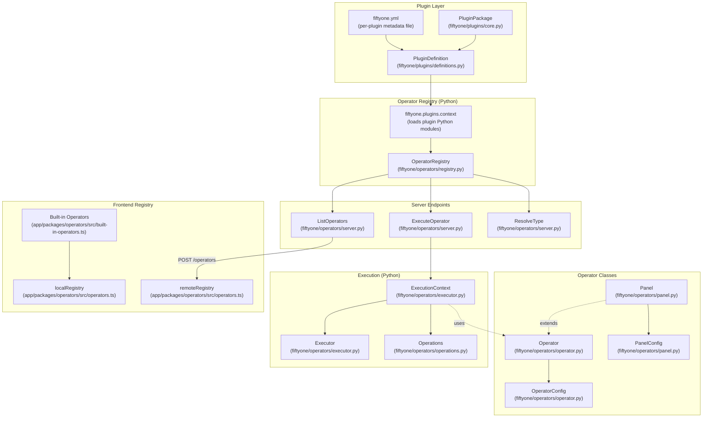
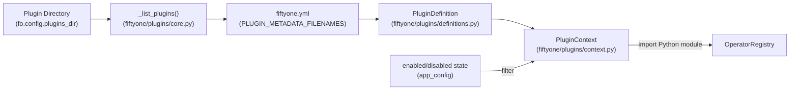
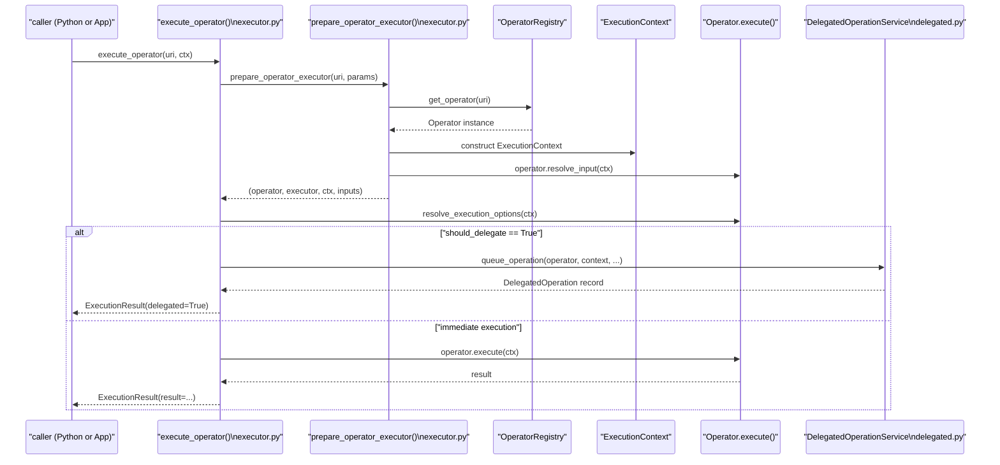
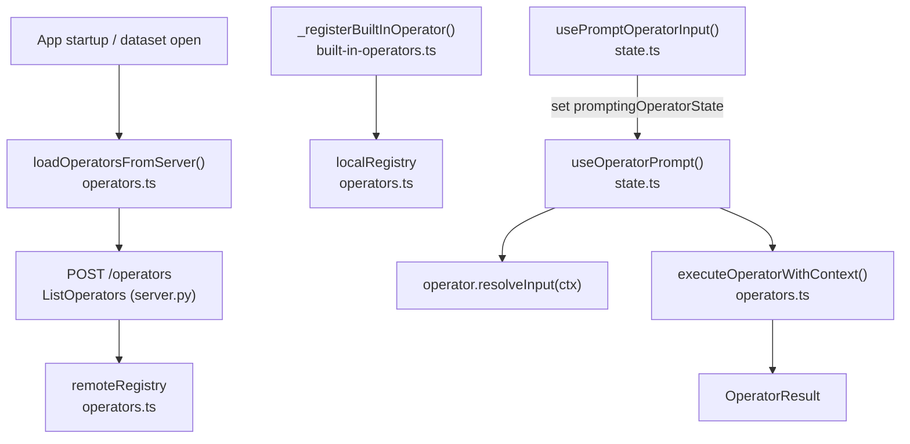

<!-- source: DeepWiki mcp.deepwiki.com · repo voxel51/fiftyone · page 9 Extensibility Framework · fetched 2026-10-21 -->

# Extensibility Framework

Relevant source files

The following files were used as context for generating this wiki page:

- [app/packages/core/src/plugins/OperatorIO/utils/index.ts](app/packages/core/src/plugins/OperatorIO/utils/index.ts)
- [app/packages/core/src/plugins/SchemaIO/components/Button.tsx](app/packages/core/src/plugins/SchemaIO/components/Button.tsx)
- [app/packages/core/src/plugins/SchemaIO/components/ButtonView.tsx](app/packages/core/src/plugins/SchemaIO/components/ButtonView.tsx)
- [app/packages/core/src/plugins/SchemaIO/components/DashboardPNGExport.tsx](app/packages/core/src/plugins/SchemaIO/components/DashboardPNGExport.tsx)
- [app/packages/core/src/plugins/SchemaIO/components/DashboardResizeHandles.css](app/packages/core/src/plugins/SchemaIO/components/DashboardResizeHandles.css)
- [app/packages/core/src/plugins/SchemaIO/components/DashboardView.tsx](app/packages/core/src/plugins/SchemaIO/components/DashboardView.tsx)
- [app/packages/core/src/plugins/SchemaIO/components/FrameLoaderView.tsx](app/packages/core/src/plugins/SchemaIO/components/FrameLoaderView.tsx)
- [app/packages/core/src/plugins/SchemaIO/components/PlotlyView.tsx](app/packages/core/src/plugins/SchemaIO/components/PlotlyView.tsx)
- [app/packages/core/src/plugins/SchemaIO/components/TimelineView.tsx](app/packages/core/src/plugins/SchemaIO/components/TimelineView.tsx)
- [app/packages/core/src/plugins/SchemaIO/components/index.ts](app/packages/core/src/plugins/SchemaIO/components/index.ts)
- [app/packages/operators/src/CustomPanel.tsx](app/packages/operators/src/CustomPanel.tsx)
- [app/packages/operators/src/OperatorBrowser.tsx](app/packages/operators/src/OperatorBrowser.tsx)
- [app/packages/operators/src/OperatorIcon.tsx](app/packages/operators/src/OperatorIcon.tsx)
- [app/packages/operators/src/OperatorPalette.tsx](app/packages/operators/src/OperatorPalette.tsx)
- [app/packages/operators/src/Panel/register.tsx](app/packages/operators/src/Panel/register.tsx)
- [app/packages/operators/src/built-in-operators.ts](app/packages/operators/src/built-in-operators.ts)
- [app/packages/operators/src/constants.ts](app/packages/operators/src/constants.ts)
- [app/packages/operators/src/index.ts](app/packages/operators/src/index.ts)
- [app/packages/operators/src/operators.ts](app/packages/operators/src/operators.ts)
- [app/packages/operators/src/state.ts](app/packages/operators/src/state.ts)
- [app/packages/operators/src/types.ts](app/packages/operators/src/types.ts)
- [app/packages/operators/src/useCustomPanelHooks.ts](app/packages/operators/src/useCustomPanelHooks.ts)
- [app/packages/operators/src/validation.ts](app/packages/operators/src/validation.ts)
- [docs/source/cli/index.rst](docs/source/cli/index.rst)
- [fiftyone/core/cli.py](fiftyone/core/cli.py)
- [fiftyone/internal/__init__.py](fiftyone/internal/__init__.py)
- [fiftyone/internal/secrets/__init__.py](fiftyone/internal/secrets/__init__.py)
- [fiftyone/internal/secrets/providers/__init__.py](fiftyone/internal/secrets/providers/__init__.py)
- [fiftyone/internal/secrets/providers/iprovider.py](fiftyone/internal/secrets/providers/iprovider.py)
- [fiftyone/internal/secrets/providers/local.py](fiftyone/internal/secrets/providers/local.py)
- [fiftyone/internal/util.py](fiftyone/internal/util.py)
- [fiftyone/operators/__init__.py](fiftyone/operators/__init__.py)
- [fiftyone/operators/executor.py](fiftyone/operators/executor.py)
- [fiftyone/operators/operations.py](fiftyone/operators/operations.py)
- [fiftyone/operators/operator.py](fiftyone/operators/operator.py)
- [fiftyone/operators/panel.py](fiftyone/operators/panel.py)
- [fiftyone/operators/registry.py](fiftyone/operators/registry.py)
- [fiftyone/operators/server.py](fiftyone/operators/server.py)
- [fiftyone/operators/types.py](fiftyone/operators/types.py)
- [fiftyone/plugins/__init__.py](fiftyone/plugins/__init__.py)
- [fiftyone/plugins/context.py](fiftyone/plugins/context.py)
- [fiftyone/plugins/core.py](fiftyone/plugins/core.py)
- [fiftyone/plugins/definitions.py](fiftyone/plugins/definitions.py)
- [fiftyone/plugins/secrets.py](fiftyone/plugins/secrets.py)
- [fiftyone/plugins/utils.py](fiftyone/plugins/utils.py)
- [fiftyone/utils/github.py](fiftyone/utils/github.py)
- [fiftyone/utils/quickstart.py](fiftyone/utils/quickstart.py)
- [tests/unittests/plugins/context_tests.py](tests/unittests/plugins/context_tests.py)
- [tests/unittests/plugins/core_tests.py](tests/unittests/plugins/core_tests.py)
- [tests/unittests/plugins/secrets_tests.py](tests/unittests/plugins/secrets_tests.py)
- [tests/unittests/secrets/provider_tests.py](tests/unittests/secrets/provider_tests.py)

This page provides an overview of FiftyOne's extensibility layer: the **operator system**, the **plugin system**, and **delegated operations**. Together, these three mechanisms allow users and developers to add custom functionality to both the Python API and the FiftyOne App without modifying the core codebase.

- For detailed documentation of individual operator classes, the type system, and execution pipeline, see [Operator Framework](#9.1).
- For asynchronous background execution of operations, see [Delegated Operations](#9.2).
- For plugin discovery, `fiftyone.yml` format, and plugin development guides, see [Plugin System and Development](#9.3).

---

## Conceptual Overview

FiftyOne's extensibility layer is built on three interlocking concepts:

| Concept | What it is | Primary location |
|---|---|---|
| **Plugin** | A directory containing a `fiftyone.yml` manifest plus Python and/or JS source files | `fiftyone/plugins/`, `app/packages/operators/` |
| **Operator** | A Python class (`Operator` or `Panel`) registered by a plugin; defines an action or interactive UI panel | `fiftyone/operators/operator.py`, `fiftyone/operators/panel.py` |
| **Delegated Operation** | An operator invocation queued for asynchronous background execution, tracked by `DelegatedOperationService` | `fiftyone/operators/delegated.py` |

Plugins are the **packaging unit** — a plugin bundles one or more operators (and optionally frontend components). Operators are the **behavioral unit** — each operator defines inputs, outputs, and an execute method. Delegated operations are the **execution unit** for long-running tasks.

---

## System Architecture

**Diagram: Extensibility Framework — Major Components and Their Code Entities**

Sources: [fiftyone/operators/operator.py:1-50](), [fiftyone/operators/panel.py:1-90](), [fiftyone/operators/registry.py:1-80](), [fiftyone/operators/executor.py:635-700](), [fiftyone/operators/operations.py:1-50](), [fiftyone/operators/server.py:1-80](), [fiftyone/plugins/definitions.py:1-50](), [fiftyone/plugins/core.py:36-55](), [app/packages/operators/src/operators.ts:406-504]()

---

## Plugin System

A plugin is a directory on disk containing a `fiftyone.yml` file (also accepted as `fiftyone.yaml`). The YAML file declares the plugin name, version, author, compatibility, and the list of operator names it exposes.

**Diagram: Plugin Discovery and Loading**

Sources: [fiftyone/plugins/core.py:31-86](), [fiftyone/plugins/definitions.py:20-110]()

The `list_plugins()` function in `fiftyone/plugins/core.py` scans `fo.config.plugins_dir` and any builtin plugin directories, resolving `fiftyone.yml` files into `PluginDefinition` instances. Each definition exposes properties such as `name`, `version`, `operators`, `has_js_bundle`, and `builtin`.

Plugins can be individually enabled or disabled via `enable_plugin()` / `disable_plugin()`, and downloaded from GitHub repos or archive URLs via `download_plugin()`.

**`PluginDefinition` key properties:**

| Property | Type | Description |
|---|---|---|
| `name` | `str` | Unique plugin identifier (from `fiftyone.yml`) |
| `directory` | `str` | Absolute path to the plugin root |
| `builtin` | `bool` | True if located inside the FiftyOne package |
| `operators` | `list[str]` | Combined list of operator and panel names |
| `has_js_bundle` | `bool` | Whether the plugin ships frontend JS |
| `fiftyone_compatibility` | `str` | Version constraint (e.g. `>=0.21`) |

---

## Operator System

Operators are the atomic unit of extensibility. Each operator is a Python class that subclasses `Operator` (in `fiftyone/operators/operator.py`) and implements at minimum a `config` property and an `execute()` method.

**Core methods an operator implements:**

| Method | Required | Purpose |
|---|---|---|
| `config` (property) | Yes | Returns `OperatorConfig` with name, label, flags |
| `execute(ctx)` | Yes | Performs the operation; receives `ExecutionContext` |
| `resolve_input(ctx)` | No | Defines the input form schema (returns `types.Property`) |
| `resolve_output(ctx)` | No | Defines the output display schema |
| `resolve_delegation(ctx)` | No | Forces delegated vs immediate execution |
| `resolve_execution_options(ctx)` | No | Returns `ExecutionOptions` for allow-immediate/delegated flags |
| `resolve_placement(ctx)` | No | Returns `Placement` for where to show the operator in the UI |

The `Panel` subclass (in `fiftyone/operators/panel.py`) adds a `render(ctx)` method and lifecycle hooks (`on_load`, `on_unload`, `on_change`, `on_change_dataset`, etc.) for building interactive UI panels.

**`OperatorConfig` key flags:**

| Flag | Default | Meaning |
|---|---|---|
| `dynamic` | `False` | Re-resolve inputs/outputs on every parameter change |
| `execute_as_generator` | `False` | Operator yields progress updates |
| `unlisted` | `False` | Hide from the Operator Browser UI |
| `on_startup` | `False` | Auto-execute when App starts |
| `on_dataset_open` | `False` | Auto-execute when a dataset is opened |
| `allow_immediate_execution` | `True` | Allow synchronous execution |
| `allow_delegated_execution` | `False` | Allow queueing as a background task |
| `default_choice_to_delegated` | `False` | Default UI choice to "Schedule" |

Sources: [fiftyone/operators/operator.py:14-122](), [fiftyone/operators/panel.py:18-177]()

---

## Execution Model

When an operator is invoked, the framework routes it through an execution pipeline that determines whether to run it immediately (in-process) or delegate it to a background worker.

**Diagram: Operator Execution Flow**

Sources: [fiftyone/operators/executor.py:128-410]()

The `ExecutionContext` (Python) provides the operator with access to:
- `ctx.dataset` — the active `Dataset`
- `ctx.view` — the current `DatasetView`
- `ctx.selected` — list of selected sample IDs
- `ctx.params` — the input parameters submitted by the user
- `ctx.ops` — an `Operations` instance for triggering built-in App actions

The `Operations` class (`fiftyone/operators/operations.py`) provides a typed Python interface to trigger built-in frontend actions such as `reload_samples()`, `open_panel()`, `set_view()`, `patch_panel_state()`, and others — all of which enqueue an `InvocationRequest` inside the `Executor`.

---

## Frontend Integration

The frontend maintains two separate operator registries inside `app/packages/operators/src/operators.ts`:

- **`localRegistry`**: Built-in JS operators registered at startup (from `built-in-operators.ts`).
- **`remoteRegistry`**: Python-backed operators loaded from the server via `POST /operators`.

**Diagram: Frontend Operator Lifecycle**

Sources: [app/packages/operators/src/operators.ts:436-504](), [app/packages/operators/src/built-in-operators.ts:1-100](), [app/packages/operators/src/state.ts:70-92](), [app/packages/operators/src/state.ts:452-705]()

The `promptingOperatorState` Recoil atom in `state.ts` tracks the currently active operator prompt. When an operator is selected (via the Operator Browser or a keyboard shortcut), `usePromptOperatorInput` sets this atom, and `useOperatorPrompt` manages the full prompt lifecycle: resolving input schema, validating params, showing the form, and calling `executeOperatorWithContext`.

Built-in frontend operators (e.g., `ReloadSamples`, `SetView`, `OpenPanel`, `ClearSelectedSamples`) live in `built-in-operators.ts` and execute entirely client-side by manipulating Recoil state.

---

## Delegated Operations

When an operator sets `allow_delegated_execution=True` in its `OperatorConfig`, the user can choose to "Schedule" rather than "Execute" it immediately. The framework calls `DelegatedOperationService.queue_operation()`, which persists the operation in MongoDB and signals a separate worker process to pick it up.

The `ExecutionRunState` enum (`fiftyone/operators/executor.py`) defines the lifecycle states: `SCHEDULED → QUEUED → RUNNING → COMPLETED | FAILED`.

For complete documentation of the delegated execution pipeline, see [Delegated Operations](#9.2).

---

## CLI Access

The `fiftyone` CLI exposes three subcommands for managing the extensibility layer:

| Command | Class | Purpose |
|---|---|---|
| `fiftyone operators list` | `OperatorsListCommand` | List all registered operators and panels |
| `fiftyone operators info <uri>` | `OperatorsInfoCommand` | Print details for a specific operator |
| `fiftyone plugins list` | `PluginsListCommand` | List installed plugins |
| `fiftyone plugins enable <name>` | `PluginsEnableCommand` | Enable a plugin |
| `fiftyone plugins disable <name>` | `PluginsDisableCommand` | Disable a plugin |
| `fiftyone plugins download <url>` | `PluginsDownloadCommand` | Download a plugin from GitHub |
| `fiftyone delegated list` | `DelegatedListCommand` | List delegated operations and their states |
| `fiftyone delegated launch` | `DelegatedLaunchCommand` | Launch a local delegated operation orchestrator |

Sources: [fiftyone/core/cli.py:99-107](), [fiftyone/core/cli.py:101-104]()

---

## Summary of Key Python Symbols

| Symbol | File | Role |
|---|---|---|
| `Operator` | `fiftyone/operators/operator.py` | Base class for all operators |
| `OperatorConfig` | `fiftyone/operators/operator.py` | Metadata and flags for an operator |
| `Panel` | `fiftyone/operators/panel.py` | Operator subclass for interactive UI panels |
| `PanelConfig` | `fiftyone/operators/panel.py` | Configuration for panels |
| `ExecutionContext` | `fiftyone/operators/executor.py` | Runtime context passed to `execute()` |
| `Executor` | `fiftyone/operators/executor.py` | Collects trigger requests and logs during execution |
| `Operations` | `fiftyone/operators/operations.py` | Typed API for triggering built-in App actions |
| `OperatorRegistry` | `fiftyone/operators/registry.py` | Loads and looks up operators by URI |
| `execute_operator` | `fiftyone/operators/executor.py` | Public entry point for programmatic execution |
| `PluginDefinition` | `fiftyone/plugins/definitions.py` | Parsed representation of `fiftyone.yml` |
| `PluginPackage` | `fiftyone/plugins/core.py` | Lightweight record of plugin name and path |
| `list_plugins` | `fiftyone/plugins/core.py` | Enumerates installed plugins |
| `download_plugin` | `fiftyone/plugins/core.py` | Downloads plugin from GitHub or URL |

---

