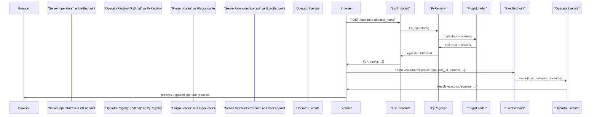
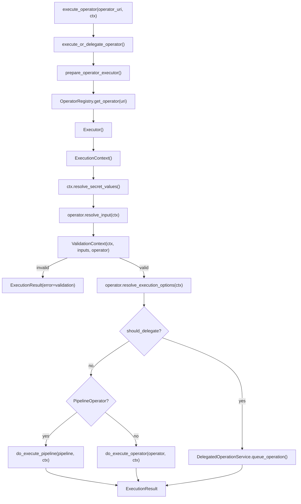
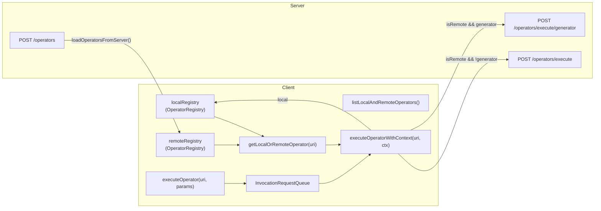
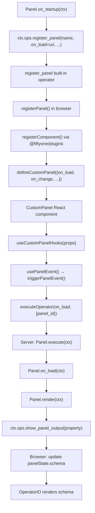

<!-- source: DeepWiki mcp.deepwiki.com · repo voxel51/fiftyone · page 9.1 Operator Framework · fetched 2026-10-21 -->

# Operator Framework

<details>
<summary>Relevant source files</summary>

The following files were used as context for generating this wiki page:

- [app/packages/core/src/plugins/OperatorIO/utils/index.ts](app/packages/core/src/plugins/OperatorIO/utils/index.ts)
- [app/packages/core/src/plugins/SchemaIO/components/Button.tsx](app/packages/core/src/plugins/SchemaIO/components/Button.tsx)
- [app/packages/core/src/plugins/SchemaIO/components/ButtonView.tsx](app/packages/core/src/plugins/SchemaIO/components/ButtonView.tsx)
- [app/packages/core/src/plugins/SchemaIO/components/DashboardPNGExport.tsx](app/packages/core/src/plugins/SchemaIO/components/DashboardPNGExport.tsx)
- [app/packages/core/src/plugins/SchemaIO/components/DashboardResizeHandles.css](app/packages/core/src/plugins/SchemaIO/components/DashboardResizeHandles.css)
- [app/packages/core/src/plugins/SchemaIO/components/DashboardView.tsx](app/packages/core/src/plugins/SchemaIO/components/DashboardView.tsx)
- [app/packages/core/src/plugins/SchemaIO/components/FrameLoaderView.tsx](app/packages/core/src/plugins/SchemaIO/components/FrameLoaderView.tsx)
- [app/packages/core/src/plugins/SchemaIO/components/PlotlyView.tsx](app/packages/core/src/plugins/SchemaIO/components/PlotlyView.tsx)
- [app/packages/core/src/plugins/SchemaIO/components/TimelineView.tsx](app/packages/core/src/plugins/SchemaIO/components/TimelineView.tsx)
- [app/packages/core/src/plugins/SchemaIO/components/index.ts](app/packages/core/src/plugins/SchemaIO/components/index.ts)
- [app/packages/operators/src/CustomPanel.tsx](app/packages/operators/src/CustomPanel.tsx)
- [app/packages/operators/src/OperatorBrowser.tsx](app/packages/operators/src/OperatorBrowser.tsx)
- [app/packages/operators/src/OperatorIcon.tsx](app/packages/operators/src/OperatorIcon.tsx)
- [app/packages/operators/src/OperatorPalette.tsx](app/packages/operators/src/OperatorPalette.tsx)
- [app/packages/operators/src/Panel/register.tsx](app/packages/operators/src/Panel/register.tsx)
- [app/packages/operators/src/built-in-operators.ts](app/packages/operators/src/built-in-operators.ts)
- [app/packages/operators/src/constants.ts](app/packages/operators/src/constants.ts)
- [app/packages/operators/src/index.ts](app/packages/operators/src/index.ts)
- [app/packages/operators/src/operators.ts](app/packages/operators/src/operators.ts)
- [app/packages/operators/src/state.ts](app/packages/operators/src/state.ts)
- [app/packages/operators/src/types.ts](app/packages/operators/src/types.ts)
- [app/packages/operators/src/useCustomPanelHooks.ts](app/packages/operators/src/useCustomPanelHooks.ts)
- [app/packages/operators/src/validation.ts](app/packages/operators/src/validation.ts)
- [fiftyone/operators/__init__.py](fiftyone/operators/__init__.py)
- [fiftyone/operators/executor.py](fiftyone/operators/executor.py)
- [fiftyone/operators/operations.py](fiftyone/operators/operations.py)
- [fiftyone/operators/operator.py](fiftyone/operators/operator.py)
- [fiftyone/operators/panel.py](fiftyone/operators/panel.py)
- [fiftyone/operators/registry.py](fiftyone/operators/registry.py)
- [fiftyone/operators/server.py](fiftyone/operators/server.py)
- [fiftyone/operators/types.py](fiftyone/operators/types.py)

</details>


This page documents the FiftyOne operator framework: the Python base classes, execution pipeline, type system, panel operators, and client-side JavaScript operator system. Operators are the primary extensibility primitive in FiftyOne — they allow plugins to define actions that users or other code can trigger from the App or from Python.

For the plugin discovery and loading mechanism that makes operators available, see [Plugin System and Development](#9.3). For asynchronous background execution of operators, see [Delegated Operations](#9.2).

---

## Architecture Overview

The operator framework spans both the Python server and the JavaScript frontend. Python operators are loaded by the plugin system and executed on the server; JavaScript operators run entirely in the browser. Both sides share the same URI scheme and protocol.

**Operator Lifecycle: Python to Browser**



Sources: [fiftyone/operators/server.py:39-121](), [fiftyone/operators/registry.py:1-120](), [app/packages/operators/src/operators.ts:436-479]()

---

## Python Operator Base Classes

### `Operator`

Defined in [fiftyone/operators/operator.py:124-348](), `Operator` is the abstract base class all Python operators extend.

| Method | Required? | Description |
|---|---|---|
| `config` (property) | Yes | Returns an `OperatorConfig` instance |
| `execute(ctx)` | Yes | Runs the operation; receives `ExecutionContext` |
| `resolve_input(ctx)` | No | Returns a `types.Property` defining the input schema |
| `resolve_output(ctx)` | No | Returns a `types.Property` defining the output schema |
| `resolve_placement(ctx)` | No | Returns a `types.Placement` for UI button placement |
| `resolve_delegation(ctx)` | No | Returns `True`/`False`/`None` to force delegation |
| `resolve_execution_options(ctx)` | No | Returns `ExecutionOptions` |
| `resolve_run_name(ctx)` | No | Returns a label string for delegated operations |

The operator's `uri` is computed as `plugin_name/operator_name`. Built-in operators use the prefix `@voxel51/operators`.

### `OperatorConfig`

`OperatorConfig` is a plain configuration object instantiated inside each operator's `config` property. Key fields:

| Field | Default | Description |
|---|---|---|
| `name` | required | Operator name, combined with plugin name to form URI |
| `label` | `name` | Human-readable display name |
| `description` | `None` | Short description shown in the Operator Browser |
| `dynamic` | `False` | If `True`, re-resolves inputs/outputs on each change |
| `execute_as_generator` | `False` | If `True`, `execute()` is treated as a generator (streaming) |
| `unlisted` | `False` | Hides from the Operator Browser |
| `on_startup` | `False` | Auto-executes when the App starts |
| `on_dataset_open` | `False` | Auto-executes when a dataset is opened |
| `allow_immediate_execution` | `True` | Whether immediate execution is offered |
| `allow_delegated_execution` | `False` | Whether delegated (background) execution is offered |
| `default_choice_to_delegated` | `False` | Pre-selects "Schedule" in the UI |
| `rerunnable` | `True` | Whether a delegated operation can be re-run |

Sources: [fiftyone/operators/operator.py:14-122]()

### `PipelineOperator`

`PipelineOperator` extends `Operator` and represents a sequenced composition of other operators. Instead of implementing `execute()`, subclasses implement `resolve_pipeline(ctx)`, which returns a `types.Pipeline` containing `types.PipelineStage` objects. The executor runs each stage's operator in order.

```mermaid
classDiagram
    class "Operator" {
        +plugin_name: str
        +uri: str
        +config: OperatorConfig
        +execute(ctx)
        +resolve_input(ctx)
        +resolve_output(ctx)
        +resolve_placement(ctx)
        +resolve_delegation(ctx)
        +resolve_execution_options(ctx)
    }
    class "OperatorConfig" {
        +name: str
        +label: str
        +dynamic: bool
        +execute_as_generator: bool
        +allow_immediate_execution: bool
        +allow_delegated_execution: bool
    }
    class "PipelineOperator" {
        +resolve_pipeline(ctx): Pipeline
    }
    class "Panel" {
        +config: PanelConfig
        +render(ctx): Property
        +on_startup(ctx)
        +on_load(ctx)
        +execute(ctx)
    }
    class "PanelConfig" {
        +name: str
        +label: str
        +surfaces: str
        +allow_multiple: bool
        +help_markdown: str
    }
    "Operator" <|-- "PipelineOperator"
    "Operator" <|-- "Panel"
    "OperatorConfig" <|-- "PanelConfig"
    "Operator" --> "OperatorConfig"
    "Panel" --> "PanelConfig"
```

Sources: [fiftyone/operators/operator.py:351-380](), [fiftyone/operators/panel.py:18-176]()

---

## ExecutionContext

`ExecutionContext` (defined in [fiftyone/operators/executor.py:635-1100+]()) is passed to every operator method. It provides access to the App state and allows triggering follow-on operations.

**Key properties:**

| Property | Type | Description |
|---|---|---|
| `dataset` | `Dataset` | The active dataset, loaded by ID or name |
| `view` | `DatasetView` | The current view, reconstructed from serialized stages |
| `params` | `dict` | The operator's input parameters |
| `selected` | `list[str]` | Currently selected sample IDs |
| `selected_labels` | `list[dict]` | Currently selected label dicts |
| `current_sample` | `str` | ID of sample open in the modal |
| `ops` | `Operations` | Helper for triggering built-in App actions |
| `panel` | `PanelRef` | Panel state/data access (panel operators only) |
| `secrets` | `SecretsDictionary` | Plugin secrets resolved at runtime |
| `delegated` | `bool` | Whether this execution was delegated |
| `requesting_delegated_execution` | `bool` | Whether the user requested delegation |

**Triggering other operators:**

```python
# Inside execute(ctx):
ctx.trigger("reload_dataset")
ctx.trigger("set_view", params={"view": [...]})
```

`trigger()` enqueues an `InvocationRequest` in the `Executor`, which is returned to the browser and processed there.

Sources: [fiftyone/operators/executor.py:635-1100]()

---

## Executor Pipeline

The executor pipeline handles request parsing, validation, delegation, and actual execution.

**Execution Flow Diagram**



### Key Functions

| Function | File | Description |
|---|---|---|
| `execute_operator()` | [executor.py:128-199]() | Public Python API; dispatches coroutine |
| `execute_or_delegate_operator()` | [executor.py:232-410]() | Core async dispatch; decides delegation |
| `prepare_operator_executor()` | [executor.py:413-448]() | Builds `ExecutionContext`, runs validation |
| `do_execute_operator()` | [executor.py:451-471]() | Calls `operator.execute(ctx)`, handles generators |
| `do_execute_pipeline()` | [executor.py:474-531]() | Executes pipeline stages sequentially |
| `resolve_type()` | [executor.py:534-557]() | Resolves input/output schema for the prompt UI |
| `resolve_execution_options()` | [executor.py:580-609]() | Returns `ExecutionOptions` for the execution prompt |

### `ExecutionResult` and `Executor`

`Executor` accumulates `InvocationRequest` objects (operators to trigger next) and log messages during execution. When execution completes, its contents are serialized and returned to the browser, which processes the `requests` list by invoking each queued operator.

`ExecutionResult` wraps the result, error, `Executor`, and a `ValidationContext` if validation failed.

Sources: [fiftyone/operators/executor.py:88-126](), [fiftyone/operators/executor.py:232-531]()

---

## Type System

The type system (`fiftyone/operators/types.py`, re-exported from `fiftyone/operators/_types/types.py`) defines the schema for operator inputs and outputs. These schemas are used to render forms in the App and to validate user input.

**Type Hierarchy (Python)**

```mermaid
classDiagram
    class "BaseType"
    class "Object" {
        +define_property(name, type, **kwargs)
        +str(name, **kwargs)
        +int(name, **kwargs)
        +bool(name, **kwargs)
        +list(name, element_type, **kwargs)
        +enum(name, values, **kwargs)
    }
    class "Property" {
        +type: BaseType
        +required: bool
        +view: View
        +default: any
        +invalid: bool
        +error_message: str
    }
    class "View" {
        +label: str
        +description: str
        +caption: str
        +space: int
    }
    class "Pipeline" {
        +stages: list[PipelineStage]
    }
    class "PipelineStage" {
        +operator_uri: str
        +params: dict
        +always_run: bool
        +rerunnable: bool
    }
    class "Placement" {
        +place: Place
        +view: View
    }
    "BaseType" <|-- "Object"
    "BaseType" <|-- "String"
    "BaseType" <|-- "Number"
    "BaseType" <|-- "Boolean"
    "BaseType" <|-- "List"
    "BaseType" <|-- "Enum"
    "BaseType" <|-- "Tuple"
    "BaseType" <|-- "Map"
    "BaseType" <|-- "OneOf"
    "Object" --> "Property"
    "Property" --> "BaseType"
    "Property" --> "View"
    "View" <|-- "PromptView"
    "View" <|-- "DropdownView"
    "View" <|-- "RadioView"
    "View" <|-- "CheckboxView"
    "View" <|-- "ProgressView"
    "View" <|-- "PlotlyView"
    "View" <|-- "DashboardView"
    "View" <|-- "ButtonView"
    "View" <|-- "HiddenView"
    "View" <|-- "CodeView"
```

**Creating input schemas:**

```python
def resolve_input(self, ctx):
    inputs = types.Object()
    inputs.str("field_name", label="Field Name", required=True)
    inputs.enum("mode", values=["a", "b"], label="Mode")
    inputs.bool("verbose", label="Verbose", default=False)
    return types.Property(inputs)
```

`View` subclasses control the UI widget rendered for each property. The type determines data shape; the view determines UI presentation.

Sources: [fiftyone/operators/types.py:1-18](), [app/packages/operators/src/types.ts:1-340]()

---

## Panel Operators

Panels are a specialized operator subtype defined in [fiftyone/operators/panel.py](). They represent persistent, stateful UI panels inside the App's spaces layout.

### `Panel` and `PanelConfig`

`Panel` extends `Operator` and overrides the lifecycle to support panel-specific events. The key method is `render(ctx)`, which returns a `types.Property` describing the panel's UI output.

**Panel lifecycle methods:**

| Method | Triggered When |
|---|---|
| `on_startup(ctx)` | App startup; registers the panel |
| `on_load(ctx)` | Panel is opened by the user |
| `on_unload(ctx)` | Panel is closed |
| `on_change(ctx)` | Panel state changes |
| `on_change_view(ctx)` | The active view changes |
| `on_change_dataset(ctx)` | Dataset is changed |
| `on_change_selected(ctx)` | Sample selection changes |
| `on_change_current_sample(ctx)` | Modal sample changes |
| `on_change_group_slice(ctx)` | Group slice changes |

`on_startup()` calls `ctx.ops.register_panel(...)` to register the panel with the App, passing a `panel_config` dict and method URIs for each lifecycle callback [fiftyone/operators/panel.py:118-153]().

`execute()` in `Panel` dispatches to the correct lifecycle method based on `ctx.params["__method__"]`, then calls `render(ctx)` and sends the output via `ctx.ops.show_panel_output()` [fiftyone/operators/panel.py:158-176]().

### `PanelRef`

`PanelRef` [fiftyone/operators/panel.py:304-376]() provides a structured API for operator methods to read/write panel state:

- `ctx.panel.state` — a `PanelRefState` object; writes trigger `patch_panel_state` ops
- `ctx.panel.data` — a `PanelRefData` object (write-only); writes trigger `patch_panel_data` ops
- `ctx.panel.set_state(key, value)` — shortcut for state patching
- `ctx.panel.close()` — closes the panel via `ctx.ops.close_panel()`

Sources: [fiftyone/operators/panel.py:93-376]()

---

## Operations Helper

`Operations` [fiftyone/operators/operations.py:15-600+]() is accessed via `ctx.ops` inside any `execute()` method. It provides a typed API for triggering built-in App actions without needing to know operator URI strings.

**Selected methods:**

| Method | Triggers |
|---|---|
| `ctx.ops.reload_dataset()` | `reload_dataset` |
| `ctx.ops.reload_samples()` | `reload_samples` |
| `ctx.ops.set_view(view)` | `set_view` |
| `ctx.ops.set_selected_samples(ids)` | `set_selected_samples` |
| `ctx.ops.open_panel(name)` | `open_panel` |
| `ctx.ops.close_panel(name)` | `close_panel` |
| `ctx.ops.register_panel(name, label, ...)` | `register_panel` |
| `ctx.ops.show_panel_output(output)` | `show_panel_output` |
| `ctx.ops.patch_panel_state(state)` | `patch_panel_state` |
| `ctx.ops.patch_panel_data(data)` | `patch_panel_data` |
| `ctx.ops.open_dataset(name)` | `open_dataset` |
| `ctx.ops.clear_view()` | `clear_view` |

Each method calls `ctx.trigger(operator_name, params=...)` internally.

Sources: [fiftyone/operators/operations.py:15-600]()

---

## Server Endpoints

Operators are exposed over HTTP through endpoints defined in [fiftyone/operators/server.py](). These are Starlette `HTTPEndpoint` classes mounted by the main server.

| Endpoint Class | Route | Purpose |
|---|---|---|
| `ListOperators` | `POST /operators` | Returns all operators/panels as JSON |
| `ExecuteOperator` | `POST /operators/execute` | Executes an operator and returns result |
| `ExecuteOperatorAsGenerator` | `POST /operators/execute/generator` | Streams generator operator output as JSON lines |
| `ResolvePlacements` | `POST /operators/resolve-placements` | Returns UI button placements for all operators |
| `ResolveType` | `POST /operators/resolve-type` | Resolves input/output schema for operator prompt |
| `ResolveExecutionOptions` | `POST /operators/resolve-execution-options` | Returns execution options (immediate vs delegated) |

`ListOperators.post()` calls `PermissionedOperatorRegistry.from_list_request()` to apply access control before serializing operators [fiftyone/operators/server.py:39-65]().

`ExecuteOperator.post()` calls `execute_or_delegate_operator()` and returns the result wrapped by `create_operator_response()` [fiftyone/operators/server.py:90-121]().

The generator endpoint wraps the operator's async generator in an `EventSourceResponse` (SSE) or streaming response, emitting `GeneratedMessage` JSON lines [fiftyone/operators/server.py:145-200+]().

Sources: [fiftyone/operators/server.py:1-250]()

---

## Client-Side Operator System

The JavaScript operator system (`app/packages/operators/src/`) mirrors the Python model: operators have a config, can resolve inputs and outputs, and are executed either locally (in-browser) or remotely (via server).

### Registries

Two `OperatorRegistry` instances exist in [app/packages/operators/src/operators.ts:406-434]():

- `localRegistry` — JavaScript operators registered via `registerOperator()` or `_registerBuiltInOperator()`
- `remoteRegistry` — Python operators fetched from the server via `loadOperatorsFromServer()`



Sources: [app/packages/operators/src/operators.ts:406-504]()

### Client `Operator` and `OperatorConfig`

The TypeScript `Operator` class [app/packages/operators/src/operators.ts:315-403]() is a client-side counterpart. Subclasses override:

- `get config()` — returns an `OperatorConfig`
- `execute(ctx)` — runs locally in-browser
- `resolveInput(ctx)` — returns a `Property` for the input form
- `resolveOutput(ctx, result)` — returns a `Property` for output display
- `useHooks()` — returns React hook results to be passed into `ctx.hooks`

Remote operators are instantiated as plain `Operator` instances marked `isRemote = true`; their `resolveInput`/`resolveOutput` call the server's resolve endpoints.

### `ExecutionContext` (Client)

The client `ExecutionContext` [app/packages/operators/src/operators.ts:104-187]() wraps a `RawContext` snapshot of Recoil state and provides:
- `params` — user-provided operator parameters
- `state` — Recoil `CallbackInterface` for reading/writing App state (local operators)
- `hooks` — results from `useHooks()`
- `trigger(uri, params)` — queues an `InvocationRequest`
- Passthrough getters: `datasetName`, `view`, `selectedSamples`, `selectedLabels`, etc.

### Execution Flow

When `executeOperator(uri, params)` is called, it enqueues an `InvocationRequest` to the `InvocationRequestQueue`. The queue processor calls `executeOperatorWithContext()`, which:

1. Looks up the operator in `localRegistry` or `remoteRegistry`
2. For local operators: calls `operator.execute(ctx)` directly
3. For remote non-generator operators: POSTs to `/operators/execute`, deserializes `ExecutionResult`, processes `executor.requests`
4. For remote generator operators: streams from `/operators/execute/generator`, processing chunks as they arrive

Sources: [app/packages/operators/src/operators.ts:663-800]()

### Recoil State (`state.ts`)

The `state.ts` module wires operator execution to React/Recoil via hooks:

| Hook | Purpose |
|---|---|
| `useOperatorExecutor(uri)` | Returns `{ execute, isExecuting, result, error, clear }` for calling an operator |
| `useOperatorPrompt()` | Manages the operator input/output dialog lifecycle |
| `useOperatorBrowser()` | Controls the searchable operator picker (`\`` hotkey) |
| `usePromptOperatorInput()` | Opens the prompt for an operator by URI |
| `useGlobalExecutionContext()` | Builds an `ExecutionContext` from current Recoil state |
| `useOperatorExecutionOptions(...)` | Fetches and formats execution options (immediate/delegated) |

Key Recoil atoms:

| Atom / Selector | Description |
|---|---|
| `promptingOperatorState` | The currently open operator prompt `{operatorName, params, ...}` |
| `availableOperators` | Derived list from both registries |
| `operatorBrowserVisibleState` | Whether the operator browser is open |
| `operatorBrowserChoices` | Filtered/sorted choices for the browser |
| `recentlyUsedOperatorsState` | Browser-persisted recently used operator URIs |

Sources: [app/packages/operators/src/state.ts:44-705]()

### Built-in Operators

`app/packages/operators/src/built-in-operators.ts` defines browser-side built-in operators registered via `_registerBuiltInOperator()`. These cover common App actions that require direct Recoil access.

**Selected built-in operators:**

| Operator | Name | Description |
|---|---|---|
| `ReloadSamples` | `reload_samples` | Bumps the `refresher` atom |
| `ReloadDataset` | `reload_dataset` | Calls `fos.useRefresh()` |
| `SetView` | `set_view` | Loads a view or saved view by name |
| `OpenPanel` | `open_panel` | Adds a panel node to the space layout |
| `ClosePanel` | `close_panel` | Removes a panel node from the space |
| `OpenDataset` | `open_dataset` | Switches the active dataset |
| `SetSelectedSamples` | `set_selected_samples` | Updates selection state |
| `ShowOutput` | `show_output` | Renders output schema in the IO panel |
| `SetProgress` | `set_progress` | Shows a progress bar via the IO panel |
| `SetPanelState` | `set_panel_state` | Replaces panel state in the space store |
| `PatchPanelData` | `patch_panel_data` | Merges data into the panel's data store |

Sources: [app/packages/operators/src/built-in-operators.ts:45-1200+]()

---

## Custom Panel Rendering

Python panels define their UI via `render(ctx)` returning a `types.Property`. The App renders this using the `CustomPanel` React component [app/packages/operators/src/CustomPanel.tsx]() backed by `useCustomPanelHooks` [app/packages/operators/src/useCustomPanelHooks.ts]().



The panel state is split into:
- `panelState.state` — user-readable state passed to every operator invocation
- `panelState.data` — write-only render data fed to `OperatorIO` as `data`
- `panelState.schema` — the serialized `Property` from `render()`, used to construct the UI

Sources: [app/packages/operators/src/CustomPanel.tsx:27-165](), [app/packages/operators/src/useCustomPanelHooks.ts:61-244](), [fiftyone/operators/panel.py:93-176]()

---

## Operator Registry (Python)

`OperatorRegistry` [fiftyone/operators/registry.py:74-180]() loads operators by calling into the plugin context system. It instantiates plugin contexts via `fiftyone.plugins.context`, which loads plugin `__init__.py` files and calls `register()` to associate operators with their plugin names.

Key methods:

| Function / Method | Description |
|---|---|
| `OperatorRegistry(enabled=True)` | Constructs a registry; loads all enabled plugins |
| `registry.get_operator(uri)` | Returns `Operator` by URI or `None` |
| `registry.operator_exists(uri)` | Returns `bool` |
| `registry.list_operators(type, builtin)` | Returns filtered operator list |
| `get_operator(uri)` (module-level) | Convenience wrapper; raises on missing |
| `list_operators(enabled, builtin, type)` | Module-level convenience |

Sources: [fiftyone/operators/registry.py:1-180](), [fiftyone/operators/__init__.py:1-30]()

---

