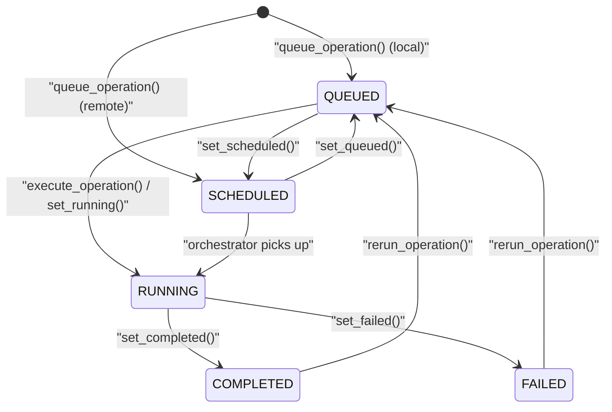
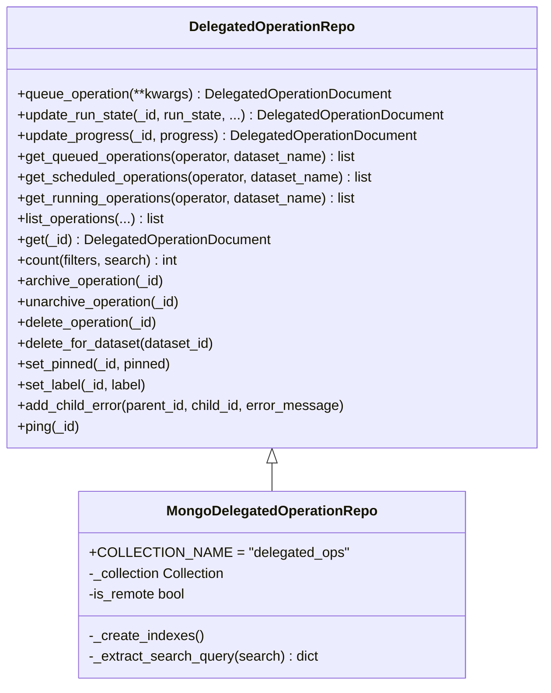
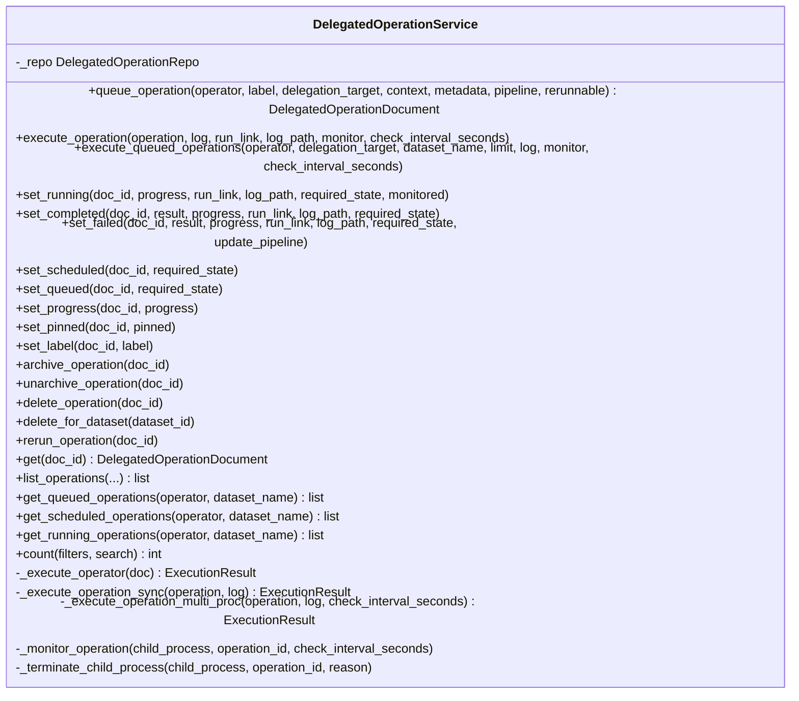
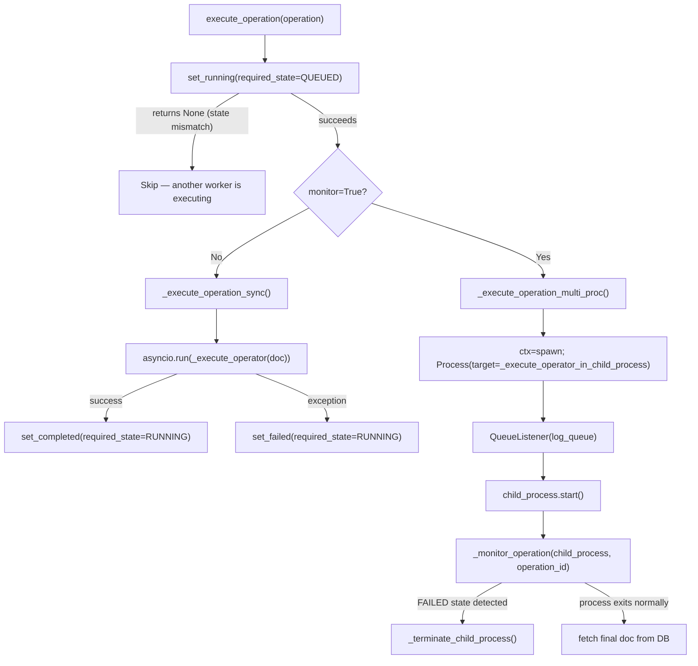
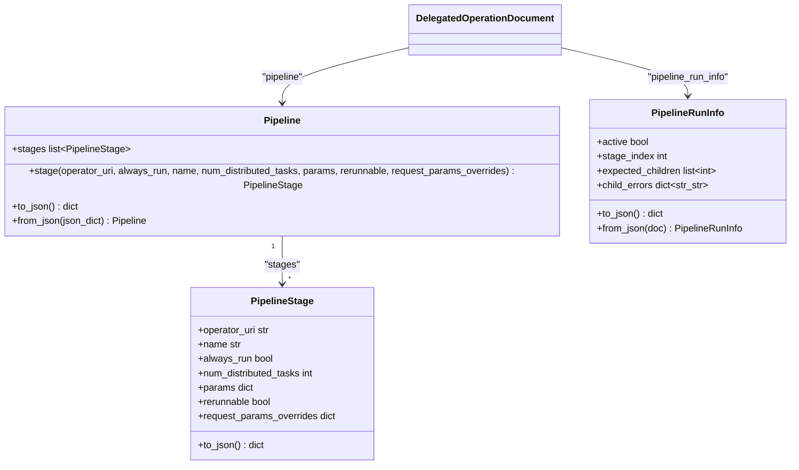
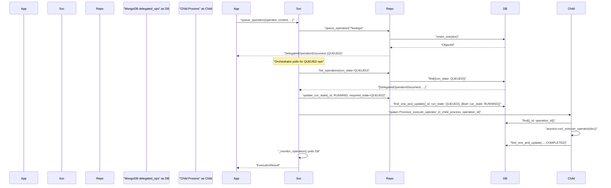

<!-- source: DeepWiki mcp.deepwiki.com · repo voxel51/fiftyone · page 9.2 Delegated Operations · fetched 2026-10-21 -->

# Delegated Operations

<details>
<summary>Relevant source files</summary>

The following files were used as context for generating this wiki page:

- [docs/source/images/plugins/operators/examples/operator-target-view.png](docs/source/images/plugins/operators/examples/operator-target-view.png)
- [fiftyone/factory/__init__.py](fiftyone/factory/__init__.py)
- [fiftyone/factory/repos/__init__.py](fiftyone/factory/repos/__init__.py)
- [fiftyone/factory/repos/delegated_operation.py](fiftyone/factory/repos/delegated_operation.py)
- [fiftyone/factory/repos/delegated_operation_doc.py](fiftyone/factory/repos/delegated_operation_doc.py)
- [fiftyone/operators/_types/__init__.py](fiftyone/operators/_types/__init__.py)
- [fiftyone/operators/_types/pipeline.py](fiftyone/operators/_types/pipeline.py)
- [fiftyone/operators/constants.py](fiftyone/operators/constants.py)
- [fiftyone/operators/delegated.py](fiftyone/operators/delegated.py)
- [tests/unittests/factory/delegated_operation_doc_tests.py](tests/unittests/factory/delegated_operation_doc_tests.py)
- [tests/unittests/operators/delegated_tests.py](tests/unittests/operators/delegated_tests.py)
- [tests/unittests/operators/executor_tests.py](tests/unittests/operators/executor_tests.py)
- [tests/unittests/operators/notification_service_tests.py](tests/unittests/operators/notification_service_tests.py)
- [tests/unittests/operators/target_view_tests.py](tests/unittests/operators/target_view_tests.py)
- [tests/unittests/operators/types_tests.py](tests/unittests/operators/types_tests.py)

</details>


Delegated operations are the mechanism by which FiftyOne operators are executed asynchronously, outside the request/response cycle of the main server. This page covers the queueing model, run state lifecycle, the `DelegatedOperationService` and its repository layer, the `Pipeline`/`PipelineStage` structures for multi-step workflows, and how operations are dispatched to child processes.

For information about how operators are defined, their type system, and how they are invoked synchronously from the App, see [Operator Framework](#9.1). For plugin discovery and how delegated operators are packaged and deployed, see [Plugin System and Development](#9.3).

---

## Overview

When a user triggers a long-running operation (e.g., running a model, computing embeddings), the operator framework queues it as a *delegated operation* rather than executing it inline. The operation is persisted to MongoDB and later picked up by an orchestrator process, which executes it in a child process and records the result.

The key components are:

| Component | Location | Role |
|---|---|---|
| `DelegatedOperationService` | `fiftyone/operators/delegated.py` | Service layer: queue, execute, manage state |
| `DelegatedOperationRepo` | `fiftyone/factory/repos/delegated_operation.py` | Abstract repository interface |
| `MongoDelegatedOperationRepo` | `fiftyone/factory/repos/delegated_operation.py` | MongoDB implementation |
| `DelegatedOperationDocument` | `fiftyone/factory/repos/delegated_operation_doc.py` | Document entity (ORM-like) |
| `Pipeline` / `PipelineStage` | `fiftyone/operators/_types/pipeline.py` | Multi-stage pipeline definition |
| `PipelineRunInfo` | `fiftyone/operators/_types/pipeline.py` | Mutable runtime state of a pipeline |
| `ExecutionRunState` | `fiftyone/operators/executor.py` | Lifecycle state enum |
| `DelegatedOperationPagingParams` | `fiftyone/factory/__init__.py` | Pagination/sorting for list queries |

---

## Run State Lifecycle

Every delegated operation has a `run_state` field tracking its progress through the following states:

**Lifecycle diagram for `ExecutionRunState`**



- **QUEUED**: Operation created locally, waiting to be executed.
- **SCHEDULED**: Operation created in a remote/cloud context; picked up by an external orchestrator.
- **RUNNING**: Execution has begun; `started_at` is set.
- **COMPLETED**: Execution succeeded; `completed_at` and `result` are set.
- **FAILED**: Execution errored; `failed_at` and `result.error` are set.

State transitions are enforced via the `required_state` parameter in `update_run_state`. If the document no longer matches `required_state` at update time, the update is skipped and `None` is returned—preventing double-execution when multiple workers are running.

Sources: [fiftyone/factory/repos/delegated_operation.py:330-438](), [fiftyone/factory/repos/delegated_operation_doc.py:42-66]()

---

## DelegatedOperationDocument

`DelegatedOperationDocument` ([fiftyone/factory/repos/delegated_operation_doc.py:23-175]()) is the entity class for a delegated operation stored in the `delegated_ops` MongoDB collection.

### Key fields

| Field | Type | Description |
|---|---|---|
| `id` | `ObjectId` | MongoDB document ID |
| `operator` | `str` | Operator URI (e.g. `@org/plugin/op_name`) |
| `label` | `str` | Human-readable label, defaults to operator URI |
| `delegation_target` | `str` | Routing key for selecting which orchestrator picks it up |
| `context` | `ExecutionContext` | Serialized execution context (request params, dataset info) |
| `run_state` | `ExecutionRunState` | Current lifecycle state |
| `dataset_id` | `ObjectId` | Associated dataset |
| `result` | `ExecutionResult` | Result or error after execution |
| `status` | `ExecutionProgress` | Optional progress indicator |
| `pipeline` | `Pipeline` | For pipeline operators: the stage definitions |
| `pipeline_run_info` | `PipelineRunInfo` | For pipeline operators: runtime execution state |
| `parent_id` | `ObjectId` | Set on child operations spawned by a pipeline |
| `pinned` | `bool` | Whether this operation is pinned in the UI |
| `archived` | `bool` | Whether archived (hidden by default from listings) |
| `rerunnable` | `bool` | Whether `rerun_operation()` is permitted |
| `monitored` | `bool` | Whether a monitoring subprocess is watching execution |
| `queued_at`, `started_at`, `completed_at`, `failed_at`, `scheduled_at`, `updated_at` | `datetime` | Timestamps for lifecycle stages |
| `run_link` | `str` | Optional URL to orchestrator-specific job information |
| `log_path` | `str` | Optional path to the execution log file |

Serialization is handled by `to_pymongo()` and `from_pymongo()`, which convert between the Python object and a raw MongoDB dict. The `context` field stores only `request_params` (not the full `ExecutionContext` object). `Pipeline` and `PipelineRunInfo` are serialized via their own `to_json()`/`from_json()` methods.

Sources: [fiftyone/factory/repos/delegated_operation_doc.py:23-176]()

---

## Repository Layer

**Class hierarchy for the repository**



`DelegatedOperationRepo` ([fiftyone/factory/repos/delegated_operation.py:31-168]()) defines the interface. `MongoDelegatedOperationRepo` ([fiftyone/factory/repos/delegated_operation.py:171-632]()) is the MongoDB implementation backed by the `delegated_ops` collection.

### Indexes

`MongoDelegatedOperationRepo._create_indexes()` ensures the following indexes exist on the collection:

| Index name | Fields |
|---|---|
| `operator_1` | `operator` (ASC) |
| `updated_at_1` | `updated_at` (ASC) |
| `run_state_1` | `run_state` (ASC) |
| `parent_id_1` | `parent_id` (ASC) |
| `dataset_id_1_parent_id_1_scheduled_at_1` | `dataset_id` (ASC), `parent_id` (ASC), `scheduled_at` (DESC) |

### Listing and paging

`list_operations()` accepts filters for `operator`, `dataset_name`, `dataset_id`, `run_state`, `delegation_target`, and `pinned`, plus an optional `DelegatedOperationPagingParams` object. If no paging is supplied, a default limit of 1000 is applied.

`DelegatedOperationPagingParams` ([fiftyone/factory/__init__.py:29-42]()) carries:
- `sort_by`: one of the `SortByField` constants (`updated_at`, `scheduled_at`, `queued_at`, `completed_at`, `started_at`, `failed_at`, `operator`)
- `sort_direction`: `SortDirection.ASCENDING` (1) or `SortDirection.DESCENDING` (-1)
- `skip` and `limit`

The `search` parameter allows regex search against the `operator`, `delegated_operation`, or `label` fields.

Sources: [fiftyone/factory/repos/delegated_operation.py:171-633](), [fiftyone/factory/__init__.py:1-42]()

---

## DelegatedOperationService

`DelegatedOperationService` ([fiftyone/operators/delegated.py:134-1006]()) is the primary interface used by the rest of FiftyOne to interact with delegated operations. It wraps the repo and adds orchestration logic for execution.

**Service method summary**



Sources: [fiftyone/operators/delegated.py:134-1006]()

---

## Queueing an Operation

`queue_operation()` delegates directly to `MongoDelegatedOperationRepo.queue_operation()`, which:

1. Creates a `DelegatedOperationDocument`.
2. Validates required fields: `operator`, `delegation_target`, `context`, `label`.
3. Resolves `dataset_id` from the `ExecutionContext.dataset` object.
4. Inserts the document and returns it with the assigned `id`.

The initial `run_state` depends on context:
- Local execution: `QUEUED`
- Remote/cloud service (detected by `is_remote_service()`): `SCHEDULED`

Sources: [fiftyone/factory/repos/delegated_operation.py:235-273](), [fiftyone/factory/repos/delegated_operation_doc.py:42-56]()

---

## Executing Operations

### execute_operation()

`execute_operation()` ([fiftyone/operators/delegated.py:652-726]()) is the entry point for running a single operation. It:

1. Calls `set_running()` with `required_state=QUEUED`. If the state no longer matches (another worker grabbed it), it returns `None` without executing.
2. Dispatches to either `_execute_operation_sync()` or `_execute_operation_multi_proc()` based on the `monitor` flag.

### Synchronous execution: `_execute_operation_sync()`

[fiftyone/operators/delegated.py:728-772]()

Runs the operator in the current process using `asyncio.run(self._execute_operator(doc))`. On success, calls `set_completed(required_state=RUNNING)`. On failure, calls `set_failed(required_state=RUNNING)`. The `required_state` guard ensures that externally-cancelled operations are not incorrectly marked.

### Multi-process execution: `_execute_operation_multi_proc()`

[fiftyone/operators/delegated.py:774-829]()

Spawns a child process using `multiprocessing.get_context("spawn")` to avoid inheriting any shared state. A `QueueListener` forwards the child's log records back to the parent's handlers.

The child process runs `_execute_operator_in_child_process()` ([fiftyone/operators/delegated.py:50-131]()), which:
1. Calls `os.setsid()` on POSIX to become session leader (enabling clean process tree termination).
2. Creates its own `DelegatedOperationService` instance.
3. Fetches the operation document from the database by ID.
4. Executes the operator and calls `set_completed()` or `set_failed()`.

The parent's `_monitor_operation()` ([fiftyone/operators/delegated.py:831-875]()) polls the database at `check_interval_seconds` intervals. If the operation's state is set to `FAILED` externally, the monitor terminates the child process tree using `psutil`.

**Execution dispatch flow**



Sources: [fiftyone/operators/delegated.py:652-875]()

### `_execute_operator()` — Core async executor

[fiftyone/operators/delegated.py:923-1006]()

This is the async coroutine that actually runs the operator logic. It:

1. Reads `operator_uri` and `context.request_params` from the document.
2. Builds a `PipelineExecutionContext` if the operation is a pipeline child (i.e., `doc.parent_id` is set).
3. Calls `prepare_operator_executor()` to load the operator and build an `ExecutionContext`.
4. If `doc.pipeline` is set, calls `do_execute_pipeline(doc.pipeline, ctx)`.
5. Otherwise, calls `do_execute_operator(operator, ctx, exhaust=True)`.
6. Resolves the output schema by calling `resolve_type_with_context(operator, ctx)` with `target="outputs"`.
7. Returns an `ExecutionResult`.

Sources: [fiftyone/operators/delegated.py:923-1006]()

---

## Pipeline Support

A `Pipeline` is an ordered sequence of `PipelineStage` objects. Pipelines allow chaining multiple operators in a single delegated operation. They are attached to a `DelegatedOperationDocument` via the `pipeline` field.

**Pipeline class diagram**



### PipelineStage fields

| Field | Type | Description |
|---|---|---|
| `operator_uri` | `str` | Required. The operator to invoke at this stage |
| `name` | `str` | Optional human-readable stage name |
| `always_run` | `bool` | If `True`, this stage runs even when a prior stage failed (`active=False`) |
| `num_distributed_tasks` | `int` | If set (≥1), this stage spawns N parallel child operations |
| `params` | `dict` | Parameters merged into the execution context |
| `rerunnable` | `bool` | Whether this stage is rerunnable; falls back to operator config |
| `request_params_overrides` | `dict` | Overrides for `ExecutionContext` fields like `view`, `view_name`, `filters` |

### PipelineRunInfo fields

`PipelineRunInfo` captures the mutable state of an in-progress pipeline run, stored alongside the parent operation document:

| Field | Description |
|---|---|
| `active` | `True` while all stages up to this point have succeeded |
| `stage_index` | Index of the currently-executing stage |
| `expected_children` | Per-stage count of expected child operations (for distributed tasks) |
| `child_errors` | `{child_op_id: error_message}` — populated by `add_child_error()` when a child fails |

When a child operation of a pipeline fails, `set_failed()` calls `_repo.add_child_error()` to record the error in the parent document's `pipeline_run_info.child_errors` map without marking the parent itself as failed.

Sources: [fiftyone/operators/_types/pipeline.py:1-260](), [fiftyone/factory/repos/delegated_operation.py:315-328]()

---

## execute_queued_operations()

`execute_queued_operations()` ([fiftyone/operators/delegated.py:587-638]()) is the batch-execution entry point used by orchestrators and the CLI. It:

1. Calls `list_operations(run_state=QUEUED, ...)` with optional filters and paging.
2. Iterates over each queued operation and calls `execute_operation()`.

```
service.execute_queued_operations(
    operator=None,          # filter by operator URI
    delegation_target=None, # filter by target
    dataset_name=None,      # filter by dataset
    limit=None,             # max operations to execute
    log=False,              # enable logging
    monitor=False,          # use subprocess with monitoring
    check_interval_seconds=60
)
```

Sources: [fiftyone/operators/delegated.py:587-638]()

---

## Rerunning Operations

`rerun_operation(doc_id)` ([fiftyone/operators/delegated.py:465-485]()) creates a new queued operation from the same parameters as an existing one. Constraints:

- The operation must have `rerunnable=True`.
- Pipeline child operations (`parent_id` is set) cannot be re-run individually; rerun the parent instead.

Sources: [fiftyone/operators/delegated.py:465-485]()

---

## State Update Guards

All `set_*` methods expose a `required_state` parameter. When supplied, the MongoDB update filter includes a `run_state` condition:

```python
collection_filter = {"_id": _id}
if required_state is not None:
    collection_filter["run_state"] = required_state
```

If the document does not match `required_state`, the update returns `None`. This prevents race conditions when multiple workers or the monitoring process attempt concurrent state transitions.

Sources: [fiftyone/factory/repos/delegated_operation.py:424-438]()

---

## Logging in Child Processes

When `monitor=True`, `_execute_operation_multi_proc()` sets up cross-process logging:

1. A `multiprocessing.Queue` (`log_queue`) is created.
2. A `logging.handlers.QueueListener` in the parent forwards records from the queue to the parent's handlers.
3. `_configure_child_logging()` ([fiftyone/operators/delegated.py:37-47]()) clears the child's `fiftyone` logger handlers and installs a `QueueHandler` pointing at `log_queue`.

This ensures all child-process log output appears in the parent's log stream.

Sources: [fiftyone/operators/delegated.py:37-47](), [fiftyone/operators/delegated.py:774-829]()

---

## Data Flow: Queue to Completion

**End-to-end data flow**



Sources: [fiftyone/operators/delegated.py:587-829](), [fiftyone/factory/repos/delegated_operation.py:235-273](), [fiftyone/factory/repos/delegated_operation.py:330-438]()

---

## CLI and RepositoryFactory Integration

The `RepositoryFactory.delegated_operation_repo()` ([fiftyone/factory/repo_factory.py]()) is the factory method that returns the appropriate `DelegatedOperationRepo` implementation. `DelegatedOperationService.__init__()` calls this when no repo is injected, making the service usable without explicit wiring.

The `fiftyone delegated` CLI subcommand (see [Command Line Interface](#10)) drives `execute_queued_operations()` and related service methods for standalone orchestrator processes.

Sources: [fiftyone/operators/delegated.py:137-141]()

---

