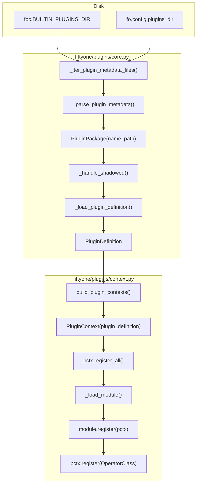
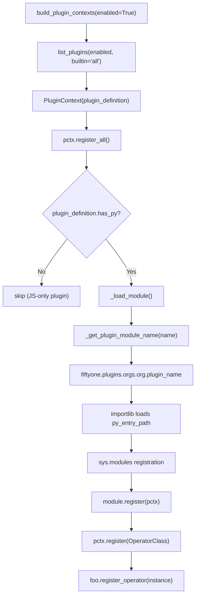
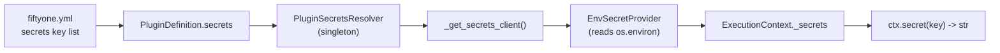

<!-- source: DeepWiki mcp.deepwiki.com · repo voxel51/fiftyone · page 9.3 Plugin System and Development · fetched 2026-10-21 -->

# Plugin System and Development

<details>
<summary>Relevant source files</summary>

The following files were used as context for generating this wiki page:

- [.gitignore](.gitignore)
- [docs/scripts/generate_plugin_docs.py](docs/scripts/generate_plugin_docs.py)
- [docs/source/cli/index.rst](docs/source/cli/index.rst)
- [docs/source/images/plugins/operators/runs/logs_configure_not_setup.png](docs/source/images/plugins/operators/runs/logs_configure_not_setup.png)
- [docs/source/images/plugins/operators/runs/logs_download_preview_pane.png](docs/source/images/plugins/operators/runs/logs_download_preview_pane.png)
- [docs/source/images/plugins/operators/runs/logs_download_runs_list_kebab.png](docs/source/images/plugins/operators/runs/logs_download_runs_list_kebab.png)
- [docs/source/images/plugins/operators/runs/logs_general.png](docs/source/images/plugins/operators/runs/logs_general.png)
- [docs/source/images/plugins/operators/runs/logs_general_with_columns.png](docs/source/images/plugins/operators/runs/logs_general_with_columns.png)
- [docs/source/integrations/albumentations.rst](docs/source/integrations/albumentations.rst)
- [docs/source/plugins/developing_plugins.rst](docs/source/plugins/developing_plugins.rst)
- [docs/source/plugins/index.rst](docs/source/plugins/index.rst)
- [docs/source/plugins/overview.rst](docs/source/plugins/overview.rst)
- [docs/source/plugins/using_plugins.rst](docs/source/plugins/using_plugins.rst)
- [fiftyone/core/cli.py](fiftyone/core/cli.py)
- [fiftyone/internal/__init__.py](fiftyone/internal/__init__.py)
- [fiftyone/internal/secrets/__init__.py](fiftyone/internal/secrets/__init__.py)
- [fiftyone/internal/secrets/providers/__init__.py](fiftyone/internal/secrets/providers/__init__.py)
- [fiftyone/internal/secrets/providers/iprovider.py](fiftyone/internal/secrets/providers/iprovider.py)
- [fiftyone/internal/secrets/providers/local.py](fiftyone/internal/secrets/providers/local.py)
- [fiftyone/internal/util.py](fiftyone/internal/util.py)
- [fiftyone/plugins/__init__.py](fiftyone/plugins/__init__.py)
- [fiftyone/plugins/context.py](fiftyone/plugins/context.py)
- [fiftyone/plugins/core.py](fiftyone/plugins/core.py)
- [fiftyone/plugins/definitions.py](fiftyone/plugins/definitions.py)
- [fiftyone/plugins/secrets.py](fiftyone/plugins/secrets.py)
- [fiftyone/plugins/utils.py](fiftyone/plugins/utils.py)
- [fiftyone/utils/github.py](fiftyone/utils/github.py)
- [fiftyone/utils/quickstart.py](fiftyone/utils/quickstart.py)
- [tests/unittests/plugins/context_tests.py](tests/unittests/plugins/context_tests.py)
- [tests/unittests/plugins/core_tests.py](tests/unittests/plugins/core_tests.py)
- [tests/unittests/plugins/secrets_tests.py](tests/unittests/plugins/secrets_tests.py)
- [tests/unittests/secrets/provider_tests.py](tests/unittests/secrets/provider_tests.py)

</details>


## Purpose and Scope

This page covers FiftyOne's plugin system: how plugins are discovered on disk, the `fiftyone.yml` metadata format, how Python and JavaScript plugin code is loaded and registered, how enabling and disabling works, and how secrets are injected at runtime. It also describes the development contract for building custom plugins with operators, panels, and components.

For documentation on the **Operator** base class, `ExecutionContext`, and the operator execution pipeline, see [9.1](#9.1). For **delegated (async) operations**, see [9.2](#9.2).

---

## Architecture Overview

**Plugin System: End-to-End Data Flow**



Sources: [fiftyone/plugins/core.py:53-85](), [fiftyone/plugins/context.py:113-165]()

---

## Plugin Directory Layout

FiftyOne discovers plugins by walking two root directories:

| Directory | Description |
|---|---|
| `fpc.BUILTIN_PLUGINS_DIR` | Built-in plugins shipped with FiftyOne (`fiftyone/plugins/constants.py`) |
| `fo.config.plugins_dir` | User plugins directory; defaults to `~/fiftyone/__plugins__`; overridable via `FIFTYONE_PLUGINS_DIR` |

A typical plugins directory layout:

```
~/fiftyone/__plugins__/
    my-py-plugin/
        fiftyone.yml
        __init__.py
        requirements.txt
    my-js-plugin/
        fiftyone.yml
        package.json
        dist/
            index.umd.js
```

Both Python-only and JS-only plugins, as well as combined Python+JS plugins, are supported. The only file unconditionally required is `fiftyone.yml`.

Sources: [fiftyone/plugins/core.py:31-32](), [fiftyone/plugins/definitions.py:48-51]()

---

## Plugin Discovery

### Discovery Algorithm

The function `_iter_plugin_metadata_files(root_dir)` in `fiftyone/plugins/core.py` performs the actual scan:

1. `os.walk` the root directory, skipping hidden directories.
2. For each directory, look for a file named `fiftyone.yml` or `fiftyone.yaml` (the tuple `PLUGIN_METADATA_FILENAMES`).
3. When a metadata file is found, yield its path and **stop descending** into the current directory (so nested plugins in sub-subdirectories require a separate root).
4. In **strict mode** (used during downloads), the YAML's `type` field must be `"plugin"` or absent.

Builtins are scanned first so that if a user plugin and a builtin share a name, the builtin takes precedence via the shadowing logic.

Sources: [fiftyone/plugins/core.py:579-668]()

### Shadowing

If two plugins have the same `name` value in their `fiftyone.yml`, the first one encountered is active and the second is "shadowed." The `_handle_shadowed()` function collects the paths of shadowed duplicates into `PluginPackage.shadow_paths`, which propagates to `PluginDefinition.shadow_paths`. The `list_plugins(shadowed="all")` call returns both the active and shadowed entries.

Sources: [fiftyone/plugins/core.py:614-633]()

---

## `fiftyone.yml` Metadata Format

Every plugin must contain a `fiftyone.yml` (or `fiftyone.yaml`) file in its root directory. The supported fields are:

| Field | Required | Description |
|---|---|---|
| `name` | **Yes** | Plugin name, conventionally `@org/plugin-name` |
| `type` | No | Should be `"plugin"` (omit for backward compat) |
| `author` | No | Author string |
| `version` | No | Plugin version string |
| `url` | No | Remote source URL (GitHub repo, etc.) |
| `license` | No | License name (e.g., `Apache 2.0`) |
| `description` | No | Short description of the plugin |
| `fiftyone.version` | No | Semver specifier for required FiftyOne version (e.g., `">=0.22"` or `"*"`) |
| `operators` | No | List of operator names exposed by the plugin |
| `panels` | No | List of panel names exposed by the plugin |
| `secrets` | No | List of secret key names the plugin may use |

**Example** (`@voxel51/annotation`):

```yaml
name: "@voxel51/annotation"
type: plugin
author: Voxel51
version: 1.0.0
url: https://github.com/voxel51/fiftyone-plugins/...
license: Apache 2.0
description: Utilities for integrating FiftyOne with annotation tools
fiftyone:
  version: ">=0.22"
operators:
  - request_annotations
  - load_annotations
secrets:
  - FIFTYONE_CVAT_URL
  - FIFTYONE_CVAT_USERNAME
```

Sources: [fiftyone/plugins/definitions.py:20-268](), [docs/source/plugins/developing_plugins.rst:199-263]()

---

## `PluginDefinition` Class

`PluginDefinition` in `fiftyone/plugins/definitions.py` is the runtime representation of parsed `fiftyone.yml` metadata.

**Key Properties**

| Property | Type | Description |
|---|---|---|
| `name` | `str` | Plugin name from YAML |
| `directory` | `str` | Absolute path to plugin root |
| `builtin` | `bool` | `True` if directory is under `BUILTIN_PLUGINS_DIR` |
| `author`, `version`, `url`, `license`, `description` | `str` | Metadata fields |
| `fiftyone_compatibility` | `str` | Raw version spec from `fiftyone.version` |
| `fiftyone_requirement` | `str` | Normalized requirement string, e.g. `fiftyone>=0.22` |
| `operators` | `list[str]` | Merged list of `operators` + `panels` from YAML |
| `py_entry` | `str` | Python entry filename; defaults to `__init__.py` |
| `py_entry_path` | `str` | Absolute path to Python entry file |
| `has_py` | `bool` | `True` if `py_entry_path` exists on disk |
| `js_bundle` | `str` | Relative path to JS bundle; resolved from YAML → `package.json` → `dist/index.umd.js` |
| `js_bundle_path` | `str` | Absolute path to JS bundle |
| `has_js` | `bool` | `True` if `js_bundle_path` exists on disk |
| `js_bundle_server_path` | `str` | URL path under which the bundle is served |
| `server_path` | `str` | URL prefix for all plugin assets (e.g. `/plugins/my-plugin`) |
| `secrets` | `list[str]` | Secret key names declared in YAML |
| `shadow_paths` | `list[str]` | Paths of duplicate-named plugins that this one shadows |

`PluginDefinition.from_disk(metadata_path)` is the standard constructor — it reads the YAML file at `metadata_path` and instantiates the class.

The `can_register_operator(name)` method returns `True` if the plugin has Python and `name` appears in its `operators` list. This guard is checked before calling `register()`.

Sources: [fiftyone/plugins/definitions.py:20-268]()

---

## Plugin Loading and Registration

**Plugin Registration Flow**



Sources: [fiftyone/plugins/context.py:113-165]()

### `PluginContext`

`PluginContext` in `fiftyone/plugins/context.py` is the runtime container for a loaded plugin.

- `build_plugin_contexts(enabled=True)` — top-level entry point; returns a list of `PluginContext` instances; decorated with `@plugins_cache` so the result is cached per process.
- `pctx.register_all()` — loads the Python module from `py_entry_path`, calls `module.register(pctx)`.
- `pctx.register(OperatorClass)` — called by the plugin's `register()` function; dispatches to the operator registry.
- `pctx.instances` — list of registered operator instances.
- `pctx.errors` — list of any errors encountered during registration.

### Synthetic Module Naming

`_get_plugin_module_name(plugin_name)` converts a plugin name like `@voxel51/annotation` to a Python module name `fiftyone.plugins.orgs.voxel51.annotation`. This module is registered in `sys.modules`, enabling multi-file plugins to use absolute imports:

```python
# Inside a multi-file plugin named @myorg/myplugin
from fiftyone.plugins.orgs.myorg.myplugin.utils import helper_fn
```

`_ensure_parent_modules()` creates the necessary namespace package entries in `sys.modules` to make this work.

Sources: [fiftyone/plugins/context.py:27-130]()

### The `register()` Contract

Every Python plugin's `__init__.py` must define a module-level `register(p)` function. The argument `p` is the `PluginContext` for the plugin. Inside `register()`, call `p.register(MyOperator)` for each operator or panel class:

```python
# __init__.py
import fiftyone.operators as foo
import fiftyone.operators.types as types

class MyOperator(foo.Operator):
    @property
    def config(self):
        return foo.OperatorConfig(name="my_operator", label="My Operator")

    def execute(self, ctx):
        return {}

def register(p):
    p.register(MyOperator)
```

The operator URI is automatically constructed as `@plugin-name/operator-name`, e.g., `@myorg/myplugin/my_operator`.

Sources: [docs/source/plugins/developing_plugins.rst:670-750]()

---

## Enable/Disable Mechanism

Plugin enablement state is stored in the FiftyOne App config JSON (default path: `~/.fiftyone/app_config.json`, overridable via `FIFTYONE_APP_CONFIG_PATH`).

**Stored format:**
```json
{
    "plugins": {
        "@voxel51/zoo": {
            "enabled": false
        }
    }
}
```

| Function | Effect |
|---|---|
| `enable_plugin(name)` | Removes or sets `enabled: true` for the plugin entry |
| `disable_plugin(name)` | Sets `enabled: false` for the plugin entry |
| `_list_disabled_plugins()` | Reads app config and returns names where `enabled == false` |

`_list_plugins(enabled=True)` filters out any plugin whose name appears in `_list_disabled_plugins()`.

**Constraints:**
- Builtin plugins (those under `fpc.BUILTIN_PLUGINS_DIR`) cannot be enabled or disabled — calling either function on a builtin raises `ValueError`.
- Disabling a plugin causes its operators to disappear from the App's operator browser.

Sources: [fiftyone/plugins/core.py:88-173]()

---

## Secrets Management

**Secrets Injection Pipeline**



Sources: [fiftyone/plugins/secrets.py](), [fiftyone/internal/secrets/providers/local.py]()

### `PluginSecretsResolver`

`PluginSecretsResolver` in `fiftyone/plugins/secrets.py` is a singleton that manages secret lookups for plugin operators.

- `register_operator(operator_uri, required_secrets)` — called during operator registration to record which secrets an operator may access.
- `get_secret(key, operator_uri)` / `get_secret_sync(key, operator_uri)` — validates that `key` is in the registered secrets for `operator_uri`, then delegates to the underlying `ISecretProvider`.
- `get_multiple(keys, operator_uri)` — batch lookup.
- `_validate_keys(keys, operator_uri)` — guard that prevents operators from accessing secrets not declared in their plugin's `fiftyone.yml`.

### `ISecretProvider` / `EnvSecretProvider`

`ISecretProvider` in `fiftyone/internal/secrets/providers/iprovider.py` defines the abstract interface: `get(key)`, `get_sync(key)`, `get_multiple(keys)`, `search(regex)`.

`EnvSecretProvider` in `fiftyone/internal/secrets/providers/local.py` is the default implementation; it reads from `os.environ` and returns `UnencryptedSecret(key, value)` instances.

Secrets declared in `fiftyone.yml` under the `secrets` key are resolved before operator execution and injected into `ExecutionContext._secrets`. Access them in operators via:

```python
def execute(self, ctx):
    api_key = ctx.secret("MY_API_KEY")
```

Sources: [fiftyone/plugins/secrets.py](), [fiftyone/internal/secrets/providers/local.py](), [fiftyone/internal/secrets/providers/iprovider.py]()

---

## CLI Reference

FiftyOne exposes plugin management through the `fiftyone plugins` and `fiftyone operators` subcommands.

### `fiftyone plugins` Commands

| Subcommand | Description |
|---|---|
| `fiftyone plugins list` | List locally available plugins with version, enabled status, directory |
| `fiftyone plugins list --enabled` | List only enabled plugins |
| `fiftyone plugins list --disabled` | List only disabled plugins |
| `fiftyone plugins info <name>` | Print all metadata for a specific plugin |
| `fiftyone plugins download <url>` | Download plugin(s) from GitHub URL or `user/repo[/ref]` |
| `fiftyone plugins download <url> --plugin-names <n1> <n2>` | Download specific plugins from a multi-plugin repo |
| `fiftyone plugins create <name>` | Scaffold a new plugin directory with `fiftyone.yml` |
| `fiftyone plugins delete <name>` | Delete a plugin from disk |
| `fiftyone plugins enable <name>` | Enable a plugin |
| `fiftyone plugins disable <name>` | Disable a plugin |
| `fiftyone plugins requirements <name> --print` | Print `requirements.txt` for a plugin |
| `fiftyone plugins requirements <name> --install` | Install plugin Python requirements |
| `fiftyone plugins requirements <name> --ensure` | Verify requirements are satisfied |

### `fiftyone operators` Commands

| Subcommand | Description |
|---|---|
| `fiftyone operators list` | List all operators and panels |
| `fiftyone operators list --enabled` | List enabled operators |
| `fiftyone operators list --panels-only` | List only panel operators |
| `fiftyone operators info <uri>` | Print metadata for a specific operator URI |

Sources: [fiftyone/core/cli.py:101-104](), [docs/source/cli/index.rst:813-923]()

---

## Python API Reference

Functions exported from `fiftyone/plugins/__init__.py`:

| Function | Description |
|---|---|
| `list_plugins(enabled, builtin, shadowed)` | Returns list of `PluginDefinition` instances |
| `get_plugin(name)` | Returns `PluginDefinition` for a named plugin |
| `find_plugin(name)` | Returns the filesystem path to a plugin directory |
| `download_plugin(url_or_gh_repo, plugin_names, overwrite)` | Downloads plugin(s) from GitHub |
| `create_plugin(plugin_name, from_files, outdir, ...)` | Creates a plugin directory with `fiftyone.yml` |
| `enable_plugin(plugin_name)` | Enables a plugin in app config |
| `disable_plugin(plugin_name)` | Disables a plugin in app config |
| `delete_plugin(plugin_name)` | Deletes plugin from disk |
| `list_downloaded_plugins()` | Returns names of all non-builtin plugins |
| `list_enabled_plugins()` | Returns names of enabled non-builtin plugins |
| `list_disabled_plugins()` | Returns names of disabled plugins |
| `load_plugin_requirements(plugin_name)` | Returns `requirements.txt` contents |
| `install_plugin_requirements(plugin_name)` | Runs `pip install` for plugin requirements |
| `ensure_plugin_requirements(plugin_name)` | Checks requirements are satisfied |
| `ensure_plugin_compatibility(plugin_name)` | Checks `fiftyone.version` compatibility |

Sources: [fiftyone/plugins/__init__.py](), [fiftyone/plugins/core.py:53-559]()

---

## Developing Python Plugins

### Minimal File Structure

```
my-plugin/
    fiftyone.yml       # required
    __init__.py        # required for Python plugins
    requirements.txt   # optional
```

### Python Operators

A Python operator subclasses `fiftyone.operators.Operator`. The `config` property returns an `OperatorConfig`, and the `execute(ctx)` method performs the operation:

```python
import fiftyone.operators as foo
import fiftyone.operators.types as types

class MyOperator(foo.Operator):
    @property
    def config(self):
        return foo.OperatorConfig(
            name="my_operator",
            label="My Operator",
            dynamic=True,
        )

    def resolve_input(self, ctx):
        inputs = types.Object()
        inputs.str("message", label="Message", required=True)
        return types.Property(inputs)

    def execute(self, ctx):
        return {"message": ctx.params["message"]}

    def resolve_output(self, ctx):
        outputs = types.Object()
        outputs.str("message", label="Output")
        return types.Property(outputs)

def register(p):
    p.register(MyOperator)
```

The operator name must also be listed under `operators` in `fiftyone.yml`.

Sources: [docs/source/plugins/developing_plugins.rst:520-566]()

### Python Panels

A Python panel subclasses `fiftyone.operators.Panel`. It renders its UI by returning a `types.Property` from `render(ctx)`:

```python
import fiftyone.operators as foo
import fiftyone.operators.types as types

class MyPanel(foo.Panel):
    @property
    def config(self):
        return foo.PanelConfig(name="my_panel", label="My Panel")

    def on_load(self, ctx):
        ctx.panel.state.greeting = "Hello!"

    def render(self, ctx):
        panel = types.Object()
        panel.btn("greet_btn", label="Greet", on_click=self.on_greet)
        return types.Property(panel, view=types.GridView())

    def on_greet(self, ctx):
        ctx.ops.notify(ctx.panel.state.greeting)

def register(p):
    p.register(MyPanel)
```

The panel name must be listed under `panels` in `fiftyone.yml`.

Sources: [docs/source/plugins/developing_plugins.rst:567-623]()

### Multi-File Plugins

For plugins with multiple Python files, import submodules using the synthetic module name `fiftyone.plugins.orgs.<org>.<plugin>.<submodule>`, e.g.:

```python
from fiftyone.plugins.orgs.myorg.myplugin import utils
```

This works because `_ensure_parent_modules()` registers the plugin directory as a namespace package path.

Sources: [fiftyone/plugins/context.py:88-111]()

---

## Developing JavaScript Plugins

JS plugins are distributed as a compiled UMD bundle (`dist/index.umd.js` by default) and use the `@fiftyone/plugins` and `@fiftyone/operators` packages.

### JS Bundle Discovery

`PluginDefinition.js_bundle` resolves in order:

1. `js_bundle` field in `fiftyone.yml`
2. `fiftyone.script` field in `package.json`
3. Falls back to `dist/index.umd.js`

The bundle is served at `PluginDefinition.js_bundle_server_path` (e.g., `/plugins/my-plugin/dist/index.umd.js`). The bundle hash (`js_bundle_hash`) is computed from the file's SHA-1 and used for cache busting.

Sources: [fiftyone/plugins/definitions.py:119-179]()

### Registering JS Panels

Use `registerComponent` from `@fiftyone/plugins`:

```typescript
import { registerComponent, PluginComponentType } from "@fiftyone/plugins";
import { MyPanel } from "./MyPanel";

registerComponent({
    name: "MyPanel",
    label: "My Panel",
    component: MyPanel,
    type: PluginComponentType.Panel,
    activator: ({ dataset }) => true,
});
```

### Registering JS Operators

Use `registerOperator` from `@fiftyone/operators`:

```typescript
import { Operator, OperatorConfig, registerOperator } from "@fiftyone/operators";

const PLUGIN_NAME = "@myorg/myplugin";

class MyJSOperator extends Operator {
    get config(): OperatorConfig {
        return new OperatorConfig({
            name: "my_js_operator",
            label: "My JS Operator",
            unlisted: true,
        });
    }
    useHooks() {
        return { setSelected: fos.useSetSelected() };
    }
    async execute({ hooks, params }) {
        hooks.setSelected(params.samples);
    }
}

registerOperator(MyJSOperator, PLUGIN_NAME);
```

The `useHooks()` method can return any React hook values; they are available as `ctx.hooks` inside `execute()`. Marking an operator `unlisted: true` hides it from the operator browser UI.

Sources: [docs/source/plugins/developing_plugins.rst:630-670]()

---

## Plugin Downloading

`download_plugin(url_or_gh_repo, plugin_names, overwrite)` in `core.py` orchestrates GitHub-based plugin installation:

1. Accepts a GitHub URL, `user/repo[/ref]` string, or archive URL.
2. Uses `GitHubRepository` (`fiftyone/utils/github.py`) to download the repo ZIP to a temp directory.
3. Searches the extracted archive for `fiftyone.yml` files via `_iter_plugin_metadata_files(root_dir, strict=True)`.
4. Copies each found plugin directory to `fo.config.plugins_dir`.

For private repositories, set the `GITHUB_TOKEN` environment variable to a personal access token.

`fiftyone.plugins.utils` provides additional utilities for browsing the FiftyOne plugin ecosystem: `list_zoo_plugins()` scrapes the `voxel51/fiftyone-plugins` README, and `find_plugins(gh_repo)` lists all `fiftyone.yml` paths in any GitHub repository.

Sources: [fiftyone/plugins/core.py:206-330](), [fiftyone/plugins/utils.py:23-137](), [fiftyone/utils/github.py:20-250]()

---

