# Page: Overview

# Overview

<details>
<summary>Relevant source files</summary>

The following files were used as context for generating this wiki page:

- [README.md](README.md)
- [app/README.md](app/README.md)
- [docs/source/_includes/substitutions.rst](docs/source/_includes/substitutions.rst)
- [docs/source/_static/images/tutorials/pandas_tutorial.png](docs/source/_static/images/tutorials/pandas_tutorial.png)
- [docs/source/_static/images/tutorials/small_object_detection.jpg](docs/source/_static/images/tutorials/small_object_detection.jpg)
- [docs/source/cheat_sheets/fiftyone_terminology.rst](docs/source/cheat_sheets/fiftyone_terminology.rst)
- [docs/source/cheat_sheets/filtering_cheat_sheet.rst](docs/source/cheat_sheets/filtering_cheat_sheet.rst)
- [docs/source/cheat_sheets/index.rst](docs/source/cheat_sheets/index.rst)
- [docs/source/cheat_sheets/pandas_vs_fiftyone.rst](docs/source/cheat_sheets/pandas_vs_fiftyone.rst)
- [docs/source/cheat_sheets/views_cheat_sheet.rst](docs/source/cheat_sheets/views_cheat_sheet.rst)
- [docs/source/faq/index.rst](docs/source/faq/index.rst)
- [docs/source/index.rst](docs/source/index.rst)
- [docs/source/integrations/index.rst](docs/source/integrations/index.rst)
- [docs/source/recipes/index.rst](docs/source/recipes/index.rst)
- [docs/source/recipes/remove_duplicate_annos.ipynb](docs/source/recipes/remove_duplicate_annos.ipynb)
- [docs/source/release-notes.rst](docs/source/release-notes.rst)
- [docs/source/tutorials/cosmos-transfer-integration.ipynb](docs/source/tutorials/cosmos-transfer-integration.ipynb)
- [docs/source/tutorials/gemini_vision.ipynb](docs/source/tutorials/gemini_vision.ipynb)
- [docs/source/tutorials/image_embeddings.ipynb](docs/source/tutorials/image_embeddings.ipynb)
- [docs/source/tutorials/images/sahi_base_model.gif](docs/source/tutorials/images/sahi_base_model.gif)
- [docs/source/tutorials/images/sahi_base_model_predictions_filtered.jpg](docs/source/tutorials/images/sahi_base_model_predictions_filtered.jpg)
- [docs/source/tutorials/images/sahi_dataset.jpg](docs/source/tutorials/images/sahi_dataset.jpg)
- [docs/source/tutorials/images/sahi_high_conf_fp_view.jpg](docs/source/tutorials/images/sahi_high_conf_fp_view.jpg)
- [docs/source/tutorials/images/sahi_slices.gif](docs/source/tutorials/images/sahi_slices.gif)
- [docs/source/tutorials/images/sahi_small_boxes_view.gif](docs/source/tutorials/images/sahi_small_boxes_view.gif)
- [docs/source/tutorials/index.rst](docs/source/tutorials/index.rst)
- [docs/source/tutorials/open_images.ipynb](docs/source/tutorials/open_images.ipynb)
- [docs/source/tutorials/pandas_comparison.ipynb](docs/source/tutorials/pandas_comparison.ipynb)
- [docs/source/tutorials/small_object_detection.ipynb](docs/source/tutorials/small_object_detection.ipynb)
- [docs/source/user_guide/app.rst](docs/source/user_guide/app.rst)
- [docs/source/user_guide/basics.rst](docs/source/user_guide/basics.rst)
- [docs/source/user_guide/config.rst](docs/source/user_guide/config.rst)
- [docs/source/user_guide/evaluation.rst](docs/source/user_guide/evaluation.rst)
- [docs/source/user_guide/index.rst](docs/source/user_guide/index.rst)
- [docs/source/user_guide/plots.rst](docs/source/user_guide/plots.rst)
- [docs/source/user_guide/using_aggregations.rst](docs/source/user_guide/using_aggregations.rst)
- [docs/source/user_guide/using_datasets.rst](docs/source/user_guide/using_datasets.rst)
- [docs/source/user_guide/using_views.rst](docs/source/user_guide/using_views.rst)
- [fiftyone/__public__.py](fiftyone/__public__.py)
- [fiftyone/core/aggregations.py](fiftyone/core/aggregations.py)
- [fiftyone/core/clips.py](fiftyone/core/clips.py)
- [fiftyone/core/collections.py](fiftyone/core/collections.py)
- [fiftyone/core/config.py](fiftyone/core/config.py)
- [fiftyone/core/dataset.py](fiftyone/core/dataset.py)
- [fiftyone/core/document.py](fiftyone/core/document.py)
- [fiftyone/core/expressions.py](fiftyone/core/expressions.py)
- [fiftyone/core/fields.py](fiftyone/core/fields.py)
- [fiftyone/core/frame.py](fiftyone/core/frame.py)
- [fiftyone/core/labels.py](fiftyone/core/labels.py)
- [fiftyone/core/odm/dataset.py](fiftyone/core/odm/dataset.py)
- [fiftyone/core/odm/document.py](fiftyone/core/odm/document.py)
- [fiftyone/core/odm/embedded_document.py](fiftyone/core/odm/embedded_document.py)
- [fiftyone/core/odm/mixins.py](fiftyone/core/odm/mixins.py)
- [fiftyone/core/odm/sample.py](fiftyone/core/odm/sample.py)
- [fiftyone/core/odm/utils.py](fiftyone/core/odm/utils.py)
- [fiftyone/core/patches.py](fiftyone/core/patches.py)
- [fiftyone/core/sample.py](fiftyone/core/sample.py)
- [fiftyone/core/stages.py](fiftyone/core/stages.py)
- [fiftyone/core/video.py](fiftyone/core/video.py)
- [fiftyone/core/view.py](fiftyone/core/view.py)
- [install.bat](install.bat)
- [tests/unittests/aggregation_tests.py](tests/unittests/aggregation_tests.py)
- [tests/unittests/dataset_tests.py](tests/unittests/dataset_tests.py)
- [tests/unittests/odm_tests.py](tests/unittests/odm_tests.py)
- [tests/unittests/patches_tests.py](tests/unittests/patches_tests.py)
- [tests/unittests/video_tests.py](tests/unittests/video_tests.py)
- [tests/unittests/view_tests.py](tests/unittests/view_tests.py)

</details>


FiftyOne is an open-source tool for building high-quality datasets and computer vision models. It provides a platform for dataset management, model evaluation, and data visualization through a Python library and an interactive web application.

The public Python API is defined in [fiftyone/__public__.py](), which is re-exported as the `fiftyone` top-level package (`import fiftyone as fo`). The system architecture centers around the `Dataset` class in `fiftyone.core.dataset`, backed by MongoDB via a mongoengine ODM layer. A Starlette/Strawberry GraphQL server (`fiftyone.server`) provides APIs for a React frontend. The platform supports multiple media types (`image`, `video`, `3d`, `point-cloud`, `group`), a wide range of annotation formats, and integrates with ML frameworks via the Model Zoo and `apply_model`.

This overview covers the high-level architecture, core components, and data flow patterns. For detailed information about specific subsystems, see:

| Section | Topic |
|---------|-------|
| [Core Data Model](#2) | Dataset, Sample, View, Labels, ODM layer |
| [Server Architecture](#3) | Starlette server, GraphQL API, session management |
| [Frontend Architecture](#4) | React app, Looker viewer, 3D visualization, state management |
| [Data Processing and I/O](#5) | Import/export formats, Dataset Zoo |
| [Model Integration and Evaluation](#6) | Model Zoo, `apply_model`, evaluation framework |
| [Extensibility Framework](#9) | Operators, delegated ops, plugin system |
| [Command Line Interface](#10) | `fiftyone` CLI commands |

## System Architecture

FiftyOne's architecture is organized around several key subsystems that work together to provide comprehensive dataset management capabilities:

## FiftyOne System Architecture

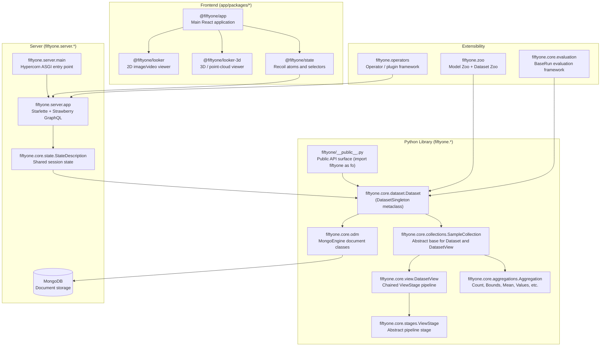

Sources: [fiftyone/__public__.py:1-50](), [fiftyone/core/dataset.py:271-310](), [fiftyone/core/collections.py:329-340](), [fiftyone/core/view.py:33-61](), [fiftyone/core/stages.py:48-58](), [fiftyone/core/aggregations.py:35-58]()

## Core Data Model

The foundation of FiftyOne is built around the `Dataset` class and its associated data structures. `Dataset` uses the `DatasetSingleton` metaclass so that all calls with the same dataset name in a process return the same Python object.

## Core Data Model Architecture

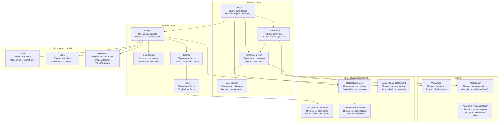

Sources: [fiftyone/core/dataset.py:271-310](), [fiftyone/core/collections.py:329-340](), [fiftyone/core/sample.py:44-100](), [fiftyone/core/view.py:33-61](), [fiftyone/core/stages.py:48-58](), [fiftyone/core/aggregations.py:35-58](), [fiftyone/core/labels.py:50-60](), [fiftyone/core/odm/sample.py:73-127](), [fiftyone/core/odm/dataset.py:58-80]()

## Server and API Architecture

The server layer provides GraphQL endpoints for frontend communication and state management. It is started via `fo.launch_app()`, which launches a `hypercorn` ASGI process hosting a Starlette application with a Strawberry GraphQL schema.

## Server and GraphQL Architecture

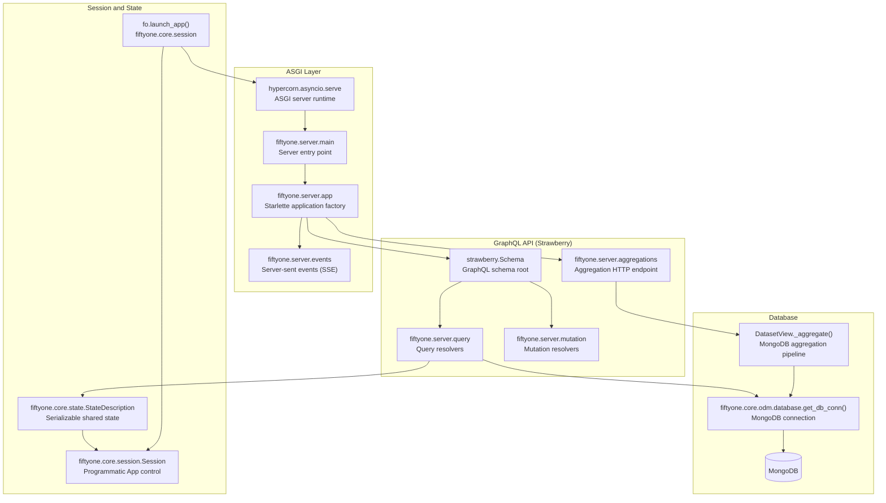

Sources: [fiftyone/core/collections.py:329-340](), [fiftyone/core/view.py:33-61](), [fiftyone/core/odm/mixins.py:56-80]()

## Frontend Application Structure

The frontend is a Yarn workspace monorepo under `app/packages/`. The main application is `@fiftyone/app`, which coordinates media viewing, state management, and the plugin/operator UI.

## Frontend Package Architecture

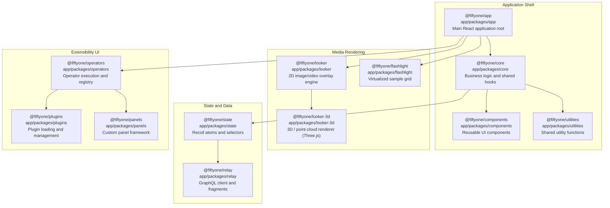

Sources: [docs/source/user_guide/app.rst:1-60]()

## Data Flow Architecture

The system processes data through several key pathways from ingestion to visualization:

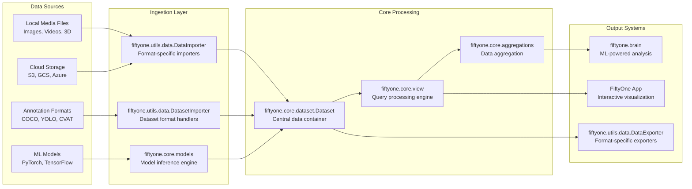

Sources: [docs/source/user_guide/using_datasets.rst:1-200](), [docs/source/user_guide/import_datasets.rst:1-100]()

## Key Technologies and Dependencies

| Layer | Technology | Role in FiftyOne |
|-------|------------|-----------------|
| Python library | Python 3.9–3.12 | Core application logic |
| Database | MongoDB + `mongoengine` | Document storage and ODM (`fiftyone.core.odm`) |
| DB distribution | `fiftyone-db` package | Bundled MongoDB for local use |
| ASGI server | `hypercorn` + `starlette` | Hosts `fiftyone.server` |
| API schema | `strawberry-graphql` | GraphQL schema for `fiftyone.server.query/mutation` |
| Frontend | React 18 + TypeScript | `@fiftyone/app` and related packages |
| Frontend state | Recoil | `@fiftyone/state` atoms and selectors |
| GraphQL client | Relay | `@fiftyone/relay` fragments |
| Build tooling | Vite + Yarn Workspaces | `app/` monorepo build pipeline |
| Image/video | `opencv-python`, `Pillow`, `eta` | Media processing in `fiftyone.utils` |
| 3D rendering | Three.js + WebGL | `@fiftyone/looker-3d` |
| ML frameworks | PyTorch, HuggingFace Transformers | Model Zoo wrappers in `fiftyone.utils.torch_utils` |
| Numeric | NumPy, SciPy, scikit-learn | Label utilities, evaluation, brain |
| Config | `fiftyone.core.config.FiftyOneConfig` | Loaded from `~/.fiftyone/config.json` or env vars |

Sources: [fiftyone/core/config.py:1-30](), [fiftyone/core/odm/mixins.py:1-35](), [docs/source/user_guide/config.rst:1-50]()

## Plugin and Extension System

FiftyOne provides a comprehensive plugin framework for extending functionality:

## Plugin and Operator Framework

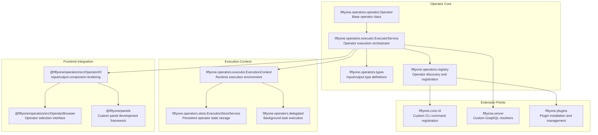

Sources: [fiftyone/operators/executor.py:1-50](), [fiftyone/operators/operator.py:1-100](), [fiftyone/operators/store.py:1-50](), [fiftyone/operators/registry.py:1-50]()

The FiftyOne system provides a unified platform for dataset management, model evaluation, and data visualization through its modular architecture and extensible plugin system. The core Python library handles data storage and processing, while the React frontend provides interactive visualization capabilities, all connected through a GraphQL API layer that enables real-time collaboration and analysis.

---

# Page: Installation and Setup

# Installation and Setup

<details>
<summary>Relevant source files</summary>

The following files were used as context for generating this wiki page:

- [.pre-commit-config.yaml](.pre-commit-config.yaml)
- [README.md](README.md)
- [app/README.md](app/README.md)
- [app/packages/app/index.html](app/packages/app/index.html)
- [app/packages/app/vite.config.ts](app/packages/app/vite.config.ts)
- [docs/source/_includes/substitutions.rst](docs/source/_includes/substitutions.rst)
- [docs/source/faq/index.rst](docs/source/faq/index.rst)
- [docs/source/index.rst](docs/source/index.rst)
- [docs/source/integrations/index.rst](docs/source/integrations/index.rst)
- [docs/source/release-notes.rst](docs/source/release-notes.rst)
- [docs/source/user_guide/app.rst](docs/source/user_guide/app.rst)
- [docs/source/user_guide/basics.rst](docs/source/user_guide/basics.rst)
- [docs/source/user_guide/config.rst](docs/source/user_guide/config.rst)
- [docs/source/user_guide/evaluation.rst](docs/source/user_guide/evaluation.rst)
- [docs/source/user_guide/index.rst](docs/source/user_guide/index.rst)
- [docs/source/user_guide/plots.rst](docs/source/user_guide/plots.rst)
- [docs/source/user_guide/using_aggregations.rst](docs/source/user_guide/using_aggregations.rst)
- [docs/source/user_guide/using_datasets.rst](docs/source/user_guide/using_datasets.rst)
- [docs/source/user_guide/using_views.rst](docs/source/user_guide/using_views.rst)
- [fiftyone/core/config.py](fiftyone/core/config.py)
- [fiftyone/utils/csv.py](fiftyone/utils/csv.py)
- [fiftyone/utils/dicom.py](fiftyone/utils/dicom.py)
- [install.bat](install.bat)
- [package/db/setup.py](package/db/setup.py)
- [package/desktop/setup.py](package/desktop/setup.py)
- [requirements/dev.txt](requirements/dev.txt)
- [requirements/extras.txt](requirements/extras.txt)
- [requirements/github.txt](requirements/github.txt)
- [requirements/test.txt](requirements/test.txt)
- [setup.py](setup.py)

</details>


This page covers how to install FiftyOne, its Python and system dependencies, how configuration is structured via `FiftyOneConfig` and `FiftyOneAppConfig`, and environment-specific setup notes. For details about how the server starts and manages its MongoDB connection after installation, see [Server Architecture](#3). For dataset and sample concepts, see [Core Data Model](#2).

---

## System Requirements

FiftyOne officially supports:

| OS | Notes |
|---|---|
| macOS (latest) | Intel and Apple Silicon |
| Ubuntu 18.04+ | x86\_64 and aarch64 |
| Amazon Linux 2 / 2023 | x86\_64 and aarch64 |
| Debian 9+ | x86\_64 only |
| RHEL / CentOS 7+ | x86\_64 and aarch64 |
| Windows (latest) | 64-bit |

**Python versions supported:** 3.9 through 3.12

[setup.py:159-163]()

**Optional system packages:**
- `libcurl` + `openssl` — required on Linux for network operations
- `ffmpeg` — required for video dataset processing
- On Linux (Debian/Ubuntu): `libgl1-mesa-dev` for OpenCV headless rendering

Sources: [README.md:228-265](), [setup.py:159-163]()

---

## Installation

### Standard Install

```shell
pip install fiftyone
```

This is the recommended approach for most users. It installs the `fiftyone` Python package along with `fiftyone-db` (bundled MongoDB), `fiftyone-brain`, and `voxel51-eta` as dependencies.

### Virtual Environments

FiftyOne should be installed into a virtual environment to avoid dependency conflicts:

```shell
python3 -m venv fiftyone_env
source fiftyone_env/bin/activate   # Linux / macOS
# or
fiftyone_env\Scripts\activate      # Windows
pip install fiftyone
```

### Source Install

Source installation builds both the Python library and the React frontend App. Prerequisites: Python 3.9–3.12, Node.js, Yarn.

```shell
git clone https://github.com/voxel51/fiftyone
cd fiftyone

bash install.sh      # macOS / Linux
.\install.bat        # Windows
```

The install script runs `yarn install` and `yarn build` in the `./app` directory, then installs the Python package in editable mode. For developer installs, pass the `-d` flag: `bash install.sh -d`.

To rebuild the frontend after pulling changes:

```shell
cd app && yarn build
```

Sources: [README.md:82-210]()

---

## Package Architecture

FiftyOne is composed of three Python distribution packages that install together.

**Package component diagram**

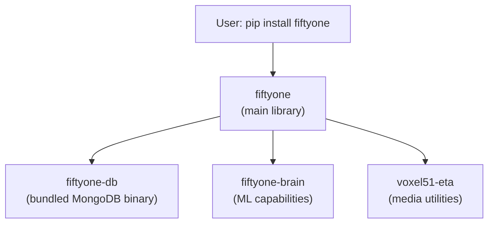

Sources: [setup.py:79-83]()

| Package | Version constraint | Role |
|---|---|---|
| `fiftyone` | — | Core library, server, CLI |
| `fiftyone-db` | `>=0.4, <2.0` | Platform-specific MongoDB binary |
| `fiftyone-brain` | `>=0.21.5, <0.22` | Uniqueness, similarity, embeddings |
| `voxel51-eta` | `>=0.15.3, <0.16` | Image/video I/O, config primitives |

[setup.py:79-83]()

---

## Python Dependencies

The following third-party packages are declared as required in `INSTALL_REQUIRES` in [setup.py:32-83]():

| Category | Key packages |
|---|---|
| Web server | `hypercorn>=0.13.2`, `starlette>=0.24.0`, `strawberry-graphql>=0.262.4,<0.292.0`, `sse-starlette`, `sseclient-py` |
| Database | `mongoengine~=0.29.1`, `motor~=3.6.0`, `pymongo~=4.9.2` |
| Data / ML | `numpy`, `pandas`, `scikit-learn`, `scikit-image`, `scipy` |
| Image | `Pillow>=6.2,!=11.2.*`, `opencv-python-headless` (fallback) |
| Plotting | `plotly>=6.1.1`, `matplotlib` |
| Serialization | `PyYAML`, `xmltodict`, `dill`, `jsonpatch` |
| Utilities | `boto3`, `psutil`, `tqdm`, `tabulate`, `humanize`, `cachetools`, `retrying` |
| Async | `aiofiles`, `async_lru>=2` |

**OpenCV selection logic** ([setup.py:86-115]()): At install time, `setup.py` checks whether `opencv-python`, `opencv-contrib-python`, or `opencv-contrib-python-headless` is already installed. If one of these is found, it is used; otherwise `opencv-python-headless` is installed as the default.

Sources: [setup.py:32-95]()

---

## Bundled MongoDB: `fiftyone-db`

FiftyOne ships its own MongoDB binary via the `fiftyone-db` package. The `package/db/setup.py` download table shows the supported platforms and the MongoDB version bundled for each:

| Platform | Version |
|---|---|
| macOS (arm64, x86\_64) | MongoDB 7.0.28 |
| Ubuntu 20.04, 22.04, 24.04 | MongoDB 7.0.28 |
| Amazon Linux 2 / 2023 | MongoDB 7.0.28 |
| RHEL/CentOS 8, 9 | MongoDB 7.0.28 |
| Debian 10 | MongoDB 6.0.27 |
| Ubuntu 18.04 | MongoDB 6.0.27 |

[package/db/setup.py:23-200]()

The bundled MongoDB stores its data files under `~/.fiftyone/var/lib/mongo` by default. This location is controlled by the `database_dir` config field. To use an external MongoDB instance instead, set `database_uri`.

Sources: [package/db/setup.py:23-200]()

---

## Configuration: `FiftyOneConfig`

`FiftyOneConfig` ([fiftyone/core/config.py:59-386]()) is the top-level configuration class. It extends `EnvConfig` (which itself extends `etac.EnvConfig`), enabling each field to be set from a JSON config file, an environment variable, or a programmatic default — in that priority order.

### Config file location

The config file is loaded from `~/.fiftyone/config.json`. It can be viewed and updated at runtime:

```python
import fiftyone as fo

# View current config
print(fo.config)

# Change a value at runtime
fo.config.show_progress_bars = False
```

### Configuration loading flow

**FiftyOneConfig resolution diagram**

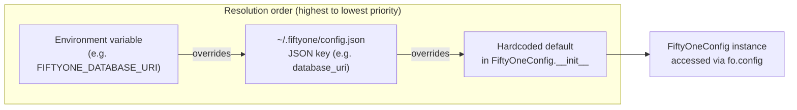

Sources: [fiftyone/core/config.py:59-386]()

### Key configuration fields

| Config field | Environment variable | Default | Description |
|---|---|---|---|
| `database_uri` | `FIFTYONE_DATABASE_URI` | `None` | MongoDB connection URI. If set, the bundled MongoDB is not used. |
| `database_dir` | `FIFTYONE_DATABASE_DIR` | `~/.fiftyone/var/lib/mongo` | Data directory for the bundled MongoDB. |
| `database_name` | `FIFTYONE_DATABASE_NAME` | `fiftyone` | Name of the MongoDB database. |
| `database_admin` | `FIFTYONE_DATABASE_ADMIN` | `True` | Whether the client may trigger database migrations. |
| `database_validation` | `FIFTYONE_DATABASE_VALIDATION` | `True` | Whether to validate DB compatibility on connect. |
| `database_compressor` | `FIFTYONE_DATABASE_COMPRESSOR` | `None` | MongoDB network compression (`zstd`, `zlib`, `snappy`). |
| `default_dataset_dir` | `FIFTYONE_DEFAULT_DATASET_DIR` | `~/fiftyone` | Default directory for dataset I/O operations. |
| `dataset_zoo_dir` | `FIFTYONE_DATASET_ZOO_DIR` | `~/fiftyone` | Directory for Dataset Zoo downloads. |
| `model_zoo_dir` | `FIFTYONE_MODEL_ZOO_DIR` | `~/fiftyone/__models__` | Directory for Model Zoo downloads. |
| `plugins_dir` | `FIFTYONE_PLUGINS_DIR` | `~/fiftyone/__plugins__` | Directory scanned for plugins. |
| `default_ml_backend` | `FIFTYONE_DEFAULT_ML_BACKEND` | auto-detected | `torch` or `tensorflow`. |
| `default_app_port` | `FIFTYONE_DEFAULT_APP_PORT` | `5151` | TCP port for the FiftyOne App server. |
| `default_app_address` | `FIFTYONE_DEFAULT_APP_ADDRESS` | `localhost` | Bind address for the App server. |
| `show_progress_bars` | `FIFTYONE_SHOW_PROGRESS_BARS` | `True` | Whether to display tqdm progress bars. |
| `do_not_track` | `FIFTYONE_DO_NOT_TRACK` | `False` | Disables anonymous usage telemetry. |
| `logging_level` | `FIFTYONE_LOGGING_LEVEL` | `INFO` | Python logging level (`DEBUG`, `INFO`, `WARNING`, `ERROR`, `CRITICAL`). |
| `logging_format` | `FIFTYONE_LOGGING_FORMAT` | `text` | `text` or `json`. |
| `logging_destination` | `FIFTYONE_LOGGING_DESTINATION` | `stdout` | `stdout` or `stdout,stderr`. |
| `timezone` | `FIFTYONE_TIMEZONE` | `None` | pytz timezone for datetime display. |
| `default_batcher` | `FIFTYONE_DEFAULT_BATCHER` | `latency` | Batching strategy for bulk DB writes: `latency`, `size`, or `static`. |
| `plugins_cache_enabled` | `FIFTYONE_PLUGINS_CACHE_ENABLED` | `False` | Whether to cache plugin discovery results. |
| `singleton_cache` | `FIFTYONE_SINGLETON_CACHE` | `True` | Whether dataset objects are singletons (auto-disabled on the App server). |

[fiftyone/core/config.py:62-315](), [docs/source/user_guide/config.rst:17-200]()

### Default path resolution (`_init`)

The `_init` method in `FiftyOneConfig` ([fiftyone/core/config.py:334-386]()) computes derived path defaults:

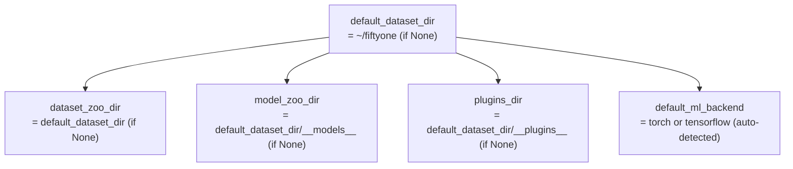

Sources: [fiftyone/core/config.py:334-386]()

---

## App Configuration: `FiftyOneAppConfig`

The App configuration is a separate object accessible via `fo.app_config`. Its JSON file lives at `~/.fiftyone/app_config.json`.

Key fields from [docs/source/user_guide/config.rst]():

| Config field | Environment variable | Default | Description |
|---|---|---|---|
| `color_scheme` | — | `None` | Default color scheme for the App. |
| `grid_media_field` | — | `filepath` | Default field shown in grid view. |
| `media_fields` | — | `['filepath']` | Declared media fields. |
| `notebook_height` | `FIFTYONE_APP_NOTEBOOK_HEIGHT` | `800` | Height (px) when embedded in notebooks. |
| `proxy_url` | `FIFTYONE_APP_PROXY_URL` | `None` | Proxy URL for cloud notebook environments. |
| `show_tooltip` | `FIFTYONE_APP_SHOW_TOOLTIP` | `True` | Whether to show label tooltips. |
| `disable_frame_filtering` | — | `False` | Disables frame-level filtering in grid view for video datasets. |

Sources: [docs/source/user_guide/config.rst:200-400]()

---

## Environment-Specific Considerations

### Docker

FiftyOne auto-detects when running inside a Docker container. If the App is not accessible in the browser, explicitly set the address to `0.0.0.0`:

```python
session = fo.launch_app(..., address="0.0.0.0")
```

Sources: [docs/source/user_guide/app.rst:93-103]()

### Windows

Multiprocessing on Windows requires the `if __name__ == "__main__":` guard when launching the App from a script, because the App is served via a subprocess:

```python
import fiftyone as fo

dataset = fo.load_dataset(...)

if __name__ == "__main__":
    session = fo.launch_app(dataset)
    session.wait()
```

Sources: [docs/source/user_guide/app.rst:107-122](), [docs/source/faq/index.rst:64-83]()

### Jupyter / Colab Notebooks

All standard FiftyOne commands work in notebooks. The App renders inline in cell output. For cloud notebooks (SageMaker, custom Jupyter), set a `proxy_url` in the App config.

Supported notebook environments:
- Jupyter Notebook / JupyterLab
- Google Colab
- Databricks Notebooks
- SageMaker Notebooks

Sources: [docs/source/faq/index.rst:85-100]()

### Remote Machines

To run the App on a remote machine and view it locally:

1. On the remote machine: `fo.launch_app(dataset, remote=True)` or `fiftyone app launch <name> --remote`
2. On the local machine: set up SSH port forwarding `ssh -N -L 5151:127.0.0.1:5151 user@host`, or use `fiftyone app connect --destination user@host`

The default port (`5151`) is controlled by `default_app_port` in `FiftyOneConfig`. The bind address is controlled by `default_app_address`.

Sources: [docs/source/user_guide/app.rst:233-347]()

### Connecting to an External MongoDB Instance

To use a self-managed MongoDB instead of the bundled one, set either the config field or environment variable before importing `fiftyone`:

```shell
export FIFTYONE_DATABASE_URI="mongodb://localhost:27017"
```

Or in `~/.fiftyone/config.json`:

```json
{
    "database_uri": "mongodb://localhost:27017"
}
```

When `database_uri` is set, the `database_dir` field is ignored. The `database_admin` flag controls whether the connecting client is allowed to trigger schema migrations.

Sources: [fiftyone/core/config.py:72-98](), [docs/source/user_guide/config.rst:20-40]()

---

## Startup Sequence

The following diagram shows what happens when `import fiftyone as fo` is executed.

**Import and initialization flow**

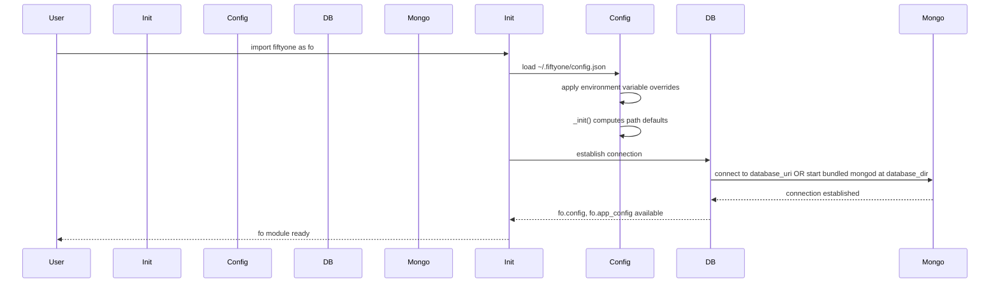

Sources: [fiftyone/core/config.py:59-386](), [package/db/setup.py:1-200]()

---

# Page: Core Data Model

# Core Data Model

<details>
<summary>Relevant source files</summary>

The following files were used as context for generating this wiki page:

- [fiftyone/__public__.py](fiftyone/__public__.py)
- [fiftyone/core/aggregations.py](fiftyone/core/aggregations.py)
- [fiftyone/core/clips.py](fiftyone/core/clips.py)
- [fiftyone/core/collections.py](fiftyone/core/collections.py)
- [fiftyone/core/dataset.py](fiftyone/core/dataset.py)
- [fiftyone/core/document.py](fiftyone/core/document.py)
- [fiftyone/core/expressions.py](fiftyone/core/expressions.py)
- [fiftyone/core/fields.py](fiftyone/core/fields.py)
- [fiftyone/core/frame.py](fiftyone/core/frame.py)
- [fiftyone/core/labels.py](fiftyone/core/labels.py)
- [fiftyone/core/odm/dataset.py](fiftyone/core/odm/dataset.py)
- [fiftyone/core/odm/document.py](fiftyone/core/odm/document.py)
- [fiftyone/core/odm/embedded_document.py](fiftyone/core/odm/embedded_document.py)
- [fiftyone/core/odm/mixins.py](fiftyone/core/odm/mixins.py)
- [fiftyone/core/odm/sample.py](fiftyone/core/odm/sample.py)
- [fiftyone/core/odm/utils.py](fiftyone/core/odm/utils.py)
- [fiftyone/core/patches.py](fiftyone/core/patches.py)
- [fiftyone/core/sample.py](fiftyone/core/sample.py)
- [fiftyone/core/stages.py](fiftyone/core/stages.py)
- [fiftyone/core/video.py](fiftyone/core/video.py)
- [fiftyone/core/view.py](fiftyone/core/view.py)
- [tests/unittests/aggregation_tests.py](tests/unittests/aggregation_tests.py)
- [tests/unittests/dataset_tests.py](tests/unittests/dataset_tests.py)
- [tests/unittests/odm_tests.py](tests/unittests/odm_tests.py)
- [tests/unittests/patches_tests.py](tests/unittests/patches_tests.py)
- [tests/unittests/video_tests.py](tests/unittests/video_tests.py)
- [tests/unittests/view_tests.py](tests/unittests/view_tests.py)

</details>


This document explains the fundamental data structures that power FiftyOne: `Dataset`, `SampleCollection`, `DatasetView`, and the ODM persistence layer. These components form the foundation for storing, organizing, and querying computer vision datasets and their associated annotations.

## Overview

FiftyOne's core data model is built around a hierarchical structure where `Dataset` instances contain collections of `Sample` objects, which can be filtered and transformed through `DatasetView` instances. The entire system is backed by MongoDB through a custom Object Document Mapper (ODM).

### Core Class Hierarchy and Inheritance

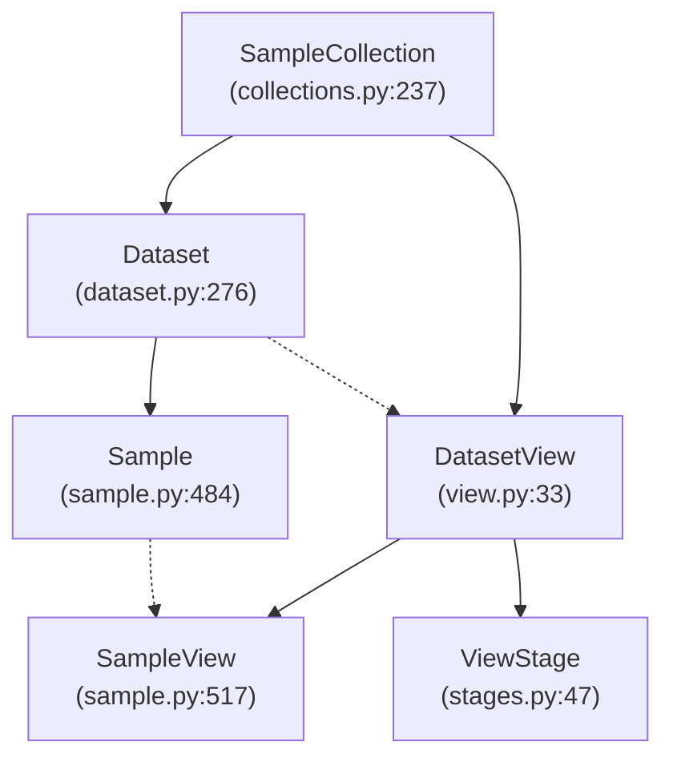

Sources: [fiftyone/core/collections.py:237-258](), [fiftyone/core/dataset.py:276-310](), [fiftyone/core/view.py:33-87](), [fiftyone/core/sample.py:484-510]()

## SampleCollection Architecture

The `SampleCollection` abstract base class defines the interface for both `Dataset` and `DatasetView` instances. This design allows consistent operations across both persistent datasets and ephemeral views.

### SampleCollection Implementation Structure

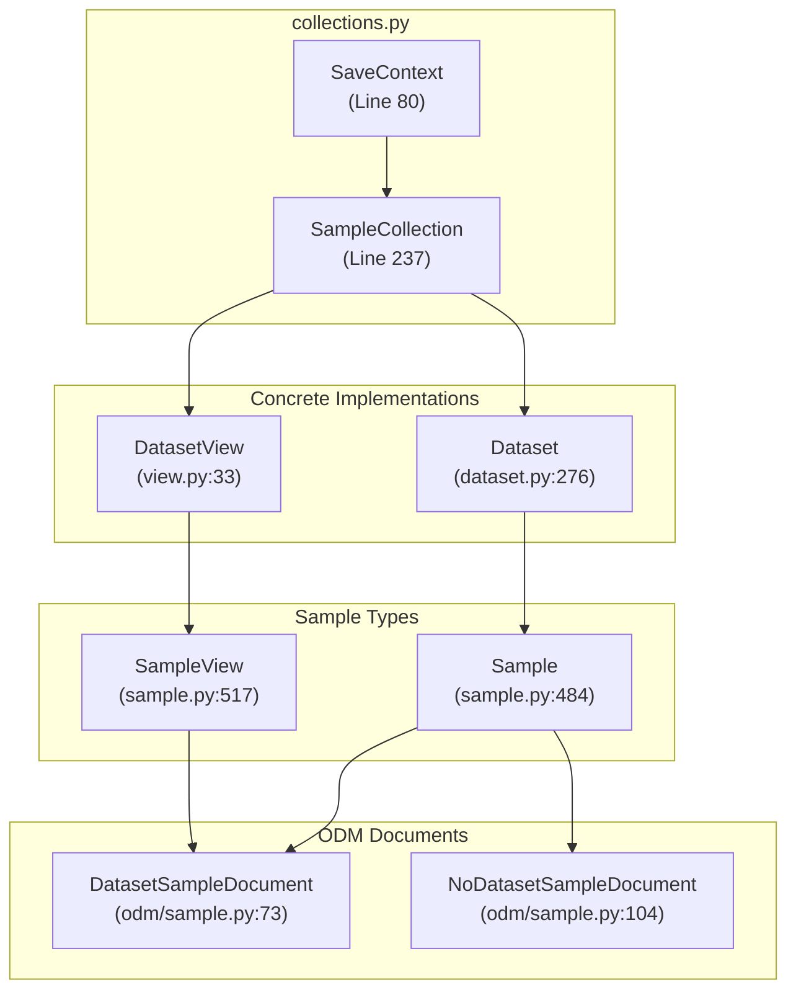

Sources: [fiftyone/core/collections.py:237-276](), [fiftyone/core/dataset.py:276-348](), [fiftyone/core/view.py:33-88](), [fiftyone/core/odm/sample.py:73-147]()

### Core SampleCollection Methods and Properties

| Property/Method | Line Location | Purpose |
|-----------------|---------------|---------|
| `media_type` | collections.py:353-355 | Type of media (image, video, group) |
| `group_field` | collections.py:358-362 | Field used for grouping samples |
| `iter_samples()` | collections.py:1274-1372 | Iterator over samples with batching |
| `count()` | collections.py:1511-1547 | Efficient sample/frame counting |
| `aggregate()` | collections.py:3823-3907 | MongoDB aggregation pipeline execution |
| `bounds()` | collections.py:4094-4113 | Compute bounds of numeric fields |

Sources: [fiftyone/core/collections.py:353-430](), [fiftyone/core/collections.py:1274-1547](), [fiftyone/core/collections.py:3823-4113]()

## Dataset Implementation

The `Dataset` class represents a persistent collection of samples stored in MongoDB. It extends `SampleCollection` and implements the `DatasetSingleton` pattern to ensure only one instance exists per dataset name.

### Dataset Class Structure and Key Attributes

```mermaid
graph TB
    subgraph "dataset.py"
        Dataset["Dataset<br/>(Line 276)<br/>metaclass=DatasetSingleton"]
        DatasetSlots["__slots__:<br/>_doc, _sample_doc_cls<br/>_frame_doc_cls, _group_slice<br/>caches..."]
    end
    
    subgraph "Core Properties (Lines 686-1105)"
        name["name (688)"]
        media_type["media_type (460)"]
        persistent["persistent (755)"]
        tags["tags (767)"]
        description["description (792)"]
        info["info (812)"]
        app_config["app_config (836)"]
    end
    
    subgraph "Schema Properties"
        classes["classes (878)"]
        default_classes["default_classes (906)"]
        mask_targets["mask_targets (932)"]
        skeletons["skeletons (1037)"]
    end
    
    subgraph "Temporal Properties"
        created_at["created_at (715)"]
        last_modified_at["last_modified_at (720)"]
        last_loaded_at["last_loaded_at (750)"]
    end
    
    Dataset --> DatasetSlots
    Dataset --> name
    Dataset --> media_type
    Dataset --> persistent
    Dataset --> tags
    Dataset --> description
    Dataset --> info
    Dataset --> app_config
    Dataset --> classes
    Dataset --> default_classes
    Dataset --> mask_targets
    Dataset --> skeletons
    Dataset --> created_at
    Dataset --> last_modified_at
    Dataset --> last_loaded_at
```

Sources: [fiftyone/core/dataset.py:276-348](), [fiftyone/core/dataset.py:686-1105](), [fiftyone/core/dataset.py:460-639]()

### Dataset Creation and Singleton Management

The `DatasetSingleton` metaclass ensures dataset instances are unique per name:

| Function | Line Location | Purpose |
|----------|---------------|---------|
| `Dataset.__init__()` | dataset.py:311-351 | Initialize with name, persistent flag |
| `load_dataset()` | dataset.py:145-175 | Load existing dataset or create new one |
| `dataset_exists()` | dataset.py:95-106 | Check if dataset exists in MongoDB |
| `delete_dataset()` | dataset.py:226-237 | Delete dataset and clean up |

The singleton ensures: `Dataset("name") is load_dataset("name")`

Sources: [fiftyone/core/dataset.py:145-175](), [fiftyone/core/dataset.py:311-351](), [fiftyone/core/singletons.py:1-50]()

## View System Architecture

The view system allows non-destructive filtering and transformation of datasets through a pipeline of `ViewStage` operations. Views are ephemeral and don't modify the underlying dataset.

### DatasetView and ViewStage Pipeline

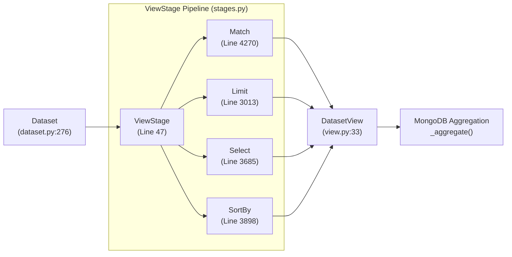

Sources: [fiftyone/core/view.py:33-87](), [fiftyone/core/stages.py:47-100](), [fiftyone/core/stages.py:4270-4310]()

### Key ViewStage Implementations

| Stage Class | Line Location | MongoDB Operation | Purpose |
|-------------|---------------|-------------------|---------|
| `Exclude` | stages.py:513 | `$match` with `$not` | Exclude samples by IDs |
| `ExcludeBy` | stages.py:591 | `$match` with `$nin` | Exclude by field values |
| `Match` | stages.py:4270 | `$match` | Filter by expressions |
| `Limit` | stages.py:3013 | `$limit` | Limit number of samples |
| `Skip` | stages.py:3851 | `$skip` | Skip N samples |
| `SortBy` | stages.py:3898 | `$sort` | Sort by field values |
| `SelectFields` | stages.py:3710 | `$project` | Project specific fields |
| `FilterLabels` | stages.py:2036 | Complex pipeline | Filter arrays of labels |

Sources: [fiftyone/core/stages.py:513-680](), [fiftyone/core/stages.py:2036-2200](), [fiftyone/core/stages.py:3013-4310]()

### View Execution and MongoDB Integration

The `DatasetView` class converts view stages into MongoDB aggregation pipelines:

| Method | Line Location | Purpose |
|--------|---------------|---------|
| `_pipeline()` | view.py:1513-1628 | Convert stages to MongoDB pipeline |
| `_aggregate()` | view.py:1736-1822 | Execute aggregation on MongoDB |
| `iter_samples()` | view.py:454-545 | Iterate over view results |

Sources: [fiftyone/core/view.py:454-545](), [fiftyone/core/view.py:1513-1822]()

## Sample and Document Architecture

Samples represent individual data points (images, videos, etc.) and their associated metadata and annotations. The system uses a dual document approach for samples in and out of datasets.

### Sample Class Hierarchy and ODM Integration

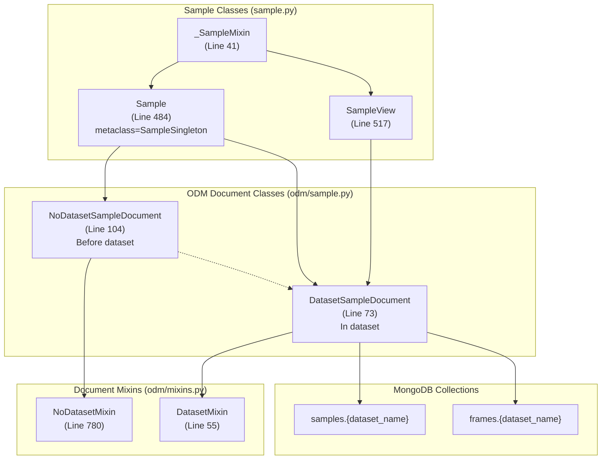

Sources: [fiftyone/core/sample.py:41-68](), [fiftyone/core/sample.py:484-517](), [fiftyone/core/odm/sample.py:73-147](), [fiftyone/core/odm/mixins.py:55-780]()

### Sample Field Schema Definition

The `DatasetSampleDocument` defines default fields for all samples:

| Field | Type | Line Location | Purpose |
|-------|------|---------------|---------|
| `id` | `ObjectIdField` | sample.py:84 | Unique sample identifier |
| `filepath` | `StringField` | sample.py:85 | Path to media file |
| `tags` | `ListField` | sample.py:86 | List of string tags |
| `metadata` | `EmbeddedDocumentField` | sample.py:87 | Media metadata |
| `created_at` | `DateTimeField` | sample.py:88 | Creation timestamp |
| `last_modified_at` | `DateTimeField` | sample.py:89 | Last modification time |
| `_media_type` | `StringField` | sample.py:91 | Media type (image/video/group) |
| `_rand` | `FloatField` | sample.py:92 | Random value for shuffling |
| `_dataset_id` | `ObjectIdField` | sample.py:93 | Reference to parent dataset |

Sources: [fiftyone/core/odm/sample.py:84-94](), [fiftyone/core/sample.py:23-38]()

### Document State Transitions

Sample documents transition between states when added to datasets:

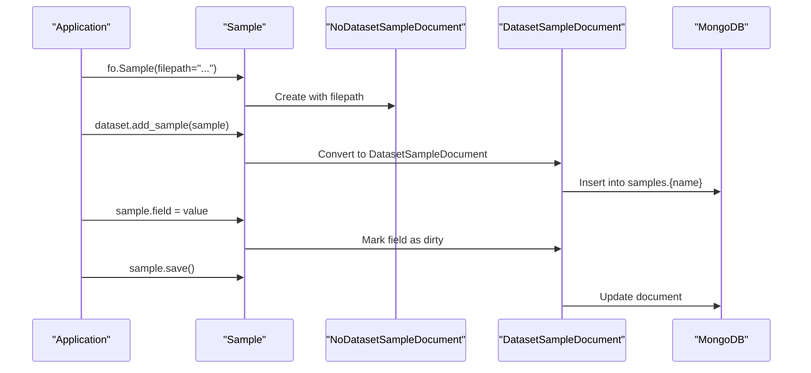

Sources: [fiftyone/core/sample.py:484-600](), [fiftyone/core/odm/sample.py:115-147](), [fiftyone/core/dataset.py:1986-2100]()

## Labels and Field System

The label and field system provides a flexible schema for storing annotations, predictions, and metadata with type safety and validation.

### Label Class Hierarchy

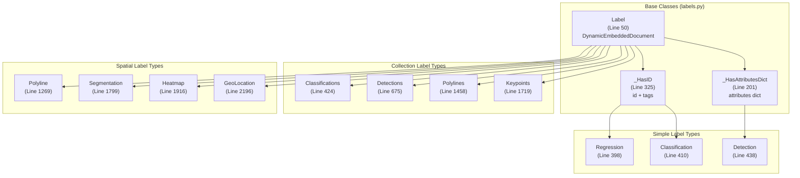

Sources: [fiftyone/core/labels.py:50-134](), [fiftyone/core/labels.py:325-346](), [fiftyone/core/labels.py:398-2300]()

### Field Type System Architecture

```mermaid
graph TB
    subgraph "Core Field Classes (fields.py)"
        Field["Field<br/>(Line 359)<br/>MongoEngine Base"]
        ReadOnlyMixin["ReadOnlyMixin<br/>(Line 346)"]
    end
    
    subgraph "Primitive Fields (Lines 400-800)"
        StringField["StringField<br/>(Line 489)"]
        IntField["IntField<br/>(Line 440)"] 
        FloatField["FloatField<br/>(Line 463)"]
        BooleanField["BooleanField<br/>(Line 542)"]
        DateTimeField["DateTimeField<br/>(Line 628)"]
        ObjectIdField["ObjectIdField<br/>(Line 516)"]
    end
    
    subgraph "Container Fields (Lines 800-1200)"
        ListField["ListField<br/>(Line 889)"]
        DictField["DictField<br/>(Line 959)"]
        EmbeddedDocumentField["EmbeddedDocumentField<br/>(Line 1096)"]
    end
    
    subgraph "Specialized Fields (Lines 1200-2000)"
        VectorField["VectorField<br/>(Line 1241)"]
        ArrayField["ArrayField<br/>(Line 1397)"]
        ClassesField["ClassesField<br/>(Line 1644)"]
        MaskTargetsField["MaskTargetsField<br/>(Line 1712)"]
    end
    
    Field --> ReadOnlyMixin
    Field --> StringField
    Field --> IntField
    Field --> FloatField
    Field --> BooleanField
    Field --> DateTimeField
    Field --> ObjectIdField
    Field --> ListField
    Field --> DictField
    Field --> EmbeddedDocumentField
    Field --> VectorField
    Field --> ArrayField
    Field --> ClassesField
    Field --> MaskTargetsField
```

Sources: [fiftyone/core/fields.py:346-400](), [fiftyone/core/fields.py:440-800](), [fiftyone/core/fields.py:889-1200](), [fiftyone/core/fields.py:1241-2000]()

## ODM (Object Document Mapper) Architecture

The ODM layer handles the mapping between Python objects and MongoDB documents, providing schema management, validation, and persistence.

### ODM Component Architecture

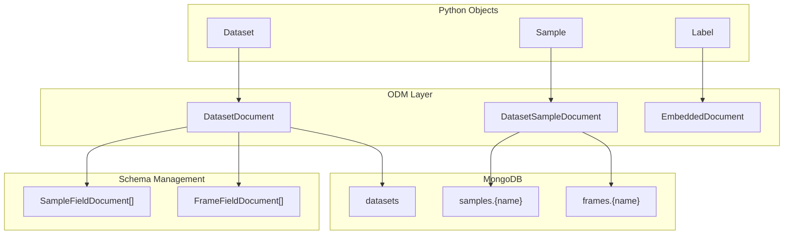

Sources: [fiftyone/core/odm/dataset.py:58-160](), [fiftyone/core/odm/sample.py:73-103](), [fiftyone/core/odm/mixins.py:55-120]()

### Dynamic Schema Management

The ODM supports dynamic schema evolution where new fields can be added at runtime:

1. **Field Declaration**: New fields are automatically detected when assigned to samples
2. **Schema Registration**: Field definitions are stored in `SampleFieldDocument` objects
3. **Validation**: Runtime validation ensures type safety
4. **Migration**: Schema changes are propagated to the dataset metadata

Sources: [fiftyone/core/odm/mixins.py:129-203](), [fiftyone/core/odm/utils.py:350-450](), [fiftyone/core/dataset.py:1600-1700]()

### Document Lifecycle

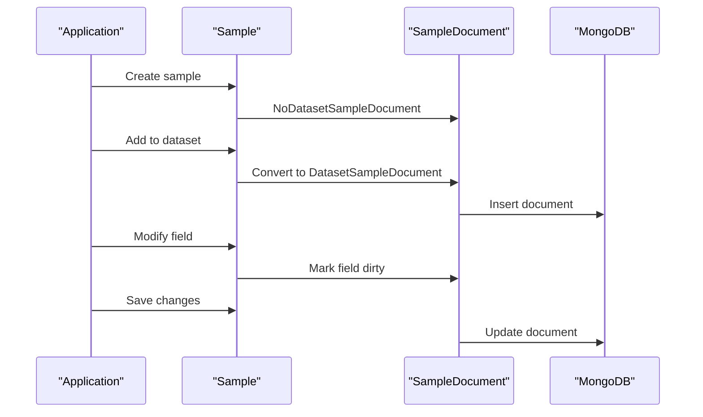

Sources: [fiftyone/core/sample.py:484-600](), [fiftyone/core/odm/sample.py:104-147](), [fiftyone/core/odm/mixins.py:200-300]()

---

# Page: Datasets and Sample Collections

# Datasets and Sample Collections

<details>
<summary>Relevant source files</summary>

The following files were used as context for generating this wiki page:

- [fiftyone/__public__.py](fiftyone/__public__.py)
- [fiftyone/core/aggregations.py](fiftyone/core/aggregations.py)
- [fiftyone/core/clips.py](fiftyone/core/clips.py)
- [fiftyone/core/collections.py](fiftyone/core/collections.py)
- [fiftyone/core/dataset.py](fiftyone/core/dataset.py)
- [fiftyone/core/document.py](fiftyone/core/document.py)
- [fiftyone/core/expressions.py](fiftyone/core/expressions.py)
- [fiftyone/core/fields.py](fiftyone/core/fields.py)
- [fiftyone/core/frame.py](fiftyone/core/frame.py)
- [fiftyone/core/labels.py](fiftyone/core/labels.py)
- [fiftyone/core/odm/dataset.py](fiftyone/core/odm/dataset.py)
- [fiftyone/core/odm/document.py](fiftyone/core/odm/document.py)
- [fiftyone/core/odm/embedded_document.py](fiftyone/core/odm/embedded_document.py)
- [fiftyone/core/odm/mixins.py](fiftyone/core/odm/mixins.py)
- [fiftyone/core/odm/sample.py](fiftyone/core/odm/sample.py)
- [fiftyone/core/odm/utils.py](fiftyone/core/odm/utils.py)
- [fiftyone/core/patches.py](fiftyone/core/patches.py)
- [fiftyone/core/sample.py](fiftyone/core/sample.py)
- [fiftyone/core/stages.py](fiftyone/core/stages.py)
- [fiftyone/core/video.py](fiftyone/core/video.py)
- [fiftyone/core/view.py](fiftyone/core/view.py)
- [tests/unittests/aggregation_tests.py](tests/unittests/aggregation_tests.py)
- [tests/unittests/dataset_tests.py](tests/unittests/dataset_tests.py)
- [tests/unittests/odm_tests.py](tests/unittests/odm_tests.py)
- [tests/unittests/patches_tests.py](tests/unittests/patches_tests.py)
- [tests/unittests/video_tests.py](tests/unittests/video_tests.py)
- [tests/unittests/view_tests.py](tests/unittests/view_tests.py)

</details>


This document covers the core data structures that represent collections of samples in FiftyOne: the `Dataset` class and the `SampleCollection` abstract interface. These classes provide the fundamental API for managing, querying, and manipulating collections of media samples with their associated metadata and labels.

For information about individual samples, see [Labels and Fields](#2.3). For information about views and filtering operations, see [Views and View Stages](#2.2).

## Core Architecture

The sample collection system in FiftyOne is built around a class hierarchy with `SampleCollection` as the abstract base class and `Dataset` as the primary concrete implementation:

```mermaid
graph TD
    SampleCollection["SampleCollection\n(Abstract Base Class)"] --> Dataset["Dataset\n(foc.SampleCollection + DatasetSingleton)"]
    SampleCollection --> DatasetView["DatasetView\n(Filtered View)"]
    SampleCollection --> PatchesView["PatchesView\n(Object Patches)"]
    SampleCollection --> FramesView["FramesView\n(Video Frames)"]
    SampleCollection --> ClipsView["ClipsView\n(Video Clips)"]
    
    Dataset --> Sample["Sample\n(_SampleMixin + Document + SampleSingleton)"]
    DatasetView --> SampleView["SampleView\n(_SampleMixin + DocumentView)"]
    
    Dataset --> DatasetSampleDocument["_sample_doc_cls\n(DatasetSampleDocument subclass)"]
    Dataset --> DatasetFrameDocument["_frame_doc_cls\n(DatasetFrameDocument subclass)"]
    
    DatasetSampleDocument --> DatasetMixin["DatasetMixin\n(Schema Management)"]
    DatasetSampleDocument --> Document["Document\n(ODM Base)"]
    
    subgraph "Database Layer"
        SampleCollection_DB[("Sample Collection\n(MongoDB)")]
        FrameCollection_DB[("Frame Collection\n(MongoDB)")]
        DatasetCollection_DB[("Dataset Collection\n(MongoDB)")]
    end
    
    DatasetSampleDocument --> SampleCollection_DB
    DatasetFrameDocument --> FrameCollection_DB
    Dataset --> DatasetCollection_DB
```

**Sources:** [fiftyone/core/collections.py:237-243](), [fiftyone/core/dataset.py:276-310](), [fiftyone/core/view.py:33-70](), [fiftyone/core/sample.py:484-508](), [fiftyone/core/odm/sample.py:73-103]()

## Dataset Class

The `Dataset` class is the primary implementation of `SampleCollection` and represents a persistent collection of samples stored in MongoDB. Datasets are singletons, meaning multiple references to the same dataset name will return the same object instance.

### Dataset Creation and Loading

**Diagram: Dataset creation and singleton lifecycle**

```mermaid
graph LR
    Constructor["Dataset(name, persistent, overwrite)"] --> DatasetExists{"dataset_exists(name)"}
    DatasetExists -->|"True + overwrite=True"| DeleteFirst["delete_dataset(name)"]
    DeleteFirst --> CreateNew["_create_dataset()"]
    DatasetExists -->|"False"| CreateNew
    DatasetExists -->|"True + overwrite=False"| LoadExisting["_load_dataset()"]

    load_dataset["load_dataset(name)"] --> TryConstructor["Dataset(name, _create=False)"]
    TryConstructor -->|"not found"| CheckFlag{"create_if_necessary?"}
    CheckFlag -->|"True"| CreateNew2["Dataset(name, _create=True)"]
    CheckFlag -->|"False"| RaiseError["DatasetNotFoundError"]

    CreateNew --> Singleton["DatasetSingleton metaclass\n_instances[name] = self"]
    LoadExisting --> Singleton
    CreateNew2 --> Singleton
```

Datasets use `DatasetSingleton` as their metaclass ([fiftyone/core/singletons.py]()). All calls to `Dataset(name)` or `load_dataset(name)` within a process return the **same object instance**. `copy()` and `deepcopy()` both return `self`.

**Persistence semantics:** `persistent=False` (default) means the dataset is deleted from the database when `delete_non_persistent_datasets()` is called—typically at server startup. Set `persistent=True` to retain the dataset across sessions. The flag can be changed at any time via `dataset.persistent = True`.

`DatasetNotFoundError` ([fiftyone/core/dataset.py:63-68]()) is raised by `load_dataset()` when the named dataset does not exist and `create_if_necessary=False`.

**Sources:** [fiftyone/core/dataset.py:63-68](), [fiftyone/core/dataset.py:140-175](), [fiftyone/core/dataset.py:306-351](), [fiftyone/core/dataset.py:245-268]()

### Key Dataset Properties and Methods

The `Dataset` class manages several core properties and provides methods for data management. Properties that mutate state call `self.save()` internally to persist changes to the `datasets` MongoDB collection.

#### Identity and Metadata

| Property | Purpose | Location |
|----------|---------|----------|
| `name` | Unique display name; must not clash with existing names | [fiftyone/core/dataset.py:679-699]() |
| `slug` | URL-safe slug derived from `name` at creation/rename time | [fiftyone/core/dataset.py:701-704]() |
| `persistent` | If `False` (default), dataset is deleted when the session ends | [fiftyone/core/dataset.py:746-756]() |
| `tags` | List of string tags on the dataset | [fiftyone/core/dataset.py:758-781]() |
| `description` | Optional free-text description | [fiftyone/core/dataset.py:783-801]() |
| `info` | User-defined `dict` of auxiliary metadata | [fiftyone/core/dataset.py:803-825]() |
| `app_config` | `DatasetAppConfig` controlling App visualization defaults | [fiftyone/core/dataset.py:827-867]() |
| `created_at` | `datetime` when the dataset was created | [fiftyone/core/dataset.py:706-709]() |
| `last_modified_at` | `datetime` of last dataset-level metadata change | [fiftyone/core/dataset.py:711-732]() |
| `last_deletion_at` | `datetime` of last sample deletion, or `None` | [fiftyone/core/dataset.py:734-739]() |
| `last_loaded_at` | `datetime` the dataset was last loaded | [fiftyone/core/dataset.py:741-744]() |

#### Media and Schema

| Property | Purpose | Location |
|----------|---------|----------|
| `media_type` | One of `"image"`, `"video"`, `"point-cloud"`, `"3d"`, `"group"` | [fiftyone/core/dataset.py:452-480]() |
| `group_field` | Field name used for grouping in group datasets | [fiftyone/core/dataset.py:533-548]() |
| `group_slice` | Active group slice name; settable | [fiftyone/core/dataset.py:550-590]() |
| `group_slices` | All slice names for a group dataset | [fiftyone/core/dataset.py:592-610]() |
| `group_media_types` | `dict` mapping slice name → media type | [fiftyone/core/dataset.py:612-630]() |
| `default_group_slice` | Default group slice; settable | [fiftyone/core/dataset.py:632-671]() |

#### Label Configuration

| Property | Purpose | Location |
|----------|---------|----------|
| `classes` | `dict` mapping field name → list of class label strings | [fiftyone/core/dataset.py:869-895]() |
| `default_classes` | Fallback class list for all label fields | [fiftyone/core/dataset.py:897-921]() |
| `mask_targets` | `dict` mapping field name → pixel-value-to-label mapping | [fiftyone/core/dataset.py:923-978]() |
| `default_mask_targets` | Fallback mask targets for all segmentation fields | [fiftyone/core/dataset.py:980-1026]() |
| `skeletons` | `dict` mapping field name → `KeypointSkeleton` | [fiftyone/core/dataset.py:1028-1062]() |
| `default_skeleton` | Fallback `KeypointSkeleton` for all keypoint fields | [fiftyone/core/dataset.py:1064-1095]() |
| `camera_intrinsics` | `dict` mapping sensor name → `CameraIntrinsics` | [fiftyone/core/dataset.py:1097-1134]() |
| `static_transforms` | `dict` mapping frame relationship key → `StaticTransform` | [fiftyone/core/dataset.py:1187-1233]() |

**Sources:** [fiftyone/core/dataset.py:452-1240](), [fiftyone/core/odm/dataset.py:1-450]()

## SampleCollection Interface

`SampleCollection` ([fiftyone/core/collections.py:329-335]()) is the abstract base class for all collections. Both `Dataset` and `DatasetView` implement it. It provides a consistent API for sample iteration, aggregation, schema inspection, and view construction.

`DatasetView` delegates dataset-level properties (`tags`, `info`, `classes`, `mask_targets`, etc.) back to its `_root_dataset` rather than maintaining its own copies. Mutations through a view affect the underlying `Dataset`.

### Core Interface Methods

**Diagram: SampleCollection method surface by category**

```mermaid
graph TD
    SC["SampleCollection\n(fiftyone/core/collections.py)"] --> Iter["Iteration"]
    SC --> Query["Query"]
    SC --> Mutate["Mutation"]
    SC --> Agg["Aggregation"]
    SC --> ViewConstruct["View Construction"]
    SC --> Schema["Schema"]

    Iter --> iter_samples["iter_samples(progress, autosave,\nbatch_size, batching_strategy)"]
    Iter --> iter_groups["iter_groups(group_slices)"]

    Query --> count["count(field_or_expr)"]
    Query --> first["first()"]
    Query --> last["last()"]
    Query --> exists["exists(field)"]

    Mutate --> add_sample["add_sample(sample, expand_schema)"]
    Mutate --> add_samples["add_samples(samples, num_workers)"]
    Mutate --> delete_samples["delete_samples(samples_or_ids)"]
    Mutate --> set_values["set_values(field, values, key_field)"]
    Mutate --> compute_metadata["compute_metadata(overwrite)"]
    Mutate --> apply_model["apply_model(model, label_field)"]
    Mutate --> merge_samples["merge_samples(samples, key_field)"]

    Agg --> aggregate["aggregate(aggregations)"]
    Agg --> distinct["distinct(field)"]
    Agg --> values["values(field, unwind)"]
    Agg --> bounds["bounds(field)"]
    Agg --> sum_["sum(field)"]

    ViewConstruct --> match["match(filter)"]
    ViewConstruct --> select["select(sample_ids)"]
    ViewConstruct --> limit["limit(count)"]
    ViewConstruct --> sort_by["sort_by(field, reverse)"]
    ViewConstruct --> shuffle["shuffle(seed)"]
    ViewConstruct --> view["view()"]

    Schema --> get_field_schema["get_field_schema(ftype, flat)"]
    Schema --> get_frame_field_schema["get_frame_field_schema()"]
    Schema --> add_sample_field["add_sample_field(name, ftype)"]
    Schema --> delete_sample_field["delete_sample_field(field_name)"]
```

**Sources:** [fiftyone/core/collections.py:329-400](), [fiftyone/core/collections.py:710-960](), [fiftyone/core/collections.py:1247-2000]()

### Sample Access Patterns

The `__getitem__` method on both `Dataset` and `DatasetView` dispatches on the key type:

**Diagram: `__getitem__` dispatch for Dataset and DatasetView**

```mermaid
graph LR
    key["collection[key]"] --> isInt{"numbers.Integral?"}
    isInt -->|"Yes"| ValueError["raises ValueError\n(numeric index unsupported)"]
    isInt -->|"No"| isSlice{"slice?"}
    isSlice -->|"Yes"| DatasetView1["returns DatasetView\n(via self.view()[slice])"]
    isSlice -->|"No"| isExpr{"ViewExpression?"}
    isExpr -->|"Yes"| DatasetView2["returns DatasetView\n(via self.view()[expr])"]
    isExpr -->|"No"| isContainer{"iterable?"}
    isContainer -->|"Yes"| DatasetView3["returns DatasetView\n(via self.view()[ids])"]
    isContainer -->|"No"| tryOID["try ObjectId(key)"]
    tryOID -->|"success"| QueryByID["MongoDB find _id=ObjectId"]
    tryOID -->|"fail"| QueryByPath["MongoDB find filepath=key"]
    QueryByID --> SampleOrView["returns Sample / SampleView"]
    QueryByPath --> SampleOrView
```

**Sources:** [fiftyone/core/dataset.py:365-397](), [fiftyone/core/view.py:102-134]()

## Sample Management Operations

### Adding and Removing Samples

Collections provide methods for managing their sample contents with comprehensive data management patterns:

```mermaid
graph TD
    SampleOps["Sample Operations"] --> AddOps["Add Operations"]
    SampleOps --> DeleteOps["Delete Operations"]
    SampleOps --> UpdateOps["Update Operations"]
    SampleOps --> BulkOps["Bulk Operations"]
    
    AddOps --> add_sample["add_sample(sample, expand_schema)"]
    AddOps --> add_samples["add_samples(samples, num_workers)"]
    AddOps --> add_dir["add_dir(dataset_dir, tags)"]
    AddOps --> add_archive["add_archive(archive_path)"]
    AddOps --> add_images["add_images(paths_or_samples)"]
    AddOps --> add_videos["add_videos(paths_or_samples)"]
    
    DeleteOps --> delete_samples["delete_samples(samples_or_ids)"]
    DeleteOps --> keep["keep(sample_ids)"]
    DeleteOps --> keep_fields["keep_fields(field_names)"]
    DeleteOps --> clear["clear()"]
    DeleteOps --> clear_sample_field["clear_sample_field(field)"]
    
    UpdateOps --> set_values["set_values(field, values, key_field)"]
    UpdateOps --> compute_metadata["compute_metadata(overwrite, num_workers)"]
    UpdateOps --> apply_model["apply_model(model, label_field)"]
    UpdateOps --> sync_last_modified_at["sync_last_modified_at()"]
    
    BulkOps --> clone["clone(name, persistent)"]
    BulkOps --> merge_samples["merge_samples(samples, key_field)"]
    BulkOps --> save_context["save_context(batch_size, batching_strategy)"]
    
    subgraph "Batch Processing Strategies"
        SaveContext["SaveContext"]
        Static["Static Batching"]
        Size["Size-based Batching"] 
        Latency["Latency-based Batching"]
        SaveContext --> Static
        SaveContext --> Size
        SaveContext --> Latency
    end
```

**Sources:** [fiftyone/core/collections.py:1501-2000](), [fiftyone/core/collections.py:2200-2800](), [fiftyone/core/collections.py:80-235]()

### Save Context for Batch Operations

The `SaveContext` class provides efficient batching for large-scale sample updates:

```mermaid
graph LR
    SaveContext["SaveContext"] --> BatchingStrategies["Batching Strategies"]
    
    BatchingStrategies --> Static["Static\n(Fixed Count)"]
    BatchingStrategies --> Size["Size\n(Target Bytes)"]
    BatchingStrategies --> Latency["Latency\n(Time-based)"]
    
    SaveContext --> BulkOps["MongoDB\nBulk Operations"]
    BulkOps --> SampleCollection[("Sample Collection")]
    BulkOps --> FrameCollection[("Frame Collection")]
```

**Sources:** [fiftyone/core/collections.py:80-235]()

## Schema and Field Management

### Field Schema System

The dataset schema is stored as a list of `SampleFieldDocument` objects embedded in the `DatasetDocument` in the `datasets` MongoDB collection. Whenever a field is added or removed, the document is updated in-place and the dataset's `_sample_doc_cls` (or `_frame_doc_cls`) is updated to match.

**Diagram: Schema storage and management (code entities)**

```mermaid
graph TD
    DatasetDoc["DatasetDocument\n(fiftyone/core/odm/dataset.py)\nsample_fields: list[SampleFieldDocument]\nframe_fields: list[SampleFieldDocument]"] --> SFD["SampleFieldDocument\n(name, ftype, embedded_doc_type,\nsubfield, db_field, description,\ninfo, read_only, created_at)"]

    SFD -->|"to_field()"| FieldObj["Field object\n(fiftyone/core/fields.py)"]
    SFD -->|"from_field(field)"| SFD

    SampleDocCls["dataset._sample_doc_cls\n(DatasetSampleDocument subclass)"] -->|"_fields dict"| FieldObj
    FrameDocCls["dataset._frame_doc_cls\n(DatasetFrameDocument subclass)"] -->|"_fields dict"| FieldObj

    FieldManagement["Dataset field methods"] --> add_sample_field["add_sample_field(name, ftype, description, info)"]
    FieldManagement --> delete_sample_field["delete_sample_field(field_name)"]
    FieldManagement --> rename_sample_field["rename_sample_field(field_name, new_name)"]
    FieldManagement --> clone_sample_field["clone_sample_field(field_name, new_name)"]
    FieldManagement --> add_frame_field["add_frame_field(name, ftype)"]
    FieldManagement --> get_field_schema["get_field_schema(ftype, embedded_doc_type, flat)"]
    FieldManagement --> get_field["get_field(field_name)"]
    FieldManagement --> has_field["has_field(field_name)"]
```

#### Field Types

| Field class | Value type | Notes |
|-------------|-----------|-------|
| `StringField` | `str` | |
| `IntField` | `int` | |
| `FloatField` | `float` | |
| `BooleanField` | `bool` | |
| `DateTimeField` | `datetime` | |
| `ListField(subfield)` | `list` | Parameterized by inner field type |
| `EmbeddedDocumentField(doc_type)` | `EmbeddedDocument` | Used for `Label` subclasses, `Metadata` |
| `ArrayField` | `numpy.ndarray` | Binary-serialized NumPy array |
| `VectorField` | `numpy.ndarray` | Stored as a list; used for embeddings |
| `DictField` | `dict` | Arbitrary JSON-serializable mapping |
| `ObjectIdField` | `bson.ObjectId` | |

#### Schema auto-expansion

When a sample is added with a field not currently in the schema, `set_field(..., create=True)` (the default) calls `add_implied_field()` on the backing document, which calls `_create_implied_field()` and writes the updated `sample_fields` list back to the `datasets` collection. This means the schema grows automatically as new data is ingested.

**Sources:** [fiftyone/core/odm/dataset.py:58-161](), [fiftyone/core/odm/mixins.py:130-200](), [fiftyone/core/fields.py:1-300](), [fiftyone/core/collections.py:2900-3400]()

## Views and Derived Collections

### Specialized Collection Types

FiftyOne provides several specialized collection types that derive from `SampleCollection`:

```mermaid
graph TD
    Collections["Specialized Collections"] --> DatasetView["DatasetView\n(Filtered Dataset)"]
    Collections --> PatchesView["PatchesView\n(Object Patches)"]
    Collections --> FramesView["FramesView\n(Video Frames)"]
    Collections --> ClipsView["ClipsView\n(Video Clips)"]
    
    DatasetView --> ViewStages["View Stages Pipeline"]
    ViewStages --> Match["match()"]
    ViewStages --> Select["select()"]
    ViewStages --> Limit["limit()"]
    ViewStages --> SortBy["sort_by()"]
    
    PatchesView --> to_patches["to_patches(field)"]
    FramesView --> to_frames["to_frames()"]
    ClipsView --> to_clips["to_clips(field)"]
    
    subgraph "Generated Collections"
        PatchSample["Patch Samples"]
        FrameSample["Frame Samples"]
        ClipSample["Clip Samples"]
    end
    
    PatchesView --> PatchSample
    FramesView --> FrameSample
    ClipsView --> ClipSample
```

**Sources:** [fiftyone/core/view.py:33-61](), [fiftyone/core/patches.py:48-66](), [fiftyone/core/video.py:35-46](), [fiftyone/core/clips.py:28-43]()

## Database Integration

### ODM and Persistence Layer

Each `Dataset` has two dynamically generated MongoEngine document classes. These classes are created at dataset-creation time and registered with MongoEngine under names matching the collection names.

**Diagram: Document class hierarchy to MongoDB collections (code entities)**

```mermaid
graph TD
    Dataset["Dataset\n(fiftyone/core/dataset.py)"] --> SDC["_sample_doc_cls\n(dynamic subclass of DatasetSampleDocument)"]
    Dataset --> FDC["_frame_doc_cls\n(dynamic subclass of DatasetFrameDocument)\nvideo datasets only"]

    SDC --> DSDoc["DatasetSampleDocument\n(fiftyone/core/odm/sample.py)\nDatasetMixin + Document\n_is_frames_doc=False"]
    FDC --> DFDoc["DatasetFrameDocument\n(fiftyone/core/odm/frame.py)\nDatasetMixin + Document\n_is_frames_doc=True"]

    DSDoc --> DMixin["DatasetMixin\n(fiftyone/core/odm/mixins.py)\nget_field_schema, set_field,\nadd_implied_field"]

    DSDoc -->|"writes to"| SampleColl[("MongoDB collection\n_sample_collection_name\ne.g. samples.abc123")]
    DFDoc -->|"writes to"| FrameColl[("MongoDB collection\n_frame_collection_name\ne.g. frames.abc123")]
    Dataset -->|"doc stored in"| DatasetColl[("MongoDB collection\ndatasets")]

    subgraph "DatasetSampleDocument default fields"
        SF["id (_id), filepath, tags, metadata,\ncreated_at, last_modified_at,\n_media_type, _rand, _dataset_id"]
    end

    subgraph "DatasetFrameDocument default fields"
        FF["id (_id), _sample_id, frame_number,\ncreated_at, last_modified_at"]
    end

    DSDoc --- SF
    DFDoc --- FF
```

The `_rand` field on each sample document is a float in `[0.999, 1.0]` seeded by the filepath; it is used by the `shuffle()` view stage for reproducible shuffling without requiring a full collection scan.

When a sample has not yet been inserted into a dataset, its backing document is a `NoDatasetSampleDocument` instance ([fiftyone/core/odm/sample.py:104-146]()). When `add_sample()` is called, the document is replaced with an instance of `_sample_doc_cls` and assigned a MongoDB `ObjectId`.

**Sources:** [fiftyone/core/odm/sample.py:73-147](), [fiftyone/core/odm/mixins.py:55-200](), [fiftyone/core/dataset.py:306-345]()

### Collection Lifecycle Management

```mermaid
graph LR
    Creation["Dataset Creation"] --> DocumentClassGen["Generate Document Classes"]
    DocumentClassGen --> CreateCollections["Create MongoDB Collections"]
    CreateCollections --> CreateIndexes["Create Indexes"]
    CreateIndexes --> RegisterSingleton["Register in Singleton Cache"]
    
    Usage["Dataset Usage"] --> LoadFromCache["Load from Singleton Cache"]
    LoadFromCache --> VerifyConnection["Verify DB Connection"]
    VerifyConnection --> Ready["Ready for Operations"]
    
    Deletion["Dataset Deletion"] --> DropCollections["Drop MongoDB Collections"]
    DropCollections --> RemoveFromCache["Remove from Singleton Cache"]
    RemoveFromCache --> CleanupIndexes["Cleanup Indexes"]
```

**Sources:** [fiftyone/core/dataset.py:3700-3850](), [fiftyone/core/singletons.py:1-100]()

---

# Page: Views and View Stages

# Views and View Stages

<details>
<summary>Relevant source files</summary>

The following files were used as context for generating this wiki page:

- [fiftyone/__public__.py](fiftyone/__public__.py)
- [fiftyone/core/aggregations.py](fiftyone/core/aggregations.py)
- [fiftyone/core/clips.py](fiftyone/core/clips.py)
- [fiftyone/core/collections.py](fiftyone/core/collections.py)
- [fiftyone/core/dataset.py](fiftyone/core/dataset.py)
- [fiftyone/core/document.py](fiftyone/core/document.py)
- [fiftyone/core/expressions.py](fiftyone/core/expressions.py)
- [fiftyone/core/fields.py](fiftyone/core/fields.py)
- [fiftyone/core/frame.py](fiftyone/core/frame.py)
- [fiftyone/core/labels.py](fiftyone/core/labels.py)
- [fiftyone/core/odm/dataset.py](fiftyone/core/odm/dataset.py)
- [fiftyone/core/odm/document.py](fiftyone/core/odm/document.py)
- [fiftyone/core/odm/embedded_document.py](fiftyone/core/odm/embedded_document.py)
- [fiftyone/core/odm/mixins.py](fiftyone/core/odm/mixins.py)
- [fiftyone/core/odm/sample.py](fiftyone/core/odm/sample.py)
- [fiftyone/core/odm/utils.py](fiftyone/core/odm/utils.py)
- [fiftyone/core/patches.py](fiftyone/core/patches.py)
- [fiftyone/core/sample.py](fiftyone/core/sample.py)
- [fiftyone/core/stages.py](fiftyone/core/stages.py)
- [fiftyone/core/video.py](fiftyone/core/video.py)
- [fiftyone/core/view.py](fiftyone/core/view.py)
- [tests/unittests/aggregation_tests.py](tests/unittests/aggregation_tests.py)
- [tests/unittests/dataset_tests.py](tests/unittests/dataset_tests.py)
- [tests/unittests/odm_tests.py](tests/unittests/odm_tests.py)
- [tests/unittests/patches_tests.py](tests/unittests/patches_tests.py)
- [tests/unittests/video_tests.py](tests/unittests/video_tests.py)
- [tests/unittests/view_tests.py](tests/unittests/view_tests.py)

</details>


The FiftyOne view system provides a pipeline-based approach for filtering, transforming, and querying datasets through lazy, chainable operations that never modify the underlying data. Views are implemented as immutable transformation pipelines that generate optimized MongoDB aggregation queries at execution time.

Views enable complex data operations through stage chaining: `dataset.match(F("confidence") > 0.5).limit(100).select_fields(["filepath", "predictions"])`. Each method call adds a `ViewStage` to the pipeline without executing any database operations until the view is iterated or aggregated.

For information about the base `Dataset` and `SampleCollection` classes that views operate on, see [Datasets and Sample Collections](#2.1). For details about the field and label structures that views can filter and select, see [Labels and Fields](#2.3).

## View Pipeline Architecture

The view system is built around a pipeline architecture where `DatasetView` objects maintain an ordered sequence of `ViewStage` transformations that are applied lazily when the view is executed.

**Core View Architecture**

```mermaid
classDiagram
    class SampleCollection {
        <<abstract>>
        +match(expr) DatasetView
        +limit(count) DatasetView
        +select_fields(fields) DatasetView
        +_aggregate(pipeline) Iterator
        +iter_samples() Iterator
    }
    
    class Dataset {
        -_sample_collection: Collection
        -_frame_collection: Collection  
        -_sample_doc_cls: Class
        +view() DatasetView
    }
    
    class DatasetView {
        -__dataset: Dataset
        -__stages: List~ViewStage~
        -__media_type: str
        -__group_slice: str
        +_base_view: DatasetView
        +_pipeline() List~dict~
    }
    
    class ViewStage {
        <<abstract>>
        +to_mongo(collection) List~dict~
        +has_view: bool
        +validate(collection) void
    }
    
    SampleCollection <|-- Dataset
    SampleCollection <|-- DatasetView
    DatasetView --> Dataset
    DatasetView --> ViewStage
```

**DatasetView Internal Structure**

The `DatasetView` class maintains the view state through several key attributes:

| Attribute | Type | Purpose |
|-----------|------|---------|
| `__dataset` | `Dataset` | Reference to underlying dataset |
| `__stages` | `List[ViewStage]` | Ordered transformation pipeline |
| `__media_type` | `str` | Media type override for the view |
| `__group_slice` | `str` | Current group slice for grouped datasets |

Sources: [fiftyone/core/view.py:72-88](), [fiftyone/core/collections.py:237-270]()

Views inherit from `SampleCollection`, providing the same fluent interface as datasets. Each view method creates a new `DatasetView` instance with an additional stage appended to the pipeline, implementing immutable transformations.

**View Creation and Chaining**

```mermaid
sequenceDiagram
    participant Client
    participant Dataset
    participant DatasetView
    participant ViewStage
    
    Client->>Dataset: match(F("label") == "cat")
    Dataset->>DatasetView: __init__(dataset, [Match(...)])
    DatasetView-->>Client: view1
    
    Client->>DatasetView: limit(100) 
    DatasetView->>DatasetView: __init__(dataset, [Match(...), Limit(...)])
    DatasetView-->>Client: view2
    
    Client->>DatasetView: select_fields(["filepath"])
    DatasetView->>DatasetView: __init__(dataset, [Match(...), Limit(...), SelectFields(...)])
    DatasetView-->>Client: view3
```

Sources: [fiftyone/core/view.py:139-147](), [fiftyone/core/collections.py:1200-1300]()

## ViewStage System

Each `ViewStage` represents a single transformation operation that generates MongoDB aggregation pipeline stages. Stages are executed sequentially to build complex database queries from simple, composable operations.

**ViewStage Execution Pipeline**

```mermaid
graph TD
    Dataset["Dataset._sample_collection"] --> View1["DatasetView(__stages=[])"]
    View1 --> |"match(F('label')=='cat')"| View2["DatasetView(__stages=[Match(...)])"]
    View2 --> |"limit(100)"| View3["DatasetView(__stages=[Match, Limit])"]
    View3 --> |"select_fields(['filepath'])"| View4["DatasetView(__stages=[Match, Limit, SelectFields])"]
    
    View4 --> |"iter_samples()"| Exec["_aggregate()"]
    Exec --> |"stage.to_mongo()"| Pipeline["[{$match: {label: 'cat'}}, {$limit: 100}, {$project: {filepath: 1}}]"]
    Pipeline --> |"collection.aggregate()"| Results["Iterator[SampleView]"]
```

**ViewStage Interface**

The abstract `ViewStage` class defines the contract for all transformation stages:

```mermaid
classDiagram
    class ViewStage {
        <<abstract>>
        +to_mongo(sample_collection) List~dict~
        +has_view bool
        +outputs_dynamic_groups() bool
        +flattens_groups() bool
        +validate(sample_collection) void
        +get_edited_fields(sample_collection, frames) List~str~
        +get_filtered_fields(sample_collection, frames) List~str~
        +get_selected_fields(sample_collection, frames) List~str~
        +get_excluded_fields(sample_collection, frames) List~str~
        +_serialize(include_uuid) dict
        +_kwargs() List
    }
    
    class Match {
        -filter: ViewExpression
        +to_mongo() List~dict~
    }
    
    class Limit {
        -count: int
        +to_mongo() List~dict~
    }
    
    class SelectFields {
        -field_names: List~str~
        +get_selected_fields() List~str~
        +to_mongo() List~dict~
    }
    
    ViewStage <|-- Match
    ViewStage <|-- Limit  
    ViewStage <|-- SelectFields
```

**ViewStage Core Methods**

| Method | Purpose |
|--------|---------|
| `to_mongo(sample_collection)` | Generates MongoDB aggregation pipeline stages |
| `has_view` | Returns `True` if stage uses `load_view()` instead of `to_mongo()` |
| `validate(sample_collection)` | Validates stage compatibility with collection |
| `get_*_fields(sample_collection)` | Returns fields affected by the stage |

Sources: [fiftyone/core/stages.py:47-355](), [fiftyone/core/stages.py:264-282]()

**View Method Registration**

View stage methods are registered on `SampleCollection` using the `@view_stage` decorator:

```mermaid
graph LR
    Decorator["@view_stage"] --> Registry["view_stage.all{}"]
    Registry --> Method["match()"]
    Registry --> Method2["limit()"]  
    Registry --> Method3["select_fields()"]
    Method --> |"creates"| Stage["Match(filter)"]
    Method2 --> |"creates"| Stage2["Limit(count)"]
    Method3 --> |"creates"| Stage3["SelectFields(fields)"]
```

This registration system enables the fluent API where methods can be chained: `dataset.match(expr).limit(100).select_fields(fields)`.

Sources: [fiftyone/core/collections.py:60-77](), [fiftyone/core/collections.py:1200-1400]()

## ViewStage Categories

FiftyOne provides numerous built-in view stages organized into functional categories. Each stage generates specific MongoDB aggregation operators to perform its transformation.

### Sample Selection Stages

These stages control which samples pass through the pipeline:

| Stage Class | Method | MongoDB Operator | Purpose |
|-------------|--------|------------------|---------|
| `Match` | `match(filter)` | `$match` | Filter by field expressions |
| `Select` | `select(ids)` | `$match` | Include samples by IDs |
| `Exclude` | `exclude(ids)` | `$match` | Remove samples by IDs |
| `ExcludeBy` | `exclude_by(field, values)` | `$match` | Remove by field values |
| `SelectBy` | `select_by(field, values)` | `$match` | Include by field values |
| `MatchTags` | `match_tags(tags)` | `$match` | Filter by sample tags |

**Sample Ordering Stages**

| Stage Class | Method | MongoDB Operator | Purpose |
|-------------|--------|------------------|---------|
| `Limit` | `limit(count)` | `$limit` | Limit sample count |
| `Skip` | `skip(count)` | `$skip` | Skip first N samples |
| `SortBy` | `sort_by(field)` | `$sort` | Sort by field values |
| `Shuffle` | `shuffle(seed)` | `$sample` | Randomize order |
| `Take` | `take(count, seed)` | `$sample` | Random sampling |

Sources: [fiftyone/core/stages.py:1500-1800](), [fiftyone/core/stages.py:513-678]()

### Field Manipulation Stages

These stages modify which fields are included in sample documents:

| Stage Class | Method | MongoDB Operator | Purpose |
|-------------|--------|------------------|---------|
| `SelectFields` | `select_fields(fields)` | `$project` | Include only specified fields |
| `ExcludeFields` | `exclude_fields(fields)` | `$project` | Remove specified fields |
| `SetField` | `set_field(field, expr)` | `$addFields` | Add/modify field values |
| `MapValues` | `map_values(field, map)` | `$addFields` | Transform field values |

Sources: [fiftyone/core/stages.py:680-775](), [fiftyone/core/stages.py:1901-2100]()

### Label-Level Operations

These stages operate on labels within `Detection`, `Classification`, and other label fields:

| Stage Class | Method | MongoDB Operator | Purpose |
|-------------|--------|------------------|---------|
| `FilterLabels` | `filter_labels(field, filter)` | `$addFields` | Filter labels within fields |
| `LimitLabels` | `limit_labels(field, limit)` | `$addFields` | Limit labels per field |
| `SelectLabels` | `select_labels(ids)` | `$addFields` | Select labels by ID |
| `ExcludeLabels` | `exclude_labels(ids)` | `$addFields` | Remove labels by ID |
| `MapLabels` | `map_labels(field, map)` | `$addFields` | Transform label values |

Sources: [fiftyone/core/stages.py:2200-2700]()

### Dataset Structure Transformations

These stages create derived views with fundamentally different sample structures:

| Stage Class | Method | Purpose |
|-------------|--------|---------|
| `ToPatches` | `to_patches(field)` | Convert detections to patch samples |
| `ToFrames` | `to_frames()` | Convert video to frame samples |
| `ToClips` | `to_clips(field)` | Extract temporal video clips |
| `Flatten` | `flatten()` | Flatten grouped datasets |
| `GroupBy` | `group_by(field)` | Create dynamic groupings |

Sources: [fiftyone/core/stages.py:3000-4000]()

### Frame and Video Operations

Specialized stages for video datasets:

| Stage Class | Method | Purpose |
|-------------|--------|---------|
| `MatchFrames` | `match_frames(filter)` | Filter frames in video samples |
| `SelectFrames` | `select_frames(frames)` | Select specific frame numbers |
| `ExcludeFrames` | `exclude_frames(frames)` | Remove specific frames |

Sources: [fiftyone/core/stages.py:2800-3000]()

## View Execution Model

Views are executed lazily through MongoDB aggregation pipelines. Execution is deferred until the view is iterated (`iter_samples()`) or aggregated (`aggregate()`, `count()`, etc.).

**Lazy Execution Pipeline**

```mermaid
sequenceDiagram
    participant Client
    participant DatasetView  
    participant SampleCollection
    participant ViewStage
    participant MongoDB
    participant SampleView
    
    Client->>DatasetView: iter_samples()
    DatasetView->>SampleCollection: _aggregate()
    
    loop For each stage in __stages
        SampleCollection->>ViewStage: to_mongo(sample_collection)
        ViewStage-->>SampleCollection: List[pipeline_stage]
    end
    
    SampleCollection->>SampleCollection: _pipeline() -> List[dict]
    SampleCollection->>MongoDB: collection.aggregate(pipeline)
    MongoDB-->>SampleCollection: cursor
    
    loop For each document
        SampleCollection->>DatasetView: _make_sample(doc)
        DatasetView->>SampleView: __init__(doc, view, filtered_fields)
        SampleView-->>Client: yield sample
    end
```

**Pipeline Construction Process**

The `_aggregate()` method in `SampleCollection` orchestrates pipeline construction:

1. **Stage Iteration**: Iterates through `_stages` list calling `to_mongo()` on each stage
2. **Pipeline Assembly**: Concatenates MongoDB stages from each `ViewStage`
3. **Optimization**: Applies pipeline optimizations for performance
4. **Execution**: Calls `collection.aggregate(pipeline)` on the MongoDB collection

```mermaid
graph TD
    Stages["__stages: [Match, Limit, SelectFields]"] --> Iterator["for stage in stages"]
    Iterator --> ToMongo["stage.to_mongo(collection)"]
    ToMongo --> Pipeline["[{$match: {label: 'cat'}}, {$limit: 100}, {$project: {filepath: 1}}]"]
    Pipeline --> Optimize["Pipeline optimization"]
    Optimize --> Execute["collection.aggregate(pipeline)"]
    Execute --> Cursor["MongoDB cursor"]
```

Sources: [fiftyone/core/collections.py:4000-4200](), [fiftyone/core/view.py:546-561]()

**Sample Document Processing**

Documents retrieved from MongoDB are converted to `SampleView` instances that respect view field filtering:

```mermaid
graph TD
    Document["MongoDB document"] --> MakeSample["_make_sample(doc)"]
    MakeSample --> SelectFields["Apply selected_fields"]
    MakeSample --> ExcludeFields["Apply excluded_fields"] 
    MakeSample --> FilterFields["Apply filtered_fields"]
    SelectFields --> SampleView["SampleView(doc, view, ...)"]
    ExcludeFields --> SampleView
    FilterFields --> SampleView
```

The `_make_sample()` method uses cached functions that understand the view's field constraints:

- **Selected Fields**: Only include specified fields in the sample interface
- **Excluded Fields**: Hide specified fields from the sample interface  
- **Filtered Fields**: Mark array fields that have been filtered by label stages

Sources: [fiftyone/core/view.py:574-598](), [fiftyone/core/sample.py:484-530]()

**Performance Considerations**

Views generate efficient MongoDB queries through several optimizations:

1. **Pipeline Ordering**: Stages that reduce document count (`$match`, `$limit`) are placed early
2. **Index Usage**: `$match` and `$sort` stages leverage database indexes
3. **Field Projection**: `$project` stages reduce network transfer by selecting only needed fields
4. **Cursor Reuse**: Iterator patterns avoid loading all documents into memory

Sources: [fiftyone/core/collections.py:3500-4000]()

## Specialized View Types

FiftyOne supports specialized view types that provide domain-specific functionality beyond basic dataset views.

### PatchesView

Patches views convert object detection datasets into collections where each sample represents a single detected object rather than a full image.

```mermaid
graph TD
    subgraph "Original Dataset"
        S1["Sample 1<br/>3 detections"]
        S2["Sample 2<br/>2 detections"]
        S3["Sample 3<br/>1 detection"]
    end
    
    subgraph "PatchesView"
        P1["Patch 1<br/>detection 1"]
        P2["Patch 2<br/>detection 2"]
        P3["Patch 3<br/>detection 3"]
        P4["Patch 4<br/>detection 1"]
        P5["Patch 5<br/>detection 2"]
        P6["Patch 6<br/>detection 1"]
    end
    
    S1 --> P1
    S1 --> P2
    S1 --> P3
    S2 --> P4
    S2 --> P5
    S3 --> P6
```

Sources: [fiftyone/core/patches.py:48-66](), [fiftyone/core/stages.py:5000-5200]()

`PatchesView` characteristics:
- Extends `DatasetView` with patch-specific functionality
- Each patch sample contains bounding box and label information
- Maintains references to original sample and detection IDs
- Supports both evaluation patches and general object patches

### FramesView

Frames views convert video datasets into collections where each sample represents a single video frame.

Sources: [fiftyone/core/video.py:35-50](), [fiftyone/core/stages.py:5500-5700]()

`FramesView` characteristics:
- Converts video samples to frame samples
- Preserves frame-level labels and metadata
- Maintains reference to original video sample
- Enables frame-level analysis and filtering

### ClipsView

Clips views create temporal segments from video datasets based on label temporal extents.

Sources: [fiftyone/core/clips.py:28-50](), [fiftyone/core/stages.py:5300-5500]()

`ClipsView` characteristics:
- Extracts temporal clips based on label support
- Maintains temporal detection information
- Useful for action recognition and temporal analysis
- Preserves relationship to source video samples

Sources: [fiftyone/core/view.py:1-700](), [fiftyone/core/stages.py:1-400](), [fiftyone/core/collections.py:237-600](), [fiftyone/core/patches.py:1-100](), [fiftyone/core/video.py:1-50](), [fiftyone/core/clips.py:1-50]()

---

# Page: Labels and Fields

# Labels and Fields

<details>
<summary>Relevant source files</summary>

The following files were used as context for generating this wiki page:

- [fiftyone/__public__.py](fiftyone/__public__.py)
- [fiftyone/core/aggregations.py](fiftyone/core/aggregations.py)
- [fiftyone/core/clips.py](fiftyone/core/clips.py)
- [fiftyone/core/collections.py](fiftyone/core/collections.py)
- [fiftyone/core/dataset.py](fiftyone/core/dataset.py)
- [fiftyone/core/document.py](fiftyone/core/document.py)
- [fiftyone/core/expressions.py](fiftyone/core/expressions.py)
- [fiftyone/core/fields.py](fiftyone/core/fields.py)
- [fiftyone/core/frame.py](fiftyone/core/frame.py)
- [fiftyone/core/labels.py](fiftyone/core/labels.py)
- [fiftyone/core/odm/dataset.py](fiftyone/core/odm/dataset.py)
- [fiftyone/core/odm/document.py](fiftyone/core/odm/document.py)
- [fiftyone/core/odm/embedded_document.py](fiftyone/core/odm/embedded_document.py)
- [fiftyone/core/odm/mixins.py](fiftyone/core/odm/mixins.py)
- [fiftyone/core/odm/sample.py](fiftyone/core/odm/sample.py)
- [fiftyone/core/odm/utils.py](fiftyone/core/odm/utils.py)
- [fiftyone/core/patches.py](fiftyone/core/patches.py)
- [fiftyone/core/sample.py](fiftyone/core/sample.py)
- [fiftyone/core/stages.py](fiftyone/core/stages.py)
- [fiftyone/core/video.py](fiftyone/core/video.py)
- [fiftyone/core/view.py](fiftyone/core/view.py)
- [tests/unittests/aggregation_tests.py](tests/unittests/aggregation_tests.py)
- [tests/unittests/dataset_tests.py](tests/unittests/dataset_tests.py)
- [tests/unittests/odm_tests.py](tests/unittests/odm_tests.py)
- [tests/unittests/patches_tests.py](tests/unittests/patches_tests.py)
- [tests/unittests/video_tests.py](tests/unittests/video_tests.py)
- [tests/unittests/view_tests.py](tests/unittests/view_tests.py)

</details>


This document covers FiftyOne's label and field system, which provides the foundation for storing structured data and annotations within datasets. Labels represent semantic annotations (classifications, detections, etc.) while fields define the data types and validation rules for dataset attributes.

For information about dataset-level operations and management, see [Datasets and Sample Collections](#2.1). For details about the database persistence layer, see the ODM documentation in the core system overview.

## Overview

FiftyOne's label and field system provides a flexible foundation for storing and manipulating structured data in computer vision datasets. The system consists of two main components:

- **Labels**: Semantic annotations that represent different types of computer vision tasks (classifications, object detections, segmentations, etc.)
- **Fields**: Type definitions and validation rules that govern how data is stored and accessed within samples

Both systems are tightly integrated with FiftyOne's document-based persistence layer and provide dynamic schema capabilities for evolving dataset structures.

### Label System Architecture

```mermaid
graph TB
    Label["Label<br/>(Base Class)"]
    
    subgraph "Simple Labels"
        Classification["Classification"]
        Regression["Regression"]
        Segmentation["Segmentation"]
        Heatmap["Heatmap"]
    end
    
    subgraph "Structured Labels"
        Detection["Detection"]
        Polyline["Polyline"]
        Keypoint["Keypoint"]
        TemporalDetection["TemporalDetection"]
        GeoLocation["GeoLocation"]
    end
    
    subgraph "List Labels"
        Classifications["Classifications"]
        Detections["Detections"]
        Polylines["Polylines"]
        Keypoints["Keypoints"]
        TemporalDetections["TemporalDetections"]
        GeoLocations["GeoLocations"]
    end
    
    subgraph "Mixins"
        _HasID["_HasID"]
        _HasLabelList["_HasLabelList"]
        _HasAttributesDict["_HasAttributesDict"]
        _HasMedia["_HasMedia"]
        _HasInstance["_HasInstance"]
    end
    
    Label --> Classification
    Label --> Regression
    Label --> Detection
    Label --> Segmentation
    Label --> Heatmap
    Label --> Polyline
    Label --> Keypoint
    Label --> TemporalDetection
    Label --> GeoLocation
    
    Label --> Classifications
    Label --> Detections
    Label --> Polylines
    Label --> Keypoints
    Label --> TemporalDetections
    Label --> GeoLocations
    
    _HasID --> Detection
    _HasID --> Classification
    _HasID --> Regression
    
    _HasLabelList --> Classifications
    _HasLabelList --> Detections
    _HasLabelList --> Polylines
    
    _HasAttributesDict --> Detection
    _HasMedia --> Detection
    _HasInstance --> Detection
```

Sources: [fiftyone/core/labels.py:50-1134]()

### Field System Architecture  

```mermaid
graph TB
    Field["Field<br/>(Base Class)"]
    
    subgraph "Primitive Fields"
        StringField["StringField"]
        IntField["IntField"] 
        FloatField["FloatField"]
        BooleanField["BooleanField"]
        DateField["DateField"]
        DateTimeField["DateTimeField"]
        ObjectIdField["ObjectIdField"]
    end
    
    subgraph "Collection Fields"
        ListField["ListField"]
        DictField["DictField"]
        ArrayField["ArrayField"]
        VectorField["VectorField"]
    end
    
    subgraph "Document Fields"
        EmbeddedDocumentField["EmbeddedDocumentField"]
        EmbeddedDocumentListField["EmbeddedDocumentListField"]
        ReferenceField["ReferenceField"]
    end
    
    subgraph "Specialized Fields"
        ClassesField["ClassesField"]
        MaskTargetsField["MaskTargetsField"]
        KeypointsField["KeypointsField"]
        PolylinePointsField["PolylinePointsField"]
        FrameNumberField["FrameNumberField"]
        FrameSupportField["FrameSupportField"]
    end
    
    Field --> StringField
    Field --> IntField
    Field --> FloatField
    Field --> BooleanField
    Field --> DateField
    Field --> DateTimeField
    Field --> ObjectIdField
    
    Field --> ListField
    Field --> DictField
    Field --> ArrayField
    Field --> VectorField
    
    Field --> EmbeddedDocumentField
    Field --> EmbeddedDocumentListField
    Field --> ReferenceField
    
    Field --> ClassesField
    Field --> MaskTargetsField
    Field --> KeypointsField
    Field --> PolylinePointsField
    Field --> FrameNumberField
    Field --> FrameSupportField
```

Sources: [fiftyone/core/fields.py:481-2358]()

## Label Types and Hierarchy

### Base Label Class

The `Label` class serves as the foundation for all annotation types in FiftyOne. It provides core functionality for custom attributes and serialization.

```mermaid
graph TB
    Label["Label"]
    
    subgraph "Core Methods"
        iter_attributes["iter_attributes()"]
        has_attribute["has_attribute()"]
        get_attribute_value["get_attribute_value()"]
        set_attribute_value["set_attribute_value()"]
        delete_attribute["delete_attribute()"]
    end
    
    subgraph "Dynamic Attributes"
        DynamicEmbeddedDocument["DynamicEmbeddedDocument<br/>(Base Class)"]
    end
    
    Label --> iter_attributes
    Label --> has_attribute  
    Label --> get_attribute_value
    Label --> set_attribute_value
    Label --> delete_attribute
    
    DynamicEmbeddedDocument --> Label
```

The base `Label` class extends `DynamicEmbeddedDocument` to support dynamic attributes, allowing users to add custom metadata to any label instance without modifying the schema.

Sources: [fiftyone/core/labels.py:50-133]()

### Classification Labels

Classification labels represent categorical predictions or ground truth labels for entire samples or specific regions.

Key characteristics:
- `label`: string classification value
- `confidence`: optional confidence score in [0, 1]
- `logits`: optional raw model outputs
- Inherits ID and tagging capabilities via `_HasID`

The `Classifications` class contains lists of `Classification` instances for multi-label scenarios.

Sources: [fiftyone/core/labels.py:410-436]()

### Detection Labels

Detection labels represent object instances with bounding boxes and optional segmentation masks.

```mermaid
graph TB
    Detection["Detection"]
    
    subgraph "Core Attributes"
        label["label: str"]
        bounding_box["bounding_box: [x,y,w,h]"]
        confidence["confidence: float"]
        index["index: int"]
    end
    
    subgraph "Segmentation"
        mask["mask: numpy.ndarray"]
        mask_path["mask_path: str"]
        has_mask["has_mask()"]
        get_mask["get_mask()"]
        import_mask["import_mask()"]
        export_mask["export_mask()"]
    end
    
    subgraph "Instance Tracking"
        instance["instance: Instance"]
        instance_id["instance_id"]
    end
    
    subgraph "Custom Attributes"
        attributes["attributes: Dict[Attribute]"]
        iter_attributes["iter_attributes()"]
    end
    
    Detection --> label
    Detection --> bounding_box
    Detection --> confidence
    Detection --> index
    
    Detection --> mask
    Detection --> mask_path
    Detection --> has_mask
    Detection --> get_mask
    Detection --> import_mask
    Detection --> export_mask
    
    Detection --> instance
    Detection --> instance_id
    
    Detection --> attributes
    Detection --> iter_attributes
```

Detection objects support both in-memory masks (numpy arrays) and disk-based masks (file paths), with utilities to convert between representations.

Sources: [fiftyone/core/labels.py:438-575]()

### Geometric Labels

FiftyOne supports various geometric annotation types for complex spatial relationships.

**Polylines**: Represent polygons, polylines, and complex shapes
- `points`: list of (x,y) coordinate lists  
- `closed`: whether shapes are closed polygons
- Support for filled regions and confidence values

**Keypoints**: Represent articulated objects and pose estimation
- `points`: list of (x,y) keypoint coordinates
- `confidence`: per-keypoint confidence values
- Integration with skeleton definitions for connectivity

Sources: [fiftyone/core/labels.py:576-970](), [fiftyone/core/labels.py:971-1134]()

## Field Types and Validation

### Primitive Field Types

FiftyOne provides comprehensive primitive field types with built-in validation:

| Field Type | Purpose | Validation |
|------------|---------|------------|
| `StringField` | Text data | Optional regex patterns, choices |
| `IntField` | Integer numbers | Min/max bounds, choices |
| `FloatField` | Floating point | Min/max bounds, NaN handling |
| `BooleanField` | True/false values | Boolean validation |
| `DateField` | Date values | Date format validation |
| `DateTimeField` | Timestamps | DateTime validation with timezone |
| `ObjectIdField` | MongoDB ObjectIds | ObjectId format validation |

Sources: [fiftyone/core/fields.py:481-850]()

### Collection Field Types

Collection fields manage structured data and relationships:

**ListField**: Manages ordered collections
- Supports nested field validation via `field` parameter
- Automatic type coercion for elements
- Length constraints and uniqueness validation

**DictField**: Manages key-value mappings  
- Optional field type for values via `field` parameter
- Support for nested document structures
- Dynamic key validation

**ArrayField**: Optimized for numerical arrays
- Integration with NumPy arrays
- Efficient serialization for large arrays
- Shape and dtype validation

Sources: [fiftyone/core/fields.py:851-1200]()

### Document Field Types

Document fields manage complex embedded objects:

**EmbeddedDocumentField**: Embeds document instances
- `document_type`: specifies embedded document class
- Full validation of nested document structure
- Support for dynamic document types

**EmbeddedDocumentListField**: Lists of embedded documents  
- Combines list and document validation
- Efficient batch operations
- Support for heterogeneous document types

Sources: [fiftyone/core/fields.py:1201-1500]()

## Schema Management

### Field Schema Definition

Dataset schemas are dynamically managed through field metadata stored in MongoDB. Each field contains comprehensive metadata:

```mermaid
graph TB
    SampleFieldDocument["SampleFieldDocument"]
    
    subgraph "Field Metadata"
        name["name: str"]
        ftype["ftype: str"]
        embedded_doc_type["embedded_doc_type: str"]
        subfield["subfield: str"] 
        fields["fields: List[SampleFieldDocument]"]
        db_field["db_field: str"]
        description["description: str"]
        info["info: Dict"]
        read_only["read_only: bool"]
        created_at["created_at: datetime"]
    end
    
    subgraph "Schema Operations"
        to_field["to_field()"]
        from_field["from_field()"]
        get_field_schema["get_field_schema()"]
        add_sample_field["add_sample_field()"]
        delete_sample_field["delete_sample_field()"]
    end
    
    SampleFieldDocument --> name
    SampleFieldDocument --> ftype
    SampleFieldDocument --> embedded_doc_type
    SampleFieldDocument --> subfield
    SampleFieldDocument --> fields
    SampleFieldDocument --> db_field
    SampleFieldDocument --> description
    SampleFieldDocument --> info
    SampleFieldDocument --> read_only
    SampleFieldDocument --> created_at
    
    SampleFieldDocument --> to_field
    SampleFieldDocument --> from_field
    SampleFieldDocument --> get_field_schema
    SampleFieldDocument --> add_sample_field
    SampleFieldDocument --> delete_sample_field
```

Sources: [fiftyone/core/odm/dataset.py:58-160]()

### Dynamic Schema Evolution

FiftyOne supports dynamic schema evolution, allowing fields to be added, modified, and removed without data migration:

**Implied Field Creation**: When setting values on non-existent fields, FiftyOne automatically infers appropriate field types and updates the schema.

**Field Validation**: All field types implement comprehensive validation that runs during assignment and persistence operations.

**Schema Constraints**: Fields support constraints like `read_only`, `required`, and `unique` that are enforced at the document level.

Sources: [fiftyone/core/odm/mixins.py:129-202]()

### Field Filtering and Selection

FiftyOne provides powerful schema introspection and filtering capabilities:

```mermaid
graph TB
    get_field_schema["get_field_schema()"]
    
    subgraph "Filter Options"
        ftype_filter["ftype: Field class filter"]
        embedded_doc_filter["embedded_doc_type: Document filter"]
        subfield_filter["subfield: Subfield type filter"]
        read_only_filter["read_only: Read-only constraint"]
        info_keys_filter["info_keys: Info metadata filter"]
        created_after_filter["created_after: Creation date filter"]
    end
    
    subgraph "Output Options"
        include_private["include_private: bool"]
        flat["flat: bool (flatten nested)"]
        unwind["unwind: bool (traverse lists)"]
        mode["mode: before|after|both"]
    end
    
    get_field_schema --> ftype_filter
    get_field_schema --> embedded_doc_filter
    get_field_schema --> subfield_filter
    get_field_schema --> read_only_filter
    get_field_schema --> info_keys_filter
    get_field_schema --> created_after_filter
    
    get_field_schema --> include_private
    get_field_schema --> flat
    get_field_schema --> unwind
    get_field_schema --> mode
```

This filtering system enables sophisticated schema analysis and field selection for views and data operations.

Sources: [fiftyone/core/fields.py:177-297](), [fiftyone/core/odm/mixins.py:207-296]()

## Integration with Datasets

### Sample and Frame Fields

FiftyOne distinguishes between sample-level and frame-level fields for video datasets:

**Sample Fields**: Attributes that apply to entire samples
- Stored in the main sample document
- Include metadata like `filepath`, `tags`, and custom annotations
- Managed via dataset's `sample_fields` schema

**Frame Fields**: Attributes that apply to individual video frames  
- Stored in separate frame collection
- Include temporal annotations like frame-level detections
- Managed via dataset's `frame_fields` schema

Sources: [fiftyone/core/dataset.py:1131-1142](), [fiftyone/core/dataset.py:1134-1141]()

### Label Integration Patterns

Labels integrate seamlessly with the dataset field system through several key patterns:

**Embedded Document Fields**: Most label types are stored as `EmbeddedDocumentField` instances, allowing full validation and nested structure support.

**Label Lists**: Collection labels like `Detections` use `EmbeddedDocumentListField` to manage lists of individual label instances.

**Custom Attributes**: All labels support dynamic attributes that automatically extend the schema when new attributes are encountered.

```mermaid
graph TB
    Dataset["Dataset"]
    Sample["Sample"] 
    Frame["Frame"]
    
    subgraph "Label Storage"
        SampleLabels["Sample Labels<br/>(EmbeddedDocumentField)"]
        FrameLabels["Frame Labels<br/>(EmbeddedDocumentField)"]
    end
    
    subgraph "Label Types"
        Classification["Classification"]
        Detections["Detections"]
        Polylines["Polylines"]
        CustomLabel["Dynamic Labels"]
    end
    
    subgraph "Schema Management"
        SampleFieldDocument["SampleFieldDocument"]
        FieldValidation["Field Validation"]
        SchemaEvolution["Schema Evolution"]
    end
    
    Dataset --> Sample
    Dataset --> Frame
    
    Sample --> SampleLabels
    Frame --> FrameLabels
    
    SampleLabels --> Classification
    SampleLabels --> Detections
    SampleLabels --> Polylines
    SampleLabels --> CustomLabel
    
    FrameLabels --> Classification
    FrameLabels --> Detections
    FrameLabels --> Polylines
    
    SampleLabels --> SampleFieldDocument
    FrameLabels --> SampleFieldDocument
    SampleFieldDocument --> FieldValidation
    SampleFieldDocument --> SchemaEvolution
```

Sources: [fiftyone/core/dataset.py:1869-1950](), [fiftyone/core/sample.py:147-287]()

## Persistence and Document System

### Document Mixins

The label and field system leverages a sophisticated mixin architecture for persistence:

**DatasetMixin**: Provides core dataset document functionality
- Field name management and validation
- Schema introspection and filtering  
- Integration with MongoDB collections

**NoDatasetMixin**: Supports standalone documents not attached to datasets
- Used for samples before dataset insertion
- Provides same interface with in-memory storage

Sources: [fiftyone/core/odm/mixins.py:55-350]()

### Serialization and Storage

Labels and fields use BSON serialization for efficient MongoDB storage:

**Value Serialization**: Complex types like NumPy arrays, ObjectIds, and embedded documents are automatically serialized using MongoDB-compatible BSON encoding.

**Schema Persistence**: Field schemas are stored as embedded documents within dataset metadata, enabling schema versioning and evolution tracking.

**Validation Pipeline**: Field validation occurs at multiple levels - during assignment, before persistence, and during deserialization.

Sources: [fiftyone/core/odm/utils.py:200-450](), [fiftyone/core/odm/document.py:24-150]()

### Performance Optimizations

The system includes several performance optimizations for large-scale datasets:

**Lazy Loading**: Complex labels and nested structures are loaded on-demand to reduce memory usage.

**Batch Operations**: Field operations support efficient batch processing for bulk updates and schema migrations.

**Index Management**: Automatic index creation for commonly queried label attributes and field paths.

Sources: [fiftyone/core/collections.py:80-235](), [fiftyone/core/dataset.py:2500-2600]()

---

# Page: Core Utilities and Metadata

# Core Utilities and Metadata

<details>
<summary>Relevant source files</summary>

The following files were used as context for generating this wiki page:

- [fiftyone/core/metadata.py](fiftyone/core/metadata.py)
- [fiftyone/core/storage.py](fiftyone/core/storage.py)
- [fiftyone/core/utils.py](fiftyone/core/utils.py)
- [fiftyone/utils/data/base.py](fiftyone/utils/data/base.py)
- [fiftyone/utils/image.py](fiftyone/utils/image.py)
- [fiftyone/utils/utils3d.py](fiftyone/utils/utils3d.py)
- [fiftyone/utils/video.py](fiftyone/utils/video.py)
- [tests/intensive/collections_tests.py](tests/intensive/collections_tests.py)
- [tests/intensive/evaluation_tests.py](tests/intensive/evaluation_tests.py)
- [tests/intensive/merge_tests.py](tests/intensive/merge_tests.py)
- [tests/intensive/session_tests.py](tests/intensive/session_tests.py)
- [tests/intensive/video_tests.py](tests/intensive/video_tests.py)
- [tests/intensive/view_tests.py](tests/intensive/view_tests.py)
- [tests/unittests/metadata_tests.py](tests/unittests/metadata_tests.py)
- [tests/unittests/utils3d_tests.py](tests/unittests/utils3d_tests.py)
- [tests/unittests/utils_tests.py](tests/unittests/utils_tests.py)

</details>


This page covers the shared utility infrastructure and media metadata system in FiftyOne. It includes the `fiftyone/core/utils.py` utility library, the `fiftyone/core/metadata.py` class hierarchy, video processing utilities in `fiftyone/utils/video.py`, image utilities in `fiftyone/utils/image.py`, 3D geometry utilities in `fiftyone/utils/utils3d.py`, and file storage helpers in `fiftyone/core/storage.py`.

For information about the label types and field schema system, see [Labels and Fields](#2.3). For the Dataset and SampleCollection APIs that call `compute_metadata()`, see [Datasets and Sample Collections](#2.1).

---

## Metadata Class Hierarchy

Every FiftyOne sample has an optional `metadata` field populated with an instance of a `Metadata` subclass. The class used depends on the sample's media type.

**Metadata class hierarchy diagram**

```mermaid
classDiagram
    class Metadata {
        +size_bytes: IntField
        +mime_type: StringField
        +build_for(path_or_url, mime_type) Metadata
        +_build_for_local(filepath, mime_type)
        +_build_for_url(url, mime_type)
    }
    class ImageMetadata {
        +width: IntField
        +height: IntField
        +num_channels: IntField
        +build_for(img_or_path_or_url, mime_type) ImageMetadata
    }
    class VideoMetadata {
        +frame_width: IntField
        +frame_height: IntField
        +frame_rate: FloatField
        +total_frame_count: IntField
        +duration: FloatField
        +encoding_str: StringField
        +build_for(video_path_or_url, mime_type) VideoMetadata
    }
    class SceneMetadata {
        +asset_counts: DictField
        +build_for(scene_path, mime_type) SceneMetadata
    }
    Metadata <|-- ImageMetadata
    Metadata <|-- VideoMetadata
    Metadata <|-- SceneMetadata
```

Sources: [fiftyone/core/metadata.py:31-301]()

All four classes inherit from `DynamicEmbeddedDocument`, making them embeddable MongoDB documents with dynamic field support (see [Labels and Fields](#2.3) for the ODM layer).

### Class Details

| Class | Media Type | Key Fields |
|---|---|---|
| `Metadata` | generic / URL | `size_bytes`, `mime_type` |
| `ImageMetadata` | `image` | + `width`, `height`, `num_channels` |
| `VideoMetadata` | `video` | + `frame_width`, `frame_height`, `frame_rate`, `total_frame_count`, `duration`, `encoding_str` |
| `SceneMetadata` | `3d` | + `asset_counts` (dict of file extension → count) |

### `build_for()` Factory Methods

Each class exposes a `build_for()` classmethod that accepts a local file path or HTTP URL:

- `Metadata.build_for(path_or_url)` — reads file size and guesses MIME type.
- `ImageMetadata.build_for(img_or_path_or_url)` — additionally reads pixel dimensions via `get_image_info()`, which uses PIL's `Image.open()`. JPEG EXIF orientation is handled to return display dimensions, not raw storage dimensions. [fiftyone/core/metadata.py:489-537]()
- `VideoMetadata.build_for(video_path_or_url)` — delegates to `eta.core.video.VideoStreamInfo.build_for()` via ffprobe. [fiftyone/core/metadata.py:193-217]()
- `SceneMetadata.build_for(scene_path)` — parses the `.fo3d` scene to enumerate all referenced asset files and accumulates their sizes. [fiftyone/core/metadata.py:220-300]()

URL requests use `ResponseStream` (from `fiftyone/core/utils.py`) to stream response content without full buffering.

### `get_metadata_cls()`

[fiftyone/core/metadata.py:403-419]()

Returns the correct `Metadata` subclass for a given media type string. Used internally to dispatch `build_for()` calls.

```
fom.IMAGE    → ImageMetadata
fom.VIDEO    → VideoMetadata
fom.THREE_D  → SceneMetadata
(other)      → Metadata
```

---

## Computing Metadata for Collections

**Metadata computation flow diagram**

```mermaid
flowchart TD
    A["compute_metadata(sample_collection)"] --> B{"num_workers <= 1?"}
    B -- "yes" --> C["_compute_metadata()"]
    B -- "no" --> D["_compute_metadata_multi()\n(multiprocessing.dummy.Pool)"]
    C --> E["_compute_sample_metadata(filepath, media_type)"]
    D --> E
    E --> F["get_metadata_cls(media_type)"]
    F --> G["MetadataSubclass.build_for(filepath)"]
    G --> H["sample_collection.set_values('metadata', values)"]
```

Sources: [fiftyone/core/metadata.py:422-654]()

`compute_metadata()` is the public entry point. It:

1. Calls `fou.recommend_thread_pool_workers()` to choose parallelism.
2. For group datasets, selects all group slices with `select_group_slices(_allow_mixed=True)` before iterating.
3. Internally uses `_compute_metadata()` (single-threaded) or `_compute_metadata_multi()` (thread pool via `multiprocessing.dummy`).
4. Persists results in batches of 1000 samples via `sample_collection.set_values("metadata", ...)`.
5. After completion, counts and logs samples still missing metadata.

`compute_sample_metadata()` handles a single `Sample` object and calls `sample.save()` if the sample is already in the database.

---

## Core Utilities (`fiftyone/core/utils.py`)

### Dependency and Import Management

| Function | Purpose |
|---|---|
| `ensure_package(requirement_str)` | Checks pip package is installed (by package name) |
| `ensure_import(requirement_str)` | Checks module is importable; enforces version constraints |
| `ensure_tf(eager)` | Verifies TensorFlow; optionally enables eager execution |
| `ensure_tfds()` | Verifies `tensorflow>=1.15` + `tensorflow_datasets` |
| `ensure_torch()` | Verifies `torch` + `torchvision` |
| `install_package(requirement_str)` | Runs `python -m pip install <requirement>` |
| `load_requirements(path)` | Reads `requirements.txt`, strips comments |
| `ensure_requirements(path)` | Calls `ensure_package` for each line |

Sources: [fiftyone/core/utils.py:369-514]()

All checking functions accept an `error_level` parameter:
- `0` → raise on failure
- `1` → log warning
- `2` → ignore

`handle_error(error, error_level)` dispatches between these three behaviors.

The `_REQUIREMENT_ERROR_SUFFIX` string appended to error messages points users to `fiftyone.config.requirement_error_level`. [fiftyone/core/utils.py:87-91]()

### Lazy Module Loading

`lazy_import(module_name)` and `LazyModule` defer an `import` statement until the module attribute is first accessed. This is used throughout the codebase to avoid importing heavy optional dependencies (e.g., `open3d`) at module load time.

[fiftyone/core/utils.py:734-797]()

Example usage in `fiftyone/utils/utils3d.py`:
```
o3d = fou.lazy_import("open3d", callback=lambda: fou.ensure_package("open3d"))
```

### Progress Tracking

`ProgressBar` extends `eta.core.utils.ProgressBar` and integrates with `fiftyone.config.show_progress_bars`. [fiftyone/core/utils.py:952-998]()

Key behavioral differences:
- If `progress` is a callable, it's used as a callback invoked on each iteration update.
- In notebook contexts (`foc.is_notebook_context()`), `max_width=90` is forced.
- `iters_str` defaults to `"samples"`.

`report_progress(progress, n=None, dt=None)` wraps a callback so it is invoked at `n` equally-spaced increments or every `dt` seconds. [fiftyone/core/utils.py:1001-1089]()

### Batching System

**Batcher class hierarchy**

```mermaid
classDiagram
    class Batcher {
        +iterable
        +transform_fn
        +return_views
        +progress
        +total
        +__iter__()
        +__next__()
    }
    class BaseChunkyBatcher {
        +_compute_batch_size()
    }
    class StaticBatcher {
        +batch_size: int
    }
    class DynamicBatcher {
        +target_measurement
        +init_batch_size
        +min_raw_batch_size
        +max_batch_size
        +apply_backpressure(measurement)
    }
    class ContentSizeBatcher {
        +target_size
        +min_batch_size
        +max_batch_size
    }
    class ContentSizeDynamicBatcher {
        +target_size
        +init_batch_size
        +apply_backpressure(size_bytes)
    }
    Batcher <|-- BaseChunkyBatcher
    BaseChunkyBatcher <|-- StaticBatcher
    BaseChunkyBatcher <|-- DynamicBatcher
    BaseChunkyBatcher <|-- ContentSizeBatcher
    Batcher <|-- ContentSizeDynamicBatcher
```

Sources: [fiftyone/core/utils.py:1092-1500]()

`get_default_batcher(iterable, **kwargs)` returns the appropriate batcher based on `fiftyone.config.default_batcher`:

| Config value | Batcher type | Governing config key |
|---|---|---|
| `"static"` | `StaticBatcher` | `batcher_static_size` |
| `"latency"` | `DynamicBatcher` | `batcher_target_latency` |
| `"size"` | `ContentSizeBatcher` | `batcher_target_size_bytes` |

`Batcher` is a context manager and iterator. When used with a `SampleCollection` and `return_views=True`, each batch is yielded as a `DatasetView` rather than a list. Progress bars are only rendered when the batcher is entered as a context manager (`with batcher:`).

### Context Managers

**`LoggingLevel`** — temporarily changes the level of a `logging.Logger`: [fiftyone/core/utils.py:693-731]()

```python
with fou.LoggingLevel(logging.ERROR, logger="fiftyone"):
    ...
```

**`ResourceLimit`** — temporarily changes a `resource` module RLIMIT value (Unix only): [fiftyone/core/utils.py:881-949]()

```python
with fou.ResourceLimit("RLIMIT_NOFILE", soft=4096):
    ...
```

### Field and Path Utilities

`split_frame_fields(fields)` partitions a list or dict of field names into two groups: sample-level fields and frame-level fields (those prefixed with `"frames."`). The `"frames."` prefix is stripped from the returned frame fields. [fiftyone/core/utils.py:170-218]()

### String and Format Utilities

| Function | Purpose |
|---|---|
| `pprint(obj)` / `pformat(obj)` | Pretty-print using `pprintpp` if available, else `pprint` |
| `indent_lines(s, indent, skip)` | Indents lines in a string |
| `justify_headings(elements, width)` | Pads heading strings for alignment |
| `fill_patterns(string)` | Substitutes ETA config patterns |
| `load_xml_as_json_dict(xml_path)` | Parses XML to dict via `xmltodict` |
| `to_slug(name)` | Converts a string to a URL-safe slug |
| `validate_hex_color(color)` | Validates `#RRGGBB` or `#RGB` format |
| `validate_color(color)` | Validates hex or CSS named color |
| `get_module_name(path, base_path)` | Converts a file path to a dotted module name |

Sources: [fiftyone/core/utils.py:140-327]()

### Worker Pool Utilities

`recommend_thread_pool_workers(num_workers)` and `recommend_process_pool_workers(num_workers)` return appropriate worker counts based on CPU count and the provided hint. Used by `compute_metadata()`, image transform functions, and download helpers. [fiftyone/core/utils.py]()

---

## Video Utilities (`fiftyone/utils/video.py`)

**Video utility function map**

```mermaid
flowchart LR
    subgraph "Collection-level"
        RV["reencode_videos()"]
        TV["transform_videos()"]
        SV["sample_videos()"]
    end
    subgraph "Single-file"
        RVS["reencode_video()"]
        TVS["transform_video()"]
        SVS["sample_video()"]
    end
    subgraph "Internal"
        TVI["_transform_videos()"]
        TVIS["_transform_video()"]
    end
    RV --> TVI
    TV --> TVI
    SV --> TVI
    RVS --> TVIS
    TVS --> TVIS
    SVS --> TVIS
    TVI --> TVIS
    TVIS --> FFMPEG["eta.core.video.FFmpeg"]
```

Sources: [fiftyone/utils/video.py:29-718]()

### Collection-Level Functions

All three collection-level functions validate their input via `fov.validate_video_collection()` and delegate to `_transform_videos()`.

**`reencode_videos(sample_collection, ...)`**
Re-encodes all videos as H.264 MP4s. Default ffmpeg command:
```
ffmpeg -loglevel error -vsync 0 -i $INPUT \
       -c:v libx264 -preset medium -crf 23 -pix_fmt yuv420p -vsync 0 -an \
       $OUTPUT
```
[fiftyone/utils/video.py:89-177]()

**`transform_videos(sample_collection, fps, min_fps, max_fps, size, min_size, max_size, ...)`**
Applies any combination of frame rate resampling, resolution resizing, and optional re-encoding. [fiftyone/utils/video.py:180-294]()

**`sample_videos(sample_collection, frames_patt, frames, fps, ...)`**
Extracts frames as image files into per-video directories. The default `frames_patt` is constructed from `fiftyone.config.default_sequence_idx + fiftyone.config.default_image_ext`. When `save_filepaths=True`, the output frame paths are written to frame-level fields. [fiftyone/utils/video.py:297-447]()

### Single-File Functions

| Function | Key parameters |
|---|---|
| `reencode_video(input_path, output_path)` | `verbose`, `**kwargs` for `FFmpeg` |
| `transform_video(input_path, output_path)` | `fps`, `min_fps`, `max_fps`, `size`, `min_size`, `max_size`, `reencode` |
| `sample_video(input_path, output_patt)` | `frames`, `fps`, `max_fps`, `size`, `original_frame_numbers` |

### Utility Functions

**`extract_clip(video_path, output_path, support, timestamps, metadata, fast)`**
Clips a video by frame range (`support`) or time range (`timestamps`). When `fast=True`, uses a two-pass strategy (stream copy then decode) for speed at the cost of accuracy. Converts frame range to timestamps using `etaf.frame_number_to_timestamp()` if `VideoMetadata` is provided. [fiftyone/utils/video.py:29-86]()

**`sample_frames_uniform(frame_rate, total_frame_count, support, fps, max_fps, always_sample_last)`**
Returns a list of frame numbers computed via uniform subsampling. Returns `None` if all frames should be sampled. [fiftyone/utils/video.py:601-670]()

**`concat_videos(input_paths, output_path)`**
Concatenates videos using ffmpeg's concat demuxer via a temporary `input_list.txt` file. [fiftyone/utils/video.py:673-690]()

**`exact_frame_count(input_path)`**
Runs ffprobe with `-count_frames` to get an exact frame count. This decodes the entire video and is slow. [fiftyone/utils/video.py:693-717]()

> **Note:** `reencode_videos`, `transform_videos`, and `sample_videos` do **not** update the `metadata` field after transformation. Call `sample_collection.compute_metadata(overwrite=True)` explicitly after any transformation.

---

## Image Utilities (`fiftyone/utils/image.py`)

The image utility module mirrors the structure of the video utility module, with collection-level and single-file variants.

| Function | Description |
|---|---|
| `read(path_or_url, include_alpha, flag)` | Reads image as numpy RGB array via `eta.core.image.read()` |
| `write(img, path)` | Writes numpy array to file via `eta.core.image.write()` |
| `reencode_images(sample_collection, ext, ...)` | Re-encodes all images in collection to `ext` |
| `transform_images(sample_collection, size, ...)` | Resizes/re-encodes images; supports parallel workers |
| `reencode_image(input_path, output_path)` | Single image re-encode |
| `transform_image(input_path, output_path, size, ...)` | Single image resize/transform |

Sources: [fiftyone/utils/image.py:22-266]()

`_transform_images()` uses `fou.recommend_process_pool_workers()` to decide between single-process and multi-process operation. Multi-process execution uses `multiprocessing.Pool`.

---

## 3D Utilities (`fiftyone/utils/utils3d.py`)

### Coordinate and Geometry Functions

**3D utility function map**

```mermaid
flowchart TD
    subgraph "Rotation / Transform"
        RPY["rpy_to_rotation(euler_rpy)"]
        SCT["single_coordinate_transform()"]
        MCT["multiple_coordinate_transform()"]
        MCT --> SCT
        SCT --> RPY
    end
    subgraph "Projection"
        CFE["corners_from_euler(location, rotation, dimension)"]
        PP["pinhole_projector(points, cam_params)"]
        PIFC["point_in_front_of_camera(corners_img, corners_3d, imsize)"]
    end
    subgraph "IoU"
        CCI["compute_cuboid_iou(gt, pred)"]
        BOX["_Box(rotation, location, scale)"]
        CCI --> BOX
        CCI --> CIP["_compute_intersection_points()"]
    end
```

Sources: [fiftyone/utils/utils3d.py:116-645]()

**`rpy_to_rotation(euler_rpy)`** — Converts `[roll, pitch, yaw]` Euler angles to a `scipy.spatial.transform.Rotation` using `R.from_euler("zyx", [yaw, pitch, roll])`. [fiftyone/utils/utils3d.py:428-439]()

**`corners_from_euler(location, rotation, dimension)`** — Computes 8 corner points of a 3D cuboid given center, RPY rotation, and `[length, width, height]`. Returns a `3x8` numpy array. [fiftyone/utils/utils3d.py:538-566]()

**`pinhole_projector(points, cam_params, normalize)`** — Projects a `3xN` array of 3D points to 2D using a `3x3` or `4x4` intrinsics matrix from `cam_params["intrinsics"]`. Assumes x-right, y-down, z-forward camera convention. [fiftyone/utils/utils3d.py:569-610]()

**`point_in_front_of_camera(corners_img, corners_3d, imsize)`** — Checks that all projected corners fall within image bounds and have positive z-depth. Returns `True` only when all corners are visible and in front of the camera. [fiftyone/utils/utils3d.py:613-645]()

**`multiple_coordinate_transform(points, euler_rpy, transformation_sequence, forward_transform_flags)`** — Applies a sequence of `(translation, rotation_matrix)` transformations to a point and its orientation. Each step calls `single_coordinate_transform()`. Orientation is tracked via quaternion composition. [fiftyone/utils/utils3d.py:442-489]()

### Cuboid IoU

**`compute_cuboid_iou(gt, pred, gt_crowd)`** computes the 3D volumetric IoU between two `Detection` instances that represent 3D cuboids (with `.rotation`, `.location`, `.dimensions` attributes). [fiftyone/utils/utils3d.py:116-150]()

The internal `_Box` class computes vertices by applying rotation and translation to a scaled unit box (`_UNIT_BOX`). Intersection volume is computed via `scipy.spatial.ConvexHull` on the intersection polygon set computed with the Sutherland-Hodgman algorithm. [fiftyone/utils/utils3d.py:153-425]()

### Scene Asset Paths

**`get_scene_asset_paths(scene_paths, abs_paths, skip_failures, progress)`** — Parses `.fo3d` scene files and returns a dict mapping scene paths to lists of referenced asset paths. Uses `fos.run()` for parallel execution. [fiftyone/utils/utils3d.py:706-747]()

### Orthographic Projection

**`OrthographicProjectionMetadata`** is a `DynamicEmbeddedDocument` that stores the output of an orthographic projection of a 3D point cloud onto a 2D image plane. [fiftyone/utils/utils3d.py:648-671]()

| Field | Type | Description |
|---|---|---|
| `filepath` | `StringField` | Path to the projected image on disk |
| `min_bound` | `ListField(FloatField)` | `[xmin, ymin]` in projection plane coordinates |
| `max_bound` | `ListField(FloatField)` | `[xmax, ymax]` in projection plane coordinates |
| `normal` | `ListField(FloatField)` | Normal vector of projection plane (default `[0,0,1]`) |
| `width` | `IntField` | Image width in pixels |
| `height` | `IntField` | Image height in pixels |

**`compute_orthographic_projection_images(samples, size, output_dir, ...)`** — Computes top-down (or arbitrary normal) orthographic projections of point clouds and writes them as images. Supports group datasets via `in_group_slice` / `out_group_slice`. Results are stored in `metadata_field` (default `"orthographic_projection_metadata"`) on each sample. Requires `open3d`, loaded lazily via `fou.lazy_import()`. [fiftyone/utils/utils3d.py:750+]()

---

## File Storage Utilities (`fiftyone/core/storage.py`)

`fiftyone/core/storage.py` provides a thin local-filesystem abstraction that mirrors cloud storage APIs (for potential extensibility).

**Key components:**

| Symbol | Purpose |
|---|---|
| `FileSystem` enum | Enumerates available backends; currently only `FileSystem.LOCAL` |
| `normalize_path(path)` | `os.path.abspath(os.path.expanduser(path))` |
| `TempDir` | Context manager that creates and deletes a `tempfile.mkdtemp()` dir |
| `open_file(path, mode)` | Opens a local file; supported modes: `r`, `rb`, `w`, `wb` |
| `open_files(paths, mode)` | Batch open, returns `FileCollection` (a list with `__exit__` cleanup) |
| `read_file(path, binary)` | Reads a file to string or bytes |
| `read_files(paths, binary)` | Parallel batch read |
| `write_file(str_or_bytes, path)` | Writes bytes to path, creating parent dirs |
| `run(fn, tasks, progress)` | Runs a function over a list of tasks with optional progress |

Sources: [fiftyone/core/storage.py:34-400]()

Path manipulation functions (`join`, `abspath`, `isabs`, `normpath`, `realpath`, `sep`) are thin wrappers over `os.path` equivalents, matching the API of cloud storage providers.

`make_temp_dir(basedir)` creates a temporary directory under `fiftyone.config.default_dataset_dir` by default. `TempDir` wraps it as a context manager that deletes the directory on exit.

---

## Data Utilities (`fiftyone/utils/data/base.py`)

**`map_values(sample_collection, path, map, progress)`** — Maps field values to new values across all samples and saves to the database immediately (as opposed to `SampleCollection.map_values()` which creates a view). Handles label fields, list fields, and frame fields. When the collection edits an existing field (e.g., via `set_field()`), it falls back to `_map_values_on_edited_field()` to correctly handle view semantics. [fiftyone/utils/data/base.py:29-213]()

**Image/video directory parsing:**

| Function | Returns |
|---|---|
| `parse_images_dir(dataset_dir, recursive)` | List of image paths filtered by MIME type |
| `parse_videos_dir(dataset_dir, recursive)` | List of video paths filtered by MIME type |
| `parse_image_classification_dir_tree(dataset_dir)` | `(samples, classes)` from `<class>/<image>` directory tree |

**`download_images(image_urls, output_dir, num_workers)`** — Downloads images from URLs using thread pool. Filenames are derived from URL basenames. [fiftyone/utils/data/base.py:343-389]()

Sources: [fiftyone/utils/data/base.py]()

---

## How These Components Interact

**End-to-end metadata computation sequence**

```mermaid
sequenceDiagram
    participant U as "User"
    participant DS as "Dataset (SampleCollection)"
    participant CM as "compute_metadata()"
    participant CMT as "_compute_metadata_multi()"
    participant CSM as "_compute_sample_metadata()"
    participant GMC as "get_metadata_cls(media_type)"
    participant MD as "Metadata.build_for(filepath)"
    participant DB as "MongoDB"

    U->>DS: dataset.compute_metadata()
    DS->>CM: compute_metadata(dataset)
    CM->>CMT: (if num_workers > 1)
    CMT->>CSM: for each (id, filepath, media_type)
    CSM->>GMC: get_metadata_cls(media_type)
    GMC-->>CSM: ImageMetadata / VideoMetadata / SceneMetadata
    CSM->>MD: MetadataCls.build_for(filepath)
    MD-->>CSM: populated Metadata instance
    CSM-->>CMT: (sample_id, metadata)
    CMT->>DS: set_values("metadata", {id: metadata})
    DS->>DB: bulk update
```

Sources: [fiftyone/core/metadata.py:422-654]()

---

# Page: Server Architecture

# Server Architecture

<details>
<summary>Relevant source files</summary>

The following files were used as context for generating this wiki page:

- [app/packages/core/src/components/Sidebar/Sidebar.tsx](app/packages/core/src/components/Sidebar/Sidebar.tsx)
- [app/packages/state/src/hooks/index.ts](app/packages/state/src/hooks/index.ts)
- [app/packages/state/src/recoil/aggregations.test.ts](app/packages/state/src/recoil/aggregations.test.ts)
- [app/packages/state/src/recoil/aggregations.ts](app/packages/state/src/recoil/aggregations.ts)
- [app/packages/state/src/recoil/atoms.ts](app/packages/state/src/recoil/atoms.ts)
- [app/packages/state/src/recoil/groups.ts](app/packages/state/src/recoil/groups.ts)
- [app/packages/state/src/recoil/labels.ts](app/packages/state/src/recoil/labels.ts)
- [app/packages/state/src/recoil/schema.ts](app/packages/state/src/recoil/schema.ts)
- [app/packages/state/src/recoil/selectors.ts](app/packages/state/src/recoil/selectors.ts)
- [app/packages/state/src/recoil/sidebar.ts](app/packages/state/src/recoil/sidebar.ts)
- [app/packages/state/src/recoil/types.ts](app/packages/state/src/recoil/types.ts)
- [app/schema.graphql](app/schema.graphql)
- [fiftyone/__init__.py](fiftyone/__init__.py)
- [fiftyone/constants.py](fiftyone/constants.py)
- [fiftyone/core/odm/__init__.py](fiftyone/core/odm/__init__.py)
- [fiftyone/core/odm/database.py](fiftyone/core/odm/database.py)
- [fiftyone/core/service.py](fiftyone/core/service.py)
- [fiftyone/core/state.py](fiftyone/core/state.py)
- [fiftyone/core/uid.py](fiftyone/core/uid.py)
- [fiftyone/server/aggregations.py](fiftyone/server/aggregations.py)
- [fiftyone/server/main.py](fiftyone/server/main.py)
- [fiftyone/server/mutation.py](fiftyone/server/mutation.py)
- [fiftyone/server/query.py](fiftyone/server/query.py)
- [fiftyone/server/view.py](fiftyone/server/view.py)
- [tests/unittests/server_view_tests.py](tests/unittests/server_view_tests.py)

</details>


This page describes the FiftyOne backend server: how it starts, manages the MongoDB connection, serves the web application, and synchronizes state with the frontend. Subsystem details are covered in:

- [Server Infrastructure and Session Management](#3.1) — Starlette/Hypercorn internals, `DatabaseService` lifecycle, `StateDescription`, and the `Session` API
- [GraphQL API and Query System](#3.2) — Strawberry schema definitions, query/mutation resolvers, aggregation endpoints, and view reconstruction

---

## Overview

The FiftyOne server is an async Python web application served by **Hypercorn** (an ASGI server) using **Starlette** as the application framework. It exposes a **Strawberry GraphQL** API consumed by the React frontend, manages a MongoDB connection, and maintains a singleton `StateDescription` object that represents the shared state between all connected clients and the Python `Session` API.

The server is launched in one of two ways:

1. **Via Python**: A `Session` object calls `fo.launch_app()`, which creates a `ServerService` that spawns the server as a subprocess.
2. **Directly**: Running `python fiftyone/server/main.py` or invoking the `fiftyone app launch` CLI command.

---

## Server Startup

The `start_server()` function in [fiftyone/server/main.py:35-64]() is the canonical entry point.

| Parameter | Default source | Description |
|---|---|---|
| `port` | `fo.config.default_app_port` | TCP port to bind |
| `address` | `fo.config.default_app_address` | Network interface to bind |
| `dataset` | `None` | Dataset path to append to browser URL |
| `clean_start` | `False` | Delete all datasets before starting |
| `open_browser` | `False` | Open a browser window on startup |

On startup, the function:
1. Builds a Hypercorn `Config` with the bind address/port.
2. Calls `set_port(port)` (from `fiftyone/server/events.py`) to register the port for the event system.
3. Sets `config.use_reloader = foc.DEV_INSTALL` to enable hot reloading in development.
4. Calls `asyncio.run(serve(app, config))` to enter the async event loop.

The `app` object is imported from `fiftyone/server/app.py` and is the Starlette application instance that mounts all route handlers.

**Server startup flow:**

```mermaid
flowchart TD
    A["start_server()"] --> B["Build hypercorn Config\n(bind, use_reloader)"]
    B --> C["set_port(port)"]
    C --> D["asyncio.run(serve(app, config))"]
    D --> E["Starlette app\n(server/app.py)"]
    E --> F["GraphQL endpoint"]
    E --> G["Static files (React SPA)"]
    E --> H["SSE /events endpoint"]
```

Sources: [fiftyone/server/main.py:35-64](), [fiftyone/constants.py:59-63]()

---

## MongoDB Connection

MongoDB connectivity is established by `establish_db_conn()` in [fiftyone/core/odm/database.py:168-240](). It supports two modes:

| Mode | Condition | Mechanism |
|---|---|---|
| **Managed** | `fo.config.database_uri` is unset | Starts a `DatabaseService` subprocess running `mongod` |
| **External** | `fo.config.database_uri` is set | Connects directly to the provided URI |

### DatabaseService

`DatabaseService` in [fiftyone/core/service.py:223-292]() is a `MultiClientService` subclass that manages a bundled `mongod` binary. It starts `mongod` with `--port 0` (OS-assigned port) and discovers the assigned port via `_wait_for_child_port()`. The port is stored in the environment variable `FIFTYONE_PRIVATE_DATABASE_PORT` so that subsequent processes in the same session can attach to the same instance without starting a new one.

Multiple Python processes can register with the same `DatabaseService` via IPC. When the last client disconnects, `_delete_non_persistent_datasets_if_allowed()` runs cleanup.

### Client Singletons

Three module-level singletons in `fiftyone/core/odm/database.py` hold the connection state:

| Variable | Type | Purpose |
|---|---|---|
| `_client` | `pymongo.MongoClient` | Synchronous client for Python library operations |
| `_async_client` | `AsyncIOMotorClient` | Async client for server request handlers |
| `_db_service` | `DatabaseService` | Reference to the managed `mongod` process |

The helper functions `get_db_conn()` and `get_async_db_conn()` are the standard access points used throughout the codebase for synchronous and asynchronous database access, respectively.

### Validation and Migrations

After connecting, `establish_db_conn()`:
1. Validates `mongod` version against `MONGODB_MIN_VERSION = Version("6.0")` ([fiftyone/constants.py:104]()).
2. Checks that `db_config.type` matches `foc.CLIENT_TYPE = "fiftyone"` ([fiftyone/constants.py:17]()).
3. Runs `fom.migrate_database_if_necessary()` to apply any pending schema migrations.

**MongoDB connection flow:**

```mermaid
flowchart TD
    A["establish_db_conn(config)"] --> B{"database_uri set?"}
    B -- "yes" --> C["Connect to external URI"]
    B -- "no" --> D{"FIFTYONE_PRIVATE_DATABASE_PORT set?"}
    D -- "yes" --> E["Reuse existing port"]
    D -- "no" --> F["DatabaseService()"]
    F --> G["Spawn mongod subprocess"]
    G --> H["_wait_for_child_port()"]
    H --> E
    C --> I["pymongo.MongoClient"]
    E --> I
    I --> J["_validate_db_version()"]
    J --> K["mongoengine.connect()"]
    K --> L["get_db_config()"]
    L --> M["migrate_database_if_necessary()"]
```

Sources: [fiftyone/core/odm/database.py:168-240](), [fiftyone/core/service.py:223-292]()

---

## Shared State: StateDescription

`StateDescription` in [fiftyone/core/state.py:34-207]() is the singleton object that represents the complete, shared application state. It is read by GraphQL query resolvers and written by mutation handlers and the Python `Session` API.

### Fields

| Field | Type | Description |
|---|---|---|
| `dataset` | `Dataset` | Currently active dataset (or `None`) |
| `view` | `DatasetView` | Active view pipeline (or `None` for full dataset) |
| `config` | `AppConfig` | Application configuration |
| `color_scheme` | `ColorScheme` | Active color scheme |
| `selected` | `List[str]` | Sample IDs currently selected in the UI |
| `selected_labels` | `List[dict]` | Labels currently selected in the UI |
| `spaces` | `Space` | Workspace panel layout |
| `group_slice` | `str` | Active slice name for grouped datasets |
| `sample_id` | `str` | Active sample (expanded modal) |
| `field_visibility_stage` | `dict` | Active field visibility filter stage |

### Serialization

`StateDescription.serialize()` produces a JSON-compatible dict used by mutation handlers to dispatch `StateUpdate` events to the frontend. It includes the dataset name, serialized view stages, field schemas (`sample_fields`, `frame_fields`), color scheme, and spaces configuration.

`StateDescription.from_dict()` reconstructs the object from a serialized dict, including re-loading the `Dataset` from MongoDB and rebuilding the `DatasetView` from its serialized stages via `fov.DatasetView._build()`.

Sources: [fiftyone/core/state.py:34-207]()

---

## Service Architecture

The full service dependency graph, from a Python user's perspective:

```mermaid
flowchart LR
    PythonUser["Python user\n(fo.launch_app)"] --> Session["Session"]
    Session --> ServerService["ServerService\n(core/service.py)"]
    Session --> DatabaseService["DatabaseService\n(core/service.py)"]
    ServerService --> ServerMain["server/main.py\n(subprocess)"]
    DatabaseService --> Mongod["mongod\n(subprocess)"]
    ServerMain --> StarlettApp["Starlette app\n(server/app.py)"]
    ServerMain --> MotorClient["AsyncIOMotorClient\n(motor)"]
    MotorClient --> Mongod
    Session --> PymongoClient["pymongo.MongoClient"]
    PymongoClient --> Mongod
```

`ServerService` [fiftyone/core/service.py:295-367]() starts the server subprocess by running `sys.executable main.py --port <port>`. It then calls `_wait_for_child_port(port=port)` to block until the server is ready before returning control to the caller.

Sources: [fiftyone/core/service.py:56-367](), [fiftyone/server/main.py:35-64]()

---

## GraphQL API

The GraphQL schema is implemented with **Strawberry** (`strawberry-graphql`). The two root types are:

| Root type | Class | File |
|---|---|---|
| `Query` | `Query` | `fiftyone/server/query.py` |
| `Mutation` | `Mutation` | `fiftyone/server/mutation.py` |

The complete generated schema is in `app/schema.graphql`.

### Query

The `Query` class in [fiftyone/server/query.py:401-571]() extends `fosa.AggregateQuery` and provides resolvers including:

| Field | Description |
|---|---|
| `dataset(name)` | Load a dataset with optional saved view or staged view |
| `datasets` | Paginated list of datasets |
| `samples(...)` | Paginated sample results with filters |
| `aggregations(form)` | Run field aggregations |
| `config` | Current `AppConfig` |
| `saved_views(dataset_name)` | List saved views for a dataset |
| `schema_for_view_stages(...)` | Compute field schema for a given view |

### Mutation

The `Mutation` class in [fiftyone/server/mutation.py:68-466]() handles state-changing operations. Each mutation that modifies global state calls `dispatch_event()` to push a `StateUpdate` to connected clients:

| Mutation | Effect |
|---|---|
| `set_dataset` | Switch active dataset |
| `set_view` | Apply a new view pipeline |
| `set_selected` | Update selected sample IDs |
| `set_selected_labels` | Update selected labels |
| `create_saved_view` | Save a named view |
| `delete_saved_view` | Remove a saved view |
| `set_spaces` | Update workspace layout |
| `set_sidebar_groups` | Persist sidebar group ordering |

For detailed resolver documentation, see [GraphQL API and Query System](#3.2).

---

## Frontend-Backend State Synchronization

The frontend communicates with the server using two mechanisms:

1. **GraphQL over HTTP** (`/graphql`) — for queries and mutations, managed by the Relay client in the React app.
2. **Server-Sent Events (SSE)** (`/events`) — for real-time push notifications from server to browser.

When a mutation modifies state, the following sequence occurs:

```mermaid
sequenceDiagram
    participant Browser
    participant GraphQL as "POST /graphql"
    participant State as "StateDescription"
    participant SSE as "SSE /events"
    participant DB as "MongoDB"

    Browser->>GraphQL: "mutation set_view(dataset, view, subscription)"
    GraphQL->>DB: "load_dataset() + DatasetView._build()"
    GraphQL->>State: "state.view = result_view"
    GraphQL->>SSE: "dispatch_event(subscription, StateUpdate)"
    SSE-->>Browser: "SSE event: StateUpdate"
    Browser->>GraphQL: "query dataset { sampleFields, ... }"
    GraphQL->>DB: "serialize dataset + view schema"
    GraphQL-->>Browser: "Dataset response"
```

The `subscription` parameter is a UUID generated by the frontend (`stateSubscription` selector in `app/packages/state/src/recoil/selectors.ts`). It scopes events to a specific browser tab or Python session, allowing multiple independent clients to coexist.

Sources: [fiftyone/server/mutation.py:198-277](), [fiftyone/core/state.py:94-144](), [app/packages/state/src/recoil/selectors.ts:65-72]()

---

## Full Component Map

The diagram below maps architectural roles to their primary code entities:

```mermaid
flowchart TD
    subgraph PythonLib["Python Library"]
        Session["Session"]
        StateDesc["StateDescription\ncore/state.py"]
        DBConn["establish_db_conn()\ncore/odm/database.py"]
    end

    subgraph Services["Service Layer (core/service.py)"]
        SrvSvc["ServerService"]
        DbSvc["DatabaseService"]
    end

    subgraph ServerProc["Server Process"]
        MainPy["start_server()\nserver/main.py"]
        AppPy["Starlette app\nserver/app.py"]
        QueryPy["Query\nserver/query.py"]
        MutPy["Mutation\nserver/mutation.py"]
        EventsPy["dispatch_event()\nserver/events.py"]
        ViewPy["get_view()\nserver/view.py"]
        AggPy["aggregate_resolver()\nserver/aggregations.py"]
    end

    subgraph Data["Data Layer"]
        Pymongo["pymongo.MongoClient"]
        Motor["AsyncIOMotorClient"]
        Mongod[("mongod")]
    end

    subgraph Frontend["Frontend"]
        React["React SPA"]
        RelayClient["Relay GraphQL client"]
    end

    Session --> SrvSvc
    Session --> DbSvc
    Session --> StateDesc
    SrvSvc --> MainPy
    DbSvc --> Mongod
    MainPy --> AppPy
    AppPy --> QueryPy
    AppPy --> MutPy
    AppPy --> EventsPy
    QueryPy --> ViewPy
    QueryPy --> AggPy
    QueryPy --> Motor
    MutPy --> StateDesc
    MutPy --> EventsPy
    DBConn --> Pymongo
    DBConn --> Motor
    Pymongo --> Mongod
    Motor --> Mongod
    React --> RelayClient
    RelayClient --> QueryPy
    RelayClient --> MutPy
    EventsPy --"SSE"--> React
```

Sources: [fiftyone/server/main.py](), [fiftyone/server/query.py](), [fiftyone/server/mutation.py](), [fiftyone/core/service.py](), [fiftyone/core/state.py](), [fiftyone/core/odm/database.py]()

---

# Page: Server Infrastructure and Session Management

# Server Infrastructure and Session Management

<details>
<summary>Relevant source files</summary>

The following files were used as context for generating this wiki page:

- [app/packages/app/src/index.tsx](app/packages/app/src/index.tsx)
- [app/packages/state/src/hooks/useScreenshot.ts](app/packages/state/src/hooks/useScreenshot.ts)
- [fiftyone/__init__.py](fiftyone/__init__.py)
- [fiftyone/constants.py](fiftyone/constants.py)
- [fiftyone/core/context.py](fiftyone/core/context.py)
- [fiftyone/core/odm/__init__.py](fiftyone/core/odm/__init__.py)
- [fiftyone/core/odm/database.py](fiftyone/core/odm/database.py)
- [fiftyone/core/service.py](fiftyone/core/service.py)
- [fiftyone/core/session/client.py](fiftyone/core/session/client.py)
- [fiftyone/core/session/events.py](fiftyone/core/session/events.py)
- [fiftyone/core/session/notebooks.py](fiftyone/core/session/notebooks.py)
- [fiftyone/core/session/session.py](fiftyone/core/session/session.py)
- [fiftyone/core/session/templates.py](fiftyone/core/session/templates.py)
- [fiftyone/core/state.py](fiftyone/core/state.py)
- [fiftyone/core/uid.py](fiftyone/core/uid.py)
- [fiftyone/server/main.py](fiftyone/server/main.py)
- [fiftyone/server/routes/event.py](fiftyone/server/routes/event.py)
- [fiftyone/server/routes/events.py](fiftyone/server/routes/events.py)

</details>


This document covers FiftyOne's server infrastructure, session management, and database connectivity systems. It explains how the FiftyOne server starts up, manages client sessions, handles state synchronization between frontend and backend, and establishes database connections.

For information about the GraphQL API and query system that runs on top of this infrastructure, see [GraphQL API and Query System](#3.2).

## Server Startup Process

FiftyOne's server infrastructure is built around an ASGI application using Hypercorn as the server implementation. The main server entry point handles configuration, service initialization, and application lifecycle management.

### Main Server Entry Point

The server startup process begins in [fiftyone/server/main.py:1-51](), which:

- Configures the Hypercorn ASGI server with address and port settings
- Sets up debug logging based on configuration
- Optionally performs clean startup by deleting existing datasets
- Launches the Starlette application imported from `fiftyone.server.app`

```mermaid
graph TD
    Start["`Server Start`"] --> Config["`Parse Configuration`"]
    Config --> Clean{"`Clean Start?`"}
    Clean -->|Yes| DeleteDS["`fo.delete_datasets('*')`"]
    Clean -->|No| SetupHypercorn["`Setup Hypercorn Config`"]
    DeleteDS --> SetupHypercorn
    SetupHypercorn --> SetPort["`set_port(args.port)`"]
    SetPort --> Launch["`asyncio.run(serve(app, config))`"]
    Launch --> Running["`Server Running`"]
```

**Server Startup Sequence**
Sources: [fiftyone/server/main.py:33-50]()

### Environment and Configuration

The server sets several environment variables during startup:
- `FIFTYONE_SERVER=1` - Identifies the process as a FiftyOne server
- Optionally disables services via `FIFTYONE_DISABLE_SERVICES`
- Configures database port via `FIFTYONE_PRIVATE_DATABASE_PORT`

Sources: [fiftyone/server/main.py:17-21](), [fiftyone/core/config.py:371-372]()

## Service Architecture

FiftyOne uses a service-oriented architecture where different components are managed as independent services that can be started, stopped, and coordinated.

### Service Base Classes

The service system is built around several base classes defined in [fiftyone/core/service.py:56-222]():

```mermaid
graph TD
    Service["`Service`<br/>Base service interface"] 
    MultiClientService["`MultiClientService`<br/>Supports multiple clients"]
    DatabaseService["`DatabaseService`<br/>MongoDB management"]
    ServerService["`ServerService`<br/>Web server management"]
    
    Service --> MultiClientService
    MultiClientService --> DatabaseService
    Service --> ServerService
```

**Service Class Hierarchy**
Sources: [fiftyone/core/service.py:56-368]()

### Database Service

The `DatabaseService` manages MongoDB instances and handles database lifecycle:

- **Executable Discovery**: Locates `mongod` executable in `fiftyone.db.bin`
- **Process Management**: Starts MongoDB with custom configuration
- **Port Management**: Uses dynamic port allocation (port 0)
- **Multi-client Support**: Allows multiple FiftyOne processes to share database

Key characteristics:
- Service name: `"db"`
- Allows headless operation
- Uses `sudo` in Colab/Databricks environments
- Configurable database directory and log paths

Sources: [fiftyone/core/service.py:223-293]()

### Server Service

The `ServerService` manages the FiftyOne web server:

- **Version Checking**: Detects existing server instances
- **Port Binding**: Waits for successful port binding
- **Client Coordination**: Handles multiple client connections

Sources: [fiftyone/core/service.py:295-368]()

## Session State Management

FiftyOne maintains synchronized state between the frontend application and backend services through the `StateDescription` class and related mechanisms.

### State Description Structure

The `StateDescription` class [fiftyone/core/state.py:34-208]() manages all aspects of session state:

```mermaid
graph LR
    StateDescription["`StateDescription`"] --> Dataset["`dataset: Dataset`"]
    StateDescription --> View["`view: DatasetView`"]
    StateDescription --> Config["`config: AppConfig`"]
    StateDescription --> ColorScheme["`color_scheme: ColorScheme`"]
    StateDescription --> Selection["`selected: List[str]`"]
    StateDescription --> FieldVisibility["`field_visibility_stage`"]
    StateDescription --> GroupState["`group_id, group_slice`"]
    StateDescription --> SampleState["`sample_id`"]
    StateDescription --> Spaces["`spaces: Space`"]
```

**State Description Components**
Sources: [fiftyone/core/state.py:38-67]()

### State Serialization

The state management system provides bidirectional serialization for client-server communication:

**Serialization Process**:
- Converts complex objects to JSON-serializable dictionaries
- Handles dataset/view references by name and serialized stages
- Includes field schemas for both sample and frame fields
- Preserves color schemes, visibility settings, and workspace configurations

**Deserialization Process**:
- Reconstructs dataset objects from names
- Rebuilds views from serialized stage definitions
- Restores configuration objects and workspace layouts

Sources: [fiftyone/core/state.py:94-207]()

### Field Schema Management

The session state includes comprehensive field schema information:

```python
# Sample fields serialization
d["sample_fields"] = [
    asdict(field) for field in serialize_fields(
        collection.get_field_schema(flat=True)
    )
]

# Frame fields serialization  
d["frame_fields"] = [
    asdict(field) for field in serialize_fields(
        collection.get_frame_field_schema(flat=True)
    )
]
```

The `serialize_fields` function [fiftyone/core/state.py:221-263]() converts MongoDB field definitions into structured data including field types, paths, embedded document types, and metadata.

Sources: [fiftyone/core/state.py:117-128](), [fiftyone/core/state.py:221-263]()

## Database Connectivity

FiftyOne's database connectivity system manages both synchronous and asynchronous connections to MongoDB, handles connection pooling, and provides database lifecycle management.

### Connection Management

The database connection system uses global connection objects and provides both sync and async access:

```mermaid
graph TD
    EstablishConn["`establish_db_conn()`"] --> CheckURI{"`database_uri exists?`"}
    CheckURI -->|Yes| DirectConnect["`Connect to URI`"]
    CheckURI -->|No| CreateService["`DatabaseService()`"]
    CreateService --> GetPort["`service.port`"]
    GetPort --> SetEnvVar["`FIFTYONE_PRIVATE_DATABASE_PORT`"]
    SetEnvVar --> CreateClient["`pymongo.MongoClient`"]
    DirectConnect --> CreateClient
    CreateClient --> ValidateDB["`_validate_db_version()`"]
    ValidateDB --> RegisterCleanup["`atexit.register()`"]
    RegisterCleanup --> MongoEngineConnect["`mongoengine.connect()`"]
    MongoEngineConnect --> CheckDBType["`Check database type`"]
    CheckDBType --> RunMigrations["`fom.migrate_database_if_necessary()`"]
```

**Database Connection Establishment**
Sources: [fiftyone/core/odm/database.py:168-239]()

### Connection Pooling

The system maintains global connection objects:
- `_client`: Synchronous PyMongo client
- `_async_client`: Asynchronous Motor client  
- `_connection_kwargs`: Shared connection parameters

Connection functions provide access:
- `get_db_client()`: Returns sync MongoDB client
- `get_db_conn()`: Returns sync database connection
- `get_async_db_client()`: Returns async Motor client
- `get_async_db_conn()`: Returns async database connection

Sources: [fiftyone/core/odm/database.py:52-56](), [fiftyone/core/odm/database.py:468-525]()

### Database Configuration

The database system uses a configuration document to track database version and client type compatibility:

```python
@dataclasses.dataclass(init=False)
class DatabaseConfigDocument:
    version: str  # Database schema version
    type: str     # Client type (e.g., "fiftyone")
```

This ensures compatibility between different FiftyOne client versions and prevents schema conflicts.

Sources: [fiftyone/core/odm/database.py:75-143]()

### Connection Options and Timezone Handling

The system supports various MongoDB connection options:
- **Compression**: Configurable via `database_compressor` (zstd, zlib, snappy)
- **Timezone Awareness**: Automatic timezone conversion using `CodecOptions`
- **Validation**: Optional database version validation

Sources: [fiftyone/core/odm/database.py:511-525](), [fiftyone/core/config.py:66-80]()

## Configuration Management

FiftyOne's configuration system provides centralized management of server, database, and application settings through environment variables and configuration files.

### Configuration Classes

The configuration system uses several specialized classes:

- **`FiftyOneConfig`**: Core FiftyOne settings including database, directories, and performance options
- **`AppConfig`**: Application-specific settings for UI behavior, themes, and visualization
- **`AnnotationConfig`**: Configuration for external annotation tool integrations

Sources: [fiftyone/core/config.py:59-380](), [fiftyone/core/config.py:388-597]()

### Server-Specific Configuration

Key server configuration options include:

| Setting | Environment Variable | Default | Purpose |
|---------|---------------------|---------|----------|
| `default_app_port` | `FIFTYONE_DEFAULT_APP_PORT` | `5151` | Server listening port |
| `default_app_address` | `FIFTYONE_DEFAULT_APP_ADDRESS` | `localhost` | Server bind address |
| `database_uri` | `FIFTYONE_DATABASE_URI` | `None` | MongoDB connection string |
| `database_name` | `FIFTYONE_DATABASE_NAME` | `fiftyone` | Database name |
| `singleton_cache` | `FIFTYONE_SINGLETON_CACHE` | `True` | Object caching (disabled for server) |

Sources: [fiftyone/core/config.py:207-218](), [fiftyone/core/config.py:371-372]()

### Database Connection Configuration

```mermaid
graph LR
    Config["`FiftyOneConfig`"] --> URI{"`database_uri?`"}
    URI -->|Set| ExternalDB["`External MongoDB`"]
    URI -->|None| LocalService["`DatabaseService`"]
    LocalService --> DBDir["`database_dir`"]
    LocalService --> LogPath["`log/mongo.log`"]
    ExternalDB --> Compressor["`database_compressor`"]
    Config --> Validation["`database_validation`"]
    Config --> Admin["`database_admin`"]
```

**Database Configuration Options**
Sources: [fiftyone/core/config.py:66-98]()

The server automatically disables singleton caching when `FIFTYONE_SERVER=1` is set, optimizing for multi-client scenarios where object caching could cause stale data issues.

Sources: [fiftyone/core/config.py:371-372]()

---

# Page: GraphQL API and Query System

# GraphQL API and Query System

<details>
<summary>Relevant source files</summary>

The following files were used as context for generating this wiki page:

- [app/packages/core/src/components/Sidebar/Sidebar.tsx](app/packages/core/src/components/Sidebar/Sidebar.tsx)
- [app/packages/state/src/hooks/index.ts](app/packages/state/src/hooks/index.ts)
- [app/packages/state/src/recoil/aggregations.test.ts](app/packages/state/src/recoil/aggregations.test.ts)
- [app/packages/state/src/recoil/aggregations.ts](app/packages/state/src/recoil/aggregations.ts)
- [app/packages/state/src/recoil/atoms.ts](app/packages/state/src/recoil/atoms.ts)
- [app/packages/state/src/recoil/groups.ts](app/packages/state/src/recoil/groups.ts)
- [app/packages/state/src/recoil/labels.ts](app/packages/state/src/recoil/labels.ts)
- [app/packages/state/src/recoil/schema.ts](app/packages/state/src/recoil/schema.ts)
- [app/packages/state/src/recoil/selectors.ts](app/packages/state/src/recoil/selectors.ts)
- [app/packages/state/src/recoil/sidebar.ts](app/packages/state/src/recoil/sidebar.ts)
- [app/packages/state/src/recoil/types.ts](app/packages/state/src/recoil/types.ts)
- [app/schema.graphql](app/schema.graphql)
- [fiftyone/server/aggregations.py](fiftyone/server/aggregations.py)
- [fiftyone/server/mutation.py](fiftyone/server/mutation.py)
- [fiftyone/server/query.py](fiftyone/server/query.py)
- [fiftyone/server/view.py](fiftyone/server/view.py)
- [tests/unittests/server_view_tests.py](tests/unittests/server_view_tests.py)

</details>


This document covers FiftyOne's GraphQL API layer, which serves as the primary interface between the web frontend and the Python backend. The system provides real-time queries for datasets, samples, aggregations, and metadata through a comprehensive GraphQL schema and resolver architecture.

For information about the underlying data models and persistence layer, see [Core Data Model](#2). For details about the frontend state management that consumes this API, see [Frontend Architecture](#4).

## Schema Architecture

The GraphQL API is built using Strawberry GraphQL and defines a comprehensive schema for querying FiftyOne datasets and samples. The schema is organized around several core types that mirror the backend data structures.

**GraphQL type hierarchy and key file locations**

```mermaid
graph TB
    subgraph "Query_Root"
        AggQ["AggregateQuery\n(fiftyone/server/aggregate.py)"]
        Query["Query(AggregateQuery)\nquery.py:401"]
    end
    subgraph "Mutation_Root"
        SetCS["SetColorScheme\n(color.py)"]
        Mutation["Mutation(SetColorScheme)\nmutation.py:68"]
    end
    subgraph "Core_Output_Types"
        Dataset["Dataset\nquery.py:233"]
        SampleIface["Sample interface\nschema.graphql:694"]
        AggIface["Aggregation interface\naggregations.py:54"]
        LightningIface["LightningResult interface\nschema.graphql:483"]
    end
    subgraph "Sample_Implementations"
        ImageSample["ImageSample"]
        VideoSample["VideoSample"]
        PointCloudSample["PointCloudSample"]
        ThreeDSample["ThreeDSample"]
    end
    subgraph "Aggregation_Implementations"
        BoolAgg["BooleanAggregation\naggregations.py:61"]
        FloatAgg["FloatAggregation\naggregations.py:78"]
        StringAgg["StringAggregation\naggregations.py:100"]
        RootAgg["RootAggregation\naggregations.py:87"]
    end
    subgraph "Input_Types"
        AggForm["AggregationForm\naggregations.py:33"]
        ExtViewForm["ExtendedViewForm\nview.py:33"]
        StateForm["StateForm\nmutation.py:51"]
        SampleFilter["SampleFilter\nschema.graphql:711"]
    end

    AggQ --> Query
    SetCS --> Mutation
    Query --> Dataset
    Query --> SampleIface
    Query --> AggIface
    Query --> LightningIface
    Dataset --> SampleIface
    SampleIface --> ImageSample
    SampleIface --> VideoSample
    SampleIface --> PointCloudSample
    SampleIface --> ThreeDSample
    AggIface --> BoolAgg
    AggIface --> FloatAgg
    AggIface --> StringAgg
    AggIface --> RootAgg
    Mutation --> StateForm
    Query --> AggForm
    Query --> ExtViewForm
    Query --> SampleFilter
```

The schema defines two main entry points: the `Query` type for data retrieval and the `Mutation` type for state changes. Real-time updates use a separate SSE event system (see page 3.1), not GraphQL subscriptions. The `Query` class in [fiftyone/server/query.py:401-571]() inherits from `AggregateQuery` (defined in `fiftyone/server/aggregate.py`), which provides the legacy `aggregate` field. The `Mutation` class in [fiftyone/server/mutation.py:68-479]() inherits from `SetColorScheme` for color scheme operations.

Sources: [app/schema.graphql:616-667](), [fiftyone/server/query.py:401-571](), [fiftyone/server/mutation.py:68-479](), [fiftyone/server/aggregations.py:53-115]()

## Core Query System Components

The query system is built around several key resolver components that handle different aspects of data retrieval and processing.

### Dataset Resolver

The `Dataset` resolver serves as the primary entry point for dataset queries, handling serialization of dataset metadata, field schemas, and view configurations.

**`Dataset` serialization pipeline**

```mermaid
graph LR
    subgraph "GraphQL_Entry_Points"
        DatasetResolver["Dataset.resolver\nquery.py:340"]
        SavedViewsQuery["Query.saved_views\nquery.py:513"]
        SchemaForView["Query.schema_for_view_stages\nquery.py:524"]
    end
    subgraph "Serialization_Layer"
        SerializeDataset["serialize_dataset\nquery.py:600"]
        DatasetModifier["Dataset.modifier\nquery.py:310"]
        FlattenFields["_flatten_fields\nquery.py:573"]
        AssignCounts["_assign_estimated_counts\nquery.py:708"]
        AssignLightning["_assign_lightning_info\nquery.py:725"]
    end
    subgraph "Core_Sources"
        FoDataset["fo.load_dataset()"]
        SavedViewDoc["SavedViewDocument.to_dict()"]
        ViewBuild["DatasetView._build()"]
        IndexInfo["get_index_information()"]
    end

    DatasetResolver --> SerializeDataset
    SerializeDataset --> DatasetModifier
    DatasetModifier --> FlattenFields
    SerializeDataset --> AssignCounts
    SerializeDataset --> AssignLightning
    AssignLightning --> IndexInfo
    FoDataset --> SerializeDataset
    SavedViewDoc --> SerializeDataset
    ViewBuild --> SerializeDataset
    SavedViewsQuery --> FoDataset
    SchemaForView --> ViewBuild
```

`Dataset.resolver` [fiftyone/server/query.py:340-354]() calls `serialize_dataset` [fiftyone/server/query.py:600-705]() which:
1. Loads the dataset via `fo.load_dataset()` and optionally a saved view by slug.
2. Builds a `DatasetView` from the serialized stages in the request.
3. Calls `Dataset.modifier` [fiftyone/server/query.py:310-338]() to flatten MongoDB document fields (`_flatten_fields`), convert mask targets, and normalize brain methods/evaluations.
4. Serializes the field schema from the resolved view (not just the base dataset).
5. Assigns estimated document counts and MongoDB index information.

Additional dataset-related query fields on `Query`:

| Field | Description | Location |
|-------|-------------|----------|
| `dataset` | Full dataset metadata for a given name + view | [query.py:435]() |
| `datasets` | Paginated list of all datasets | [query.py:436-440]() |
| `saved_views` | Saved views for a dataset | [query.py:513-521]() |
| `schema_for_view_stages` | Field schema after applying view stages | [query.py:524-570]() |
| `stage_definitions` | Available view stage definitions for the UI | [query.py:502]() |

Sources: [fiftyone/server/query.py:310-354](), [fiftyone/server/query.py:513-570](), [fiftyone/server/query.py:600-731]()

### Sample Pagination System

The sample pagination system handles efficient querying and streaming of large sample collections with support for filtering, sorting, and metadata resolution.

```mermaid
graph TB
    subgraph "Sample Query Pipeline"
        PaginateSamples["paginate_samples<br/>samples.py:90"]
        GetView["get_view<br/>view.py:77"]
        SamplesPipeline["get_samples_pipeline<br/>samples.py:194"]
        CreateSampleItem["_create_sample_item<br/>samples.py:169"]
    end
    
    subgraph "Processing Stages"
        HandleFrames["_handle_frames<br/>samples.py:211"]
        HandleGroups["_handle_groups<br/>samples.py:258"]
        MetadataResolution["get_metadata<br/>metadata.py:56"]
    end
    
    subgraph "Output Generation"
        SampleTypes["SampleItem Union<br/>samples.py:71"]
        MediaURLs["MediaURL generation"]
        AspectRatio["Aspect ratio calculation"]
    end
    
    PaginateSamples --> GetView
    PaginateSamples --> SamplesPipeline
    PaginateSamples --> CreateSampleItem
    
    SamplesPipeline --> HandleFrames
    SamplesPipeline --> HandleGroups
    
    CreateSampleItem --> MetadataResolution
    CreateSampleItem --> SampleTypes
    CreateSampleItem --> MediaURLs
    CreateSampleItem --> AspectRatio
```

The pagination system uses MongoDB aggregation pipelines for efficient data retrieval and supports complex filtering through the view system. Media metadata is resolved asynchronously for optimal performance.

Sources: [fiftyone/server/samples.py:90-167](), [fiftyone/server/view.py:77-161](), [fiftyone/server/samples.py:194-264](), [fiftyone/server/metadata.py:56-136]()

### Aggregation Query System

The aggregation system provides statistical summaries and field value distributions for dataset analysis and filtering UI components. There are two aggregation endpoints on `Query`:

- `aggregations(form: AggregationForm!)` — The primary endpoint used by the frontend. Defined in [fiftyone/server/aggregations.py]() and referenced from `Query` at [fiftyone/server/query.py:402]().
- `aggregate(datasetName, view, aggregations, ...)` — A legacy endpoint provided by the `AggregateQuery` base class in `fiftyone/server/aggregate.py`.

**`aggregate_resolver` execution path**

```mermaid
graph LR
    subgraph "Entry"
        AggForm["AggregationForm\naggregations.py:33"]
        AggResolver["aggregate_resolver\naggregations.py:117"]
    end
    subgraph "View_Construction"
        LoadView["_load_view\naggregations.py:209"]
        GetView["fosv.get_view\nview.py:77"]
        MakeOptSelect["fov.make_optimized_select_view"]
        ExcludeLabels["view.exclude_labels()"]
    end
    subgraph "Per_Path_Processing"
        ResolvePath["_resolve_path_aggregation\naggregations.py:230"]
        ResultMapping["RESULT_MAPPING dict\naggregations.py:189"]
        AsyncAgg["view._async_aggregate()\ncore aggregations"]
    end
    subgraph "Core_Aggregation_Types"
        CountA["foa.Count"]
        BoundsA["foa.Bounds"]
        CountValA["foa.CountValues"]
    end
    subgraph "GraphQL_Result_Types"
        BoolAgg["BooleanAggregation\naggregations.py:61"]
        FloatAgg["FloatAggregation\naggregations.py:78"]
        StringAgg["StringAggregation\naggregations.py:100"]
        RootAgg["RootAggregation\naggregations.py:87"]
        Timeout["AggregationQueryTimeout\nexceptions.py"]
    end

    AggForm --> AggResolver
    AggResolver --> LoadView
    LoadView --> GetView
    AggResolver --> MakeOptSelect
    AggResolver --> ExcludeLabels
    AggResolver --> ResolvePath
    ResolvePath --> ResultMapping
    ResolvePath --> CountA
    ResolvePath --> BoundsA
    ResolvePath --> CountValA
    ResolvePath --> AsyncAgg
    AsyncAgg --> BoolAgg
    AsyncAgg --> FloatAgg
    AsyncAgg --> StringAgg
    AsyncAgg --> RootAgg
    AsyncAgg --> Timeout
```

`_resolve_path_aggregation` [fiftyone/server/aggregations.py:230-330]() determines which core aggregations to run based on field type using `RESULT_MAPPING` [fiftyone/server/aggregations.py:189-207](). For each path, it always runs `foa.Count` and conditionally adds `foa.Bounds` (numeric/date fields) or `foa.CountValues` (boolean/string fields). When `query_performance` is enabled, it skips the extra aggregations and passes an index `hint` to `foa.Count`.

The `max_query_time` parameter (in seconds) is converted to milliseconds for MongoDB's `maxTimeMS` option. On timeout, each path returns an `AggregationQueryTimeout` result rather than raising an exception.

Sources: [fiftyone/server/aggregations.py:117-186](), [fiftyone/server/aggregations.py:189-330](), [fiftyone/server/query.py:401-403]()

## View System and Filtering

The view system provides a filtering and transformation layer that sits between the GraphQL resolvers and the underlying MongoDB collections. Two primary entry points exist in [fiftyone/server/view.py]():

- `load_view` [fiftyone/server/view.py:40-74]() — async, used by mutations and the operator framework. Accepts an `ExtendedViewForm` input type.
- `get_view` [fiftyone/server/view.py:77-161]() — sync (with `awaitable=True` option), used by query resolvers and aggregations.

### View Construction Pipeline

**`get_view` and `get_extended_view` execution path**

```mermaid
graph TB
    subgraph "Entry_Points"
        LoadView["load_view()\nview.py:40"]
        GetView["get_view()\nview.py:77"]
    end
    subgraph "Base_View_Construction"
        BuildView["DatasetView._build(dataset, stages)\ncore/view.py"]
        LoadSaved["dataset.load_saved_view(view_name)"]
        GetDynGroup["view.get_dynamic_group(dynamic_group)"]
        HandleGroup["handle_group_filter()\nview.py:265"]
        MakeOptSelect["fov.make_optimized_select_view()"]
    end
    subgraph "Extended_View_via_get_extended_view"
        GetExtView["get_extended_view()\nview.py:163"]
        ExtendView["extend_view()\nview.py:247"]
        MatchTags["view.match_tags()"]
        MatchLabelTags["_match_label_tags()\nview.py:965"]
        ProjPagination["_project_pagination_paths()\nview.py:375"]
        AddLabelTagCounts["_add_labels_tags_counts()\nview.py:352"]
    end
    subgraph "Filter_Stage_Generation"
        MakeMatch["_make_match_stage()\nview.py:416"]
        MakeFieldFilter["_make_field_filter_stages()\nview.py:445"]
        MakeLabelFilter["_make_label_filter_stages()\nview.py:473"]
        IterPaths["_iter_paths()\nview.py:523"]
    end
    subgraph "Emitted_ViewStages"
        MatchS["fosg.Match"]
        FilterLabelsS["fosg.FilterLabels"]
        SetFieldS["fosg.SetField"]
        FilterKeypointsS["fosg.FilterKeypoints"]
        SelectFieldsS["fosg.SelectFields"]
    end

    LoadView --> GetView
    GetView --> BuildView
    GetView --> LoadSaved
    GetView --> GetDynGroup
    GetView --> HandleGroup
    GetView --> MakeOptSelect
    GetView --> GetExtView
    GetExtView --> ExtendView
    GetExtView --> MatchTags
    GetExtView --> MatchLabelTags
    GetExtView --> MakeMatch
    GetExtView --> MakeFieldFilter
    GetExtView --> MakeLabelFilter
    GetExtView --> ProjPagination
    ProjPagination --> SelectFieldsS
    GetExtView --> AddLabelTagCounts
    MakeMatch --> IterPaths
    MakeFieldFilter --> IterPaths
    MakeLabelFilter --> IterPaths
    MakeMatch --> MatchS
    MakeFieldFilter --> SetFieldS
    MakeLabelFilter --> FilterLabelsS
    MakeLabelFilter --> FilterKeypointsS
```

`get_extended_view` [fiftyone/server/view.py:163-244]() applies App-defined filter specifications on top of a base view. The `filters` dict from the frontend is parsed by `_iter_paths` [fiftyone/server/view.py:523-552]() which classifies paths as label fields or primitive fields, then dispatches to `_make_match_stage`, `_make_field_filter_stages`, or `_make_label_filter_stages`.

When `pagination_data=True`, `_project_pagination_paths` [fiftyone/server/view.py:375-413]() excludes `DictField` values for grid performance and adds a `SelectFields` stage. `_add_labels_tags_counts` [fiftyone/server/view.py:352-372]() accumulates label tag counts into `_label_tags` for display in the sidebar.

`extend_view` [fiftyone/server/view.py:247-262]() processes the `extended_stages` dict (keyed by fully-qualified class name, e.g. `"fiftyone.core.stages.SortBySimilarity"`) and reconstructs stage objects via `fosg.ViewStage._from_dict`.

Sources: [fiftyone/server/view.py:40-161](), [fiftyone/server/view.py:163-262](), [fiftyone/server/view.py:352-552]()

## Mutation Resolvers

The `Mutation` type in [fiftyone/server/mutation.py:68-479]() is the primary mechanism for state changes. It inherits from `SetColorScheme` [fiftyone/server/color.py]() which adds `set_color_scheme` and `set_dataset_color_scheme`. All mutations accept a `subscription` string and optional `session` string, which are used to route `dispatch_event` calls to the correct SSE subscriber (see page 3.1).

| Mutation | Description | Location |
|----------|-------------|----------|
| `set_dataset` | Loads a dataset, resets view/selection/spaces state | [mutation.py:83-110]() |
| `set_view` | Builds a view from stages + `StateForm`, dispatches `StateUpdate` | [mutation.py:199-277]() |
| `create_saved_view` | Saves a named view, returns `SavedView` | [mutation.py:280-328]() |
| `delete_saved_view` | Deletes a saved view by name | [mutation.py:331-368]() |
| `update_saved_view` | Updates name/description/color of a saved view | [mutation.py:372-421]() |
| `set_group_slice` | Changes active group slice | [mutation.py:112-119]() |
| `set_sample` | Sets focused sample/group | [mutation.py:122-134]() |
| `set_sidebar_groups` | Persists sidebar group paths to `dataset.app_config` | [mutation.py:136-169]() |
| `set_selected` | Updates selected sample IDs | [mutation.py:172-181]() |
| `set_selected_labels` | Updates selected label IDs | [mutation.py:184-196]() |
| `set_spaces` | Updates panel layout `Space` | [mutation.py:423-433]() |
| `set_field_visibility_stage` | Applies field visibility filter stage | [mutation.py:70-80]() |
| `search_select_fields` | Returns field paths matching a meta-filter | [mutation.py:436-466]() |

`set_view` [fiftyone/server/mutation.py:199-277]() is the most complex mutation. It:
1. Optionally loads a saved view if `saved_view_slug` is provided.
2. Otherwise, calls `get_view` with stages, filters, extended stages, and group slice from the `StateForm`.
3. Handles a special case for group datasets with conversion stages (e.g. `ToClips`, `ToPatches`).
4. Calls `_build_result_view` [fiftyone/server/mutation.py:469-478]() to apply `sample_ids` selection and `add_stages`.
5. Dispatches `fose.StateUpdate` to synchronize state with the frontend.

Sources: [fiftyone/server/mutation.py:68-479]()

## Frontend Integration

The GraphQL API integrates with the React frontend through a state management system built on Recoil and Relay.

### Query Integration Pattern

The frontend uses `graphQLSelectorFamily` (from `recoil-relay`) to declare queries as Recoil selectors. When selector dependencies (e.g. `view`, `filters`, `datasetName`) change, the selector automatically re-runs the GraphQL query.

**Frontend query atoms and their GraphQL operations**

```mermaid
graph LR
    subgraph "Recoil_Atoms_and_Selectors"
        DatasetAtom["dataset atom\ndataset.ts"]
        ViewAtom["view atom\nview.ts"]
        FiltersAtom["filters\nfilters.ts"]
        AggQuery["aggregationQuery\naggregations.ts:42"]
        GroupSamples["groupSamples\ngroups.ts:437"]
        SamplesQuery["samples query\ngroups.ts"]
    end
    subgraph "GraphQL_Operations"
        AggGQL["aggregationsQuery\n(foq.aggregation)"]
        PaginateGQL["paginateSamplesQuery\n(foq.paginateSamples)"]
        DatasetGQL["dataset query\n(datasetFragment)"]
    end
    subgraph "Server_Resolvers"
        AggResolver["aggregate_resolver\naggregations.py:117"]
        PaginateResolver["Query.samples\nquery.py:443"]
        DatasetResolver["Dataset.resolver\nquery.py:340"]
    end

    AggQuery --> AggGQL
    GroupSamples --> PaginateGQL
    SamplesQuery --> PaginateGQL
    DatasetAtom --> DatasetGQL

    AggGQL --> AggResolver
    PaginateGQL --> PaginateResolver
    DatasetGQL --> DatasetResolver

    ViewAtom --> AggQuery
    FiltersAtom --> AggQuery
    ViewAtom --> GroupSamples
```

`aggregationQuery` [app/packages/state/src/recoil/aggregations.ts:42-120]() assembles an `AggregationForm` from Recoil state (view stages, filters, group slices, hidden labels, sample IDs) and dispatches it to the server. The `aggregation` selector family [app/packages/state/src/recoil/aggregations.ts:145-176]() looks up a specific path's result from the batch response.

Dataset field schemas are surfaced as Recoil atoms via `graphQLSyncFragmentAtom` — for example, `flatSampleFields` [app/packages/state/src/recoil/atoms.ts:146-159]() and `flatFrameFields` [app/packages/state/src/recoil/atoms.ts:166-179]() read from GraphQL fragment data and are used throughout the schema selectors.

Sources: [app/packages/state/src/recoil/aggregations.ts:42-120](), [app/packages/state/src/recoil/atoms.ts:146-184](), [app/packages/state/src/recoil/groups.ts:437-469]()

## Query Optimization and Performance

The system includes several optimization strategies for handling large datasets and complex queries efficiently.

### Performance Features

| Feature | Implementation | Location |
|---------|----------------|----------|
| Query timeouts | `maxQueryTime` parameter with `ExecutionTimeout` handling | [fiftyone/server/aggregations.py:165-172]() |
| Index hints | `hint` parameter passed to MongoDB aggregations | [fiftyone/server/samples.py:129]() |
| Field projection | `_project_pagination_paths` for grid performance | [fiftyone/server/view.py:375-413]() |
| Cursor-based pagination | Connection pattern with cursor management | [fiftyone/server/samples.py:149-166]() |
| Async operations | `asyncio.gather` for parallel metadata resolution | [fiftyone/server/samples.py:140-147]() |

### Caching Strategy

The server uses multiple per-request cache layers to avoid redundant computations during sample pagination:

- **Metadata cache** — per-request dict passed through `get_metadata` in `fiftyone/server/metadata.py`, avoiding repeated filesystem or database calls for the same sample.
- **URL cache** — per-request dict for resolved media URLs.
- **Dataset cache** — a short-lived TTL cache in `fiftyone/server/utils.py` (`load_and_cache_dataset`) that avoids reloading the dataset object for every sample in a batch.

Sources: [fiftyone/server/samples.py](), [fiftyone/server/metadata.py](), [fiftyone/server/utils.py]()

## Error Handling and Timeouts

The GraphQL API implements comprehensive error handling for query timeouts, data validation, and system failures.

### Timeout Management

The system provides configurable query timeouts to prevent long-running operations from blocking the application:

- `AggregationQueryTimeout` for aggregation queries that exceed limits
- `QueryTimeout` for sample pagination queries  
- `ExecutionTimeout` handling at the MongoDB level with automatic error conversion

Query performance can be monitored through the `query_performance` flag, which enables optimization hints and timeout enforcement.

Sources: [fiftyone/server/exceptions.py](), [fiftyone/server/aggregations.py:165-172](), [fiftyone/server/query.py:462-480]()

---

# Page: Frontend Architecture

# Frontend Architecture

<details>
<summary>Relevant source files</summary>

The following files were used as context for generating this wiki page:

- [app/package.json](app/package.json)
- [app/packages/aggregations/package.json](app/packages/aggregations/package.json)
- [app/packages/app/index.html](app/packages/app/index.html)
- [app/packages/app/package.json](app/packages/app/package.json)
- [app/packages/app/vite.config.ts](app/packages/app/vite.config.ts)
- [app/packages/components/package.json](app/packages/components/package.json)
- [app/packages/core/package.json](app/packages/core/package.json)
- [app/packages/embeddings/package.json](app/packages/embeddings/package.json)
- [app/packages/flashlight/package.json](app/packages/flashlight/package.json)
- [app/packages/looker-3d/package.json](app/packages/looker-3d/package.json)
- [app/packages/looker/package.json](app/packages/looker/package.json)
- [app/packages/map/package.json](app/packages/map/package.json)
- [app/packages/operators/package.json](app/packages/operators/package.json)
- [app/packages/plugins/package.json](app/packages/plugins/package.json)
- [app/packages/relay/package.json](app/packages/relay/package.json)
- [app/packages/state/package.json](app/packages/state/package.json)
- [app/packages/utilities/package.json](app/packages/utilities/package.json)
- [app/yarn.lock](app/yarn.lock)
- [package/db/setup.py](package/db/setup.py)
- [package/desktop/setup.py](package/desktop/setup.py)
- [setup.py](setup.py)

</details>


## Purpose and Scope

This document covers the frontend architecture of the FiftyOne web application, including the React-based user interface, state management systems, media viewing components, and client-side data processing. The frontend is responsible for rendering datasets, managing user interactions, and providing visualization tools for computer vision data.

For backend server architecture and GraphQL APIs, see [Server Architecture](#3). For data model and persistence layers, see [Core Data Model](#2).

## Frontend System Overview

The FiftyOne frontend is built as a modern React application with TypeScript, featuring a component-based architecture with centralized state management and specialized media viewing capabilities.

```mermaid
graph TB
    subgraph "Frontend Application"
        React["React Application<br/>TypeScript + Vite"]
        Recoil["Recoil State Management<br/>Atoms & Selectors"]
        Components["UI Components<br/>Material-UI + Styled"]
    end

    subgraph "Core Systems"
        Looker["Looker System<br/>Media Viewers"]
        Schema["Schema Settings<br/>Field Visibility"]
        Sidebar["Sidebar<br/>Filters & Navigation"]
        Grid["Grid View<br/>Sample Display"]
    end

    subgraph "Data Layer"
        GraphQL["GraphQL Client<br/>Relay Integration"]
        State["Application State<br/>Datasets & Views"]
        Cache["Local Cache<br/>Media & Metadata"]
    end

    subgraph "Media Processing"
        ImageViewer["Image Looker<br/>2D Visualization"]
        VideoPlayer["Video Looker<br/>Timeline & Controls"]
        ThreeDViewer["3D Looker<br/>Point Cloud Viewer"]
        Overlays["Overlay System<br/>Labels & Annotations"]
    end

    React --> Components
    React --> Recoil
    Components --> Looker
    Components --> Schema
    Components --> Sidebar
    Components --> Grid

    Looker --> ImageViewer
    Looker --> VideoPlayer
    Looker --> ThreeDViewer
    Looker --> Overlays

    Recoil --> State
    GraphQL --> State
    State --> Cache

    Components --> GraphQL
```

Sources: [app/packages/looker/src/index.ts:1-29](), [app/packages/state/src/hooks/useSchemaSettings.ts:1-376](), [app/packages/core/src/components/Sidebar/Sidebar.tsx:1-50]()

## State Management Architecture

The frontend uses Recoil for state management, providing a reactive state system with atoms, selectors, and hooks. The state is organized around core entities like datasets, samples, and UI preferences.

```mermaid
graph TB
    subgraph "Recoil State Management"
        Atoms["State Atoms<br/>dataset, filters, modal"]
        Selectors["Derived State<br/>viewSchemaSelector"]
        Hooks["Custom Hooks<br/>useSchemaSettings"]
    end

    subgraph "State Categories"
        DatasetState["Dataset State<br/>datasetName, fieldSchema"]
        UIState["UI State<br/>settingsModal, sidebar"]
        FilterState["Filter State<br/>excludedPaths, visibility"]
        ViewState["View State<br/>selectedSamples, groupBy"]
    end

    subgraph "State Persistence"
        LocalStorage["Browser Storage<br/>Preferences & Settings"]
        Session["Session State<br/>Temporary UI State"]
        URL["URL State<br/>View Parameters"]
    end

    Atoms --> DatasetState
    Atoms --> UIState
    Atoms --> FilterState
    Atoms --> ViewState

    Selectors --> Atoms
    Hooks --> Selectors
    Hooks --> Atoms

    UIState --> LocalStorage
    FilterState --> Session
    ViewState --> URL
```

### Core State Hooks

The `useSchemaSettings` hook manages field visibility and schema-related state:

- **Field Management**: Controls which fields are visible in the UI
- **Search Integration**: Handles field search and filtering
- **Exclusion Logic**: Manages excluded field paths for different view types
- **Tab State**: Controls between selection and filter rule modes

Sources: [app/packages/state/src/hooks/useSchemaSettings.ts:28-375](), [app/packages/state/src/recoil/schemaSettings.atoms.ts:1-50]()

## Looker System Architecture

The Looker system provides media viewing capabilities for different media types with overlay support for annotations and labels.

```mermaid
graph TB
    subgraph "Looker Core"
        LookerIndex["looker/src/index.ts<br/>Main Exports"]
        BaseState["BaseState Interface<br/>Common State Props"]
        StateUpdate["StateUpdate Type<br/>State Management"]
    end

    subgraph "Media Viewers"
        ImageLooker["Image Looker<br/>Static Image Viewing"]
        VideoLooker["Video Looker<br/>Timeline & Controls"]
        FrameLooker["Frame Looker<br/>Video Frame Viewing"]
        ThreeDLooker["3D Looker<br/>Point Cloud Rendering"]
    end

    subgraph "Overlay System"
        Detection["Detection Overlays<br/>Bounding Boxes"]
        Segmentation["Segmentation Overlays<br/>Pixel Masks"]
        Classification["Classification Overlays<br/>Labels & Tags"]
        Keypoint["Keypoint Overlays<br/>Skeletal Data"]
    end

    subgraph "UI Elements"
        Controls["Control Elements<br/>Play/Pause/Seek"]
        Timeline["Timeline Elements<br/>Video Navigation"]
        Options["Options Panel<br/>View Settings"]
        Canvas["Canvas Element<br/>Rendering Surface"]
    end

    LookerIndex --> BaseState
    LookerIndex --> StateUpdate
    BaseState --> ImageLooker
    BaseState --> VideoLooker
    BaseState --> FrameLooker
    BaseState --> ThreeDLooker

    ImageLooker --> Detection
    ImageLooker --> Segmentation
    ImageLooker --> Classification
    VideoLooker --> Detection
    VideoLooker --> Keypoint

    VideoLooker --> Controls
    VideoLooker --> Timeline
    ImageLooker --> Options
    ThreeDLooker --> Canvas
```

### Media State Management

Each media type extends the base state with specific properties:

- **ImageState**: Basic zoom and pan controls
- **VideoState**: Frame navigation, playback controls, buffering
- **FrameState**: Individual frame viewing with frame-specific options
- **ThreeDState**: 3D rendering controls and camera positioning

Sources: [app/packages/looker/src/state.ts:1-525](), [app/packages/looker/src/overlays/detection.ts:1-372](), [app/packages/looker/src/overlays/segmentation.ts:1-287]()

## Schema Settings System

The schema settings system manages field visibility and provides advanced filtering capabilities for dataset fields.

```mermaid
graph TB
    subgraph "Schema Settings UI"
        SettingsModal["SchemaSettings.tsx<br/>Modal Component"]
        SearchComponent["SchemaSearch.tsx<br/>Field Search UI"]
        SelectionComponent["SchemaSelection.tsx<br/>Field Selection UI"]
    end

    subgraph "State Management"
        SettingsHook["useSchemaSettings Hook<br/>Core Logic"]
        SearchHook["useSearchSchemaFields<br/>Search Functionality"]
        VisibilityAtoms["Recoil Atoms<br/>excludedPaths, modal"]
    end

    subgraph "Field Processing"
        FieldSchema["Field Schema<br/>Dataset Structure"]
        PathUtils["Path Utilities<br/>getSubPaths, skipField"]
        DisabledFields["Disabled Field Logic<br/>Metadata & Reserved"]
    end

    subgraph "View Integration"
        FieldVisibilityStage["Field Visibility Stage<br/>ExcludeFields Stage"]
        ViewPipeline["View Pipeline<br/>Applied Exclusions"]
        BackendSync["Backend Synchronization<br/>GraphQL Mutations"]
    end

    SettingsModal --> SearchComponent
    SettingsModal --> SelectionComponent
    SettingsModal --> SettingsHook

    SettingsHook --> SearchHook
    SettingsHook --> VisibilityAtoms
    SearchHook --> FieldSchema

    FieldSchema --> PathUtils
    PathUtils --> DisabledFields
    DisabledFields --> FieldVisibilityStage

    FieldVisibilityStage --> ViewPipeline
    ViewPipeline --> BackendSync
```

### Field Visibility Logic

The system implements sophisticated field visibility rules:

- **Reserved Fields**: System fields like `id`, `filepath`, `metadata` are always disabled
- **Nested Fields**: Supports showing/hiding nested object properties
- **View-Specific Rules**: Different rules for patches, clips, and frame views
- **Search Integration**: Real-time field search with nested field support

Sources: [app/packages/core/src/components/Schema/SchemaSettings.tsx:1-263](), [app/packages/state/src/hooks/useSchemaSettings.utils.ts:1-310]()

## Component Architecture

The frontend follows a hierarchical component structure with clear separation of concerns between presentation and logic.

```mermaid
graph TB
    subgraph "Core Components"
        App["App Component<br/>Root Application"]
        Router["Router<br/>Navigation Logic"]
        Layout["Layout Components<br/>Header, Sidebar, Main"]
    end

    subgraph "View Components"
        Grid["Grid Component<br/>Sample Grid View"]
        Modal["Modal Component<br/>Sample Detail View"]
        Dataset["Dataset Component<br/>Dataset Overview"]
    end

    subgraph "Sidebar System"
        SidebarMain["Sidebar.tsx<br/>Main Container"]
        FilterEntry["FilterEntry.tsx<br/>Filter Controls"]
        Draggable["Draggable.tsx<br/>Drag & Drop"]
    end

    subgraph "Schema Components"
        SchemaSettings["SchemaSettings.tsx<br/>Field Visibility Modal"]
        SchemaSearch["SchemaSearch.tsx<br/>Field Search"]
        SchemaSelection["SchemaSelection.tsx<br/>Field Selection"]
    end

    subgraph "Looker Integration"
        LookerComponent["Looker Components<br/>Media Viewers"]
        OverlayComponents["Overlay Components<br/>Label Rendering"]
        ControlComponents["Control Components<br/>Media Controls"]
    end

    App --> Router
    Router --> Layout
    Layout --> Grid
    Layout --> Modal
    Layout --> Dataset

    Layout --> SidebarMain
    SidebarMain --> FilterEntry
    SidebarMain --> Draggable

    Modal --> SchemaSettings
    SchemaSettings --> SchemaSearch
    SchemaSettings --> SchemaSelection

    Grid --> LookerComponent
    Modal --> LookerComponent
    LookerComponent --> OverlayComponents
    LookerComponent --> ControlComponents
```

### Sidebar Architecture

The sidebar implements a sophisticated drag-and-drop interface for field management:

- **Entry Types**: Different entry types for groups, paths, empty states, and inputs
- **Interactive Items**: Draggable items with spring animations
- **Measurement System**: Dynamic height calculation and positioning
- **Event Handling**: Keyboard navigation and mouse interactions

Sources: [app/packages/core/src/components/Sidebar/Sidebar.tsx:24-153](), [app/packages/core/src/components/Sidebar/Entries/FilterEntry.tsx:1-160]()

## Media Overlay System

The overlay system renders labels and annotations over media content with interactive capabilities.

```mermaid
graph TB
    subgraph "Overlay Base System"
        BaseOverlay["base.ts<br/>Overlay Interface"]
        CoordinateOverlay["CoordinateOverlay<br/>Abstract Base Class"]
        OverlayTypes["Overlay Types<br/>CONTAINS, PointInfo"]
    end

    subgraph "Label Overlays"
        DetectionOverlay["detection.ts<br/>Bounding Box Rendering"]
        SegmentationOverlay["segmentation.ts<br/>Pixel Mask Rendering"]
        ClassificationOverlay["classifications.ts<br/>Text Label Rendering"]
        HeatmapOverlay["heatmap.ts<br/>Heat Map Rendering"]
    end

    subgraph "Interactive Features"
        Selection["Label Selection<br/>Click Handling"]
        Hover["Hover Effects<br/>Highlight & Tooltip"]
        Filtering["Label Filtering<br/>Visibility Rules"]
        Coloring["Color Management<br/>Field-based Coloring"]
    end

    subgraph "Rendering Pipeline"
        Canvas["Canvas Rendering<br/>2D Context Drawing"]
        Transform["Coordinate Transform<br/>Screen to Image Space"]
        Optimization["Rendering Optimization<br/>Selective Updates"]
    end

    BaseOverlay --> CoordinateOverlay
    CoordinateOverlay --> DetectionOverlay
    CoordinateOverlay --> SegmentationOverlay
    CoordinateOverlay --> ClassificationOverlay
    BaseOverlay --> HeatmapOverlay

    DetectionOverlay --> Selection
    DetectionOverlay --> Hover
    SegmentationOverlay --> Filtering
    ClassificationOverlay --> Coloring

    Selection --> Canvas
    Hover --> Transform
    Filtering --> Canvas
    Coloring --> Optimization
```

### Overlay Rendering Process

Each overlay type implements specific rendering logic:

- **Detection**: Renders bounding boxes with labels and confidence scores
- **Segmentation**: Displays pixel-level masks with color coding
- **Classification**: Shows text labels with background styling
- **Heatmap**: Renders intensity maps with customizable coloring

Sources: [app/packages/looker/src/overlays/base.ts:1-172](), [app/packages/looker/src/overlays/detection.ts:80-356](), [app/packages/looker/src/overlays/segmentation.ts:29-287]()

## Frontend-Backend Integration

The frontend integrates with the backend through GraphQL queries and real-time subscriptions.

```mermaid
graph LR
    subgraph "Frontend State"
        RecoilAtoms["Recoil Atoms<br/>Client State"]
        Selectors["GraphQL Selectors<br/>Data Derivation"]
        Components["React Components<br/>UI Rendering"]
    end

    subgraph "GraphQL Layer"
        Fragments["GraphQL Fragments<br/>viewSchemaFragment"]
        Queries["GraphQL Queries<br/>Dataset & Sample Data"]
        Mutations["GraphQL Mutations<br/>Field Visibility Updates"]
        Subscriptions["Subscriptions<br/>Real-time Updates"]
    end

    subgraph "Backend APIs"
        GraphQLServer["GraphQL Server<br/>Schema & Resolvers"]
        SessionManagement["Session Management<br/>State Synchronization"]
        DataServices["Data Services<br/>Dataset Operations"]
    end

    Components --> Selectors
    Selectors --> RecoilAtoms
    Selectors --> Fragments
    
    Fragments --> Queries
    Queries --> GraphQLServer
    Mutations --> SessionManagement
    Subscriptions --> DataServices

    GraphQLServer --> DataServices
    SessionManagement --> DataServices
```

The frontend maintains synchronized state with the backend through:

- **Fragment-based Queries**: Reusable GraphQL fragments for consistent data fetching
- **Optimistic Updates**: Immediate UI updates with backend synchronization
- **Session Persistence**: Maintains view state across browser sessions
- **Real-time Sync**: Live updates when data changes on the server

Sources: [app/packages/state/src/hooks/useSchemaSettings.ts:17-26](), [app/packages/core/src/components/Schema/SchemaSettings.tsx:225-231]()

---

# Page: Media Viewing and the Looker System

# Media Viewing and the Looker System

<details>
<summary>Relevant source files</summary>

The following files were used as context for generating this wiki page:

- [app/packages/core/src/components/Grid/Grid.tsx](app/packages/core/src/components/Grid/Grid.tsx)
- [app/packages/core/src/components/Grid/useRefreshers.ts](app/packages/core/src/components/Grid/useRefreshers.ts)
- [app/packages/core/src/components/Modal/Group/DynamicGroup/pagination/index.tsx](app/packages/core/src/components/Modal/Group/DynamicGroup/pagination/index.tsx)
- [app/packages/core/src/components/Modal/Group/DynamicGroup/useDynamicGroupSamples.ts](app/packages/core/src/components/Modal/Group/DynamicGroup/useDynamicGroupSamples.ts)
- [app/packages/core/src/components/Modal/Modal.tsx](app/packages/core/src/components/Modal/Modal.tsx)
- [app/packages/core/src/components/Modal/ModalNavigation.tsx](app/packages/core/src/components/Modal/ModalNavigation.tsx)
- [app/packages/core/src/components/Modal/hooks.ts](app/packages/core/src/components/Modal/hooks.ts)
- [app/packages/core/src/components/Sidebar/Entries/PathValueEntry.tsx](app/packages/core/src/components/Sidebar/Entries/PathValueEntry.tsx)
- [app/packages/looker/src/constants.ts](app/packages/looker/src/constants.ts)
- [app/packages/looker/src/elements/common/actions.ts](app/packages/looker/src/elements/common/actions.ts)
- [app/packages/looker/src/elements/common/controls.module.css](app/packages/looker/src/elements/common/controls.module.css)
- [app/packages/looker/src/elements/common/controls.ts](app/packages/looker/src/elements/common/controls.ts)
- [app/packages/looker/src/elements/common/looker.module.css](app/packages/looker/src/elements/common/looker.module.css)
- [app/packages/looker/src/elements/common/looker.ts](app/packages/looker/src/elements/common/looker.ts)
- [app/packages/looker/src/elements/common/options.module.css](app/packages/looker/src/elements/common/options.module.css)
- [app/packages/looker/src/elements/common/options.ts](app/packages/looker/src/elements/common/options.ts)
- [app/packages/looker/src/elements/frame.ts](app/packages/looker/src/elements/frame.ts)
- [app/packages/looker/src/elements/image.ts](app/packages/looker/src/elements/image.ts)
- [app/packages/looker/src/elements/index.ts](app/packages/looker/src/elements/index.ts)
- [app/packages/looker/src/elements/util.ts](app/packages/looker/src/elements/util.ts)
- [app/packages/looker/src/elements/video.module.css](app/packages/looker/src/elements/video.module.css)
- [app/packages/looker/src/elements/video.ts](app/packages/looker/src/elements/video.ts)
- [app/packages/looker/src/index.ts](app/packages/looker/src/index.ts)
- [app/packages/looker/src/overlays/base.ts](app/packages/looker/src/overlays/base.ts)
- [app/packages/looker/src/overlays/classifications.ts](app/packages/looker/src/overlays/classifications.ts)
- [app/packages/looker/src/overlays/detection.ts](app/packages/looker/src/overlays/detection.ts)
- [app/packages/looker/src/overlays/heatmap.ts](app/packages/looker/src/overlays/heatmap.ts)
- [app/packages/looker/src/overlays/polyline.ts](app/packages/looker/src/overlays/polyline.ts)
- [app/packages/looker/src/overlays/segmentation.ts](app/packages/looker/src/overlays/segmentation.ts)
- [app/packages/looker/src/state.ts](app/packages/looker/src/state.ts)
- [app/packages/looker/src/util.ts](app/packages/looker/src/util.ts)
- [app/packages/looker/src/zoom.ts](app/packages/looker/src/zoom.ts)
- [app/packages/state/src/hooks/useCreateLooker.ts](app/packages/state/src/hooks/useCreateLooker.ts)
- [app/packages/state/src/hooks/useExpandSample.ts](app/packages/state/src/hooks/useExpandSample.ts)
- [app/packages/state/src/hooks/useSetExpandedSample.ts](app/packages/state/src/hooks/useSetExpandedSample.ts)
- [app/packages/state/src/recoil/dynamicGroups.test.ts](app/packages/state/src/recoil/dynamicGroups.test.ts)
- [app/packages/state/src/recoil/dynamicGroups.ts](app/packages/state/src/recoil/dynamicGroups.ts)
- [app/packages/state/src/recoil/modal.ts](app/packages/state/src/recoil/modal.ts)
- [app/packages/state/src/recoil/pathData/groups.ts](app/packages/state/src/recoil/pathData/groups.ts)

</details>


## Purpose and Scope

This document describes the `@fiftyone/looker` package and its integration with `@fiftyone/core` for rendering media samples with label overlays. It covers the Looker class hierarchy, the overlay rendering pipeline, the element tree model, keyboard control system, the sample Grid, and the expanded-sample Modal.

For 3D-specific rendering (FO3D, PixiJS-based 2D engine), see [4.3](#4.3) and [4.2](#4.2). For Recoil-based frontend state management and schema visibility, see [4.4](#4.4).

---

## Looker Types

`AbstractLooker<State>` (exported from `@fiftyone/looker`) is the base class. Six concrete subclasses are selected at runtime based on sample media type and the current view context.

| Looker Class | Media Type | Context |
|---|---|---|
| `ImageLooker` | `image` | Still image files |
| `VideoLooker` | `video` | Native video files |
| `FrameLooker` | `video` (frame/patches view) | Frames or patches view of a video dataset |
| `ImaVidLooker` | image sequence | Ordered dynamic groups rendered as playable video |
| `ThreeDLooker` | `point-cloud` / `3d` | `.pcd` or `.fo3d` files |
| `MetadataLooker` | non-native types | Datasets with custom media types |

The selection logic runs inside the `create` callback in `useCreateLooker` [app/packages/state/src/hooks/useCreateLooker.ts:89-136]().

**Looker Type Selection Logic**

```mermaid
flowchart TD
    A["sample received"] --> B{"isNativeMediaType?"}
    B -- "No" --> ML["MetadataLooker"]
    B -- "Yes" --> C{"filepath ends with\n.pcd or .fo3d?"}
    C -- "Yes" --> TL["ThreeDLooker"]
    C -- "No" --> D{"mimeType startsWith\nvideo/?"}
    D -- "Yes" --> E{"isFrame or isPatch view?"}
    E -- "Yes" --> FL["FrameLooker"]
    E -- "No" --> VL["VideoLooker"]
    D -- "No" --> F{"shouldRenderImaVidLooker?"}
    F -- "Yes" --> IL["ImaVidLooker"]
    F -- "No" --> IM["ImageLooker"]
```

Sources: [app/packages/state/src/hooks/useCreateLooker.ts:89-136]()

---

## State Model

Every looker type owns a `State` object that contains a `config` (static, set at construction) and `options` (dynamic, updated during the looker's lifetime). The full type tree is defined in `app/packages/looker/src/state.ts`.

**State, Config, and Options Hierarchy**

```mermaid
classDiagram
    class BaseState {
        +config BaseConfig
        +options BaseOptions
        +dimensions Dimensions
        +pixelCoordinates Coordinates
        +scale number
        +pan Coordinates
        +SHORTCUTS ControlMap
        +loaded boolean
        +hovering boolean
        +error boolean|AppError
        +destroyed boolean
    }
    class BaseConfig {
        +src string
        +sources object
        +sampleId string
        +mediaField string
        +thumbnail boolean
        +fieldSchema Schema
        +isDynamicGroup boolean
        +view Stage[]
        +dataset string
        +isModal boolean
    }
    class BaseOptions {
        +activePaths string[]
        +coloring Coloring
        +filter function
        +selectedLabels string[]
        +showLabel boolean
        +showConfidence boolean
        +showIndex boolean
        +showOverlays boolean
        +alpha number
        +smoothMasks boolean
    }
    BaseState --> BaseConfig : "config"
    BaseState --> BaseOptions : "options"
    BaseState <|-- ImageState
    BaseState <|-- VideoState
    BaseState <|-- FrameState
    BaseState <|-- ImaVidState
    BaseState <|-- ThreeDState
```

Sources: [app/packages/looker/src/state.ts:171-347]()

### State Extensions by Looker Type

| State Type | Additional Fields |
|---|---|
| `VideoState` | `frameNumber`, `duration`, `playing`, `seeking`, `buffers`, `buffering`, `fragment`, `lockedToSupport` |
| `ImaVidState` | `currentFrameNumber`, `totalFrames`, `bufferManager: BufferManager`, `buffering`, `seekBarHovering` |
| `FrameState` | `duration` |

| Config Type | Additional Fields |
|---|---|
| `VideoConfig` | `enableTimeline`, `frameRate`, `support?: [number, number]` |
| `ImaVidConfig` | `frameStoreController: ImaVidFramesController`, `firstFrameNumber`, `frameRate` |
| `ThreeDConfig` | `isOpmAvailable: boolean`, `isFo3d: boolean` |
| `FrameConfig` | `frameRate`, `frameNumber` |

Sources: [app/packages/looker/src/state.ts:233-424]()

The `StateUpdate<State>` function type is the primary way looker internals mutate state: it accepts either a partial state object or a function `(previousState) => partialState`, with an optional post-update callback that receives the final state and current overlays [app/packages/looker/src/state.ts:434-441]().

---

## Overlay System

Overlays are drawn onto a `<canvas>` element positioned over the media element. Each overlay instance corresponds to one label object from a FiftyOne field on the sample.

### Overlay Interface and Class Hierarchy

```mermaid
classDiagram
    class Overlay {
        <<interface>>
        +draw(ctx, state) void
        +isShown(state) boolean
        +containsPoint(state) CONTAINS
        +getMouseDistance(state) number
        +getPointInfo(state) PointInfo
        +getPoints(state) Coordinates[]
        +getSelectData(state) SelectData
        +getSizeBytes() number
        +cleanup(setTargetsToNull) void
    }
    class CoordinateOverlay {
        <<abstract>>
        +field string
        +label RegularLabel
        +getColor(state) string
        +isSelected(state) boolean
        +isTagFiltered(state) boolean
    }
    Overlay <|.. CoordinateOverlay
    Overlay <|.. ClassificationsOverlay
    Overlay <|.. SegmentationOverlay
    Overlay <|.. HeatmapOverlay
    CoordinateOverlay <|-- DetectionOverlay
    CoordinateOverlay <|-- PolylineOverlay
    ClassificationsOverlay <|-- TemporalDetectionOverlay
```

Sources: [app/packages/looker/src/overlays/base.ts:88-172]()

### Overlay Implementations

| Class | File | Draws | Hit-Test Strategy |
|---|---|---|---|
| `DetectionOverlay` | `overlays/detection.ts` | Bounding box stroke, label text, instance mask bitmap, 3D convex hull fill | Rectangle + label header region |
| `SegmentationOverlay` | `overlays/segmentation.ts` | Full-image mask `ImageBitmap` | Typed array pixel lookup |
| `HeatmapOverlay` | `overlays/heatmap.ts` | Full-image heatmap `ImageBitmap` | Typed array pixel lookup |
| `ClassificationsOverlay` | `overlays/classifications.ts` | Text badges in top-left corner | Stored badge bounding boxes |
| `TemporalDetectionOverlay` | `overlays/classifications.ts` | Same, filtered by `support` frame range | Same |
| `PolylineOverlay` | `overlays/polyline.ts` | Path stroke, optional fill | Distance from nearest line segment |

Sources: [app/packages/looker/src/overlays/detection.ts](), [app/packages/looker/src/overlays/segmentation.ts](), [app/packages/looker/src/overlays/classifications.ts](), [app/packages/looker/src/overlays/polyline.ts](), [app/packages/looker/src/overlays/heatmap.ts]()

### CONTAINS Enum

`containsPoint` returns a `CONTAINS` enum to determine hover priority when multiple overlays stack:

```
CONTAINS.NONE    = 0  — cursor not on this overlay
CONTAINS.CONTENT = 1  — cursor inside label area
CONTAINS.BORDER  = 2  — cursor on label border (takes precedence)
```

Sources: [app/packages/looker/src/overlays/base.ts:12-16]()

### Dense Mask Rendering Pipeline

For `DetectionOverlay` (with instance masks), `SegmentationOverlay`, and `HeatmapOverlay`:

1. Raw typed array buffer (`OverlayMask`) arrives with the label data
2. A `LookerWorker` (spawned via `createWorker`) processes the buffer off the main thread and creates an `ImageBitmap`
3. The bitmap is stored on `label.mask.bitmap` or `label.map.bitmap`
4. The `_renderStatus` field on the label transitions from `RENDER_STATUS_PENDING` → `RENDER_STATUS_PAINTED`
5. `draw()` calls `ctx.drawImage(bitmap, x, y, w, h)` to composite it

The `cleanup()` method on each overlay calls `bitmap.close()` to release GPU memory.

Sources: [app/packages/looker/src/overlays/detection.ts:107-148](), [app/packages/looker/src/overlays/detection.ts:219-236](), [app/packages/looker/src/util.ts:446-511]()

---

## Element Tree System

Each looker constructs a tree of `BaseElement<State>` instances mirroring the DOM structure. The tree is built once with `createElementsTree` and updated reactively as state changes.

### BaseElement Lifecycle

```mermaid
flowchart LR
    A["createElementsTree(params)"] --> B["new ElementClass()"]
    B --> C["element.boot(params)"]
    C --> D["element.createHTMLElement()"]
    D --> E["attach DOM event listeners"]
    E --> F["State update arrives"]
    F --> G["element.renderSelf(state)"]
    G --> H["returns updated HTMLElement or null"]
```

Sources: [app/packages/looker/src/elements/util.ts:42-70]()

Each `BaseElement` exposes a `getEvents()` method returning DOM event handlers that call `update(stateChange)` or `dispatchEvent(type, detail)`. Events use `AbortController` signal for cleanup.

### Image Looker Element Tree

```mermaid
graph TD
    LookerElement --> ImageElement
    LookerElement --> CanvasElement
    LookerElement --> ErrorElement
    LookerElement --> TagsElement
    LookerElement --> ThumbnailSelectorElement
    LookerElement --> ControlsElement
    LookerElement --> OptionsPanelElement
    ControlsElement --> PlusElement["PlusElement (zoom in)"]
    ControlsElement --> MinusElement["MinusElement (zoom out)"]
    ControlsElement --> CropToContentButtonElement
    ControlsElement --> ToggleOverlaysButtonElement
    ControlsElement --> JSONButtonElement
    ControlsElement --> OptionsButtonElement
    ControlsElement --> HelpButtonElement
    OptionsPanelElement --> ShowConfidenceOptionElement
    OptionsPanelElement --> ShowLabelOptionElement
    OptionsPanelElement --> ShowTooltipOptionElement
    OptionsPanelElement --> ShowIndexOptionElement
    OptionsPanelElement --> OnlyShowHoveredOnLabelOptionElement
```

Sources: [app/packages/looker/src/elements/index.ts:98-145]()

### Video Looker Additional Elements

The video element tree adds to the image tree:

| Element Class | Role |
|---|---|
| `VideoElement` | Manages pooled `<video>` via `acquirePlayer()` / `acquireThumbnailer()` |
| `SeekBarElement` | `<input type="range">` for timeline scrubbing with buffer-fill progress |
| `SeekBarThumbElement` | Draggable seek thumb overlay |
| `PlayButtonElement` | Toggles play/pause; shows buffering spinner |
| `TimeElement` | Displays current frame string or timestamp |
| `PLAYBACK_RATE` | Icon + range slider for playback speed (0.1x–2x) |
| `VOLUME` | Mute icon + range slider for volume |
| `SupportLockButtonElement` | Lock/unlock playback to clip `support` range; only shown when `config.support` is set |
| `LoaderBar` | Shimmer loading bar shown in thumbnail mode while buffering |

Sources: [app/packages/looker/src/elements/index.ts:147-210](), [app/packages/looker/src/elements/video.ts]()

### Key Element Class Summary

| Class | File | Role |
|---|---|---|
| `LookerElement` | `elements/common/looker.ts` | Root `<div>`, keyboard event dispatch, highlight border |
| `CanvasElement` | `elements/common/` | `<canvas>` for all overlay drawing; resizes to media dimensions |
| `ImageElement` | `elements/image.ts` | `` with up to 10 load retries using linear backoff |
| `VideoElement` | `elements/video.ts` | Pooled `<video>` with canvas poster fallback |
| `FrameElement` | `elements/frame.ts` | Seeks a shared video to a specific frame, copies to a `<canvas>` |
| `ControlsElement` | `elements/common/controls.ts` | Bottom toolbar grid; hidden entirely in thumbnail mode |

Sources: [app/packages/looker/src/elements/common/looker.ts](), [app/packages/looker/src/elements/image.ts](), [app/packages/looker/src/elements/frame.ts]()

---

## Controls and Keyboard Shortcuts

Keyboard and mouse interactions use a `Control<State>` interface defined in `app/packages/looker/src/state.ts`:

```typescript
interface Control<State extends BaseState> {
  eventKeys?: string | string[];
  eventKeyType?: ControlEventKeyType;  // KEY_DOWN or HOLD
  title: string;
  shortcut: string;
  action: Action<State>;
  afterAction?: Action<State>;        // called on key-up for HOLD-type
  alwaysHandle?: boolean;             // fires even if shouldHandleKeyEvents=false
}
```

Controls are grouped into `ControlMap` objects and stored on `BaseState.SHORTCUTS`:

| Shortcut Map | Content |
|---|---|
| `COMMON_SHORTCUTS` | Escape, zoom in/out, crop to content, reset zoom, toggle controls, JSON panel, help, rotate labels, toggle overlays (`Shift` hold) |
| `VIDEO_SHORTCUTS` | `COMMON` + play/pause (`Space`), next/prev frame (`>/<`), seek to % (`0–9`), mute (`m`), support lock (`l`) |
| `IMAVID_SHORTCUTS` | `COMMON` + no-op next/prev frame (handled externally by the playback timeline) |

On each `keydown`, `LookerElement` looks up `event.key` in `state.SHORTCUTS` and calls `control.action(update, dispatchEvent, key, shiftKey)` [app/packages/looker/src/elements/common/looker.ts:22-50]().

Sources: [app/packages/looker/src/elements/common/actions.ts:372-708]()

---

## The Sample Grid

`Grid` in `app/packages/core/src/components/Grid/Grid.tsx` renders sample thumbnails as a virtual, justified grid using the `@fiftyone/spotlight` package.

### Grid Component Architecture

```mermaid
flowchart TD
    Grid["Grid component\n(Grid.tsx)"] --> SpotlightInstance["Spotlight instance\n(@fiftyone/spotlight)"]
    Grid --> useLookerCache["useLookerCache\n(LRU: max 200 items)"]
    Grid --> useSpotlightPager["useSpotlightPager\n(GraphQL page fetching)"]
    Grid --> useRenderer["useRenderer\n(per-cell looker factory)"]
    Grid --> useUpdates["useUpdates\n(propagate option changes to cache)"]
    SpotlightInstance --> |"onItemClick"| useExpandSample["useExpandSample"]
    useExpandSample --> |"sets Recoil modalSelector"| Modal["Modal component"]
    useLookerCache --> LookerInstances["cached Looker instances\n(up to 200, LRU eviction)"]
    useSpotlightPager --> |"page() → paginateSamples"| GraphQL["GraphQL paginateSamplesQuery"]
```

Sources: [app/packages/core/src/components/Grid/Grid.tsx]()

### Grid Configuration Parameters

| Parameter | Default / Source |
|---|---|
| `MAX_INSTANCES` | `200` — max cached looker instances across all rows |
| `MAX_ROWS` | `200` — max rows Spotlight maintains in DOM |
| `spacing` | `gridSpacing` Recoil atom |
| `maxItemsSizeBytes` | `maxGridItemsSizeBytes` atom ÷ 2 |
| `rowAspectRatioThreshold` | `zoom` from `useZoomSetting` (`gridCrop` atom) |
| `scrollbar` | `true` |

Sources: [app/packages/core/src/components/Grid/Grid.tsx:30-121]()

The cache uses `getSizeBytes()` (delegated to each overlay's `getSizeBytes()`) to enforce the memory budget. When the budget is exceeded, the least-recently-used looker instances are destroyed.

---

## The Modal (Expanded Sample View)

When a sample is clicked, `Modal` renders via `ReactDOM.createPortal` into the `#modal` DOM element.

### Modal Component Layout

```mermaid
graph TD
    ModalWrapper --> Actions["Actions\n(toolbar buttons)"]
    ModalWrapper --> TooltipInfo["TooltipInfo\n(label hover tooltip)"]
    ModalWrapper --> ModalContainer
    ModalContainer --> OperatorPromptAreaL["OperatorPromptArea\n(DRAWER_LEFT)"]
    ModalContainer --> ModalNavigation["ModalNavigation\n(prev/next arrows)"]
    ModalContainer --> SpacesContainer
    ModalContainer --> Sidebar
    ModalContainer --> OperatorPromptAreaR["OperatorPromptArea\n(DRAWER_RIGHT)"]
    ModalContainer --> JSONPanel["JSONPanel (conditional)"]
    ModalContainer --> HelpPanel["HelpPanel (conditional)"]
    SpacesContainer --> ModalSpace["ModalSpace\n(looker container)"]
```

Sources: [app/packages/core/src/components/Modal/Modal.tsx:273-318]()

### Modal Looker Lifecycle

`Modal` keeps `activeLookerRef` (`useRef<fos.Lookers>`) pointing to the active looker. When `setActiveLookerRef(looker)` is called by `ModalSpace`:

1. A `"close"` event listener is attached to the looker (`modalCloseHandler`)
2. `currentModalUniqueIdJotaiAtom` is set to `"${groupId}-${sampleId}"` for instance-coloring cross-linking
3. Tooltip event handlers are registered

On modal close, `selectiveRenderingEventBus.removeAllListeners()` is called and `currentModalUniqueIdJotaiAtom` is reset to `""`.

Sources: [app/packages/core/src/components/Modal/Modal.tsx:110-142](), [app/packages/core/src/components/Modal/Modal.tsx:245-271]()

### Modal Keyboard Shortcuts

| Key | Action |
|---|---|
| `Escape` | Unlock tooltip → exit fullscreen → close modal |
| `f` | Toggle fullscreen |
| `s` | Toggle sidebar |
| `x` | Select/deselect current sample |
| `ArrowLeft` | Previous sample |
| `ArrowRight` | Next sample |

Sources: [app/packages/core/src/components/Modal/Modal.tsx:198-227](), [app/packages/core/src/components/Modal/ModalNavigation.tsx:145-160]()

### Sample Navigation

`ModalNavigation` uses `createDebouncedNavigator` with a 150ms debounce. Each navigation call:
1. Saves pending annotation edits
2. Exits annotation edit mode
3. Clears undo history (`clearUndo`)
4. Calls `selectiveRenderingEventBus.removeAllListeners()`
5. Calls `setModal(sample)` with the new sample

Sources: [app/packages/core/src/components/Modal/ModalNavigation.tsx:85-143]()

---

## The `useCreateLooker` Factory Hook

`useCreateLooker` bridges the Recoil state world with the imperative Looker API. It returns a ref holding the `create` callback.

### Factory Pipeline

```mermaid
flowchart TD
    A["useCreateLooker(isModal, thumbnail, options)"] --> B["create() Recoil callback"]
    B --> C["Determine LookerClass\n(ImageLooker, VideoLooker, etc.)"]
    C --> D["Assemble config:\nfieldSchema, sources, view,\ndataset, mediaField, support"]
    D --> E{"create === ThreeDLooker?"}
    E -- "Yes" --> F["detect OrthographicProjectionMetadata\nset isOpmAvailable, isOpmSrc"]
    E -- "No" --> G{"create === ImaVidLooker?"}
    G -- "Yes" --> H["ImaVidFramesControllerStore.get/set()\npartitionKey = sampleId-mediaField"]
    G -- "No" --> I["config.src = getSampleSrc(sampleMediaFilePath)"]
    F --> I
    H --> I
    I --> J["new LookerClass(sample, config, options)"]
    J --> K["looker.addEventListener('error', handleError)"]
    K --> L["selectiveRenderingEventBus.on(FO_LABEL_TOGGLED_EVENT)"]
    L --> M["return looker"]
```

Sources: [app/packages/state/src/hooks/useCreateLooker.ts:89-283]()

### Key Recoil Dependencies

The `create` callback is re-created when any of these change:

- `fieldSchema` / `frameFieldSchema` — sample and frame field schemas
- `mediaField` — selected media field name
- `selected` — set of selected sample IDs (controls `options.selected`)
- `isClip`, `isFrame`, `isPatch` — view type flags
- `shouldRenderImaVidLooker` — whether dynamic group is an image sequence
- `view`, `dataset` — current view pipeline and dataset name

Sources: [app/packages/state/src/hooks/useCreateLooker.ts:283-308]()

---

## ImaVid Looker (Image-as-Video)

`ImaVidLooker` renders ordered dynamic groups — sequences of image samples — as a playable video. It is activated when `shouldRenderImaVidLooker` is true in the Recoil state.

### Frame Buffer Architecture

`ImaVidFramesController` (at `app/packages/looker/src/lookers/imavid/controller.ts`) manages frame fetching:
- Fetches pages of frames from the server using the Relay environment
- Uses a `BufferManager` to track which frame ranges are buffered
- Stores frame data accessible by the `ImaVidLooker` via `frameStoreController` in config

`ImaVidFramesControllerStore` is a `Map` keyed by `"${sampleId}-${mediaField}"`. It prevents re-creating controllers on repeated renders of the same sequence.

Sources: [app/packages/state/src/hooks/useCreateLooker.ts:198-255](), [app/packages/looker/src/state.ts:380-418]()

---

## Video Player Pooling

The browser limits concurrent `HTMLVideoElement` instances. FiftyOne uses `acquirePlayer()` and `acquireThumbnailer()` to borrow from shared pools:

- **Thumbnail mode**: `acquireThumbnailer()` borrows a video element, seeks to the poster frame (or `support[0]` for clips), draws to a `<canvas>`, then releases the element immediately.
- **Hover play (thumbnail)**: After a 500ms delay, `acquirePlayer()` is called. On `mouseleave`, the player is released and the canvas poster is displayed.
- **Full (modal) playback**: Player is held for the lifetime of the looker.

The `releaseVideo()` method on `VideoElement` handles race conditions between pending play/pause promises and release requests using `waitingToPause`, `waitingToPlay`, and `waitingToRelease` flags.

Sources: [app/packages/looker/src/elements/video.ts:603-663](), [app/packages/looker/src/elements/video.ts:749-797]()

---

## Zoom and Pan

Pan and zoom are tracked in `BaseState` as `scale` (number) and `pan` (`Coordinates`). Key utility functions in `app/packages/looker/src/util.ts`:

| Function | Purpose |
|---|---|
| `clampScale` | Prevents zoom below `zoomPad` ratio or below `MIN_PIXELS` (16px) per dimension |
| `snapBox` | Constrains pan so the image never leaves the window |
| `getRenderedScale` | Computes actual pixel scale from window dimensions and image dimensions |
| `getFitRect` | Letterboxes/pillarboxes a bounding box to fit an aspect ratio |

When `state.zoomToContent` is set to `true`, the looker automatically computes the bounding box of all visible overlay points (via `POINTS_FROM_FO` in `zoom.ts`) and adjusts `scale` and `pan` to fit them in view.

Sources: [app/packages/looker/src/util.ts:340-406](), [app/packages/looker/src/zoom.ts]()

---

## Coloring System

Label colors are resolved at draw time from the `Coloring` object in `BaseOptions`:

| `coloring.by` | Color Assignment |
|---|---|
| `COLOR_BY.FIELD` | One color per field, deterministically from `coloring.pool` + `coloring.seed` + field name |
| `COLOR_BY.VALUE` | Color from `coloring.targets`, indexed by label class value |
| `COLOR_BY.INSTANCE` | Color derived from `label.instance._id` |

**Mask target mapping** (`MaskTargets`) for segmentation and heatmap overlays:

- `IntMaskTargets`: integer pixel value → label string (`{ "1": "cat" }`)
- `RgbMaskTargets`: hex color → `{ label: string, intTarget: number }` (for RGB masks)

`SegmentationOverlay` builds a reverse map (`rgbMaskTargetsReverseMap`) from int target → color + label for efficient tooltip lookups.

Sources: [app/packages/looker/src/state.ts:18-30](), [app/packages/looker/src/state.ts:119-132](), [app/packages/looker/src/overlays/segmentation.ts:113-130]()

---

## Selective Rendering Event Bus

`selectiveRenderingEventBus` (exported from `@fiftyone/looker`) is a lightweight event bus for cross-component communication that bypasses the Recoil update cycle:

- **`FO_LABEL_TOGGLED_EVENT`**: Fired when a label is shift-clicked in the modal to select/deselect it. `useCreateLooker` subscribes each new looker to this event via the `AbortController` signal so the handler is cleaned up automatically.
- The bus is fully cleared (`removeAllListeners()`) whenever the modal closes or navigates to a new sample, preventing stale handlers from accumulating.

Sources: [app/packages/core/src/components/Modal/Modal.tsx:136-139](), [app/packages/state/src/hooks/useCreateLooker.ts:276-281]()

---

# Page: Lighter Rendering Engine

# Lighter Rendering Engine

<details>
<summary>Relevant source files</summary>

The following files were used as context for generating this wiki page:

- [app/packages/core/src/components/Modal/Lighter/LighterSampleRenderer.tsx](app/packages/core/src/components/Modal/Lighter/LighterSampleRenderer.tsx)
- [app/packages/core/src/components/Modal/Lighter/useBridge.ts](app/packages/core/src/components/Modal/Lighter/useBridge.ts)
- [app/packages/core/src/components/Modal/Lighter/useLighterTooltipEventHandler.ts](app/packages/core/src/components/Modal/Lighter/useLighterTooltipEventHandler.ts)
- [app/packages/core/src/components/Modal/ModalLooker.tsx](app/packages/core/src/components/Modal/ModalLooker.tsx)
- [app/packages/core/src/components/Modal/Sidebar/Annotate/Confirmation/useConfirmDelete.tsx](app/packages/core/src/components/Modal/Sidebar/Annotate/Confirmation/useConfirmDelete.tsx)
- [app/packages/core/src/components/Modal/VideoLooker.tsx](app/packages/core/src/components/Modal/VideoLooker.tsx)
- [app/packages/core/src/components/Modal/use-key-events.ts](app/packages/core/src/components/Modal/use-key-events.ts)
- [app/packages/core/src/components/Modal/use-looker.ts](app/packages/core/src/components/Modal/use-looker.ts)
- [app/packages/core/src/components/Modal/utils.ts](app/packages/core/src/components/Modal/utils.ts)
- [app/packages/lighter/README.md](app/packages/lighter/README.md)
- [app/packages/lighter/package.json](app/packages/lighter/package.json)
- [app/packages/lighter/src/commands/AddOverlayCommand.ts](app/packages/lighter/src/commands/AddOverlayCommand.ts)
- [app/packages/lighter/src/commands/UpdateLabelCommand.ts](app/packages/lighter/src/commands/UpdateLabelCommand.ts)
- [app/packages/lighter/src/constants.ts](app/packages/lighter/src/constants.ts)
- [app/packages/lighter/src/core/Scene2D.ts](app/packages/lighter/src/core/Scene2D.ts)
- [app/packages/lighter/src/events/index.ts](app/packages/lighter/src/events/index.ts)
- [app/packages/lighter/src/index.ts](app/packages/lighter/src/index.ts)
- [app/packages/lighter/src/interaction/InteractionManager.ts](app/packages/lighter/src/interaction/InteractionManager.ts)
- [app/packages/lighter/src/interaction/InteractiveDetectionHandler.ts](app/packages/lighter/src/interaction/InteractiveDetectionHandler.ts)
- [app/packages/lighter/src/overlay/BaseOverlay.ts](app/packages/lighter/src/overlay/BaseOverlay.ts)
- [app/packages/lighter/src/overlay/BoundingBoxOverlay.ts](app/packages/lighter/src/overlay/BoundingBoxOverlay.ts)
- [app/packages/lighter/src/overlay/ClassificationOverlay.ts](app/packages/lighter/src/overlay/ClassificationOverlay.ts)
- [app/packages/lighter/src/overlay/ImageOverlay.ts](app/packages/lighter/src/overlay/ImageOverlay.ts)
- [app/packages/lighter/src/react/index.ts](app/packages/lighter/src/react/index.ts)
- [app/packages/lighter/src/react/useLighter.ts](app/packages/lighter/src/react/useLighter.ts)
- [app/packages/lighter/src/react/useLighterEventBus.ts](app/packages/lighter/src/react/useLighterEventBus.ts)
- [app/packages/lighter/src/react/useLighterSetup.ts](app/packages/lighter/src/react/useLighterSetup.ts)
- [app/packages/lighter/src/renderer/PixiRenderer2D.ts](app/packages/lighter/src/renderer/PixiRenderer2D.ts)
- [app/packages/lighter/src/renderer/Renderer2D.ts](app/packages/lighter/src/renderer/Renderer2D.ts)
- [app/packages/lighter/src/selection/SelectionManager.ts](app/packages/lighter/src/selection/SelectionManager.ts)
- [app/packages/lighter/src/types.ts](app/packages/lighter/src/types.ts)
- [app/packages/lighter/src/utils/colorMapping.ts](app/packages/lighter/src/utils/colorMapping.ts)
- [app/packages/lighter/tsconfig.json](app/packages/lighter/tsconfig.json)

</details>


This page documents the `@fiftyone/lighter` package: a 2D rendering engine built on PixiJS used for displaying FiftyOne samples with interactive annotation overlays. It covers the `Scene2D` scene manager, the overlay type hierarchy, the `InteractionManager` and `SelectionManager`, the PixiJS rendering backend, and how the system integrates with the React application via `useBridge` and related hooks.

For the older Canvas/WebGL rendering path used in the grid and non-annotation modal views, see [Media Viewing and the Looker System](#4.1). For the 3D visualization system, see [3D Visualization](#4.3).

---

## Purpose and Scope

Lighter is activated when the modal viewer is in **annotate mode** (`ModalMode.ANNOTATE`). In this mode, `ModalLooker` renders `LighterSampleRenderer` instead of the standard looker. Lighter supports:

- Rendering a sample image via an HTML `` element positioned behind a PixiJS canvas
- Rendering label overlays (bounding boxes, classifications) via PixiJS graphics
- Interactive drag, resize, and creation of bounding box annotations
- Selection, hover, and tooltip state synchronized with FiftyOne's Recoil/Jotai state
- Undo/redo via the `@fiftyone/commands` command bus

Sources: [app/packages/core/src/components/Modal/ModalLooker.tsx:99-113](), [app/packages/lighter/README.md:1-40]()

---

## Package Layout

The `@fiftyone/lighter` package lives at `app/packages/lighter` and is organized as follows:

| Directory | Contents |
|---|---|
| `src/core/` | `Scene2D`, `CoordinateSystem2D`, `RenderingStateManager`, `SceneConfig` |
| `src/overlay/` | `BaseOverlay`, `ImageOverlay`, `BoundingBoxOverlay`, `ClassificationOverlay`, `OverlayFactory` |
| `src/renderer/` | `Renderer2D` interface, `PixiRenderer2D`, `MockRenderer2D`, `SharedPixiApplication` |
| `src/interaction/` | `InteractionManager`, `InteractiveDetectionHandler` |
| `src/selection/` | `SelectionManager`, `Selectable` interface |
| `src/commands/` | `AddOverlayCommand`, `RemoveOverlayCommand`, `MoveOverlayCommand`, `TransformOverlayCommand`, `UpdateLabelCommand` |
| `src/events/` | `LighterEventGroup` type definitions |
| `src/react/` | `useLighter`, `useLighterSetupWithPixi`, `useLighterEventBus`, `useLighterEventHandler` |
| `src/utils/` | `colorMapping`, `color`, `geometry` |

Sources: [app/packages/lighter/src/index.ts:1-82](), [app/packages/lighter/package.json:1-37]()

---

## High-Level Architecture

**Lighter System — Component Relationships**

```mermaid
graph TD
  LighterSampleRenderer["LighterSampleRenderer\n(React component)"]
  useLighterSetupWithPixi["useLighterSetupWithPixi\n(React hook)"]
  useBridge["useBridge\n(React hook)"]
  useLighter["useLighter\n(React hook)"]
  Scene2D["Scene2D\n(scene manager)"]
  PixiRenderer2D["PixiRenderer2D\n(PixiJS renderer)"]
  InteractionManager["InteractionManager"]
  SelectionManager["SelectionManager"]
  CoordinateSystem2D["CoordinateSystem2D"]
  RenderingStateManager["RenderingStateManager"]
  BaseOverlay["BaseOverlay\n(abstract)"]
  ImageOverlay["ImageOverlay"]
  BoundingBoxOverlay["BoundingBoxOverlay"]
  ClassificationOverlay["ClassificationOverlay"]
  lighterSceneAtom["lighterSceneAtom\n(Jotai atom)"]
  EventBus["LighterEventGroup\n(event bus)"]

  LighterSampleRenderer --> useLighterSetupWithPixi
  LighterSampleRenderer --> useBridge
  LighterSampleRenderer --> useLighter
  useLighterSetupWithPixi --> Scene2D
  useLighterSetupWithPixi --> PixiRenderer2D
  useLighterSetupWithPixi --> lighterSceneAtom
  useLighter --> lighterSceneAtom
  Scene2D --> InteractionManager
  Scene2D --> SelectionManager
  Scene2D --> CoordinateSystem2D
  Scene2D --> RenderingStateManager
  Scene2D --> EventBus
  Scene2D --> BaseOverlay
  BaseOverlay --> ImageOverlay
  BaseOverlay --> BoundingBoxOverlay
  BaseOverlay --> ClassificationOverlay
  PixiRenderer2D --> Scene2D
  useBridge --> Scene2D
  useBridge --> EventBus
```

Sources: [app/packages/lighter/src/core/Scene2D.ts:147-187](), [app/packages/core/src/components/Modal/Lighter/LighterSampleRenderer.tsx:37-136](), [app/packages/lighter/src/react/useLighterSetup.ts:32-93]()

---

## Scene2D

`Scene2D` ([app/packages/lighter/src/core/Scene2D.ts:147-327]()) is the central orchestrator. It is instantiated by `useLighterSetupWithPixi` and stored in the Jotai atom `lighterSceneAtom`.

### Responsibilities

- Maintains the overlay registry (`Map<string, BaseOverlay>`) and the ordered render list (`overlayOrder: string[]`)
- Owns a `CoordinateSystem2D` for converting between relative `[0, 1]` label coordinates and absolute canvas pixel coordinates
- Owns an `InteractionManager` and `SelectionManager`
- Drives the render loop via `startRenderLoop()`, which registers a tick handler on `PixiRenderer2D`
- Listens to scene-scoped events via an isolated `eventChannel` (a random string) to prevent cross-scene event leakage
- Manages undo/redo via `CommandContextManager` from `@fiftyone/commands`

### Configuration

`Scene2D` is constructed with a `Scene2DConfig`:

```
{
  canvas: HTMLCanvasElement,
  renderer: Renderer2D,
  resourceLoader: ResourceLoader,
  options: SceneOptions,   // activePaths, showOverlays, alpha
  sceneId: string
}
```

### Overlay Ordering

The render order is recalculated by `recalculateOverlayOrder()` whenever the cursor moves or overlay options change. The algorithm:

1. Groups overlays into bins keyed by `overlay.field`, ordered by `activePaths`
2. Separates overlays that contain the current cursor point (`contained`) from those that don't (`outside`)
3. Renders `contained` last (topmost), so hovered overlays appear on top
4. Supports **rotation** (cycling through overlapping overlays) via `ArrowUp`/`ArrowDown` keys

The canonical media overlay (the `ImageOverlay`) is always placed first (bottommost).

### TypeGuards

`TypeGuards` ([app/packages/lighter/src/core/Scene2D.ts:54-98]()) is a static object of type narrowing functions:

| Guard | Purpose |
|---|---|
| `isHoverable` | Checks for `getTooltipInfo`, `onHoverEnter`, `onHoverLeave` |
| `isSelectable` | Checks for `id`, `isSelected`, `setSelected` |
| `isSpatial` | Checks for `getRelativeBounds`, `setAbsoluteBounds` |
| `isTransformable` | Checks for `getPosition`, `setPosition`, `getBounds`, `setBounds` |
| `isMovable` | Checks for `id` + transform methods |
| `isInteractionHandler` | Checks for `id`, `containsPoint`, `markDirty` |

Sources: [app/packages/lighter/src/core/Scene2D.ts:54-327]()

---

## Coordinate System

`CoordinateSystem2D` ([app/packages/lighter/src/core/CoordinateSystem2D.ts]()) implements the `CoordinateSystem` interface. It tracks a `TransformMatrix` (`scaleX`, `scaleY`, `offsetX`, `offsetY`) that maps label-space coordinates `[0, 1]` to canvas pixel coordinates.

The transform is updated whenever the canonical media (the `ImageOverlay`) changes bounds. The `ImageOverlay` emits `lighter:canonical-media-bounds-changed`, which triggers `coordinateSystem.updateTransform(event.bounds)` in `Scene2D` followed by `updateAllSpatialOverlays()` to reproject all `Spatial` overlays into pixel space.

**Coordinate Transform Flow**

```mermaid
sequenceDiagram
  participant "ImageOverlay" as IO
  participant "Scene2D EventBus" as EB
  participant "CoordinateSystem2D" as CS
  participant "BoundingBoxOverlay" as BBO

  IO->>EB: "lighter:canonical-media-bounds-changed"
  EB->>CS: "updateTransform(bounds)"
  CS-->>CS: "Recalculate scaleX/Y, offsetX/Y"
  EB->>BBO: "setAbsoluteBounds(relativeToAbsolute(relativeBounds))"
  BBO-->>BBO: "markDirty()"
```

Sources: [app/packages/lighter/src/core/Scene2D.ts:190-207](), [app/packages/lighter/src/overlay/ImageOverlay.ts:397-403](), [app/packages/lighter/src/types.ts:169-181]()

---

## Renderer Layer

### `Renderer2D` Interface

`Renderer2D` ([app/packages/lighter/src/renderer/Renderer2D.ts:57-179]()) defines the drawing contract, decoupling overlays from the PixiJS implementation. Key methods:

| Method | Description |
|---|---|
| `drawRect(bounds, style, containerId)` | Renders a rectangle with optional stroke/fill/dash |
| `drawText(text, position, options, containerId)` | Renders a text label with background |
| `drawLine(start, end, style, containerId)` | Renders a line segment |
| `drawHandles(bounds, width, color, containerId)` | Renders resize corner handles |
| `drawScrim(bounds, canonicalMediaBounds, containerId)` | Renders a selection scrim overlay |
| `hitTest(point, containerId?)` | Returns true if a canvas point intersects a container |
| `dispose(containerId)` | Destroys a container and all its children |
| `screenToWorld(screenPoint)` | Converts screen coords to viewport world coords |
| `getScale()` | Returns current viewport zoom scale |

### `PixiRenderer2D`

`PixiRenderer2D` ([app/packages/lighter/src/renderer/PixiRenderer2D.ts:33-940]()) is the production implementation:

- Uses a **singleton** `SharedPixiApplication` (one `PIXI.Application` per page) to avoid multiple WebGL contexts
- Creates a `pixi-viewport` `Viewport` inside the PIXI stage that supports drag, pinch, and wheel zoom
- Maintains two child containers within the viewport: `backgroundContainer` (for sprites/images) and `foregroundContainer` (for graphics, text)
- Each overlay is allocated a named `PIXI.Container` (`containerId = overlay.id`); `dispose(containerId)` calls `container.destroy({ children: true })`
- Emits `lighter:zoomed` and `lighter:viewport-moved` events when the viewport transforms change

**PixiRenderer2D Container Hierarchy**

```mermaid
graph TD
  PIXIApp["PIXI.Application\n(SharedPixiApplication singleton)"]
  Stage["app.stage\n(PIXI.Container)"]
  Viewport["Viewport\n(pixi-viewport)"]
  BG["backgroundContainer\n(PIXI.Container)"]
  FG["foregroundContainer\n(PIXI.Container)"]
  ImgContainer["imageOverlay container\n(PIXI.Container - Sprite)"]
  BoxContainer["boundingBoxOverlay container\n(PIXI.Container - Graphics + Text)"]

  PIXIApp --> Stage
  Stage --> Viewport
  Viewport --> BG
  Viewport --> FG
  BG --> ImgContainer
  FG --> BoxContainer
```

Sources: [app/packages/lighter/src/renderer/PixiRenderer2D.ts:33-114](), [app/packages/lighter/src/renderer/Renderer2D.ts:57-179]()

---

## Overlay Types

**Overlay Type Hierarchy**

```mermaid
classDiagram
  class BaseOverlay {
    +id string
    +field string
    +label RawLookerLabel
    +isDirty boolean
    +markDirty()
    +markClean()
    +render(renderer, style, meta)
    +containsPoint(point) bool
    +onHoverEnter(point, event) bool
    +onHoverLeave(point, event) bool
    +destroy()
    #renderImpl(renderer, meta)*
  }

  class ImageOverlay {
    +getOverlayType() "ImageOverlay"
    +getRenderedBounds() Rect
    +getOriginalDimensions() Dimensions
    +notifyBoundsChanged()
    -imgElement HTMLImageElement
    -updateImageTransform(x, y, scale)
  }

  class BoundingBoxOverlay {
    +getOverlayType() "BoundingBoxOverlay"
    +getRelativeBounds() Rect
    +setAbsoluteBounds(bounds)
    +onPointerDown(point, worldPoint, event, scale)
    +onMove(point, worldPoint, event, scale)
    +onPointerUp(point, event)
    +getCursor(worldPoint, scale) string
    +isMoving() bool
    +isDragging() bool
    +isResizing() bool
    -moveState MoveState
  }

  class ClassificationOverlay {
    +getOverlayType() "ClassificationOverlay"
    +isSelected() bool
    +setSelected(selected)
    +getSelectionPriority() number
  }

  BaseOverlay <|-- ImageOverlay
  BaseOverlay <|-- BoundingBoxOverlay
  BaseOverlay <|-- ClassificationOverlay
```

Sources: [app/packages/lighter/src/overlay/BaseOverlay.ts:22-393](), [app/packages/lighter/src/overlay/ImageOverlay.ts:39-489](), [app/packages/lighter/src/overlay/BoundingBoxOverlay.ts:72-750](), [app/packages/lighter/src/overlay/ClassificationOverlay.ts:28-125]()

### `BaseOverlay`

[app/packages/lighter/src/overlay/BaseOverlay.ts:22-393]()

Abstract base class implementing `InteractionHandler`. All overlays:
- Have a unique `id`, a `field` (the FiftyOne field path), and a typed `label`
- Track `isDirty` to signal the render loop to re-render
- Lazily initialize an `EventDispatcher` for the scene's `eventChannel`
- Call `emitLoaded()` at the end of successful rendering

### `ImageOverlay`

[app/packages/lighter/src/overlay/ImageOverlay.ts:39-489]()

Also implements `CanonicalMedia`. Unlike other overlays, it renders via an HTML `` element inserted into the DOM **before** the PixiJS canvas, using CSS `transform: translate(...) scale(...)` to track the viewport. This avoids CORS issues that would arise from loading images as PixiJS textures.

Key behaviors:
- `setRenderer()` creates the `` element and attaches a `ResizeObserver` on the parent container
- Subscribes to `lighter:viewport-moved` to call `updateImageTransform(x, y, scale)` and keep the image in sync with the PixiJS viewport
- On load, emits `lighter:canonical-media-bounds-changed` to trigger coordinate system update

### `BoundingBoxOverlay`

[app/packages/lighter/src/overlay/BoundingBoxOverlay.ts:72-750]()

Implements `Movable`, `Selectable`, `BoundedOverlay`, `Spatial`, and `Hoverable`. State machine for `moveState`:

| State | Meaning |
|---|---|
| `"NONE"` | Not interacting |
| `"DRAGGING"` | Being moved as a whole |
| `"SETTING"` | Being created from scratch (draw-to-create) |
| `"RESIZE_N/NE/E/SE/S/SW/W/NW"` | Being resized from an edge/corner |

Renders a rectangle via `renderer.drawRect()`, optional scrim/handles when selected, and a label text badge via `renderer.drawText()`.

### `ClassificationOverlay`

[app/packages/lighter/src/overlay/ClassificationOverlay.ts:28-125]()

Renders a text tab badge at the top-left corner of the canonical media bounds using `renderer.drawText()` with `anchor: { vertical: "top" }`. Multiple classification overlays stack vertically using `offset: { bottom: renderMeta.overlayIndex }`.

### `OverlayFactory`

`OverlayFactory` is a registry of overlay constructors. A pre-configured singleton `overlayFactory` is exported from `src/index.ts` and used by `LighterSampleRenderer` to instantiate overlays:

```
overlayFactory.create<ImageOptions, ImageOverlay>("image", { src: mediaUrl, maintainAspectRatio: true })
```

Sources: [app/packages/lighter/src/index.ts:32](), [app/packages/core/src/components/Modal/Lighter/LighterSampleRenderer.tsx:64-72]()

---

## Interaction System

### `InteractionManager`

[app/packages/lighter/src/interaction/InteractionManager.ts:187-940]()

Attached to the canvas element, `InteractionManager` translates raw pointer/keyboard DOM events into overlay-level interaction calls. It owns no rendering state; overlays call `markDirty()` themselves.

**Event handling pipeline:**

```mermaid
flowchart TD
  PointerDown["pointerdown\n(canvas event)"]
  FindHandler["findHandlerAtPoint(point)"]
  SelectOverlay["selectionManager.select(id)"]
  DispatchDragStart["dispatch: lighter:overlay-drag-start"]
  PointerMove["pointermove\n(canvas event)"]
  HandleHover["handleHover(point, event)"]
  DispatchHover["dispatch: lighter:overlay-hover"]
  HandleDrag["handler.onMove(point, worldPoint, event, scale)"]
  PointerUp["pointerup\n(canvas event)"]
  HandleClick["handleClick(point, event, now)"]
  DispatchDragEnd["dispatch: lighter:overlay-drag-end / overlay-resize-end"]

  PointerDown --> FindHandler
  FindHandler --> SelectOverlay
  SelectOverlay --> DispatchDragStart
  PointerMove --> HandleHover
  HandleHover --> DispatchHover
  PointerMove --> HandleDrag
  PointerUp --> HandleClick
  PointerUp --> DispatchDragEnd
```

**Handler selection priority** (in `findHandlerAtPoint`):

1. **Currently selected** handlers take precedence
2. Among selectables, the one with the highest `getSelectionPriority()` wins
3. Topmost by render order (last in `handlers[]`) as a fallback

**Drag vs. click disambiguation** uses two gates:
- **Spatial gate**: pointer moved > `CLICK_THRESHOLD` (10 px)
- **Temporal gate**: pointer held down > `DRAG_TIME_THRESHOLD` (500 ms)

Either condition alone classifies the gesture as a drag.

The `InteractiveDetectionHandler` is a special handler inserted into the handler list during "QuickDraw" mode. It always reports `containsPoint() = true` and uses `MoveState.SETTING` to draw a new bounding box from scratch.

Sources: [app/packages/lighter/src/interaction/InteractionManager.ts:187-504](), [app/packages/lighter/src/interaction/InteractiveDetectionHandler.ts:16-130]()

---

## Selection System

`SelectionManager` ([app/packages/lighter/src/selection/SelectionManager.ts:27-230]()) maintains the set of selected overlay IDs and coordinates with the `Selectable` interface.

- Only one overlay can be selected at a time (`multipleSelection = false`)
- `select(id)` deselects the previous selection before selecting the new one
- Emits `lighter:overlay-select` and `lighter:selection-cleared` events via the scene event bus
- `BoundingBoxOverlay` and `ClassificationOverlay` both implement `Selectable`

The `Selectable` interface requires: `id`, `isSelected()`, `setSelected(bool)`, `toggleSelected()`, and `getSelectionPriority(): number`.

Priority constants from `constants.ts`:

| Overlay | Priority |
|---|---|
| `ClassificationOverlay` | 15 |
| `BoundingBoxOverlay` | 10 |
| `ImageOverlay` | 0 |

Sources: [app/packages/lighter/src/selection/SelectionManager.ts:27-230](), [app/packages/lighter/src/constants.ts:5-9]()

---

## Event System

All inter-component communication within a scene uses `LighterEventGroup` events dispatched over a scene-scoped `eventChannel`. The channel ID is a random string generated per `Scene2D` instance, preventing events from leaking across concurrent scenes.

**Selected events from `LighterEventGroup`:**

| Event | Payload | Emitter | Consumer |
|---|---|---|---|
| `lighter:overlay-added` | `{ id, overlay }` | `Scene2D.addOverlay` | `useBridge` |
| `lighter:overlay-removed` | `{ id }` | `Scene2D.removeOverlay` | `useBridge` |
| `lighter:overlay-hover` | `{ id, point }` | `InteractionManager` | `useLighterTooltipEventHandler` |
| `lighter:overlay-unhover` | `{ id, point }` | `InteractionManager` | `useLighterTooltipEventHandler` |
| `lighter:overlay-drag-end` | `{ id, startBounds, absoluteBounds, ... }` | `InteractionManager` | `Scene2D` → `MoveOverlayCommand` |
| `lighter:overlay-establish` | `{ id, overlay, absoluteBounds }` | `InteractionManager` | `Scene2D` → `AddOverlayCommand`, `useBridge` |
| `lighter:canonical-media-bounds-changed` | `{ bounds }` | `ImageOverlay` | `Scene2D` |
| `lighter:scene-options-changed` | `{ activePaths, showOverlays, alpha }` | `useLighterSetupWithPixi` | `Scene2D` |
| `lighter:zoomed` | `{ scale }` | `PixiRenderer2D` | `InteractionManager` (marks all dirty) |
| `lighter:viewport-moved` | `{ x, y, scale }` | `PixiRenderer2D` | `ImageOverlay` |
| `lighter:command-executed` | `{ commandId, isUndoable, command }` | `CommandContextManager` | `useBridge` |

Sources: [app/packages/lighter/src/events/index.ts:1-130]()

---

## React Integration

### Initialization: `useLighterSetupWithPixi`

[app/packages/lighter/src/react/useLighterSetup.ts:32-93]()

Called by `LighterSampleRenderer` (via `LighterSetupImpl`). Accepts a stable `HTMLCanvasElement`, a `LighterOptions` object, and a `sceneId`.

**Initialization sequence:**

```mermaid
sequenceDiagram
  participant "LighterSetupImpl" as LSI
  participant "useLighterSetupWithPixi" as ULS
  participant "PixiRenderer2D" as PR
  participant "Scene2D" as S2D
  participant "lighterSceneAtom" as ATOM

  LSI->>ULS: "call(canvas, options, sceneId)"
  ULS->>PR: "new PixiRenderer2D(canvas)"
  ULS->>S2D: "new Scene2D({ renderer, canvas, ... })"
  ULS->>ATOM: "setScene(newScene)"
  ULS->>PR: "renderer.setEventChannel(scene.getEventChannel())"
  ULS->>PR: "renderer.initializePixiJS()"
  PR-->>PR: "sharedPixiApp.initialize(canvas)"
  ULS->>S2D: "scene.startRenderLoop()"
```

When `sceneId` changes (e.g., navigating to a new sample), the old `Scene2D` is destroyed (`scene.destroy()`) and a new one is created.

Options changes (e.g., `activePaths` update) dispatch `lighter:scene-options-changed` without recreating the scene.

### Accessing the Scene: `useLighter`

[app/packages/lighter/src/react/useLighter.ts:18-111]()

Reads `lighterSceneAtom` and exposes stable imperative callbacks:

- `addOverlay(overlay, withUndo?)`
- `removeOverlay(id, withUndo?)`
- `getOverlay(id)`
- `transformOverlay(id, options)`
- `registerRenderCallback(callback)`
- `overlayFactory` (the shared `OverlayFactory` instance)

Callbacks use a `sceneRef` pattern to avoid stale closure captures while remaining stable across renders.

### State Bridge: `useBridge`

[app/packages/core/src/components/Modal/Lighter/useBridge.ts:41-256]()

`useBridge` is the two-way adapter between Lighter's event system and FiftyOne's state management (Recoil + Jotai + annotation event bus). It is called inside `LighterSetupImpl`.

**FiftyOne → Lighter:**

| Annotation Event | Action |
|---|---|
| `annotation:sidebarValueUpdated` | Executes `UpdateLabelCommand` on the overlay |
| `annotation:sidebarLabelHover` | Dispatches `lighter:do-overlay-hover` |
| `annotation:sidebarLabelUnhover` | Dispatches `lighter:do-overlay-unhover` |

**Lighter → FiftyOne:**

| Lighter Event | Action |
|---|---|
| `lighter:overlay-added` | Calls `addLabelToSidebar(...)` |
| `lighter:overlay-removed` | Calls `removeLabelFromSidebar(...)`, clears editing state |
| `lighter:overlay-establish` | Dispatches `annotation:canvasDetectionOverlayEstablish` |
| `lighter:overlay-undone` | Executes `DeleteAnnotationCommand` |
| `lighter:command-executed` | Updates sidebar data via `save(newLabel)` |

Additionally, `useBridge` calls `scene.updateColorMappingContext(context)` whenever the FiftyOne color scheme changes, then marks all overlays dirty to trigger recoloring.

### Tooltip Handler: `useLighterTooltipEventHandler`

[app/packages/core/src/components/Modal/Lighter/useLighterTooltipEventHandler.ts:20-155]()

Listens for `lighter:overlay-hover`, `lighter:overlay-unhover`, and `lighter:overlay-hover-move`. On hover, it reads `overlay.getTooltipInfo()` (defined by the `Hoverable` interface) and writes to `fos.tooltipDetail` Recoil atom, positioning the tooltip using canvas-relative coordinates.

### `LighterSampleRenderer` Component

[app/packages/core/src/components/Modal/Lighter/LighterSampleRenderer.tsx:37-136]()

Top-level React component. Renders an outer `<div>` container, then inside it renders `LighterSetupImpl` once the container ref and `sceneId` are ready.

`LighterSetupImpl` reads `activePaths` from `activeLabelSchemas` (Jotai atom) rather than Recoil's filtered paths, to include newly created annotation fields that haven't yet propagated to the GraphQL schema cache.

A shared singleton `singletonCanvas` manages the `HTMLCanvasElement`, passed into `useLighterSetupWithPixi`.

---

## Command System (Undo/Redo)

Lighter integrates with `@fiftyone/commands` `CommandContextManager` for undo/redo. Commands implement the `Undoable` interface (`execute()` / `undo()`).

| Command | Description |
|---|---|
| `AddOverlayCommand` | Adds an overlay; undo removes it and dispatches `lighter:overlay-undone` |
| `RemoveOverlayCommand` | Removes an overlay; undo re-adds it |
| `MoveOverlayCommand` | Records start/end bounds; undo restores previous bounds |
| `TransformOverlayCommand` | Applies scale/position transform; undo restores old bounds |
| `UpdateLabelCommand` | Updates overlay label data; undo restores prior label |

`Scene2D` listens for `lighter:overlay-drag-end` and `lighter:overlay-resize-end` to push `MoveOverlayCommand` onto the undo stack, and for `lighter:overlay-establish` to push `AddOverlayCommand`.

Sources: [app/packages/lighter/src/commands/AddOverlayCommand.ts:16-80](), [app/packages/lighter/src/commands/UpdateLabelCommand.ts:14-54](), [app/packages/lighter/src/core/Scene2D.ts:244-305]()

---

## Render Loop

**Render loop flow per frame:**

```mermaid
flowchart TD
  Tick["PixiRenderer2D ticker\n(PIXI.Application.ticker)"]
  RenderFrame["Scene2D.renderFrame()"]
  BeforeCallbacks["Execute 'before' render callbacks"]
  IterateOverlays["Iterate overlayOrder"]
  IsDirty{{"overlay.getIsDirty()?"}}
  ShouldShow{{"shouldShowOverlay(overlay)?"}}
  CreateStyle["createOverlayStyle(overlay)"]
  RenderOverlay["overlay.render(renderer, style, meta)"]
  MarkClean["overlay.markClean()"]
  AfterCallbacks["Execute 'after' render callbacks"]

  Tick --> RenderFrame
  RenderFrame --> BeforeCallbacks
  BeforeCallbacks --> IterateOverlays
  IterateOverlays --> IsDirty
  IsDirty -->|"yes"| ShouldShow
  IsDirty -->|"no"| IterateOverlays
  ShouldShow -->|"yes"| CreateStyle
  ShouldShow -->|"no"| IterateOverlays
  CreateStyle --> RenderOverlay
  RenderOverlay --> MarkClean
  MarkClean --> IterateOverlays
  IterateOverlays -->|"done"| AfterCallbacks
```

`shouldShowOverlay` returns false when `showOverlays` is false or the overlay's field is not in `activePaths`. `createOverlayStyle` resolves the overlay color from `ColorMappingContext` (using `getOverlayColor` from `colorMapping.ts`) or falls back to `generateColorFromId` for a deterministic HSL color.

Sources: [app/packages/lighter/src/core/Scene2D.ts:908-980](), [app/packages/lighter/src/utils/colorMapping.ts:34-80]()

---

# Page: 3D Visualization

# 3D Visualization

<details>
<summary>Relevant source files</summary>

The following files were used as context for generating this wiki page:

- [app/packages/core/src/components/Modal/Sidebar/Annotate/Edit/Position3d.tsx](app/packages/core/src/components/Modal/Sidebar/Annotate/Edit/Position3d.tsx)
- [app/packages/looker-3d/src/StatusBar.tsx](app/packages/looker-3d/src/StatusBar.tsx)
- [app/packages/looker-3d/src/annotation/AnnotationPlane.tsx](app/packages/looker-3d/src/annotation/AnnotationPlane.tsx)
- [app/packages/looker-3d/src/annotation/CreateCuboidRenderer.tsx](app/packages/looker-3d/src/annotation/CreateCuboidRenderer.tsx)
- [app/packages/looker-3d/src/annotation/Crosshair3D.tsx](app/packages/looker-3d/src/annotation/Crosshair3D.tsx)
- [app/packages/looker-3d/src/annotation/GlobalCursorCoordinator.tsx](app/packages/looker-3d/src/annotation/GlobalCursorCoordinator.tsx)
- [app/packages/looker-3d/src/annotation/MainPanel.tsx](app/packages/looker-3d/src/annotation/MainPanel.tsx)
- [app/packages/looker-3d/src/annotation/MultiPanelView.tsx](app/packages/looker-3d/src/annotation/MultiPanelView.tsx)
- [app/packages/looker-3d/src/annotation/PolylinePointMarker.tsx](app/packages/looker-3d/src/annotation/PolylinePointMarker.tsx)
- [app/packages/looker-3d/src/annotation/SegmentPolylineRenderer.tsx](app/packages/looker-3d/src/annotation/SegmentPolylineRenderer.tsx)
- [app/packages/looker-3d/src/annotation/SidePanel.tsx](app/packages/looker-3d/src/annotation/SidePanel.tsx)
- [app/packages/looker-3d/src/annotation/annotation-toolbar/CoordinateInputs.tsx](app/packages/looker-3d/src/annotation/annotation-toolbar/CoordinateInputs.tsx)
- [app/packages/looker-3d/src/annotation/annotation-toolbar/useAnnotationActions.tsx](app/packages/looker-3d/src/annotation/annotation-toolbar/useAnnotationActions.tsx)
- [app/packages/looker-3d/src/annotation/store/index.ts](app/packages/looker-3d/src/annotation/store/index.ts)
- [app/packages/looker-3d/src/annotation/store/labelResolution.test.ts](app/packages/looker-3d/src/annotation/store/labelResolution.test.ts)
- [app/packages/looker-3d/src/annotation/store/labelResolution.ts](app/packages/looker-3d/src/annotation/store/labelResolution.ts)
- [app/packages/looker-3d/src/annotation/store/operations.ts](app/packages/looker-3d/src/annotation/store/operations.ts)
- [app/packages/looker-3d/src/annotation/store/renderModel.ts](app/packages/looker-3d/src/annotation/store/renderModel.ts)
- [app/packages/looker-3d/src/annotation/store/store.test.ts](app/packages/looker-3d/src/annotation/store/store.test.ts)
- [app/packages/looker-3d/src/annotation/store/transient.ts](app/packages/looker-3d/src/annotation/store/transient.ts)
- [app/packages/looker-3d/src/annotation/store/types.ts](app/packages/looker-3d/src/annotation/store/types.ts)
- [app/packages/looker-3d/src/annotation/store/working.ts](app/packages/looker-3d/src/annotation/store/working.ts)
- [app/packages/looker-3d/src/annotation/types.ts](app/packages/looker-3d/src/annotation/types.ts)
- [app/packages/looker-3d/src/annotation/useCuboidAnnotation.tsx](app/packages/looker-3d/src/annotation/useCuboidAnnotation.tsx)
- [app/packages/looker-3d/src/annotation/usePolylineAnnotation.tsx](app/packages/looker-3d/src/annotation/usePolylineAnnotation.tsx)
- [app/packages/looker-3d/src/annotation/useSetEditingToExisting3dLabel.tsx](app/packages/looker-3d/src/annotation/useSetEditingToExisting3dLabel.tsx)
- [app/packages/looker-3d/src/annotation/useSetEditingToNewCuboid.tsx](app/packages/looker-3d/src/annotation/useSetEditingToNewCuboid.tsx)
- [app/packages/looker-3d/src/annotation/useSyncWorkingToSidebar.ts](app/packages/looker-3d/src/annotation/useSyncWorkingToSidebar.ts)
- [app/packages/looker-3d/src/annotation/utils/polyline-utils.test.ts](app/packages/looker-3d/src/annotation/utils/polyline-utils.test.ts)
- [app/packages/looker-3d/src/annotation/utils/polyline-utils.ts](app/packages/looker-3d/src/annotation/utils/polyline-utils.ts)
- [app/packages/looker-3d/src/constants.ts](app/packages/looker-3d/src/constants.ts)
- [app/packages/looker-3d/src/fo3d/Annotation3d.tsx](app/packages/looker-3d/src/fo3d/Annotation3d.tsx)
- [app/packages/looker-3d/src/fo3d/Fo3dCanvas.tsx](app/packages/looker-3d/src/fo3d/Fo3dCanvas.tsx)
- [app/packages/looker-3d/src/fo3d/FoScene.tsx](app/packages/looker-3d/src/fo3d/FoScene.tsx)
- [app/packages/looker-3d/src/fo3d/MediaTypeFo3d.tsx](app/packages/looker-3d/src/fo3d/MediaTypeFo3d.tsx)
- [app/packages/looker-3d/src/fo3d/context.tsx](app/packages/looker-3d/src/fo3d/context.tsx)
- [app/packages/looker-3d/src/fo3d/scene-controls/SceneControls.tsx](app/packages/looker-3d/src/fo3d/scene-controls/SceneControls.tsx)
- [app/packages/looker-3d/src/fo3d/utils.ts](app/packages/looker-3d/src/fo3d/utils.ts)
- [app/packages/looker-3d/src/hooks/use-3d-annotation.ts](app/packages/looker-3d/src/hooks/use-3d-annotation.ts)
- [app/packages/looker-3d/src/hooks/use-camera-views.ts](app/packages/looker-3d/src/hooks/use-camera-views.ts)
- [app/packages/looker-3d/src/hooks/use-cursor-bounds.ts](app/packages/looker-3d/src/hooks/use-cursor-bounds.ts)
- [app/packages/looker-3d/src/hooks/use-empty-canvas-interaction.ts](app/packages/looker-3d/src/hooks/use-empty-canvas-interaction.ts)
- [app/packages/looker-3d/src/hooks/use-fo3d.ts](app/packages/looker-3d/src/hooks/use-fo3d.ts)
- [app/packages/looker-3d/src/hooks/use-mesh-material-controls.ts](app/packages/looker-3d/src/hooks/use-mesh-material-controls.ts)
- [app/packages/looker-3d/src/hooks/use3dAnnotationEventHandlers.ts](app/packages/looker-3d/src/hooks/use3dAnnotationEventHandlers.ts)
- [app/packages/looker-3d/src/index.ts](app/packages/looker-3d/src/index.ts)
- [app/packages/looker-3d/src/labels/DragGate3D.tsx](app/packages/looker-3d/src/labels/DragGate3D.tsx)
- [app/packages/looker-3d/src/labels/cuboid.tsx](app/packages/looker-3d/src/labels/cuboid.tsx)
- [app/packages/looker-3d/src/labels/index.tsx](app/packages/looker-3d/src/labels/index.tsx)
- [app/packages/looker-3d/src/labels/merge-utils.test.ts](app/packages/looker-3d/src/labels/merge-utils.test.ts)
- [app/packages/looker-3d/src/labels/merge-utils.ts](app/packages/looker-3d/src/labels/merge-utils.ts)
- [app/packages/looker-3d/src/labels/polyline.tsx](app/packages/looker-3d/src/labels/polyline.tsx)
- [app/packages/looker-3d/src/labels/shared/hooks.ts](app/packages/looker-3d/src/labels/shared/hooks.ts)
- [app/packages/looker-3d/src/types.ts](app/packages/looker-3d/src/types.ts)
- [app/packages/looker-3d/src/utils.test.ts](app/packages/looker-3d/src/utils.test.ts)
- [app/packages/looker-3d/src/utils.ts](app/packages/looker-3d/src/utils.ts)
- [app/packages/state/src/hooks/useTooltip.ts](app/packages/state/src/hooks/useTooltip.ts)
- [app/packages/state/src/hooks/useTooltip.utils.ts](app/packages/state/src/hooks/useTooltip.utils.ts)

</details>


This page documents the FO3D scene format, the frontend rendering pipeline for `.fo3d` samples, the `useFo3d` hook, the `FoScene` type hierarchy, camera control behavior, and the 3D annotation tools for cuboids and polylines. It covers the `app/packages/looker-3d` package exclusively.

For 2D image/video rendering, see [4.1 Media Viewing and the Looker System](#4.1). For the Lighter 2D engine (PixiJS), see [4.2 Lighter Rendering Engine](#4.2).

---

## The FO3D Format

A `.fo3d` file is a JSON document describing a 3D scene. It is the `filepath` stored in a FiftyOne sample whose media type is `fo3d`. The file is fetched over HTTP by the frontend and parsed into a typed scene graph.

The raw JSON is described by the `FiftyoneSceneRawJson` type in [app/packages/looker-3d/src/utils.ts:75-84]().

**Top-level fields:**

| Field | Type | Description |
|---|---|---|
| `background` | `FoSceneBackground \| null` | Solid color, equirectangular image, or cubemap |
| `camera` | `FoCameraProps` | Default camera position, look-at, up axis, fov, near, far |
| `lights` | `FoLightProps[]` | Ambient, point, directional, and spot lights |
| `_type` | string | Must be `"Scene"` |
| `position` | `[x, y, z]` | Root position |
| `quaternion` | `[x, y, z, w]` | Root rotation |
| `scale` | `[x, y, z]` | Root scale |
| `children` | `FoSceneRawNode[]` | Scene nodes |

Each `FoSceneRawNode` carries the same transform fields plus a `_type` discriminator identifying the asset class (e.g. `"PcdPointCloud"`, `"FbxMesh"`, `"BoxGeometry"`), and a `defaultMaterial` object.

**Supported `_type` values and their resolved asset classes:**

| `_type` suffix | Asset class | Key path field |
|---|---|---|
| `FbxMesh` | `FbxAsset` | `fbxPath` |
| `GltfMesh` | `GltfAsset` | `gltfPath` |
| `ObjMesh` | `ObjAsset` | `objPath`, `mtlPath` |
| `StlMesh` | `StlAsset` | `stlPath` |
| `PlyMesh` | `PlyAsset` | `plyPath` |
| `PointCloud` | `PcdAsset` | `pcdPath` |
| `BoxGeometry` | `BoxGeometryAsset` | width, height, depth |
| `CylinderGeometry` | `CylinderGeometryAsset` | radiusTop, radiusBottom, height… |
| `SphereGeometry` | `SphereGeometryAsset` | radius, widthSegments… |
| `PlaneGeometry` | `PlaneGeometryAsset` | width, height |

Sources: [app/packages/looker-3d/src/utils.ts:18-84](), [app/packages/looker-3d/src/hooks/use-fo3d.ts:13-130]()

---

## Scene Parsing: `useFo3d`

**FO3D scene parse data flow**

```mermaid
flowchart LR
  fo3dFile[".fo3d file"]
  useFo3dFetcher["useFo3dFetcher()"]
  rawData["FiftyoneSceneRawJson"]
  buildSceneGraph["buildSceneGraph()"]
  FoScene["FoScene"]
  FoSceneNode["FoSceneNode[]"]
  MeshAsset["MeshAsset subclasses"]

  fo3dFile --> useFo3dFetcher
  useFo3dFetcher --> rawData
  rawData --> buildSceneGraph
  buildSceneGraph --> FoSceneNode
  FoSceneNode --> MeshAsset
  buildSceneGraph --> FoScene
  FoScene --> FoSceneNode
```

Sources: [app/packages/looker-3d/src/hooks/use-fo3d.ts:218-433]()

`useFo3d(url, filepath, fo3dRoot)` is the primary parsing hook. It:

1. Calls `useFo3dFetcher` to fetch and cache the JSON.
2. Strips any `preTransformed*` attributes (enterprise-only; not used in OSS).
3. Stores the raw data in `fos.fo3dContent` (a Recoil atom).
4. Runs `buildSceneGraph` recursively to convert each `FoSceneRawNode` into a typed `FoSceneNode` with concrete `MeshAsset` instances and Three.js `Vector3`/`Quaternion` objects.
5. Resolves relative `background.image` and `background.cube` paths against `fo3dRoot`.
6. Returns `{ foScene: FoScene | null, isLoading: boolean }`.

**`FoScene` and `FoSceneNode` types**

```mermaid
classDiagram
  class FoScene {
    +background FoSceneBackground
    +cameraProps FoCameraProps
    +lights FoLightProps[]
    +position Vector3
    +quaternion Quaternion
    +scale Vector3
    +children FoSceneNode[]
  }
  class FoSceneNode {
    +uuid string
    +name string
    +asset MeshAsset
    +position Vector3
    +quaternion Quaternion
    +scale Vector3
    +visible boolean
    +children FoSceneNode[]
  }
  class MeshAsset {
    <<union>>
    FbxAsset
    GltfAsset
    ObjAsset
    PcdAsset
    PlyAsset
    StlAsset
    BoxGeometryAsset
    CylinderGeometryAsset
    SphereGeometryAsset
    PlaneGeometryAsset
  }
  FoScene "1" --> "0..*" FoSceneNode
  FoSceneNode "1" --> "0..1" MeshAsset
  FoSceneNode "1" --> "0..*" FoSceneNode : children
```

Sources: [app/packages/looker-3d/src/hooks/use-fo3d.ts:192-208](), [app/packages/looker-3d/src/utils.ts:18-84]()

---

## Component Architecture

**3D rendering component hierarchy**

```mermaid
graph TD
  MediaTypeFo3dComponent["MediaTypeFo3dComponent\n(fo3d/MediaTypeFo3d.tsx)"]
  Fo3dSceneContext["Fo3dSceneContext.Provider\n(fo3d/context.tsx)"]
  NormalCanvas["Canvas (view mode)"]
  MultiPanelView["MultiPanelView\n(annotation/MultiPanelView.tsx)"]
  Fo3dSceneContent["Fo3dSceneContent\n(fo3d/Fo3dCanvas.tsx)"]
  FoSceneComponent["FoSceneComponent\n(fo3d/FoScene.tsx)"]
  ThreeDLabels["ThreeDLabels\n(labels/index.tsx)"]
  Gizmos["Gizmos\n(fo3d/Gizmos.tsx)"]
  AnnotationControls["AnnotationControls"]
  MainPanel["MainPanel"]
  SidePanel["SidePanel (×2)\n(annotation/SidePanel.tsx)"]
  R3fNode["R3fNode (recursive)"]
  AssetComponents["Obj/Pcd/Ply/Stl/Gltf/Fbx\nBox/Cylinder/Sphere/Plane"]
  Cuboid["Cuboid\n(labels/cuboid.tsx)"]
  Polyline["Polyline\n(labels/polyline.tsx)"]

  MediaTypeFo3dComponent --> Fo3dSceneContext
  Fo3dSceneContext --> NormalCanvas
  Fo3dSceneContext --> MultiPanelView
  NormalCanvas --> Fo3dSceneContent
  Fo3dSceneContent --> FoSceneComponent
  Fo3dSceneContent --> ThreeDLabels
  Fo3dSceneContent --> Gizmos
  Fo3dSceneContent --> AnnotationControls
  MultiPanelView --> MainPanel
  MultiPanelView --> SidePanel
  FoSceneComponent --> R3fNode
  R3fNode --> AssetComponents
  ThreeDLabels --> Cuboid
  ThreeDLabels --> Polyline
```

Sources: [app/packages/looker-3d/src/fo3d/MediaTypeFo3d.tsx:82-747](), [app/packages/looker-3d/src/fo3d/Fo3dCanvas.tsx:96-184](), [app/packages/looker-3d/src/fo3d/FoScene.tsx:246-297](), [app/packages/looker-3d/src/annotation/MultiPanelView.tsx:1-50]()

### `MediaTypeFo3dComponent`

Declared in [app/packages/looker-3d/src/fo3d/MediaTypeFo3d.tsx:82-747](), this is the top-level React component mounted when a sample has media type `fo3d`. Its responsibilities:

- Resolves the `.fo3d` URL from `fos.fo3dSample` and `fos.selectedMediaField`.
- Calls `useFo3d` to parse the scene.
- Manages scene-level state: `upVector`, `lookAt`, bounding box via `useFo3dBounds`, camera position precedence, `autoRotate`, `raycastPrecision`, `hoverMetadata`.
- Provides `Fo3dSceneContext` to all descendants.
- Switches between single-canvas view mode and `MultiPanelView` when `mode === "annotate"`.
- Renders `AnnotationToolbar` when a cuboid or polyline annotation mode is active.

### `Fo3dSceneContext`

Defined in [app/packages/looker-3d/src/fo3d/context.tsx:16-58](), this React context carries shared 3D scene state:

| Field | Type | Description |
|---|---|---|
| `isSceneInitialized` | boolean | True once first camera position is set |
| `upVector` | `Vector3 \| null` | World "up" direction, persisted to localStorage |
| `sceneBoundingBox` | `Box3 \| null` | Computed from loaded assets |
| `cursorBounds` | `Box3 \| null` | Annotation cursor movement limits |
| `fo3dRoot` | string | Base URL for resolving relative asset paths |
| `autoRotate` | boolean | Enables OrbitControls auto-rotation |
| `raycastPrecision` | number | 1–10 scale controlling ray hit area |
| `pointCloudSettings` | `Fo3dPointCloudSettings` | `{ enableTooltip }` |
| `pluginSettings` | `Looker3dSettings` | Settings from `usePluginSettings("3d")` |

### `Fo3dSceneContent`

Declared in [app/packages/looker-3d/src/fo3d/Fo3dCanvas.tsx:96-173](), this is the R3F tree rendered inside the `<Canvas>` element. It mounts:

- `PerspectiveCameraDrei` — defaults from `foScene.cameraProps` (fov, near, far, aspect).
- `CameraControls` (from `@react-three/drei`) or `OrbitControls` when `autoRotate` is on.
- `SceneControls` — a `leva` debug panel with scene-level controls.
- `Gizmos` — axis helper and grid.
- `FoSceneComponent` — renders the scene graph.
- `ThreeDLabels` — renders cuboid/polyline overlays.
- `FrustumCollection` — frustum visualization (if any).
- `AnnotationControls` — cuboid/polyline creation renderers when in annotate mode.

### `FoSceneComponent` and `R3fNode`

`FoSceneComponent` in [app/packages/looker-3d/src/fo3d/FoScene.tsx:246-297]() builds a `leva` visibility map from the parsed scene, then renders `SceneR3f`, which walks the `FoScene.children` array and renders each as an `R3fNode`.

`R3fNode` (lines 184–224) checks the visibility map and calls `getAssetJsx` to dispatch to the correct Three.js component:

| Asset class | R3F component | File |
|---|---|---|
| `ObjAsset` | `<Obj>` | `fo3d/mesh/Obj` |
| `PcdAsset` | `<Pcd>` | `fo3d/point-cloud/Pcd` |
| `PlyAsset` | `<Ply>` | `fo3d/mesh/Ply` |
| `StlAsset` | `<Stl>` | `fo3d/mesh/Stl` |
| `GltfAsset` | `<Gltf>` | `fo3d/mesh/Gltf` |
| `FbxAsset` | `<Fbx>` | `fo3d/mesh/Fbx` |
| `BoxGeometryAsset` | `<Box>` | `fo3d/shape/Box` |
| `CylinderGeometryAsset` | `<Cylinder>` | `fo3d/shape/Cylinder` |
| `SphereGeometryAsset` | `<Sphere>` | `fo3d/shape/Sphere` |
| `PlaneGeometryAsset` | `<Plane>` | `fo3d/shape/Plane` |

Each node is wrapped in `<AssetErrorBoundary>` and `<Suspense>`.

Sources: [app/packages/looker-3d/src/fo3d/FoScene.tsx:41-182](), [app/packages/looker-3d/src/fo3d/FoScene.tsx:184-244]()

---

## Camera System

### Position Priority

`getDefaultCameraPosition()` in [app/packages/looker-3d/src/fo3d/MediaTypeFo3d.tsx:324-401]() resolves the initial camera position through a priority chain.

**Camera position priority chain**

```mermaid
flowchart TD
  A["getDefaultCameraPosition()"] --> B{"cameraPositionAtom\n(operator override)?"}
  B -- "yes" --> C["new Vector3(...cameraPositionAtom)"]
  B -- "no" --> D{"foScene.cameraProps\n.position?"}
  D -- "yes" --> E["Use scene-defined position"]
  D -- "no" --> F{"lastSavedCameraState\n(localStorage)?"}
  F -- "yes" --> G["Restore from localStorage"]
  F -- "no" --> H{"settings\n.defaultCameraPosition?"}
  H -- "yes" --> I["Use plugin settings"]
  H -- "no" --> J{"bounding box\ncomputed?"}
  J -- "yes" --> K["calculateCameraPositionForUpVector()"]
  J -- "no" --> L["DEFAULT_CAMERA_POSITION()\n=> Vector3(0,5,-5)"]
```

Sources: [app/packages/looker-3d/src/fo3d/MediaTypeFo3d.tsx:324-401](), [app/packages/looker-3d/src/fo3d/utils.ts:26-63](), [app/packages/looker-3d/src/utils.ts:600-670]()

Camera state is persisted to `localStorage` keyed as `${datasetName}-fo3d-camera-position` via `saveCameraState` / `getSavedCameraState` in [app/packages/looker-3d/src/fo3d/utils.ts:26-63]().

### Up Vector

The up vector determines which axis is "up" for the scene. It is resolved in `getDefaultUpVector()` [app/packages/looker-3d/src/fo3d/MediaTypeFo3d.tsx:125-162]():

1. `foScene.cameraProps.up` string (`"X"`, `"Y"`, `"Z"`, `"-X"`, `"-Y"`, `"-Z"`)
2. `settings.defaultUp` from plugin settings
3. Default: `new Vector3(0, 1, 0)` (Y-up)

The up vector is persisted to localStorage as `fo3d-up-vector`.

### Camera View Events

Three window-level custom events drive programmatic camera changes (dispatched by `StatusBar` actions):

| Event constant | Effect |
|---|---|
| `SET_TOP_VIEW_EVENT` | Moves camera above scene bounding box along up vector |
| `SET_EGO_VIEW_EVENT` | Moves camera to a ~5° angled perspective view (`"pov"` mode) |
| `SET_ZOOM_TO_SELECTED_EVENT` | Zooms and re-centers on the selected 3D label |

Sources: [app/packages/looker-3d/src/constants.ts:17-19](), [app/packages/looker-3d/src/fo3d/MediaTypeFo3d.tsx:505-549]()

### Mouse Controls

Mouse button bindings update dynamically based on keyboard state tracked in `keyState` [app/packages/looker-3d/src/fo3d/MediaTypeFo3d.tsx:204-265]():

| Keys held | Left-button drag |
|---|---|
| None | Rotate (`CameraControlsImpl.ACTION.ROTATE`) |
| Shift | Truck (pan) |
| Ctrl | Dolly (zoom) |

Camera controls are disabled entirely during active cuboid creation, polyline segmentation, or transform drag operations.

---

## Point Cloud Shading

Point cloud assets (`PcdAsset`, `PlyAsset` with `isPcd=true`) are shaded according to `FoPointcloudMaterialProps.shadingMode`:

| `shadingMode` | Description |
|---|---|
| `"height"` | Color mapped along the scene's up axis |
| `"intensity"` | Uses scalar intensity attribute from PCD file |
| `"rgb"` | Uses per-point RGB color attributes |
| `"custom"` | Solid `customColor` |

The colorscale for height/intensity shading uses the red-to-blue gradient defined in `DEFAULT_PCD_SHADING_GRADIENTS_RED_TO_BLUE` [app/packages/looker-3d/src/constants.ts:77-92]().

Sources: [app/packages/looker-3d/src/hooks/use-fo3d.ts:184-191]()

---

## 3D Label Overlays

`ThreeDLabels` in [app/packages/looker-3d/src/labels/index.tsx:59-374]() is responsible for rendering all 3D annotations on a sample. It:

1. Calls `load3dOverlays(sampleMap, selectedLabels, [], schema)` to extract raw label data.
2. Computes per-label colors via `getLabelColor`.
3. Filters labels by `pathFilter` and, in annotate mode, by `annotationSchemas`.
4. In annotate mode, reads from `workingAtom` (the working store) instead of raw overlays.
5. Renders `Cuboid` components for `Detection3D` labels and `Polyline` components for `Polyline3D` labels, each wrapped in a `DragGate3D` (suppresses click if pointer has moved more than `DRAG_GATE_THRESHOLD_PX`).

### `Cuboid` Component

Declared in [app/packages/looker-3d/src/labels/cuboid.tsx:32-289]().

- Renders a `lineSegments2` edge outline using `LineSegmentsGeometry` (from `three/examples/jsm`) and a transparent `meshBasicMaterial` volume for click detection.
- Applies `useLegacyCoordinates` adjustment: legacy data stored location as top-center; new format stores geometric center.
- Supports translate, rotate, and scale transforms via `Transformable` / `TransformControls` when selected.
- Shows a wireframe complementary-color overlay when selected for annotation.
- `userData.labelId` is set via `FO_USER_DATA.LABEL_ID` for scene traversal lookup.

### `Polyline` Component

Declared in [app/packages/looker-3d/src/labels/polyline.tsx:30-293]().

- Renders each segment with `LineDrei` from `@react-three/drei`.
- When `closed=true`, adds a closing segment from last to first point per segment.
- When `filled=true`, creates `MeshBasicMaterial` + `createFilledPolygonMeshes` for polygon fill.
- Has point markers (selectable spheres) when selected for annotation.
- Supports whole-polyline translation via `Transformable`.

Sources: [app/packages/looker-3d/src/labels/index.tsx](), [app/packages/looker-3d/src/labels/cuboid.tsx](), [app/packages/looker-3d/src/labels/polyline.tsx]()

---

## Annotation Tools

When `mode === "annotate"` (set by the annotation operator), `MediaTypeFo3dComponent` switches to `MultiPanelView` and renders `AnnotationToolbar`.

### Multi-Panel Layout

`MultiPanelView` in [app/packages/looker-3d/src/annotation/MultiPanelView.tsx]() creates a CSS grid with three panels:

- **Main panel** (`MainPanel`): perspective camera, same as single-canvas view.
- **Side-top panel** (`SidePanel`, `panelId="side-top"`): orthographic camera, default view `"Front"`.
- **Side-bottom panel** (`SidePanel`, `panelId="side-bottom"`): orthographic camera, default view `"Right"`.

Each `SidePanel` (in [app/packages/looker-3d/src/annotation/SidePanel.tsx]()) uses `OrthographicCamera` + `MapControls` (pan/zoom only, no rotate), and supports view switching via a dropdown: Top, Bottom, Left, Right, Front, Back, or an Image Slice (if available from camera sensor data).

A `RaycastService` per panel intercepts pointer events and computes world-space intersection points using the annotation plane for vertex placement.

A `Crosshair3D` component renders a synchronized crosshair indicator in orthographic panels to help with spatial alignment across views.

### Annotation Toolbar

`AnnotationToolbar` renders `AnnotationActionGroup[]` returned by `useAnnotationActions` in [app/packages/looker-3d/src/annotation/annotation-toolbar/useAnnotationActions.tsx]().

**Action groups:**

| Group | Actions |
|---|---|
| `edit-actions` | Field selector (active annotation field), Deselect (Esc) |
| `polyline-actions` | New Segment, Edit Segments, Snap Close Automatically |
| `cuboid-actions` | Create Cuboid (toggle creation mode) |
| `general-actions` | Delete (Delete key), Toggle Annotation Plane |
| `transform-actions` | Translate, Rotate, Scale |
| `coordinate-inputs` | XYZ numeric inputs for selected point or annotation plane |

### Cuboid Creation

`CreateCuboidRenderer` in [app/packages/looker-3d/src/annotation/CreateCuboidRenderer.tsx]() implements a 3-click workflow:

1. **Click 1**: Sets center position (raycasted against annotation plane).
2. **Click 2**: Sets orientation direction (defines rotation from center).
3. **Click 3**: Commits width; height/depth use defaults.

The created cuboid is written to `workingAtom` via `useCuboidOperations().createCuboid`.

### Polyline Creation

`SegmentPolylineRenderer` in [app/packages/looker-3d/src/annotation/SegmentPolylineRenderer.tsx]() implements interactive vertex placement:

- Each click adds a vertex (raycasted against the annotation plane).
- A "rubber band" dashed line follows the cursor from the last placed vertex.
- **Double-click**: Commits segment without the duplicate vertex.
- **Click near first vertex** (within `SNAP_TOLERANCE = 0.5`): Closes the loop.
- **Delete/Backspace**: Removes last placed vertex.
- **Escape**: Cancels active segment.
- Completed segments are added to an existing polyline (multi-segment support) or create a new label.

Sources: [app/packages/looker-3d/src/constants.ts:103](), [app/packages/looker-3d/src/annotation/SegmentPolylineRenderer.tsx]()

### Annotation Plane

`AnnotationPlane` provides a manipulable transparent plane to constrain vertex placement to a 2D surface. Its state lives in `annotationPlaneAtom` which holds `{ enabled, position, quaternion, showX, showY, showZ }`. Raycasting in `RaycastService` and `SegmentPolylineRenderer` uses `getPlaneFromPositionAndQuaternion()` [app/packages/looker-3d/src/utils.ts:336-351]() to compute the Three.js `Plane` for intersection testing.

---

## Annotation State: Working Store

**Annotation data flow**

```mermaid
flowchart TD
  rawOverlays["load3dOverlays()\nrawOverlays"]
  useInitializeWorking["useInitializeWorking()"]
  workingAtomFamily["workingAtomFamily\n(keyed by sampleId)"]
  workingAtom["workingAtom (selector facade)"]
  workingDocSelector["workingDocSelector\n=> WorkingDoc"]
  ThreeDLabels["ThreeDLabels: renderModel"]
  CuboidOps["useCuboidOperations()"]
  PolylineOps["usePolylineOperations()"]
  transientAtom["transientAtom\n(live drag state)"]
  Cuboid["Cuboid component"]
  Polyline["Polyline component"]

  rawOverlays --> useInitializeWorking
  useInitializeWorking --> workingAtomFamily
  workingAtomFamily --> workingAtom
  workingAtom --> workingDocSelector
  workingDocSelector --> ThreeDLabels
  ThreeDLabels --> Cuboid
  ThreeDLabels --> Polyline
  CuboidOps --> workingAtom
  PolylineOps --> workingAtom
  CuboidOps --> transientAtom
  PolylineOps --> transientAtom
  transientAtom --> Cuboid
  transientAtom --> Polyline
```

Sources: [app/packages/looker-3d/src/annotation/store/working.ts](), [app/packages/looker-3d/src/annotation/store/operations.ts]()

### `workingAtomFamily` and `workingAtom`

Defined in [app/packages/looker-3d/src/annotation/store/working.ts:47-82]().

- `workingAtomFamily` is a Recoil `atomFamily` keyed by `sampleId`. Each sample has its own `WorkingState: { doc: WorkingDoc, initialized: boolean }`.
- `workingAtom` is a `selector` that automatically reads/writes the family entry for `fos.currentSampleId`.
- `WorkingDoc` has `labelsById: Record<LabelId, ReconciledDetection3D | ReconciledPolyline3D>` and `deletedIds: Set<LabelId>`.

### Initialization and Patching

`useInitializeWorking(rawOverlays)` [app/packages/looker-3d/src/annotation/store/working.ts:125-244]():

- On first entering annotate mode, populates `labelsById` from `rawOverlays`.
- On subsequent re-renders where `rawOverlays` changes (coloring, schema, filter), patches the working store: updates colors, removes labels no longer in schema (unless `isNew` or soft-deleted), adds newly available labels.
- `useResetWorkingOnModeChange` clears the store when leaving annotate mode.

### Transient Store

A separate `transientAtom` holds live drag preview state (position/dimension/quaternion deltas) without writing to the undoable working store. The `Cuboid` and `Polyline` components read from `transientAtom` for smooth real-time drag feedback, then `finalizeCuboidDrag` / `finalizePolylineDrag` in `operations.ts` commits the final delta to `workingAtom` as an undoable operation via `usePushUndoable`.

### Undo/Redo

All label mutations in `useCuboidOperations` and `usePolylineOperations` [app/packages/looker-3d/src/annotation/store/operations.ts]() use `createPushAndExec(key, execFn, undoFn)` from `@fiftyone/commands` `usePushUndoable(KnownContexts.ModalAnnotate)`, registering both the forward and undo functions in the undo history.

---

## Plugin Settings: `Looker3dSettings`

The 3D viewer reads plugin settings via `usePluginSettings<Looker3dSettings>("3d")`. Relevant fields:

| Setting | Effect |
|---|---|
| `defaultUp` | `[x,y,z]` up vector override |
| `defaultCameraPosition` | `{x,y,z}` initial camera position |
| `useLegacyCoordinates` | Shifts cuboid Y by `-0.5 * height` |
| `overlay.rotation` | Global euler rotation applied to all overlays |
| `overlay.itemRotation` | Per-item euler rotation fallback |

Sources: [app/packages/looker-3d/src/fo3d/MediaTypeFo3d.tsx:91-162](), [app/packages/looker-3d/src/labels/index.tsx:71-181]()

---

# Page: State Management and Schema Settings

# State Management and Schema Settings

<details>
<summary>Relevant source files</summary>

The following files were used as context for generating this wiki page:

- [app/packages/app/src/components/DatasetSelector.tsx](app/packages/app/src/components/DatasetSelector.tsx)
- [app/packages/app/src/useSetters/onSetFieldVisibilityStage.ts](app/packages/app/src/useSetters/onSetFieldVisibilityStage.ts)
- [app/packages/core/src/components/Schema/SchemaSearch.tsx](app/packages/core/src/components/Schema/SchemaSearch.tsx)
- [app/packages/core/src/components/Schema/SchemaSearchHelp.tsx](app/packages/core/src/components/Schema/SchemaSearchHelp.tsx)
- [app/packages/core/src/components/Schema/SchemaSelectControls.tsx](app/packages/core/src/components/Schema/SchemaSelectControls.tsx)
- [app/packages/core/src/components/Schema/SchemaSelection.tsx](app/packages/core/src/components/Schema/SchemaSelection.tsx)
- [app/packages/core/src/components/Schema/SchemaSettings.tsx](app/packages/core/src/components/Schema/SchemaSettings.tsx)
- [app/packages/core/src/components/Sidebar/Entries/FilterEntry.tsx](app/packages/core/src/components/Sidebar/Entries/FilterEntry.tsx)
- [app/packages/core/src/components/Sidebar/Sidebar.tsx](app/packages/core/src/components/Sidebar/Sidebar.tsx)
- [app/packages/looker/src/elements/common/tags.ts](app/packages/looker/src/elements/common/tags.ts)
- [app/packages/looker/src/elements/imavid/frame-count.ts](app/packages/looker/src/elements/imavid/frame-count.ts)
- [app/packages/state/src/hooks/index.ts](app/packages/state/src/hooks/index.ts)
- [app/packages/state/src/hooks/useSchemaSettings.ts](app/packages/state/src/hooks/useSchemaSettings.ts)
- [app/packages/state/src/hooks/useSchemaSettings.utils.test.ts](app/packages/state/src/hooks/useSchemaSettings.utils.test.ts)
- [app/packages/state/src/hooks/useSchemaSettings.utils.ts](app/packages/state/src/hooks/useSchemaSettings.utils.ts)
- [app/packages/state/src/recoil/aggregations.test.ts](app/packages/state/src/recoil/aggregations.test.ts)
- [app/packages/state/src/recoil/aggregations.ts](app/packages/state/src/recoil/aggregations.ts)
- [app/packages/state/src/recoil/atoms.ts](app/packages/state/src/recoil/atoms.ts)
- [app/packages/state/src/recoil/groups.ts](app/packages/state/src/recoil/groups.ts)
- [app/packages/state/src/recoil/labels.ts](app/packages/state/src/recoil/labels.ts)
- [app/packages/state/src/recoil/schema.ts](app/packages/state/src/recoil/schema.ts)
- [app/packages/state/src/recoil/schemaSettings.atoms.test.ts](app/packages/state/src/recoil/schemaSettings.atoms.test.ts)
- [app/packages/state/src/recoil/schemaSettings.atoms.ts](app/packages/state/src/recoil/schemaSettings.atoms.ts)
- [app/packages/state/src/recoil/selectors.ts](app/packages/state/src/recoil/selectors.ts)
- [app/packages/state/src/recoil/sidebar.ts](app/packages/state/src/recoil/sidebar.ts)
- [app/packages/state/src/recoil/types.ts](app/packages/state/src/recoil/types.ts)
- [app/packages/utilities/src/index.ts](app/packages/utilities/src/index.ts)
- [app/schema.graphql](app/schema.graphql)
- [app/vite.config.ts](app/vite.config.ts)
- [fiftyone/server/aggregations.py](fiftyone/server/aggregations.py)
- [fiftyone/server/mutation.py](fiftyone/server/mutation.py)
- [fiftyone/server/query.py](fiftyone/server/query.py)
- [fiftyone/server/view.py](fiftyone/server/view.py)
- [tests/unittests/server_view_tests.py](tests/unittests/server_view_tests.py)

</details>


## Purpose and Scope

This document covers the Recoil-based frontend state management architecture in the FiftyOne App (`@fiftyone/state`), with a focus on the schema settings subsystem: field visibility controls, the `useSchemaSettings` hook, and the `SchemaSettings` UI component.

This document is scoped to the **client-side** state layer. For server-side state synchronization and the `StateDescription` shared object, see [3.1](#3.1). For the GraphQL API that feeds data into this layer, see [3.2](#3.2). For how schema fields are defined and stored in the Python core, see [2.3](#2.3).

---

## Recoil State Architecture Overview

The FiftyOne frontend uses [Recoil](https://recoiljs.org/) as its primary state management library. State is distributed across multiple files in `app/packages/state/src/recoil/`, each scoped to a domain.

A key architectural pattern is `graphQLSyncFragmentAtom` (from `@fiftyone/relay`), which bridges a Relay GraphQL fragment to a Recoil atom. When the Relay store updates (e.g., after a query response), the atom's value is automatically synchronized. This avoids manual subscription management and keeps server data and Recoil in sync.

**Atom/Selector Architecture — Key Modules**

```mermaid
flowchart TD
    relay["@fiftyone/relay\ngraphQLSyncFragmentAtom"]
    server["GraphQL Server\n(Strawberry / Python)"]

    server -->|"fragments"| relay
    relay -->|"synchronizes"| atoms_ts["atoms.ts\nflatSampleFields\nflatFrameFields\nmediaType\nmodal"]
    relay -->|"synchronizes"| selectors_ts["selectors.ts\ndatasetName\ndatasetId\ndatasetAppConfig"]
    relay -->|"synchronizes"| groups_ts["groups.ts\ndefaultGroupSlice\ngroupSlice"]
    relay -->|"synchronizes"| sidebar_ts["sidebar.ts\nsidebarGroups"]

    atoms_ts -->|"collapseFields"| derived1["sampleFields\nframeFields\n(selectors in atoms.ts)"]
    selectors_ts -->|"get(datasetAppConfig)"| derived2["activeFieldsConfig\ndisableFrameFiltering\ndynamicGroupsTargetFrameRate"]
    selectors_ts -->|"get(fieldVisibilityStage)\nget(similarityParameters)"| extStages["extendedStages\n(selector)"]
```

Sources: [app/packages/state/src/recoil/atoms.ts:1-415](), [app/packages/state/src/recoil/selectors.ts:1-200](), [app/packages/state/src/recoil/groups.ts:1-100]()

---

## Core Atom Categories

The table below maps major Recoil atoms by domain to their defining module.

| Domain | Atoms / Selectors | Module |
|---|---|---|
| Dataset schema | `flatSampleFields`, `sampleFields`, `flatFrameFields`, `frameFields` | `atoms.ts` |
| Dataset identity | `datasetName`, `datasetId`, `mediaType` | `selectors.ts` |
| App config | `datasetAppConfig`, `activeFieldsConfig`, `disableFrameFiltering` | `selectors.ts` |
| Selection | `selectedSamples`, `selectedLabels`, `hiddenLabels` | `atoms.ts` |
| UI state | `modal`, `fullscreen`, `loading`, `theme`, `isSidebarFilterMode` | `atoms.ts` |
| Schema settings | `schemaSearchTerm`, `schemaSelectedSettingsTab`, `settingsModal`, `allFieldsCheckedState`, `excludedPathsState`, `expandedPathsState`, `showNestedFieldsState`, `fieldVisibilityStage` | `schemaSettings.atoms.ts` |
| Extended stages | `extendedStages`, `extendedStagesNoSort`, `extendedStagesUnsorted` | `selectors.ts` |
| Aggregations | `aggregationQuery`, `aggregations`, `aggregation` | `aggregations.ts` |

`flatSampleFields` and `flatFrameFields` are `graphQLSyncFragmentAtom` instances backed by the `sampleFieldsFragment` and `frameFieldsFragment` GraphQL fragments respectively. Their selectors `sampleFields` and `frameFields` run `collapseFields` to reconstruct the nested tree from the flat server representation.

Sources: [app/packages/state/src/recoil/atoms.ts:131-184](), [app/packages/state/src/recoil/atoms.ts:381-384](), [app/packages/state/src/recoil/selectors.ts:23-55](), [app/packages/state/src/recoil/selectors.ts:130-163]()

---

## Schema Settings Atoms

All atoms and derived selectors specific to the schema settings panel live in `app/packages/state/src/recoil/schemaSettings.atoms.ts`.

**Tab system:**

```ts
TAB_OPTIONS_MAP = { SELECTION: "Selection", FILTER_RULE: "Filter rule" }
```

| Atom / Selector | Type | Purpose |
|---|---|---|
| `schemaSearchTerm` | `atom<string>` | Current text in the schema search box |
| `schemaSelectedSettingsTab` | `atom<string>` | Active tab: `"Selection"` or `"Filter rule"` |
| `showNestedFieldsState` | `atom<boolean>` | Whether nested sub-fields are shown |
| `settingsModal` | `atom<{open: boolean} \| null>` | Controls field visibility modal open/close |
| `allFieldsCheckedState` | `atom<boolean>` | Tracks if all fields are currently checked |
| `expandedPathsState` | `atom<{} \| null>` | Tree expansion state for field paths |
| `excludedPathsState` | `atomFamily` keyed by params | Per-dataset `Set<string>` of hidden field paths |
| `fieldVisibilityStage` | `sessionAtom` | The serialized `ExcludeFields` stage to be sent to server |
| `isFieldVisibilityActive` | `selector<boolean>` | True when `fieldVisibilityStage` has non-empty `field_names` |
| `excludedPathsStrippedState` | `selector<string[]>` | `excludedPaths` with `frames.` prefix removed for server consumption |

`fieldVisibilityStage` is a `sessionAtom` (session-scoped, resets on dataset change) with shape `{ cls: string, kwargs: { field_names: string[] } }`.

Sources: [app/packages/state/src/recoil/schemaSettings.atoms.ts:17-51]()

---

## The `useSchemaSettings` Hook

`useSchemaSettings` in `app/packages/state/src/hooks/useSchemaSettings.ts` is the central orchestrator for the schema settings panel. It is consumed by both `SchemaSettings.tsx` and `FilterEntry.tsx`.

**Schema data acquisition:**

The hook uses a `viewSchemaSelector` — a `graphQLSyncFragmentAtom` backed by `foq.viewSchemaFragment` — to read the current view's schema from the Relay store:

```
viewSchemaSelector → data.schemaForViewStages → { fieldSchemaRaw, frameFieldSchema }
```

These are keyed by path using `lodash.keyBy` to produce `fieldSchema` and `viewSchema` dictionaries, then merged into `combinedSchema`.

[app/packages/state/src/hooks/useSchemaSettings.ts:17-91]()

**`finalSchema` computation:**

`finalSchema` is a memoized list of field descriptor objects, each carrying:

| Field | Description |
|---|---|
| `path` | Dot-separated field path |
| `count` | Nesting depth |
| `isSelected` | Whether the field is currently visible |
| `pathLabelFinal` | Display label (full or leaf) |
| `skip` | Result of `skipField()` — should not be rendered |
| `disabled` | Result of `disabledField()` — cannot be toggled |
| `info`, `description`, `name` | Field metadata from schema |

It filters out paths that should be skipped, applies nesting filters, and sorts enabled fields before disabled ones.

[app/packages/state/src/hooks/useSchemaSettings.ts:145-250]()

**Key returned functions:**

| Function | Behavior |
|---|---|
| `toggleSelection(path, checked)` | Adds/removes a path and all its sub-paths from `excludedPaths` |
| `setAllFieldsChecked(val)` | Checks or unchecks all fields; respects `includeNestedFields` |
| `resetExcludedPaths()` | Clears `excludedPaths` for the current dataset |
| `setIncludeNestedFields(val)` | Updates the nested fields search filter |

`toggleSelection` uses `getSubPaths` from `useSchemaSettings.utils.ts` to compute all descendant paths that should be toggled together.

[app/packages/state/src/hooks/useSchemaSettings.ts:264-338]()

---

## Field Visibility Utility Functions

`app/packages/state/src/hooks/useSchemaSettings.utils.ts` provides pure utility functions used by `useSchemaSettings` and schema selectors.

| Function | Signature | Purpose |
|---|---|---|
| `skipField(path, schema)` | `(string, {}) → boolean` | Returns `true` if the field type should be hidden entirely (e.g., unsupported types, internal sub-fields) |
| `disabledField(path, schema, ...)` | `(string, ...) → boolean` | Returns `true` if the field cannot be toggled (e.g., `id`, `filepath`, view-specific locked paths) |
| `getSubPaths(path, schema, mediaType, frameSchema)` | `(...) → Set<string>` | Returns the given path plus all descendant paths in the schema |
| `getPath(path, mediaType, frameSchema)` | `(...) → string` | Prefixes with `frames.` for video frame fields |

`skipField` checks against `SKIP_FIELD_TYPES` (array, dict, vector fields) and also skips internal label sub-fields like `bounding_box` and `index` that are not user-configurable.

`disabledField` permanently disables `id`, `filepath`, `tags`, `metadata` and view-specific paths like `sample_id` in patches/clips views.

Sources: [app/packages/state/src/hooks/useSchemaSettings.utils.ts:39-250]()

---

## Schema-related Selectors

`app/packages/state/src/recoil/schema.ts` provides selectors used throughout the sidebar and overlay systems.

**Schema Selector Architecture**

```mermaid
flowchart TD
    flatSampleFields["flatSampleFields\n(graphQLSyncFragmentAtom)"]
    flatFrameFields["flatFrameFields\n(graphQLSyncFragmentAtom)"]
    sampleFields["sampleFields\n(selector: collapseFields)"]
    frameFields["frameFields\n(selector: collapseFields)"]
    fieldSchema["fieldSchema\n(selectorFamily by SPACE)"]
    buildSchema["buildSchema()\n(schema.ts)"]
    labelFields["labelFields\n(selectorFamily)"]
    fieldPaths["fieldPaths\n(selectorFamily)"]
    sidebarPaths["sidebarPaths\n(selector, sidebar.ts)"]
    pathIsShown["pathIsShown\n(selectorFamily)"]
    expandPath["expandPath\n(selectorFamily)"]

    flatSampleFields --> sampleFields
    flatFrameFields --> frameFields
    sampleFields --> fieldSchema
    frameFields --> fieldSchema
    sampleFields --> buildSchema
    frameFields --> buildSchema
    buildSchema --> labelFields
    buildSchema --> fieldPaths
    fieldPaths --> sidebarPaths
    fieldSchema --> pathIsShown
    fieldSchema --> expandPath
```

Sources: [app/packages/state/src/recoil/schema.ts:40-160](), [app/packages/state/src/recoil/atoms.ts:146-184]()

Key selectors from `schema.ts`:

| Selector | Purpose |
|---|---|
| `fieldSchema(space)` | Schema dict for `SAMPLE` or `FRAME` space |
| `buildSchema(sampleFields, frameFields)` | Merges sample + frame fields into unified schema with `frames.*` prefix |
| `pathIsShown(path)` | Whether a given path is currently displayed in the sidebar |
| `labelFields({space})` | All label-type field paths for a space |
| `expandPath(path)` | Resolves a label field path to its child label list path |
| `filterPaths(paths, schema)` | Filters out paths not present in schema |

---

## Field Visibility Data Flow

**Schema Settings Flow: From Server to Applied Stage**

```mermaid
flowchart TD
    gql_query["schema_for_view_stages\n(query.py: SchemaResult)"]
    relay_fragment["viewSchemaFragment\n(@fiftyone/relay)"]
    viewSchemaSelector["viewSchemaSelector\n(graphQLSyncFragmentAtom, useSchemaSettings.ts:17)"]
    hook["useSchemaSettings()\n(useSchemaSettings.ts:28)"]
    finalSchema["finalSchema\n(memoized list of field descriptors)"]
    excludedPaths["excludedPathsState\n(atomFamily, schemaSettings.atoms.ts)"]
    SchemaSelectionUI["SchemaSelection\n(SchemaSelection.tsx)"]
    SchemaSettingsUI["SchemaSettings modal\n(SchemaSettings.tsx)"]
    toggleSelection["toggleSelection()\n(hook method)"]
    setAllFields["setAllFieldsChecked()\n(hook method)"]
    applyBtn["Apply button\n(SchemaSettings.tsx:222)"]
    setFVStage["setFieldVisibilityStage()\n(useSetSelectedFieldsStage)"]
    fieldVisibilityStage["fieldVisibilityStage\n(sessionAtom)"]
    extendedStages["extendedStages\n(selector, selectors.ts:483)"]
    serverMutation["set_field_visibility_stage mutation\n(mutation.py:69)"]
    aggQuery["aggregationQuery\n(aggregations.ts)"]

    gql_query -->|"SchemaResult"| relay_fragment
    relay_fragment --> viewSchemaSelector
    viewSchemaSelector --> hook
    hook --> finalSchema
    hook --> excludedPaths
    finalSchema --> SchemaSelectionUI
    SchemaSelectionUI --> SchemaSettingsUI
    SchemaSettingsUI -->|"user toggles"| toggleSelection
    toggleSelection --> excludedPaths
    SchemaSettingsUI -->|"user toggles all"| setAllFields
    setAllFields --> excludedPaths
    applyBtn -->|"excludedPathsStripped"| setFVStage
    setFVStage --> fieldVisibilityStage
    setFVStage --> serverMutation
    fieldVisibilityStage --> extendedStages
    extendedStages --> aggQuery
```

Sources: [app/packages/state/src/hooks/useSchemaSettings.ts:17-122](), [app/packages/state/src/recoil/selectors.ts:483-515](), [app/packages/core/src/components/Schema/SchemaSettings.tsx:220-234](), [fiftyone/server/mutation.py:69-79]()

**Apply action detail:**

When the user clicks Apply in `SchemaSettings.tsx`, the handler:

1. Calls `resetAttributeFilters()` — clears `filters`, `modalFilters`, `attributeVisibility`, `modalAttributeVisibility`
2. Calls `setFieldVisibilityStage({ cls: "fiftyone.core.stages.ExcludeFields", kwargs: { field_names: excludedPathsStripped } })`
3. Closes the modal

`excludedPathsStripped` is computed by `excludedPathsStrippedState` — it reads the `Set<string>` from `excludedPathsState` for the current dataset, converts it to an array, and strips the `frames.` prefix from frame field paths (the server expects raw frame field names).

When Reset is clicked:
1. `resetFieldVisibilityStage()` — resets `fieldVisibilityStage` to `null`
2. `resetExcludedPaths()` — sets `excludedPaths` to `{ [datasetName]: new Set() }`
3. Clears search state

Sources: [app/packages/core/src/components/Schema/SchemaSettings.tsx:78-257]()

---

## Integration with Extended Stages

The `extendedStages` selector in `selectors.ts` is the central place where field visibility, similarity search, and sort parameters are combined before being sent to the server.

```mermaid
flowchart LR
    fvStage["fieldVisibilityStage\n(sessionAtom)"]
    simParams["similarityParameters\n(atom)"]
    gridSort["gridSortBy\n(atom)"]
    extUnsorted["extendedStagesUnsorted\n(selector)"]
    extStages["extendedStages\n(selector)"]
    extNoSort["extendedStagesNoSort\n(selector)"]
    aggForm["AggregationForm\n(aggregations.ts)"]
    samplePagination["paginate_samples\n(query.py)"]

    fvStage -->|"cls + field_names"| extStages
    simParams -->|"SortBySimilarity"| extStages
    gridSort -->|"SortBy"| extStages
    extUnsorted --> extStages
    fvStage --> extNoSort
    simParams --> extNoSort
    extUnsorted --> extNoSort
    extStages --> aggForm
    extNoSort --> aggForm
    aggForm --> samplePagination
```

`extendedStages` is used in most aggregation queries. `extendedStagesNoSort` is used for aggregations where sort order is not relevant (e.g., counting).

The field visibility stage is serialized as:
```
{ "fiftyone.core.stages.ExcludeFields": { "field_names": [...], "_allow_missing": true } }
```

This matches the Python `ExcludeFields` view stage constructor, which is applied server-side to drop fields from the projection.

Sources: [app/packages/state/src/recoil/selectors.ts:450-542](), [app/packages/state/src/recoil/aggregations.ts:42-120]()

---

## Server-Side Schema Queries

The frontend obtains view-specific schema data through the `schema_for_view_stages` GraphQL query defined in `fiftyone/server/query.py`.

**`SchemaResult` type** ([fiftyone/server/query.py:395-398]()):

| Field | Type | Description |
|---|---|---|
| `field_schema` | `List[SampleField]` | Flat list of sample-level fields for the given view |
| `frame_field_schema` | `List[SampleField]` | Flat list of frame-level fields (video only) |

The query ([fiftyone/server/query.py:524-570]()):
1. Loads the dataset
2. If `view_stages` are provided, reconstructs the view with `DatasetView._build`
3. Calls `get_field_schema(flat=True)` and (for video) `get_frame_field_schema(flat=True)`
4. Returns serialized fields via `serialize_fields`

This query is used rather than the `Dataset.sample_fields` field when the schema needs to reflect the current view's filtered/modified schema (e.g., after a `ToPatches` or `ToFrames` stage).

The `_flatten_fields` helper ([fiftyone/server/query.py:573-593]()) recursively flattens nested field trees into a dot-separated path list, which is what the frontend expects.

The `DatasetAppConfig` type ([fiftyone/server/query.py:218-230]()) also includes an `active_fields` field of type `ActiveFields` (`{ exclude: bool, paths: [str] }`), which represents the dataset-level default field visibility configured in the Python `DatasetAppConfig`. This is separate from the session-level `fieldVisibilityStage`.

Sources: [fiftyone/server/query.py:218-230](), [fiftyone/server/query.py:395-398](), [fiftyone/server/query.py:524-593]()

---

## `SchemaSettings` UI Component

`SchemaSettings` (`app/packages/core/src/components/Schema/SchemaSettings.tsx`) renders as a fixed modal overlay with two tabs.

**Component hierarchy:**

```mermaid
flowchart TD
    FilterEntry["FilterEntry\n(Entries/FilterEntry.tsx)\nSettings icon — opens modal"]
    SchemaSettings["SchemaSettings\n(Schema/SchemaSettings.tsx)\nModal overlay"]
    TabOption["TabOption\n(components/utils)\nSelection | Filter rule tabs"]
    SchemaSearch["SchemaSearch\n(Schema/SchemaSearch.tsx)\nFilter rule tab content"]
    SchemaSelection["SchemaSelection\n(Schema/SchemaSelection.tsx)\nSelection tab content"]
    SchemaSelectionControls["SchemaSelectionControls\n(Schema/SchemaSelectControls.tsx)\nShow nested fields toggle, metadata link"]
    SchemaSelectionRow["SchemaSelectionRow\n(Schema/SchemaSelectionRow.tsx)\nOne row per field"]

    FilterEntry -->|"setSettingsModal({open:true})"| SchemaSettings
    SchemaSettings --> TabOption
    SchemaSettings -->|"isFilterRuleActive"| SchemaSearch
    SchemaSettings -->|"!isFilterRuleActive"| SchemaSelection
    SchemaSelection --> SchemaSelectionControls
    SchemaSelection --> SchemaSelectionRow
```

Sources: [app/packages/core/src/components/Schema/SchemaSettings.tsx:48-262](), [app/packages/core/src/components/Schema/SchemaSelection.tsx:10-65](), [app/packages/core/src/components/Schema/SchemaSearch.tsx:13-100](), [app/packages/core/src/components/Sidebar/Entries/FilterEntry.tsx:22-158]()

**Tab behavior:**

| Tab | Content | State Used |
|---|---|---|
| `Selection` | `SchemaSelection` — checkbox list of fields | `finalSchema`, `excludedPaths`, `toggleSelection` |
| `Filter rule` | `SchemaSearch` — metadata-based search using `useSearchSchemaFields` | `searchTerm`, `searchResults`, `searchMetaFilter` |

In Filter rule mode, the Apply button is disabled if `searchTerm` is empty or `searchResults` is empty. When applied, the search results are sent to the server via the `search_select_fields` mutation ([fiftyone/server/mutation.py:435-466]()), which calls `dataset.select_fields(meta_filter=meta_filter)` and returns the matching field paths. These paths are then used to configure `fieldVisibilityStage`.

**Sidebar filter/visibility mode:**

`FilterEntry.tsx` also manages the `isSidebarFilterMode` atom, which toggles the sidebar between:
- **Filter mode** (`isSidebarFilterMode = true`): sidebar widgets filter samples
- **Visibility mode** (`isSidebarFilterMode = false`): sidebar widgets toggle label overlay visibility

This is independent of the field visibility (schema) system but displayed in the same sidebar header area.

Sources: [app/packages/core/src/components/Sidebar/Entries/FilterEntry.tsx:22-158](), [app/packages/state/src/recoil/atoms.ts:381-384]()

---

## Dataset-Level vs. Session-Level Field Visibility

There are two distinct field visibility mechanisms that can coexist:

| Mechanism | Scope | Storage | Atom |
|---|---|---|---|
| `DatasetAppConfig.active_fields` | Dataset-level default | MongoDB | `activeFieldsConfig` (from `datasetAppConfig`) |
| `fieldVisibilityStage` | Session-level | In-memory (`sessionAtom`) | `fieldVisibilityStage` (schemaSettings.atoms.ts) |

`activeFieldsConfig` is a `graphQLSyncFragmentAtom` backed by `datasetAppConfigFragment`. It reflects `DatasetAppConfig.activeFields` from the server — a persistent, dataset-wide configuration. The session-level `fieldVisibilityStage` overrides or supplements this during a session and is computed into `extendedStages` at query time.

The `computeActiveFields` function (in `app/packages/state/src/activeFields.ts`, imported by `schema.ts`) merges these two sources to determine the final set of active fields used when deciding `pathIsShown`.

Sources: [app/packages/state/src/recoil/selectors.ts:130-148](), [app/packages/state/src/recoil/schema.ts:92-109]()

---

# Page: Data Processing and I/O

# Data Processing and I/O

<details>
<summary>Relevant source files</summary>

The following files were used as context for generating this wiki page:

- [docs/source/user_guide/export_datasets.rst](docs/source/user_guide/export_datasets.rst)
- [fiftyone/types/dataset_types.py](fiftyone/types/dataset_types.py)
- [fiftyone/utils/bdd.py](fiftyone/utils/bdd.py)
- [fiftyone/utils/coco.py](fiftyone/utils/coco.py)
- [fiftyone/utils/data/exporters.py](fiftyone/utils/data/exporters.py)
- [fiftyone/utils/data/importers.py](fiftyone/utils/data/importers.py)
- [fiftyone/utils/data/parsers.py](fiftyone/utils/data/parsers.py)
- [fiftyone/utils/geojson.py](fiftyone/utils/geojson.py)
- [fiftyone/utils/kitti.py](fiftyone/utils/kitti.py)
- [fiftyone/utils/openlabel.py](fiftyone/utils/openlabel.py)
- [fiftyone/utils/tf.py](fiftyone/utils/tf.py)
- [fiftyone/utils/voc.py](fiftyone/utils/voc.py)
- [fiftyone/utils/yolo.py](fiftyone/utils/yolo.py)
- [tests/unittests/import_export_tests.py](tests/unittests/import_export_tests.py)
- [tests/unittests/utils/__init__.py](tests/unittests/utils/__init__.py)
- [tests/unittests/utils/openlabel.py](tests/unittests/utils/openlabel.py)

</details>


This page provides an overview of FiftyOne's data import, export, and format conversion capabilities. It covers the architecture that ties dataset format types to their importer and exporter implementations, the core pipeline that moves data between disk and FiftyOne datasets, and the catalog of built-in format support.

For detailed documentation of the `DatasetImporter` and `DatasetExporter` base classes, the full list of supported formats, and how to implement custom importers/exporters, see [Import and Export Systems](#5.1). For information about downloading and loading public benchmark datasets through the Dataset Zoo, see [Dataset Zoo](#5.2).

---

## Architecture Overview

FiftyOne's I/O system is organized around three interconnected layers:

1. **Dataset Types** (`fiftyone/types/dataset_types.py`): Python classes that act as format identifiers. Each type exposes `get_dataset_importer_cls()` and `get_dataset_exporter_cls()` to return the concrete importer/exporter for that format.
2. **Importers / Exporters** (`fiftyone/utils/data/importers.py`, `fiftyone/utils/data/exporters.py`): Base class hierarchies that define the iteration and writing protocols.
3. **Format Utilities** (`fiftyone/utils/coco.py`, `fiftyone/utils/yolo.py`, `fiftyone/utils/voc.py`, etc.): Format-specific parsing and serialization logic.

The primary entry points for end users are `SampleCollection.from_dir()` (import) and `SampleCollection.export()` (export), which delegate through this layered system.

**Dataset type hierarchy**

```mermaid
classDiagram
    class Dataset {
        +get_dataset_importer_cls()
        +get_dataset_exporter_cls()
    }
    class UnlabeledDataset
    class LabeledDataset
    class UnlabeledImageDataset
    class UnlabeledVideoDataset
    class LabeledImageDataset
    class LabeledVideoDataset
    class GroupDataset
    class ImageClassificationDataset
    class ImageDetectionDataset
    class ImageSegmentationDataset
    class VideoClassificationDataset
    class VideoDetectionDataset
    class ImageLabelsDataset
    class VideoLabelsDataset

    Dataset <|-- UnlabeledDataset
    Dataset <|-- LabeledDataset
    Dataset <|-- GroupDataset
    UnlabeledDataset <|-- UnlabeledImageDataset
    UnlabeledDataset <|-- UnlabeledVideoDataset
    LabeledDataset <|-- LabeledImageDataset
    LabeledDataset <|-- LabeledVideoDataset
    LabeledImageDataset <|-- ImageClassificationDataset
    LabeledImageDataset <|-- ImageDetectionDataset
    LabeledImageDataset <|-- ImageSegmentationDataset
    LabeledImageDataset <|-- ImageLabelsDataset
    LabeledVideoDataset <|-- VideoClassificationDataset
    LabeledVideoDataset <|-- VideoDetectionDataset
    LabeledVideoDataset <|-- VideoLabelsDataset
```

Sources: [fiftyone/types/dataset_types.py:1-217]()

---

## Dataset Type Registry

Each concrete dataset type class in `fiftyone/types/dataset_types.py` links a logical format name to specific importer and exporter classes. The registration is done by overriding `get_dataset_importer_cls()` and `get_dataset_exporter_cls()`.

**Format → Importer/Exporter mapping**

```mermaid
flowchart LR
    subgraph "fiftyone/types/dataset_types.py"
        COCODetectionDataset["COCODetectionDataset"]
        VOCDetectionDataset["VOCDetectionDataset"]
        KITTIDetectionDataset["KITTIDetectionDataset"]
        YOLOv4Dataset["YOLOv4Dataset"]
        YOLOv5Dataset["YOLOv5Dataset"]
        BDDDataset["BDDDataset"]
        OpenLABELImageDataset["OpenLABELImageDataset"]
        ImageDirectory["ImageDirectory"]
        FiftyOneDataset["FiftyOneDataset"]
        TFImageClassificationDataset["TFImageClassificationDataset"]
    end

    subgraph "fiftyone/utils/coco.py"
        COCOImporter["COCODetectionDatasetImporter"]
        COCOExporter["COCODetectionDatasetExporter"]
    end

    subgraph "fiftyone/utils/voc.py"
        VOCImporter["VOCDetectionDatasetImporter"]
        VOCExporter["VOCDetectionDatasetExporter"]
    end

    subgraph "fiftyone/utils/kitti.py"
        KITTIImporter["KITTIDetectionDatasetImporter"]
        KITTIExporter["KITTIDetectionDatasetExporter"]
    end

    subgraph "fiftyone/utils/yolo.py"
        YOLOv4Importer["YOLOv4DatasetImporter"]
        YOLOv5Importer["YOLOv5DatasetImporter"]
    end

    subgraph "fiftyone/utils/bdd.py"
        BDDImporter["BDDDatasetImporter"]
        BDDExporter["BDDDatasetExporter"]
    end

    subgraph "fiftyone/utils/openlabel.py"
        OLImporter["OpenLABELImageDatasetImporter"]
    end

    COCODetectionDataset --> COCOImporter
    COCODetectionDataset --> COCOExporter
    VOCDetectionDataset --> VOCImporter
    VOCDetectionDataset --> VOCExporter
    KITTIDetectionDataset --> KITTIImporter
    KITTIDetectionDataset --> KITTIExporter
    YOLOv4Dataset --> YOLOv4Importer
    YOLOv5Dataset --> YOLOv5Importer
    BDDDataset --> BDDImporter
    BDDDataset --> BDDExporter
    OpenLABELImageDataset --> OLImporter
```

Sources: [fiftyone/types/dataset_types.py:243-700]()

---

## Importer Classes

All importers derive from one of the following abstract bases in `fiftyone/utils/data/importers.py`:

| Base Class | Iteration Contract | Use Case |
|---|---|---|
| `BatchDatasetImporter` | `import_samples(dataset, ...)` | Imports directly into a dataset in one shot |
| `GenericSampleDatasetImporter` | Yields `Sample` objects | FiftyOne's own format, arbitrary fields |
| `GroupDatasetImporter` | Yields `{name: Sample}` dicts | Multi-slice grouped datasets |
| `UnlabeledImageDatasetImporter` | Yields `(image_path, metadata)` | Image directories with no labels |
| `UnlabeledVideoDatasetImporter` | Yields `(video_path, metadata)` | Video directories with no labels |
| `LabeledImageDatasetImporter` | Yields `(image_path, metadata, label)` | Labeled image datasets |
| `LabeledVideoDatasetImporter` | Yields `(video_path, metadata, label, frames)` | Labeled video datasets |

The `build_dataset_importer()` function [fiftyone/utils/data/importers.py:579-660]() constructs the correct importer instance given a `dataset_type` object, passing through format-specific keyword arguments.

The `import_samples()` function [fiftyone/utils/data/importers.py:54-177]() is the core driver. It:
1. Invokes `_build_parse_sample_fcn()` to generate a `parse_sample` function appropriate for the importer type.
2. Iterates the importer, constructing `Sample` objects.
3. Feeds samples into `dataset.add_samples()`.
4. Optionally calls `parse_dataset_info()` to store format-level metadata (classes, license info, etc.) on the dataset.

**Import pipeline**

```mermaid
sequenceDiagram
    participant User
    participant Collection as "SampleCollection.from_dir()"
    participant BuildImporter as "build_dataset_importer()"
    participant Importer as "DatasetImporter.__iter__()"
    participant ParseFn as "_build_parse_sample_fcn()"
    participant Dataset as "dataset.add_samples()"

    User->>Collection: from_dir(dataset_dir, dataset_type, ...)
    Collection->>BuildImporter: dataset_type.get_dataset_importer_cls()(**kwargs)
    BuildImporter-->>Collection: DatasetImporter instance
    Collection->>ParseFn: build parse_sample function
    loop each sample
        Collection->>Importer: next()
        Importer-->>Collection: raw sample tuple
        Collection->>ParseFn: parse_sample(raw)
        ParseFn-->>Collection: Sample object
        Collection->>Dataset: add_samples([...])
    end
    Collection->>Collection: parse_dataset_info(info)
```

Sources: [fiftyone/utils/data/importers.py:54-177](), [fiftyone/utils/data/importers.py:404-576](), [fiftyone/utils/data/importers.py:579-660]()

---

## Exporter Classes

All exporters derive from one of the following abstract bases in `fiftyone/utils/data/exporters.py`:

| Base Class | Writing Contract | Use Case |
|---|---|---|
| `BatchDatasetExporter` | `export_samples(collection)` | Exports a whole collection at once |
| `GenericSampleDatasetExporter` | `export_sample(sample)` per-sample | FiftyOne's own format |
| `GroupDatasetExporter` | `export_sample(group)` per-group | Grouped datasets |
| `UnlabeledImageDatasetExporter` | `export_sample(image, metadata)` | Images without labels |
| `UnlabeledVideoDatasetExporter` | `export_sample(video, metadata)` | Videos without labels |
| `LabeledImageDatasetExporter` | `export_sample(image, label, metadata)` | Labeled images |
| `LabeledVideoDatasetExporter` | `export_sample(video, label, metadata, frames)` | Labeled videos |

The `export_samples()` function [fiftyone/utils/data/exporters.py:51-373]() is the main driver. It:
1. Calls `build_dataset_exporter()` to instantiate the correct exporter.
2. Selects the appropriate `SampleParser` based on the exporter type.
3. Detects patch exports (spatial label fields with unlabeled image exporters) and clip exports (temporal label fields with video exporters), transparently converting the collection.
4. Calls `write_dataset()` to drive the actual writing loop.

**Export pipeline**

```mermaid
sequenceDiagram
    participant User
    participant Collection as "SampleCollection.export()"
    participant BuildExporter as "build_dataset_exporter()"
    participant PatchCheck as "_check_for_patches_export()"
    participant WriteDataset as "write_dataset()"
    participant Exporter as "DatasetExporter"

    User->>Collection: export(export_dir, dataset_type, label_field, ...)
    Collection->>PatchCheck: detect patch/clip coercion
    Collection->>BuildExporter: dataset_type.get_dataset_exporter_cls()(**kwargs)
    BuildExporter-->>Collection: DatasetExporter instance
    Collection->>WriteDataset: write_dataset(samples, parser, exporter)
    WriteDataset->>Exporter: setup()
    WriteDataset->>Exporter: log_collection(sample_collection)
    loop each sample
        WriteDataset->>Exporter: export_sample(...)
    end
    WriteDataset->>Exporter: close()
```

Sources: [fiftyone/utils/data/exporters.py:51-373](), [fiftyone/utils/data/exporters.py:376-465](), [fiftyone/utils/data/exporters.py:468-528]()

---

## Sample Parsers

`SampleParser` classes in `fiftyone/utils/data/parsers.py` act as adapters that convert arbitrary external sample representations into the form that FiftyOne's dataset-level functions expect. The key hierarchy:

| Parser | Produces |
|---|---|
| `UnlabeledImageSampleParser` | `(image_path, metadata)` |
| `LabeledImageSampleParser` | `(image_path, metadata, label)` |
| `UnlabeledVideoSampleParser` | `(video_path, metadata)` |
| `LabeledVideoSampleParser` | `(video_path, metadata, label, frames)` |

FiftyOne ships concrete implementations like `FiftyOneLabeledImageSampleParser`, `FiftyOneUnlabeledImageSampleParser`, `FiftyOneUnlabeledVideoSampleParser`, and others in `fiftyone/utils/data/parsers.py`. The convenience functions `add_images()`, `add_labeled_images()`, `add_videos()`, and `add_labeled_videos()` also live in this module and accept parser instances directly [fiftyone/utils/data/parsers.py:27-99]().

Sources: [fiftyone/utils/data/parsers.py:1-220]()

---

## Built-in Format Support

| Dataset Type | Module | Importer | Exporter | Label Types |
|---|---|---|---|---|
| `ImageDirectory` | `fiftyone.utils.data` | `ImageDirectoryImporter` | `ImageDirectoryExporter` | None (media only) |
| `VideoDirectory` | `fiftyone.utils.data` | `VideoDirectoryImporter` | `VideoDirectoryExporter` | None (media only) |
| `MediaDirectory` | `fiftyone.utils.data` | `MediaDirectoryImporter` | `MediaDirectoryExporter` | None (media only) |
| `ImageClassificationDirectoryTree` | `fiftyone.utils.data` | `ImageClassificationDirectoryTreeImporter` | `ImageClassificationDirectoryTreeExporter` | `Classification` |
| `FiftyOneImageClassificationDataset` | `fiftyone.utils.data` | `FiftyOneImageClassificationDatasetImporter` | `FiftyOneImageClassificationDatasetExporter` | `Classifications` |
| `TFImageClassificationDataset` | `fiftyone.utils.tf` | `TFImageClassificationDatasetImporter` | `TFImageClassificationDatasetExporter` | `Classification` (TFRecords) |
| `COCODetectionDataset` | `fiftyone.utils.coco` | `COCODetectionDatasetImporter` | `COCODetectionDatasetExporter` | `Detections`, `Polylines`, `Keypoints` |
| `VOCDetectionDataset` | `fiftyone.utils.voc` | `VOCDetectionDatasetImporter` | `VOCDetectionDatasetExporter` | `Detections` |
| `KITTIDetectionDataset` | `fiftyone.utils.kitti` | `KITTIDetectionDatasetImporter` | `KITTIDetectionDatasetExporter` | `Detections` |
| `YOLOv4Dataset` | `fiftyone.utils.yolo` | `YOLOv4DatasetImporter` | `YOLOv4DatasetExporter` | `Detections`, `Polylines` |
| `YOLOv5Dataset` | `fiftyone.utils.yolo` | `YOLOv5DatasetImporter` | `YOLOv5DatasetExporter` | `Detections`, `Polylines` |
| `BDDDataset` | `fiftyone.utils.bdd` | `BDDDatasetImporter` | `BDDDatasetExporter` | `Detections`, `Polylines` |
| `OpenLABELImageDataset` | `fiftyone.utils.openlabel` | `OpenLABELImageDatasetImporter` | — | `Detections`, `Keypoints`, `Polylines` |
| `OpenLABELVideoDataset` | `fiftyone.utils.openlabel` | `OpenLABELVideoDatasetImporter` | — | `Detections`, `Keypoints`, `Polylines` |
| `FiftyOneDataset` | `fiftyone.utils.data` | `FiftyOneDatasetImporter` | `FiftyOneDatasetExporter` | All types |
| `GeoJSONDataset` | `fiftyone.utils.geojson` | `GeoJSONDatasetImporter` | `GeoJSONDatasetExporter` | `GeoLocation`, `GeoLocations` |
| `TFObjectDetectionDataset` | `fiftyone.utils.tf` | `TFObjectDetectionDatasetImporter` | `TFObjectDetectionDatasetExporter` | `Detections` (TFRecords) |
| `CVATImageDataset` | `fiftyone.utils.cvat` | `CVATImageDatasetImporter` | `CVATImageDatasetExporter` | Multi-label |
| `OpenImagesV6Dataset` | `fiftyone.utils.openimages` | `OpenImagesV6DatasetImporter` | — | Detections, classifications |
| `OpenImagesV7Dataset` | `fiftyone.utils.openimages` | `OpenImagesV7DatasetImporter` | — | Detections, classifications |

Sources: [fiftyone/types/dataset_types.py:243-700](), [fiftyone/utils/data/importers.py:1-50](), [fiftyone/utils/data/exporters.py:1-50]()

---

## Label Type Coercion During Export

The export pipeline in `export_samples()` [fiftyone/utils/data/exporters.py:209-364]() performs several automatic coercions to reduce friction:

### Single labels to list types
If the exporter expects a list type (e.g., `Detections`) but the field holds a single instance (e.g., `Detection`), the export wraps the value in a single-element list. This is handled by `_make_single_label_to_list_fcn()` [fiftyone/utils/data/exporters.py:799-806]().

### Classification as Detections
If the exporter expects `Detections` but the field holds `Classification`, each classification is converted to a `Detection` with a bounding box spanning the entire image via `_classification_to_detections()` [fiftyone/utils/data/exporters.py:809-822]().

### Object patch exports
When exporting to an unlabeled image format (`UnlabeledImageDatasetExporter`) but a spatial label field is provided (`Detection`, `Detections`, `Polyline`, `Polylines`), the pipeline automatically extracts image patches per object. This is detected by `_check_for_patches_export()` [fiftyone/utils/data/exporters.py:531-599]() and uses `ImagePatchesExtractor` from `fiftyone/utils/patches.py`.

### Video clip exports
When exporting to a video format with a `TemporalDetection` or `TemporalDetections` label field, video clips are extracted automatically. Detected by `_check_for_clips_export()` [fiftyone/utils/data/exporters.py:602-681]().

```mermaid
flowchart TD
    A["export() called with label_field"] --> B{"exporter type?"}
    B --> |"UnlabeledImageDatasetExporter\n+ spatial label field"| C["_check_for_patches_export()\nImagePatchesExtractor"]
    B --> |"UnlabeledVideoDatasetExporter\n+ TemporalDetection field"| D["_check_for_clips_export()\nto_clips()"]
    B --> |"LabeledImageDatasetExporter"| E["_make_label_coercion_functions()"]
    E --> F{"label type mismatch?"}
    F --> |"Single → List"| G["_make_single_label_to_list_fcn()"]
    F --> |"Classification → Detections"| H["_classification_to_detections()"]
    F --> |"Native type match"| I["No coercion needed"]
```

Sources: [fiftyone/utils/data/exporters.py:531-681](), [fiftyone/utils/data/exporters.py:684-796](), [fiftyone/utils/data/exporters.py:799-822]()

---

## Format-Specific Helpers

Beyond the importer/exporter classes, several modules expose standalone helper functions for working with specific formats without going through the full import/export pipeline:

- **`fiftyone/utils/coco.py`**: `add_coco_labels()` — adds COCO-format annotations directly to an existing collection; `load_coco_detection_annotations()` — parses a COCO JSON file; `COCOObject` — intermediate representation of one COCO annotation.
- **`fiftyone/utils/yolo.py`**: `add_yolo_labels()` — adds YOLO-format `.txt` files to an existing collection; `load_yolo_annotations()` — parses a single YOLO text file.
- **`fiftyone/utils/geojson.py`**: `load_location_data()` — merges GeoJSON `FeatureCollection` geometry data into a collection's location field by matching on filename.
- **`fiftyone/utils/tf.py`**: `from_images_dir()`, `from_images()`, `write_tf_records()` — utilities for creating `tf.data.Dataset` objects and writing TFRecords.

Sources: [fiftyone/utils/coco.py:44-262](), [fiftyone/utils/yolo.py:30-206](), [fiftyone/utils/geojson.py:26-158](), [fiftyone/utils/tf.py:34-214]()

---

## Media Export Modes

All importer/exporter pairs that handle media files support a consistent `export_media` parameter controlling how media is transferred:

| Value | Behavior |
|---|---|
| `True` | Copy media files to the output directory |
| `False` | Do not export media (labels-only export) |
| `"move"` | Move media files to the output directory |
| `"symlink"` | Create symlinks in the output directory |
| `"manifest"` | Write a `data.json` mapping UUIDs to source paths |

The `rel_dir` parameter, accepted by most exporters, strips a common prefix from input filepaths to produce nested output paths that mirror the input directory structure.

Sources: [fiftyone/utils/data/exporters.py:51-210](), [fiftyone/utils/coco.py:635-760](), [fiftyone/utils/voc.py:212-290]()

---

## Relationship to Adjacent Systems

- **Core Data Model** (see [Core Data Model](#2)): The I/O system creates and populates `Sample` and `Dataset` objects defined in the core layer.
- **Labels and Fields** (see [Labels and Fields](#2.3)): Importers produce `fiftyone.core.labels.Label` instances; exporters consume them. The coercion logic depends on the label type hierarchy.
- **Model Evaluation** (see [Model Integration and Evaluation](#6)): Evaluation workflows often import ground-truth data in one of these formats.
- **Dataset Zoo** (see [Dataset Zoo](#5.2)): Zoo loaders are built on top of the importer infrastructure, using `DatasetImporter` subclasses internally.
- **CLI** (see [Command Line Interface](#10)): The `fiftyone convert` and `fiftyone datasets export` commands wrap `export_samples()` and `import_samples()`.

---

# Page: Import and Export Systems

# Import and Export Systems

<details>
<summary>Relevant source files</summary>

The following files were used as context for generating this wiki page:

- [docs/source/user_guide/export_datasets.rst](docs/source/user_guide/export_datasets.rst)
- [fiftyone/types/dataset_types.py](fiftyone/types/dataset_types.py)
- [fiftyone/utils/bdd.py](fiftyone/utils/bdd.py)
- [fiftyone/utils/coco.py](fiftyone/utils/coco.py)
- [fiftyone/utils/data/exporters.py](fiftyone/utils/data/exporters.py)
- [fiftyone/utils/data/importers.py](fiftyone/utils/data/importers.py)
- [fiftyone/utils/data/parsers.py](fiftyone/utils/data/parsers.py)
- [fiftyone/utils/geojson.py](fiftyone/utils/geojson.py)
- [fiftyone/utils/kitti.py](fiftyone/utils/kitti.py)
- [fiftyone/utils/openlabel.py](fiftyone/utils/openlabel.py)
- [fiftyone/utils/tf.py](fiftyone/utils/tf.py)
- [fiftyone/utils/voc.py](fiftyone/utils/voc.py)
- [fiftyone/utils/yolo.py](fiftyone/utils/yolo.py)
- [tests/unittests/import_export_tests.py](tests/unittests/import_export_tests.py)
- [tests/unittests/utils/__init__.py](tests/unittests/utils/__init__.py)
- [tests/unittests/utils/openlabel.py](tests/unittests/utils/openlabel.py)

</details>


This page documents FiftyOne's data import and export infrastructure: the abstract base classes that define the import/export contract, the dataset type registry that maps format names to concrete implementations, and the built-in format support (COCO, YOLO, VOC, KITTI, BDD, OpenLABEL, GeoJSON, TFRecords, and others).

For information about the Dataset Zoo (loading curated public datasets by name), see [Dataset Zoo](#5.2). For information about annotation platform integrations (CVAT, Labelbox, etc.), see [External Annotation Tool Integration](#7.1).

---

## Architecture Overview

FiftyOne's I/O system has three layers:

1. **Dataset Type Registry** — `fiftyone.types.Dataset` subclasses. Each type class carries pointers to the importer and exporter classes for that format.
2. **DatasetImporter / DatasetExporter** — Abstract base classes that define the lifecycle contract for reading and writing. Format-specific classes implement these.
3. **SampleParser** — Intermediate adapters used internally during export to extract label fields from FiftyOne `Sample` objects before handing them to the exporter.

The user-facing entry points are `SampleCollection.export()` and `Dataset.from_dir()`, which delegate to `export_samples()` and `import_samples()` respectively.

```mermaid
flowchart TD
    A["User: dataset.export() or Dataset.from_dir()"]
    B["export_samples() / import_samples()\nfiftyone/utils/data/exporters.py\nfiftyone/utils/data/importers.py"]
    C["build_dataset_exporter() / build_dataset_importer()"]
    D["fiftyone.types.Dataset subclass\nfiftyone/types/dataset_types.py"]
    E["get_dataset_exporter_cls()\nget_dataset_importer_cls()"]
    F["Format-specific Importer/Exporter\n(e.g. COCODetectionDatasetImporter)"]
    G["SampleParser\nfiftyone/utils/data/parsers.py"]

    A --> B
    B --> C
    C --> D
    D --> E
    E --> F
    B --> G
    G --> F
```

Sources: [fiftyone/utils/data/exporters.py:51-374](), [fiftyone/utils/data/importers.py:54-177](), [fiftyone/types/dataset_types.py:11-36]()

---

## Dataset Type Registry

Every supported format is represented by a subclass of `fiftyone.types.Dataset` defined in `fiftyone/types/dataset_types.py`. Each type class implements two methods:

| Method | Returns |
|---|---|
| `get_dataset_importer_cls()` | The `DatasetImporter` class for this format |
| `get_dataset_exporter_cls()` | The `DatasetExporter` class for this format |

The abstract base hierarchy in `dataset_types.py` mirrors the kind of data each format supports:

```mermaid
classDiagram
    class Dataset {
        +get_dataset_importer_cls()
        +get_dataset_exporter_cls()
    }
    class UnlabeledDataset
    class LabeledDataset
    class UnlabeledImageDataset
    class UnlabeledVideoDataset
    class LabeledImageDataset
    class LabeledVideoDataset
    class ImageClassificationDataset
    class ImageDetectionDataset
    class ImageSegmentationDataset
    class ImageLabelsDataset
    class VideoClassificationDataset
    class VideoDetectionDataset
    class VideoLabelsDataset
    class GroupDataset

    Dataset <|-- UnlabeledDataset
    Dataset <|-- LabeledDataset
    Dataset <|-- GroupDataset
    UnlabeledDataset <|-- UnlabeledImageDataset
    UnlabeledDataset <|-- UnlabeledVideoDataset
    LabeledDataset <|-- LabeledImageDataset
    LabeledDataset <|-- LabeledVideoDataset
    LabeledImageDataset <|-- ImageClassificationDataset
    LabeledImageDataset <|-- ImageDetectionDataset
    LabeledImageDataset <|-- ImageSegmentationDataset
    LabeledImageDataset <|-- ImageLabelsDataset
    LabeledVideoDataset <|-- VideoClassificationDataset
    LabeledVideoDataset <|-- VideoDetectionDataset
    LabeledVideoDataset <|-- VideoLabelsDataset
```

Sources: [fiftyone/types/dataset_types.py:11-241]()

### Concrete Type → Importer/Exporter Mapping

| `fiftyone.types` class | Importer | Exporter | Module |
|---|---|---|---|
| `ImageDirectory` | `ImageDirectoryImporter` | `ImageDirectoryExporter` | `fiftyone.utils.data` |
| `VideoDirectory` | `VideoDirectoryImporter` | `VideoDirectoryExporter` | `fiftyone.utils.data` |
| `MediaDirectory` | `MediaDirectoryImporter` | `MediaDirectoryExporter` | `fiftyone.utils.data` |
| `ImageClassificationDirectoryTree` | `ImageClassificationDirectoryTreeImporter` | `ImageClassificationDirectoryTreeExporter` | `fiftyone.utils.data` |
| `VideoClassificationDirectoryTree` | `VideoClassificationDirectoryTreeImporter` | `VideoClassificationDirectoryTreeExporter` | `fiftyone.utils.data` |
| `FiftyOneImageClassificationDataset` | `FiftyOneImageClassificationDatasetImporter` | `FiftyOneImageClassificationDatasetExporter` | `fiftyone.utils.data` |
| `FiftyOneImageDetectionDataset` | `FiftyOneImageDetectionDatasetImporter` | `FiftyOneImageDetectionDatasetExporter` | `fiftyone.utils.data` |
| `FiftyOneTemporalDetectionDataset` | `FiftyOneTemporalDetectionDatasetImporter` | `FiftyOneTemporalDetectionDatasetExporter` | `fiftyone.utils.data` |
| `FiftyOneDataset` | `FiftyOneDatasetImporter` | `FiftyOneDatasetExporter` | `fiftyone.utils.data` |
| `COCODetectionDataset` | `COCODetectionDatasetImporter` | `COCODetectionDatasetExporter` | `fiftyone.utils.coco` |
| `VOCDetectionDataset` | `VOCDetectionDatasetImporter` | `VOCDetectionDatasetExporter` | `fiftyone.utils.voc` |
| `KITTIDetectionDataset` | `KITTIDetectionDatasetImporter` | `KITTIDetectionDatasetExporter` | `fiftyone.utils.kitti` |
| `YOLOv4Dataset` | `YOLOv4DatasetImporter` | `YOLOv4DatasetExporter` | `fiftyone.utils.yolo` |
| `YOLOv5Dataset` | `YOLOv5DatasetImporter` | `YOLOv5DatasetExporter` | `fiftyone.utils.yolo` |
| `BDDDataset` | `BDDDatasetImporter` | `BDDDatasetExporter` | `fiftyone.utils.bdd` |
| `OpenLABELImageDataset` | `OpenLABELImageDatasetImporter` | — | `fiftyone.utils.openlabel` |
| `OpenLABELVideoDataset` | `OpenLABELVideoDatasetImporter` | — | `fiftyone.utils.openlabel` |
| `OpenImagesV6Dataset` | `OpenImagesV6DatasetImporter` | — | `fiftyone.utils.openimages` |
| `OpenImagesV7Dataset` | `OpenImagesV7DatasetImporter` | — | `fiftyone.utils.openimages` |
| `TFImageClassificationDataset` | `TFImageClassificationDatasetImporter` | `TFImageClassificationDatasetExporter` | `fiftyone.utils.tf` |
| `TFObjectDetectionDataset` | `TFObjectDetectionDatasetImporter` | `TFObjectDetectionDatasetExporter` | `fiftyone.utils.tf` |
| `GeoJSONDataset` | `GeoJSONDatasetImporter` | `GeoJSONDatasetExporter` | `fiftyone.utils.geojson` |

Sources: [fiftyone/types/dataset_types.py:243-650](), [fiftyone/utils/coco.py:264-265](), [fiftyone/utils/yolo.py:209-210](), [fiftyone/utils/voc.py:27-28](), [fiftyone/utils/kitti.py:33-34](), [fiftyone/utils/bdd.py:27-28](), [fiftyone/utils/openlabel.py:35-36]()

---

## DatasetImporter

### Abstract Base Classes

All importers live in `fiftyone/utils/data/importers.py`. The class hierarchy determines what each `__next__()` call returns and how `import_samples()` processes that output.

```mermaid
classDiagram
    class DatasetImporter {
        +dataset_dir
        +shuffle
        +seed
        +max_samples
        +has_dataset_info: bool
        +setup()
        +get_dataset_info()
        +__iter__()
        +__next__()
        +__len__()
    }
    class BatchDatasetImporter {
        +import_samples(dataset, tags, progress)
    }
    class GenericSampleDatasetImporter {
        +has_sample_field_schema: bool
        +get_sample_field_schema()
    }
    class GroupDatasetImporter {
        +group_field: str
        +get_group_media_types()
    }
    class UnlabeledImageDatasetImporter {
        +has_image_metadata: bool
        +__next__() returns "(image_path, image_metadata)"
    }
    class UnlabeledVideoDatasetImporter {
        +has_video_metadata: bool
        +__next__() returns "(video_path, video_metadata)"
    }
    class UnlabeledMediaDatasetImporter {
        +__next__() returns "(filepath, metadata)"
    }
    class LabeledImageDatasetImporter {
        +label_cls
        +has_image_metadata: bool
        +__next__() returns "(image_path, image_metadata, label)"
    }
    class LabeledVideoDatasetImporter {
        +label_cls
        +frame_labels_cls
        +__next__() returns "(video_path, video_metadata, label, frames)"
    }
    class ImportPathsMixin {
        +_parse_data_path()
        +_parse_labels_path()
        +_load_data_map()
    }

    DatasetImporter <|-- BatchDatasetImporter
    DatasetImporter <|-- GenericSampleDatasetImporter
    DatasetImporter <|-- GroupDatasetImporter
    DatasetImporter <|-- UnlabeledImageDatasetImporter
    DatasetImporter <|-- UnlabeledVideoDatasetImporter
    DatasetImporter <|-- UnlabeledMediaDatasetImporter
    DatasetImporter <|-- LabeledImageDatasetImporter
    DatasetImporter <|-- LabeledVideoDatasetImporter
```

Sources: [fiftyone/utils/data/importers.py:404-576]()

### Importer Lifecycle

```mermaid
sequenceDiagram
    participant U as "Caller"
    participant IS as "import_samples()"
    participant DI as "DatasetImporter"
    participant DS as "Dataset"

    U->>IS: "import_samples(dataset, importer, ...)"
    IS->>DI: "__enter__() / setup()"
    IS->>DI: "_build_parse_sample_fcn()"
    loop "for each sample"
        IS->>DI: "__next__()"
        DI-->>IS: "(image_path, metadata, label)"
        IS->>DS: "add_samples([Sample(...)])"
    end
    IS->>DI: "get_dataset_info()"
    IS->>DS: "parse_dataset_info(dataset, info)"
    IS->>DI: "__exit__()"
```

Sources: [fiftyone/utils/data/importers.py:54-177]()

### Key Top-Level Functions

| Function | Location | Purpose |
|---|---|---|
| `import_samples(dataset, dataset_importer, ...)` | importers.py:54 | Add samples from an importer to a dataset |
| `merge_samples(dataset, dataset_importer, ...)` | importers.py:180 | Merge samples from an importer into an existing dataset |
| `build_dataset_importer(dataset_type, **kwargs)` | importers.py:579 | Instantiate an importer from a `fiftyone.types.Dataset` type |
| `parse_dataset_info(dataset, info)` | importers.py:663 | Apply dataset-level info (classes, mask targets, etc.) to the dataset |

`build_dataset_importer()` calls `dataset_type.get_dataset_importer_cls()` and constructs the importer by matching `**kwargs` to the constructor signature. Any unused kwargs emit a warning.

Sources: [fiftyone/utils/data/importers.py:579-660](), [fiftyone/utils/data/importers.py:663-740]()

### `ImportPathsMixin`

Most format-specific importers mix in `ImportPathsMixin` to get standardized path resolution. This mixin provides:

- `_parse_data_path(dataset_dir, data_path, default)` — resolves where media files live; supports directory names, absolute paths, JSON manifests, or dicts.
- `_parse_labels_path(dataset_dir, labels_path, default)` — resolves where label files live.
- `_load_data_map(data_path, ...)` — builds a `{uuid: filepath}` map from a directory or JSON manifest.

Sources: [fiftyone/utils/data/importers.py:404-576]()

---

## DatasetExporter

### Abstract Base Classes

All exporters live in `fiftyone/utils/data/exporters.py`.

```mermaid
classDiagram
    class DatasetExporter {
        +export_dir
        +setup()
        +log_collection(sample_collection)
        +close()
    }
    class BatchDatasetExporter {
        +export_samples(sample_collection, progress)
    }
    class GenericSampleDatasetExporter {
        +export_sample(sample)
    }
    class GroupDatasetExporter {
        +export_sample(sample, group)
    }
    class UnlabeledImageDatasetExporter {
        +export_media
        +requires_image_metadata: bool
        +export_sample(image_or_path, metadata)
    }
    class UnlabeledVideoDatasetExporter {
        +export_media
        +export_sample(video_path, metadata)
    }
    class UnlabeledMediaDatasetExporter {
        +export_sample(filepath, metadata)
    }
    class LabeledImageDatasetExporter {
        +label_cls
        +requires_image_metadata: bool
        +export_sample(image_or_path, label, metadata)
    }
    class LabeledVideoDatasetExporter {
        +label_cls
        +frame_labels_cls
        +export_sample(video_path, label, frames, metadata)
    }
    class ExportPathsMixin {
        +_parse_data_path()
        +_parse_labels_path()
    }

    DatasetExporter <|-- BatchDatasetExporter
    DatasetExporter <|-- GenericSampleDatasetExporter
    DatasetExporter <|-- GroupDatasetExporter
    DatasetExporter <|-- UnlabeledImageDatasetExporter
    DatasetExporter <|-- UnlabeledVideoDatasetExporter
    DatasetExporter <|-- UnlabeledMediaDatasetExporter
    DatasetExporter <|-- LabeledImageDatasetExporter
    DatasetExporter <|-- LabeledVideoDatasetExporter
```

Sources: [fiftyone/utils/data/exporters.py:468-1000]()

### Exporter Lifecycle

```mermaid
sequenceDiagram
    participant U as "Caller"
    participant ES as "export_samples()"
    participant WD as "write_dataset()"
    participant DE as "DatasetExporter"

    U->>ES: "export_samples(samples, dataset_type=..., ...)"
    ES->>ES: "build_dataset_exporter(dataset_type, ...)"
    ES->>ES: "_check_for_patches_export() / _check_for_clips_export()"
    ES->>WD: "write_dataset(samples, parser, exporter)"
    WD->>DE: "__enter__() / setup()"
    WD->>DE: "log_collection(sample_collection)"
    loop "for each sample"
        WD->>DE: "export_sample(image_or_path, label, metadata)"
    end
    WD->>DE: "__exit__() / close()"
```

Sources: [fiftyone/utils/data/exporters.py:209-465]()

### Key Top-Level Functions

| Function | Location | Purpose |
|---|---|---|
| `export_samples(samples, export_dir, dataset_type, ...)` | exporters.py:51 | Main export entry point |
| `write_dataset(samples, sample_parser, dataset_exporter, ...)` | exporters.py:376 | Lower-level write dispatch |
| `build_dataset_exporter(dataset_type, **kwargs)` | exporters.py:468 | Instantiate an exporter from a `fiftyone.types.Dataset` type |

The `export_media` parameter passed to exporters controls how media is handled:

| `export_media` value | Effect |
|---|---|
| `True` | Copy media files to the output directory |
| `False` | Do not export media (labels only) |
| `"move"` | Move media files to the output directory |
| `"symlink"` | Create symlinks in the output directory |
| `"manifest"` | Write a `data.json` UUID→filepath manifest |

Sources: [fiftyone/utils/data/exporters.py:51-528]()

---

## SampleParser

`SampleParser` classes (in `fiftyone/utils/data/parsers.py`) bridge a FiftyOne `Sample` object to the tuple format expected by the exporter. They are instantiated internally by `export_samples()` and are not typically used directly.

| Parser class | Output |
|---|---|
| `FiftyOneUnlabeledImageSampleParser` | `(image_path, image_metadata)` |
| `FiftyOneUnlabeledVideoSampleParser` | `(video_path, video_metadata)` |
| `FiftyOneUnlabeledMediaSampleParser` | `(filepath, metadata)` |
| `FiftyOneLabeledImageSampleParser` | `(image_path, image_metadata, label)` |
| `FiftyOneLabeledVideoSampleParser` | `(video_path, video_metadata, label, frames)` |

The `FiftyOneLabeledImageSampleParser` accepts an optional `label_fcn` callback that applies label coercion before the label is passed to the exporter.

Sources: [fiftyone/utils/data/parsers.py:1-100](), [fiftyone/utils/data/exporters.py:300-365]()

---

## Label Coercion During Export

`export_samples()` automatically coerces labels to match what the target exporter expects. This is implemented in `_make_label_coercion_functions()` in `exporters.py`.

```mermaid
flowchart TD
    A["export_samples() called with label_field"]
    B{"Exporter type?"}
    C["UnlabeledImageDatasetExporter"]
    D["LabeledImageDatasetExporter"]
    E{"label_field is spatial type?\n(Detection/Detections/Polyline/Polylines)"}
    F["Export image patches via\nImagePatchesExtractor"]
    G{"label_field type vs exporter.label_cls?"}
    H{"Single → list coercion?\n(e.g. Detection → Detections)"}
    I{"Classification → Detections?"}
    J["Wrap in list type"]
    K["Convert to full-image bounding box"]
    L["Export as-is"]

    A --> B
    B --> C
    B --> D
    C --> E
    E -->|"Yes"| F
    E -->|"No"| L
    D --> G
    G --> H
    H -->|"Yes"| J
    H -->|"No"| I
    I -->|"Yes"| K
    I -->|"No"| L
```

| Coercion | Condition | Result |
|---|---|---|
| Single → list | `Detection` field with exporter expecting `Detections` | Wraps in `Detections(detections=[label])` |
| Classification → Detections | `Classification` field with exporter expecting `Detections` | Creates `Detection` with `bounding_box=[0, 0, 1, 1]` |
| Patches export | Spatial label field + unlabeled image exporter | Extracts patches via `ImagePatchesExtractor` |
| Clips export | `TemporalDetection` field + unlabeled video exporter | Extracts video clips via `to_clips()` |

Sources: [fiftyone/utils/data/exporters.py:531-796]()

---

## Format-Specific Implementations

### COCO (`fiftyone/utils/coco.py`)

**Import:** `COCODetectionDatasetImporter` reads a single `labels.json` that follows COCO annotation format. It supports filtering by `classes`, `image_ids`, `label_types`, and `max_samples` during import. The `setup()` method calls `load_coco_detection_annotations()` to parse the JSON and build in-memory maps.

**Export:** `COCODetectionDatasetExporter` accumulates image dicts and annotation dicts across `export_sample()` calls, then writes the full `labels.json` in `close()`.

**Intermediate object:** `COCOObject` represents a single COCO annotation with methods `to_detection()`, `to_polyline()`, `to_keypoints()`, and `from_label()`.

**Standalone helper:** `add_coco_labels(sample_collection, label_field, labels_or_path, categories, ...)` can add COCO annotations to an existing collection without a full import cycle.

Label types supported: `detections`, `segmentations` (as `Detections` with masks or `Polylines`), `keypoints`.

Sources: [fiftyone/utils/coco.py:264-973](), [fiftyone/utils/coco.py:44-262]()

### YOLO (`fiftyone/utils/yolo.py`)

**YOLOv4:** `YOLOv4DatasetImporter` / `YOLOv4DatasetExporter`. Reads from a directory where each image has a paired `.txt` file. Class names come from an `obj.names` file. The image list file (`images.txt`) determines which samples are loaded.

**YOLOv5:** `YOLOv5DatasetImporter` / `YOLOv5DatasetExporter`. Uses a `dataset.yaml` configuration file that declares class names and split paths.

**Standalone helper:** `add_yolo_labels(sample_collection, label_field, labels_path, classes, ...)` matches YOLO `.txt` files to existing samples by filename.

Each YOLO `.txt` row format:
- Detections: `<class_id> <x_center> <y_center> <width> <height>`
- Instances/polylines: `<class_id> <x1> <y1> <x2> <y2> ...`

Sources: [fiftyone/utils/yolo.py:1-400]()

### VOC (`fiftyone/utils/voc.py`)

`VOCDetectionDatasetImporter` / `VOCDetectionDatasetExporter`. Labels are per-image XML files. The importer calls `load_voc_detection_annotations()` for each sample. The exporter renders XML using a Jinja2 template. Supports `extra_attrs` to include non-standard VOC fields.

Sources: [fiftyone/utils/voc.py:27-400]()

### KITTI (`fiftyone/utils/kitti.py`)

`KITTIDetectionDatasetImporter` / `KITTIDetectionDatasetExporter`. Labels are per-image `.txt` files with space-delimited rows. The standard KITTI fields (`type`, `truncated`, `occluded`, `alpha`, `bbox`, `dimensions`, `location`, `rotation_y`) are loaded as first-class attributes; additional columns become `extra_attrs`.

Sources: [fiftyone/utils/kitti.py:33-400]()

### BDD (`fiftyone/utils/bdd.py`)

`BDDDatasetImporter` / `BDDDatasetExporter`. Reads a single `labels.json` file in Berkeley DeepDrive format. Each sample's annotation dict contains `labels` for detections, polylines, and classification attributes. The `_parse_bdd_annotation()` helper converts BDD label dicts to FiftyOne label objects.

Sources: [fiftyone/utils/bdd.py:27-400]()

### OpenLABEL (`fiftyone/utils/openlabel.py`)

`OpenLABELImageDatasetImporter` / `OpenLABELVideoDatasetImporter`. Reads the ASAM OpenLABEL JSON schema. Supports `detections`, `segmentations`, and `keypoints` label types. Segmentations can be loaded as `Polylines` (`use_polylines=True`) or dense-mask `Detections`. An optional `skeleton` / `skeleton_key` pair enables keypoint skeleton resolution.

`SegmentationType` is an enum (`INSTANCE`, `POLYLINE`, `SEMANTIC`) used internally to control how segmentation data is parsed.

Sources: [fiftyone/utils/openlabel.py:27-400]()

### GeoJSON (`fiftyone/utils/geojson.py`)

`GeoJSONDatasetImporter` / `GeoJSONDatasetExporter`. Reads/writes GeoJSON `FeatureCollection` documents. The `filename` property in each feature's `properties` is used to match features to FiftyOne samples.

**Standalone helper:** `load_location_data(samples, geojson_or_path, location_field, ...)` loads geo data into a `GeoLocation` or `GeoLocations` field of an existing collection.

`to_geo_json_geometry(label)` converts a `GeoLocation` or `GeoLocations` label to a GeoJSON geometry dict.

Sources: [fiftyone/utils/geojson.py:1-200]()

### TFRecords (`fiftyone/utils/tf.py`)

`TFImageClassificationDatasetImporter` / `TFImageClassificationDatasetExporter` and `TFObjectDetectionDatasetImporter` / `TFObjectDetectionDatasetExporter`. TFRecords must be unpacked into an `images_dir` before import; `build_dataset_importer()` automatically sets this directory when it is not provided.

`TFRecordsWriter` is a context-manager helper class for writing sharded TFRecord files.

Sources: [fiftyone/utils/tf.py:216-400](), [fiftyone/utils/data/importers.py:611-630]()

---

## Import/Export Lifecycle Diagram (with Code Entities)

This diagram maps the full call chain for a typical labeled image import and export, naming all concrete code entities involved.

```mermaid
flowchart LR
    subgraph "Import Path"
        A1["Dataset.from_dir()\nfiftyone/core/dataset.py"]
        A2["build_dataset_importer()\nimporters.py:579"]
        A3["COCODetectionDataset.get_dataset_importer_cls()\ndataset_types.py:436"]
        A4["COCODetectionDatasetImporter\ncoco.py:264"]
        A5["import_samples()\nimporters.py:54"]
        A6["_build_parse_sample_fcn()\nimporters.py:404"]
        A7["Dataset.add_samples()"]
        A8["parse_dataset_info()\nimporters.py:663"]
    end

    subgraph "Export Path"
        B1["SampleCollection.export()\nfiftyone/core/collections.py"]
        B2["export_samples()\nexporters.py:51"]
        B3["build_dataset_exporter()\nexporters.py:468"]
        B4["COCODetectionDataset.get_dataset_exporter_cls()\ndataset_types.py:441"]
        B5["COCODetectionDatasetExporter\ncoco.py:635"]
        B6["FiftyOneLabeledImageSampleParser\nparsers.py"]
        B7["_make_label_coercion_functions()\nexporters.py:684"]
        B8["write_dataset()\nexporters.py:376"]
        B9["COCODetectionDatasetExporter.export_sample()\ncoco.py:824"]
        B10["COCODetectionDatasetExporter.close()\ncoco.py:914"]
    end

    A1 --> A2 --> A3 --> A4
    A4 --> A5 --> A6 --> A7 --> A8

    B1 --> B2 --> B3 --> B4 --> B5
    B2 --> B6
    B2 --> B7
    B2 --> B8
    B8 --> B9 --> B10
```

Sources: [fiftyone/utils/data/importers.py:54-660](), [fiftyone/utils/data/exporters.py:51-528](), [fiftyone/types/dataset_types.py:426-444](), [fiftyone/utils/coco.py:264-973]()

---

## Python API Entry Points

```python
# Import
dataset = fo.Dataset.from_dir(
    dataset_dir="/path/to/data",
    dataset_type=fo.types.COCODetectionDataset,
    label_types="detections",
)

# Export
dataset.export(
    export_dir="/path/for/export",
    dataset_type=fo.types.COCODetectionDataset,
    label_field="ground_truth",
)

# Labels-only export (no media copy)
dataset.export(
    dataset_type=fo.types.COCODetectionDataset,
    labels_path="/path/for/labels.json",
    label_field="ground_truth",
    abs_paths=True,
)

# Merge from disk into existing dataset
dataset.merge_dir(
    dataset_dir="/path/to/new-data",
    dataset_type=fo.types.COCODetectionDataset,
)
```

Sources: [docs/source/user_guide/export_datasets.rst:28-167]()

The CLI equivalents use `fiftyone datasets export` and `fiftyone convert`. See [Command Line Interface](#10) for full CLI documentation.

---

## Implementing a Custom Importer or Exporter

To add a new format:

1. **Define the type class** — Create a subclass of the appropriate `fiftyone.types.Dataset` base (e.g., `LabeledImageDataset`) and implement `get_dataset_importer_cls()` and/or `get_dataset_exporter_cls()`.

2. **Implement the importer** — Subclass `LabeledImageDatasetImporter` (or another base as appropriate) and mix in `ImportPathsMixin`. Implement:
   - `setup()` — parse file lists, load any index files
   - `__len__()` — return total sample count
   - `__next__()` — return `(image_path, image_metadata, label)`
   - `label_cls` property — declare the returned label type(s)
   - `has_dataset_info` / `get_dataset_info()` — optionally return dataset-level metadata

3. **Implement the exporter** — Subclass `LabeledImageDatasetExporter` and mix in `ExportPathsMixin`. Implement:
   - `setup()` — initialize accumulators
   - `log_collection(sample_collection)` — capture collection-level info
   - `export_sample(image_or_path, label, metadata)` — process one sample
   - `close()` — write any accumulated output files
   - `label_cls` property — declare accepted label type(s)

Sources: [fiftyone/utils/data/importers.py:404-576](), [fiftyone/utils/data/exporters.py:684-796]()

---

# Page: Dataset Zoo

# Dataset Zoo

<details>
<summary>Relevant source files</summary>

The following files were used as context for generating this wiki page:

- [docs/source/images/dataset_zoo/kinetics.png](docs/source/images/dataset_zoo/kinetics.png)
- [docs/source/images/dataset_zoo/places-validation.png](docs/source/images/dataset_zoo/places-validation.png)
- [docs/source/images/dataset_zoo_coco_2017.png](docs/source/images/dataset_zoo_coco_2017.png)
- [docs/source/integrations/activitynet.rst](docs/source/integrations/activitynet.rst)
- [docs/source/integrations/coco.rst](docs/source/integrations/coco.rst)
- [docs/source/integrations/open_images.rst](docs/source/integrations/open_images.rst)
- [fiftyone/utils/activitynet.py](fiftyone/utils/activitynet.py)
- [fiftyone/utils/aws.py](fiftyone/utils/aws.py)
- [fiftyone/utils/cityscapes.py](fiftyone/utils/cityscapes.py)
- [fiftyone/utils/imagenet.py](fiftyone/utils/imagenet.py)
- [fiftyone/utils/kinetics.py](fiftyone/utils/kinetics.py)
- [fiftyone/utils/lfw.py](fiftyone/utils/lfw.py)
- [fiftyone/utils/openimages.py](fiftyone/utils/openimages.py)
- [fiftyone/utils/places.py](fiftyone/utils/places.py)
- [fiftyone/utils/youtube.py](fiftyone/utils/youtube.py)
- [fiftyone/zoo/__init__.py](fiftyone/zoo/__init__.py)
- [fiftyone/zoo/datasets/__init__.py](fiftyone/zoo/datasets/__init__.py)
- [fiftyone/zoo/datasets/base.py](fiftyone/zoo/datasets/base.py)
- [fiftyone/zoo/datasets/tf.py](fiftyone/zoo/datasets/tf.py)
- [fiftyone/zoo/datasets/torch.py](fiftyone/zoo/datasets/torch.py)

</details>


The Dataset Zoo is FiftyOne's system for discovering, downloading, and loading pre-built datasets. It provides a unified interface to access popular computer vision datasets from various sources including the FiftyOne community, TensorFlow Datasets, and PyTorch's Torchvision, while supporting partial downloads and custom remote datasets.

For information about importing and exporting custom dataset formats, see [Import and Export Systems](#5.1).

## System Architecture

The Dataset Zoo is built around a hierarchical class structure that abstracts different dataset sources and provides consistent APIs for dataset discovery, downloading, and loading.

### Core Class Hierarchy

```mermaid
graph TB
    ZooDataset["ZooDataset<br/>(Abstract Base)"]
    FiftyOneDataset["FiftyOneDataset<br/>(FiftyOne Native)"]
    TFDSDataset["TFDSDataset<br/>(TensorFlow)"]
    TorchVisionDataset["TorchVisionDataset<br/>(PyTorch)"]
    RemoteZooDataset["RemoteZooDataset<br/>(GitHub/URL)"]
    
    ActivityNet100Dataset["ActivityNet100Dataset"]
    COCO2017Dataset["COCO2017Dataset"]
    BDD100KDataset["BDD100KDataset"]
    OpenImagesV7Dataset["OpenImagesV7Dataset"]
    MNISTDataset_TF["MNISTDataset (TF)"]
    CIFAR10Dataset_TF["CIFAR10Dataset (TF)"]
    MNISTDataset_Torch["MNISTDataset (Torch)"]
    VOC2007Dataset_Torch["VOC2007Dataset (Torch)"]
    
    ZooDataset --> FiftyOneDataset
    ZooDataset --> TFDSDataset
    ZooDataset --> TorchVisionDataset
    ZooDataset --> RemoteZooDataset
    
    FiftyOneDataset --> ActivityNet100Dataset
    FiftyOneDataset --> COCO2017Dataset
    FiftyOneDataset --> BDD100KDataset
    FiftyOneDataset --> OpenImagesV7Dataset
    
    TFDSDataset --> MNISTDataset_TF
    TFDSDataset --> CIFAR10Dataset_TF
    
    TorchVisionDataset --> MNISTDataset_Torch
    TorchVisionDataset --> VOC2007Dataset_Torch
```

Sources: [fiftyone/zoo/datasets/__init__.py:630-803](), [fiftyone/zoo/datasets/base.py:37-41](), [fiftyone/zoo/datasets/tf.py:32-37](), [fiftyone/zoo/datasets/torch.py:36-41]()

### System Components and Data Flow

```mermaid
graph TB
    subgraph "Discovery Layer"
        list_zoo_datasets["list_zoo_datasets()"]
        list_zoo_dataset_sources["list_zoo_dataset_sources()"]
        _get_zoo_datasets["_get_zoo_datasets()"]
    end
    
    subgraph "Dataset Registry"
        builtin_datasets["Built-in Datasets<br/>(base.py, tf.py, torch.py)"]
        remote_datasets["Remote Datasets<br/>(GitHub/URL)"]
        downloaded_datasets["Downloaded Datasets<br/>(local cache)"]
    end
    
    subgraph "Loading Layer"
        load_zoo_dataset["load_zoo_dataset()"]
        get_zoo_dataset["get_zoo_dataset()"]
        _parse_dataset_details["_parse_dataset_details()"]
    end
    
    subgraph "Download Layer"
        download_zoo_dataset["download_zoo_dataset()"]
        ZooDataset_download["ZooDataset._download_and_prepare()"]
        dataset_specific_downloaders["Dataset-specific downloaders<br/>(download_*_split functions)"]
    end
    
    subgraph "Import Layer"
        DatasetImporter["DatasetImporter classes"]
        dataset_type["Dataset Type detection"]
        format_parsers["Format-specific parsers"]
    end
    
    subgraph "Storage"
        fo_config_dataset_zoo_dir["fo.config.dataset_zoo_dir"]
        ZooDatasetInfo["ZooDatasetInfo files"]
        raw_data["Raw dataset files"]
    end
    
    list_zoo_datasets --> _get_zoo_datasets
    _get_zoo_datasets --> builtin_datasets
    _get_zoo_datasets --> remote_datasets
    _get_zoo_datasets --> downloaded_datasets
    
    load_zoo_dataset --> get_zoo_dataset
    load_zoo_dataset --> download_zoo_dataset
    get_zoo_dataset --> _parse_dataset_details
    
    download_zoo_dataset --> ZooDataset_download
    ZooDataset_download --> dataset_specific_downloaders
    dataset_specific_downloaders --> fo_config_dataset_zoo_dir
    
    load_zoo_dataset --> DatasetImporter
    DatasetImporter --> dataset_type
    DatasetImporter --> format_parsers
    
    ZooDataset_download --> ZooDatasetInfo
    dataset_specific_downloaders --> raw_data
```

Sources: [fiftyone/zoo/datasets/__init__.py:36-81](), [fiftyone/zoo/datasets/__init__.py:261-476](), [fiftyone/zoo/datasets/__init__.py:174-238](), [fiftyone/zoo/datasets/__init__.py:806-942]()

## Core Dataset Classes

### ZooDataset Base Class

The `ZooDataset` class ([fiftyone/zoo/datasets/__init__.py:806-942]()) defines the interface all zoo datasets must implement.

**Abstract properties** (must be overridden):

| Property | Type | Purpose |
|---|---|---|
| `name` | `str` | Unique string identifier (e.g., `"coco-2017"`) |
| `license` | `str` | License name or URL |
| `tags` | `tuple` | Classification tags, e.g., `("image", "detection")` |
| `supported_splits` | `tuple` or `None` | Available splits, e.g., `("train", "validation", "test")` |

**Optional properties** (with defaults):

| Property | Default | Purpose |
|---|---|---|
| `supports_partial_downloads` | `False` | Whether subset filtering is supported |
| `requires_manual_download` | `False` | Whether the user must download source files manually |
| `importer_kwargs` | `{}` | Default kwargs forwarded to the `DatasetImporter` |
| `has_splits` | derived | `True` if `supported_splits` is not `None` |

**Key methods**:

| Method | Purpose |
|---|---|
| `download_and_prepare(dataset_dir, split, splits, cleanup)` | Public entry point; iterates splits and calls `_download_and_prepare()` |
| `_download_and_prepare(dataset_dir, scratch_dir, split)` | Abstract; returns `(dataset_type, num_samples, classes)` |
| `_load_dataset(dataset, dataset_dir, split)` | Used by `RemoteZooDataset` subclasses that bypass the standard importer |
| `load_info(dataset_dir)` / `save_info(dataset_dir, info)` | Read/write the `info.json` metadata file for a downloaded dataset |
| `has_info(dataset_dir)` | Check whether a dataset directory has a valid `info.json` |
| `get_split_dir(dataset_dir, split)` | Return the per-split subdirectory path |

Sources: [fiftyone/zoo/datasets/__init__.py:806-942]()

### FiftyOneDataset

`FiftyOneDataset` ([fiftyone/zoo/datasets/base.py:38-41]()) is the marker base class for all natively-provided zoo datasets. Subclasses include comprehensive download utilities:
- Partial downloads filtered by classes, sample counts, image IDs, label types
- Intelligent caching — already-downloaded files are reused across invocations
- Multi-threaded image/video downloading via `num_workers`
- Source-file passthrough for datasets like ActivityNet and ImageNet that may require manual downloads

### External Dataset Integration

**`TFDSDataset`** ([fiftyone/zoo/datasets/tf.py:32-37]()): Wraps `tensorflow_datasets` via `tfds.load()`. Raises a clear error if `tensorflow` or `tensorflow_datasets` are not installed.

**`TorchVisionDataset`** ([fiftyone/zoo/datasets/torch.py:36-41]()): Wraps `torchvision.datasets`. Raises a clear error if `torch` or `torchvision` are not installed.

Several datasets (e.g., MNIST, CIFAR-10, ImageNet) are available from both TF and Torch backends. When both are installed, a source-priority ordering determines which backend is used by default.

## Available Datasets

The tables below list datasets provided through each source. `★` marks datasets that support partial downloads (i.e., `supports_partial_downloads = True`). `†` marks datasets that require a manual download step.

### FiftyOne Built-in Datasets

| Dataset Name | Class (in `base.py`) | Tags | Splits | Approx. Size |
|---|---|---|---|---|
| `activitynet-100` ★ | `ActivityNet100Dataset` | video, temporal-detection | train, test, validation | 223 GB |
| `activitynet-200` ★ | `ActivityNet200Dataset` | video, temporal-detection | train, test, validation | 500 GB |
| `bdd100k` † | `BDD100KDataset` | image, multilabel, automotive | train, validation, test | 7.10 GB |
| `caltech101` | `Caltech101Dataset` | image, classification | — | 138.60 MB |
| `caltech256` | `Caltech256Dataset` | image, classification | — | 1.16 GB |
| `cityscapes` † | `CityscapesDataset` | image, multilabel, automotive | train, validation, test | 11.80 GB |
| `coco-2014` ★ | `COCO2014Dataset` | image, detection, segmentation | train, validation, test | 37.57 GB |
| `coco-2017` ★ | `COCO2017Dataset` | image, detection, segmentation | train, validation, test | 25.20 GB |
| `open-images-v6` ★ | `OpenImagesV6Dataset` | image, detection, segmentation | train, validation, test | ~561 GB |
| `open-images-v7` ★ | `OpenImagesV7Dataset` | image, detection, segmentation | train, validation, test | ~561 GB |
| `kinetics-400` ★ | `Kinetics400Dataset` | video, classification | train, validation, test | ~450 GB |
| `kinetics-600` ★ | `Kinetics600Dataset` | video, classification | train, validation, test | ~750 GB |
| `kinetics-700` ★ | `Kinetics700Dataset` | video, classification | train, validation, test | ~700 GB |
| `kinetics-700-2020` ★ | `Kinetics7002020Dataset` | video, classification | train, validation, test | ~700 GB |
| `hmdb51` | `HMDB51Dataset` | video, classification | train, test | 2.16 GB |
| `ucf101` | `UCF101Dataset` | video, classification | train, test | 6.48 GB |
| `lfw` | `LabeledFacesInTheWildDataset` | image, classification | train, test | 173 MB |
| `places` ★ | `Places365Dataset` | image, classification | train, validation, test | ~105 GB |
| `fiw` | `FIWDataset` | image, classification | train, validation, test | — |
| `kitti` | `KITTIDataset` | image, detection | train, validation | 12 GB |
| `sama-coco` | `SamaCOCODataset` | image, detection, segmentation | train, validation | — |
| `quickstart` | `QuickstartDataset` | image, detection | — | ~23 MB |
| `quickstart-video` | `QuickstartVideoDataset` | video, detection | — | ~35 MB |
| `quickstart-geo` | `QuickstartGeoDataset` | image, classification | — | — |

Sources: [fiftyone/zoo/datasets/base.py:1-35](), [fiftyone/zoo/datasets/base.py:38-41]()

### TensorFlow Datasets Backend

| Dataset Name | Class (in `tf.py`) | Tags | Splits |
|---|---|---|---|
| `mnist` | `MNISTDataset` | image, classification | train, test |
| `fashion-mnist` | `FashionMNISTDataset` | image, classification | train, test |
| `cifar10` | `CIFAR10Dataset` | image, classification | train, test |
| `cifar100` | `CIFAR100Dataset` | image, classification | train, test |
| `imagenet-2012` † | `ImageNet2012Dataset` | image, classification | train, validation |
| `voc-2007` | `VOC2007Dataset` | image, detection | train, validation, test |
| `voc-2012` | `VOC2012Dataset` | image, detection | train, validation |
| `kitti` | `KITTIDataset` | image, detection | train, validation |
| `coco-2017` ★ | `COCO2017Dataset` | image, detection | train, validation, test |

Sources: [fiftyone/zoo/datasets/tf.py:32-392]()

### PyTorch (Torchvision) Backend

| Dataset Name | Class (in `torch.py`) | Tags | Splits |
|---|---|---|---|
| `mnist` | `MNISTDataset` | image, classification | train, test |
| `fashion-mnist` | `FashionMNISTDataset` | image, classification | train, test |
| `cifar10` | `CIFAR10Dataset` | image, classification | train, test |
| `cifar100` | `CIFAR100Dataset` | image, classification | train, test |
| `imagenet-2012` † | `ImageNet2012Dataset` | image, classification | train, validation |
| `coco-2014` | `COCO2014Dataset` | image, detection | train, validation |
| `coco-2017` | `COCO2017Dataset` | image, detection | train, validation |
| `voc-2007` | `VOC2007Dataset` | image, detection | train, validation, test |
| `voc-2012` | `VOC2012Dataset` | image, detection | train, validation |
| `kitti` | `KITTIDataset` | image, detection | train, validation |

Sources: [fiftyone/zoo/datasets/torch.py:36-400]()

## Dataset Discovery and Sources

### Discovery API

```mermaid
graph LR
    subgraph "Source Types"
        fiftyone_source["'fiftyone'<br/>(Built-in datasets)"]
        tf_source["'tf'<br/>(TensorFlow Datasets)"]
        torch_source["'torch'<br/>(Torchvision)"]
    end
    
    list_zoo_datasets --> filter_by_tags
    list_zoo_datasets --> filter_by_source
    list_zoo_datasets --> filter_by_license
    
    filter_by_source --> fiftyone_source
    filter_by_source --> tf_source  
    filter_by_source --> torch_source
    
    _get_zoo_datasets["_get_zoo_datasets()"] --> all_datasets_dict
    all_datasets_dict --> source_prioritization["Source prioritization<br/>(first match wins)"]
```

The system supports filtering datasets by:
- **Tags**: Content type filters like `["image", "detection"]`
- **Source**: Backend source like `"tf"` or `"torch"`  
- **License**: License requirements for compliance

Sources: [fiftyone/zoo/datasets/__init__.py:36-126](), [fiftyone/zoo/datasets/__init__.py:1085-1185]()

### Remote Dataset Support

The Dataset Zoo supports loading datasets from remote sources:

| Source Type | Format | Example |
|---|---|---|
| GitHub Repository | `https://github.com/<user>/<repo>` | Public/private repos with GITHUB_TOKEN |
| GitHub Branch/Commit | `https://github.com/<user>/<repo>/tree/<branch>` | Specific git references |
| GitHub Shorthand | `<user>/<repo>[/<ref>]` | Simplified GitHub syntax |
| Archive URL | `https://example.com/dataset.zip` | Direct archive downloads |

Remote datasets require a `fiftyone.yml` metadata file defining the dataset configuration.

Sources: [fiftyone/zoo/datasets/__init__.py:174-238](), [fiftyone/zoo/datasets/__init__.py:1186-1234]()

## Download and Loading Workflow

```mermaid
graph TB
    load_zoo_dataset_call["load_zoo_dataset(name, split, ...)"]
    
    subgraph "Dataset Resolution"
        parse_name["Parse name_or_url"]
        check_local["Check if downloaded"]
        resolve_dataset_class["Resolve ZooDataset class"]
    end
    
    subgraph "Download Phase" 
        download_if_needed["download_if_necessary?"]
        download_zoo_dataset_call["download_zoo_dataset()"]
        dataset_download_and_prepare["dataset._download_and_prepare()"]
        dataset_specific_download["Dataset-specific download logic"]
        save_zoo_info["Save ZooDatasetInfo"]
    end
    
    subgraph "Import Phase"
        get_dataset_type["Get dataset type"]
        create_importer["Create DatasetImporter"]
        parse_splits["Parse requested splits"]
        import_data["Import data to Dataset"]
    end
    
    subgraph "Result"
        fiftyone_dataset["FiftyOne Dataset"]
    end
    
    load_zoo_dataset_call --> parse_name
    parse_name --> check_local
    check_local --> resolve_dataset_class
    resolve_dataset_class --> download_if_needed
    
    download_if_needed -->|Yes| download_zoo_dataset_call
    download_zoo_dataset_call --> dataset_download_and_prepare
    dataset_download_and_prepare --> dataset_specific_download
    dataset_specific_download --> save_zoo_info
    
    download_if_needed -->|No| get_dataset_type
    save_zoo_info --> get_dataset_type
    
    get_dataset_type --> create_importer
    create_importer --> parse_splits
    parse_splits --> import_data
    import_data --> fiftyone_dataset
```

Sources: [fiftyone/zoo/datasets/__init__.py:261-476](), [fiftyone/zoo/datasets/__init__.py:174-238]()

## Dataset-Specific Download Systems

### Partial Download Support

Many FiftyOne datasets support sophisticated partial download capabilities:

**COCO Dataset Example**:
```python
# Load 50 random validation samples with segmentations for cats and dogs
dataset = foz.load_zoo_dataset(
    "coco-2017",
    split="validation", 
    label_types=["segmentations"],
    classes=["cat", "dog"],
    max_samples=50,
    shuffle=True
)
```

**Open Images Example**: 
```python
# Load specific image IDs with multiple label types
dataset = foz.load_zoo_dataset(
    "open-images-v7",
    split="validation",
    label_types=["detections", "classifications", "points"],
    image_ids=["abc123", "def456"],
    only_matching=True
)
```

Sources: [fiftyone/zoo/datasets/base.py:810-1000](), [fiftyone/zoo/datasets/base.py:1780-1950](), [docs/source/integrations/coco.rst:67-113]()

### Download Utilities

**ActivityNet**: Uses `download_activitynet_split()` with YouTube video downloading and local source file processing.

**Open Images**: Uses `download_open_images_split()` with AWS S3 integration and sophisticated class/attribute filtering.

**Kinetics**: Uses `download_kinetics_split()` with both AWS S3 tar downloads and individual YouTube video fallbacks.

Sources: [fiftyone/utils/activitynet.py:26-125](), [fiftyone/utils/openimages.py:666-816](), [fiftyone/utils/kinetics.py:26-113]()

## Key API Functions

### Primary User APIs

| Function | Purpose | Key Parameters |
|---|---|---|
| `load_zoo_dataset()` | Load dataset into FiftyOne | `name_or_url`, `split`, `max_samples`, `classes` |
| `download_zoo_dataset()` | Download without loading | `name_or_url`, `splits`, `overwrite` |  
| `list_zoo_datasets()` | List available datasets | `tags`, `source`, `license` |
| `find_zoo_dataset()` | Get dataset directory path | `name_or_url`, `split` |

### Management APIs

| Function | Purpose |
|---|---|
| `list_downloaded_zoo_datasets()` | Show cached datasets |
| `delete_zoo_dataset()` | Remove downloaded data |
| `load_zoo_dataset_info()` | Access dataset metadata |
| `get_zoo_dataset()` | Get ZooDataset instance |

Sources: [fiftyone/zoo/datasets/__init__.py:261-476](), [fiftyone/zoo/datasets/__init__.py:36-81](), [fiftyone/zoo/datasets/__init__.py:479-529]()

## Dataset Information Management

### ZooDatasetInfo Class

`ZooDatasetInfo` ([fiftyone/zoo/datasets/__init__.py:943-1084]()) persists metadata about a downloaded dataset to disk as `info.json` inside the dataset's root directory under `fo.config.dataset_zoo_dir`.

**ZooDatasetInfo fields and on-disk persistence**

```mermaid
graph LR
    subgraph "ZooDatasetInfo fields"
        name["name"]
        zoo_dataset["zoo_dataset (ZooDataset instance)"]
        dataset_type["dataset_type (fiftyone.types instance)"]
        num_samples["num_samples (dict split->count)"]
        downloaded_splits["downloaded_splits (set)"]
        classes["classes (list)"]
        info["info (arbitrary metadata)"]
    end

    subgraph "Disk storage"
        info_json["info.json"]
        dataset_root["fo.config.dataset_zoo_dir/<name>/"]
    end

    ZooDatasetInfo -- "save_info() / load_info()" --> info_json
    info_json -- "ZooDataset.has_info()" --> dataset_root
```

Key capabilities:
- `is_split_downloaded(split)` — check whether a specific split has been downloaded
- `get_zoo_dataset()` — reconstruct the originating `ZooDataset` instance
- `get_dataset_type()` — return the `fiftyone.types` instance needed to select the correct `DatasetImporter`

`list_downloaded_zoo_datasets()` ([fiftyone/zoo/datasets/__init__.py:139-171]()) walks `fo.config.dataset_zoo_dir` looking for directories containing a valid `info.json`, using `ZooDataset.has_info()` and `ZooDataset.load_info()` to enumerate the cache.

Sources: [fiftyone/zoo/datasets/__init__.py:943-1084](), [fiftyone/zoo/datasets/__init__.py:139-171]()

## Extension Points

### Creating Custom Zoo Datasets

To add a new built-in dataset, inherit from `FiftyOneDataset` and implement:

1. **Properties**: `name`, `license`, `tags`, `supported_splits`
2. **Download Logic**: `_download_and_prepare()` method  
3. **Format Integration**: Return appropriate `dataset_type` and metadata

Example structure:
```python
class CustomDataset(FiftyOneDataset):
    @property
    def name(self):
        return "custom-dataset"
        
    def _download_and_prepare(self, dataset_dir, scratch_dir, split):
        # Download logic
        # Return (dataset_type, num_samples, classes)
```

### Remote Dataset Development

Create remote datasets by:
1. Publishing dataset code to GitHub repository
2. Including `fiftyone.yml` with dataset metadata
3. Implementing `RemoteZooDataset` subclass
4. Loading via `load_zoo_dataset("https://github.com/user/repo")`

Sources: [fiftyone/zoo/datasets/base.py:37-41](), [fiftyone/zoo/datasets/__init__.py:1186-1234]()

---

# Page: Model Integration and Evaluation

# Model Integration and Evaluation

<details>
<summary>Relevant source files</summary>

The following files were used as context for generating this wiki page:

- [docs/scripts/make_model_zoo_docs.py](docs/scripts/make_model_zoo_docs.py)
- [docs/source/images/integrations/ultralytics_open_world_boxes.png](docs/source/images/integrations/ultralytics_open_world_boxes.png)
- [docs/source/integrations/mongodb.rst](docs/source/integrations/mongodb.rst)
- [docs/source/integrations/pytorch_hub.rst](docs/source/integrations/pytorch_hub.rst)
- [docs/source/integrations/ultralytics.rst](docs/source/integrations/ultralytics.rst)
- [fiftyone/core/models.py](fiftyone/core/models.py)
- [fiftyone/core/odm/runs.py](fiftyone/core/odm/runs.py)
- [fiftyone/core/odm/views.py](fiftyone/core/odm/views.py)
- [fiftyone/core/runs.py](fiftyone/core/runs.py)
- [fiftyone/migrations/revisions/v0_19_0.py](fiftyone/migrations/revisions/v0_19_0.py)
- [fiftyone/utils/clip/__init__.py](fiftyone/utils/clip/__init__.py)
- [fiftyone/utils/clip/model.py](fiftyone/utils/clip/model.py)
- [fiftyone/utils/clip/tokenizer.py](fiftyone/utils/clip/tokenizer.py)
- [fiftyone/utils/clip/zoo.py](fiftyone/utils/clip/zoo.py)
- [fiftyone/utils/eval/__init__.py](fiftyone/utils/eval/__init__.py)
- [fiftyone/utils/eval/activitynet.py](fiftyone/utils/eval/activitynet.py)
- [fiftyone/utils/eval/base.py](fiftyone/utils/eval/base.py)
- [fiftyone/utils/eval/classification.py](fiftyone/utils/eval/classification.py)
- [fiftyone/utils/eval/coco.py](fiftyone/utils/eval/coco.py)
- [fiftyone/utils/eval/detection.py](fiftyone/utils/eval/detection.py)
- [fiftyone/utils/eval/openimages.py](fiftyone/utils/eval/openimages.py)
- [fiftyone/utils/eval/regression.py](fiftyone/utils/eval/regression.py)
- [fiftyone/utils/eval/segmentation.py](fiftyone/utils/eval/segmentation.py)
- [fiftyone/utils/iou.py](fiftyone/utils/iou.py)
- [fiftyone/utils/labels.py](fiftyone/utils/labels.py)
- [fiftyone/utils/open_clip.py](fiftyone/utils/open_clip.py)
- [fiftyone/utils/sam.py](fiftyone/utils/sam.py)
- [fiftyone/utils/sam2.py](fiftyone/utils/sam2.py)
- [fiftyone/utils/super_gradients.py](fiftyone/utils/super_gradients.py)
- [fiftyone/utils/torch.py](fiftyone/utils/torch.py)
- [fiftyone/utils/transformers.py](fiftyone/utils/transformers.py)
- [fiftyone/utils/ultralytics.py](fiftyone/utils/ultralytics.py)
- [fiftyone/zoo/models/__init__.py](fiftyone/zoo/models/__init__.py)
- [fiftyone/zoo/models/manifest-tf.json](fiftyone/zoo/models/manifest-tf.json)
- [fiftyone/zoo/models/manifest-torch.json](fiftyone/zoo/models/manifest-torch.json)
- [fiftyone/zoo/models/torch.py](fiftyone/zoo/models/torch.py)
- [pylintrc](pylintrc)
- [tests/intensive/model_zoo_tests.py](tests/intensive/model_zoo_tests.py)
- [tests/misc/torch_tests.py](tests/misc/torch_tests.py)
- [tests/unittests/evaluation_tests.py](tests/unittests/evaluation_tests.py)
- [tests/unittests/get_item_tests.py](tests/unittests/get_item_tests.py)
- [tests/unittests/label_tests.py](tests/unittests/label_tests.py)
- [tests/unittests/torch_dataset_tests.py](tests/unittests/torch_dataset_tests.py)
- [tests/unittests/utils/test_sam2.py](tests/unittests/utils/test_sam2.py)

</details>


This page provides an overview of FiftyOne's model application and evaluation subsystems. It covers the abstract model interface, how models are applied to datasets, the evaluation framework's run/config pattern, and the evaluation protocols available for classification, detection, and segmentation tasks.

- For details on the Model Zoo manifest files, `load_zoo_model`, and specific third-party integrations, see [Model Zoo and Application](#6.1).
- For a full reference on evaluation protocols, IoU utilities, and result storage, see [Model Evaluation Framework](#6.2).
- For information on importing and exporting datasets that evaluation results may depend on, see [Import and Export Systems](#5.1).

---

## Model Abstraction Layer

All FiftyOne-compatible models implement the `Model` base class defined in [fiftyone/core/models.py](). Models communicate their capabilities through a set of mixins.

### Core Class Hierarchy

**Model class hierarchy and mixin system**

```mermaid
classDiagram
    class Model {
        +media_type str
        +predict(img)
        +predict_all(imgs)
    }
    class EmbeddingsMixin {
        +has_embeddings bool
        +embed(arg)
        +embed_all(args)
        +get_embeddings()
    }
    class LogitsMixin {
        +has_logits bool
        +store_logits bool
        +get_logits(labels)
    }
    class PromptMixin {
        +prompt_field str
    }
    class SupportsGetItem {
        +build_get_item(field_mapping)
    }
    class SamplesMixin {
        +needs_fields dict
    }
    class TorchModelMixin {
        +preprocess bool
    }
    class TorchImageModel {
        +config TorchImageModelConfig
        +device
        +transforms
        +classes list
        +ragged_batches bool
    }
    class TorchEmbeddingsMixin {
        +_embeddings_layer
        +_as_feature_extractor bool
    }

    Model <|-- TorchImageModel
    EmbeddingsMixin <|-- TorchEmbeddingsMixin
    TorchEmbeddingsMixin <|-- TorchImageModel
    TorchModelMixin <|-- TorchImageModel
    LogitsMixin <|-- TorchImageModel
    SupportsGetItem <|-- TorchImageModel
    EmbeddingsMixin <|-- TransformerEmbeddingsMixin
```

Sources: [fiftyone/core/models.py:1-50](), [fiftyone/utils/torch.py:329-402](), [fiftyone/utils/torch.py:657-720]()

---

### Key Model Interfaces

| Mixin / Class | Role | Key Attribute/Method |
|---|---|---|
| `Model` | Base interface for all models | `media_type`, `predict()`, `predict_all()` |
| `EmbeddingsMixin` | Models that expose vector embeddings | `embed()`, `embed_all()`, `has_embeddings` |
| `LogitsMixin` | Models that expose class logits | `has_logits`, `store_logits`, `get_logits()` |
| `PromptMixin` | Models that accept visual prompts | `prompt_field` |
| `SupportsGetItem` | Models using `torch.utils.data.DataLoader` | `build_get_item()` |
| `SamplesMixin` | Models that need access to the full `Sample` object | `needs_fields` |
| `TorchModelMixin` | Torch-specific inference control | `preprocess` |

Sources: [fiftyone/core/models.py:45-310]()

---

### `TorchImageModel` and `TorchImageModelConfig`

`TorchImageModel` ([fiftyone/utils/torch.py:657-719]()) is the standard wrapper for running PyTorch models. It is configured via `TorchImageModelConfig` ([fiftyone/utils/torch.py:403-596]()), which accepts:

| Config Field | Purpose |
|---|---|
| `entrypoint_fcn` | Function that constructs the raw `torch.nn.Module` |
| `entrypoint_args` | Arguments for the entrypoint function |
| `output_processor_cls` | Class that converts raw model output to FiftyOne labels |
| `embeddings_layer` | Named layer whose output is exposed as embeddings |
| `image_mean`, `image_std` | Preprocessing normalization |
| `image_dim`, `image_size` | Preprocessing resize target |
| `confidence_thresh` | Confidence filter applied to predictions |
| `labels_path` | Path to a text file mapping class indices to label strings |
| `device` | Device string, e.g., `"cuda:0"`, `"cpu"`, `"mps"` |

**Output processors** (defined in [fiftyone/utils/torch.py]()) convert raw model tensors to FiftyOne label types:

| Output Processor | Output Label Type |
|---|---|
| `ClassifierOutputProcessor` | `Classification` |
| `DetectorOutputProcessor` | `Detections` |
| `SemanticSegmenterOutputProcessor` | `Segmentation` |
| `InstanceSegmenterOutputProcessor` | `Detections` (with masks) |
| `KeypointDetectorOutputProcessor` | `Keypoints` |

Sources: [fiftyone/utils/torch.py:403-596](), [fiftyone/utils/torch.py:657-950]()

---

## Applying Models to Datasets

The primary entrypoint for running models is the `apply_model` function in [fiftyone/core/models.py:53-310](), which is also exposed as `SampleCollection.apply_model()`.

**`apply_model` dispatch logic**

```mermaid
flowchart TD
    A["apply_model(samples, model, ...)"]
    B{"Is flash model?"}
    C["fouf.apply_flash_model()"]
    D{"Needs conversion?"}
    E["foutr.convert_transformers_model()"]
    F["fouu.convert_ultralytics_model()"]
    G["fous.convert_super_gradients_model()"]
    H{"model.media_type?"}
    I["_apply_video_model()"]
    J{"Process video frames?"}
    K{"use_data_loader?"}
    L["_apply_image_model_data_loader()"]
    M{"batch_size?"}
    N["_apply_image_model_batch()"]
    O["_apply_image_model_single()"]
    P["_apply_image_model_to_frames_batch()"]
    Q["_apply_image_model_to_frames_single()"]

    A --> B
    B -- Yes --> C
    B -- No --> D
    D -- Transformers --> E
    D -- Ultralytics --> F
    D -- SuperGradients --> G
    D -- No --> H
    E --> H
    F --> H
    G --> H
    H -- video --> I
    H -- image --> J
    J -- Yes --> K
    J -- No --> K
    K -- Yes --> L
    K -- No, batch --> M
    M -- Yes --> N
    M -- No --> O
    J -- video frames --> P
    J -- video frames, single --> Q
```

Sources: [fiftyone/core/models.py:53-310]()

### Compute Embeddings

`compute_embeddings` (also on `SampleCollection`) calls `apply_model` internally, routing through the same dispatch logic, but stores float array output in a specified field instead of label objects. The model must implement `EmbeddingsMixin` with `has_embeddings == True`.

---

## Third-Party Model Integrations

FiftyOne auto-detects model types from third-party frameworks at runtime via helper predicates in [fiftyone/core/models.py:313-343]() and converts them to `Model`-compatible wrappers.

**Third-party model conversion flow**

```mermaid
flowchart LR
    UM["ultralytics.YOLO"]
    TM["transformers model"]
    SGM["super_gradients model"]
    FM["flash.Task"]

    UM --> |"fouu.convert_ultralytics_model()"| FOU["FiftyOneYOLODetectionModel\nor variant"]
    TM --> |"foutr.convert_transformers_model()"| FOT["FiftyOneTransformer\nor FiftyOneZeroShotTransformer"]
    SGM --> |"fous.convert_super_gradients_model()"| FOSG["FiftyOneSuperGradientsModel"]
    FM --> |"fouf.apply_flash_model()"| FOFL["Flash-specific pipeline"]

    FOU --> Model
    FOT --> Model
    FOSG --> Model
    FOFL --> Model

    Model["fiftyone.core.models.Model"]
```

Sources: [fiftyone/core/models.py:313-343](), [fiftyone/utils/ultralytics.py:28-55](), [fiftyone/utils/transformers.py:44-79](), [fiftyone/utils/super_gradients.py]()

### Integration Summary

| Framework | Conversion Function | Supported Tasks |
|---|---|---|
| Ultralytics (YOLO, RT-DETR) | `convert_ultralytics_model()` | Detection, segmentation, classification, OBB, pose |
| HuggingFace Transformers | `convert_transformers_model()` | Classification, detection, segmentation, depth, pose, zero-shot |
| OpenCLIP | `TorchOpenClipModel` | Zero-shot classification, embeddings |
| SAM / SAM2 | `SegmentAnythingModel`, `SegmentAnything2ImageModel`, `SegmentAnything2VideoModel` | Segmentation (prompted, automatic) |
| PyTorch Hub | `load_torch_hub_image_model()` | Any task supported by `TorchImageModel` |
| Torchvision | `TorchvisionImageModel` | Classification, segmentation, detection, keypoints |
| SuperGradients | `convert_super_gradients_model()` | Detection |
| Lightning Flash | `apply_flash_model()` | Various |

Sources: [fiftyone/utils/transformers.py:44-79](), [fiftyone/utils/ultralytics.py:28-55](), [fiftyone/utils/open_clip.py](), [fiftyone/utils/sam.py](), [fiftyone/zoo/models/torch.py]()

---

## Model Zoo

The FiftyOne Model Zoo provides pre-configured models loadable via `foz.load_zoo_model()`. Models are defined in manifest JSON files:

- [fiftyone/zoo/models/manifest-torch.json]() — PyTorch/Torchvision models
- [fiftyone/zoo/models/manifest-tf.json]() — TensorFlow models

Each manifest entry specifies:

| Manifest Field | Purpose |
|---|---|
| `base_name` | Unique model identifier |
| `default_deployment_config_dict` | Full config dict including `type` and model-specific args |
| `manager.config.url` | Download URL for model weights |
| `requirements.packages` | Required Python packages |
| `tags` | Searchable tags (e.g., `"classification"`, `"embeddings"`, `"torch"`) |

The `HasZooModel` mixin ([fiftyone/zoo/models/__init__.py]()) is mixed into config classes like `TorchvisionImageModelConfig` to handle weight downloading before model instantiation.

Sources: [fiftyone/zoo/models/__init__.py](), [fiftyone/zoo/models/torch.py](), [fiftyone/zoo/models/manifest-torch.json:1-60]()

---

## Evaluation Framework

All evaluation runs share a common infrastructure built on the `BaseRun` / `BaseRunConfig` / `BaseRunInfo` pattern defined in [fiftyone/core/runs.py]().

### Run Infrastructure

```mermaid
classDiagram
    class BaseRunConfig {
        +type str
        +method str
        +cls str
        +build() BaseRun
        +from_dict(d) BaseRunConfig
    }
    class BaseRun {
        +register_run(samples, key)
        +validate_run(samples, key)
        +get_fields(samples, key)
        +cleanup(samples, key)
        +save_run_results(samples, key, results)
        +load_run_results(samples, key)
    }
    class BaseRunInfo {
        +key str
        +version str
        +timestamp datetime
        +config BaseRunConfig
    }
    class BaseEvaluationMethodConfig {
        +type = "evaluation"
    }
    class BaseEvaluationMethod {
        +ensure_requirements()
        +register_samples(samples, eval_key)
        +evaluate_samples(samples, eval_key)
        +compute_custom_metrics(samples, eval_key, results)
        +add_fields_to_sidebar_group(samples, eval_key)
    }
    class BaseClassificationResults {
        +classes array
        +missing str
        +report()
        +metrics()
        +confusion_matrix()
        +plot_confusion_matrix()
    }

    BaseRunConfig <|-- BaseEvaluationMethodConfig
    BaseRun <|-- BaseEvaluationMethod
    BaseEvaluationMethodConfig --> BaseEvaluationMethod
    BaseEvaluationMethod --> BaseClassificationResults
    BaseRunConfig --> BaseRunInfo
```

Sources: [fiftyone/core/runs.py:26-203](), [fiftyone/utils/eval/base.py]()

---

### Evaluation Entrypoints

The three primary evaluation entrypoints are methods on `SampleCollection`, delegating to functions in `fiftyone/utils/eval/`:

| Entrypoint Function | Module | Task |
|---|---|---|
| `evaluate_classifications()` | [fiftyone/utils/eval/classification.py:34-134]() | Classification |
| `evaluate_detections()` | [fiftyone/utils/eval/detection.py:33-241]() | Object detection, polylines, keypoints, temporal |
| `evaluate_segmentations()` | [fiftyone/utils/eval/segmentation.py:36-138]() | Semantic segmentation |
| `evaluate_regressions()` | [fiftyone/utils/eval/regression.py]() | Regression |

All entrypoints follow the same lifecycle:

```mermaid
sequenceDiagram
    participant U as "User"
    participant E as "evaluate_*()"
    participant C as "EvaluationMethodConfig"
    participant M as "EvaluationMethod"
    participant D as "Dataset/MongoDB"

    U ->> E: "evaluate_*(samples, pred_field, gt_field, eval_key, ...)"
    E ->> C: "_parse_config(method, **kwargs)"
    C ->> M: "config.build()"
    M ->> M: "ensure_requirements()"
    M ->> D: "register_run(samples, eval_key)"
    M ->> D: "register_samples(samples, eval_key)"
    M ->> M: "evaluate_samples(samples, eval_key)"
    M ->> M: "compute_custom_metrics(samples, eval_key, results)"
    M ->> D: "save_run_results(samples, eval_key, results)"
    M ->> D: "add_fields_to_sidebar_group(samples, eval_key)"
    M -->> U: "returns Results object"
```

Sources: [fiftyone/utils/eval/classification.py:34-134](), [fiftyone/utils/eval/detection.py:33-241](), [fiftyone/utils/eval/segmentation.py:36-138]()

---

### Classification Evaluation

Defined in [fiftyone/utils/eval/classification.py](). Three built-in methods:

| Method String | Config Class | Description |
|---|---|---|
| `"simple"` | `SimpleEvaluationConfig` | Direct label comparison per sample |
| `"top-k"` | `TopKEvaluationConfig` | Top-k accuracy using stored logits |
| `"binary"` | `BinaryEvaluationConfig` | Binary classification with thresholding |

When `eval_key` is provided, a boolean `eval_key` field is written to each sample (or frame). `ClassificationResults` wraps `sklearn.metrics` to produce confusion matrices, precision/recall reports, and interactive plots.

Sources: [fiftyone/utils/eval/classification.py:262-370]()

---

### Detection Evaluation

Defined in [fiftyone/utils/eval/detection.py](). Three built-in protocols:

| Method String | Config Class | Default For |
|---|---|---|
| `"coco"` | `COCOEvaluationConfig` | Spatial detections, polylines, keypoints |
| `"open-images"` | `OpenImagesEvaluationConfig` | Open Images-style with class hierarchies |
| `"activitynet"` | `ActivityNetEvaluationConfig` | `TemporalDetections` |

When `eval_key` is provided, the following fields are populated per object and per sample:

```
# Per-object
object.<eval_key>        # "tp", "fp", or "fn"
object.<eval_key>_id     # matched object ID
object.<eval_key>_iou    # matching IoU value

# Per-sample
sample.<eval_key>_tp     # int
sample.<eval_key>_fp     # int
sample.<eval_key>_fn     # int
```

Sources: [fiftyone/utils/eval/detection.py:82-241]()

---

### COCO Detection Evaluation

`COCOEvaluation` ([fiftyone/utils/eval/coco.py:121-251]()) matches predictions to ground truths in descending confidence order, requiring a minimum IoU. When `compute_mAP=True`, it sweeps over IoU thresholds (default 0.50:0.95:0.05) and returns `COCODetectionResults`, which provides:

| Method | Description |
|---|---|
| `mAP(classes=None)` | COCO-style mean average precision |
| `mAR(classes=None)` | COCO-style mean average recall |
| `plot_pr_curves(classes, iou_thresh)` | Precision-recall curves (Plotly or Matplotlib) |

Sources: [fiftyone/utils/eval/coco.py:253-480]()

---

### Segmentation Evaluation

Defined in [fiftyone/utils/eval/segmentation.py](). The default method `"simple"` performs pixelwise comparison. When `eval_key` is provided, the following fields are written per sample:

```
sample.<eval_key>_accuracy
sample.<eval_key>_precision
sample.<eval_key>_recall
```

`SegmentationResults` provides per-class accuracy, mean IoU (mIoU), and confusion matrix visualizations.

Sources: [fiftyone/utils/eval/segmentation.py:36-138]()

---

### IoU Utilities

The `fiftyone/utils/iou.py` module provides `compute_ious()`, which dispatches to the appropriate geometry calculation based on the label type:

| Label Type | IoU Method |
|---|---|
| `Detection` (bounding box) | `_compute_bbox_ious()` |
| `Detection` (instance mask) | `_compute_mask_ious()` |
| `Polyline` (filled) | `_compute_polygon_ious()` via Shapely |
| `Polyline` (unfilled) | `_compute_polyline_similarities()` (OKS-style) |
| `Keypoint` | `_compute_keypoint_similarities()` (OKS) |
| `TemporalDetection` | `compute_segment_ious()` |

The `sparse=True` mode returns a dict `{pred.id: [(gt.id, iou), ...]}` for efficient matching in COCO evaluation.

Sources: [fiftyone/utils/iou.py:30-156]()

---

### Evaluation Result Persistence

Results are stored in MongoDB alongside the dataset document via `BaseRun.save_run_results()` and reloaded by `BaseRun.load_run_results()`. The key is a user-supplied string (e.g., `"eval"`) that must be a valid Python identifier.

Existing runs can be managed with:

| Method | Description |
|---|---|
| `dataset.list_evaluations()` | List all eval keys |
| `dataset.get_evaluation_info(eval_key)` | Return stored `BaseRunInfo` |
| `dataset.load_evaluation_results(eval_key)` | Load results object |
| `dataset.delete_evaluation(eval_key)` | Delete run fields and stored results |
| `dataset.rename_evaluation(eval_key, new_key)` | Rename run and associated fields |

Sources: [fiftyone/core/runs.py:299-500]()

---

## System Overview

**Full model integration and evaluation flow**

```mermaid
flowchart TD
    ZOO["foz.load_zoo_model(name)"]
    MANIFEST["manifest-torch.json\nmanifest-tf.json"]
    TPMODEL["Third-party model\n(YOLO, transformers, etc.)"]
    CONVERT["_convert_model_if_necessary()"]
    FOMODEL["fiftyone.core.models.Model"]
    APPLY["apply_model(samples, model, label_field)"]
    LABELS["Sample label fields\n(Detections, Classification, etc.)"]
    EVALCLS["evaluate_classifications()"]
    EVALDET["evaluate_detections()"]
    EVALSEG["evaluate_segmentations()"]
    CLSRESULT["ClassificationResults"]
    DETRESULT["DetectionResults\nCOCODetectionResults"]
    SEGRESULT["SegmentationResults"]
    DB["MongoDB\n(run results + eval fields)"]

    MANIFEST --> ZOO
    ZOO --> FOMODEL
    TPMODEL --> CONVERT
    CONVERT --> FOMODEL
    FOMODEL --> APPLY
    APPLY --> LABELS
    LABELS --> EVALCLS
    LABELS --> EVALDET
    LABELS --> EVALSEG
    EVALCLS --> CLSRESULT
    EVALDET --> DETRESULT
    EVALSEG --> SEGRESULT
    CLSRESULT --> DB
    DETRESULT --> DB
    SEGRESULT --> DB
```

Sources: [fiftyone/core/models.py](), [fiftyone/zoo/models/__init__.py](), [fiftyone/utils/eval/classification.py](), [fiftyone/utils/eval/detection.py](), [fiftyone/utils/eval/segmentation.py](), [fiftyone/core/runs.py]()

---

# Page: Model Zoo and Application

# Model Zoo and Application

<details>
<summary>Relevant source files</summary>

The following files were used as context for generating this wiki page:

- [docs/scripts/make_model_zoo_docs.py](docs/scripts/make_model_zoo_docs.py)
- [docs/source/images/dataset_zoo_coco_2017.png](docs/source/images/dataset_zoo_coco_2017.png)
- [docs/source/images/integrations/ultralytics_open_world_boxes.png](docs/source/images/integrations/ultralytics_open_world_boxes.png)
- [docs/source/integrations/mongodb.rst](docs/source/integrations/mongodb.rst)
- [docs/source/integrations/pytorch_hub.rst](docs/source/integrations/pytorch_hub.rst)
- [docs/source/integrations/ultralytics.rst](docs/source/integrations/ultralytics.rst)
- [fiftyone/core/models.py](fiftyone/core/models.py)
- [fiftyone/utils/cityscapes.py](fiftyone/utils/cityscapes.py)
- [fiftyone/utils/clip/__init__.py](fiftyone/utils/clip/__init__.py)
- [fiftyone/utils/clip/model.py](fiftyone/utils/clip/model.py)
- [fiftyone/utils/clip/tokenizer.py](fiftyone/utils/clip/tokenizer.py)
- [fiftyone/utils/clip/zoo.py](fiftyone/utils/clip/zoo.py)
- [fiftyone/utils/imagenet.py](fiftyone/utils/imagenet.py)
- [fiftyone/utils/lfw.py](fiftyone/utils/lfw.py)
- [fiftyone/utils/open_clip.py](fiftyone/utils/open_clip.py)
- [fiftyone/utils/sam.py](fiftyone/utils/sam.py)
- [fiftyone/utils/sam2.py](fiftyone/utils/sam2.py)
- [fiftyone/utils/super_gradients.py](fiftyone/utils/super_gradients.py)
- [fiftyone/utils/torch.py](fiftyone/utils/torch.py)
- [fiftyone/utils/transformers.py](fiftyone/utils/transformers.py)
- [fiftyone/utils/ultralytics.py](fiftyone/utils/ultralytics.py)
- [fiftyone/zoo/__init__.py](fiftyone/zoo/__init__.py)
- [fiftyone/zoo/models/__init__.py](fiftyone/zoo/models/__init__.py)
- [fiftyone/zoo/models/manifest-tf.json](fiftyone/zoo/models/manifest-tf.json)
- [fiftyone/zoo/models/manifest-torch.json](fiftyone/zoo/models/manifest-torch.json)
- [fiftyone/zoo/models/torch.py](fiftyone/zoo/models/torch.py)
- [pylintrc](pylintrc)
- [tests/intensive/model_zoo_tests.py](tests/intensive/model_zoo_tests.py)
- [tests/misc/torch_tests.py](tests/misc/torch_tests.py)
- [tests/unittests/get_item_tests.py](tests/unittests/get_item_tests.py)
- [tests/unittests/torch_dataset_tests.py](tests/unittests/torch_dataset_tests.py)
- [tests/unittests/utils/test_sam2.py](tests/unittests/utils/test_sam2.py)

</details>


This document covers FiftyOne's Model Zoo system and the model application infrastructure. The Model Zoo provides pre-built models from various frameworks, while the application system handles running inference on datasets with these models.

For information about model evaluation and metrics computation, see [Model Evaluation Framework](#6.2). For information about the datasets used with these models, see [Dataset Zoo](#5.2).

## Purpose and Scope

The Model Zoo and Application system encompasses:

- **Model Zoo**: A registry of pre-configured models from popular ML frameworks
- **Model Application**: Infrastructure for applying models to FiftyOne datasets 
- **Framework Integration**: Wrappers for PyTorch, Ultralytics, HuggingFace, and other frameworks
- **Output Processing**: Converting model outputs to FiftyOne label formats
- **Specialized Models**: Support for unique architectures like Segment Anything and CLIP

## System Architecture

The Model Zoo system consists of manifest files that define available models, wrapper classes that provide a unified interface, and an application pipeline that handles inference execution.

### Manifest Structure

Each model in the zoo is described by a JSON entry in one of the manifest files under `fiftyone/zoo/models/`. The primary manifests are `manifest-torch.json` and `manifest-tf.json`, discoverable via the glob pattern `manifest-*.json`.

Each manifest entry has the following fields:

| Field | Type | Purpose |
|---|---|---|
| `base_name` | string | Unique model identifier (used as the model name) |
| `base_filename` | string | Local filename for cached weights |
| `version` | string or null | Optional version tag |
| `description` | string | Human-readable description |
| `source` | string | URL to model source |
| `author` | string | Model author |
| `license` | string | License identifier (e.g., `"Apache 2.0"`) |
| `size_bytes` | integer | Size of model weights file |
| `manager` | object | Download configuration (`type` + `config.url`) |
| `default_deployment_config_dict` | object | Model class (`type`) and its init config |
| `requirements` | object | `packages` list and `cpu`/`gpu` support flags |
| `tags` | array | Searchable tags (e.g., `"torch"`, `"classification"`, `"embeddings"`) |
| `training_data` | array | Training dataset references |
| `date_added` | string | Registration date |

The `default_deployment_config_dict` is the most important field — it specifies the Python class that wraps the model and its full configuration. For example, for AlexNet:

```
"type": "fiftyone.zoo.models.torch.TorchvisionImageModel",
"config": {
    "entrypoint_fcn": "torchvision.models.alexnet.alexnet",
    "entrypoint_args": {"weights": "AlexNet_Weights.DEFAULT"},
    "output_processor_cls": "fiftyone.utils.torch.ClassifierOutputProcessor",
    "embeddings_layer": "<classifier.6",
    ...
}
```

Sources: [fiftyone/zoo/models/manifest-torch.json:1-60](), [fiftyone/zoo/models/manifest-tf.json:1-50]()

### Model Zoo Architecture

```mermaid
graph TB
    subgraph "Model Manifests"
        ManifestTorch["manifest-torch.json"]
        ManifestTF["manifest-tf.json"] 
        ManifestOther["manifest-*.json"]
    end
    
    subgraph "Model Registry"
        ZooModel["ZooModel"]
        ModelManager["ModelManager"]
        HasZooModel["HasZooModel mixin"]
    end
    
    subgraph "Framework Wrappers"
        TorchImageModel["TorchImageModel"]
        TransformerModel["FiftyOneTransformer"] 
        UltralyticsModel["FiftyOneYOLOModel"]
        SAMModel["SegmentAnythingModel"]
        CLIPModel["TorchCLIPModel"]
    end
    
    subgraph "Core Model Interface"
        BaseModel["Model (base class)"]
        EmbeddingsMixin["EmbeddingsMixin"]
        PromptMixin["PromptMixin"]
        LogitsMixin["LogitsMixin"]
    end
    
    ManifestTorch --> ZooModel
    ManifestTF --> ZooModel
    ManifestOther --> ZooModel
    
    ZooModel --> ModelManager
    HasZooModel --> ZooModel
    
    TorchImageModel --> BaseModel
    TransformerModel --> BaseModel
    UltralyticsModel --> BaseModel
    SAMModel --> BaseModel
    CLIPModel --> BaseModel
    
    BaseModel --> EmbeddingsMixin
    BaseModel --> PromptMixin
    BaseModel --> LogitsMixin
    
    TorchImageModel -.-> HasZooModel
    TransformerModel -.-> HasZooModel
    UltralyticsModel -.-> HasZooModel
```

**`load_zoo_model` Resolution Flow**

```mermaid
graph LR
    subgraph "fiftyone/zoo/models/__init__.py"
        list_zoo_models["list_zoo_models()"]
        get_zoo_model["get_zoo_model()"]
        load_zoo_model["load_zoo_model()"]
        download_zoo_model["download_zoo_model()"]
        _load_zoo_models_manifest["_load_zoo_models_manifest()"]
    end

    subgraph "manifest-torch.json / manifest-tf.json"
        ZooModelEntry["ZooModel entry"]
        ManagerConfig["manager config (url)"]
        DeployConfig["default_deployment_config_dict"]
    end

    subgraph "Model Instantiation"
        HasZooModel["HasZooModel.init()"]
        ConfigCls["ModelConfig subclass"]
        WrapperCls["Model wrapper class"]
    end

    list_zoo_models --> _load_zoo_models_manifest
    get_zoo_model --> _load_zoo_models_manifest
    load_zoo_model --> download_zoo_model
    download_zoo_model --> ManagerConfig
    _load_zoo_models_manifest --> ZooModelEntry
    ZooModelEntry --> DeployConfig
    DeployConfig --> HasZooModel
    HasZooModel --> ConfigCls
    ConfigCls --> WrapperCls
```

Sources: [fiftyone/zoo/models/__init__.py:36-400](), [fiftyone/zoo/models/manifest-torch.json:1-60]()

## Model Application Pipeline

The model application system processes datasets through a unified pipeline that handles different model types, batch processing, and output formatting.

### Application Workflow

```mermaid
graph TB
    subgraph "Input Processing"
        ValidateInput["validate_input()"]
        SelectFields["select_fields()"]
        PrepareData["prepare_data()"]
    end
    
    subgraph "Model Application Strategy"
        CheckModelType{"Model Type?"}
        ImageModel["Image Model Path"]
        VideoModel["Video Model Path"]
        FrameModel["Frame-by-Frame Path"]
    end
    
    subgraph "Execution Modes"
        SingleMode["Single Sample"]
        BatchMode["Batch Processing"]
        DataLoaderMode["DataLoader Mode"]
    end
    
    subgraph "Output Processing"
        ProcessOutputs["process_outputs()"]
        ApplyThreshold["apply_confidence_thresh()"]
        SaveResults["save_results()"]
    end
    
    ValidateInput --> SelectFields
    SelectFields --> PrepareData
    PrepareData --> CheckModelType
    
    CheckModelType -->|"media_type=image"| ImageModel
    CheckModelType -->|"media_type=video"| VideoModel
    CheckModelType -->|"video + image model"| FrameModel
    
    ImageModel --> SingleMode
    ImageModel --> BatchMode
    ImageModel --> DataLoaderMode
    
    VideoModel --> SingleMode
    FrameModel --> BatchMode
    
    SingleMode --> ProcessOutputs
    BatchMode --> ProcessOutputs
    DataLoaderMode --> ProcessOutputs
    
    ProcessOutputs --> ApplyThreshold
    ApplyThreshold --> SaveResults
```

**Core Application Function**

The `apply_model` function in [fiftyone/core/models.py:52-292]() serves as the main entry point for model application. It handles model type detection, execution strategy selection, and result processing.

```mermaid
graph LR
    subgraph "apply_model Function Flow"
        ValidateModel["validate_model_type()"]
        CheckSupport["check_model_support()"]
        SelectStrategy["select_execution_strategy()"]
        ExecuteModel["execute_model()"]
    end
    
    subgraph "Strategy Selection Logic"
        UseDataLoader{"use_data_loader?"}
        ProcessFrames{"process_video_frames?"}
        BatchSupported{"batch_size?"}
    end
    
    ValidateModel --> CheckSupport
    CheckSupport --> SelectStrategy
    SelectStrategy --> UseDataLoader
    
    UseDataLoader -->|Yes| ExecuteModel
    UseDataLoader -->|No| ProcessFrames
    ProcessFrames -->|Yes| ExecuteModel  
    ProcessFrames -->|No| BatchSupported
    BatchSupported --> ExecuteModel
```

Sources: [fiftyone/core/models.py:52-292](), [fiftyone/core/models.py:446-519]()

## Embedding Extraction via `compute_embeddings`

Beyond prediction, models that implement `EmbeddingsMixin` (i.e., `model.has_embeddings == True`) can be used to extract vector embeddings for each sample. This is called via `SampleCollection.compute_embeddings()`.

The `TorchEmbeddingsMixin` class in `fiftyone/utils/torch.py` provides the embedding extraction implementation for PyTorch models. Two mechanisms are supported:

| Mechanism | How it works |
|---|---|
| `embeddings_layer` (string) | Attaches a `SaveLayerTensor` hook to the named layer; the saved tensor is returned after each forward pass. Prepend `"<"` to capture the layer's *input* instead of its output. |
| `as_feature_extractor=True` | Uses `torchvision.models.feature_extraction.create_feature_extractor()` to build a submodel that returns the named layer's output directly. |

The `embeddings_layer` is declared in the manifest's `default_deployment_config_dict`. For example, AlexNet declares `"embeddings_layer": "<classifier.6"`, which captures the input to the final classifier layer.

**Embedding Extraction Data Flow**

```mermaid
graph LR
    subgraph "fiftyone/utils/torch.py"
        TorchEmbeddingsMixin["TorchEmbeddingsMixin"]
        SaveLayerTensor["SaveLayerTensor (hook)"]
        embed_all["embed_all()"]
        get_embeddings["get_embeddings()"]
    end

    subgraph "fiftyone/core/models.py"
        EmbeddingsMixin["EmbeddingsMixin"]
        compute_embeddings["SampleCollection.compute_embeddings()"]
    end

    subgraph "Config"
        embeddings_layer["embeddings_layer (string)"]
        as_feature_extractor["as_feature_extractor (bool)"]
    end

    compute_embeddings -->|"calls"| embed_all
    TorchEmbeddingsMixin -->|"inherits"| EmbeddingsMixin
    embeddings_layer -->|"attaches"| SaveLayerTensor
    SaveLayerTensor -->|"captures tensor"| get_embeddings
    as_feature_extractor -->|"uses create_feature_extractor()"| embed_all
    embed_all --> get_embeddings
```

Sources: [fiftyone/utils/torch.py:329-401](), [fiftyone/utils/torch.py:344-388]()

## Framework Integrations

FiftyOne integrates with major ML frameworks through dedicated wrapper classes that provide unified interfaces while preserving framework-specific functionality.

### PyTorch Integration

The PyTorch integration centers around the `TorchImageModel` class and supporting utilities.

**PyTorch Model Hierarchy**

```mermaid
graph TB
    subgraph "PyTorch Base Classes"
        TorchImageModelConfig["TorchImageModelConfig"]
        TorchImageModel["TorchImageModel"]
        TorchEmbeddingsMixin["TorchEmbeddingsMixin"]
        TorchSamplesMixin["TorchSamplesMixin"]
    end
    
    subgraph "Specialized PyTorch Models" 
        TorchvisionImageModel["TorchvisionImageModel"]
        TorchOpenClipModel["TorchOpenClipModel"]
        TorchCLIPModel["TorchCLIPModel"]
    end
    
    subgraph "Configuration Components"
        ImageTransforms["image preprocessing"]
        OutputProcessor["OutputProcessor"]
        DeviceManagement["device management"]
        EmbeddingsLayer["embeddings_layer"]
    end
    
    TorchImageModelConfig --> TorchImageModel
    TorchEmbeddingsMixin --> TorchImageModel
    TorchSamplesMixin -.-> TorchImageModel
    
    TorchImageModel --> TorchvisionImageModel
    TorchImageModel --> TorchOpenClipModel  
    TorchImageModel --> TorchCLIPModel
    
    TorchImageModelConfig --> ImageTransforms
    TorchImageModelConfig --> OutputProcessor
    TorchImageModelConfig --> DeviceManagement
    TorchImageModelConfig --> EmbeddingsLayer
```

**PyTorch Hub Integration**

```mermaid
graph LR
    subgraph "Hub Model Loading"
        LoadHubModel["load_torch_hub_image_model()"]
        LoadRawModel["load_torch_hub_raw_model()"] 
        FindRequirements["find_torch_hub_requirements()"]
        InstallReqs["install_torch_hub_requirements()"]
    end
    
    subgraph "Model Wrapping"
        HubEntrypoint["torch.hub.load()"]
        WrapModel["TorchImageModel wrapper"]
        ConfigModel["TorchImageModelConfig"]
    end
    
    LoadHubModel --> HubEntrypoint
    LoadRawModel --> HubEntrypoint
    FindRequirements --> InstallReqs
    
    HubEntrypoint --> WrapModel
    WrapModel --> ConfigModel
```

The `TorchvisionImageModel` class in `fiftyone/zoo/models/torch.py` extends `TorchImageModel` and monkey-patches `load_state_dict_from_url` so that model weights are stored in `fo.config.model_zoo_dir` rather than the Torch Hub cache. This is done via `_make_load_state_dict_from_url_monkey_patcher` in [fiftyone/zoo/models/torch.py:74-95]().

The `HasZooModel` mixin (from `fiftyone/zoo/models/__init__.py`) is mixed into config classes like `TorchvisionImageModelConfig`. It provides:
- `init(d)`: processes the config dict, resolving the model path
- `download_model_if_necessary()`: downloads weights to `fo.config.model_zoo_dir` if absent

Sources: [fiftyone/utils/torch.py:51-114](), [fiftyone/zoo/models/torch.py:25-96](), [fiftyone/utils/torch.py:657-718]()

### Ultralytics Integration

The Ultralytics integration supports YOLO models through automatic model type detection and specialized output processing.

The entry point for automatic model conversion is `_convert_model_if_necessary()` in `fiftyone/core/models.py`, which calls `convert_ultralytics_model()` when it detects a model from the `ultralytics.*` module namespace.

**Ultralytics Model Conversion (`fiftyone/utils/ultralytics.py`)**

```mermaid
graph TB
    subgraph "fiftyone/core/models.py"
        _convert_model_if_necessary["_convert_model_if_necessary()"]
        _is_ultralytics_model["_is_ultralytics_model()"]
    end

    subgraph "fiftyone/utils/ultralytics.py"
        convert_ultralytics_model["convert_ultralytics_model()"]
        FiftyOneYOLOModelConfig["FiftyOneYOLOModelConfig"]
        FiftyOneYOLOModel["FiftyOneYOLOModel"]
    end

    subgraph "ultralytics model type dispatch"
        SegmentationModel["ultralytics.nn.tasks.SegmentationModel"]
        PoseModel["ultralytics.nn.tasks.PoseModel"]
        OBBModel["ultralytics.nn.tasks.OBBModel"]
        DetectionModel["ultralytics.nn.tasks.DetectionModel"]
        ClassificationModel["ultralytics.nn.tasks.ClassificationModel"]
    end

    subgraph "Output format converters"
        to_detections["to_detections()"]
        to_instances["to_instances()"]
        to_polylines["to_polylines()"]
        to_keypoints["to_keypoints()"]
        to_classifications["to_classifications()"]
        obb_to_polylines["obb_to_polylines()"]
    end

    _is_ultralytics_model --> _convert_model_if_necessary
    _convert_model_if_necessary --> convert_ultralytics_model
    convert_ultralytics_model --> SegmentationModel
    convert_ultralytics_model --> PoseModel
    convert_ultralytics_model --> OBBModel
    convert_ultralytics_model --> DetectionModel
    convert_ultralytics_model --> ClassificationModel
    SegmentationModel --> to_instances
    SegmentationModel --> to_polylines
    PoseModel --> to_keypoints
    OBBModel --> obb_to_polylines
    DetectionModel --> to_detections
    ClassificationModel --> to_classifications
    convert_ultralytics_model --> FiftyOneYOLOModel
    FiftyOneYOLOModelConfig --> FiftyOneYOLOModel
```

Sources: [fiftyone/utils/ultralytics.py:28-56](), [fiftyone/core/models.py:321-343](), [fiftyone/utils/ultralytics.py:496-608]()

### HuggingFace Transformers Integration

The Transformers integration handles diverse model types through automatic task detection and specialized configurations.

**Transformers Model Support**

```mermaid
graph TB
    subgraph "Task Detection"
        TransformersModel["transformers model"]
        GetModelType["get_model_type()"]
        
        ImageClassification["image-classification"]
        ObjectDetection["object-detection"] 
        SemanticSegmentation["semantic-segmentation"]
        DepthEstimation["depth-estimation"]
        ZeroShotTasks["zero-shot tasks"]
    end
    
    subgraph "FiftyOne Integration"
        FiftyOneTransformer["FiftyOneTransformer"]
        TransformerConfig["FiftyOneTransformerConfig"]
        EmbeddingsMixin["TransformerEmbeddingsMixin"]
        ZeroShotMixin["ZeroShotTransformerEmbeddingsMixin"]
    end
    
    subgraph "Output Processing"
        ToSegmentation["to_segmentation()"]
        ToHeatmap["to_heatmap()"]
        ToDetections["to_detections()"]
        ToClassification["standard classification"]
    end
    
    TransformersModel --> GetModelType
    GetModelType --> ImageClassification
    GetModelType --> ObjectDetection
    GetModelType --> SemanticSegmentation
    GetModelType --> DepthEstimation
    GetModelType --> ZeroShotTasks
    
    ImageClassification --> FiftyOneTransformer
    ObjectDetection --> FiftyOneTransformer
    SemanticSegmentation --> FiftyOneTransformer
    ZeroShotTasks --> FiftyOneTransformer
    
    FiftyOneTransformer --> TransformerConfig
    FiftyOneTransformer --> EmbeddingsMixin
    FiftyOneTransformer --> ZeroShotMixin
    
    SemanticSegmentation --> ToSegmentation
    DepthEstimation --> ToHeatmap
    ObjectDetection --> ToDetections
    ImageClassification --> ToClassification
```

The `FiftyOneTransformerConfig` in `fiftyone/utils/transformers.py` uses `transformers.AutoConfig.from_pretrained()` and `transformers.AutoProcessor.from_pretrained()` for automatic processor/config loading. The `name_or_path` field maps to a HuggingFace model identifier. Embedding extraction is handled by `TransformerEmbeddingsMixin`, which supports multiple output key strategies: `pooler_output`, `last_hidden_state`, and `hidden_states`.

Zero-shot models use `FiftyOneZeroShotTransformerConfig` and mix in `ZeroShotTransformerEmbeddingsMixin` and `ZeroShotTransformerPromptMixin` to support text-image similarity via `get_image_features()`.

Sources: [fiftyone/utils/transformers.py:44-80](), [fiftyone/utils/transformers.py:256-380](), [fiftyone/utils/transformers.py:566-625]()

## Specialized Model Types

FiftyOne provides specialized support for advanced model architectures that require unique handling for prompts, embeddings, or multi-modal inputs.

### Segment Anything Models

The Segment Anything integration supports both SAM and SAM2 models with prompt-based segmentation and automatic mask generation.

**SAM Model Architecture**

```mermaid
graph TB
    subgraph "SAM Models"
        SAMModel["SegmentAnythingModel"]
        SAM2ImageModel["SegmentAnything2ImageModel"] 
        SAM2VideoModel["SegmentAnything2VideoModel"]
        MedSAM["MedicalSAM models"]
    end
    
    subgraph "Prompt Types"
        BoxPrompts["box prompts (Detections)"]
        PointPrompts["point prompts (Keypoints)"]
        AutoGeneration["automatic generation"]
    end
    
    subgraph "SAM Processing"
        SamPredictor["SamPredictor"]
        SamAutomaticMaskGenerator["SamAutomaticMaskGenerator"]
        VideoPredictor["SAM2VideoPredictor"]
    end
    
    subgraph "Output Formats"
        InstanceSegmenter["InstanceSegmenterOutputProcessor"]
        Detections["Detection instances"]
        Polylines["Polyline instances"]
    end
    
    SAMModel --> BoxPrompts
    SAMModel --> PointPrompts
    SAMModel --> AutoGeneration
    
    SAM2ImageModel --> BoxPrompts
    SAM2ImageModel --> PointPrompts
    SAM2VideoModel --> BoxPrompts
    
    BoxPrompts --> SamPredictor
    PointPrompts --> SamPredictor
    AutoGeneration --> SamAutomaticMaskGenerator
    
    SAM2VideoModel --> VideoPredictor
    
    SamPredictor --> InstanceSegmenter
    SamAutomaticMaskGenerator --> InstanceSegmenter
    VideoPredictor --> InstanceSegmenter
    
    InstanceSegmenter --> Detections
    InstanceSegmenter --> Polylines
```

SAM models in the manifest use `fiftyone.utils.sam.SegmentAnythingModel` as their deployment type. SAM2 models use either `fiftyone.utils.sam2.SegmentAnything2ImageModel` or `fiftyone.utils.sam2.SegmentAnything2VideoModel`, depending on whether the model handles static images or video frames.

The prompt field is passed via `apply_model(..., prompt_field="ground_truth")`. The `SegmentAnythingModel.predict_all()` in `fiftyone/utils/sam.py` reads the prompt field from samples to extract box or keypoint prompts, then dispatches to either `SamPredictor` (prompted) or `SamAutomaticMaskGenerator` (unprompted).

Sources: [fiftyone/utils/sam.py:50-160](), [fiftyone/utils/sam2.py:1-50](), [fiftyone/zoo/models/manifest-torch.json:114-260]()

### CLIP Models

CLIP models provide zero-shot classification and embedding capabilities through text-image similarity computation.

**CLIP Integration Architecture**

```mermaid
graph LR
    subgraph "CLIP Implementations"
        OpenCLIP["TorchOpenClipModel"]
        OriginalCLIP["TorchCLIPModel"] 
        HFTransformers["Transformers CLIP"]
    end
    
    subgraph "CLIP Capabilities"
        ZeroShotClassification["zero-shot classification"]
        ImageEmbeddings["image embeddings"]
        TextEmbeddings["text embeddings"] 
        SimilaritySearch["similarity search"]
    end
    
    subgraph "Text Processing"
        SimpleTokenizer["SimpleTokenizer"]
        TextEncoder["text encoder"]
        TextPrompts["text prompts"]
    end
    
    subgraph "Image Processing" 
        ImageEncoder["image encoder"]
        ImagePreprocessing["image preprocessing"]
        VisualEmbeddings["visual embeddings"]
    end
    
    OpenCLIP --> ZeroShotClassification
    OriginalCLIP --> ZeroShotClassification
    HFTransformers --> ZeroShotClassification
    
    ZeroShotClassification --> ImageEmbeddings
    ZeroShotClassification --> TextEmbeddings
    ImageEmbeddings --> SimilaritySearch
    TextEmbeddings --> SimilaritySearch
    
    TextEmbeddings --> SimpleTokenizer
    SimpleTokenizer --> TextEncoder
    TextEncoder --> TextPrompts
    
    ImageEmbeddings --> ImageEncoder
    ImageEncoder --> ImagePreprocessing
    ImagePreprocessing --> VisualEmbeddings
```

Both CLIP implementations inherit from `fom.PromptMixin`, which provides `embed_prompt()` and `embed_prompts()` for text embedding. The `can_embed_prompts` property returns `True` for both, enabling similarity search and zero-shot classification workflows.

For `TorchOpenClipModel`, text features are cached in `_text_features` after the first forward pass; `_get_text_features()` tokenizes class prompts and encodes them using `open_clip.get_tokenizer()`.

Sources: [fiftyone/utils/open_clip.py:29-205](), [fiftyone/utils/clip/zoo.py:31-167]()

## Output Processing Pipeline

The output processing system converts raw model predictions into FiftyOne label formats while handling confidence thresholding and format standardization.

**Output Processor Hierarchy**

```mermaid
graph TB
    subgraph "Base Processors"
        OutputProcessor["OutputProcessor"]
        TorchOutputProcessor["TorchOutputProcessor"]
    end
    
    subgraph "Task-Specific Processors"
        ClassifierOutputProcessor["ClassifierOutputProcessor"]
        DetectionOutputProcessor["DetectionOutputProcessor"]
        InstanceSegmenterOutputProcessor["InstanceSegmenterOutputProcessor"]
        SemanticSegmenterOutputProcessor["SemanticSegmenterOutputProcessor"]
        KeypointOutputProcessor["KeypointOutputProcessor"]
    end
    
    subgraph "Processing Steps"
        ApplyThreshold["apply_confidence_thresh()"]
        FormatOutput["format_output()"]
        CreateLabels["create_fo_labels()"]
        StoreLogits["store_logits()"]
    end
    
    OutputProcessor --> TorchOutputProcessor
    TorchOutputProcessor --> ClassifierOutputProcessor
    TorchOutputProcessor --> DetectionOutputProcessor  
    TorchOutputProcessor --> InstanceSegmenterOutputProcessor
    TorchOutputProcessor --> SemanticSegmenterOutputProcessor
    TorchOutputProcessor --> KeypointOutputProcessor
    
    ClassifierOutputProcessor --> ApplyThreshold
    DetectionOutputProcessor --> ApplyThreshold
    ApplyThreshold --> FormatOutput
    FormatOutput --> CreateLabels
    CreateLabels --> StoreLogits
```

Sources: [fiftyone/utils/torch.py:1200-1800](), [fiftyone/core/models.py:696-728](), [fiftyone/utils/torch.py:900-1000]()

---

# Page: Model Evaluation Framework

# Model Evaluation Framework

<details>
<summary>Relevant source files</summary>

The following files were used as context for generating this wiki page:

- [fiftyone/core/odm/runs.py](fiftyone/core/odm/runs.py)
- [fiftyone/core/odm/views.py](fiftyone/core/odm/views.py)
- [fiftyone/core/runs.py](fiftyone/core/runs.py)
- [fiftyone/migrations/revisions/v0_19_0.py](fiftyone/migrations/revisions/v0_19_0.py)
- [fiftyone/utils/eval/__init__.py](fiftyone/utils/eval/__init__.py)
- [fiftyone/utils/eval/activitynet.py](fiftyone/utils/eval/activitynet.py)
- [fiftyone/utils/eval/base.py](fiftyone/utils/eval/base.py)
- [fiftyone/utils/eval/classification.py](fiftyone/utils/eval/classification.py)
- [fiftyone/utils/eval/coco.py](fiftyone/utils/eval/coco.py)
- [fiftyone/utils/eval/detection.py](fiftyone/utils/eval/detection.py)
- [fiftyone/utils/eval/openimages.py](fiftyone/utils/eval/openimages.py)
- [fiftyone/utils/eval/regression.py](fiftyone/utils/eval/regression.py)
- [fiftyone/utils/eval/segmentation.py](fiftyone/utils/eval/segmentation.py)
- [fiftyone/utils/iou.py](fiftyone/utils/iou.py)
- [fiftyone/utils/labels.py](fiftyone/utils/labels.py)
- [tests/unittests/evaluation_tests.py](tests/unittests/evaluation_tests.py)
- [tests/unittests/label_tests.py](tests/unittests/label_tests.py)

</details>


## Purpose and Scope

The Model Evaluation Framework provides a comprehensive system for evaluating model predictions against ground truth labels in FiftyOne. This framework supports multiple evaluation tasks including classification, detection, segmentation, and regression, with various evaluation protocols tailored to different domains and benchmarks.

For information about model application and inference pipelines, see [Model Zoo and Application](#6.1). For details about annotation workflows that generate ground truth data, see [External Annotation Tool Integration](#7.1).

## Architecture Overview

The evaluation framework follows a hierarchical design with base classes providing common functionality and task-specific implementations handling domain-specific metrics and protocols.

### Evaluation Framework Architecture

The following diagram shows the full class hierarchy from storage primitives up to task-specific evaluation protocols.

**Class hierarchy from runs framework to evaluation implementations**

```mermaid
graph TB
    subgraph "fiftyone.core.runs"
        BaseRunConfig["BaseRunConfig"]
        BaseRun["BaseRun"]
        BaseRunResults["BaseRunResults"]
    end

    subgraph "fiftyone.core.evaluation"
        EvalMethodConfig["EvaluationMethodConfig"]
        EvalMethod["EvaluationMethod"]
        EvalResults["EvaluationResults"]
    end

    subgraph "fiftyone.utils.eval.base"
        BaseEvalConfig["BaseEvaluationMethodConfig"]
        BaseEvalMethod["BaseEvaluationMethod"]
        BaseEvalResults["BaseEvaluationResults"]
        BaseClassResults["BaseClassificationResults"]
    end

    subgraph "Task configs (fiftyone.utils.eval.*)"
        ClassConfig["ClassificationEvaluationConfig"]
        DetConfig["DetectionEvaluationConfig"]
        SegConfig["SegmentationEvaluationConfig"]
        RegConfig["RegressionEvaluationConfig"]
    end

    subgraph "Protocol configs"
        COCOConfig["COCOEvaluationConfig\ncoco.py"]
        OIConfig["OpenImagesEvaluationConfig\nopenimages.py"]
        ANConfig["ActivityNetEvaluationConfig\nactivitynet.py"]
    end

    BaseRunConfig --> EvalMethodConfig
    BaseRun --> EvalMethod
    BaseRunResults --> EvalResults

    EvalMethodConfig --> BaseEvalConfig
    EvalMethod --> BaseEvalMethod
    EvalResults --> BaseEvalResults

    BaseEvalResults --> BaseClassResults

    BaseEvalConfig --> ClassConfig
    BaseEvalConfig --> DetConfig
    BaseEvalConfig --> SegConfig
    BaseEvalConfig --> RegConfig

    DetConfig --> COCOConfig
    DetConfig --> OIConfig
    DetConfig --> ANConfig
```

Sources: [fiftyone/utils/eval/base.py:188-206](), [fiftyone/utils/eval/classification.py:136-158](), [fiftyone/utils/eval/detection.py:244-282](), [fiftyone/utils/eval/coco.py:30-119](), [fiftyone/core/runs.py:56-105]()

## Base Evaluation Framework

### Configuration and Method Base Classes

The framework is built on three core base classes that provide common evaluation functionality:

**BaseEvaluationMethodConfig** serves as the configuration base, defining common parameters like custom metrics and handling credential loading:

```python
# Key configuration methods
@property
def type(self):
    """The type of evaluation (classification, detection, etc.)"""
    
@property  
def method(self):
    """The name of the specific evaluation method"""
    
def build(self):
    """Builds the evaluation method instance"""
```

**BaseEvaluationMethod** provides the core evaluation workflow including run registration, sample processing, and results generation:

```python
# Core evaluation workflow methods  
def register_run(self, samples, key):
    """Registers evaluation run with dataset"""
    
def register_samples(self, samples, eval_key):
    """Prepares dataset schema for evaluation"""
    
def evaluate_samples(self, samples, eval_key=None):
    """Performs the actual evaluation"""
    
def compute_custom_metrics(self, samples, eval_key, results):
    """Computes user-defined custom metrics"""
```

**BaseEvaluationResults** handles result storage, metrics computation, and visualization generation.

Sources: [fiftyone/utils/eval/base.py:188-206](), [fiftyone/utils/eval/base.py:201-255](), [fiftyone/utils/eval/base.py:640-850]()

### Integration with Dataset Runs Framework

Evaluations are tracked through FiftyOne's runs framework. Each evaluation run is persisted to MongoDB as a `RunDocument`, with large result blobs stored in GridFS.

**Evaluation run storage and lifecycle**

```mermaid
graph LR
    subgraph "MongoDB (fiftyone.core.odm.runs)"
        RunDocument["RunDocument\ncollection: runs"]
        RDFields["dataset_id\nkey\nversion\ntimestamp\nconfig (DictField)\nview_stages (ListField)\nresults (FileField/GridFS)"]
    end

    subgraph "In-memory cache (fiftyone.core.runs)"
        ResultsCache["_eval_cache\ndict keyed by eval_key"]
    end

    subgraph "Evaluation Lifecycle"
        Register["register_run()\nValidate + write RunDocument"]
        Execute["evaluate_samples()\nCompute per-sample metrics"]
        Store["save_run_results()\nSerialize to GridFS"]
        Load["load_run_results()\nDeserialize + cache"]
    end

    Register --> RunDocument
    RunDocument --> RDFields
    Execute --> Store
    Store --> RunDocument
    Load --> ResultsCache
    RunDocument --> Load
```

`RunDocument` stores the serialized `BaseRunConfig` in its `config` field and the serialized results blob in `results` (GridFS). The `view_stages` field captures the view pipeline if evaluation was run on a `DatasetView`.

Sources: [fiftyone/core/odm/runs.py:21-33](), [fiftyone/core/runs.py:299-324](), [fiftyone/core/runs.py:556-665](), [fiftyone/core/runs.py:667-737]()

### Subset Views

`get_subset_view()` in `fiftyone/utils/eval/base.py` is a helper that resolves a subset definition dict into a filtered `DatasetView`. Subset definitions can specify filtering by:

| `type` | Filter Mechanism |
|--------|-----------------|
| `"view"` | Named saved view on the dataset |
| `"field"` | Sample-level field value or expression |
| `"attribute"` | Label attribute value or expression |

Compound subsets are expressed as a list of such dicts and are applied in order. This is used internally by evaluation methods that need to scope metrics to a subset of data.

Sources: [fiftyone/utils/eval/base.py:34-185]()

## Task-Specific Evaluation Methods

### Classification Evaluation

Classification evaluation supports three main approaches:

| Method | Config Class | Description |
|--------|--------------|-------------|
| `simple` | `SimpleEvaluationConfig` | Direct label comparison |
| `top-k` | `TopKEvaluationConfig` | Top-k accuracy evaluation using logits |
| `binary` | `BinaryEvaluationConfig` | Binary classification with TP/FP/TN/FN |

**Simple Evaluation** compares predicted and ground truth labels directly:

```python
# Key evaluation logic in SimpleEvaluation.evaluate_samples()
ytrue, ypred, confs = samples.values([gt, pred, pred_conf])
results = ClassificationResults(
    samples, config, eval_key, ytrue, ypred, confs=confs
)
```

**Top-K Evaluation** requires logits and evaluates whether the ground truth appears in the top-k predictions:

```python
# Requires logits field to be populated
logits = samples.values([pred_field + ".logits"])
confs, correct = _evaluate_top_k(ytrue, ypred, logits, k, targets_map)
```

**Binary Evaluation** provides detailed TP/FP/TN/FN analysis for two-class problems and populates evaluation status on each sample.

Sources: [fiftyone/utils/eval/classification.py:278-366](), [fiftyone/utils/eval/classification.py:395-507](), [fiftyone/utils/eval/classification.py:591-724]()

### Detection Evaluation

Detection evaluation supports multiple spatial data types and evaluation protocols.

**Detection label types, protocols, and IoU dispatch in `fiftyone/utils/iou.py`**

```mermaid
graph TB
    subgraph "Label types (fiftyone.core.labels)"
        Detections["Detections\n(bounding boxes + optional masks)"]
        Polylines["Polylines\n(polygons / unfilled polylines)"]
        Keypoints["Keypoints\n(keypoint sets)"]
        TemporalDet["TemporalDetections\n(temporal segments)"]
    end

    subgraph "Protocols (fiftyone.utils.eval.*)"
        COCO["COCOEvaluation\ncoco.py"]
        OpenImages["OpenImagesEvaluation\nopenimages.py"]
        ActivityNet["ActivityNetEvaluation\nactivitynet.py"]
    end

    subgraph "IoU dispatch (fiftyone.utils.iou)"
        ComputeIoUs["compute_ious()"]
        BBoxIoU["_compute_bbox_ious()"]
        MaskIoU["_compute_mask_ious()"]
        PolygonIoU["_compute_polygon_ious()"]
        KeypointSim["_compute_keypoint_similarities()"]
        SegmentIoU["compute_segment_ious()"]
    end

    Detections --> COCO
    Detections --> OpenImages
    Polylines --> COCO
    Keypoints --> COCO
    TemporalDet --> ActivityNet

    COCO --> ComputeIoUs
    OpenImages --> ComputeIoUs
    ActivityNet --> SegmentIoU

    ComputeIoUs --> BBoxIoU
    ComputeIoUs --> MaskIoU
    ComputeIoUs --> PolygonIoU
    ComputeIoUs --> KeypointSim
```

`compute_ious()` in [fiftyone/utils/iou.py:30-156]() dispatches to the correct backend based on label type and configuration flags (`use_masks`, `use_boxes`). For keypoints and unfilled polylines, object keypoint similarity is used instead of standard IoU.

The detection evaluation workflow:

1. **Sample Registration** (`DetectionEvaluation.register_samples()`): Declares schema fields for TP/FP/FN counts at both sample and object level.
2. **Per-sample Object Matching** (`evaluate()`): Matches predictions to ground truth objects via IoU, writing results directly onto labels.
3. **Results Aggregation** (`generate_results()`): Computes precision/recall metrics; for COCO, optionally performs an IoU sweep to generate mAP and PR curves.

Fields populated when `eval_key` is provided:

| Field | Level | Type | Description |
|-------|-------|------|-------------|
| `<eval_key>_tp` | sample | `IntField` | True positive count |
| `<eval_key>_fp` | sample | `IntField` | False positive count |
| `<eval_key>_fn` | sample | `IntField` | False negative count |
| `<label_list>.<eval_key>` | object | `StringField` | `"tp"`, `"fp"`, or `"fn"` |
| `<label_list>.<eval_key>_id` | object | `StringField` | ID of matched counterpart |
| `<label_list>.<eval_key>_iou` | object | `FloatField` | IoU with matched object |

Sources: [fiftyone/utils/eval/detection.py:33-148](), [fiftyone/utils/eval/detection.py:295-434](), [fiftyone/utils/iou.py:30-157]()

### IoU Utilities

`fiftyone/utils/iou.py` provides standalone IoU utilities beyond evaluation:

| Function | Description |
|----------|-------------|
| `compute_ious(preds, gts, ...)` | Pairwise IoU matrix or sparse dict between predicted and ground truth objects |
| `compute_segment_ious(preds, gts)` | Pairwise temporal IoU for `TemporalDetection` objects |
| `compute_max_ious(sample_collection, label_field, ...)` | Populates a `max_iou` attribute on each label recording its highest overlap with any other label |
| `compute_bbox_iou(gt, pred)` | Single-pair bounding box IoU |
| `find_duplicates(sample_collection, label_field, ...)` | Returns IDs of duplicate labels above an IoU threshold; supports `"simple"` and `"greedy"` deduplication methods |

Sources: [fiftyone/utils/iou.py:30-183](), [fiftyone/utils/iou.py:185-373](), [fiftyone/utils/iou.py:489-524]()

### Segmentation Evaluation

Segmentation evaluation performs pixelwise comparison of semantic masks with support for boundary evaluation:

**SimpleEvaluation** provides the core segmentation evaluation with options for:
- Full mask evaluation vs boundary-only evaluation (`bandwidth` parameter)
- Dice coefficient computation (`compute_dice` parameter) 
- Multiple averaging strategies for precision/recall (`average` parameter)

The evaluation process handles mask resizing automatically when prediction and ground truth dimensions don't match.

Sources: [fiftyone/utils/eval/segmentation.py:36-138](), [fiftyone/utils/eval/segmentation.py:323-366]()

### Regression Evaluation  

Regression evaluation computes error metrics between predicted and ground truth continuous values:

**SimpleEvaluation** supports various error metrics:
- Mean Squared Error (MSE)
- Mean Absolute Error (MAE) 
- R² coefficient of determination
- Custom sklearn-compatible metrics

The evaluation handles missing data gracefully and provides both sample-level and aggregate metrics.

Sources: [fiftyone/utils/eval/regression.py:36-133](), [fiftyone/utils/eval/regression.py:140-180]()

## Evaluation Protocols

### COCO-Style Evaluation

COCO evaluation implements the standard COCO detection evaluation protocol with the following features:

**Matching Strategy**: 
- Predictions matched to ground truth in descending confidence order
- IoU threshold determines matches (`iou` parameter)
- Classwise matching optional (`classwise` parameter)
- Crowd object support (`iscrowd` parameter)

**mAP Computation** (when `compute_mAP=True`):
- Multiple IoU thresholds (default: 0.5:0.05:0.95)
- Precision-recall curve generation
- AP computation across IoU thresholds and classes

```python
# Key COCO evaluation configuration
config = COCOEvaluationConfig(
    pred_field="predictions",
    gt_field="ground_truth", 
    iou=0.5,
    classwise=True,
    compute_mAP=True,
    iou_threshs=[0.5, 0.55, ..., 0.95]
)
```

Sources: [fiftyone/utils/eval/coco.py:30-119](), [fiftyone/utils/eval/coco.py:121-250](), [fiftyone/utils/eval/coco.py:710-835]()

### Open Images Evaluation  

Open Images evaluation extends COCO-style evaluation with:
- **Hierarchical labels**: Support for label hierarchies and expansion
- **Image-level labels**: Positive/negative image-level annotations
- **Group detection**: Handling of group annotations

### ActivityNet Evaluation

ActivityNet evaluation specializes in temporal detection with:
- **Temporal IoU**: Segment overlap computation for temporal detections
- **mAP over time**: Precision-recall curves across temporal IoU thresholds

Sources: [fiftyone/utils/eval/openimages.py:24-142](), [fiftyone/utils/eval/activitynet.py:28-98]()

## Results and Metrics

### Results Classes Hierarchy

`BaseClassificationResults` is the common base for all label-matching tasks (classification, detection, and segmentation) since they all reduce to comparing ground truth labels against predicted labels. `RegressionResults` uses `BaseEvaluationResults` directly since it compares numeric values.

**Results class hierarchy (fiftyone.utils.eval.*)**

```mermaid
graph TB
    BaseEvalResults["BaseEvaluationResults\nbase.py"]
    BaseClassResults["BaseClassificationResults\nbase.py\n(confusion matrix, report, plot_confusion_matrix)"]
    
    ClassResults["ClassificationResults\nclassification.py"]
    BinaryResults["BinaryClassificationResults\nclassification.py\n(scores, plot_roc_curve, plot_pr_curve)"]
    
    DetResults["DetectionResults\ndetection.py\n(ious array)"]
    COCOResults["COCODetectionResults\ncoco.py\n(mAP, mAR, plot_pr_curves)"]
    OIResults["OpenImagesDetectionResults\nopenimages.py\n(mAP, plot_pr_curves)"]
    ANResults["ActivityNetDetectionResults\nactivitynet.py\n(mAP, plot_pr_curves)"]
    
    SegResults["SegmentationResults\nsegmentation.py"]
    RegResults["RegressionResults\nregression.py\n(MSE, MAE, R2)"]

    BaseEvalResults --> BaseClassResults
    BaseEvalResults --> RegResults

    BaseClassResults --> ClassResults
    BaseClassResults --> DetResults
    BaseClassResults --> SegResults

    ClassResults --> BinaryResults
    DetResults --> COCOResults
    DetResults --> OIResults
    DetResults --> ANResults
```

### Key Metrics by Task Type

| Task | Primary Metrics | Visualization |
|------|----------------|---------------|
| Classification | Accuracy, Precision, Recall, F1 | Confusion Matrix |
| Binary Classification | ROC-AUC, PR-AUC, Precision, Recall | ROC/PR Curves |
| Detection | mAP, mAR, IoU distribution | PR Curves |
| Segmentation | Pixel Accuracy, Mean IoU, Dice | Per-class metrics |
| Regression | MSE, MAE, R² | Scatter plots |

### Interactive Plotting Integration

Results classes integrate with FiftyOne's plotting framework to generate interactive visualizations:

```python
# Example plotting methods available on results
results.plot_confusion_matrix()  # Classification
results.plot_pr_curve()          # Binary classification  
results.plot_pr_curves()         # COCO detection
results.print_report()           # All task types
```

Sources: [fiftyone/utils/eval/base.py:640-850](), [fiftyone/utils/eval/classification.py:751-902](), [fiftyone/utils/eval/coco.py:253-460]()

## Custom Metrics Framework

The evaluation framework supports custom metrics through a plugin-like system:

**Custom Metric Definition**:
```python
# Custom metrics can be defined as:
custom_metrics = [
    "custom_metric_name",  # Use default parameters
    {"custom_metric": {"param": "value"}},  # With parameters  
]
```

**Implementation Requirements**:
- Custom metrics must be registered evaluation operators
- Must implement `execute()` method with samples and results parameters
- Can store results in dataset fields or return computed values

**Integration Points**:
- `compute_custom_metrics()` called after main evaluation
- `get_custom_metric_fields()` handles field cleanup and renaming
- Custom metric results cached with evaluation results

Sources: [fiftyone/utils/eval/base.py:208-254](), [fiftyone/utils/eval/base.py:430-520]()

---

# Page: Annotation Systems

# Annotation Systems

<details>
<summary>Relevant source files</summary>

The following files were used as context for generating this wiki page:

- [app/packages/core/src/components/Modal/Sidebar/Annotate/SchemaManager/ActiveFieldsSection.tsx](app/packages/core/src/components/Modal/Sidebar/Annotate/SchemaManager/ActiveFieldsSection.tsx)
- [app/packages/core/src/components/Modal/Sidebar/Annotate/SchemaManager/EditFieldLabelSchema/EditFieldLabelSchema.tsx](app/packages/core/src/components/Modal/Sidebar/Annotate/SchemaManager/EditFieldLabelSchema/EditFieldLabelSchema.tsx)
- [app/packages/core/src/components/Modal/Sidebar/Annotate/SchemaManager/EditFieldLabelSchema/GUIContent/AddAttributeCard.tsx](app/packages/core/src/components/Modal/Sidebar/Annotate/SchemaManager/EditFieldLabelSchema/GUIContent/AddAttributeCard.tsx)
- [app/packages/core/src/components/Modal/Sidebar/Annotate/SchemaManager/EditFieldLabelSchema/GUIContent/AddClassCard.tsx](app/packages/core/src/components/Modal/Sidebar/Annotate/SchemaManager/EditFieldLabelSchema/GUIContent/AddClassCard.tsx)
- [app/packages/core/src/components/Modal/Sidebar/Annotate/SchemaManager/EditFieldLabelSchema/GUIContent/AttributeCard.tsx](app/packages/core/src/components/Modal/Sidebar/Annotate/SchemaManager/EditFieldLabelSchema/GUIContent/AttributeCard.tsx)
- [app/packages/core/src/components/Modal/Sidebar/Annotate/SchemaManager/EditFieldLabelSchema/GUIContent/AttributeFormContent.tsx](app/packages/core/src/components/Modal/Sidebar/Annotate/SchemaManager/EditFieldLabelSchema/GUIContent/AttributeFormContent.tsx)
- [app/packages/core/src/components/Modal/Sidebar/Annotate/SchemaManager/EditFieldLabelSchema/GUIContent/AttributesSection.tsx](app/packages/core/src/components/Modal/Sidebar/Annotate/SchemaManager/EditFieldLabelSchema/GUIContent/AttributesSection.tsx)
- [app/packages/core/src/components/Modal/Sidebar/Annotate/SchemaManager/EditFieldLabelSchema/GUIContent/CardActions.tsx](app/packages/core/src/components/Modal/Sidebar/Annotate/SchemaManager/EditFieldLabelSchema/GUIContent/CardActions.tsx)
- [app/packages/core/src/components/Modal/Sidebar/Annotate/SchemaManager/EditFieldLabelSchema/GUIContent/ClassesSection.tsx](app/packages/core/src/components/Modal/Sidebar/Annotate/SchemaManager/EditFieldLabelSchema/GUIContent/ClassesSection.tsx)
- [app/packages/core/src/components/Modal/Sidebar/Annotate/SchemaManager/EditFieldLabelSchema/GUIContent/ComponentTypeButton.tsx](app/packages/core/src/components/Modal/Sidebar/Annotate/SchemaManager/EditFieldLabelSchema/GUIContent/ComponentTypeButton.tsx)
- [app/packages/core/src/components/Modal/Sidebar/Annotate/SchemaManager/EditFieldLabelSchema/GUIContent/EditAction.tsx](app/packages/core/src/components/Modal/Sidebar/Annotate/SchemaManager/EditFieldLabelSchema/GUIContent/EditAction.tsx)
- [app/packages/core/src/components/Modal/Sidebar/Annotate/SchemaManager/EditFieldLabelSchema/GUIContent/ListDefaultInput.tsx](app/packages/core/src/components/Modal/Sidebar/Annotate/SchemaManager/EditFieldLabelSchema/GUIContent/ListDefaultInput.tsx)
- [app/packages/core/src/components/Modal/Sidebar/Annotate/SchemaManager/EditFieldLabelSchema/GUIContent/PrimitiveFieldContent.tsx](app/packages/core/src/components/Modal/Sidebar/Annotate/SchemaManager/EditFieldLabelSchema/GUIContent/PrimitiveFieldContent.tsx)
- [app/packages/core/src/components/Modal/Sidebar/Annotate/SchemaManager/EditFieldLabelSchema/GUIContent/RangeInput.tsx](app/packages/core/src/components/Modal/Sidebar/Annotate/SchemaManager/EditFieldLabelSchema/GUIContent/RangeInput.tsx)
- [app/packages/core/src/components/Modal/Sidebar/Annotate/SchemaManager/EditFieldLabelSchema/GUIContent/ValuesList.tsx](app/packages/core/src/components/Modal/Sidebar/Annotate/SchemaManager/EditFieldLabelSchema/GUIContent/ValuesList.tsx)
- [app/packages/core/src/components/Modal/Sidebar/Annotate/SchemaManager/EditFieldLabelSchema/GUIContent/index.tsx](app/packages/core/src/components/Modal/Sidebar/Annotate/SchemaManager/EditFieldLabelSchema/GUIContent/index.tsx)
- [app/packages/core/src/components/Modal/Sidebar/Annotate/SchemaManager/EditFieldLabelSchema/GUIContent/useAttributeForm.ts](app/packages/core/src/components/Modal/Sidebar/Annotate/SchemaManager/EditFieldLabelSchema/GUIContent/useAttributeForm.ts)
- [app/packages/core/src/components/Modal/Sidebar/Annotate/SchemaManager/EditFieldLabelSchema/Header.tsx](app/packages/core/src/components/Modal/Sidebar/Annotate/SchemaManager/EditFieldLabelSchema/Header.tsx)
- [app/packages/core/src/components/Modal/Sidebar/Annotate/SchemaManager/EditFieldLabelSchema/JSONEditor.tsx](app/packages/core/src/components/Modal/Sidebar/Annotate/SchemaManager/EditFieldLabelSchema/JSONEditor.tsx)
- [app/packages/core/src/components/Modal/Sidebar/Annotate/SchemaManager/EditFieldLabelSchema/useLabelSchema.ts](app/packages/core/src/components/Modal/Sidebar/Annotate/SchemaManager/EditFieldLabelSchema/useLabelSchema.ts)
- [app/packages/core/src/components/Modal/Sidebar/Annotate/SchemaManager/Footer.tsx](app/packages/core/src/components/Modal/Sidebar/Annotate/SchemaManager/Footer.tsx)
- [app/packages/core/src/components/Modal/Sidebar/Annotate/SchemaManager/GUIView.tsx](app/packages/core/src/components/Modal/Sidebar/Annotate/SchemaManager/GUIView.tsx)
- [app/packages/core/src/components/Modal/Sidebar/Annotate/SchemaManager/HiddenFieldsSection.tsx](app/packages/core/src/components/Modal/Sidebar/Annotate/SchemaManager/HiddenFieldsSection.tsx)
- [app/packages/core/src/components/Modal/Sidebar/Annotate/SchemaManager/Modal.tsx](app/packages/core/src/components/Modal/Sidebar/Annotate/SchemaManager/Modal.tsx)
- [app/packages/core/src/components/Modal/Sidebar/Annotate/SchemaManager/NewFieldSchema/NewFieldSchema.tsx](app/packages/core/src/components/Modal/Sidebar/Annotate/SchemaManager/NewFieldSchema/NewFieldSchema.tsx)
- [app/packages/core/src/components/Modal/Sidebar/Annotate/SchemaManager/NoActiveSchema.tsx](app/packages/core/src/components/Modal/Sidebar/Annotate/SchemaManager/NoActiveSchema.tsx)
- [app/packages/core/src/components/Modal/Sidebar/Annotate/SchemaManager/constants.ts](app/packages/core/src/components/Modal/Sidebar/Annotate/SchemaManager/constants.ts)
- [app/packages/core/src/components/Modal/Sidebar/Annotate/SchemaManager/hooks.ts](app/packages/core/src/components/Modal/Sidebar/Annotate/SchemaManager/hooks.ts)
- [app/packages/core/src/components/Modal/Sidebar/Annotate/SchemaManager/state.ts](app/packages/core/src/components/Modal/Sidebar/Annotate/SchemaManager/state.ts)
- [app/packages/core/src/components/Modal/Sidebar/Annotate/SchemaManager/utils.ts](app/packages/core/src/components/Modal/Sidebar/Annotate/SchemaManager/utils.ts)
- [app/packages/core/src/components/Modal/Sidebar/Annotate/useCreateAnnotationLabel.ts](app/packages/core/src/components/Modal/Sidebar/Annotate/useCreateAnnotationLabel.ts)
- [docs/source/_static/images/integrations/labelstudio.png](docs/source/_static/images/integrations/labelstudio.png)
- [docs/source/integrations/cvat.rst](docs/source/integrations/cvat.rst)
- [docs/source/integrations/labelbox.rst](docs/source/integrations/labelbox.rst)
- [docs/source/integrations/labelstudio.rst](docs/source/integrations/labelstudio.rst)
- [docs/source/user_guide/annotation.rst](docs/source/user_guide/annotation.rst)
- [fiftyone/core/annotation/__init__.py](fiftyone/core/annotation/__init__.py)
- [fiftyone/core/annotation/constants.py](fiftyone/core/annotation/constants.py)
- [fiftyone/core/annotation/generate_label_schemas.py](fiftyone/core/annotation/generate_label_schemas.py)
- [fiftyone/core/annotation/utils.py](fiftyone/core/annotation/utils.py)
- [fiftyone/core/annotation/validate_label_schemas.py](fiftyone/core/annotation/validate_label_schemas.py)
- [fiftyone/core/validation.py](fiftyone/core/validation.py)
- [fiftyone/utils/annotations.py](fiftyone/utils/annotations.py)
- [fiftyone/utils/cvat.py](fiftyone/utils/cvat.py)
- [fiftyone/utils/labelbox.py](fiftyone/utils/labelbox.py)
- [fiftyone/utils/labelstudio.py](fiftyone/utils/labelstudio.py)
- [fiftyone/utils/scale.py](fiftyone/utils/scale.py)
- [plugins/operators/annotation.py](plugins/operators/annotation.py)
- [tests/intensive/cvat_tests.py](tests/intensive/cvat_tests.py)
- [tests/intensive/labelbox_tests.py](tests/intensive/labelbox_tests.py)
- [tests/intensive/labelstudio_tests.py](tests/intensive/labelstudio_tests.py)
- [tests/intensive/scale_tests.py](tests/intensive/scale_tests.py)
- [tests/unittests/annotation/dataset_label_schemas_tests.py](tests/unittests/annotation/dataset_label_schemas_tests.py)
- [tests/unittests/annotation/generate_label_schemas_tests.py](tests/unittests/annotation/generate_label_schemas_tests.py)
- [tests/unittests/annotation/validate_label_schemas_tests.py](tests/unittests/annotation/validate_label_schemas_tests.py)

</details>


This page gives an overview of FiftyOne's two annotation subsystems: **external annotation tool integration** and **in-app annotation with label schema management**. Both subsystems share the concept of a _label schema_ — a structured description of which fields, label types, classes, and attributes are available for annotation.

For detailed documentation on external backend integrations (CVAT, Labelbox, Label Studio, Scale AI), see [External Annotation Tool Integration](#7.1).  
For documentation on the in-app Schema Manager, annotation operators, and `generate_label_schemas`, see [In-App Annotation and Label Schema Management](#7.2).

---

## Two Annotation Paths

```mermaid
flowchart LR
  D["Dataset / DatasetView"]

  D --> EA["External Annotation\n(annotate / load_annotations)"]
  D --> IA["In-App Annotation\n(Schema Manager + operators)"]

  EA --> B1["CVAT\nCVATBackend"]
  EA --> B2["Labelbox\nLabelboxBackend"]
  EA --> B3["Label Studio\nLabelStudioBackend"]
  EA --> B4["Scale AI\nScaleBackend"]

  B1 & B2 & B3 & B4 -->|"annotators work"| B1
  B1 & B2 & B3 & B4 -->|"load_annotations()"| D

  IA --> SM["SchemaManager UI\nModal.tsx"]
  SM --> AO["Annotation Operators\nAnnotation.py"]
  AO --> DB["MongoDB\nDataset.label_schemas"]
```

*Sources: [fiftyone/utils/annotations.py:65-261](), [fiftyone/utils/cvat.py:1-50](), [fiftyone/utils/labelbox.py:1-50](), [fiftyone/utils/labelstudio.py:1-50](), [fiftyone/utils/scale.py:1-30](), [plugins/operators/annotation.py:1-336](), [app/packages/core/src/components/Modal/Sidebar/Annotate/SchemaManager/Modal.tsx:1-50]()*

---

## External Annotation Integration

External annotation sends samples (and optionally existing labels) to a third-party platform, allows human annotators to work there, then pulls the results back into the FiftyOne dataset.

### Core API

| Function / Method | Location | Purpose |
|---|---|---|
| `annotate()` | [fiftyone/utils/annotations.py:65]() | Upload samples + labels to a backend; returns `AnnotationResults` |
| `SampleCollection.annotate()` | Core collection API | Convenience wrapper calling `foua.annotate()` |
| `SampleCollection.load_annotations()` | Core collection API | Download finished annotations and merge into dataset |
| `SampleCollection.load_annotation_results()` | Core collection API | Reload `AnnotationResults` for an existing run |
| `SampleCollection.delete_annotation_run()` | Core collection API | Remove run record (not labels) from dataset |
| `connect_to_api()` | [fiftyone/utils/annotations.py:37]() | Directly instantiate a backend `AnnotationAPI` |

The `anno_key` string passed to `annotate()` uniquely identifies an annotation run. It follows the same `BaseRun` storage pattern used by the evaluation framework (see [Model Evaluation Framework](#6.2)).

### Backend Class Hierarchy

**Figure: AnnotationBackend class hierarchy mapped to modules**

```mermaid
classDiagram
  class AnnotationBackendConfig {
    +name: str
    +label_schema: dict
    +media_field: str
    +build() AnnotationBackend
    +load_credentials()
  }
  class AnnotationBackend {
    +config: AnnotationBackendConfig
    +supported_media_types: list
    +supported_label_types: list
    +supported_attr_types: list
    +upload_annotations(samples, anno_key) AnnotationResults
    +download_annotations(results) dict
    +register_run(samples, anno_key)
    +save_run_results(samples, anno_key, results)
    +connect_to_api() AnnotationAPI
  }
  class AnnotationAPI {
    +upload_samples(samples, anno_key, backend)
    +download_annotations(results)
    +launch_editor(url)
  }
  class AnnotationResults {
    +id_map: dict
    +backend: AnnotationBackend
    +cleanup()
    +launch_editor()
  }

  AnnotationBackendConfig <|-- CVATBackendConfig
  AnnotationBackendConfig <|-- LabelboxBackendConfig
  AnnotationBackendConfig <|-- LabelStudioBackendConfig
  AnnotationBackendConfig <|-- ScaleBackendConfig

  AnnotationBackend <|-- CVATBackend
  AnnotationBackend <|-- LabelboxBackend
  AnnotationBackend <|-- LabelStudioBackend
  AnnotationBackend <|-- ScaleBackend

  AnnotationAPI <|-- CVATAnnotationAPI
  AnnotationAPI <|-- LabelboxAnnotationAPI
  AnnotationAPI <|-- LabelStudioAnnotationAPI
  AnnotationAPI <|-- ScaleAnnotationAPI

  AnnotationResults <|-- CVATAnnotationResults
  AnnotationResults <|-- LabelboxAnnotationResults
  AnnotationResults <|-- LabelStudioAnnotationResults
  AnnotationResults <|-- ScaleAnnotationResults
```

*Sources: [fiftyone/utils/annotations.py:273-303](), [fiftyone/utils/cvat.py](), [fiftyone/utils/labelbox.py:54-212](), [fiftyone/utils/labelstudio.py:47-200](), [fiftyone/utils/scale.py]*

### Supported Backends

| Backend | Module | Config | API Class | Key Auth Env Vars |
|---|---|---|---|---|
| CVAT | `fiftyone/utils/cvat.py` | `CVATBackendConfig` | `CVATAnnotationAPI` | `FIFTYONE_CVAT_USERNAME`, `FIFTYONE_CVAT_PASSWORD` |
| Labelbox | `fiftyone/utils/labelbox.py` | `LabelboxBackendConfig` | `LabelboxAnnotationAPI` | `FIFTYONE_LABELBOX_API_KEY` |
| Label Studio | `fiftyone/utils/labelstudio.py` | `LabelStudioBackendConfig` | `LabelStudioAnnotationAPI` | `FIFTYONE_LABEL_STUDIO_API_KEY` |
| Scale AI | `fiftyone/utils/scale.py` | `ScaleBackendConfig` | `ScaleAnnotationAPI` | Scale API key |

The active backend is selected via the `backend` parameter to `annotate()`. The default is controlled by `fiftyone.annotation_config.default_backend` (env var: `FIFTYONE_ANNOTATION_DEFAULT_BACKEND`). Backend configs are registered under `fiftyone.annotation_config.backends`.

Backend selection and config instantiation are handled by `_parse_config()` in [fiftyone/utils/annotations.py:273-302]().

### Annotation Workflow

**Figure: `annotate()` and `load_annotations()` call sequence**

```mermaid
sequenceDiagram
  participant User
  participant SampleCollection
  participant annotate["foua.annotate()"]
  participant backend["AnnotationBackend"]
  participant api["AnnotationAPI"]
  participant DB["MongoDB (runs store)"]

  User->>SampleCollection: annotate(anno_key, label_field=..., backend="cvat")
  SampleCollection->>annotate: foua.annotate(samples, anno_key, ...)
  annotate->>annotate: _parse_config(backend, None, **kwargs)
  annotate->>annotate: _build_label_schema(samples, backend, ...)
  annotate->>backend: register_run(samples, anno_key)
  backend->>DB: store run record
  annotate->>backend: upload_annotations(samples, anno_key)
  backend->>api: upload_samples(samples, anno_key, backend)
  api-->>backend: AnnotationResults
  annotate->>backend: save_run_results(samples, anno_key, results)
  backend->>DB: store AnnotationResults

  Note over User,DB: Annotators work in external tool

  User->>SampleCollection: load_annotations(anno_key)
  SampleCollection->>backend: load_run_results(samples, anno_key)
  DB-->>backend: AnnotationResults
  backend->>backend: download_annotations(results)
  backend->>api: download annotations from platform
  api-->>backend: label data
  backend->>SampleCollection: merge_labels(samples, ...)
  SampleCollection->>DB: write merged labels
```

*Sources: [fiftyone/utils/annotations.py:65-261](), [fiftyone/utils/cvat.py:386-434]()*

### Label Schema for External Backends

The `label_schema` dict passed to `annotate()` defines what to annotate. `_build_label_schema()` in [fiftyone/utils/annotations.py:381-568]() constructs this from the convenience parameters (`label_field`, `label_type`, `classes`, `attributes`, etc.).

```python
# Verbose form accepted by annotate()
label_schema = {
    "new_field": {
        "type": "detections",           # one of _LABEL_TYPES_MAP keys
        "classes": ["cat", "dog"],
        "attributes": {
            "occluded": {
                "type": "radio",
                "values": [True, False],
                "default": False,
            }
        },
    },
    "existing_field": {
        # label_type inferred from field; classes inferred from dataset
        "allow_additions": True,
        "allow_deletions": True,
        "allow_label_edits": True,
        "allow_spatial_edits": True,
    },
}
```

Supported label type strings (from `_LABEL_TYPES_MAP` at [fiftyone/utils/annotations.py:306-320]()):

| Type String | FiftyOne Label Class |
|---|---|
| `"classification"` | `fol.Classification` |
| `"classifications"` | `fol.Classifications` |
| `"detections"` / `"instances"` | `fol.Detections` |
| `"polylines"` / `"polygons"` | `fol.Polylines` |
| `"keypoints"` | `fol.Keypoints` |
| `"segmentation"` | `fol.Segmentation` |
| `"scalar"` | Primitive field types |

---

## In-App Annotation

In-app annotation allows users to create and edit labels directly in the FiftyOne App without leaving the interface. It targets image and 3D scene datasets, and is driven by the **Annotation Schema** — a per-dataset configuration stored in `Dataset.label_schemas` and `Dataset.active_label_schemas` in MongoDB.

### Supported Media and Label Types

From [fiftyone/core/annotation/constants.py:171-200]():

| Media Type | Supported Label Types |
|---|---|
| `image` | `Classification`, `Classifications`, `Detection`, `Detections` |
| `3d` | `Classification`, `Classifications`, `Detection`, `Detections`, `Polyline`, `Polylines` |
| `group` | Slices matching above types |

Primitive fields (`BooleanField`, `FloatField`, `IntField`, `StringField`, `DateField`, `DictField`, `ListField` subtypes) are also supported in the Annotation Schema.

### In-App Annotation Architecture

**Figure: In-app annotation — frontend operators mapped to Python backend**

```mermaid
flowchart TD
  subgraph Frontend["App Frontend"]
    AM["Modal.tsx\n(SchemaManager modal)"]
    GV["GUIView.tsx\n(Active/Hidden field lists)"]
    EF["EditFieldLabelSchema.tsx\n(per-field editor)"]
    NF["NewFieldSchema.tsx\n(new field creation)"]
    ULS["useLabelSchema.ts\n(hook: scan/save/validate)"]

    AM --> GV
    AM --> EF
    AM --> NF
    EF --> ULS
  end

  subgraph Operators["Python Operators (plugins/operators/annotation.py)"]
    GLS["GetLabelSchemas"]
    GenLS["GenerateLabelSchemas"]
    ULS2["UpdateLabelSchema"]
    VLS["ValidateLabelSchemas"]
    ALS["ActivateLabelSchemas"]
    DLS["DeactivateLabelSchemas"]
    DelLS["DeleteLabelSchemas"]
    CAF["CreateAndActivateField"]
  end

  subgraph Core["fiftyone/core/annotation/"]
    GEN["generate_label_schemas.py"]
    VAL["validate_label_schemas.py\nValidationErrors"]
    CONST["constants.py\n(types, components, thresholds)"]
  end

  subgraph Dataset["Dataset (MongoDB)"]
    LS["label_schemas"]
    ALS2["active_label_schemas"]
  end

  ULS -->|"generate_label_schemas op"| GenLS
  ULS -->|"validate_label_schemas op"| VLS
  ULS -->|"update_label_schema op"| ULS2
  ULS -->|"activate/deactivate ops"| ALS & DLS

  GV -->|"get_label_schemas op"| GLS
  NF -->|"create_and_activate_field op"| CAF

  GenLS --> GEN
  VLS --> VAL
  ULS2 --> LS
  ALS --> ALS2
  DLS --> ALS2
  CAF --> GEN
  GLS --> LS
```

*Sources: [plugins/operators/annotation.py](), [fiftyone/core/annotation/generate_label_schemas.py](), [fiftyone/core/annotation/validate_label_schemas.py](), [app/packages/core/src/components/Modal/Sidebar/Annotate/SchemaManager/Modal.tsx](), [app/packages/core/src/components/Modal/Sidebar/Annotate/SchemaManager/EditFieldLabelSchema/useLabelSchema.ts]()*

### Annotation Operators

All operators are registered in [plugins/operators/annotation.py]() and are `unlisted` (not shown in the main operator palette — they are called programmatically by the Schema Manager UI).

| Operator Class | `config.name` | Action |
|---|---|---|
| `GetLabelSchemas` | `get_label_schemas` | Returns all field schemas and active fields for the dataset |
| `GenerateLabelSchemas` | `generate_label_schemas` | Scans dataset samples to infer a schema for a field |
| `UpdateLabelSchema` | `update_label_schema` | Saves a validated schema for one field |
| `ValidateLabelSchemas` | `validate_label_schemas` | Validates schema dict(s) against the field type |
| `ActivateLabelSchemas` | `activate_label_schemas` | Adds fields to `active_label_schemas` |
| `DeactivateLabelSchemas` | `deactivate_label_schemas` | Removes fields from `active_label_schemas` |
| `DeleteLabelSchemas` | `delete_label_schemas` | Removes schema entries for fields |
| `SetActiveLabelSchemas` | `set_active_label_schemas` | Replaces `active_label_schemas` entirely |
| `CreateAndActivateField` | `create_and_activate_field` | Adds a new sample field, generates its schema, activates it |
| `ListValidAnnotationFields` | `list_valid_annotation_fields` | Lists all fields eligible for in-app annotation |

*Sources: [plugins/operators/annotation.py:19-335]()*

### In-App Annotation Schema Format

The in-app schema format is defined in [fiftyone/core/annotation/constants.py]() and validated by `validate_label_schemas()` in [fiftyone/core/annotation/validate_label_schemas.py]().

**For label-type fields** (`Detections`, `Classification`, etc.):

```python
{
    "type": "detections",          # label type name (lower-cased class name)
    "classes": ["cat", "dog"],     # ordered list of classes
    "attributes": [                # list (not dict) of attribute configs
        {
            "name": "occluded",
            "type": "bool",
            "component": "toggle",  # UI widget
        },
        {
            "name": "severity",
            "type": "int",
            "component": "slider",
            "range": [0, 10],
        }
    ],
    "read_only": False,
}
```

**For primitive fields** (`StringField`, `IntField`, etc.):

```python
{
    "type": "str",           # schema type string
    "component": "dropdown", # UI widget
    "values": ["a", "b"],    # allowed values (required for dropdown/radio)
    "read_only": False,
}
```

**Component types by data type** (from [fiftyone/core/annotation/constants.py:63-106]()):

| Data Type | Available UI Components |
|---|---|
| `bool` | `toggle`, `checkbox` |
| `str` | `text`, `radio`, `dropdown` |
| `int`, `float` | `text`, `radio`, `dropdown`, `slider` |
| `list<str/int/float>` | `text`, `dropdown`, `checkboxes` |
| `date`, `datetime` | `datepicker` |
| `dict` | `json` |

### Schema Manager UI

The Schema Manager is a modal panel rendered by [app/packages/core/src/components/Modal/Sidebar/Annotate/SchemaManager/Modal.tsx](). It presents two sections:

- **Active fields** — managed by `ActiveFieldsSection.tsx`; supports drag-and-drop reordering via `set_active_label_schemas`
- **Hidden fields** — managed by `HiddenFieldsSection.tsx`; fields eligible for activation

Clicking the ✏️ icon on a field opens `EditFieldLabelSchema.tsx`, which uses the `useLabelSchema` hook ([app/packages/core/src/components/Modal/Sidebar/Annotate/SchemaManager/EditFieldLabelSchema/useLabelSchema.ts]()). This hook manages:

- **Scanning** — calls `generate_label_schemas` operator to impute schema from sample data
- **Validation** — calls `validate_label_schemas` operator on JSON edits
- **Saving** — calls `update_label_schema` then activates/deactivates the field
- **Discard** — reverts unsaved edits

The editor supports two modes (toggled by `ToggleSwitch`):
- **GUI** — rendered by `GUIContent/index.tsx` with `ClassesSection`, `AttributesSection`, and `PrimitiveFieldContent` sub-components
- **JSON** — rendered by `JSONEditor.tsx` with live validation via `validate_label_schemas`

*Sources: [app/packages/core/src/components/Modal/Sidebar/Annotate/SchemaManager/hooks.ts](), [app/packages/core/src/components/Modal/Sidebar/Annotate/SchemaManager/EditFieldLabelSchema/useLabelSchema.ts](), [app/packages/core/src/components/Modal/Sidebar/Annotate/SchemaManager/EditFieldLabelSchema/EditFieldLabelSchema.tsx]()*

---

## Shared Concepts

### Annotation Configuration

Both subsystems read from `fiftyone.annotation_config` (backed by `~/.fiftyone/annotation_config.json`). For external backends, this stores credentials and backend registration. For in-app annotation, the relevant state is stored directly on the `Dataset` document in MongoDB (`label_schemas`, `active_label_schemas`).

### Label Schema as a Shared Abstraction

The external annotation `label_schema` (a flat dict keyed by field name, with `type`/`classes`/`attributes` as dict) and the in-app Annotation Schema (same keys, but `attributes` as an ordered array with `name` fields and `component` selectors) are related but not identical. The in-app format adds:

- `component` — specifies the UI widget for editing
- `range` — defines slider bounds for numeric types
- Attributes as an ordered array (to support drag-and-drop reordering)

The `generate_label_schemas()` function ([fiftyone/core/annotation/generate_label_schemas.py]()) bridges between the two by scanning existing FiftyOne field schemas and observed data to produce a valid in-app schema.

---

## Subsystem Pages

| Page | Content |
|---|---|
| [External Annotation Tool Integration](#7.1) | `AnnotationBackend`/`AnnotationAPI` abstraction, `annotate()`/`load_annotations()` internals, CVAT/Labelbox/Label Studio/Scale AI backend implementations |
| [In-App Annotation and Label Schema Management](#7.2) | `generate_label_schemas`, `validate_label_schemas`, Schema Manager UI, annotation operators, label schema format details |

---

# Page: External Annotation Tool Integration

# External Annotation Tool Integration

<details>
<summary>Relevant source files</summary>

The following files were used as context for generating this wiki page:

- [docs/source/_static/images/integrations/labelstudio.png](docs/source/_static/images/integrations/labelstudio.png)
- [docs/source/integrations/cvat.rst](docs/source/integrations/cvat.rst)
- [docs/source/integrations/labelbox.rst](docs/source/integrations/labelbox.rst)
- [docs/source/integrations/labelstudio.rst](docs/source/integrations/labelstudio.rst)
- [docs/source/user_guide/annotation.rst](docs/source/user_guide/annotation.rst)
- [fiftyone/core/validation.py](fiftyone/core/validation.py)
- [fiftyone/utils/annotations.py](fiftyone/utils/annotations.py)
- [fiftyone/utils/cvat.py](fiftyone/utils/cvat.py)
- [fiftyone/utils/labelbox.py](fiftyone/utils/labelbox.py)
- [fiftyone/utils/labelstudio.py](fiftyone/utils/labelstudio.py)
- [fiftyone/utils/scale.py](fiftyone/utils/scale.py)
- [tests/intensive/cvat_tests.py](tests/intensive/cvat_tests.py)
- [tests/intensive/labelbox_tests.py](tests/intensive/labelbox_tests.py)
- [tests/intensive/labelstudio_tests.py](tests/intensive/labelstudio_tests.py)
- [tests/intensive/scale_tests.py](tests/intensive/scale_tests.py)

</details>


This document covers FiftyOne's annotation backend system that enables seamless integration with external annotation tools for labeling datasets. The system provides a unified interface for uploading samples, managing annotation workflows, and importing completed labels back into FiftyOne datasets.

For information about the core annotation workflows and API usage, see [User Guide: Annotation](#10). For details about dataset import/export formats, see [Data Processing and I/O](#5).

## Overview

FiftyOne's external annotation tool integration enables users to:
- Upload datasets to external annotation platforms
- Configure label schemas and annotation tasks
- Track annotation progress and manage workflows
- Import completed annotations back into FiftyOne
- Support multiple annotation backends through a common interface

The system currently supports four major annotation backends:
- **CVAT** (Computer Vision Annotation Tool) - Full-featured open-source platform
- **Labelbox** - Cloud-based annotation service with advanced project management
- **Label Studio** - Lightweight open-source annotation server
- **Scale AI** - Professional annotation service (import/export only)

## Architecture Overview

```mermaid
graph TB
    subgraph "FiftyOne Core"
        Dataset["Dataset"]
        SampleCollection["SampleCollection"]
        AnnotateMethod["annotate()"]
        LoadMethod["load_annotations()"]
    end

    subgraph "Annotation Framework"
        AnnotationBackend["AnnotationBackend"]
        BackendConfig["AnnotationBackendConfig"]
        AnnotationAPI["AnnotationAPI"]
        AnnotationResults["AnnotationResults"]
    end

    subgraph "Backend Implementations"
        CVATBackend["CVATBackend"]
        LabelboxBackend["LabelboxBackend"]
        LabelStudioBackend["LabelStudioBackend"]
        ScaleUtils["Scale Utilities"]
    end

    subgraph "External Services"
        CVATServer["CVAT Server"]
        LabelboxCloud["Labelbox Cloud"]
        LabelStudioServer["Label Studio Server"]
        ScaleAI["Scale AI"]
    end

    Dataset --> AnnotateMethod
    AnnotateMethod --> AnnotationBackend
    AnnotationBackend --> BackendConfig
    AnnotationBackend --> AnnotationAPI
    AnnotationAPI --> AnnotationResults
    LoadMethod --> AnnotationResults

    AnnotationBackend --> CVATBackend
    AnnotationBackend --> LabelboxBackend
    AnnotationBackend --> LabelStudioBackend

    CVATBackend --> CVATServer
    LabelboxBackend --> LabelboxCloud
    LabelStudioBackend --> LabelStudioServer
    ScaleUtils --> ScaleAI

    style Dataset fill:#e1f5fe
    style AnnotationBackend fill:#f3e5f5
    style CVATBackend fill:#e8f5e8
```

Sources: [fiftyone/utils/annotations.py:37-302](), [docs/source/user_guide/annotation.rst:1-50]()

## Core Framework Components

The annotation system is built around several key abstractions that provide a common interface across different backends.

### AnnotationBackend Base Class

The `AnnotationBackend` class defines the core interface that all annotation backends must implement:

```mermaid
classDiagram
    class AnnotationBackend {
        +supported_media_types: list
        +supported_label_types: list
        +supported_scalar_types: list
        +supported_attr_types: list
        +supports_keyframes: bool
        +supports_video_sample_fields: bool
        +requires_label_schema: bool
        +upload_annotations()
        +download_annotations()
        +connect_to_api()
    }

    class CVATBackend {
        +supported_media_types: [IMAGE, VIDEO]
        +supported_label_types: [classification, detections, ...]
        +upload_annotations()
        +download_annotations()
    }

    class LabelboxBackend {
        +supported_media_types: [IMAGE, VIDEO]
        +supported_label_types: [classification, detections, ...]
        +upload_annotations()
        +download_annotations()
    }

    class LabelStudioBackend {
        +supported_media_types: [IMAGE]
        +supported_label_types: [classification, detections, ...]
        +upload_annotations()
        +download_annotations()
    }

    AnnotationBackend <|-- CVATBackend
    AnnotationBackend <|-- LabelboxBackend
    AnnotationBackend <|-- LabelStudioBackend
```

Sources: [fiftyone/utils/annotations.py:273-302](), [fiftyone/utils/cvat.py:1740-1800](), [fiftyone/utils/labelbox.py:123-213]()

### Configuration and API Classes

Each backend uses a configuration class and API client for managing server connections:

| Backend | Config Class | API Class | Key Features |
|---------|--------------|-----------|--------------|
| CVAT | `CVATBackendConfig` | `CVATAnnotationAPI` | Project/task management, full label support |
| Labelbox | `LabelboxBackendConfig` | `LabelboxAnnotationAPI` | Ontology management, cloud storage |
| Label Studio | `LabelStudioBackendConfig` | `LabelStudioAnnotationAPI` | Local deployment, XML configs |

Sources: [fiftyone/utils/cvat.py:1620-1700](), [fiftyone/utils/labelbox.py:54-122](), [fiftyone/utils/labelstudio.py:47-91]()

## CVAT Integration

CVAT is the most comprehensive annotation backend, supporting the full range of FiftyOne's label types and media formats.

### CVAT Backend Architecture

```mermaid
graph TB
    subgraph "CVAT Backend Components"
        CVATBackendConfig["CVATBackendConfig<br/>• server credentials<br/>• task parameters<br/>• job assignments"]
        CVATBackend["CVATBackend<br/>• upload_annotations()<br/>• download_annotations()"]
        CVATAnnotationAPI["CVATAnnotationAPI<br/>• connect_to_api()<br/>• create_task()<br/>• upload_data()"]
        CVATAnnotationResults["CVATAnnotationResults<br/>• task_ids<br/>• frame_id_map<br/>• cleanup()"]
    end

    subgraph "CVAT Server Structure"
        CVATProject["CVAT Project<br/>• shared label schema<br/>• multiple tasks"]
        CVATTask["CVAT Task<br/>• media upload<br/>• annotation jobs"]
        CVATJob["CVAT Job<br/>• assigned annotators<br/>• review workflow"]
    end

    CVATBackendConfig --> CVATBackend
    CVATBackend --> CVATAnnotationAPI
    CVATAnnotationAPI --> CVATAnnotationResults
    
    CVATAnnotationAPI --> CVATProject
    CVATProject --> CVATTask
    CVATTask --> CVATJob

    style CVATBackendConfig fill:#e3f2fd
    style CVATAnnotationAPI fill:#f1f8e9
```

Sources: [fiftyone/utils/cvat.py:1620-1740](), [fiftyone/utils/cvat.py:1800-2000]()

### CVAT Label Schema Support

CVAT supports the most comprehensive set of label types and features:

| Label Type | Support Level | Key Features |
|------------|---------------|--------------|
| Classifications | Full | Single and multi-label |
| Detections | Full | Bounding boxes with attributes |
| Instances | Full | Instance segmentation masks |
| Polylines/Polygons | Full | Vector annotations |
| Keypoints | Full | Pose estimation |
| Segmentation | Full | Semantic segmentation |
| Video Tracks | Full | Temporal object tracking |

### CVAT Import/Export Flow

The CVAT integration handles both upload and download of annotations:

```mermaid
sequenceDiagram
    participant FO as "FiftyOne Dataset"
    participant CB as "CVATBackend"
    participant API as "CVATAnnotationAPI" 
    participant Server as "CVAT Server"

    FO->>CB: annotate(anno_key, config)
    CB->>API: upload_annotations()
    API->>Server: create_project/task
    API->>Server: upload_media_data
    API->>Server: upload_label_schema
    Server-->>API: task_ids
    API-->>CB: CVATAnnotationResults
    CB-->>FO: results

    Note over Server: Annotation work performed

    FO->>CB: load_annotations(anno_key)
    CB->>API: download_annotations()
    API->>Server: get_annotations(task_id)
    Server-->>API: annotation_data
    API-->>CB: parsed_labels
    CB-->>FO: merged_labels
```

Sources: [fiftyone/utils/cvat.py:49-289](), [fiftyone/utils/cvat.py:1800-1900]()

### CVAT Data Format Conversion

CVAT uses its own XML-based annotation format that requires conversion to/from FiftyOne labels:

**Import Process:**
- Download CVAT XML annotations via API
- Parse XML using `CVATImageAnnotationReader` / `CVATVideoAnnotationReader`
- Convert to FiftyOne label objects using format converters
- Merge labels back into dataset samples

**Export Process:**
- Extract FiftyOne labels from samples  
- Convert to CVAT format using `CVATImage` / `CVATTrack` objects
- Generate XML using `CVATImageAnnotationWriter` / `CVATVideoAnnotationWriter`
- Upload via CVAT API

Sources: [fiftyone/utils/cvat.py:465-815](), [fiftyone/utils/cvat.py:1000-1200]()

## Labelbox Integration

Labelbox provides a cloud-based annotation platform with sophisticated project management and ontology features.

### Labelbox Backend Architecture

```mermaid
graph TB
    subgraph "Labelbox Components"
        LabelboxBackendConfig["LabelboxBackendConfig<br/>• api_key<br/>• project_name<br/>• members<br/>• classes_as_attrs"]
        LabelboxBackend["LabelboxBackend<br/>• upload_annotations()<br/>• download_annotations()"]
        LabelboxAnnotationAPI["LabelboxAnnotationAPI<br/>• upload_samples()<br/>• create_ontology()<br/>• manage_project()"]
    end

    subgraph "Labelbox Cloud"
        Organization["Organization<br/>• user management<br/>• billing"]
        Project["Project<br/>• annotation tasks<br/>• ontology"]
        Dataset["Dataset<br/>• media storage<br/>• data rows"]
        Ontology["Ontology<br/>• label schema<br/>• classification tools"]
    end

    LabelboxBackendConfig --> LabelboxBackend
    LabelboxBackend --> LabelboxAnnotationAPI
    
    LabelboxAnnotationAPI --> Organization
    Organization --> Project
    Project --> Dataset
    Project --> Ontology

    style LabelboxBackendConfig fill:#fff3e0
    style LabelboxAnnotationAPI fill:#e8f5e8
```

Sources: [fiftyone/utils/labelbox.py:54-190](), [fiftyone/utils/labelbox.py:214-300]()

### Labelbox Data Management

Labelbox uses a different data model than CVAT:

- **DataRows**: Individual media items with global keys (mapped to FiftyOne sample IDs)  
- **Projects**: Annotation workflows with defined ontologies
- **Ontologies**: Label schemas defining classification and annotation tools
- **Batches**: Groups of DataRows sent for annotation

### Labelbox Export Versions

Labelbox supports two export format versions:

| Version | API Version | Features |
|---------|-------------|----------|
| V1 | Legacy | Basic label export |
| V2 | Current | Advanced features, better data structure |

The export version is configurable via `LabelboxBackendConfig.export_version`.

Sources: [fiftyone/utils/labelbox.py:47-52](), [fiftyone/utils/labelbox.py:295-300]()

## Label Studio Integration

Label Studio provides a lightweight, self-hosted annotation server with XML-based configuration.

### Label Studio Architecture

```mermaid
graph TB
    subgraph "Label Studio Components"
        LabelStudioBackendConfig["LabelStudioBackendConfig<br/>• url<br/>• api_key<br/>• project_name"]
        LabelStudioBackend["LabelStudioBackend<br/>• IMAGE support only<br/>• upload_annotations()"]
        LabelStudioAnnotationAPI["LabelStudioAnnotationAPI<br/>• _init_project()<br/>• _upload_tasks()"]
    end

    subgraph "Label Studio Server"
        Project["Project<br/>• XML label config<br/>• task management"]
        Tasks["Tasks<br/>• uploaded media<br/>• predictions"]
        Storage["Storage<br/>• local files<br/>• cloud storage"]
    end

    LabelStudioBackendConfig --> LabelStudioBackend
    LabelStudioBackend --> LabelStudioAnnotationAPI
    
    LabelStudioAnnotationAPI --> Project
    Project --> Tasks
    Tasks --> Storage

    style LabelStudioBackendConfig fill:#f3e5f5
    style LabelStudioAnnotationAPI fill:#e1f5fe
```

Sources: [fiftyone/utils/labelstudio.py:47-163](), [fiftyone/utils/labelstudio.py:200-280]()

### Label Studio Configuration Generation

Label Studio uses XML templates to define annotation interfaces. The system automatically generates these from FiftyOne label schemas:

**XML Template Generation:**
- Convert FiftyOne label types to Label Studio control types
- Generate `<View>` XML with appropriate input controls  
- Map label classes to `<Choice>` or `<Label>` elements
- Configure annotation tools (rectangles, polygons, brushes, etc.)

**Example Mapping:**
- `detections` → `<RectangleLabels>`  
- `classifications` → `<Choices choice="multiple">`
- `segmentation` → `<BrushLabels>`

Sources: [fiftyone/utils/labelstudio.py:680-800](), [tests/intensive/labelstudio_tests.py:36-220]()

## Scale AI Integration

Scale AI uses a different integration pattern focused on batch import/export rather than live annotation sessions.

### Scale Integration Pattern

```mermaid
graph LR
    subgraph "FiftyOne"
        Dataset["Dataset<br/>• scale_id field<br/>• labels"]
        ExportFunc["export_to_scale()"]
        ImportFunc["import_from_scale()"]
    end

    subgraph "Scale AI"
        Tasks["Scale Tasks<br/>• task_id<br/>• response data"]
        API["Scale API<br/>• batch processing<br/>• annotation jobs"]
    end

    Dataset --> ExportFunc
    ExportFunc --> Tasks
    Tasks --> ImportFunc
    ImportFunc --> Dataset
    
    API --> Tasks

    style Dataset fill:#e3f2fd
    style Tasks fill:#fff3e0
```

The Scale integration supports:
- **General Image Annotation**: Object detection, classification
- **Semantic Segmentation**: Pixel-level labeling  
- **General Video Annotation**: Frame-by-frame labeling
- **Video Playbook**: Temporal annotation workflows

Sources: [fiftyone/utils/scale.py:35-254](), [fiftyone/utils/scale.py:257-400]()

## Configuration Management

FiftyOne provides a centralized configuration system for managing annotation backend settings.

### Annotation Config Structure

The annotation configuration is stored at `~/.fiftyone/annotation_config.json`:

```json
{
    "default_backend": "cvat",
    "backends": {
        "cvat": {
            "config_cls": "fiftyone.utils.cvat.CVATBackendConfig", 
            "url": "https://app.cvat.ai",
            "username": "...",
            "password": "..."
        },
        "labelbox": {
            "config_cls": "fiftyone.utils.labelbox.LabelboxBackendConfig",
            "url": "app.labelbox.com",
            "api_key": "..."
        }
    }
}
```

### Environment Variable Support

All backends support environment variable configuration:

| Backend | Environment Variables |
|---------|----------------------|
| CVAT | `FIFTYONE_CVAT_URL`, `FIFTYONE_CVAT_USERNAME`, `FIFTYONE_CVAT_PASSWORD` |
| Labelbox | `FIFTYONE_LABELBOX_URL`, `FIFTYONE_LABELBOX_API_KEY` |  
| Label Studio | `FIFTYONE_LABELSTUDIO_URL`, `FIFTYONE_LABELSTUDIO_API_KEY` |

Sources: [docs/source/user_guide/annotation.rst:234-388](), [fiftyone/utils/annotations.py:273-302]()

## Error Handling and Validation

The annotation system includes comprehensive validation and error handling:

### Media Type Validation
- Check that backend supports the dataset's media type
- Handle grouped datasets with appropriate slice selection
- Validate label field types against backend capabilities

### Label Schema Validation  
- Ensure required fields are provided for new label types
- Validate class lists and attribute specifications
- Check spatial label compatibility with video frame fields

### Connection Handling
- Automatic credential prompting for missing authentication
- Server connectivity testing during setup
- Graceful handling of network timeouts and API errors

Sources: [fiftyone/utils/annotations.py:196-270](), [fiftyone/core/validation.py:52-90]()

---

# Page: In-App Annotation and Label Schema Management

# In-App Annotation and Label Schema Management

<details>
<summary>Relevant source files</summary>

The following files were used as context for generating this wiki page:

- [app/packages/core/src/components/Modal/Sidebar/Annotate/SchemaManager/ActiveFieldsSection.tsx](app/packages/core/src/components/Modal/Sidebar/Annotate/SchemaManager/ActiveFieldsSection.tsx)
- [app/packages/core/src/components/Modal/Sidebar/Annotate/SchemaManager/EditFieldLabelSchema/EditFieldLabelSchema.tsx](app/packages/core/src/components/Modal/Sidebar/Annotate/SchemaManager/EditFieldLabelSchema/EditFieldLabelSchema.tsx)
- [app/packages/core/src/components/Modal/Sidebar/Annotate/SchemaManager/EditFieldLabelSchema/GUIContent/AddAttributeCard.tsx](app/packages/core/src/components/Modal/Sidebar/Annotate/SchemaManager/EditFieldLabelSchema/GUIContent/AddAttributeCard.tsx)
- [app/packages/core/src/components/Modal/Sidebar/Annotate/SchemaManager/EditFieldLabelSchema/GUIContent/AddClassCard.tsx](app/packages/core/src/components/Modal/Sidebar/Annotate/SchemaManager/EditFieldLabelSchema/GUIContent/AddClassCard.tsx)
- [app/packages/core/src/components/Modal/Sidebar/Annotate/SchemaManager/EditFieldLabelSchema/GUIContent/AttributeCard.tsx](app/packages/core/src/components/Modal/Sidebar/Annotate/SchemaManager/EditFieldLabelSchema/GUIContent/AttributeCard.tsx)
- [app/packages/core/src/components/Modal/Sidebar/Annotate/SchemaManager/EditFieldLabelSchema/GUIContent/AttributeFormContent.tsx](app/packages/core/src/components/Modal/Sidebar/Annotate/SchemaManager/EditFieldLabelSchema/GUIContent/AttributeFormContent.tsx)
- [app/packages/core/src/components/Modal/Sidebar/Annotate/SchemaManager/EditFieldLabelSchema/GUIContent/AttributesSection.tsx](app/packages/core/src/components/Modal/Sidebar/Annotate/SchemaManager/EditFieldLabelSchema/GUIContent/AttributesSection.tsx)
- [app/packages/core/src/components/Modal/Sidebar/Annotate/SchemaManager/EditFieldLabelSchema/GUIContent/CardActions.tsx](app/packages/core/src/components/Modal/Sidebar/Annotate/SchemaManager/EditFieldLabelSchema/GUIContent/CardActions.tsx)
- [app/packages/core/src/components/Modal/Sidebar/Annotate/SchemaManager/EditFieldLabelSchema/GUIContent/ClassesSection.tsx](app/packages/core/src/components/Modal/Sidebar/Annotate/SchemaManager/EditFieldLabelSchema/GUIContent/ClassesSection.tsx)
- [app/packages/core/src/components/Modal/Sidebar/Annotate/SchemaManager/EditFieldLabelSchema/GUIContent/ComponentTypeButton.tsx](app/packages/core/src/components/Modal/Sidebar/Annotate/SchemaManager/EditFieldLabelSchema/GUIContent/ComponentTypeButton.tsx)
- [app/packages/core/src/components/Modal/Sidebar/Annotate/SchemaManager/EditFieldLabelSchema/GUIContent/EditAction.tsx](app/packages/core/src/components/Modal/Sidebar/Annotate/SchemaManager/EditFieldLabelSchema/GUIContent/EditAction.tsx)
- [app/packages/core/src/components/Modal/Sidebar/Annotate/SchemaManager/EditFieldLabelSchema/GUIContent/ListDefaultInput.tsx](app/packages/core/src/components/Modal/Sidebar/Annotate/SchemaManager/EditFieldLabelSchema/GUIContent/ListDefaultInput.tsx)
- [app/packages/core/src/components/Modal/Sidebar/Annotate/SchemaManager/EditFieldLabelSchema/GUIContent/PrimitiveFieldContent.tsx](app/packages/core/src/components/Modal/Sidebar/Annotate/SchemaManager/EditFieldLabelSchema/GUIContent/PrimitiveFieldContent.tsx)
- [app/packages/core/src/components/Modal/Sidebar/Annotate/SchemaManager/EditFieldLabelSchema/GUIContent/RangeInput.tsx](app/packages/core/src/components/Modal/Sidebar/Annotate/SchemaManager/EditFieldLabelSchema/GUIContent/RangeInput.tsx)
- [app/packages/core/src/components/Modal/Sidebar/Annotate/SchemaManager/EditFieldLabelSchema/GUIContent/ValuesList.tsx](app/packages/core/src/components/Modal/Sidebar/Annotate/SchemaManager/EditFieldLabelSchema/GUIContent/ValuesList.tsx)
- [app/packages/core/src/components/Modal/Sidebar/Annotate/SchemaManager/EditFieldLabelSchema/GUIContent/index.tsx](app/packages/core/src/components/Modal/Sidebar/Annotate/SchemaManager/EditFieldLabelSchema/GUIContent/index.tsx)
- [app/packages/core/src/components/Modal/Sidebar/Annotate/SchemaManager/EditFieldLabelSchema/GUIContent/useAttributeForm.ts](app/packages/core/src/components/Modal/Sidebar/Annotate/SchemaManager/EditFieldLabelSchema/GUIContent/useAttributeForm.ts)
- [app/packages/core/src/components/Modal/Sidebar/Annotate/SchemaManager/EditFieldLabelSchema/Header.tsx](app/packages/core/src/components/Modal/Sidebar/Annotate/SchemaManager/EditFieldLabelSchema/Header.tsx)
- [app/packages/core/src/components/Modal/Sidebar/Annotate/SchemaManager/EditFieldLabelSchema/JSONEditor.tsx](app/packages/core/src/components/Modal/Sidebar/Annotate/SchemaManager/EditFieldLabelSchema/JSONEditor.tsx)
- [app/packages/core/src/components/Modal/Sidebar/Annotate/SchemaManager/EditFieldLabelSchema/useLabelSchema.ts](app/packages/core/src/components/Modal/Sidebar/Annotate/SchemaManager/EditFieldLabelSchema/useLabelSchema.ts)
- [app/packages/core/src/components/Modal/Sidebar/Annotate/SchemaManager/Footer.tsx](app/packages/core/src/components/Modal/Sidebar/Annotate/SchemaManager/Footer.tsx)
- [app/packages/core/src/components/Modal/Sidebar/Annotate/SchemaManager/GUIView.tsx](app/packages/core/src/components/Modal/Sidebar/Annotate/SchemaManager/GUIView.tsx)
- [app/packages/core/src/components/Modal/Sidebar/Annotate/SchemaManager/HiddenFieldsSection.tsx](app/packages/core/src/components/Modal/Sidebar/Annotate/SchemaManager/HiddenFieldsSection.tsx)
- [app/packages/core/src/components/Modal/Sidebar/Annotate/SchemaManager/Modal.tsx](app/packages/core/src/components/Modal/Sidebar/Annotate/SchemaManager/Modal.tsx)
- [app/packages/core/src/components/Modal/Sidebar/Annotate/SchemaManager/NewFieldSchema/NewFieldSchema.tsx](app/packages/core/src/components/Modal/Sidebar/Annotate/SchemaManager/NewFieldSchema/NewFieldSchema.tsx)
- [app/packages/core/src/components/Modal/Sidebar/Annotate/SchemaManager/NoActiveSchema.tsx](app/packages/core/src/components/Modal/Sidebar/Annotate/SchemaManager/NoActiveSchema.tsx)
- [app/packages/core/src/components/Modal/Sidebar/Annotate/SchemaManager/constants.ts](app/packages/core/src/components/Modal/Sidebar/Annotate/SchemaManager/constants.ts)
- [app/packages/core/src/components/Modal/Sidebar/Annotate/SchemaManager/hooks.ts](app/packages/core/src/components/Modal/Sidebar/Annotate/SchemaManager/hooks.ts)
- [app/packages/core/src/components/Modal/Sidebar/Annotate/SchemaManager/state.ts](app/packages/core/src/components/Modal/Sidebar/Annotate/SchemaManager/state.ts)
- [app/packages/core/src/components/Modal/Sidebar/Annotate/SchemaManager/utils.ts](app/packages/core/src/components/Modal/Sidebar/Annotate/SchemaManager/utils.ts)
- [app/packages/core/src/components/Modal/Sidebar/Annotate/useCreateAnnotationLabel.ts](app/packages/core/src/components/Modal/Sidebar/Annotate/useCreateAnnotationLabel.ts)
- [fiftyone/core/annotation/__init__.py](fiftyone/core/annotation/__init__.py)
- [fiftyone/core/annotation/constants.py](fiftyone/core/annotation/constants.py)
- [fiftyone/core/annotation/generate_label_schemas.py](fiftyone/core/annotation/generate_label_schemas.py)
- [fiftyone/core/annotation/utils.py](fiftyone/core/annotation/utils.py)
- [fiftyone/core/annotation/validate_label_schemas.py](fiftyone/core/annotation/validate_label_schemas.py)
- [plugins/operators/annotation.py](plugins/operators/annotation.py)
- [tests/unittests/annotation/dataset_label_schemas_tests.py](tests/unittests/annotation/dataset_label_schemas_tests.py)
- [tests/unittests/annotation/generate_label_schemas_tests.py](tests/unittests/annotation/generate_label_schemas_tests.py)
- [tests/unittests/annotation/validate_label_schemas_tests.py](tests/unittests/annotation/validate_label_schemas_tests.py)

</details>


This page documents the in-app annotation system: how label schemas are defined, generated, validated, and managed through the Schema Manager UI. It covers the Python-side schema data model, the operator layer that bridges backend and frontend, and the React component tree that implements the Schema Manager modal.

For integration with **external annotation platforms** (CVAT, Labelbox, etc.) see page [7.1](#7.1). For general field and label type definitions see page [2.3](#2.3). For the operator framework that the annotation operators use see page [9.1](#9.1).

---

## What Is a Label Schema?

A **label schema** is a per-field configuration dictionary that describes how a dataset field should be presented to annotators. It specifies:

- **`type`** — the semantic data type (e.g. `"str"`, `"float"`, `"detections"`)
- **`component`** — the UI widget to render (e.g. `"radio"`, `"dropdown"`, `"slider"`, `"toggle"`)
- **`classes`** — for label fields, the allowed class names
- **`attributes`** — for label fields, sub-field schemas (list of attribute config dicts)
- **`values`** / **`range`** — allowed values or numeric range for constrained inputs
- **`default`** — optional default value when creating a new label
- **`read_only`** — whether annotators can modify the field

Example schema for a `detections` field (from `generate_label_schemas` docs):

```json
{
  "ground_truth": {
    "type": "detections",
    "component": "text",
    "attributes": [
      { "name": "confidence", "type": "float", "component": "text" },
      { "name": "id", "type": "id", "component": "text", "read_only": true }
    ]
  }
}
```

---

## Python-Side Schema System

### Constants

All type names, component names, setting keys, and constraint sets are defined in `fiftyone/core/annotation/constants.py`.

**Supported types:**

| Constant | Value | Field class |
|---|---|---|
| `BOOL` | `"bool"` | `BooleanField` |
| `DATE` | `"date"` | `DateField` |
| `DATETIME` | `"datetime"` | `DateTimeField` |
| `DICT` | `"dict"` | `DictField` |
| `FLOAT` | `"float"` | `FloatField` |
| `INT` | `"int"` | `IntField` / `FrameNumberField` |
| `STR` | `"str"` | `StringField` |
| `STR_LIST` | `"list<str>"` | `ListField[StringField]` |
| `INT_LIST` | `"list<int>"` | `ListField[IntField]` |
| `FLOAT_LIST` | `"list<float>"` | `ListField[FloatField]` |
| `ID` | `"id"` | `ObjectIdField` / `UUIDField` |

**Component ↔ type compatibility:**

| Type | Allowed components |
|---|---|
| `bool` | `checkbox`, `toggle` (default) |
| `date` / `datetime` | `datepicker` |
| `dict` | `json` |
| `float` / `int` | `dropdown`, `radio`, `slider`, `text` (default) |
| `str` | `dropdown`, `radio`, `text` |
| `list<str>` | `checkboxes`, `dropdown`, `text` |
| `list<int>` / `list<float>` | `checkboxes`, `dropdown`, `text` |
| `id` | `text` (must be `read_only`) |

The `VALUES_COMPONENTS` set (`{checkboxes, dropdown, radio}`) requires a `values` list. `slider` requires a `range: [min, max]` list.

The `CHECKBOXES_OR_RADIO_THRESHOLD = 5` constant controls automatic component selection: ≤5 classes → `radio`, >5 → `dropdown`.

Sources: [fiftyone/core/annotation/constants.py:1-220]()

---

### Schema Generation: `generate_label_schemas`

**`generate_label_schemas(sample_collection, fields=None, scan_samples=True)`** in `fiftyone/core/annotation/generate_label_schemas.py` inspects a dataset's field schema and optionally scans sample values to produce schemas automatically.

Key behaviors:

- When `scan_samples=True` and a `float`/`int` field has distinct finite bounds, the component defaults to `slider` with a `range`.
- For `str` fields: ≤5 distinct values → `radio`; >5 and ≤1000 → `dropdown`; >1000 or 0 → `text`.
- For label fields (e.g. `Detections`), it traverses sub-fields to produce the `attributes` list.
- Embedded document fields (e.g. `metadata.height`) are traversed one level deep.

The function returns either a single field's schema dict (when `fields` is a scalar) or a dict keyed by field name.

Sources: [fiftyone/core/annotation/generate_label_schemas.py:1-210]()

---

### Schema Validation: `validate_label_schemas`

**`validate_label_schemas(sample_collection, label_schema, allow_new_attrs=False, allow_new_fields=False, fields=None)`** in `fiftyone/core/annotation/validate_label_schemas.py` validates a schema dict against the dataset.

It raises `ValidationErrors` (a subclass of `ExceptionGroup`) on failure, collecting all errors across fields.

**Internal validation hierarchy:**

```mermaid
flowchart TD
  A["validate_label_schemas()"] --> B["_validate_field_label_schema() per field"]
  B --> C{"is label field?"}
  C -- "yes" --> D["_validate_label_field_label_schema()"]
  C -- "no" --> E{"field type"}
  D --> F["_validate_attributes()"]
  F --> G["_validate_attribute() per attribute"]
  G --> B
  E -- "bool" --> H["_validate_bool_field_label_schema()"]
  E -- "date/datetime" --> I["_validate_date_datetime_field_label_schema()"]
  E -- "dict" --> J["_validate_dict_field_label_schema()"]
  E -- "float/int" --> K["_validate_float_int_field_label_schema()"]
  E -- "str" --> L["_validate_str_field_label_schema()"]
  E -- "list<str>" --> M["_validate_str_list_field_label_schema()"]
  E -- "list<int/float>" --> N["_validate_float_int_list_field_label_schema()"]
```

The validations check:

- Field existence (unless `allow_new_fields=True`)
- Field support status
- Type/component compatibility
- `read_only` consistency with field definition
- `values` list types and deduplication
- `range` ordering and type
- `default` validity (within range/values if specified)
- Attribute name uniqueness, non-configurability of `bounding_box`/`points`

Sources: [fiftyone/core/annotation/validate_label_schemas.py:1-712]()

---

### Supported Label Types

Not all `Label` subclasses are supported for in-app annotation. From `fiftyone/core/annotation/constants.py`:

- **Always supported:** `Classification`, `Classifications`
- **Supported for `image` media:** `Detection`, `Detections`
- **Supported for `3d` media:** `Detection`, `Detections`, `Polyline`, `Polylines`
- **Unsupported:** `GeoLocation`, `GeoLocations`, `TemporalDetection`, `TemporalDetections`
- **Supported media types:** `image`, `3d`, `group`

Sources: [fiftyone/core/annotation/constants.py:171-220]()

---

## Annotation Operators

All in-app annotation operators live in `plugins/operators/annotation.py`. They are all `unlisted=True` (not shown in the operator palette) and are called programmatically from the frontend.

**Operator registry:**

| Operator class | `name` | Purpose |
|---|---|---|
| `GetLabelSchemas` | `get_label_schemas` | Returns all field schemas, types, and `active_label_schemas` |
| `GenerateLabelSchemas` | `generate_label_schemas` | Calls `dataset.generate_label_schemas()` with optional sample limit |
| `ValidateLabelSchemas` | `validate_label_schemas` | Runs `validate_label_schemas()`, returns error list |
| `UpdateLabelSchema` | `update_label_schema` | Calls `dataset.update_label_schema()` for a single field |
| `ActivateLabelSchemas` | `activate_label_schemas` | Calls `dataset.activate_label_schemas(fields)` |
| `DeactivateLabelSchemas` | `deactivate_label_schemas` | Calls `dataset.deactivate_label_schemas(fields)` |
| `DeleteLabelSchemas` | `delete_label_schemas` | Calls `dataset.delete_label_schemas(fields)` |
| `SetActiveLabelSchemas` | `set_active_label_schemas` | Sets `dataset.active_label_schemas` and saves |
| `CreateAndActivateField` | `create_and_activate_field` | Creates a new field, sets its schema, activates it |
| `ListValidAnnotationFields` | `list_valid_annotation_fields` | Returns valid annotation fields from `foau.list_valid_annotation_fields()` |

`GetLabelSchemas` is the bootstrap operator: it returns a dict per field containing `default_label_schema`, `read_only`, `type`, `unsupported`, and `label_schema` (if one was saved).

`CreateAndActivateField` handles the "New field" flow: it calls `dataset.add_sample_field()`, calls `dataset.update_label_schema()`, then `dataset.activate_label_schemas(field_name, prepend=True)`.

Sources: [plugins/operators/annotation.py:1-336]()

---

## Schema Manager UI

The Schema Manager is a modal dialog rendered inside the sample modal sidebar. It is rendered as a portal into a `#annotation` DOM element.

### Component Hierarchy

**Schema Manager component tree:**

```mermaid
flowchart TD
  A["Modal.tsx\n(SchemaManager modal)"] --> B["GUIView.tsx\n(field list + JSON tab)"]
  A --> C["EditFieldLabelSchema.tsx\n(per-field editor)"]
  A --> D["NewFieldSchema.tsx\n(new field creation)"]

  B --> E["ActiveFieldsSection.tsx\n(active/visible fields)"]
  B --> F["HiddenFieldsSection.tsx\n(hidden fields)"]
  B --> G["JSONContent\n(read-only schema JSON)"]

  C --> H["Header.tsx\n(field name + type)"]
  C --> I["GUIContent/index.tsx\n(classes + attributes)"]
  C --> J["JSONEditor.tsx\n(editable JSON)"]
  C --> K["useLabelSchema.ts\n(hook: state + ops)"]

  I --> L["ClassesSection.tsx"]
  I --> M["AttributesSection.tsx"]
  I --> N["PrimitiveFieldContent.tsx"]

  M --> O["AttributeCard.tsx"]
  M --> P["AttributeFormContent.tsx"]
  P --> Q["useAttributeForm.ts"]
```

Sources: [app/packages/core/src/components/Modal/Sidebar/Annotate/SchemaManager/Modal.tsx:1-227](), [app/packages/core/src/components/Modal/Sidebar/Annotate/SchemaManager/GUIView.tsx:1-135](), [app/packages/core/src/components/Modal/Sidebar/Annotate/SchemaManager/EditFieldLabelSchema/EditFieldLabelSchema.tsx:1-189]()

---

### Navigation Model

The modal uses a flat state machine controlled by two Jotai atoms: `currentField` (which field is being edited, or `null`) and `isNewFieldMode` (whether the "New field" creation flow is active).

```mermaid
stateDiagram-v2
  [*] --> "GUIView (field list)"
  "GUIView (field list)" --> "EditFieldLabelSchema" : "user clicks edit on a field\n(sets currentField atom)"
  "GUIView (field list)" --> "NewFieldSchema" : "user clicks New field\n(sets isNewFieldMode atom)"
  "EditFieldLabelSchema" --> "GUIView (field list)" : "back button\n(sets currentField = null)"
  "NewFieldSchema" --> "GUIView (field list)" : "back / discard / create\n(sets isNewFieldMode = false)"
```

Sources: [app/packages/core/src/components/Modal/Sidebar/Annotate/SchemaManager/Modal.tsx:44-102]()

---

### GUIView: Active and Hidden Fields

`GUIView` renders a `ToggleSwitch` between **GUI** and **JSON** tabs.

The **GUI tab** shows:

- **`ActiveFieldsSection`** — The ordered list of fields currently enabled for annotation. Fields can be drag-reordered; order is persisted via the `set_active_label_schemas` operator. Each row shows field name, type, attribute count, a `Read-only` pill if applicable, and an edit button.
- **`HiddenFieldsSection`** — The collapsible list of all other annotation-eligible fields not in the active set. Fields marked `unsupported` show a pill. Fields with a saved schema show an edit button; unsupported fields have no action.

Both sections support multi-selection for bulk activate/deactivate via the footer's "Move N to visible/hidden" button.

The **JSON tab** shows the full schema data as a read-only Monaco code editor.

Sources: [app/packages/core/src/components/Modal/Sidebar/Annotate/SchemaManager/GUIView.tsx:1-135](), [app/packages/core/src/components/Modal/Sidebar/Annotate/SchemaManager/ActiveFieldsSection.tsx:1-246](), [app/packages/core/src/components/Modal/Sidebar/Annotate/SchemaManager/HiddenFieldsSection.tsx:1-200]()

---

### EditFieldLabelSchema: Per-Field Editor

`EditFieldLabelSchema` renders the editor for a single field. It uses the `useLabelSchema` hook for all logic.

**Layout:**

1. **Header** — read-only `field name` and `field type` inputs
2. **Read-only toggle** — sets `read_only` in the schema
3. **Schema section** — `ToggleSwitch` between **GUI** and **JSON** tabs plus a **Scan** button
4. **Errors** — validation error display
5. **Footer** — Visible field toggle (after first save), Discard button, Save button

**GUI tab** dispatches on field type:
- **Primitive fields** (Bool, Int, Float, Str, Date, etc.) → `PrimitiveFieldContent`, which shows component selector buttons (`ComponentTypeButton`), `ValuesList`, and `RangeInput`.
- **Label fields** (Detections, Classification, etc.) → `ClassesSection` + `AttributesSection`.

**JSON tab** — `JSONEditor`, a Monaco editor that calls `validate_label_schemas` on every change and highlights errors.

Sources: [app/packages/core/src/components/Modal/Sidebar/Annotate/SchemaManager/EditFieldLabelSchema/EditFieldLabelSchema.tsx:1-189]()

---

### `useLabelSchema` Hook

`useLabelSchema(field)` in `EditFieldLabelSchema/useLabelSchema.ts` is the central logic hook for the per-field editor. It composes several internal hooks:

| Internal hook | Responsibility |
|---|---|
| `useCurrentLabelSchema` | Resolves current (draft) → saved → default schema priority |
| `useDefaultLabelSchema` | Reads `data.default_label_schema` from `labelSchemaData` atom |
| `useSavedLabelSchema` | Reads/writes `data.label_schema` in `labelSchemaData` atom |
| `useVisibility` | Tracks pending `active`/`hidden` toggle state |
| `useReadOnly` | Gets/toggles `read_only` in current schema |
| `useConfigUpdate` | Provides `updateClassOrder` and `updateConfig` callbacks |
| `useSave` | Calls `update_label_schema` operator, then activates/deactivates field |
| `useScan` | Calls `generate_label_schemas` operator with optional sample limit |
| `useValidate` | Calls `validate_label_schemas` operator on JSON parse, manages error state |
| `useDiscard` | Resets current schema to saved/default, increments `editorKey` |

The returned `hasChanges` flag is `true` if the current schema differs from the saved schema, or if there are validation errors, or if visibility was toggled.

On component unmount, `currentLabelSchema.remove(field)` is called to clean up draft state, so re-opening the field shows the saved state.

Sources: [app/packages/core/src/components/Modal/Sidebar/Annotate/SchemaManager/EditFieldLabelSchema/useLabelSchema.ts:1-347]()

---

### NewFieldSchema: New Field Creation

`NewFieldSchema` in `NewFieldSchema/NewFieldSchema.tsx` is a single-step form for creating a new dataset field and immediately activating it.

**Form fields:**

1. **Field name** — validated against existing field names and a regex `[a-zA-Z_][a-zA-Z0-9_]*`
2. **Field category toggle** — `label` or `primitive`
3. **Type dropdown** — label types (`detections`, `classification`, etc.) or primitive types (`str`, `int`, `float`, …)
4. **Label field config** — `ClassesSection` + `AttributesSection` (pre-populated with default attributes for the chosen type)
5. **Primitive field config** — `PrimitiveFieldContent`

On submit it calls the `create_and_activate_field` operator, then refreshes schema data via `get_label_schemas`.

Default attributes for each label type are defined in `constants.ts`:
- `detections` (2D): `id`, `tags`, `confidence`, `index`, `mask_path`
- `detections` (3D): `id`, `tags`, `confidence`, `index`
- `classification`: `id`, `tags`, `confidence`
- `polylines`: `id`, `tags`, `confidence`, `closed`, `filled`, `index`

Sources: [app/packages/core/src/components/Modal/Sidebar/Annotate/SchemaManager/NewFieldSchema/NewFieldSchema.tsx:1-411](), [app/packages/core/src/components/Modal/Sidebar/Annotate/SchemaManager/constants.ts:80-127]()

---

## State Management

The Schema Manager uses **Jotai** atoms for local state (not Recoil, which is used for the broader FiftyOne app state). Atoms are defined in `state.ts` and `../state.ts` (the parent `Annotate` module's state file).

**Data flow from server to UI:**

```mermaid
sequenceDiagram
  participant "Frontend (SchemaManager)" as FE
  participant "get_label_schemas operator" as OP
  participant "Dataset (Python)" as DS

  FE->>OP: execute()
  OP->>DS: dataset.label_schemas
  OP->>DS: list_valid_annotation_fields()
  OP->>DS: generate_label_schemas() per supported field
  DS-->>OP: schema data
  OP-->>FE: {active_label_schemas, label_schemas}
  FE->>FE: setLabelSchemasData(label_schemas)
  FE->>FE: setActiveLabelSchemas(active_label_schemas)
```

**Key atoms:**

| Atom | Location | Purpose |
|---|---|---|
| `labelSchemasData` | `../state` | Full map of field name → `{default_label_schema, label_schema, type, read_only, unsupported}` |
| `activeLabelSchemas` | `../state` | Ordered list of active field names |
| `activePaths` | `../state` | New-system active paths (falls back to `activeLabelSchemas`) |
| `currentField` | `../state` | Currently-selected field for editing (`null` = list view) |
| `labelSchemaData(field)` | `../state` | Per-field atom family derived from `labelSchemasData` |
| `fieldType(field)` | `../state` | Per-field type string (e.g. `"Detections"`) |
| `fieldAttributeCount(field)` | `../state` | Derived attribute count |
| `isNewFieldMode` | `SchemaManager/state` | Whether "New field" form is visible |
| `selectedActiveFields` | `SchemaManager/state` | Set of selected active field names (for bulk ops) |
| `selectedHiddenFields` | `SchemaManager/state` | Set of selected hidden field names |
| `currentLabelSchema(field)` | `EditFieldLabelSchema/state` | Per-field draft schema (cleared on unmount) |
| `draftJsonContent` | `SchemaManager/state` | Draft JSON string for full-schema JSON editor |
| `jsonValidationErrors` | `SchemaManager/state` | Validation errors from full-schema JSON editor |

Sources: [app/packages/core/src/components/Modal/Sidebar/Annotate/SchemaManager/state.ts:1-100](), [app/packages/core/src/components/Modal/Sidebar/Annotate/SchemaManager/hooks.ts:1-700]()

---

## Operator ↔ Component Data Flow

**End-to-end flow for saving a field schema:**

```mermaid
sequenceDiagram
  participant "EditFieldLabelSchema" as UI
  participant "useLabelSchema.save()" as HOOK
  participant "useSchemaManager.updateSchema()" as MGR
  participant "update_label_schema operator" as OP1
  participant "activate_label_schemas operator" as OP2
  participant "Dataset (Python)" as DS

  UI->>HOOK: user clicks Save
  HOOK->>HOOK: reconcileComponent(currentSchema)
  HOOK->>MGR: updateSchema({field, label_schema})
  MGR->>OP1: execute({field, label_schema})
  OP1->>DS: dataset.update_label_schema(field, schema, allow_new_attrs=True)
  DS-->>OP1: ok
  OP1-->>MGR: {label_schema}
  MGR-->>HOOK: success
  HOOK->>HOOK: setSaved(current)
  alt first save OR visibility toggled to active
    HOOK->>OP2: execute({fields: [field]})
    OP2->>DS: dataset.activate_label_schemas(fields)
  end
  HOOK->>HOOK: setCurrentField(null)
```

Sources: [app/packages/core/src/components/Modal/Sidebar/Annotate/SchemaManager/EditFieldLabelSchema/useLabelSchema.ts:139-206]()

---

## Component Reconciliation

When saving, `reconcileComponent(config)` in `utils.ts` auto-adjusts the `component` field to remain consistent with `classes`:

- If `classes` is present and `component === "text"` → switches to `"radio"` (≤5 classes) or `"dropdown"` (>5 classes)
- If `classes` is absent and `component` is `"radio"` or `"dropdown"` → strips `classes` key and resets to `"text"`

The threshold `CLASSES_COMPONENT_THRESHOLD = 5` mirrors `CHECKBOXES_OR_RADIO_THRESHOLD` in `constants.py`.

Sources: [app/packages/core/src/components/Modal/Sidebar/Annotate/SchemaManager/utils.ts:588-612](), [app/packages/core/src/components/Modal/Sidebar/Annotate/SchemaManager/constants.ts:323-323]()

---

## Schema Scanning

Clicking **Scan** in the per-field editor calls the `generate_label_schemas` operator. For large datasets (sample count exceeds `queryPerformanceMaxSearch`), the `useIsLargeDataset` hook sets a scan limit passed as the `limit` parameter to the operator.

The operator creates a view via `ctx.dataset.limit(limit)` before calling `generate_label_schemas`, keeping the scan fast on large datasets.

Sources: [app/packages/core/src/components/Modal/Sidebar/Annotate/SchemaManager/EditFieldLabelSchema/useLabelSchema.ts:208-236](), [plugins/operators/annotation.py:76-96]()

---

## Attribute Form

`AttributeFormContent` + `useAttributeForm` implement the form for adding and editing label attributes.

**Form fields:**
- **Name** (text input, read-only when editing)
- **Attribute type** (`Select` dropdown from `ATTRIBUTE_TYPE_OPTIONS`)
- **Read-only toggle**
- **Input type** (component buttons from `COMPONENT_OPTIONS[type]`)
- **Values list** (when component requires it: `radio`, `dropdown`, `checkboxes`)
- **Range** (min/max, when component is `slider`)
- **Default** (optional; `ListDefaultInput` for list types, text `Input` otherwise)

Validation is performed by `getAttributeFormErrors(formData)` in `utils.ts`, which calls `validateValues`, `validateRange`, `validateScalarDefault`, and `validateListDefault`.

Sources: [app/packages/core/src/components/Modal/Sidebar/Annotate/SchemaManager/EditFieldLabelSchema/GUIContent/AttributeFormContent.tsx:1-244](), [app/packages/core/src/components/Modal/Sidebar/Annotate/SchemaManager/EditFieldLabelSchema/GUIContent/useAttributeForm.ts:1-187](), [app/packages/core/src/components/Modal/Sidebar/Annotate/SchemaManager/utils.ts:528-577]()

---

## Python Dataset API for Label Schemas

The following methods are available on `Dataset` / `SampleCollection` objects (backed by the above modules):

| Method | Description |
|---|---|
| `dataset.generate_label_schemas(fields, scan_samples)` | Generate schemas; wraps `generate_label_schemas()` |
| `dataset.validate_label_schemas(schema, ...)` | Validate schemas; wraps `validate_label_schemas()` |
| `dataset.update_label_schema(field, schema, ...)` | Store a schema for a field |
| `dataset.label_schemas` | Dict of stored label schemas |
| `dataset.active_label_schemas` | Ordered list of active field names |
| `dataset.activate_label_schemas(fields, prepend)` | Add fields to active list |
| `dataset.deactivate_label_schemas(fields)` | Remove fields from active list |
| `dataset.delete_label_schemas(fields)` | Delete stored schemas |

Sources: [fiftyone/core/annotation/__init__.py:1-50](), [plugins/operators/annotation.py:19-335]()

---

# Page: Visualization and Analysis

# Analysis and Evaluation

<details>
<summary>Relevant source files</summary>

The following files were used as context for generating this wiki page:

- [fiftyone/__public__.py](fiftyone/__public__.py)
- [fiftyone/core/aggregations.py](fiftyone/core/aggregations.py)
- [fiftyone/core/clips.py](fiftyone/core/clips.py)
- [fiftyone/core/collections.py](fiftyone/core/collections.py)
- [fiftyone/core/dataset.py](fiftyone/core/dataset.py)
- [fiftyone/core/document.py](fiftyone/core/document.py)
- [fiftyone/core/expressions.py](fiftyone/core/expressions.py)
- [fiftyone/core/fields.py](fiftyone/core/fields.py)
- [fiftyone/core/frame.py](fiftyone/core/frame.py)
- [fiftyone/core/labels.py](fiftyone/core/labels.py)
- [fiftyone/core/odm/dataset.py](fiftyone/core/odm/dataset.py)
- [fiftyone/core/odm/document.py](fiftyone/core/odm/document.py)
- [fiftyone/core/odm/embedded_document.py](fiftyone/core/odm/embedded_document.py)
- [fiftyone/core/odm/mixins.py](fiftyone/core/odm/mixins.py)
- [fiftyone/core/odm/sample.py](fiftyone/core/odm/sample.py)
- [fiftyone/core/odm/utils.py](fiftyone/core/odm/utils.py)
- [fiftyone/core/patches.py](fiftyone/core/patches.py)
- [fiftyone/core/plots/__init__.py](fiftyone/core/plots/__init__.py)
- [fiftyone/core/plots/base.py](fiftyone/core/plots/base.py)
- [fiftyone/core/plots/manager.py](fiftyone/core/plots/manager.py)
- [fiftyone/core/plots/matplotlib.py](fiftyone/core/plots/matplotlib.py)
- [fiftyone/core/plots/plotly.py](fiftyone/core/plots/plotly.py)
- [fiftyone/core/plots/utils.py](fiftyone/core/plots/utils.py)
- [fiftyone/core/plots/views.py](fiftyone/core/plots/views.py)
- [fiftyone/core/sample.py](fiftyone/core/sample.py)
- [fiftyone/core/stages.py](fiftyone/core/stages.py)
- [fiftyone/core/video.py](fiftyone/core/video.py)
- [fiftyone/core/view.py](fiftyone/core/view.py)
- [tests/unittests/aggregation_tests.py](tests/unittests/aggregation_tests.py)
- [tests/unittests/dataset_tests.py](tests/unittests/dataset_tests.py)
- [tests/unittests/odm_tests.py](tests/unittests/odm_tests.py)
- [tests/unittests/patches_tests.py](tests/unittests/patches_tests.py)
- [tests/unittests/video_tests.py](tests/unittests/video_tests.py)
- [tests/unittests/view_tests.py](tests/unittests/view_tests.py)

</details>


The Analysis and Evaluation system in FiftyOne provides comprehensive tools for evaluating machine learning models and analyzing dataset quality. This system includes evaluation methods for classification, detection, segmentation, and regression tasks, along with visualization capabilities and run management infrastructure.

For information about data processing and format conversion, see [Data Processing](#5). For model integration and application workflows, see [Model Integration](#6).

## Evaluation Framework Architecture

The evaluation system is built on a hierarchical framework that provides consistent interfaces across different evaluation types while allowing specialized implementations for specific tasks.

### Core Evaluation Architecture

```mermaid
graph TD
    BaseEvaluationMethodConfig["BaseEvaluationMethodConfig"] --> ClassificationEvaluationConfig["ClassificationEvaluationConfig"]
    BaseEvaluationMethodConfig --> DetectionEvaluationConfig["DetectionEvaluationConfig"] 
    BaseEvaluationMethodConfig --> SegmentationEvaluationConfig["SegmentationEvaluationConfig"]
    BaseEvaluationMethodConfig --> RegressionEvaluationConfig["RegressionEvaluationConfig"]
    
    BaseEvaluationMethod["BaseEvaluationMethod"] --> ClassificationEvaluation["ClassificationEvaluation"]
    BaseEvaluationMethod --> DetectionEvaluation["DetectionEvaluation"]
    BaseEvaluationMethod --> SegmentationEvaluation["SegmentationEvaluation"]
    BaseEvaluationMethod --> RegressionEvaluation["RegressionEvaluation"]
    
    DetectionEvaluation --> COCOEvaluation["COCOEvaluation"]
    DetectionEvaluation --> OpenImagesEvaluation["OpenImagesEvaluation"]
    DetectionEvaluation --> ActivityNetEvaluation["ActivityNetEvaluation"]
    
    BaseEvaluationResults["BaseEvaluationResults"] --> ClassificationResults["ClassificationResults"]
    BaseEvaluationResults --> DetectionResults["DetectionResults"]
    BaseEvaluationResults --> SegmentationResults["SegmentationResults"]
    BaseEvaluationResults --> RegressionResults["RegressionResults"]
    
    DetectionResults --> COCODetectionResults["COCODetectionResults"]
```

Sources: [fiftyone/utils/eval/base.py:188-252](), [fiftyone/utils/eval/classification.py:136-159](), [fiftyone/utils/eval/detection.py:244-293](), [fiftyone/utils/eval/coco.py:30-120]()

### Run Management System

```mermaid
graph TD
    BaseRunConfig["BaseRunConfig"] --> BaseRun["BaseRun"]
    BaseRun --> register_run["register_run()"]
    BaseRun --> validate_run["validate_run()"]
    BaseRun --> cleanup["cleanup()"]
    
    BaseRunInfo["BaseRunInfo"] --> RunDocument["RunDocument"]
    RunDocument --> MongoDB[("MongoDB")]
    
    Dataset["Dataset"] --> runs_field["evaluation_runs"]
    runs_field --> RunDocument
    
    Session["Session"] --> plots["plots"]
    plots --> PlotManager["PlotManager"]
    PlotManager --> ResponsivePlot["ResponsivePlot"]
```

Sources: [fiftyone/core/runs.py:205-323](), [fiftyone/core/odm/runs.py:21-34](), [fiftyone/core/plots/manager.py:27-77]()

## Evaluation Types and Methods

### Classification Evaluation

The classification evaluation system supports standard accuracy-based evaluation, top-k evaluation, and binary classification scenarios.

```mermaid
graph TD
    evaluate_classifications["evaluate_classifications()"] --> ClassificationEvaluationConfig["ClassificationEvaluationConfig"]
    ClassificationEvaluationConfig --> SimpleEvaluationConfig["SimpleEvaluationConfig"]
    ClassificationEvaluationConfig --> TopKEvaluationConfig["TopKEvaluationConfig"]
    ClassificationEvaluationConfig --> BinaryEvaluationConfig["BinaryEvaluationConfig"]
    
    SimpleEvaluationConfig --> SimpleEvaluation["SimpleEvaluation"]
    TopKEvaluationConfig --> TopKEvaluation["TopKEvaluation"]
    BinaryEvaluationConfig --> BinaryEvaluation["BinaryEvaluation"]
    
    SimpleEvaluation --> ClassificationResults["ClassificationResults"]
    TopKEvaluation --> ClassificationResults
    BinaryEvaluation --> BinaryClassificationResults["BinaryClassificationResults"]
    
    ClassificationResults --> confusion_matrix["confusion_matrix()"]
    ClassificationResults --> report["report()"]
    BinaryClassificationResults --> plot_roc_curve["plot_roc_curve()"]
    BinaryClassificationResults --> plot_pr_curve["plot_pr_curve()"]
```

Sources: [fiftyone/utils/eval/classification.py:33-134](), [fiftyone/utils/eval/classification.py:261-367](), [fiftyone/utils/eval/classification.py:575-724]()

### Detection Evaluation

Detection evaluation includes multiple specialized methods for different evaluation protocols, with COCO-style evaluation being the most comprehensive.

```mermaid
graph TD
    evaluate_detections["evaluate_detections()"] --> DetectionEvaluationConfig["DetectionEvaluationConfig"]
    DetectionEvaluationConfig --> COCOEvaluationConfig["COCOEvaluationConfig"]
    DetectionEvaluationConfig --> OpenImagesEvaluationConfig["OpenImagesEvaluationConfig"]
    DetectionEvaluationConfig --> ActivityNetEvaluationConfig["ActivityNetEvaluationConfig"]
    
    COCOEvaluationConfig --> COCOEvaluation["COCOEvaluation"]
    OpenImagesEvaluationConfig --> OpenImagesEvaluation["OpenImagesEvaluation"]
    ActivityNetEvaluationConfig --> ActivityNetEvaluation["ActivityNetEvaluation"]
    
    COCOEvaluation --> COCODetectionResults["COCODetectionResults"]
    OpenImagesEvaluation --> DetectionResults["DetectionResults"]
    ActivityNetEvaluation --> DetectionResults
    
    COCODetectionResults --> mAP["mAP()"]
    COCODetectionResults --> mAR["mAR()"]
    COCODetectionResults --> plot_pr_curves["plot_pr_curves()"]
    
    compute_ious["compute_ious()"] --> DetectionEvaluation["DetectionEvaluation"]
    compute_ious --> use_masks["use_masks"]
    compute_ious --> use_boxes["use_boxes"]
```

Sources: [fiftyone/utils/eval/detection.py:33-242](), [fiftyone/utils/eval/coco.py:121-250](), [fiftyone/utils/eval/openimages.py:24-142](), [fiftyone/utils/iou.py:30-157]()

### IoU Computation Framework

```mermaid
graph TD
    compute_ious["compute_ious()"] --> Detection["Detection"]
    compute_ious --> Polyline["Polyline"]
    compute_ious --> Keypoint["Keypoint"]
    
    Detection --> compute_bbox_ious["_compute_bbox_ious()"]
    Detection --> compute_mask_ious["_compute_mask_ious()"]
    
    Polyline --> compute_polygon_ious["_compute_polygon_ious()"]
    Polyline --> compute_polyline_similarities["_compute_polyline_similarities()"]
    
    Keypoint --> compute_keypoint_similarities["_compute_keypoint_similarities()"]
    
    compute_ious --> sparse["sparse=True/False"]
    compute_ious --> classwise["classwise=True/False"]
    compute_ious --> iscrowd["iscrowd handling"]
```

Sources: [fiftyone/utils/iou.py:30-157](), [fiftyone/utils/iou.py:479-530](), [fiftyone/utils/iou.py:159-183]()

## Visualization and Plotting

### Plot Types and Hierarchy

```mermaid
graph TD
    Plot["Plot"] --> ResponsivePlot["ResponsivePlot"]
    ResponsivePlot --> InteractivePlot["InteractivePlot"]
    ResponsivePlot --> ViewPlot["ViewPlot"]
    
    InteractivePlot --> InteractiveHeatmap["InteractiveHeatmap"]
    InteractivePlot --> InteractiveScatter["InteractiveScatter"]
    
    plot_confusion_matrix["plot_confusion_matrix()"] --> InteractiveHeatmap
    plot_regressions["plot_regressions()"] --> InteractiveScatter
    plot_pr_curves["plot_pr_curves()"] --> PlotlyNotebookPlot["PlotlyNotebookPlot"]
    plot_roc_curve["plot_roc_curve()"] --> PlotlyNotebookPlot
    
    PlotManager["PlotManager"] --> Session["Session"]
    Session --> view["session.view"]
    PlotManager --> link_type["link_type: samples/frames/labels/view"]
```

Sources: [fiftyone/core/plots/base.py:19-84](), [fiftyone/core/plots/plotly.py:47-123](), [fiftyone/core/plots/manager.py:27-77]()

### Evaluation Results Visualization

| Plot Type | Function | Purpose | Interactive |
|-----------|----------|---------|-------------|
| Confusion Matrix | `plot_confusion_matrix()` | Classification accuracy visualization | Yes (cell selection) |
| PR Curves | `plot_pr_curves()` | Precision-recall analysis | No |
| ROC Curve | `plot_roc_curve()` | Binary classification performance | No |
| Regression Plot | `plot_regressions()` | Regression predictions vs ground truth | Yes (point selection) |

Sources: [fiftyone/core/plots/base.py:19-84](), [fiftyone/core/plots/plotly.py:427-516](), [fiftyone/core/plots/plotly.py:617-703]()

## Metrics and Computation

### COCO Evaluation Metrics

The COCO evaluation system provides comprehensive detection evaluation with mAP computation across multiple IoU thresholds.

```mermaid
graph TD
    COCOEvaluation["COCOEvaluation"] --> evaluate["evaluate()"]
    COCOEvaluation --> generate_results["generate_results()"]
    
    evaluate --> coco_evaluation_single_iou["_coco_evaluation_single_iou()"]
    generate_results --> compute_pr_curves["_compute_pr_curves()"]
    
    compute_pr_curves --> precision["precision[num_iou x num_classes x num_recall]"]
    compute_pr_curves --> recall["recall[num_recall]"]
    compute_pr_curves --> iou_threshs["iou_threshs"]
    
    COCODetectionResults["COCODetectionResults"] --> mAP["mAP()"]
    COCODetectionResults --> mAR["mAR()"]
    COCODetectionResults --> plot_pr_curves_method["plot_pr_curves()"]
    
    mAP --> classwise_AP["_classwise_AP"]
    mAR --> classwise_AR["_classwise_AR"]
```

Sources: [fiftyone/utils/eval/coco.py:121-250](), [fiftyone/utils/eval/coco.py:253-480](), [fiftyone/utils/eval/coco.py:710-835]()

### Custom Metrics Framework

The evaluation system supports custom metrics through an operator-based framework that integrates with the broader FiftyOne operator system.

```mermaid
graph TD
    BaseEvaluationMethod["BaseEvaluationMethod"] --> compute_custom_metrics["compute_custom_metrics()"]
    compute_custom_metrics --> get_custom_metrics["_get_custom_metrics()"]
    
    custom_metrics_config["config.custom_metrics"] --> metric_uris["metric URIs"]
    metric_uris --> get_operator["foo.get_operator()"]
    get_operator --> operator_compute["operator.compute()"]
    
    operator_compute --> custom_metric_value["metric value"]
    custom_metric_value --> results_custom_metrics["results.custom_metrics"]
    
    results_custom_metrics --> aggregate_key["aggregate_key"]
    results_custom_metrics --> label["label"]
    results_custom_metrics --> lower_is_better["lower_is_better"]
```

Sources: [fiftyone/utils/eval/base.py:224-277](), [fiftyone/utils/eval/base.py:208-222]()

## Integration with Dataset Management

### Evaluation Run Storage

```mermaid
graph TD
    Dataset["Dataset"] --> evaluation_runs["evaluation_runs"]
    evaluation_runs --> RunDocument["RunDocument"]
    
    RunDocument --> dataset_id["dataset_id"]
    RunDocument --> key["key"]
    RunDocument --> version["version"]
    RunDocument --> timestamp["timestamp"]
    RunDocument --> config["config"]
    RunDocument --> view_stages["view_stages"]
    RunDocument --> results["results (FileField)"]
    
    BaseRun["BaseRun"] --> register_run["register_run()"]
    register_run --> save_run_info["save_run_info()"]
    save_run_info --> RunDocument
    
    Dataset --> get_evaluation_info["get_evaluation_info()"]
    Dataset --> list_evaluations["list_evaluations()"]
    Dataset --> delete_evaluation["delete_evaluation()"]
```

Sources: [fiftyone/core/runs.py:299-323](), [fiftyone/core/runs.py:555-608](), [fiftyone/core/odm/runs.py:21-34]()

### Field Management and Schema Updates

The evaluation system automatically manages dataset schema updates when evaluation runs are registered, adding necessary fields for storing evaluation results.

```mermaid
graph TD
    register_samples["register_samples()"] --> is_frame_field["samples._is_frame_field()"]
    is_frame_field --> add_sample_field["dataset.add_sample_field()"]
    is_frame_field --> add_frame_field["dataset.add_frame_field()"]
    
    add_sample_field --> eval_key_field["eval_key"]
    add_sample_field --> tp_field["eval_key_tp"]
    add_sample_field --> fp_field["eval_key_fp"]
    add_sample_field --> fn_field["eval_key_fn"]
    
    DetectionEvaluation["DetectionEvaluation"] --> object_level_fields["Object-level fields"]
    object_level_fields --> eval_attr["object.eval_key"]
    object_level_fields --> id_attr["object.eval_key_id"]
    object_level_fields --> iou_attr["object.eval_key_iou"]
```

Sources: [fiftyone/utils/eval/detection.py:307-379](), [fiftyone/utils/eval/classification.py:285-306](), [fiftyone/utils/eval/segmentation.py:181-216]()

---

# Page: Interactive Plotting and Aggregations

# Interactive Plotting Framework

<details>
<summary>Relevant source files</summary>

The following files were used as context for generating this wiki page:

- [app/packages/core/src/components/Sidebar/Sidebar.tsx](app/packages/core/src/components/Sidebar/Sidebar.tsx)
- [app/packages/state/src/hooks/index.ts](app/packages/state/src/hooks/index.ts)
- [app/packages/state/src/recoil/aggregations.test.ts](app/packages/state/src/recoil/aggregations.test.ts)
- [app/packages/state/src/recoil/aggregations.ts](app/packages/state/src/recoil/aggregations.ts)
- [app/packages/state/src/recoil/atoms.ts](app/packages/state/src/recoil/atoms.ts)
- [app/packages/state/src/recoil/groups.ts](app/packages/state/src/recoil/groups.ts)
- [app/packages/state/src/recoil/labels.ts](app/packages/state/src/recoil/labels.ts)
- [app/packages/state/src/recoil/schema.ts](app/packages/state/src/recoil/schema.ts)
- [app/packages/state/src/recoil/selectors.ts](app/packages/state/src/recoil/selectors.ts)
- [app/packages/state/src/recoil/sidebar.ts](app/packages/state/src/recoil/sidebar.ts)
- [app/packages/state/src/recoil/types.ts](app/packages/state/src/recoil/types.ts)
- [app/schema.graphql](app/schema.graphql)
- [fiftyone/__public__.py](fiftyone/__public__.py)
- [fiftyone/core/aggregations.py](fiftyone/core/aggregations.py)
- [fiftyone/core/clips.py](fiftyone/core/clips.py)
- [fiftyone/core/collections.py](fiftyone/core/collections.py)
- [fiftyone/core/dataset.py](fiftyone/core/dataset.py)
- [fiftyone/core/document.py](fiftyone/core/document.py)
- [fiftyone/core/expressions.py](fiftyone/core/expressions.py)
- [fiftyone/core/fields.py](fiftyone/core/fields.py)
- [fiftyone/core/frame.py](fiftyone/core/frame.py)
- [fiftyone/core/labels.py](fiftyone/core/labels.py)
- [fiftyone/core/odm/dataset.py](fiftyone/core/odm/dataset.py)
- [fiftyone/core/odm/document.py](fiftyone/core/odm/document.py)
- [fiftyone/core/odm/embedded_document.py](fiftyone/core/odm/embedded_document.py)
- [fiftyone/core/odm/mixins.py](fiftyone/core/odm/mixins.py)
- [fiftyone/core/odm/sample.py](fiftyone/core/odm/sample.py)
- [fiftyone/core/odm/utils.py](fiftyone/core/odm/utils.py)
- [fiftyone/core/patches.py](fiftyone/core/patches.py)
- [fiftyone/core/plots/__init__.py](fiftyone/core/plots/__init__.py)
- [fiftyone/core/plots/base.py](fiftyone/core/plots/base.py)
- [fiftyone/core/plots/manager.py](fiftyone/core/plots/manager.py)
- [fiftyone/core/plots/matplotlib.py](fiftyone/core/plots/matplotlib.py)
- [fiftyone/core/plots/plotly.py](fiftyone/core/plots/plotly.py)
- [fiftyone/core/plots/utils.py](fiftyone/core/plots/utils.py)
- [fiftyone/core/plots/views.py](fiftyone/core/plots/views.py)
- [fiftyone/core/sample.py](fiftyone/core/sample.py)
- [fiftyone/core/stages.py](fiftyone/core/stages.py)
- [fiftyone/core/video.py](fiftyone/core/video.py)
- [fiftyone/core/view.py](fiftyone/core/view.py)
- [fiftyone/server/aggregations.py](fiftyone/server/aggregations.py)
- [fiftyone/server/mutation.py](fiftyone/server/mutation.py)
- [fiftyone/server/query.py](fiftyone/server/query.py)
- [fiftyone/server/view.py](fiftyone/server/view.py)
- [tests/unittests/aggregation_tests.py](tests/unittests/aggregation_tests.py)
- [tests/unittests/dataset_tests.py](tests/unittests/dataset_tests.py)
- [tests/unittests/odm_tests.py](tests/unittests/odm_tests.py)
- [tests/unittests/patches_tests.py](tests/unittests/patches_tests.py)
- [tests/unittests/server_view_tests.py](tests/unittests/server_view_tests.py)
- [tests/unittests/video_tests.py](tests/unittests/video_tests.py)
- [tests/unittests/view_tests.py](tests/unittests/view_tests.py)

</details>


The FiftyOne interactive plotting framework provides a comprehensive system for creating interactive visualizations of datasets, model evaluations, and analysis results. The framework supports both programmatic plot generation and interactive visualization within the FiftyOne App, enabling users to explore data patterns, model performance, and evaluation metrics through various chart types and interactive features.

The plotting system is designed to be bidirectionally linked with the FiftyOne App, allowing selections in plots to update the App view and vice versa. This creates a powerful workflow for exploring and analyzing datasets.

Sources: [fiftyone/core/plots/base.py:1-84](), [fiftyone/core/plots/plotly.py:1-50](), [fiftyone/core/plots/manager.py:1-75]()

## System Architecture

The plotting system is built around a layered architecture with backend abstraction, interactive session management, and frontend rendering components.

### Core Plotting Framework

```mermaid
graph TB
    subgraph "Backend Abstraction"
        base["fiftyone.core.plots.base"]
        plotly["fiftyone.core.plots.plotly"]
        matplotlib["fiftyone.core.plots.matplotlib"]
    end
    
    subgraph "Plot Types"
        confusion["plot_confusion_matrix"]
        regression["plot_regressions"]
        pr_curve["plot_pr_curve"]
        roc_curve["plot_roc_curve"]
        scatter["scatterplot"]
        lines["lines"]
    end
    
    subgraph "Session Management"
        manager["PlotManager"]
        session["Session.plots"]
        responsive["ResponsivePlot"]
    end
    
    subgraph "Frontend Components"
        react_plots["React Plot Components"]
        evaluation_ui["Model Evaluation UI"]
        scenario_analysis["Scenario Analysis"]
    end
    
    base --> plotly
    base --> matplotlib
    base --> confusion
    base --> regression
    base --> pr_curve
    base --> roc_curve
    base --> scatter
    base --> lines
    
    manager --> session
    session --> responsive
    responsive --> react_plots
    
    react_plots --> evaluation_ui
    react_plots --> scenario_analysis
```

The core plotting framework is organized into several key components:

1. **Backend Abstraction Layer**: Provides unified interfaces for different plotting backends (Plotly and Matplotlib)
2. **Plot Types**: Specialized plotting functions for different visualization needs
3. **Session Management**: Handles the connection between plots and the FiftyOne App
4. **Frontend Components**: Renders the plots in the App interface

Sources: [fiftyone/core/plots/base.py:1-84](), [fiftyone/core/plots/plotly.py:1-50](), [fiftyone/core/plots/matplotlib.py:1-50](), [fiftyone/core/plots/manager.py:1-75]()

### Plot Class Hierarchy

The plotting system uses a hierarchical class structure to organize different types of plots and their behaviors.

```mermaid
classDiagram
    class Plot {
        +show()
        +save()
        +freeze()
        +is_frozen
    }
    
    class ResponsivePlot {
        +connect()
        +disconnect()
        +update_view()
        +is_connected
        +link_type
        +supports_session_updates
    }
    
    class InteractivePlot {
        +selection_callback()
        +sync_selection()
        +recommend_link_type()
    }
    
    class ViewPlot {
        +_update_view()
        +_get_aggregations()
        +init_view
    }
    
    class InteractiveHeatmap {
        +_get_selected_ids()
        +_update_selection()
    }
    
    class InteractiveScatter {
        +_get_selected_ids()
        +_update_selection()
    }
    
    class PlotlyViewPlot {
        +_get_trace_updates()
        +_update_view()
    }
    
    class ViewGrid {
        +plots
        +shape
        +_init_aggregations()
    }
    
    Plot <|-- ResponsivePlot
    ResponsivePlot <|-- InteractivePlot
    ResponsivePlot <|-- ViewPlot
    InteractivePlot <|-- InteractiveHeatmap
    InteractivePlot <|-- InteractiveScatter
    ViewPlot <|-- PlotlyViewPlot
    PlotlyViewPlot <|-- ViewGrid
```

The class hierarchy is designed to support different types of interactive behaviors:

- `Plot`: Base class for all plots with common functionality
- `ResponsivePlot`: Plots that can respond to changes in a linked object
- `InteractivePlot`: Plots that support bidirectional interaction with the FiftyOne App
- `ViewPlot`: Plots that automatically update based on the current dataset view
- Specialized implementations like `InteractiveHeatmap` and `InteractiveScatter` provide specific interactive behaviors

Sources: [fiftyone/core/plots/base.py:627-829](), [fiftyone/core/plots/plotly.py:1800-2000](), [fiftyone/core/plots/views.py:30-50]()

## Backend System

The plotting framework provides a backend abstraction layer that supports both Plotly and Matplotlib rendering engines, with Plotly being the primary backend for interactive plots.

### Backend Selection and Configuration

The system automatically selects the appropriate backend based on context and user preferences:

```mermaid
graph LR
    subgraph "Backend Selection"
        parse_backend["_parse_backend()"]
        plotly_check["plotly available?"]
        matplotlib_check["matplotlib available?"]
        context_check["jupyter context?"]
    end
    
    subgraph "Plotly Backend"
        plotly_plots["PlotlyNotebookPlot"]
        interactive_plots["InteractiveHeatmap<br/>InteractiveScatter"]
        plotly_widgets["Plotly Widgets"]
    end
    
    subgraph "Matplotlib Backend"
        matplotlib_plots["Matplotlib Figures"]
        static_plots["Static Plots"]
        matplotlib_widgets["Matplotlib Widgets"]
    end
    
    parse_backend --> plotly_check
    parse_backend --> matplotlib_check
    parse_backend --> context_check
    
    plotly_check --> plotly_plots
    plotly_check --> interactive_plots
    plotly_check --> plotly_widgets
    
    matplotlib_check --> matplotlib_plots
    matplotlib_check --> static_plots
    matplotlib_check --> matplotlib_widgets
```

The backend selection process is handled by the `_parse_backend()` function, which determines the appropriate backend based on availability and context. The Plotly backend is preferred for interactive plots, while Matplotlib is available as an alternative for static visualizations.

Sources: [fiftyone/core/plots/base.py:613-624](), [fiftyone/core/plots/plotly.py:183-186](), [fiftyone/core/plots/matplotlib.py:75-80]()

### Plot Generation Functions

The base module provides unified interfaces for different plot types:

| Function | Description | Backend Support |
|----------|-------------|----------------|
| `plot_confusion_matrix()` | Confusion matrix visualizations | Plotly, Matplotlib |
| `plot_regressions()` | Regression analysis plots | Plotly, Matplotlib |
| `plot_pr_curve()` | Precision-recall curve plotting | Plotly, Matplotlib |
| `plot_pr_curves()` | Multiple PR curves | Plotly, Matplotlib |
| `plot_roc_curve()` | ROC curve visualization | Plotly, Matplotlib |
| `scatterplot()` | General-purpose scatter plotting | Plotly, Matplotlib |
| `lines()` | Line plot generation | Plotly, Matplotlib |
| `location_scatterplot()` | Geolocation visualization | Plotly, Matplotlib |

Each function automatically delegates to the appropriate backend implementation based on the `backend` parameter or default settings.

Sources: [fiftyone/core/plots/base.py:19-84](), [fiftyone/core/plots/base.py:86-178](), [fiftyone/core/plots/base.py:181-306](), [fiftyone/core/plots/base.py:309-415](), [fiftyone/core/plots/base.py:418-515](), [fiftyone/core/plots/base.py:518-610]()

## Interactive Plot System

The interactive plotting system enables bidirectional communication between plots and FiftyOne sessions, allowing users to select points in plots and automatically update the dataset view.

### Session Integration

```mermaid
graph TB
    subgraph "Session Management"
        session["Session"]
        plot_manager["PlotManager"]
        plots_attr["session.plots"]
    end
    
    subgraph "Plot Linking"
        view_links["View Links"]
        sample_links["Sample Links"]
        frame_links["Frame Links"]
        label_links["Label Links"]
    end
    
    subgraph "Interactive Features"
        selection["Point Selection"]
        sync["View Synchronization"]
        callbacks["Selection Callbacks"]
    end
    
    session --> plot_manager
    plot_manager --> plots_attr
    plots_attr --> view_links
    plots_attr --> sample_links
    plots_attr --> frame_links
    plots_attr --> label_links
    
    view_links --> selection
    sample_links --> selection
    frame_links --> selection
    label_links --> selection
    
    selection --> sync
    sync --> callbacks
```

The `PlotManager` class manages the communication between plots and the FiftyOne session. It handles attaching plots to sessions, synchronizing plot states with the current view, and processing selection events from plots.

Sources: [fiftyone/core/plots/manager.py:27-60](), [fiftyone/core/plots/manager.py:185-220]()

### Link Types and Behaviors

The `PlotManager` supports different types of links between plots and sessions:

| Link Type | Description | Behavior |
|-----------|-------------|----------|
| View links | `link_type == "view"` | Plots update when session view changes |
| Sample links | `link_type == "samples"` | Point selection loads corresponding samples |
| Frame links | `link_type == "frames"` | Point selection loads corresponding frames |
| Label links | `link_type == "labels"` | Point selection loads corresponding labels |

When a plot is attached to a session, the appropriate link type is determined based on the plot's characteristics and the data it represents.

Sources: [fiftyone/core/plots/manager.py:34-54](), [fiftyone/core/plots/manager.py:221-320]()

### Interactive Plot Classes

#### InteractiveHeatmap

The `InteractiveHeatmap` class is specialized for confusion matrix visualizations with cell-based selection:

```python
class InteractiveHeatmap(InteractivePlot):
    def __init__(self, z, ids, xlabels=None, ylabels=None, zlim=None, ...):
        # Initialize heatmap with selectable cells
    
    def _get_selected_ids(self, selected_data):
        # Extract IDs from selected cells
    
    def _update_selection(self, selected_ids):
        # Update heatmap cell selection
```

This class is used by the `plot_confusion_matrix()` function when IDs are provided, enabling interactive selection of confusion matrix cells to view the corresponding samples.

Sources: [fiftyone/core/plots/plotly.py:189-258]()

#### InteractiveScatter

The `InteractiveScatter` class handles point-based selection for scatter plots and embeddings:

```python
class InteractiveScatter(InteractivePlot):
    def __init__(self, figure, link_type=None, init_view=None, ...):
        # Initialize scatter plot with selectable points
    
    def _get_selected_ids(self, selected_data):
        # Extract IDs from selected points
    
    def _update_selection(self, selected_ids):
        # Update point selection visualization
```

This class is used by functions like `scatterplot()`, `plot_regressions()`, and `lines()` to enable interactive selection of points to view the corresponding samples.

Sources: [fiftyone/core/plots/plotly.py:1400-1500]()

## View Plot System

View plots automatically update their content when the associated dataset view changes, enabling dynamic dashboards and real-time analysis.

### View Plot Architecture

```mermaid
graph TB
    subgraph "View Plot Types"
        categorical["CategoricalHistogram"]
        numerical["NumericalHistogram"]
        view_grid["ViewGrid"]
        custom_view["Custom ViewPlot"]
    end
    
    subgraph "Update Mechanism"
        view_change["View Change Event"]
        aggregations["Aggregation Execution"]
        trace_updates["Trace Updates"]
        plot_refresh["Plot Refresh"]
    end
    
    subgraph "Data Pipeline"
        dataset_view["DatasetView"]
        agg_results["Aggregation Results"]
        plot_data["Plot Data"]
    end
    
    categorical --> view_change
    numerical --> view_change
    view_grid --> view_change
    custom_view --> view_change
    
    view_change --> aggregations
    aggregations --> trace_updates
    trace_updates --> plot_refresh
    
    dataset_view --> agg_results
    agg_results --> plot_data
    plot_data --> plot_refresh
```

The `ViewPlot` system is designed to automatically update plot content when the dataset view changes. This is accomplished through:

1. **Aggregation-based updates**: View plots define aggregations that compute the necessary data for the plot
2. **Event-driven updates**: When the view changes, the `PlotManager` triggers updates to all connected view plots
3. **Efficient updates**: Aggregations are batched and executed efficiently to minimize computation

Sources: [fiftyone/core/plots/views.py:31-70](), [fiftyone/core/plots/base.py:778-829](), [fiftyone/core/plots/manager.py:395-430]()

### ViewGrid Implementation

The `ViewGrid` class enables composition of multiple view plots into dashboard-like layouts:

```python
class ViewGrid(PlotlyViewPlot):
    def __init__(self, plots, shape=None, hgap=None, vgap=None, ...):
        # Initialize grid with multiple plots
    
    def _init_aggregations(self):
        # Collect aggregations from all plots
    
    def _get_trace_updates(self, view, agg_results=None):
        # Update all plots in grid
```

Key features of the `ViewGrid` class:

- Combines multiple view plots into a single grid layout
- Automatically collects and executes aggregations from all child plots
- Distributes aggregation results to the appropriate child plots
- Updates all plots in the grid when the view changes

Sources: [fiftyone/core/plots/views.py:73-150](), [fiftyone/core/plots/views.py:467-494]()

## Specialized Plot Types

### Confusion Matrix Visualization

The confusion matrix plotting system provides both static and interactive visualizations for model evaluation:

```mermaid
graph LR
    subgraph "Input Data"
        matrix["Confusion Matrix"]
        labels["Class Labels"]
        ids["Label IDs"]
        samples["SampleCollection"]
    end
    
    subgraph "Processing"
        colorscale["_to_log_colorscale()"]
        static_plot["_plot_confusion_matrix_static()"]
        interactive_plot["_plot_confusion_matrix_interactive()"]
    end
    
    subgraph "Output"
        static_fig["Static Figure"]
        interactive_heatmap["InteractiveHeatmap"]
        notebook_plot["PlotlyNotebookPlot"]
    end
    
    matrix --> static_plot
    matrix --> interactive_plot
    labels --> static_plot
    labels --> interactive_plot
    ids --> interactive_plot
    samples --> interactive_plot
    
    static_plot --> colorscale
    interactive_plot --> colorscale
    
    static_plot --> static_fig
    static_plot --> notebook_plot
    interactive_plot --> interactive_heatmap
```

The confusion matrix visualization system supports both static and interactive modes:

- **Static mode**: When no IDs are provided, a static confusion matrix is generated
- **Interactive mode**: When IDs are provided, an `InteractiveHeatmap` is created that allows selection of cells to view the corresponding samples
- **Log colorscale**: Optional log scaling of the colorscale to better visualize variations in smaller values

Sources: [fiftyone/core/plots/plotly.py:47-123](), [fiftyone/core/plots/plotly.py:125-186](), [fiftyone/core/plots/plotly.py:189-258]()

### Regression Analysis Plots

The `plot_regressions()` function creates interactive scatter plots for regression analysis:

```python
def plot_regressions(ytrue, ypred, samples=None, ids=None, labels=None, sizes=None, ...):
    # Stack ground truth and predictions into points
    points = np.stack([ytrue, ypred], axis=-1)
    
    # Calculate best fit line
    xline, yline, best_fit_label = best_fit_line(points, label=best_fit_label)
    
    # Create figure with best fit line
    figure.add_trace(go.Scatter(x=xline, y=yline, mode="lines", line_color="black", name=best_fit_label))
    
    # Add scatter points with optional coloring and sizing
    return scatterplot(points, samples=samples, ids=ids, labels=labels, sizes=sizes, ...)
```

Key features:
- Automatically calculates and displays a best-fit line with R² value
- Supports coloring points by categorical or numerical values
- Supports scaling point sizes based on numerical values
- Interactive selection of points to view corresponding samples

Sources: [fiftyone/core/plots/plotly.py:261-425](), [fiftyone/core/plots/utils.py:214-228]()

### PR and ROC Curves

The system provides specialized functions for model evaluation curves:

| Function | Description | Features |
|----------|-------------|----------|
| `plot_pr_curve()` | Single precision-recall curve | Area under curve, hover data with thresholds |
| `plot_pr_curves()` | Multiple per-class PR curves | Per-class average precision, legend with AP values |
| `plot_roc_curve()` | ROC curve with AUC | Area under curve, hover data with thresholds |

These functions support both static and interactive modes, with the interactive mode providing hover information about specific points on the curves.

Sources: [fiftyone/core/plots/plotly.py:428-516](), [fiftyone/core/plots/plotly.py:518-615](), [fiftyone/core/plots/plotly.py:618-703]()

## Notebook Integration

The plotting system is designed to work seamlessly in Jupyter notebook environments, providing interactive visualizations that can be embedded directly in notebook cells.

### PlotlyNotebookPlot

The `PlotlyNotebookPlot` class provides notebook-specific functionality for displaying plots:

```python
class PlotlyNotebookPlot(Plot):
    """A Plotly plot displayed in a Jupyter notebook."""
    
    def __init__(self, figure):
        self._figure = figure
        self._frozen = False
    
    def show(self, **kwargs):
        # Display plot in notebook cell
        if self._frozen:
            display(self._img)
        else:
            self._figure.update_layout(**kwargs)
            display(self._figure)
    
    def save(self, path, **kwargs):
        # Save plot to file
        self._figure.write_image(path, **kwargs)
    
    def freeze(self):
        # Convert to static image
        self._img = self._figure.to_image(format="png")
        self._frozen = True
```

The `PlotlyNotebookPlot` class handles the display of plots in notebook environments, with support for:
- Interactive display of Plotly figures
- Freezing plots to static images for better performance
- Saving plots to image files

Sources: [fiftyone/core/plots/plotly.py:1-50]()

### Context Detection

The system automatically detects the execution context and adapts plot behavior accordingly:

```python
def is_jupyter_context():
    """Determines if the current execution context is a Jupyter notebook."""
    try:
        from IPython import get_ipython
        if get_ipython() is None:
            return False
        return get_ipython().__class__.__name__ == "ZMQInteractiveShell"
    except ImportError:
        return False

def is_notebook_context():
    """Determines if the current execution context is any notebook environment."""
    try:
        from IPython import get_ipython
        if get_ipython() is None:
            return False
        return True
    except ImportError:
        return False
```

When plots are created in notebook contexts, they automatically return `PlotlyNotebookPlot` instances that render inline. This context detection enables the plotting system to provide the appropriate visualization experience based on the environment.

Sources: [fiftyone/core/context.py:1-50](), [fiftyone/core/plots/plotly.py:183-186](), [fiftyone/core/plots/plotly.py:512-516](), [fiftyone/core/plots/plotly.py:612-615](), [fiftyone/core/plots/plotly.py:702-703]()

## Plot Data Processing

### Data Parsing and Transformation

The plotting system includes utilities for processing various data formats:

```mermaid
graph TB
    subgraph "Input Data Sources"
        raw_data["Raw Data Arrays"]
        field_names["Field Names"]
        expressions["ViewExpressions"]
        samples["SampleCollection"]
    end
    
    subgraph "Parsing Functions"
        parse_scatter["parse_scatter_inputs()"]
        parse_lines["parse_lines_inputs()"]
        parse_locations["parse_locations()"]
        parse_values["_parse_values()"]
    end
    
    subgraph "Output Data"
        points["Processed Points"]
        ids["Sample/Frame/Label IDs"]
        labels["Color Values"]
        sizes["Size Values"]
        categorical["Categorical Flag"]
    end
    
    raw_data --> parse_scatter
    field_names --> parse_scatter
    expressions --> parse_scatter
    samples --> parse_scatter
    
    raw_data --> parse_lines
    field_names --> parse_lines
    expressions --> parse_lines
    samples --> parse_lines
    
    raw_data --> parse_locations
    field_names --> parse_locations
    samples --> parse_locations
    
    parse_scatter --> parse_values
    parse_lines --> parse_values
    
    parse_scatter --> points
    parse_scatter --> ids
    parse_scatter --> labels
    parse_scatter --> sizes
    parse_scatter --> categorical
    
    parse_lines --> points
    parse_lines --> ids
    parse_lines --> labels
    parse_lines --> sizes
    
    parse_locations --> points
```

The data parsing utilities handle various input formats and convert them to standardized formats for plotting:

- `parse_scatter_inputs()`: Processes data for scatter plots, handling points, IDs, labels, and sizes
- `parse_lines_inputs()`: Processes data for line plots, handling x/y coordinates, IDs, labels, and sizes
- `parse_locations()`: Processes geolocation data, extracting coordinates from GeoLocation fields
- `_parse_values()`: Internal utility for extracting values from fields or expressions

Sources: [fiftyone/core/plots/utils.py:22-96](), [fiftyone/core/plots/utils.py:126-211](), [fiftyone/core/plots/utils.py:99-123](), [fiftyone/core/plots/utils.py:235-269]()

### Statistical Analysis

The plotting utilities include statistical functions for enhanced visualizations:

```python
def best_fit_line(points, label=None):
    """Computes a best fit line for the given points.
    
    Args:
        points: a `num_points x 2` array of points
        label (None): an optional label for the line
        
    Returns:
        xline: x-coordinates for the line
        yline: y-coordinates for the line
        label: a label for the line (includes R² if not provided)
    """
    x = points[:, 0]
    y = points[:, 1]

    model = skl.LinearRegression()
    model.fit(x[:, np.newaxis], y)

    xline = np.array([x.min(), x.max()])
    yline = model.predict(xline[:, np.newaxis])

    if label is None:
        r2_score = skm.r2_score(x, y, sample_weight=None)
        label = "r^2: %0.3f" % r2_score

    return xline, yline, label
```

The `best_fit_line()` function is used by the `plot_regressions()` function to calculate and display a regression line with an optional R² value. This enhances the visualization of regression data by showing the trend line and goodness of fit.

Sources: [fiftyone/core/plots/utils.py:214-228](), [fiftyone/core/plots/plotly.py:261-425]()

## Usage Patterns

### Basic Plot Generation

```python
# Create confusion matrix
plot = fo.plot_confusion_matrix(
    confusion_matrix, 
    labels, 
    ids=ids,
    samples=dataset
)

# Create scatter plot
plot = fo.scatterplot(
    points,
    samples=dataset,
    labels="predictions.confidence",
    sizes="ground_truth.area"
)

# Attach to session
session.plots.attach(plot)
```

### View Plot Dashboard

```python
# Create multiple view plots
categorical_hist = fo.CategoricalHistogram("ground_truth.label")
numerical_hist = fo.NumericalHistogram("predictions.confidence")

# Compose into grid
grid = fo.ViewGrid([categorical_hist, numerical_hist])
session.plots.attach(grid)
```

### Location Plotting

```python
# Create location scatterplot
plot = fo.location_scatterplot(
    samples=dataset,
    labels="uniqueness",
    sizes="num_objects"
)

# With explicit coordinates
locations = dataset.values("location.point.coordinates")
plot = fo.location_scatterplot(
    locations=locations,
    labels=uniqueness_values
)
```

Sources: [docs/source/user_guide/plots.rst:350-400](), [fiftyone/core/plots/base.py:518-610]()

The FiftyOne visualization and plotting system provides a comprehensive framework for creating interactive, responsive visualizations that integrate seamlessly with dataset exploration and model evaluation workflows. Through its layered architecture, backend abstraction, and rich frontend components, it enables users to gain deep insights into their data and model performance through visual analysis.

---

# Page: Extensibility Framework

# Extensibility Framework

<details>
<summary>Relevant source files</summary>

The following files were used as context for generating this wiki page:

- [app/packages/core/src/plugins/OperatorIO/utils/index.ts](app/packages/core/src/plugins/OperatorIO/utils/index.ts)
- [app/packages/core/src/plugins/SchemaIO/components/Button.tsx](app/packages/core/src/plugins/SchemaIO/components/Button.tsx)
- [app/packages/core/src/plugins/SchemaIO/components/ButtonView.tsx](app/packages/core/src/plugins/SchemaIO/components/ButtonView.tsx)
- [app/packages/core/src/plugins/SchemaIO/components/DashboardPNGExport.tsx](app/packages/core/src/plugins/SchemaIO/components/DashboardPNGExport.tsx)
- [app/packages/core/src/plugins/SchemaIO/components/DashboardResizeHandles.css](app/packages/core/src/plugins/SchemaIO/components/DashboardResizeHandles.css)
- [app/packages/core/src/plugins/SchemaIO/components/DashboardView.tsx](app/packages/core/src/plugins/SchemaIO/components/DashboardView.tsx)
- [app/packages/core/src/plugins/SchemaIO/components/FrameLoaderView.tsx](app/packages/core/src/plugins/SchemaIO/components/FrameLoaderView.tsx)
- [app/packages/core/src/plugins/SchemaIO/components/PlotlyView.tsx](app/packages/core/src/plugins/SchemaIO/components/PlotlyView.tsx)
- [app/packages/core/src/plugins/SchemaIO/components/TimelineView.tsx](app/packages/core/src/plugins/SchemaIO/components/TimelineView.tsx)
- [app/packages/core/src/plugins/SchemaIO/components/index.ts](app/packages/core/src/plugins/SchemaIO/components/index.ts)
- [app/packages/operators/src/CustomPanel.tsx](app/packages/operators/src/CustomPanel.tsx)
- [app/packages/operators/src/OperatorBrowser.tsx](app/packages/operators/src/OperatorBrowser.tsx)
- [app/packages/operators/src/OperatorIcon.tsx](app/packages/operators/src/OperatorIcon.tsx)
- [app/packages/operators/src/OperatorPalette.tsx](app/packages/operators/src/OperatorPalette.tsx)
- [app/packages/operators/src/Panel/register.tsx](app/packages/operators/src/Panel/register.tsx)
- [app/packages/operators/src/built-in-operators.ts](app/packages/operators/src/built-in-operators.ts)
- [app/packages/operators/src/constants.ts](app/packages/operators/src/constants.ts)
- [app/packages/operators/src/index.ts](app/packages/operators/src/index.ts)
- [app/packages/operators/src/operators.ts](app/packages/operators/src/operators.ts)
- [app/packages/operators/src/state.ts](app/packages/operators/src/state.ts)
- [app/packages/operators/src/types.ts](app/packages/operators/src/types.ts)
- [app/packages/operators/src/useCustomPanelHooks.ts](app/packages/operators/src/useCustomPanelHooks.ts)
- [app/packages/operators/src/validation.ts](app/packages/operators/src/validation.ts)
- [docs/source/cli/index.rst](docs/source/cli/index.rst)
- [fiftyone/core/cli.py](fiftyone/core/cli.py)
- [fiftyone/internal/__init__.py](fiftyone/internal/__init__.py)
- [fiftyone/internal/secrets/__init__.py](fiftyone/internal/secrets/__init__.py)
- [fiftyone/internal/secrets/providers/__init__.py](fiftyone/internal/secrets/providers/__init__.py)
- [fiftyone/internal/secrets/providers/iprovider.py](fiftyone/internal/secrets/providers/iprovider.py)
- [fiftyone/internal/secrets/providers/local.py](fiftyone/internal/secrets/providers/local.py)
- [fiftyone/internal/util.py](fiftyone/internal/util.py)
- [fiftyone/operators/__init__.py](fiftyone/operators/__init__.py)
- [fiftyone/operators/executor.py](fiftyone/operators/executor.py)
- [fiftyone/operators/operations.py](fiftyone/operators/operations.py)
- [fiftyone/operators/operator.py](fiftyone/operators/operator.py)
- [fiftyone/operators/panel.py](fiftyone/operators/panel.py)
- [fiftyone/operators/registry.py](fiftyone/operators/registry.py)
- [fiftyone/operators/server.py](fiftyone/operators/server.py)
- [fiftyone/operators/types.py](fiftyone/operators/types.py)
- [fiftyone/plugins/__init__.py](fiftyone/plugins/__init__.py)
- [fiftyone/plugins/context.py](fiftyone/plugins/context.py)
- [fiftyone/plugins/core.py](fiftyone/plugins/core.py)
- [fiftyone/plugins/definitions.py](fiftyone/plugins/definitions.py)
- [fiftyone/plugins/secrets.py](fiftyone/plugins/secrets.py)
- [fiftyone/plugins/utils.py](fiftyone/plugins/utils.py)
- [fiftyone/utils/github.py](fiftyone/utils/github.py)
- [fiftyone/utils/quickstart.py](fiftyone/utils/quickstart.py)
- [tests/unittests/plugins/context_tests.py](tests/unittests/plugins/context_tests.py)
- [tests/unittests/plugins/core_tests.py](tests/unittests/plugins/core_tests.py)
- [tests/unittests/plugins/secrets_tests.py](tests/unittests/plugins/secrets_tests.py)
- [tests/unittests/secrets/provider_tests.py](tests/unittests/secrets/provider_tests.py)

</details>


This page provides an overview of FiftyOne's extensibility layer: the **operator system**, the **plugin system**, and **delegated operations**. Together, these three mechanisms allow users and developers to add custom functionality to both the Python API and the FiftyOne App without modifying the core codebase.

- For detailed documentation of individual operator classes, the type system, and execution pipeline, see [Operator Framework](#9.1).
- For asynchronous background execution of operations, see [Delegated Operations](#9.2).
- For plugin discovery, `fiftyone.yml` format, and plugin development guides, see [Plugin System and Development](#9.3).

---

## Conceptual Overview

FiftyOne's extensibility layer is built on three interlocking concepts:

| Concept | What it is | Primary location |
|---|---|---|
| **Plugin** | A directory containing a `fiftyone.yml` manifest plus Python and/or JS source files | `fiftyone/plugins/`, `app/packages/operators/` |
| **Operator** | A Python class (`Operator` or `Panel`) registered by a plugin; defines an action or interactive UI panel | `fiftyone/operators/operator.py`, `fiftyone/operators/panel.py` |
| **Delegated Operation** | An operator invocation queued for asynchronous background execution, tracked by `DelegatedOperationService` | `fiftyone/operators/delegated.py` |

Plugins are the **packaging unit** — a plugin bundles one or more operators (and optionally frontend components). Operators are the **behavioral unit** — each operator defines inputs, outputs, and an execute method. Delegated operations are the **execution unit** for long-running tasks.

---

## System Architecture

**Diagram: Extensibility Framework — Major Components and Their Code Entities**

```mermaid
graph TD
    subgraph "Plugin Layer"
        PD["PluginDefinition\n(fiftyone/plugins/definitions.py)"]
        YAML["fiftyone.yml\n(per-plugin metadata file)"]
        YAML --> PD
        PP["PluginPackage\n(fiftyone/plugins/core.py)"]
        PP --> PD
    end

    subgraph "Operator Registry (Python)"
        OR["OperatorRegistry\n(fiftyone/operators/registry.py)"]
        fopc["fiftyone.plugins.context\n(loads plugin Python modules)"]
        fopc --> OR
        PD --> fopc
    end

    subgraph "Operator Classes"
        OPC["OperatorConfig\n(fiftyone/operators/operator.py)"]
        OP["Operator\n(fiftyone/operators/operator.py)"]
        PAN["Panel\n(fiftyone/operators/panel.py)"]
        PPC["PanelConfig\n(fiftyone/operators/panel.py)"]
        OP --> OPC
        PAN --> PPC
        PAN -.extends.-> OP
    end

    subgraph "Execution (Python)"
        EC["ExecutionContext\n(fiftyone/operators/executor.py)"]
        EX["Executor\n(fiftyone/operators/executor.py)"]
        OPS["Operations\n(fiftyone/operators/operations.py)"]
        EC --> EX
        EC --> OPS
    end

    subgraph "Server Endpoints"
        LO["ListOperators\n(fiftyone/operators/server.py)"]
        EO["ExecuteOperator\n(fiftyone/operators/server.py)"]
        RT["ResolveType\n(fiftyone/operators/server.py)"]
    end

    subgraph "Frontend Registry"
        LR["localRegistry\n(app/packages/operators/src/operators.ts)"]
        RR["remoteRegistry\n(app/packages/operators/src/operators.ts)"]
        BIO["Built-in Operators\n(app/packages/operators/src/built-in-operators.ts)"]
        BIO --> LR
        LO -->|"POST /operators"| RR
    end

    OR --> LO
    OR --> EO
    OR --> RT
    EO --> EC
    EC -.uses.-> OP
```

Sources: [fiftyone/operators/operator.py:1-50](), [fiftyone/operators/panel.py:1-90](), [fiftyone/operators/registry.py:1-80](), [fiftyone/operators/executor.py:635-700](), [fiftyone/operators/operations.py:1-50](), [fiftyone/operators/server.py:1-80](), [fiftyone/plugins/definitions.py:1-50](), [fiftyone/plugins/core.py:36-55](), [app/packages/operators/src/operators.ts:406-504]()

---

## Plugin System

A plugin is a directory on disk containing a `fiftyone.yml` file (also accepted as `fiftyone.yaml`). The YAML file declares the plugin name, version, author, compatibility, and the list of operator names it exposes.

**Diagram: Plugin Discovery and Loading**

```mermaid
flowchart LR
    DIR["Plugin Directory\n(fo.config.plugins_dir)"]
    SCAN["_list_plugins()\n(fiftyone/plugins/core.py)"]
    YAML["fiftyone.yml\n(PLUGIN_METADATA_FILENAMES)"]
    PD["PluginDefinition\n(fiftyone/plugins/definitions.py)"]
    CTX["PluginContext\n(fiftyone/plugins/context.py)"]
    OR["OperatorRegistry"]
    EN["enabled/disabled state\n(app_config)"]

    DIR --> SCAN
    SCAN --> YAML
    YAML --> PD
    PD --> CTX
    EN -->|"filter"| CTX
    CTX -->|"import Python module"| OR
```

Sources: [fiftyone/plugins/core.py:31-86](), [fiftyone/plugins/definitions.py:20-110]()

The `list_plugins()` function in `fiftyone/plugins/core.py` scans `fo.config.plugins_dir` and any builtin plugin directories, resolving `fiftyone.yml` files into `PluginDefinition` instances. Each definition exposes properties such as `name`, `version`, `operators`, `has_js_bundle`, and `builtin`.

Plugins can be individually enabled or disabled via `enable_plugin()` / `disable_plugin()`, and downloaded from GitHub repos or archive URLs via `download_plugin()`.

**`PluginDefinition` key properties:**

| Property | Type | Description |
|---|---|---|
| `name` | `str` | Unique plugin identifier (from `fiftyone.yml`) |
| `directory` | `str` | Absolute path to the plugin root |
| `builtin` | `bool` | True if located inside the FiftyOne package |
| `operators` | `list[str]` | Combined list of operator and panel names |
| `has_js_bundle` | `bool` | Whether the plugin ships frontend JS |
| `fiftyone_compatibility` | `str` | Version constraint (e.g. `>=0.21`) |

---

## Operator System

Operators are the atomic unit of extensibility. Each operator is a Python class that subclasses `Operator` (in `fiftyone/operators/operator.py`) and implements at minimum a `config` property and an `execute()` method.

**Core methods an operator implements:**

| Method | Required | Purpose |
|---|---|---|
| `config` (property) | Yes | Returns `OperatorConfig` with name, label, flags |
| `execute(ctx)` | Yes | Performs the operation; receives `ExecutionContext` |
| `resolve_input(ctx)` | No | Defines the input form schema (returns `types.Property`) |
| `resolve_output(ctx)` | No | Defines the output display schema |
| `resolve_delegation(ctx)` | No | Forces delegated vs immediate execution |
| `resolve_execution_options(ctx)` | No | Returns `ExecutionOptions` for allow-immediate/delegated flags |
| `resolve_placement(ctx)` | No | Returns `Placement` for where to show the operator in the UI |

The `Panel` subclass (in `fiftyone/operators/panel.py`) adds a `render(ctx)` method and lifecycle hooks (`on_load`, `on_unload`, `on_change`, `on_change_dataset`, etc.) for building interactive UI panels.

**`OperatorConfig` key flags:**

| Flag | Default | Meaning |
|---|---|---|
| `dynamic` | `False` | Re-resolve inputs/outputs on every parameter change |
| `execute_as_generator` | `False` | Operator yields progress updates |
| `unlisted` | `False` | Hide from the Operator Browser UI |
| `on_startup` | `False` | Auto-execute when App starts |
| `on_dataset_open` | `False` | Auto-execute when a dataset is opened |
| `allow_immediate_execution` | `True` | Allow synchronous execution |
| `allow_delegated_execution` | `False` | Allow queueing as a background task |
| `default_choice_to_delegated` | `False` | Default UI choice to "Schedule" |

Sources: [fiftyone/operators/operator.py:14-122](), [fiftyone/operators/panel.py:18-177]()

---

## Execution Model

When an operator is invoked, the framework routes it through an execution pipeline that determines whether to run it immediately (in-process) or delegate it to a background worker.

**Diagram: Operator Execution Flow**

```mermaid
sequenceDiagram
    participant Caller as "caller (Python or App)"
    participant EX as "execute_operator()\nexecutor.py"
    participant PE as "prepare_operator_executor()\nexecutor.py"
    participant OR as "OperatorRegistry"
    participant EC as "ExecutionContext"
    participant OP as "Operator.execute()"
    participant DS as "DelegatedOperationService\ndelegated.py"

    Caller->>EX: execute_operator(uri, ctx)
    EX->>PE: prepare_operator_executor(uri, params)
    PE->>OR: get_operator(uri)
    OR-->>PE: Operator instance
    PE->>EC: construct ExecutionContext
    PE->>OP: operator.resolve_input(ctx)
    PE-->>EX: (operator, executor, ctx, inputs)
    EX->>OP: resolve_execution_options(ctx)
    alt "should_delegate == True"
        EX->>DS: queue_operation(operator, context, ...)
        DS-->>EX: DelegatedOperation record
        EX-->>Caller: ExecutionResult(delegated=True)
    else "immediate execution"
        EX->>OP: operator.execute(ctx)
        OP-->>EX: result
        EX-->>Caller: ExecutionResult(result=...)
    end
```

Sources: [fiftyone/operators/executor.py:128-410]()

The `ExecutionContext` (Python) provides the operator with access to:
- `ctx.dataset` — the active `Dataset`
- `ctx.view` — the current `DatasetView`
- `ctx.selected` — list of selected sample IDs
- `ctx.params` — the input parameters submitted by the user
- `ctx.ops` — an `Operations` instance for triggering built-in App actions

The `Operations` class (`fiftyone/operators/operations.py`) provides a typed Python interface to trigger built-in frontend actions such as `reload_samples()`, `open_panel()`, `set_view()`, `patch_panel_state()`, and others — all of which enqueue an `InvocationRequest` inside the `Executor`.

---

## Frontend Integration

The frontend maintains two separate operator registries inside `app/packages/operators/src/operators.ts`:

- **`localRegistry`**: Built-in JS operators registered at startup (from `built-in-operators.ts`).
- **`remoteRegistry`**: Python-backed operators loaded from the server via `POST /operators`.

**Diagram: Frontend Operator Lifecycle**

```mermaid
flowchart TD
    startup["App startup / dataset open"]
    lops["loadOperatorsFromServer()\noperators.ts"]
    endpoint["POST /operators\nListOperators (server.py)"]
    rreg["remoteRegistry\noperators.ts"]
    lreg["localRegistry\noperators.ts"]
    bio["_registerBuiltInOperator()\nbuilt-in-operators.ts"]
    prompt["usePromptOperatorInput()\nstate.ts"]
    oprompt["useOperatorPrompt()\nstate.ts"]
    resolveInput["operator.resolveInput(ctx)"]
    execute["executeOperatorWithContext()\noperators.ts"]
    result["OperatorResult"]

    startup --> lops
    lops --> endpoint
    endpoint --> rreg
    bio --> lreg
    prompt -->|"set promptingOperatorState"| oprompt
    oprompt --> resolveInput
    oprompt --> execute
    execute --> result
```

Sources: [app/packages/operators/src/operators.ts:436-504](), [app/packages/operators/src/built-in-operators.ts:1-100](), [app/packages/operators/src/state.ts:70-92](), [app/packages/operators/src/state.ts:452-705]()

The `promptingOperatorState` Recoil atom in `state.ts` tracks the currently active operator prompt. When an operator is selected (via the Operator Browser or a keyboard shortcut), `usePromptOperatorInput` sets this atom, and `useOperatorPrompt` manages the full prompt lifecycle: resolving input schema, validating params, showing the form, and calling `executeOperatorWithContext`.

Built-in frontend operators (e.g., `ReloadSamples`, `SetView`, `OpenPanel`, `ClearSelectedSamples`) live in `built-in-operators.ts` and execute entirely client-side by manipulating Recoil state.

---

## Delegated Operations

When an operator sets `allow_delegated_execution=True` in its `OperatorConfig`, the user can choose to "Schedule" rather than "Execute" it immediately. The framework calls `DelegatedOperationService.queue_operation()`, which persists the operation in MongoDB and signals a separate worker process to pick it up.

The `ExecutionRunState` enum (`fiftyone/operators/executor.py`) defines the lifecycle states: `SCHEDULED → QUEUED → RUNNING → COMPLETED | FAILED`.

For complete documentation of the delegated execution pipeline, see [Delegated Operations](#9.2).

---

## CLI Access

The `fiftyone` CLI exposes three subcommands for managing the extensibility layer:

| Command | Class | Purpose |
|---|---|---|
| `fiftyone operators list` | `OperatorsListCommand` | List all registered operators and panels |
| `fiftyone operators info <uri>` | `OperatorsInfoCommand` | Print details for a specific operator |
| `fiftyone plugins list` | `PluginsListCommand` | List installed plugins |
| `fiftyone plugins enable <name>` | `PluginsEnableCommand` | Enable a plugin |
| `fiftyone plugins disable <name>` | `PluginsDisableCommand` | Disable a plugin |
| `fiftyone plugins download <url>` | `PluginsDownloadCommand` | Download a plugin from GitHub |
| `fiftyone delegated list` | `DelegatedListCommand` | List delegated operations and their states |
| `fiftyone delegated launch` | `DelegatedLaunchCommand` | Launch a local delegated operation orchestrator |

Sources: [fiftyone/core/cli.py:99-107](), [fiftyone/core/cli.py:101-104]()

---

## Summary of Key Python Symbols

| Symbol | File | Role |
|---|---|---|
| `Operator` | `fiftyone/operators/operator.py` | Base class for all operators |
| `OperatorConfig` | `fiftyone/operators/operator.py` | Metadata and flags for an operator |
| `Panel` | `fiftyone/operators/panel.py` | Operator subclass for interactive UI panels |
| `PanelConfig` | `fiftyone/operators/panel.py` | Configuration for panels |
| `ExecutionContext` | `fiftyone/operators/executor.py` | Runtime context passed to `execute()` |
| `Executor` | `fiftyone/operators/executor.py` | Collects trigger requests and logs during execution |
| `Operations` | `fiftyone/operators/operations.py` | Typed API for triggering built-in App actions |
| `OperatorRegistry` | `fiftyone/operators/registry.py` | Loads and looks up operators by URI |
| `execute_operator` | `fiftyone/operators/executor.py` | Public entry point for programmatic execution |
| `PluginDefinition` | `fiftyone/plugins/definitions.py` | Parsed representation of `fiftyone.yml` |
| `PluginPackage` | `fiftyone/plugins/core.py` | Lightweight record of plugin name and path |
| `list_plugins` | `fiftyone/plugins/core.py` | Enumerates installed plugins |
| `download_plugin` | `fiftyone/plugins/core.py` | Downloads plugin from GitHub or URL |

---

# Page: Operator Framework

# Operator Framework

<details>
<summary>Relevant source files</summary>

The following files were used as context for generating this wiki page:

- [app/packages/core/src/plugins/OperatorIO/utils/index.ts](app/packages/core/src/plugins/OperatorIO/utils/index.ts)
- [app/packages/core/src/plugins/SchemaIO/components/Button.tsx](app/packages/core/src/plugins/SchemaIO/components/Button.tsx)
- [app/packages/core/src/plugins/SchemaIO/components/ButtonView.tsx](app/packages/core/src/plugins/SchemaIO/components/ButtonView.tsx)
- [app/packages/core/src/plugins/SchemaIO/components/DashboardPNGExport.tsx](app/packages/core/src/plugins/SchemaIO/components/DashboardPNGExport.tsx)
- [app/packages/core/src/plugins/SchemaIO/components/DashboardResizeHandles.css](app/packages/core/src/plugins/SchemaIO/components/DashboardResizeHandles.css)
- [app/packages/core/src/plugins/SchemaIO/components/DashboardView.tsx](app/packages/core/src/plugins/SchemaIO/components/DashboardView.tsx)
- [app/packages/core/src/plugins/SchemaIO/components/FrameLoaderView.tsx](app/packages/core/src/plugins/SchemaIO/components/FrameLoaderView.tsx)
- [app/packages/core/src/plugins/SchemaIO/components/PlotlyView.tsx](app/packages/core/src/plugins/SchemaIO/components/PlotlyView.tsx)
- [app/packages/core/src/plugins/SchemaIO/components/TimelineView.tsx](app/packages/core/src/plugins/SchemaIO/components/TimelineView.tsx)
- [app/packages/core/src/plugins/SchemaIO/components/index.ts](app/packages/core/src/plugins/SchemaIO/components/index.ts)
- [app/packages/operators/src/CustomPanel.tsx](app/packages/operators/src/CustomPanel.tsx)
- [app/packages/operators/src/OperatorBrowser.tsx](app/packages/operators/src/OperatorBrowser.tsx)
- [app/packages/operators/src/OperatorIcon.tsx](app/packages/operators/src/OperatorIcon.tsx)
- [app/packages/operators/src/OperatorPalette.tsx](app/packages/operators/src/OperatorPalette.tsx)
- [app/packages/operators/src/Panel/register.tsx](app/packages/operators/src/Panel/register.tsx)
- [app/packages/operators/src/built-in-operators.ts](app/packages/operators/src/built-in-operators.ts)
- [app/packages/operators/src/constants.ts](app/packages/operators/src/constants.ts)
- [app/packages/operators/src/index.ts](app/packages/operators/src/index.ts)
- [app/packages/operators/src/operators.ts](app/packages/operators/src/operators.ts)
- [app/packages/operators/src/state.ts](app/packages/operators/src/state.ts)
- [app/packages/operators/src/types.ts](app/packages/operators/src/types.ts)
- [app/packages/operators/src/useCustomPanelHooks.ts](app/packages/operators/src/useCustomPanelHooks.ts)
- [app/packages/operators/src/validation.ts](app/packages/operators/src/validation.ts)
- [fiftyone/operators/__init__.py](fiftyone/operators/__init__.py)
- [fiftyone/operators/executor.py](fiftyone/operators/executor.py)
- [fiftyone/operators/operations.py](fiftyone/operators/operations.py)
- [fiftyone/operators/operator.py](fiftyone/operators/operator.py)
- [fiftyone/operators/panel.py](fiftyone/operators/panel.py)
- [fiftyone/operators/registry.py](fiftyone/operators/registry.py)
- [fiftyone/operators/server.py](fiftyone/operators/server.py)
- [fiftyone/operators/types.py](fiftyone/operators/types.py)

</details>


This page documents the FiftyOne operator framework: the Python base classes, execution pipeline, type system, panel operators, and client-side JavaScript operator system. Operators are the primary extensibility primitive in FiftyOne — they allow plugins to define actions that users or other code can trigger from the App or from Python.

For the plugin discovery and loading mechanism that makes operators available, see [Plugin System and Development](#9.3). For asynchronous background execution of operators, see [Delegated Operations](#9.2).

---

## Architecture Overview

The operator framework spans both the Python server and the JavaScript frontend. Python operators are loaded by the plugin system and executed on the server; JavaScript operators run entirely in the browser. Both sides share the same URI scheme and protocol.

**Operator Lifecycle: Python to Browser**

```mermaid
sequenceDiagram
    participant "Browser" as Browser
    participant "Server /operators" as ListEndpoint
    participant "OperatorRegistry (Python)" as PyRegistry
    participant "Plugin Loader" as PluginLoader
    participant "Server /operators/execute" as ExecEndpoint
    participant "Operator.execute()" as OperatorExecute

    Browser->>"ListEndpoint": POST /operators {dataset_name}
    "ListEndpoint"->>"PyRegistry": list_operators()
    "PyRegistry"->>"PluginLoader": load plugin contexts
    "PluginLoader"->>"PyRegistry": Operator instances
    "PyRegistry"->>"ListEndpoint": operator JSON list
    "ListEndpoint"->>Browser: [{uri, config, ...}]
    Browser->>"ExecEndpoint": POST /operators/execute {operator_uri, params, ...}
    "ExecEndpoint"->>"OperatorExecute": execute_or_delegate_operator()
    "OperatorExecute"->>Browser: {result, executor.requests, ...}
    Browser->>"Browser": process triggered operator requests
```

Sources: [fiftyone/operators/server.py:39-121](), [fiftyone/operators/registry.py:1-120](), [app/packages/operators/src/operators.ts:436-479]()

---

## Python Operator Base Classes

### `Operator`

Defined in [fiftyone/operators/operator.py:124-348](), `Operator` is the abstract base class all Python operators extend.

| Method | Required? | Description |
|---|---|---|
| `config` (property) | Yes | Returns an `OperatorConfig` instance |
| `execute(ctx)` | Yes | Runs the operation; receives `ExecutionContext` |
| `resolve_input(ctx)` | No | Returns a `types.Property` defining the input schema |
| `resolve_output(ctx)` | No | Returns a `types.Property` defining the output schema |
| `resolve_placement(ctx)` | No | Returns a `types.Placement` for UI button placement |
| `resolve_delegation(ctx)` | No | Returns `True`/`False`/`None` to force delegation |
| `resolve_execution_options(ctx)` | No | Returns `ExecutionOptions` |
| `resolve_run_name(ctx)` | No | Returns a label string for delegated operations |

The operator's `uri` is computed as `plugin_name/operator_name`. Built-in operators use the prefix `@voxel51/operators`.

### `OperatorConfig`

`OperatorConfig` is a plain configuration object instantiated inside each operator's `config` property. Key fields:

| Field | Default | Description |
|---|---|---|
| `name` | required | Operator name, combined with plugin name to form URI |
| `label` | `name` | Human-readable display name |
| `description` | `None` | Short description shown in the Operator Browser |
| `dynamic` | `False` | If `True`, re-resolves inputs/outputs on each change |
| `execute_as_generator` | `False` | If `True`, `execute()` is treated as a generator (streaming) |
| `unlisted` | `False` | Hides from the Operator Browser |
| `on_startup` | `False` | Auto-executes when the App starts |
| `on_dataset_open` | `False` | Auto-executes when a dataset is opened |
| `allow_immediate_execution` | `True` | Whether immediate execution is offered |
| `allow_delegated_execution` | `False` | Whether delegated (background) execution is offered |
| `default_choice_to_delegated` | `False` | Pre-selects "Schedule" in the UI |
| `rerunnable` | `True` | Whether a delegated operation can be re-run |

Sources: [fiftyone/operators/operator.py:14-122]()

### `PipelineOperator`

`PipelineOperator` extends `Operator` and represents a sequenced composition of other operators. Instead of implementing `execute()`, subclasses implement `resolve_pipeline(ctx)`, which returns a `types.Pipeline` containing `types.PipelineStage` objects. The executor runs each stage's operator in order.

```mermaid
classDiagram
    class "Operator" {
        +plugin_name: str
        +uri: str
        +config: OperatorConfig
        +execute(ctx)
        +resolve_input(ctx)
        +resolve_output(ctx)
        +resolve_placement(ctx)
        +resolve_delegation(ctx)
        +resolve_execution_options(ctx)
    }
    class "OperatorConfig" {
        +name: str
        +label: str
        +dynamic: bool
        +execute_as_generator: bool
        +allow_immediate_execution: bool
        +allow_delegated_execution: bool
    }
    class "PipelineOperator" {
        +resolve_pipeline(ctx): Pipeline
    }
    class "Panel" {
        +config: PanelConfig
        +render(ctx): Property
        +on_startup(ctx)
        +on_load(ctx)
        +execute(ctx)
    }
    class "PanelConfig" {
        +name: str
        +label: str
        +surfaces: str
        +allow_multiple: bool
        +help_markdown: str
    }
    "Operator" <|-- "PipelineOperator"
    "Operator" <|-- "Panel"
    "OperatorConfig" <|-- "PanelConfig"
    "Operator" --> "OperatorConfig"
    "Panel" --> "PanelConfig"
```

Sources: [fiftyone/operators/operator.py:351-380](), [fiftyone/operators/panel.py:18-176]()

---

## ExecutionContext

`ExecutionContext` (defined in [fiftyone/operators/executor.py:635-1100+]()) is passed to every operator method. It provides access to the App state and allows triggering follow-on operations.

**Key properties:**

| Property | Type | Description |
|---|---|---|
| `dataset` | `Dataset` | The active dataset, loaded by ID or name |
| `view` | `DatasetView` | The current view, reconstructed from serialized stages |
| `params` | `dict` | The operator's input parameters |
| `selected` | `list[str]` | Currently selected sample IDs |
| `selected_labels` | `list[dict]` | Currently selected label dicts |
| `current_sample` | `str` | ID of sample open in the modal |
| `ops` | `Operations` | Helper for triggering built-in App actions |
| `panel` | `PanelRef` | Panel state/data access (panel operators only) |
| `secrets` | `SecretsDictionary` | Plugin secrets resolved at runtime |
| `delegated` | `bool` | Whether this execution was delegated |
| `requesting_delegated_execution` | `bool` | Whether the user requested delegation |

**Triggering other operators:**

```python
# Inside execute(ctx):
ctx.trigger("reload_dataset")
ctx.trigger("set_view", params={"view": [...]})
```

`trigger()` enqueues an `InvocationRequest` in the `Executor`, which is returned to the browser and processed there.

Sources: [fiftyone/operators/executor.py:635-1100]()

---

## Executor Pipeline

The executor pipeline handles request parsing, validation, delegation, and actual execution.

**Execution Flow Diagram**

```mermaid
flowchart TD
    A["execute_operator(operator_uri, ctx)"] --> B["execute_or_delegate_operator()"]
    B --> C["prepare_operator_executor()"]
    C --> D["OperatorRegistry.get_operator(uri)"]
    D --> E["Executor()"]
    E --> F["ExecutionContext()"]
    F --> G["ctx.resolve_secret_values()"]
    G --> H["operator.resolve_input(ctx)"]
    H --> I["ValidationContext(ctx, inputs, operator)"]
    I -->|"invalid"| J["ExecutionResult(error=validation)"]
    I -->|"valid"| K["operator.resolve_execution_options(ctx)"]
    K --> L{"should_delegate?"}
    L -->|"yes"| M["DelegatedOperationService.queue_operation()"]
    L -->|"no"| N{"PipelineOperator?"}
    N -->|"yes"| O["do_execute_pipeline(pipeline, ctx)"]
    N -->|"no"| P["do_execute_operator(operator, ctx)"]
    O --> Q["ExecutionResult"]
    P --> Q
    M --> Q
```

### Key Functions

| Function | File | Description |
|---|---|---|
| `execute_operator()` | [executor.py:128-199]() | Public Python API; dispatches coroutine |
| `execute_or_delegate_operator()` | [executor.py:232-410]() | Core async dispatch; decides delegation |
| `prepare_operator_executor()` | [executor.py:413-448]() | Builds `ExecutionContext`, runs validation |
| `do_execute_operator()` | [executor.py:451-471]() | Calls `operator.execute(ctx)`, handles generators |
| `do_execute_pipeline()` | [executor.py:474-531]() | Executes pipeline stages sequentially |
| `resolve_type()` | [executor.py:534-557]() | Resolves input/output schema for the prompt UI |
| `resolve_execution_options()` | [executor.py:580-609]() | Returns `ExecutionOptions` for the execution prompt |

### `ExecutionResult` and `Executor`

`Executor` accumulates `InvocationRequest` objects (operators to trigger next) and log messages during execution. When execution completes, its contents are serialized and returned to the browser, which processes the `requests` list by invoking each queued operator.

`ExecutionResult` wraps the result, error, `Executor`, and a `ValidationContext` if validation failed.

Sources: [fiftyone/operators/executor.py:88-126](), [fiftyone/operators/executor.py:232-531]()

---

## Type System

The type system (`fiftyone/operators/types.py`, re-exported from `fiftyone/operators/_types/types.py`) defines the schema for operator inputs and outputs. These schemas are used to render forms in the App and to validate user input.

**Type Hierarchy (Python)**

```mermaid
classDiagram
    class "BaseType"
    class "Object" {
        +define_property(name, type, **kwargs)
        +str(name, **kwargs)
        +int(name, **kwargs)
        +bool(name, **kwargs)
        +list(name, element_type, **kwargs)
        +enum(name, values, **kwargs)
    }
    class "Property" {
        +type: BaseType
        +required: bool
        +view: View
        +default: any
        +invalid: bool
        +error_message: str
    }
    class "View" {
        +label: str
        +description: str
        +caption: str
        +space: int
    }
    class "Pipeline" {
        +stages: list[PipelineStage]
    }
    class "PipelineStage" {
        +operator_uri: str
        +params: dict
        +always_run: bool
        +rerunnable: bool
    }
    class "Placement" {
        +place: Place
        +view: View
    }
    "BaseType" <|-- "Object"
    "BaseType" <|-- "String"
    "BaseType" <|-- "Number"
    "BaseType" <|-- "Boolean"
    "BaseType" <|-- "List"
    "BaseType" <|-- "Enum"
    "BaseType" <|-- "Tuple"
    "BaseType" <|-- "Map"
    "BaseType" <|-- "OneOf"
    "Object" --> "Property"
    "Property" --> "BaseType"
    "Property" --> "View"
    "View" <|-- "PromptView"
    "View" <|-- "DropdownView"
    "View" <|-- "RadioView"
    "View" <|-- "CheckboxView"
    "View" <|-- "ProgressView"
    "View" <|-- "PlotlyView"
    "View" <|-- "DashboardView"
    "View" <|-- "ButtonView"
    "View" <|-- "HiddenView"
    "View" <|-- "CodeView"
```

**Creating input schemas:**

```python
def resolve_input(self, ctx):
    inputs = types.Object()
    inputs.str("field_name", label="Field Name", required=True)
    inputs.enum("mode", values=["a", "b"], label="Mode")
    inputs.bool("verbose", label="Verbose", default=False)
    return types.Property(inputs)
```

`View` subclasses control the UI widget rendered for each property. The type determines data shape; the view determines UI presentation.

Sources: [fiftyone/operators/types.py:1-18](), [app/packages/operators/src/types.ts:1-340]()

---

## Panel Operators

Panels are a specialized operator subtype defined in [fiftyone/operators/panel.py](). They represent persistent, stateful UI panels inside the App's spaces layout.

### `Panel` and `PanelConfig`

`Panel` extends `Operator` and overrides the lifecycle to support panel-specific events. The key method is `render(ctx)`, which returns a `types.Property` describing the panel's UI output.

**Panel lifecycle methods:**

| Method | Triggered When |
|---|---|
| `on_startup(ctx)` | App startup; registers the panel |
| `on_load(ctx)` | Panel is opened by the user |
| `on_unload(ctx)` | Panel is closed |
| `on_change(ctx)` | Panel state changes |
| `on_change_view(ctx)` | The active view changes |
| `on_change_dataset(ctx)` | Dataset is changed |
| `on_change_selected(ctx)` | Sample selection changes |
| `on_change_current_sample(ctx)` | Modal sample changes |
| `on_change_group_slice(ctx)` | Group slice changes |

`on_startup()` calls `ctx.ops.register_panel(...)` to register the panel with the App, passing a `panel_config` dict and method URIs for each lifecycle callback [fiftyone/operators/panel.py:118-153]().

`execute()` in `Panel` dispatches to the correct lifecycle method based on `ctx.params["__method__"]`, then calls `render(ctx)` and sends the output via `ctx.ops.show_panel_output()` [fiftyone/operators/panel.py:158-176]().

### `PanelRef`

`PanelRef` [fiftyone/operators/panel.py:304-376]() provides a structured API for operator methods to read/write panel state:

- `ctx.panel.state` — a `PanelRefState` object; writes trigger `patch_panel_state` ops
- `ctx.panel.data` — a `PanelRefData` object (write-only); writes trigger `patch_panel_data` ops
- `ctx.panel.set_state(key, value)` — shortcut for state patching
- `ctx.panel.close()` — closes the panel via `ctx.ops.close_panel()`

Sources: [fiftyone/operators/panel.py:93-376]()

---

## Operations Helper

`Operations` [fiftyone/operators/operations.py:15-600+]() is accessed via `ctx.ops` inside any `execute()` method. It provides a typed API for triggering built-in App actions without needing to know operator URI strings.

**Selected methods:**

| Method | Triggers |
|---|---|
| `ctx.ops.reload_dataset()` | `reload_dataset` |
| `ctx.ops.reload_samples()` | `reload_samples` |
| `ctx.ops.set_view(view)` | `set_view` |
| `ctx.ops.set_selected_samples(ids)` | `set_selected_samples` |
| `ctx.ops.open_panel(name)` | `open_panel` |
| `ctx.ops.close_panel(name)` | `close_panel` |
| `ctx.ops.register_panel(name, label, ...)` | `register_panel` |
| `ctx.ops.show_panel_output(output)` | `show_panel_output` |
| `ctx.ops.patch_panel_state(state)` | `patch_panel_state` |
| `ctx.ops.patch_panel_data(data)` | `patch_panel_data` |
| `ctx.ops.open_dataset(name)` | `open_dataset` |
| `ctx.ops.clear_view()` | `clear_view` |

Each method calls `ctx.trigger(operator_name, params=...)` internally.

Sources: [fiftyone/operators/operations.py:15-600]()

---

## Server Endpoints

Operators are exposed over HTTP through endpoints defined in [fiftyone/operators/server.py](). These are Starlette `HTTPEndpoint` classes mounted by the main server.

| Endpoint Class | Route | Purpose |
|---|---|---|
| `ListOperators` | `POST /operators` | Returns all operators/panels as JSON |
| `ExecuteOperator` | `POST /operators/execute` | Executes an operator and returns result |
| `ExecuteOperatorAsGenerator` | `POST /operators/execute/generator` | Streams generator operator output as JSON lines |
| `ResolvePlacements` | `POST /operators/resolve-placements` | Returns UI button placements for all operators |
| `ResolveType` | `POST /operators/resolve-type` | Resolves input/output schema for operator prompt |
| `ResolveExecutionOptions` | `POST /operators/resolve-execution-options` | Returns execution options (immediate vs delegated) |

`ListOperators.post()` calls `PermissionedOperatorRegistry.from_list_request()` to apply access control before serializing operators [fiftyone/operators/server.py:39-65]().

`ExecuteOperator.post()` calls `execute_or_delegate_operator()` and returns the result wrapped by `create_operator_response()` [fiftyone/operators/server.py:90-121]().

The generator endpoint wraps the operator's async generator in an `EventSourceResponse` (SSE) or streaming response, emitting `GeneratedMessage` JSON lines [fiftyone/operators/server.py:145-200+]().

Sources: [fiftyone/operators/server.py:1-250]()

---

## Client-Side Operator System

The JavaScript operator system (`app/packages/operators/src/`) mirrors the Python model: operators have a config, can resolve inputs and outputs, and are executed either locally (in-browser) or remotely (via server).

### Registries

Two `OperatorRegistry` instances exist in [app/packages/operators/src/operators.ts:406-434]():

- `localRegistry` — JavaScript operators registered via `registerOperator()` or `_registerBuiltInOperator()`
- `remoteRegistry` — Python operators fetched from the server via `loadOperatorsFromServer()`

```mermaid
flowchart LR
    subgraph "Client"
        LR["localRegistry\n(OperatorRegistry)"]
        RR["remoteRegistry\n(OperatorRegistry)"]
        GFO["getLocalOrRemoteOperator(uri)"]
        LAR["listLocalAndRemoteOperators()"]
        EO["executeOperator(uri, params)"]
        IQ["InvocationRequestQueue"]
        EWC["executeOperatorWithContext(uri, ctx)"]
    end
    subgraph "Server"
        LSE["POST /operators"]
        ESE["POST /operators/execute"]
        EGS["POST /operators/execute/generator"]
    end

    LR --> GFO
    RR --> GFO
    GFO --> EWC
    EO --> IQ
    IQ --> EWC
    EWC -->|"isRemote && !generator"| ESE
    EWC -->|"isRemote && generator"| EGS
    EWC -->|"local"| LR
    LSE -->|"loadOperatorsFromServer()"| RR
```

Sources: [app/packages/operators/src/operators.ts:406-504]()

### Client `Operator` and `OperatorConfig`

The TypeScript `Operator` class [app/packages/operators/src/operators.ts:315-403]() is a client-side counterpart. Subclasses override:

- `get config()` — returns an `OperatorConfig`
- `execute(ctx)` — runs locally in-browser
- `resolveInput(ctx)` — returns a `Property` for the input form
- `resolveOutput(ctx, result)` — returns a `Property` for output display
- `useHooks()` — returns React hook results to be passed into `ctx.hooks`

Remote operators are instantiated as plain `Operator` instances marked `isRemote = true`; their `resolveInput`/`resolveOutput` call the server's resolve endpoints.

### `ExecutionContext` (Client)

The client `ExecutionContext` [app/packages/operators/src/operators.ts:104-187]() wraps a `RawContext` snapshot of Recoil state and provides:
- `params` — user-provided operator parameters
- `state` — Recoil `CallbackInterface` for reading/writing App state (local operators)
- `hooks` — results from `useHooks()`
- `trigger(uri, params)` — queues an `InvocationRequest`
- Passthrough getters: `datasetName`, `view`, `selectedSamples`, `selectedLabels`, etc.

### Execution Flow

When `executeOperator(uri, params)` is called, it enqueues an `InvocationRequest` to the `InvocationRequestQueue`. The queue processor calls `executeOperatorWithContext()`, which:

1. Looks up the operator in `localRegistry` or `remoteRegistry`
2. For local operators: calls `operator.execute(ctx)` directly
3. For remote non-generator operators: POSTs to `/operators/execute`, deserializes `ExecutionResult`, processes `executor.requests`
4. For remote generator operators: streams from `/operators/execute/generator`, processing chunks as they arrive

Sources: [app/packages/operators/src/operators.ts:663-800]()

### Recoil State (`state.ts`)

The `state.ts` module wires operator execution to React/Recoil via hooks:

| Hook | Purpose |
|---|---|
| `useOperatorExecutor(uri)` | Returns `{ execute, isExecuting, result, error, clear }` for calling an operator |
| `useOperatorPrompt()` | Manages the operator input/output dialog lifecycle |
| `useOperatorBrowser()` | Controls the searchable operator picker (`\`` hotkey) |
| `usePromptOperatorInput()` | Opens the prompt for an operator by URI |
| `useGlobalExecutionContext()` | Builds an `ExecutionContext` from current Recoil state |
| `useOperatorExecutionOptions(...)` | Fetches and formats execution options (immediate/delegated) |

Key Recoil atoms:

| Atom / Selector | Description |
|---|---|
| `promptingOperatorState` | The currently open operator prompt `{operatorName, params, ...}` |
| `availableOperators` | Derived list from both registries |
| `operatorBrowserVisibleState` | Whether the operator browser is open |
| `operatorBrowserChoices` | Filtered/sorted choices for the browser |
| `recentlyUsedOperatorsState` | Browser-persisted recently used operator URIs |

Sources: [app/packages/operators/src/state.ts:44-705]()

### Built-in Operators

`app/packages/operators/src/built-in-operators.ts` defines browser-side built-in operators registered via `_registerBuiltInOperator()`. These cover common App actions that require direct Recoil access.

**Selected built-in operators:**

| Operator | Name | Description |
|---|---|---|
| `ReloadSamples` | `reload_samples` | Bumps the `refresher` atom |
| `ReloadDataset` | `reload_dataset` | Calls `fos.useRefresh()` |
| `SetView` | `set_view` | Loads a view or saved view by name |
| `OpenPanel` | `open_panel` | Adds a panel node to the space layout |
| `ClosePanel` | `close_panel` | Removes a panel node from the space |
| `OpenDataset` | `open_dataset` | Switches the active dataset |
| `SetSelectedSamples` | `set_selected_samples` | Updates selection state |
| `ShowOutput` | `show_output` | Renders output schema in the IO panel |
| `SetProgress` | `set_progress` | Shows a progress bar via the IO panel |
| `SetPanelState` | `set_panel_state` | Replaces panel state in the space store |
| `PatchPanelData` | `patch_panel_data` | Merges data into the panel's data store |

Sources: [app/packages/operators/src/built-in-operators.ts:45-1200+]()

---

## Custom Panel Rendering

Python panels define their UI via `render(ctx)` returning a `types.Property`. The App renders this using the `CustomPanel` React component [app/packages/operators/src/CustomPanel.tsx]() backed by `useCustomPanelHooks` [app/packages/operators/src/useCustomPanelHooks.ts]().

```mermaid
flowchart TD
    A["Panel.on_startup(ctx)"] --> B["ctx.ops.register_panel(name, on_load=uri, ...)"]
    B --> C["register_panel built-in operator"]
    C --> D["registerPanel() in browser"]
    D --> E["registerComponent() via @fiftyone/plugins"]
    E --> F["defineCustomPanel({on_load, on_change, ...})"]
    F --> G["CustomPanel React component"]
    G --> H["useCustomPanelHooks(props)"]
    H --> I["usePanelEvent() → triggerPanelEvent()"]
    I --> J["executeOperator(on_load, {panel_id})"]
    J --> K["Server: Panel.execute(ctx)"]
    K --> L["Panel.on_load(ctx)"]
    L --> M["Panel.render(ctx)"]
    M --> N["ctx.ops.show_panel_output(property)"]
    N --> O["Browser: update panelState.schema"]
    O --> P["OperatorIO renders schema"]
```

The panel state is split into:
- `panelState.state` — user-readable state passed to every operator invocation
- `panelState.data` — write-only render data fed to `OperatorIO` as `data`
- `panelState.schema` — the serialized `Property` from `render()`, used to construct the UI

Sources: [app/packages/operators/src/CustomPanel.tsx:27-165](), [app/packages/operators/src/useCustomPanelHooks.ts:61-244](), [fiftyone/operators/panel.py:93-176]()

---

## Operator Registry (Python)

`OperatorRegistry` [fiftyone/operators/registry.py:74-180]() loads operators by calling into the plugin context system. It instantiates plugin contexts via `fiftyone.plugins.context`, which loads plugin `__init__.py` files and calls `register()` to associate operators with their plugin names.

Key methods:

| Function / Method | Description |
|---|---|
| `OperatorRegistry(enabled=True)` | Constructs a registry; loads all enabled plugins |
| `registry.get_operator(uri)` | Returns `Operator` by URI or `None` |
| `registry.operator_exists(uri)` | Returns `bool` |
| `registry.list_operators(type, builtin)` | Returns filtered operator list |
| `get_operator(uri)` (module-level) | Convenience wrapper; raises on missing |
| `list_operators(enabled, builtin, type)` | Module-level convenience |

Sources: [fiftyone/operators/registry.py:1-180](), [fiftyone/operators/__init__.py:1-30]()

---

# Page: Delegated Operations

# Delegated Operations

<details>
<summary>Relevant source files</summary>

The following files were used as context for generating this wiki page:

- [docs/source/images/plugins/operators/examples/operator-target-view.png](docs/source/images/plugins/operators/examples/operator-target-view.png)
- [fiftyone/factory/__init__.py](fiftyone/factory/__init__.py)
- [fiftyone/factory/repos/__init__.py](fiftyone/factory/repos/__init__.py)
- [fiftyone/factory/repos/delegated_operation.py](fiftyone/factory/repos/delegated_operation.py)
- [fiftyone/factory/repos/delegated_operation_doc.py](fiftyone/factory/repos/delegated_operation_doc.py)
- [fiftyone/operators/_types/__init__.py](fiftyone/operators/_types/__init__.py)
- [fiftyone/operators/_types/pipeline.py](fiftyone/operators/_types/pipeline.py)
- [fiftyone/operators/constants.py](fiftyone/operators/constants.py)
- [fiftyone/operators/delegated.py](fiftyone/operators/delegated.py)
- [tests/unittests/factory/delegated_operation_doc_tests.py](tests/unittests/factory/delegated_operation_doc_tests.py)
- [tests/unittests/operators/delegated_tests.py](tests/unittests/operators/delegated_tests.py)
- [tests/unittests/operators/executor_tests.py](tests/unittests/operators/executor_tests.py)
- [tests/unittests/operators/notification_service_tests.py](tests/unittests/operators/notification_service_tests.py)
- [tests/unittests/operators/target_view_tests.py](tests/unittests/operators/target_view_tests.py)
- [tests/unittests/operators/types_tests.py](tests/unittests/operators/types_tests.py)

</details>


Delegated operations are the mechanism by which FiftyOne operators are executed asynchronously, outside the request/response cycle of the main server. This page covers the queueing model, run state lifecycle, the `DelegatedOperationService` and its repository layer, the `Pipeline`/`PipelineStage` structures for multi-step workflows, and how operations are dispatched to child processes.

For information about how operators are defined, their type system, and how they are invoked synchronously from the App, see [Operator Framework](#9.1). For plugin discovery and how delegated operators are packaged and deployed, see [Plugin System and Development](#9.3).

---

## Overview

When a user triggers a long-running operation (e.g., running a model, computing embeddings), the operator framework queues it as a *delegated operation* rather than executing it inline. The operation is persisted to MongoDB and later picked up by an orchestrator process, which executes it in a child process and records the result.

The key components are:

| Component | Location | Role |
|---|---|---|
| `DelegatedOperationService` | `fiftyone/operators/delegated.py` | Service layer: queue, execute, manage state |
| `DelegatedOperationRepo` | `fiftyone/factory/repos/delegated_operation.py` | Abstract repository interface |
| `MongoDelegatedOperationRepo` | `fiftyone/factory/repos/delegated_operation.py` | MongoDB implementation |
| `DelegatedOperationDocument` | `fiftyone/factory/repos/delegated_operation_doc.py` | Document entity (ORM-like) |
| `Pipeline` / `PipelineStage` | `fiftyone/operators/_types/pipeline.py` | Multi-stage pipeline definition |
| `PipelineRunInfo` | `fiftyone/operators/_types/pipeline.py` | Mutable runtime state of a pipeline |
| `ExecutionRunState` | `fiftyone/operators/executor.py` | Lifecycle state enum |
| `DelegatedOperationPagingParams` | `fiftyone/factory/__init__.py` | Pagination/sorting for list queries |

---

## Run State Lifecycle

Every delegated operation has a `run_state` field tracking its progress through the following states:

**Lifecycle diagram for `ExecutionRunState`**

```mermaid
stateDiagram-v2
    [*] --> QUEUED : "queue_operation() (local)"
    [*] --> SCHEDULED : "queue_operation() (remote)"
    QUEUED --> RUNNING : "execute_operation() / set_running()"
    SCHEDULED --> RUNNING : "orchestrator picks up"
    RUNNING --> COMPLETED : "set_completed()"
    RUNNING --> FAILED : "set_failed()"
    COMPLETED --> QUEUED : "rerun_operation()"
    FAILED --> QUEUED : "rerun_operation()"
    QUEUED --> SCHEDULED : "set_scheduled()"
    SCHEDULED --> QUEUED : "set_queued()"
```

- **QUEUED**: Operation created locally, waiting to be executed.
- **SCHEDULED**: Operation created in a remote/cloud context; picked up by an external orchestrator.
- **RUNNING**: Execution has begun; `started_at` is set.
- **COMPLETED**: Execution succeeded; `completed_at` and `result` are set.
- **FAILED**: Execution errored; `failed_at` and `result.error` are set.

State transitions are enforced via the `required_state` parameter in `update_run_state`. If the document no longer matches `required_state` at update time, the update is skipped and `None` is returned—preventing double-execution when multiple workers are running.

Sources: [fiftyone/factory/repos/delegated_operation.py:330-438](), [fiftyone/factory/repos/delegated_operation_doc.py:42-66]()

---

## DelegatedOperationDocument

`DelegatedOperationDocument` ([fiftyone/factory/repos/delegated_operation_doc.py:23-175]()) is the entity class for a delegated operation stored in the `delegated_ops` MongoDB collection.

### Key fields

| Field | Type | Description |
|---|---|---|
| `id` | `ObjectId` | MongoDB document ID |
| `operator` | `str` | Operator URI (e.g. `@org/plugin/op_name`) |
| `label` | `str` | Human-readable label, defaults to operator URI |
| `delegation_target` | `str` | Routing key for selecting which orchestrator picks it up |
| `context` | `ExecutionContext` | Serialized execution context (request params, dataset info) |
| `run_state` | `ExecutionRunState` | Current lifecycle state |
| `dataset_id` | `ObjectId` | Associated dataset |
| `result` | `ExecutionResult` | Result or error after execution |
| `status` | `ExecutionProgress` | Optional progress indicator |
| `pipeline` | `Pipeline` | For pipeline operators: the stage definitions |
| `pipeline_run_info` | `PipelineRunInfo` | For pipeline operators: runtime execution state |
| `parent_id` | `ObjectId` | Set on child operations spawned by a pipeline |
| `pinned` | `bool` | Whether this operation is pinned in the UI |
| `archived` | `bool` | Whether archived (hidden by default from listings) |
| `rerunnable` | `bool` | Whether `rerun_operation()` is permitted |
| `monitored` | `bool` | Whether a monitoring subprocess is watching execution |
| `queued_at`, `started_at`, `completed_at`, `failed_at`, `scheduled_at`, `updated_at` | `datetime` | Timestamps for lifecycle stages |
| `run_link` | `str` | Optional URL to orchestrator-specific job information |
| `log_path` | `str` | Optional path to the execution log file |

Serialization is handled by `to_pymongo()` and `from_pymongo()`, which convert between the Python object and a raw MongoDB dict. The `context` field stores only `request_params` (not the full `ExecutionContext` object). `Pipeline` and `PipelineRunInfo` are serialized via their own `to_json()`/`from_json()` methods.

Sources: [fiftyone/factory/repos/delegated_operation_doc.py:23-176]()

---

## Repository Layer

**Class hierarchy for the repository**

```mermaid
classDiagram
    class DelegatedOperationRepo {
        +queue_operation(**kwargs) DelegatedOperationDocument
        +update_run_state(_id, run_state, ...) DelegatedOperationDocument
        +update_progress(_id, progress) DelegatedOperationDocument
        +get_queued_operations(operator, dataset_name) list
        +get_scheduled_operations(operator, dataset_name) list
        +get_running_operations(operator, dataset_name) list
        +list_operations(...) list
        +get(_id) DelegatedOperationDocument
        +count(filters, search) int
        +archive_operation(_id)
        +unarchive_operation(_id)
        +delete_operation(_id)
        +delete_for_dataset(dataset_id)
        +set_pinned(_id, pinned)
        +set_label(_id, label)
        +add_child_error(parent_id, child_id, error_message)
        +ping(_id)
    }
    class MongoDelegatedOperationRepo {
        +COLLECTION_NAME = "delegated_ops"
        -_collection Collection
        -is_remote bool
        -_create_indexes()
        -_extract_search_query(search) dict
    }
    DelegatedOperationRepo <|-- MongoDelegatedOperationRepo
```

`DelegatedOperationRepo` ([fiftyone/factory/repos/delegated_operation.py:31-168]()) defines the interface. `MongoDelegatedOperationRepo` ([fiftyone/factory/repos/delegated_operation.py:171-632]()) is the MongoDB implementation backed by the `delegated_ops` collection.

### Indexes

`MongoDelegatedOperationRepo._create_indexes()` ensures the following indexes exist on the collection:

| Index name | Fields |
|---|---|
| `operator_1` | `operator` (ASC) |
| `updated_at_1` | `updated_at` (ASC) |
| `run_state_1` | `run_state` (ASC) |
| `parent_id_1` | `parent_id` (ASC) |
| `dataset_id_1_parent_id_1_scheduled_at_1` | `dataset_id` (ASC), `parent_id` (ASC), `scheduled_at` (DESC) |

### Listing and paging

`list_operations()` accepts filters for `operator`, `dataset_name`, `dataset_id`, `run_state`, `delegation_target`, and `pinned`, plus an optional `DelegatedOperationPagingParams` object. If no paging is supplied, a default limit of 1000 is applied.

`DelegatedOperationPagingParams` ([fiftyone/factory/__init__.py:29-42]()) carries:
- `sort_by`: one of the `SortByField` constants (`updated_at`, `scheduled_at`, `queued_at`, `completed_at`, `started_at`, `failed_at`, `operator`)
- `sort_direction`: `SortDirection.ASCENDING` (1) or `SortDirection.DESCENDING` (-1)
- `skip` and `limit`

The `search` parameter allows regex search against the `operator`, `delegated_operation`, or `label` fields.

Sources: [fiftyone/factory/repos/delegated_operation.py:171-633](), [fiftyone/factory/__init__.py:1-42]()

---

## DelegatedOperationService

`DelegatedOperationService` ([fiftyone/operators/delegated.py:134-1006]()) is the primary interface used by the rest of FiftyOne to interact with delegated operations. It wraps the repo and adds orchestration logic for execution.

**Service method summary**

```mermaid
classDiagram
    class DelegatedOperationService {
        -_repo DelegatedOperationRepo
        +queue_operation(operator, label, delegation_target, context, metadata, pipeline, rerunnable) DelegatedOperationDocument
        +execute_operation(operation, log, run_link, log_path, monitor, check_interval_seconds)
        +execute_queued_operations(operator, delegation_target, dataset_name, limit, log, monitor, check_interval_seconds)
        +set_running(doc_id, progress, run_link, log_path, required_state, monitored)
        +set_completed(doc_id, result, progress, run_link, log_path, required_state)
        +set_failed(doc_id, result, progress, run_link, log_path, required_state, update_pipeline)
        +set_scheduled(doc_id, required_state)
        +set_queued(doc_id, required_state)
        +set_progress(doc_id, progress)
        +set_pinned(doc_id, pinned)
        +set_label(doc_id, label)
        +archive_operation(doc_id)
        +unarchive_operation(doc_id)
        +delete_operation(doc_id)
        +delete_for_dataset(dataset_id)
        +rerun_operation(doc_id)
        +get(doc_id) DelegatedOperationDocument
        +list_operations(...) list
        +get_queued_operations(operator, dataset_name) list
        +get_scheduled_operations(operator, dataset_name) list
        +get_running_operations(operator, dataset_name) list
        +count(filters, search) int
        -_execute_operator(doc) ExecutionResult
        -_execute_operation_sync(operation, log) ExecutionResult
        -_execute_operation_multi_proc(operation, log, check_interval_seconds) ExecutionResult
        -_monitor_operation(child_process, operation_id, check_interval_seconds)
        -_terminate_child_process(child_process, operation_id, reason)
    }
```

Sources: [fiftyone/operators/delegated.py:134-1006]()

---

## Queueing an Operation

`queue_operation()` delegates directly to `MongoDelegatedOperationRepo.queue_operation()`, which:

1. Creates a `DelegatedOperationDocument`.
2. Validates required fields: `operator`, `delegation_target`, `context`, `label`.
3. Resolves `dataset_id` from the `ExecutionContext.dataset` object.
4. Inserts the document and returns it with the assigned `id`.

The initial `run_state` depends on context:
- Local execution: `QUEUED`
- Remote/cloud service (detected by `is_remote_service()`): `SCHEDULED`

Sources: [fiftyone/factory/repos/delegated_operation.py:235-273](), [fiftyone/factory/repos/delegated_operation_doc.py:42-56]()

---

## Executing Operations

### execute_operation()

`execute_operation()` ([fiftyone/operators/delegated.py:652-726]()) is the entry point for running a single operation. It:

1. Calls `set_running()` with `required_state=QUEUED`. If the state no longer matches (another worker grabbed it), it returns `None` without executing.
2. Dispatches to either `_execute_operation_sync()` or `_execute_operation_multi_proc()` based on the `monitor` flag.

### Synchronous execution: `_execute_operation_sync()`

[fiftyone/operators/delegated.py:728-772]()

Runs the operator in the current process using `asyncio.run(self._execute_operator(doc))`. On success, calls `set_completed(required_state=RUNNING)`. On failure, calls `set_failed(required_state=RUNNING)`. The `required_state` guard ensures that externally-cancelled operations are not incorrectly marked.

### Multi-process execution: `_execute_operation_multi_proc()`

[fiftyone/operators/delegated.py:774-829]()

Spawns a child process using `multiprocessing.get_context("spawn")` to avoid inheriting any shared state. A `QueueListener` forwards the child's log records back to the parent's handlers.

The child process runs `_execute_operator_in_child_process()` ([fiftyone/operators/delegated.py:50-131]()), which:
1. Calls `os.setsid()` on POSIX to become session leader (enabling clean process tree termination).
2. Creates its own `DelegatedOperationService` instance.
3. Fetches the operation document from the database by ID.
4. Executes the operator and calls `set_completed()` or `set_failed()`.

The parent's `_monitor_operation()` ([fiftyone/operators/delegated.py:831-875]()) polls the database at `check_interval_seconds` intervals. If the operation's state is set to `FAILED` externally, the monitor terminates the child process tree using `psutil`.

**Execution dispatch flow**

```mermaid
flowchart TD
    A["execute_operation(operation)"] --> B["set_running(required_state=QUEUED)"]
    B -->|"returns None (state mismatch)"| C["Skip — another worker is executing"]
    B -->|"succeeds"| D{"monitor=True?"}
    D -->|"No"| E["_execute_operation_sync()"]
    D -->|"Yes"| F["_execute_operation_multi_proc()"]
    E --> G["asyncio.run(_execute_operator(doc))"]
    G -->|"success"| H["set_completed(required_state=RUNNING)"]
    G -->|"exception"| I["set_failed(required_state=RUNNING)"]
    F --> J["ctx=spawn; Process(target=_execute_operator_in_child_process)"]
    J --> K["QueueListener(log_queue)"]
    K --> L["child_process.start()"]
    L --> M["_monitor_operation(child_process, operation_id)"]
    M -->|"FAILED state detected"| N["_terminate_child_process()"]
    M -->|"process exits normally"| O["fetch final doc from DB"]
```

Sources: [fiftyone/operators/delegated.py:652-875]()

### `_execute_operator()` — Core async executor

[fiftyone/operators/delegated.py:923-1006]()

This is the async coroutine that actually runs the operator logic. It:

1. Reads `operator_uri` and `context.request_params` from the document.
2. Builds a `PipelineExecutionContext` if the operation is a pipeline child (i.e., `doc.parent_id` is set).
3. Calls `prepare_operator_executor()` to load the operator and build an `ExecutionContext`.
4. If `doc.pipeline` is set, calls `do_execute_pipeline(doc.pipeline, ctx)`.
5. Otherwise, calls `do_execute_operator(operator, ctx, exhaust=True)`.
6. Resolves the output schema by calling `resolve_type_with_context(operator, ctx)` with `target="outputs"`.
7. Returns an `ExecutionResult`.

Sources: [fiftyone/operators/delegated.py:923-1006]()

---

## Pipeline Support

A `Pipeline` is an ordered sequence of `PipelineStage` objects. Pipelines allow chaining multiple operators in a single delegated operation. They are attached to a `DelegatedOperationDocument` via the `pipeline` field.

**Pipeline class diagram**

```mermaid
classDiagram
    class Pipeline {
        +stages list~PipelineStage~
        +stage(operator_uri, always_run, name, num_distributed_tasks, params, rerunnable, request_params_overrides) PipelineStage
        +to_json() dict
        +from_json(json_dict) Pipeline
    }
    class PipelineStage {
        +operator_uri str
        +name str
        +always_run bool
        +num_distributed_tasks int
        +params dict
        +rerunnable bool
        +request_params_overrides dict
        +to_json() dict
    }
    class PipelineRunInfo {
        +active bool
        +stage_index int
        +expected_children list~int~
        +child_errors dict~str_str~
        +to_json() dict
        +from_json(doc) PipelineRunInfo
    }
    Pipeline "1" --> "*" PipelineStage : "stages"
    DelegatedOperationDocument --> Pipeline : "pipeline"
    DelegatedOperationDocument --> PipelineRunInfo : "pipeline_run_info"
```

### PipelineStage fields

| Field | Type | Description |
|---|---|---|
| `operator_uri` | `str` | Required. The operator to invoke at this stage |
| `name` | `str` | Optional human-readable stage name |
| `always_run` | `bool` | If `True`, this stage runs even when a prior stage failed (`active=False`) |
| `num_distributed_tasks` | `int` | If set (≥1), this stage spawns N parallel child operations |
| `params` | `dict` | Parameters merged into the execution context |
| `rerunnable` | `bool` | Whether this stage is rerunnable; falls back to operator config |
| `request_params_overrides` | `dict` | Overrides for `ExecutionContext` fields like `view`, `view_name`, `filters` |

### PipelineRunInfo fields

`PipelineRunInfo` captures the mutable state of an in-progress pipeline run, stored alongside the parent operation document:

| Field | Description |
|---|---|
| `active` | `True` while all stages up to this point have succeeded |
| `stage_index` | Index of the currently-executing stage |
| `expected_children` | Per-stage count of expected child operations (for distributed tasks) |
| `child_errors` | `{child_op_id: error_message}` — populated by `add_child_error()` when a child fails |

When a child operation of a pipeline fails, `set_failed()` calls `_repo.add_child_error()` to record the error in the parent document's `pipeline_run_info.child_errors` map without marking the parent itself as failed.

Sources: [fiftyone/operators/_types/pipeline.py:1-260](), [fiftyone/factory/repos/delegated_operation.py:315-328]()

---

## execute_queued_operations()

`execute_queued_operations()` ([fiftyone/operators/delegated.py:587-638]()) is the batch-execution entry point used by orchestrators and the CLI. It:

1. Calls `list_operations(run_state=QUEUED, ...)` with optional filters and paging.
2. Iterates over each queued operation and calls `execute_operation()`.

```
service.execute_queued_operations(
    operator=None,          # filter by operator URI
    delegation_target=None, # filter by target
    dataset_name=None,      # filter by dataset
    limit=None,             # max operations to execute
    log=False,              # enable logging
    monitor=False,          # use subprocess with monitoring
    check_interval_seconds=60
)
```

Sources: [fiftyone/operators/delegated.py:587-638]()

---

## Rerunning Operations

`rerun_operation(doc_id)` ([fiftyone/operators/delegated.py:465-485]()) creates a new queued operation from the same parameters as an existing one. Constraints:

- The operation must have `rerunnable=True`.
- Pipeline child operations (`parent_id` is set) cannot be re-run individually; rerun the parent instead.

Sources: [fiftyone/operators/delegated.py:465-485]()

---

## State Update Guards

All `set_*` methods expose a `required_state` parameter. When supplied, the MongoDB update filter includes a `run_state` condition:

```python
collection_filter = {"_id": _id}
if required_state is not None:
    collection_filter["run_state"] = required_state
```

If the document does not match `required_state`, the update returns `None`. This prevents race conditions when multiple workers or the monitoring process attempt concurrent state transitions.

Sources: [fiftyone/factory/repos/delegated_operation.py:424-438]()

---

## Logging in Child Processes

When `monitor=True`, `_execute_operation_multi_proc()` sets up cross-process logging:

1. A `multiprocessing.Queue` (`log_queue`) is created.
2. A `logging.handlers.QueueListener` in the parent forwards records from the queue to the parent's handlers.
3. `_configure_child_logging()` ([fiftyone/operators/delegated.py:37-47]()) clears the child's `fiftyone` logger handlers and installs a `QueueHandler` pointing at `log_queue`.

This ensures all child-process log output appears in the parent's log stream.

Sources: [fiftyone/operators/delegated.py:37-47](), [fiftyone/operators/delegated.py:774-829]()

---

## Data Flow: Queue to Completion

**End-to-end data flow**

```mermaid
sequenceDiagram
    participant "Operator/App" as App
    participant "DelegatedOperationService" as Svc
    participant "MongoDelegatedOperationRepo" as Repo
    participant "MongoDB delegated_ops" as DB
    participant "Child Process" as Child

    App->>Svc: "queue_operation(operator, context, ...)"
    Svc->>Repo: "queue_operation(**kwargs)"
    Repo->>DB: "insert_one(doc)"
    DB-->>Repo: "ObjectId"
    Repo-->>App: "DelegatedOperationDocument (QUEUED)"

    Note over Svc: "Orchestrator polls for QUEUED ops"
    Svc->>Repo: "list_operations(run_state=QUEUED)"
    Repo->>DB: "find({run_state: QUEUED})"
    DB-->>Svc: "[DelegatedOperationDocument, ...]"

    Svc->>Repo: "update_run_state(_id, RUNNING, required_state=QUEUED)"
    Repo->>DB: "find_one_and_update({_id, run_state: QUEUED}, {$set: run_state: RUNNING})"

    Svc->>Child: "spawn Process(_execute_operator_in_child_process, operation_id)"
    Child->>DB: "find({_id: operation_id})"
    Child->>Child: "asyncio.run(_execute_operator(doc))"
    Child->>DB: "find_one_and_update(..., COMPLETED)"

    Svc->>Svc: "_monitor_operation() polls DB"
    Svc-->>App: "ExecutionResult"
```

Sources: [fiftyone/operators/delegated.py:587-829](), [fiftyone/factory/repos/delegated_operation.py:235-273](), [fiftyone/factory/repos/delegated_operation.py:330-438]()

---

## CLI and RepositoryFactory Integration

The `RepositoryFactory.delegated_operation_repo()` ([fiftyone/factory/repo_factory.py]()) is the factory method that returns the appropriate `DelegatedOperationRepo` implementation. `DelegatedOperationService.__init__()` calls this when no repo is injected, making the service usable without explicit wiring.

The `fiftyone delegated` CLI subcommand (see [Command Line Interface](#10)) drives `execute_queued_operations()` and related service methods for standalone orchestrator processes.

Sources: [fiftyone/operators/delegated.py:137-141]()

---

# Page: Plugin System and Development

# Plugin System and Development

<details>
<summary>Relevant source files</summary>

The following files were used as context for generating this wiki page:

- [.gitignore](.gitignore)
- [docs/scripts/generate_plugin_docs.py](docs/scripts/generate_plugin_docs.py)
- [docs/source/cli/index.rst](docs/source/cli/index.rst)
- [docs/source/images/plugins/operators/runs/logs_configure_not_setup.png](docs/source/images/plugins/operators/runs/logs_configure_not_setup.png)
- [docs/source/images/plugins/operators/runs/logs_download_preview_pane.png](docs/source/images/plugins/operators/runs/logs_download_preview_pane.png)
- [docs/source/images/plugins/operators/runs/logs_download_runs_list_kebab.png](docs/source/images/plugins/operators/runs/logs_download_runs_list_kebab.png)
- [docs/source/images/plugins/operators/runs/logs_general.png](docs/source/images/plugins/operators/runs/logs_general.png)
- [docs/source/images/plugins/operators/runs/logs_general_with_columns.png](docs/source/images/plugins/operators/runs/logs_general_with_columns.png)
- [docs/source/integrations/albumentations.rst](docs/source/integrations/albumentations.rst)
- [docs/source/plugins/developing_plugins.rst](docs/source/plugins/developing_plugins.rst)
- [docs/source/plugins/index.rst](docs/source/plugins/index.rst)
- [docs/source/plugins/overview.rst](docs/source/plugins/overview.rst)
- [docs/source/plugins/using_plugins.rst](docs/source/plugins/using_plugins.rst)
- [fiftyone/core/cli.py](fiftyone/core/cli.py)
- [fiftyone/internal/__init__.py](fiftyone/internal/__init__.py)
- [fiftyone/internal/secrets/__init__.py](fiftyone/internal/secrets/__init__.py)
- [fiftyone/internal/secrets/providers/__init__.py](fiftyone/internal/secrets/providers/__init__.py)
- [fiftyone/internal/secrets/providers/iprovider.py](fiftyone/internal/secrets/providers/iprovider.py)
- [fiftyone/internal/secrets/providers/local.py](fiftyone/internal/secrets/providers/local.py)
- [fiftyone/internal/util.py](fiftyone/internal/util.py)
- [fiftyone/plugins/__init__.py](fiftyone/plugins/__init__.py)
- [fiftyone/plugins/context.py](fiftyone/plugins/context.py)
- [fiftyone/plugins/core.py](fiftyone/plugins/core.py)
- [fiftyone/plugins/definitions.py](fiftyone/plugins/definitions.py)
- [fiftyone/plugins/secrets.py](fiftyone/plugins/secrets.py)
- [fiftyone/plugins/utils.py](fiftyone/plugins/utils.py)
- [fiftyone/utils/github.py](fiftyone/utils/github.py)
- [fiftyone/utils/quickstart.py](fiftyone/utils/quickstart.py)
- [tests/unittests/plugins/context_tests.py](tests/unittests/plugins/context_tests.py)
- [tests/unittests/plugins/core_tests.py](tests/unittests/plugins/core_tests.py)
- [tests/unittests/plugins/secrets_tests.py](tests/unittests/plugins/secrets_tests.py)
- [tests/unittests/secrets/provider_tests.py](tests/unittests/secrets/provider_tests.py)

</details>


## Purpose and Scope

This page covers FiftyOne's plugin system: how plugins are discovered on disk, the `fiftyone.yml` metadata format, how Python and JavaScript plugin code is loaded and registered, how enabling and disabling works, and how secrets are injected at runtime. It also describes the development contract for building custom plugins with operators, panels, and components.

For documentation on the **Operator** base class, `ExecutionContext`, and the operator execution pipeline, see [9.1](#9.1). For **delegated (async) operations**, see [9.2](#9.2).

---

## Architecture Overview

**Plugin System: End-to-End Data Flow**

```mermaid
flowchart TD
    subgraph "Disk"
        B1["fpc.BUILTIN_PLUGINS_DIR"]
        B2["fo.config.plugins_dir"]
    end
    subgraph "fiftyone/plugins/core.py"
        C1["_iter_plugin_metadata_files()"]
        C2["_parse_plugin_metadata()"]
        C3["PluginPackage(name, path)"]
        C4["_handle_shadowed()"]
        C5["_load_plugin_definition()"]
        C6["PluginDefinition"]
    end
    subgraph "fiftyone/plugins/context.py"
        D1["build_plugin_contexts()"]
        D2["PluginContext(plugin_definition)"]
        D3["pctx.register_all()"]
        D4["_load_module()"]
        D5["module.register(pctx)"]
        D6["pctx.register(OperatorClass)"]
    end
    B1 --> C1
    B2 --> C1
    C1 --> C2
    C2 --> C3
    C3 --> C4
    C4 --> C5
    C5 --> C6
    C6 --> D1
    D1 --> D2
    D2 --> D3
    D3 --> D4
    D4 --> D5
    D5 --> D6
```

Sources: [fiftyone/plugins/core.py:53-85](), [fiftyone/plugins/context.py:113-165]()

---

## Plugin Directory Layout

FiftyOne discovers plugins by walking two root directories:

| Directory | Description |
|---|---|
| `fpc.BUILTIN_PLUGINS_DIR` | Built-in plugins shipped with FiftyOne (`fiftyone/plugins/constants.py`) |
| `fo.config.plugins_dir` | User plugins directory; defaults to `~/fiftyone/__plugins__`; overridable via `FIFTYONE_PLUGINS_DIR` |

A typical plugins directory layout:

```
~/fiftyone/__plugins__/
    my-py-plugin/
        fiftyone.yml
        __init__.py
        requirements.txt
    my-js-plugin/
        fiftyone.yml
        package.json
        dist/
            index.umd.js
```

Both Python-only and JS-only plugins, as well as combined Python+JS plugins, are supported. The only file unconditionally required is `fiftyone.yml`.

Sources: [fiftyone/plugins/core.py:31-32](), [fiftyone/plugins/definitions.py:48-51]()

---

## Plugin Discovery

### Discovery Algorithm

The function `_iter_plugin_metadata_files(root_dir)` in `fiftyone/plugins/core.py` performs the actual scan:

1. `os.walk` the root directory, skipping hidden directories.
2. For each directory, look for a file named `fiftyone.yml` or `fiftyone.yaml` (the tuple `PLUGIN_METADATA_FILENAMES`).
3. When a metadata file is found, yield its path and **stop descending** into the current directory (so nested plugins in sub-subdirectories require a separate root).
4. In **strict mode** (used during downloads), the YAML's `type` field must be `"plugin"` or absent.

Builtins are scanned first so that if a user plugin and a builtin share a name, the builtin takes precedence via the shadowing logic.

Sources: [fiftyone/plugins/core.py:579-668]()

### Shadowing

If two plugins have the same `name` value in their `fiftyone.yml`, the first one encountered is active and the second is "shadowed." The `_handle_shadowed()` function collects the paths of shadowed duplicates into `PluginPackage.shadow_paths`, which propagates to `PluginDefinition.shadow_paths`. The `list_plugins(shadowed="all")` call returns both the active and shadowed entries.

Sources: [fiftyone/plugins/core.py:614-633]()

---

## `fiftyone.yml` Metadata Format

Every plugin must contain a `fiftyone.yml` (or `fiftyone.yaml`) file in its root directory. The supported fields are:

| Field | Required | Description |
|---|---|---|
| `name` | **Yes** | Plugin name, conventionally `@org/plugin-name` |
| `type` | No | Should be `"plugin"` (omit for backward compat) |
| `author` | No | Author string |
| `version` | No | Plugin version string |
| `url` | No | Remote source URL (GitHub repo, etc.) |
| `license` | No | License name (e.g., `Apache 2.0`) |
| `description` | No | Short description of the plugin |
| `fiftyone.version` | No | Semver specifier for required FiftyOne version (e.g., `">=0.22"` or `"*"`) |
| `operators` | No | List of operator names exposed by the plugin |
| `panels` | No | List of panel names exposed by the plugin |
| `secrets` | No | List of secret key names the plugin may use |

**Example** (`@voxel51/annotation`):

```yaml
name: "@voxel51/annotation"
type: plugin
author: Voxel51
version: 1.0.0
url: https://github.com/voxel51/fiftyone-plugins/...
license: Apache 2.0
description: Utilities for integrating FiftyOne with annotation tools
fiftyone:
  version: ">=0.22"
operators:
  - request_annotations
  - load_annotations
secrets:
  - FIFTYONE_CVAT_URL
  - FIFTYONE_CVAT_USERNAME
```

Sources: [fiftyone/plugins/definitions.py:20-268](), [docs/source/plugins/developing_plugins.rst:199-263]()

---

## `PluginDefinition` Class

`PluginDefinition` in `fiftyone/plugins/definitions.py` is the runtime representation of parsed `fiftyone.yml` metadata.

**Key Properties**

| Property | Type | Description |
|---|---|---|
| `name` | `str` | Plugin name from YAML |
| `directory` | `str` | Absolute path to plugin root |
| `builtin` | `bool` | `True` if directory is under `BUILTIN_PLUGINS_DIR` |
| `author`, `version`, `url`, `license`, `description` | `str` | Metadata fields |
| `fiftyone_compatibility` | `str` | Raw version spec from `fiftyone.version` |
| `fiftyone_requirement` | `str` | Normalized requirement string, e.g. `fiftyone>=0.22` |
| `operators` | `list[str]` | Merged list of `operators` + `panels` from YAML |
| `py_entry` | `str` | Python entry filename; defaults to `__init__.py` |
| `py_entry_path` | `str` | Absolute path to Python entry file |
| `has_py` | `bool` | `True` if `py_entry_path` exists on disk |
| `js_bundle` | `str` | Relative path to JS bundle; resolved from YAML → `package.json` → `dist/index.umd.js` |
| `js_bundle_path` | `str` | Absolute path to JS bundle |
| `has_js` | `bool` | `True` if `js_bundle_path` exists on disk |
| `js_bundle_server_path` | `str` | URL path under which the bundle is served |
| `server_path` | `str` | URL prefix for all plugin assets (e.g. `/plugins/my-plugin`) |
| `secrets` | `list[str]` | Secret key names declared in YAML |
| `shadow_paths` | `list[str]` | Paths of duplicate-named plugins that this one shadows |

`PluginDefinition.from_disk(metadata_path)` is the standard constructor — it reads the YAML file at `metadata_path` and instantiates the class.

The `can_register_operator(name)` method returns `True` if the plugin has Python and `name` appears in its `operators` list. This guard is checked before calling `register()`.

Sources: [fiftyone/plugins/definitions.py:20-268]()

---

## Plugin Loading and Registration

**Plugin Registration Flow**

```mermaid
flowchart TD
    A["build_plugin_contexts(enabled=True)"] --> B["list_plugins(enabled, builtin='all')"]
    B --> C["PluginContext(plugin_definition)"]
    C --> D["pctx.register_all()"]
    D --> E{"plugin_definition.has_py?"}
    E -- "No" --> F["skip (JS-only plugin)"]
    E -- "Yes" --> G["_load_module()"]
    G --> H["_get_plugin_module_name(name)"]
    H --> I["fiftyone.plugins.orgs.org.plugin_name"]
    I --> J["importlib loads py_entry_path"]
    J --> K["sys.modules registration"]
    K --> L["module.register(pctx)"]
    L --> M["pctx.register(OperatorClass)"]
    M --> N["foo.register_operator(instance)"]
```

Sources: [fiftyone/plugins/context.py:113-165]()

### `PluginContext`

`PluginContext` in `fiftyone/plugins/context.py` is the runtime container for a loaded plugin.

- `build_plugin_contexts(enabled=True)` — top-level entry point; returns a list of `PluginContext` instances; decorated with `@plugins_cache` so the result is cached per process.
- `pctx.register_all()` — loads the Python module from `py_entry_path`, calls `module.register(pctx)`.
- `pctx.register(OperatorClass)` — called by the plugin's `register()` function; dispatches to the operator registry.
- `pctx.instances` — list of registered operator instances.
- `pctx.errors` — list of any errors encountered during registration.

### Synthetic Module Naming

`_get_plugin_module_name(plugin_name)` converts a plugin name like `@voxel51/annotation` to a Python module name `fiftyone.plugins.orgs.voxel51.annotation`. This module is registered in `sys.modules`, enabling multi-file plugins to use absolute imports:

```python
# Inside a multi-file plugin named @myorg/myplugin
from fiftyone.plugins.orgs.myorg.myplugin.utils import helper_fn
```

`_ensure_parent_modules()` creates the necessary namespace package entries in `sys.modules` to make this work.

Sources: [fiftyone/plugins/context.py:27-130]()

### The `register()` Contract

Every Python plugin's `__init__.py` must define a module-level `register(p)` function. The argument `p` is the `PluginContext` for the plugin. Inside `register()`, call `p.register(MyOperator)` for each operator or panel class:

```python
# __init__.py
import fiftyone.operators as foo
import fiftyone.operators.types as types

class MyOperator(foo.Operator):
    @property
    def config(self):
        return foo.OperatorConfig(name="my_operator", label="My Operator")

    def execute(self, ctx):
        return {}

def register(p):
    p.register(MyOperator)
```

The operator URI is automatically constructed as `@plugin-name/operator-name`, e.g., `@myorg/myplugin/my_operator`.

Sources: [docs/source/plugins/developing_plugins.rst:670-750]()

---

## Enable/Disable Mechanism

Plugin enablement state is stored in the FiftyOne App config JSON (default path: `~/.fiftyone/app_config.json`, overridable via `FIFTYONE_APP_CONFIG_PATH`).

**Stored format:**
```json
{
    "plugins": {
        "@voxel51/zoo": {
            "enabled": false
        }
    }
}
```

| Function | Effect |
|---|---|
| `enable_plugin(name)` | Removes or sets `enabled: true` for the plugin entry |
| `disable_plugin(name)` | Sets `enabled: false` for the plugin entry |
| `_list_disabled_plugins()` | Reads app config and returns names where `enabled == false` |

`_list_plugins(enabled=True)` filters out any plugin whose name appears in `_list_disabled_plugins()`.

**Constraints:**
- Builtin plugins (those under `fpc.BUILTIN_PLUGINS_DIR`) cannot be enabled or disabled — calling either function on a builtin raises `ValueError`.
- Disabling a plugin causes its operators to disappear from the App's operator browser.

Sources: [fiftyone/plugins/core.py:88-173]()

---

## Secrets Management

**Secrets Injection Pipeline**

```mermaid
flowchart LR
    YML["fiftyone.yml\nsecrets key list"] --> DEF["PluginDefinition.secrets"]
    DEF --> RES["PluginSecretsResolver\n(singleton)"]
    RES --> PROV["_get_secrets_client()"]
    PROV --> ENV["EnvSecretProvider\n(reads os.environ)"]
    ENV --> CTX["ExecutionContext._secrets"]
    CTX --> API["ctx.secret(key) -> str"]
```

Sources: [fiftyone/plugins/secrets.py](), [fiftyone/internal/secrets/providers/local.py]()

### `PluginSecretsResolver`

`PluginSecretsResolver` in `fiftyone/plugins/secrets.py` is a singleton that manages secret lookups for plugin operators.

- `register_operator(operator_uri, required_secrets)` — called during operator registration to record which secrets an operator may access.
- `get_secret(key, operator_uri)` / `get_secret_sync(key, operator_uri)` — validates that `key` is in the registered secrets for `operator_uri`, then delegates to the underlying `ISecretProvider`.
- `get_multiple(keys, operator_uri)` — batch lookup.
- `_validate_keys(keys, operator_uri)` — guard that prevents operators from accessing secrets not declared in their plugin's `fiftyone.yml`.

### `ISecretProvider` / `EnvSecretProvider`

`ISecretProvider` in `fiftyone/internal/secrets/providers/iprovider.py` defines the abstract interface: `get(key)`, `get_sync(key)`, `get_multiple(keys)`, `search(regex)`.

`EnvSecretProvider` in `fiftyone/internal/secrets/providers/local.py` is the default implementation; it reads from `os.environ` and returns `UnencryptedSecret(key, value)` instances.

Secrets declared in `fiftyone.yml` under the `secrets` key are resolved before operator execution and injected into `ExecutionContext._secrets`. Access them in operators via:

```python
def execute(self, ctx):
    api_key = ctx.secret("MY_API_KEY")
```

Sources: [fiftyone/plugins/secrets.py](), [fiftyone/internal/secrets/providers/local.py](), [fiftyone/internal/secrets/providers/iprovider.py]()

---

## CLI Reference

FiftyOne exposes plugin management through the `fiftyone plugins` and `fiftyone operators` subcommands.

### `fiftyone plugins` Commands

| Subcommand | Description |
|---|---|
| `fiftyone plugins list` | List locally available plugins with version, enabled status, directory |
| `fiftyone plugins list --enabled` | List only enabled plugins |
| `fiftyone plugins list --disabled` | List only disabled plugins |
| `fiftyone plugins info <name>` | Print all metadata for a specific plugin |
| `fiftyone plugins download <url>` | Download plugin(s) from GitHub URL or `user/repo[/ref]` |
| `fiftyone plugins download <url> --plugin-names <n1> <n2>` | Download specific plugins from a multi-plugin repo |
| `fiftyone plugins create <name>` | Scaffold a new plugin directory with `fiftyone.yml` |
| `fiftyone plugins delete <name>` | Delete a plugin from disk |
| `fiftyone plugins enable <name>` | Enable a plugin |
| `fiftyone plugins disable <name>` | Disable a plugin |
| `fiftyone plugins requirements <name> --print` | Print `requirements.txt` for a plugin |
| `fiftyone plugins requirements <name> --install` | Install plugin Python requirements |
| `fiftyone plugins requirements <name> --ensure` | Verify requirements are satisfied |

### `fiftyone operators` Commands

| Subcommand | Description |
|---|---|
| `fiftyone operators list` | List all operators and panels |
| `fiftyone operators list --enabled` | List enabled operators |
| `fiftyone operators list --panels-only` | List only panel operators |
| `fiftyone operators info <uri>` | Print metadata for a specific operator URI |

Sources: [fiftyone/core/cli.py:101-104](), [docs/source/cli/index.rst:813-923]()

---

## Python API Reference

Functions exported from `fiftyone/plugins/__init__.py`:

| Function | Description |
|---|---|
| `list_plugins(enabled, builtin, shadowed)` | Returns list of `PluginDefinition` instances |
| `get_plugin(name)` | Returns `PluginDefinition` for a named plugin |
| `find_plugin(name)` | Returns the filesystem path to a plugin directory |
| `download_plugin(url_or_gh_repo, plugin_names, overwrite)` | Downloads plugin(s) from GitHub |
| `create_plugin(plugin_name, from_files, outdir, ...)` | Creates a plugin directory with `fiftyone.yml` |
| `enable_plugin(plugin_name)` | Enables a plugin in app config |
| `disable_plugin(plugin_name)` | Disables a plugin in app config |
| `delete_plugin(plugin_name)` | Deletes plugin from disk |
| `list_downloaded_plugins()` | Returns names of all non-builtin plugins |
| `list_enabled_plugins()` | Returns names of enabled non-builtin plugins |
| `list_disabled_plugins()` | Returns names of disabled plugins |
| `load_plugin_requirements(plugin_name)` | Returns `requirements.txt` contents |
| `install_plugin_requirements(plugin_name)` | Runs `pip install` for plugin requirements |
| `ensure_plugin_requirements(plugin_name)` | Checks requirements are satisfied |
| `ensure_plugin_compatibility(plugin_name)` | Checks `fiftyone.version` compatibility |

Sources: [fiftyone/plugins/__init__.py](), [fiftyone/plugins/core.py:53-559]()

---

## Developing Python Plugins

### Minimal File Structure

```
my-plugin/
    fiftyone.yml       # required
    __init__.py        # required for Python plugins
    requirements.txt   # optional
```

### Python Operators

A Python operator subclasses `fiftyone.operators.Operator`. The `config` property returns an `OperatorConfig`, and the `execute(ctx)` method performs the operation:

```python
import fiftyone.operators as foo
import fiftyone.operators.types as types

class MyOperator(foo.Operator):
    @property
    def config(self):
        return foo.OperatorConfig(
            name="my_operator",
            label="My Operator",
            dynamic=True,
        )

    def resolve_input(self, ctx):
        inputs = types.Object()
        inputs.str("message", label="Message", required=True)
        return types.Property(inputs)

    def execute(self, ctx):
        return {"message": ctx.params["message"]}

    def resolve_output(self, ctx):
        outputs = types.Object()
        outputs.str("message", label="Output")
        return types.Property(outputs)

def register(p):
    p.register(MyOperator)
```

The operator name must also be listed under `operators` in `fiftyone.yml`.

Sources: [docs/source/plugins/developing_plugins.rst:520-566]()

### Python Panels

A Python panel subclasses `fiftyone.operators.Panel`. It renders its UI by returning a `types.Property` from `render(ctx)`:

```python
import fiftyone.operators as foo
import fiftyone.operators.types as types

class MyPanel(foo.Panel):
    @property
    def config(self):
        return foo.PanelConfig(name="my_panel", label="My Panel")

    def on_load(self, ctx):
        ctx.panel.state.greeting = "Hello!"

    def render(self, ctx):
        panel = types.Object()
        panel.btn("greet_btn", label="Greet", on_click=self.on_greet)
        return types.Property(panel, view=types.GridView())

    def on_greet(self, ctx):
        ctx.ops.notify(ctx.panel.state.greeting)

def register(p):
    p.register(MyPanel)
```

The panel name must be listed under `panels` in `fiftyone.yml`.

Sources: [docs/source/plugins/developing_plugins.rst:567-623]()

### Multi-File Plugins

For plugins with multiple Python files, import submodules using the synthetic module name `fiftyone.plugins.orgs.<org>.<plugin>.<submodule>`, e.g.:

```python
from fiftyone.plugins.orgs.myorg.myplugin import utils
```

This works because `_ensure_parent_modules()` registers the plugin directory as a namespace package path.

Sources: [fiftyone/plugins/context.py:88-111]()

---

## Developing JavaScript Plugins

JS plugins are distributed as a compiled UMD bundle (`dist/index.umd.js` by default) and use the `@fiftyone/plugins` and `@fiftyone/operators` packages.

### JS Bundle Discovery

`PluginDefinition.js_bundle` resolves in order:

1. `js_bundle` field in `fiftyone.yml`
2. `fiftyone.script` field in `package.json`
3. Falls back to `dist/index.umd.js`

The bundle is served at `PluginDefinition.js_bundle_server_path` (e.g., `/plugins/my-plugin/dist/index.umd.js`). The bundle hash (`js_bundle_hash`) is computed from the file's SHA-1 and used for cache busting.

Sources: [fiftyone/plugins/definitions.py:119-179]()

### Registering JS Panels

Use `registerComponent` from `@fiftyone/plugins`:

```typescript
import { registerComponent, PluginComponentType } from "@fiftyone/plugins";
import { MyPanel } from "./MyPanel";

registerComponent({
    name: "MyPanel",
    label: "My Panel",
    component: MyPanel,
    type: PluginComponentType.Panel,
    activator: ({ dataset }) => true,
});
```

### Registering JS Operators

Use `registerOperator` from `@fiftyone/operators`:

```typescript
import { Operator, OperatorConfig, registerOperator } from "@fiftyone/operators";

const PLUGIN_NAME = "@myorg/myplugin";

class MyJSOperator extends Operator {
    get config(): OperatorConfig {
        return new OperatorConfig({
            name: "my_js_operator",
            label: "My JS Operator",
            unlisted: true,
        });
    }
    useHooks() {
        return { setSelected: fos.useSetSelected() };
    }
    async execute({ hooks, params }) {
        hooks.setSelected(params.samples);
    }
}

registerOperator(MyJSOperator, PLUGIN_NAME);
```

The `useHooks()` method can return any React hook values; they are available as `ctx.hooks` inside `execute()`. Marking an operator `unlisted: true` hides it from the operator browser UI.

Sources: [docs/source/plugins/developing_plugins.rst:630-670]()

---

## Plugin Downloading

`download_plugin(url_or_gh_repo, plugin_names, overwrite)` in `core.py` orchestrates GitHub-based plugin installation:

1. Accepts a GitHub URL, `user/repo[/ref]` string, or archive URL.
2. Uses `GitHubRepository` (`fiftyone/utils/github.py`) to download the repo ZIP to a temp directory.
3. Searches the extracted archive for `fiftyone.yml` files via `_iter_plugin_metadata_files(root_dir, strict=True)`.
4. Copies each found plugin directory to `fo.config.plugins_dir`.

For private repositories, set the `GITHUB_TOKEN` environment variable to a personal access token.

`fiftyone.plugins.utils` provides additional utilities for browsing the FiftyOne plugin ecosystem: `list_zoo_plugins()` scrapes the `voxel51/fiftyone-plugins` README, and `find_plugins(gh_repo)` lists all `fiftyone.yml` paths in any GitHub repository.

Sources: [fiftyone/plugins/core.py:206-330](), [fiftyone/plugins/utils.py:23-137](), [fiftyone/utils/github.py:20-250]()

---

# Page: Command Line Interface

# Command Line Interface

<details>
<summary>Relevant source files</summary>

The following files were used as context for generating this wiki page:

- [docs/source/cli/index.rst](docs/source/cli/index.rst)
- [fiftyone/core/cli.py](fiftyone/core/cli.py)
- [fiftyone/internal/__init__.py](fiftyone/internal/__init__.py)
- [fiftyone/internal/secrets/__init__.py](fiftyone/internal/secrets/__init__.py)
- [fiftyone/internal/secrets/providers/__init__.py](fiftyone/internal/secrets/providers/__init__.py)
- [fiftyone/internal/secrets/providers/iprovider.py](fiftyone/internal/secrets/providers/iprovider.py)
- [fiftyone/internal/secrets/providers/local.py](fiftyone/internal/secrets/providers/local.py)
- [fiftyone/internal/util.py](fiftyone/internal/util.py)
- [fiftyone/plugins/__init__.py](fiftyone/plugins/__init__.py)
- [fiftyone/plugins/context.py](fiftyone/plugins/context.py)
- [fiftyone/plugins/core.py](fiftyone/plugins/core.py)
- [fiftyone/plugins/definitions.py](fiftyone/plugins/definitions.py)
- [fiftyone/plugins/secrets.py](fiftyone/plugins/secrets.py)
- [fiftyone/plugins/utils.py](fiftyone/plugins/utils.py)
- [fiftyone/utils/github.py](fiftyone/utils/github.py)
- [fiftyone/utils/quickstart.py](fiftyone/utils/quickstart.py)
- [tests/unittests/plugins/context_tests.py](tests/unittests/plugins/context_tests.py)
- [tests/unittests/plugins/core_tests.py](tests/unittests/plugins/core_tests.py)
- [tests/unittests/plugins/secrets_tests.py](tests/unittests/plugins/secrets_tests.py)
- [tests/unittests/secrets/provider_tests.py](tests/unittests/secrets/provider_tests.py)

</details>


This page documents the `fiftyone` CLI — its command hierarchy, arguments, and how the implementation is structured in `fiftyone/core/cli.py`. The CLI exposes dataset management, App control, format conversion, plugin management, operator inspection, delegated operation management, and zoo interaction as terminal commands.

For the Python API equivalents that the CLI delegates to, see the Core Data Model ([2]()), Extensibility Framework ([9]()), Data Processing and I/O ([5]()), and Model Integration ([6]()) pages.

---

## Overview

Installing FiftyOne installs the `fiftyone` executable, which is backed by a standard `argparse`/`argcomplete` CLI. Tab completion is available in `bash`, `zsh`, and `tcsh` via `argcomplete`.

**Tab completion setup:**

```shell
# bash (~/.bashrc)
eval "$(register-python-argcomplete fiftyone)"

# zsh (~/.zshrc)
autoload bashcompinit
bashcompinit
eval "$(register-python-argcomplete fiftyone)"

# tcsh (~/.tcshrc)
eval `register-python-argcomplete --shell tcsh fiftyone`
```

Sources: [docs/source/cli/index.rst:36-55]()

---

## Command Architecture

Every command is a class that inherits from `Command` and implements two static methods:

| Method | Purpose |
|---|---|
| `setup(parser)` | Declares arguments and subparsers for this command |
| `execute(parser, args)` | Runs the command logic given parsed arguments |

`FiftyOneCommand` is the root class. Its `setup()` registers all top-level subcommands via `_register_command()`.

**Class hierarchy diagram:**

```mermaid
classDiagram
    class Command {
        +setup(parser)$
        +execute(parser, args)$
    }
    class FiftyOneCommand
    class QuickstartCommand
    class AppCommand
    class ConfigCommand
    class ConstantsCommand
    class ConvertCommand
    class DatasetsCommand
    class MigrateCommand
    class AnnotationCommand
    class BrainCommand
    class EvaluationCommand
    class OperatorsCommand
    class DelegatedCommand
    class PluginsCommand
    class UtilsCommand
    class ZooCommand
    class LabsCommand

    Command <|-- FiftyOneCommand
    Command <|-- QuickstartCommand
    Command <|-- AppCommand
    Command <|-- ConfigCommand
    Command <|-- ConstantsCommand
    Command <|-- ConvertCommand
    Command <|-- DatasetsCommand
    Command <|-- MigrateCommand
    Command <|-- AnnotationCommand
    Command <|-- BrainCommand
    Command <|-- EvaluationCommand
    Command <|-- OperatorsCommand
    Command <|-- DelegatedCommand
    Command <|-- PluginsCommand
    Command <|-- UtilsCommand
    Command <|-- ZooCommand
    Command <|-- LabsCommand
```

Sources: [fiftyone/core/cli.py:56-106]()

**Top-level command map:**

```mermaid
graph LR
    fiftyone["fiftyone"]
    fiftyone --> quickstart["quickstart\nQuickstartCommand"]
    fiftyone --> app["app\nAppCommand"]
    fiftyone --> config["config\nConfigCommand"]
    fiftyone --> constants["constants\nConstantsCommand"]
    fiftyone --> convert["convert\nConvertCommand"]
    fiftyone --> datasets["datasets\nDatasetsCommand"]
    fiftyone --> migrate["migrate\nMigrateCommand"]
    fiftyone --> annotation["annotation\nAnnotationCommand"]
    fiftyone --> brain["brain\nBrainCommand"]
    fiftyone --> evaluation["evaluation\nEvaluationCommand"]
    fiftyone --> operators["operators\nOperatorsCommand"]
    fiftyone --> delegated["delegated\nDelegatedCommand"]
    fiftyone --> plugins["plugins\nPluginsCommand"]
    fiftyone --> utils["utils\nUtilsCommand"]
    fiftyone --> zoo["zoo\nZooCommand"]
    fiftyone --> labs["labs\nLabsCommand"]
```

Sources: [fiftyone/core/cli.py:85-106]()

---

## `fiftyone quickstart`

Loads a zoo dataset and opens the App. Delegates to `fouq.quickstart()` in `fiftyone/utils/quickstart.py`.

```
fiftyone quickstart [-v] [-p PORT] [-A ADDRESS] [-r] [-w WAIT]
```

| Flag | Description |
|---|---|
| `-v`, `--video` | Load a video dataset instead of an image dataset |
| `-p PORT`, `--port PORT` | Port number for the App server |
| `-A ADDRESS`, `--address ADDRESS` | Server address/hostname |
| `-r`, `--remote` | Launch in remote mode (no automatic browser open) |
| `-w WAIT`, `--wait WAIT` | Seconds to wait after last connection before exiting (negative = wait forever) |

**Examples:**
```shell
fiftyone quickstart
fiftyone quickstart --video
fiftyone quickstart --remote
```

Sources: [fiftyone/core/cli.py:113-181](), [fiftyone/utils/quickstart.py:14-62]()

---

## `fiftyone config`

Inspect the FiftyOne configuration. Delegates to `focg.locate_config()` and `fo.config`.

```
fiftyone config [-l] [FIELD]
```

| Argument | Description |
|---|---|
| `FIELD` | (optional) Print only this config field |
| `-l`, `--locate` | Print the path to the config file on disk |

**Examples:**
```shell
fiftyone config
fiftyone config default_app_port
fiftyone config --locate
```

Sources: [fiftyone/core/cli.py:183-224]()

---

## `fiftyone constants`

Print values from `fiftyone.constants`. Delegates to `foc` module attributes.

```
fiftyone constants [CONSTANT]
```

**Examples:**
```shell
fiftyone constants
fiftyone constants VERSION
```

Sources: [fiftyone/core/cli.py:227-283]()

---

## `fiftyone convert`

Convert datasets between supported formats on disk. Delegates to `foud.convert_dataset()`.

```
fiftyone convert --input-type INPUT_TYPE --output-type OUTPUT_TYPE
                 [--input-dir INPUT_DIR]
                 [--input-kwargs KEY=VAL ...]
                 [--output-dir OUTPUT_DIR]
                 [--output-kwargs KEY=VAL ...]
                 [-o]
```

| Argument | Required | Description |
|---|---|---|
| `--input-type` | ✓ | `fiftyone.types.Dataset` subclass for input |
| `--output-type` | ✓ | `fiftyone.types.Dataset` subclass for output |
| `--input-dir` | | Directory containing the input dataset |
| `--input-kwargs KEY=VAL` | | Extra keyword args forwarded to the importer |
| `--output-dir` | | Directory for the converted output |
| `--output-kwargs KEY=VAL` | | Extra keyword args forwarded to the exporter |
| `-o`, `--overwrite` | | Overwrite an existing output directory |

**Examples:**
```shell
fiftyone convert \
    --input-dir /path/to/coco \
    --input-type fiftyone.types.COCODetectionDataset \
    --output-dir /path/to/cvat \
    --output-type fiftyone.types.CVATImageDataset

fiftyone convert \
    --input-dir /path/to/coco \
    --input-type fiftyone.types.COCODetectionDataset \
    --input-kwargs max_samples=100 shuffle=True \
    --output-dir /path/to/tfrecords \
    --output-type fiftyone.types.TFObjectDetectionDataset \
    --output-kwargs force_rgb=True \
    --overwrite
```

Sources: [fiftyone/core/cli.py:286-379]()

---

## `fiftyone datasets`

The `datasets` group provides eleven subcommands for managing persisted datasets.

```mermaid
graph LR
    datasets["fiftyone datasets"] --> list["list\nDatasetsListCommand"]
    datasets --> info["info\nDatasetsInfoCommand"]
    datasets --> stats["stats\nDatasetsStatsCommand"]
    datasets --> create["create\nDatasetsCreateCommand"]
    datasets --> head["head\nDatasetsHeadCommand"]
    datasets --> tail["tail\nDatasetsTailCommand"]
    datasets --> stream["stream\nDatasetsStreamCommand"]
    datasets --> export["export\nDatasetsExportCommand"]
    datasets --> draw["draw\nDatasetsDrawCommand"]
    datasets --> rename["rename\nDatasetsRenameCommand"]
    datasets --> delete["delete\nDatasetsDeleteCommand"]
```

Sources: [fiftyone/core/cli.py:382-403]()

### `datasets list`

```
fiftyone datasets list [-p PATT] [-t TAG ...]
```

| Flag | Description |
|---|---|
| `-p PATT`, `--glob-patt PATT` | Glob pattern filter on dataset names |
| `-t TAG ...`, `--tags TAG ...` | Only show datasets with all given tags |

```shell
fiftyone datasets list
fiftyone datasets list --glob-patt 'quickstart-*'
fiftyone datasets list --tags automotive healthcare
```

Sources: [fiftyone/core/cli.py:405-444]()

### `datasets info`

Prints a table of dataset metadata. Accepts the same filter flags as `list`, plus sort options.

```
fiftyone datasets info [-p PATT] [-t TAG ...] [-s FIELD] [-r] [NAME]
```

| Flag | Description |
|---|---|
| `NAME` | (optional) Print detailed info for a specific dataset |
| `-s FIELD`, `--sort-by FIELD` | Sort by column: `name`, `created_at`, `last_loaded_at`, `version`, `persistent`, `media_type`, `tags` |
| `-r`, `--reverse` | Reverse sort order |

```shell
fiftyone datasets info
fiftyone datasets info --sort-by created_at --reverse
fiftyone datasets info quickstart
```

Sources: [fiftyone/core/cli.py:447-535]()

### `datasets stats`

```
fiftyone datasets stats NAME [-m] [-c]
```

| Flag | Description |
|---|---|
| `-m`, `--include-media` | Include raw media file size totals |
| `-c`, `--compressed` | Report compressed on-disk collection sizes |

Sources: [fiftyone/core/cli.py:565-606]()

### `datasets create`

Creates a persistent dataset from files on disk or a JSON samples file. Delegates to `fod.Dataset.from_dir()` or `fod.Dataset.from_json()`.

```
fiftyone datasets create [-n NAME] [-d DATASET_DIR] [-j JSON_PATH]
                         [-t TYPE] [-k KEY=VAL ...]
```

```shell
fiftyone datasets create \
    --name my-dataset --dataset-dir /data --type fiftyone.types.COCODetectionDataset

fiftyone datasets create --json-path samples.json
```

Sources: [fiftyone/core/cli.py:609-685]()

### `datasets head` / `datasets tail`

Print the first or last N samples of a dataset.

```
fiftyone datasets head NAME [-n NUM_SAMPLES]
fiftyone datasets tail NAME [-n NUM_SAMPLES]
```

Default: 3 samples.

Sources: [fiftyone/core/cli.py:688-757]()

### `datasets stream`

Stream all samples to the terminal. Delegates to `fou.stream_objects()`.

```
fiftyone datasets stream NAME
```

Sources: [fiftyone/core/cli.py:760-778]()

### `datasets export`

Export a dataset to disk. Supports tag/label filtering before export.

```
fiftyone datasets export NAME [-d EXPORT_DIR] [-j JSON_PATH]
                              [-f LABEL_FIELD] [-t TYPE]
                              [--filters KEY=VAL ...] [-k KEY=VAL ...]
```

| Flag | Description |
|---|---|
| `-d`, `--export-dir` | Output directory |
| `-j`, `--json-path` | Export as FiftyOne JSON to this path |
| `-f`, `--label-field` | Label field to export |
| `-t`, `--type` | Dataset type for export |
| `--filters KEY=VAL` | Pre-filter: `tags=train,val` or `ground_truth=car,dog` |
| `-k`, `--kwargs` | Additional exporter kwargs |

```shell
fiftyone datasets export quickstart \
    --export-dir /tmp/out --type fiftyone.types.COCODetectionDataset \
    --label-field ground_truth

fiftyone datasets export quickstart \
    --filters tags=validation ground_truth=cat,dog \
    --export-dir /tmp/filtered --type fiftyone.types.COCODetectionDataset \
    --label-field ground_truth
```

Sources: [fiftyone/core/cli.py:781-894]()

### `datasets draw`

Render annotated media with label overlays burned in. Delegates to `dataset.draw_labels()`.

```
fiftyone datasets draw NAME [-d OUTPUT_DIR] [-f LABEL_FIELDS]
```

```shell
fiftyone datasets draw quickstart \
    --output-dir /tmp/annotated --label-fields ground_truth,predictions
```

Sources: [fiftyone/core/cli.py:897-940]()

### `datasets rename` / `datasets delete`

```shell
fiftyone datasets rename old-name new-name

fiftyone datasets delete dataset1 dataset2
fiftyone datasets delete --glob-patt 'tmp-*'
fiftyone datasets delete --non-persistent
```

Sources: [fiftyone/core/cli.py:943-1019]()

---

## `fiftyone app`

```mermaid
graph LR
    app["fiftyone app"] --> config["config\nAppConfigCommand"]
    app --> launch["launch\nAppLaunchCommand"]
    app --> debug["debug\nAppDebugCommand"]
    app --> view["view\nAppViewCommand"]
    app --> connect["connect\nAppConnectCommand"]
```

Sources: [fiftyone/core/cli.py:1082-1097]()

### `app config`

Inspect the App configuration (`fo.app_config`).

```
fiftyone app config [-l] [FIELD]
```

### `app launch`

Start the FiftyOne App, optionally loading a named dataset.

```
fiftyone app launch [NAME] [-p PORT] [-A ADDRESS] [-r] [-b BROWSER] [-w WAIT]
```

| Flag | Description |
|---|---|
| `NAME` | Dataset to open |
| `-r`, `--remote` | Remote session (no browser open) |
| `-b BROWSER` | Browser executable to use |
| `-w WAIT` | Seconds to wait before exiting (negative = forever) |

```shell
fiftyone app launch
fiftyone app launch quickstart
fiftyone app launch quickstart --remote
fiftyone app launch --port 5152 --browser firefox
```

The session is kept alive by `_watch_session(session, wait)` which calls `session.wait(wait)` and catches `KeyboardInterrupt`.

Sources: [fiftyone/core/cli.py:1146-1242]()

### `app connect`

Connect to an already-running remote App session.

```
fiftyone app connect --destination HOST [-p PORT] [-l LOCAL_PORT]
                     [-i IDENTITY]
```

---

## `fiftyone migrate`

Manage database schema migrations.

```
fiftyone migrate [-i] [-a] [-v VERSION]
                 [-n DATASET_NAME ...] [--error-level LEVEL] [--verbose]
```

| Flag | Description |
|---|---|
| `-i`, `--info` | Print current revision info for all datasets |
| `-a`, `--all` | Migrate database and all datasets |
| `-v VERSION` | Target revision |
| `-n NAME ...` | Migrate a specific dataset |
| `--error-level LEVEL` | 0=error, 1=warn, 2=ignore on per-dataset failures |
| `--verbose` | Log each individual migration step |

```shell
fiftyone migrate --info
fiftyone migrate --all
fiftyone migrate --all --version 0.22.0
fiftyone migrate --dataset-name my-dataset
```

Sources: [docs/source/cli/index.rst:752-812]()

---

## `fiftyone operators`

Inspect locally installed operators and panels.

```mermaid
graph LR
    operators["fiftyone operators"] --> list["list\nOperatorsListCommand"]
    operators --> info["info\nOperatorsInfoCommand"]
```

### `operators list`

```
fiftyone operators list [-g PATT] [-e] [-d] [-b] [-c] [-o] [-p] [-n] [-u]
```

| Flag | Description |
|---|---|
| `-g PATT` | Filter by URI glob pattern |
| `-e` / `-d` | Only enabled / only disabled |
| `-b` / `-c` | Only builtins / only non-builtins |
| `-o` / `-p` | Only operators / only panels |
| `-n` | Names only |
| `-u` | Include unlisted operators |

```shell
fiftyone operators list
fiftyone operators list --glob-patt '*/compute_*'
fiftyone operators list --enabled --panels-only
```

### `operators info`

```
fiftyone operators info URI
```

Sources: [docs/source/cli/index.rst:813-924]()

---

## `fiftyone delegated`

Manage delegated (asynchronous) operations. For the underlying service architecture, see Delegated Operations ([9.2]()).

```mermaid
graph LR
    delegated["fiftyone delegated"] --> launch["launch\nDelegatedLaunchCommand"]
    delegated --> list["list\nDelegatedListCommand"]
    delegated --> info["info\nDelegatedInfoCommand"]
    delegated --> output["output\nDelegatedOutputCommand"]
    delegated --> fail["fail\nDelegatedFailCommand"]
    delegated --> delete["delete\nDelegatedDeleteCommand"]
    delegated --> cleanup["cleanup\nDelegatedCleanupCommand"]
```

### `delegated launch`

Start a local service to execute queued delegated operations.

```
fiftyone delegated launch [-t TYPE]
```

Default type is `local`.

### `delegated list`

```
fiftyone delegated list [-o OPERATOR] [-d DATASET] [-m MATCH]
                        [-s STATE] [--sort-by SORT_BY] [--reverse] [-l LIMIT]
```

| Flag | Description |
|---|---|
| `-o OPERATOR` | Filter by operator URI |
| `-d DATASET` | Filter by dataset name |
| `-m MATCH` | Substring match on operator or label |
| `-s STATE` | Filter by state: `SCHEDULED`, `QUEUED`, `RUNNING`, `COMPLETED`, `FAILED` |
| `--sort-by` | `SCHEDULED_AT`, `QUEUED_AT`, `STARTED_AT`, `COMPLETED_AT`, `FAILED_AT`, `OPERATOR`, `LABEL` |
| `-l LIMIT` | Maximum number of rows |

```shell
fiftyone delegated list \
    --dataset quickstart \
    --operator @voxel51/io/export_samples \
    --state COMPLETED \
    --sort-by COMPLETED_AT \
    --limit 10
```

### `delegated info` / `delegated output`

```shell
fiftyone delegated info <id>
fiftyone delegated output <id>
```

### `delegated fail` / `delegated delete` / `delegated cleanup`

```shell
fiftyone delegated fail <id>
fiftyone delegated delete <id1> <id2>
fiftyone delegated cleanup --state COMPLETED
```

Sources: [docs/source/cli/index.rst:925-1100]()

---

## `fiftyone plugins`

Manage locally installed plugins. For the plugin loading system, see Plugin System ([9.3]()).

```mermaid
graph LR
    plugins["fiftyone plugins"] --> list["list\nPluginsListCommand"]
    plugins --> info["info\nPluginsInfoCommand"]
    plugins --> download["download\nPluginsDownloadCommand"]
    plugins --> require["require\nPluginsRequireCommand"]
    plugins --> install["install\nPluginsInstallCommand"]
    plugins --> enable["enable\nPluginsEnableCommand"]
    plugins --> disable["disable\nPluginsDisableCommand"]
    plugins --> delete["delete\nPluginsDeleteCommand"]
    plugins --> create["create\nPluginsCreateCommand"]
```

### `plugins list`

```
fiftyone plugins list [-e] [-d] [-b] [-c] [-n]
```

| Flag | Description |
|---|---|
| `-e` / `-d` | Only enabled / only disabled |
| `-b` / `-c` | Only builtins / only non-builtins |
| `-n` | Names only |

### `plugins download`

Download a plugin from GitHub or a URL. Delegates to `fop.download_plugin()`.

```
fiftyone plugins download URL_OR_GH_REPO [-n NAME ...] [-o]
```

```shell
fiftyone plugins download https://github.com/voxel51/fiftyone-plugins
fiftyone plugins download voxel51/fiftyone-plugins --plugin-names @voxel51/annotation
```

### `plugins install` / `plugins require`

Install (`pip install`) or check a plugin's Python requirements.

```shell
fiftyone plugins install @voxel51/annotation
fiftyone plugins require @voxel51/annotation
```

### `plugins enable` / `plugins disable`

Toggle plugin enablement. Delegates to `fop.enable_plugin()` / `fop.disable_plugin()`.

```shell
fiftyone plugins enable @voxel51/annotation
fiftyone plugins disable @voxel51/annotation
```

### `plugins delete`

```shell
fiftyone plugins delete @voxel51/annotation
```

### `plugins create`

Scaffold a new plugin directory with a `fiftyone.yml` metadata file.

```shell
fiftyone plugins create @myorg/my-plugin --from-files /path/to/files
```

Sources: [fiftyone/plugins/core.py:53-558]()

---

## `fiftyone zoo`

```mermaid
graph LR
    zoo["fiftyone zoo"] --> datasets["datasets\nZooDatasetsCommand"]
    zoo --> models["models\nZooModelsCommand"]
    datasets --> ds_list["list"]
    datasets --> ds_find["find"]
    datasets --> ds_info["info"]
    datasets --> ds_download["download"]
    datasets --> ds_load["load"]
    datasets --> ds_delete["delete"]
    models --> m_list["list"]
    models --> m_find["find"]
    models --> m_info["info"]
    models --> m_req["requirements"]
    models --> m_download["download"]
    models --> m_apply["apply"]
    models --> m_embed["embed"]
    models --> m_delete["delete"]
```

### `zoo datasets`

| Subcommand | Description |
|---|---|
| `list` | List available zoo datasets, with optional tag/name filters |
| `find` | Print local path to a downloaded zoo dataset |
| `info` | Print metadata about a zoo dataset |
| `download` | Download a zoo dataset (with optional split/kwargs) |
| `load` | Download (if needed) and load a zoo dataset as a FiftyOne dataset |
| `delete` | Delete a downloaded zoo dataset from disk |

```shell
fiftyone zoo datasets list
fiftyone zoo datasets list --tags detection
fiftyone zoo datasets download coco-2017 --split validation
fiftyone zoo datasets load quickstart --dataset-name qs
```

### `zoo models`

| Subcommand | Description |
|---|---|
| `list` | List available zoo models |
| `find` | Print local path to a downloaded zoo model |
| `info` | Print metadata about a zoo model |
| `requirements` | Print or install a model's Python requirements |
| `download` | Download a zoo model |
| `apply` | Apply a zoo model to a dataset and store predictions |
| `embed` | Compute and store embeddings for a dataset |
| `delete` | Delete a downloaded zoo model |

```shell
fiftyone zoo models list
fiftyone zoo models download resnet50-imagenet-torch
fiftyone zoo models apply resnet50-imagenet-torch quickstart --label-field predictions
fiftyone zoo models embed clip-vit-base32-torch quickstart --embeddings-field embeddings
```

Sources: [docs/source/cli/index.rst:1100-end]()

---

## `fiftyone utils`

Utility operations on media files.

| Subcommand | Class | Description |
|---|---|---|
| `compute-metadata` | `UtilsComputeMetadataCommand` | Populate `metadata` field for all samples |
| `transform-images` | `UtilsTransformImagesCommand` | Resize, convert, or re-encode images |
| `transform-videos` | `UtilsTransformVideosCommand` | Re-encode or clip video files |

```shell
fiftyone utils compute-metadata quickstart
fiftyone utils transform-images quickstart --max-size 1920,1080 --output-dir /tmp/resized
fiftyone utils transform-videos quickstart --fps 30
```

---

## `fiftyone annotation`

```
fiftyone annotation config [-l] [FIELD]
```

Inspects the annotation configuration (`fo.annotation_config`). Delegates to `focg.locate_annotation_config()`.

Sources: [fiftyone/core/cli.py:1022-1079]()

---

## Implementation Details

### `_ParseKwargsAction`

A custom `argparse.Action` that converts space-separated `KEY=VAL` tokens into a Python dict. Used by `convert`, `datasets create`, `datasets export`, and others.

```shell
--input-kwargs max_samples=100 shuffle=True
# parsed as: {"max_samples": "100", "shuffle": "True"}
```

Sources: [fiftyone/core/cli.py:1-55]()

### Session Lifecycle

Commands that open the App (`quickstart`, `app launch`, `app view`) share the helper `_watch_session(session, wait)`:

```mermaid
flowchart TD
    A["command.execute()"] --> B["launch_app() / quickstart()"]
    B --> C["_watch_session(session, wait)"]
    C --> D{"FIFTYONE_EXIT set?"}
    D -- yes --> E["return immediately"]
    D -- no --> F["session.wait(wait)"]
    F --> G{"KeyboardInterrupt?"}
    G -- yes --> H["return"]
    G -- no --> I["all connections lost\nafter WAIT seconds → return"]
```

Sources: [fiftyone/core/cli.py:1233-1252]()

### Delegation to Python API

Each CLI command is a thin wrapper over the Python API. The table below maps key commands to their Python equivalents:

| CLI Command | Python API |
|---|---|
| `quickstart` | `fouq.quickstart()` |
| `app launch` | `fos.launch_app()` |
| `convert` | `foud.convert_dataset()` |
| `datasets create` | `fod.Dataset.from_dir()` / `fod.Dataset.from_json()` |
| `datasets export` | `dataset.export()` / `dataset.write_json()` |
| `datasets draw` | `dataset.draw_labels()` |
| `datasets delete` | `fod.delete_dataset()` / `fod.delete_datasets()` |
| `datasets rename` | `dataset.name = new_name` |
| `migrate` | `fom.migrate_database_if_necessary()` |
| `plugins download` | `fop.download_plugin()` |
| `plugins enable/disable` | `fop.enable_plugin()` / `fop.disable_plugin()` |
| `plugins delete` | `fop.delete_plugin()` |
| `zoo datasets load` | `fozd.load_zoo_dataset()` |
| `zoo models apply` | `fozm.apply_zoo_model()` |

Sources: [fiftyone/core/cli.py:26-50](), [fiftyone/plugins/core.py:88-143](), [fiftyone/utils/quickstart.py:14-39]()

---

# Page: Development Infrastructure

# Development Infrastructure

<details>
<summary>Relevant source files</summary>

The following files were used as context for generating this wiki page:

- [.github/workflows/build-db.yml](.github/workflows/build-db.yml)
- [.github/workflows/build-docker-internal.yml](.github/workflows/build-docker-internal.yml)
- [.github/workflows/build-docs.yml](.github/workflows/build-docs.yml)
- [.github/workflows/build-graphql.yml](.github/workflows/build-graphql.yml)
- [.github/workflows/build.yml](.github/workflows/build.yml)
- [.github/workflows/e2e.yml](.github/workflows/e2e.yml)
- [.github/workflows/lint-app.yml](.github/workflows/lint-app.yml)
- [.github/workflows/pr.yml](.github/workflows/pr.yml)
- [.github/workflows/publish.yml](.github/workflows/publish.yml)
- [.github/workflows/push-release.yml](.github/workflows/push-release.yml)
- [.github/workflows/test.yml](.github/workflows/test.yml)
- [.github/workflows/windows-test.yml](.github/workflows/windows-test.yml)
- [app/packages/app/index.html](app/packages/app/index.html)
- [app/packages/app/vite.config.ts](app/packages/app/vite.config.ts)
- [package/db/setup.py](package/db/setup.py)
- [package/desktop/setup.py](package/desktop/setup.py)
- [package/desktop/src/__init__.py](package/desktop/src/__init__.py)
- [setup.py](setup.py)

</details>


This page provides an overview of the build, testing, CI/CD, and toolchain infrastructure for the FiftyOne project. It describes how the codebase is packaged, tested, and deployed at a high level. For detailed treatment of specific subsystems, see:

- [Build System and Packaging](#11.1) — `setup.py`, `CustomBdistWheel`, Yarn workspaces, and Vite configuration
- [CI/CD Workflows](#11.2) — Individual GitHub Actions workflow files in depth
- [Documentation System](#11.3) — Sphinx, `generate_docs.bash`, and the docs build pipeline

---

## Python Package Structure

FiftyOne is distributed as three separate Python packages, each with its own `setup.py`:

| Package | Setup File | Description |
|---|---|---|
| `fiftyone` | [setup.py:1-164]() | Main library — all Python source in the `fiftyone/` namespace |
| `fiftyone-db` | [package/db/setup.py:1-354]() | Bundles platform-specific `mongod` binaries |
| `fiftyone-desktop` | [package/desktop/setup.py:1-196]() | Bundles the Electron desktop app binary |

The main package version is pinned at `VERSION = "1.14.0"` in [setup.py:16](), and both sub-packages (`fiftyone-db`, `fiftyone-desktop`) are listed as runtime dependencies. The `RELEASE_VERSION` environment variable overrides the default version string during release builds.

### Core Python Dependencies

Key runtime dependencies declared in [setup.py:32-83]():

| Category | Notable Packages |
|---|---|
| Web server | `hypercorn`, `starlette`, `strawberry-graphql` |
| Database | `pymongo`, `mongoengine`, `motor` |
| Data science | `numpy`, `pandas`, `scikit-learn`, `scipy`, `matplotlib`, `plotly` |
| Media | `Pillow`, `opencv-python-headless` |
| Internal | `fiftyone-brain`, `fiftyone-db`, `voxel51-eta` |

The OpenCV dependency is selected at install time via `choose_requirement` in [setup.py:98-109]() — it uses a full `opencv-python` or `opencv-contrib-python` variant if already present, otherwise falls back to `opencv-python-headless`.

The console entry point `fiftyone=fiftyone.core.cli:main` is registered in [setup.py:162](), wiring the `fiftyone` command to the CLI module.

---

## Binary Packaging with `CustomBdistWheel`

Both `fiftyone-db` and `fiftyone-desktop` use a custom `bdist_wheel` subclass to produce platform-specific, non-pure-Python wheels that embed binary assets.

**`fiftyone-db`** — `CustomBdistWheel` in [package/db/setup.py:209-312]() downloads the appropriate `mongod` binary from MongoDB's download servers at wheel-build time. It detects OS and architecture through `FODB_MACHINE` and `FODB_SYSTEM` environment variables (or `platform.machine()`/`platform.system()` defaults), looks up the download URL from a nested dictionary (e.g., `LINUX_DOWNLOADS`, `DARWIN_DOWNLOADS`, `WINDOWS_DOWNLOADS`), and extracts only the `mongod` binary into `fiftyone/db/bin/`.

**`fiftyone-desktop`** — `CustomBdistWheel` in [package/desktop/setup.py:61-154]() finds a built Electron app in the `app/packages/desktop/release/` directory and archives it into `fiftyone/desktop/bin/` as a `.tar.gz`. Platform tag normalization maps host platform names to manylinux/macosx wheel tags.

Both classes override `get_tag()` to emit `py3-none-<platform>` tags, making them recognized as platform-specific despite containing no compiled Python extensions.

---

## Frontend Toolchain

The frontend application lives under `app/` and uses **Yarn 4** (Berry) with workspaces. All CI jobs pin to Yarn `4.9.1` (or `4.12.0` for doc builds) via `corepack prepare`.

The main app bundle is built with **Vite**. The configuration at [app/packages/app/vite.config.ts:1-64]() defines:

- Plugins: `reactRefresh`, `relay` (GraphQL), `svgr`, `nodePolyfills`
- Dev server port defaulting to `5173`, with proxy rules forwarding `/plugins` and `/aggregate` to the FiftyOne Python server on port `5151`
- Rollup options that suppress `MODULE_LEVEL_DIRECTIVE` warnings

The built frontend assets are copied into the Python server package as part of the `make app` + `make python` build sequence.

---

## CI/CD Workflow Architecture

All automation lives in `.github/workflows/`. The PR orchestration workflow at [.github/workflows/pr.yml:1-108]() acts as the entry point for pull requests, using path-based filtering to selectively invoke child workflows.

**PR Workflow Decision Flow:**

```mermaid
flowchart TD
    PR["Pull Request opened/synchronized"] --> MOD["modified-files job\n(dorny/paths-filter)"]
    MOD --> |"app/** changed"| BUILD["build.yml"]
    MOD --> |"app/** or e2e-pw/** changed"| E2E["e2e.yml"]
    MOD --> |"app/** changed"| LINT["lint-app.yml"]
    MOD --> |"fiftyone/** or tests/** changed"| TEST["test.yml"]
    MOD --> |"fiftyone/** changed"| WINTEST["windows-test.yml"]
    BUILD --> GATE["all-tests gate job"]
    LINT --> GATE
    TEST --> GATE
    E2E --> GATE
```

Sources: [.github/workflows/pr.yml:1-108]()

---

### Individual Workflow Responsibilities

| Workflow File | Trigger | Purpose |
|---|---|---|
| `pr.yml` | PR opened/synced | Orchestrates all PR checks via path filters |
| `build.yml` | `workflow_call` | Builds frontend (`make app`) and Python wheel (`make python`) |
| `test.yml` | `workflow_call` | Runs Python tests (3.9–3.12) and frontend unit tests |
| `windows-test.yml` | `workflow_call` | Runs Python tests on `windows-latest` (3.9–3.12) |
| `lint-app.yml` | `workflow_call` | Runs ESLint and Biome on the `app/` packages |
| `e2e.yml` | `workflow_call` | Runs Playwright end-to-end tests against a live MongoDB |
| `publish.yml` | Tag push `v*` | Builds, tests, publishes to PyPI, and builds Docker images |
| `build-docs.yml` | Push/PR to doc branches | Builds Sphinx docs; publishes to GCS on tag |
| `build-db.yml` | Tag push `db-v*` | Builds and publishes `fiftyone-db` wheels per platform |
| `build-graphql.yml` | Tag push `graphql-v*` | Builds `fiftyone-graphql` package |
| `build-docker-internal.yml` | Schedule (Thursdays) | Builds internal Docker image for vulnerability scanning |
| `push-release.yml` | Push to `release/v*` | Creates a PR to merge release branch back into `develop` |

Sources: [.github/workflows/build.yml:1-74](), [.github/workflows/test.yml:1-137](), [.github/workflows/publish.yml:1-106](), [.github/workflows/build-docs.yml:1-201](), [.github/workflows/build-db.yml:1-130]()

---

### Build Workflow Detail

The reusable `build.yml` workflow ([.github/workflows/build.yml:1-74]()) performs:

1. Checkout with submodules
2. Python 3.9 setup + `pip install build`
3. Node 22 setup + `corepack enable` + Yarn 4 activation
4. Node module cache restore (keyed on `app/yarn.lock` hash)
5. `make app` — builds the frontend bundle
6. `make python -o app` — builds the Python wheel (skipping the app target)
7. Upload `dist/` as a GitHub Actions artifact named `dist`

Release version is determined by the `RELEASE_TAG` environment variable: if the git tag matches `refs/tags/v*rc*`, `RELEASE_VERSION` is extracted and injected into `setup.py`'s `get_version()`.

---

### Test Workflow Detail

**Python tests** ([.github/workflows/test.yml:43-137]()) run on a matrix of Python 3.9, 3.10, 3.11, 3.12 on `ubuntu-latest`. Key details:

- Dependencies installed via **`uv`** (`astral-sh/setup-uv@v7`) for speed
- Requirements come from `requirements/github.txt` and `requirements/test.txt`
- Tests are run via `tests/utils/pytest_wrapper.py` rather than calling `pytest` directly, ensuring services shut down cleanly between test runs
- Coverage reported to Codecov for Python 3.11 only
- Three test categories run separately:
  - Standard: `tests/` (excluding `benchmarking/`, `isolated/`, `intensive/`, `no_wrapper/`)
  - No-wrapper: `tests/no_wrapper/`
  - Isolated: each file in `tests/isolated/` runs in its own subprocess

**Frontend tests** run `cd app && yarn test` on `ubuntu-latest`.

**Windows tests** ([.github/workflows/windows-test.yml:1-88]()) mirror the Python test matrix on `windows-latest`.

---

### E2E Test Workflow Detail

The `e2e.yml` workflow ([.github/workflows/e2e.yml:1-171]()) uses Playwright against a real MongoDB instance:

- `supercharge/mongodb-github-action` starts MongoDB (matrix: `latest`)
- Python 3.10.16 + `uv` installs requirements from `requirements/e2e.txt`
- Disk space is freed with `jlumbroso/free-disk-space` (the standard 14 GB runner disk is insufficient)
- Playwright browsers are cached by version, keyed on `${{ runner.os }}-playwright-${{ playwright-version }}`
- FFmpeg is installed via `afoley587/setup-ffmpeg@main`
- Tests run from the `e2e-pw/` directory via `yarn e2e`
- Reports uploaded as `playwright-report-mongodb-<version>` artifacts, retained 30 days

Key environment variables used in E2E runs:

| Variable | Value |
|---|---|
| `FIFTYONE_DATABASE_URI` | `mongodb://localhost:27017` |
| `FIFTYONE_DATABASE_NAME` | `playwright` |
| `FIFTYONE_DO_NOT_TRACK` | `true` |
| `FIFTYONE_PLUGINS_DIR` | `${{ github.workspace }}/e2e-pw/src/shared/assets/plugins` |

---

### Publish Workflow Detail

The publish workflow ([.github/workflows/publish.yml:1-106]()) triggers on version tags (`v*`):

1. Calls `build.yml`, `test.yml`, and `e2e.yml` as dependencies
2. Downloads the `dist/` artifact and publishes to PyPI using **OIDC trusted publishing** (`pypa/gh-action-pypi-publish@v1.13.0`) — no explicit API token required
3. After PyPI publish, builds Docker images for Python 3.9, 3.10, 3.11, 3.12 using `docker/build-push-action@v6`:
   - Multi-platform: `linux/amd64,linux/arm64`
   - SBOM generation enabled
   - Python 3.11 also receives the `latest` and unversioned `vX.Y.Z` tags

```mermaid
sequenceDiagram
    participant "Tag Push (v*)" as tag
    participant "build.yml" as build
    participant "test.yml" as test
    participant "e2e.yml" as e2e
    participant "PyPI" as pypi
    participant "Docker Hub" as docker

    tag ->> build: "trigger (workflow_call)"
    tag ->> test: "trigger (workflow_call)"
    tag ->> e2e: "trigger (workflow_call)"
    build -->> tag: "dist/ artifact"
    test -->> tag: "pass"
    e2e -->> tag: "pass"
    tag ->> pypi: "gh-action-pypi-publish (OIDC)"
    pypi -->> tag: "published"
    tag ->> docker: "build-push-action (4x Python)"
```

Sources: [.github/workflows/publish.yml:1-106]()

---

## Caching Strategy

CI jobs use `actions/cache@v5` extensively to avoid redundant work:

| Cache | Key | Used In |
|---|---|---|
| `app/node_modules` + `app/.yarn/cache` | `node-modules-${{ hashFiles('app/yarn.lock') }}` | build, test, lint, e2e |
| `e2e-pw/node_modules` | `node-modules-${{ hashFiles('e2e-pw/yarn.lock') }}` | e2e |
| Playwright browsers | `${{ runner.os }}-playwright-${{ playwright-version }}` | e2e |
| `uv` pip cache | `requirements/*.txt` globs | test, e2e |

Sources: [.github/workflows/build.yml:47-57](), [.github/workflows/e2e.yml:91-155](), [.github/workflows/test.yml:75-83]()

---

## Workflow Relationships

```mermaid
flowchart LR
    subgraph "Entrypoints"
        PR["pr.yml\n(pull_request)"]
        PUB["publish.yml\n(tag push v*)"]
        DBWF["build-db.yml\n(tag push db-v*)"]
        DOCS["build-docs.yml\n(branch/tag push)"]
        DOCKER["build-docker-internal.yml\n(schedule)"]
    end

    subgraph "Reusable Workflows (workflow_call)"
        BUILD["build.yml"]
        TEST["test.yml"]
        E2E["e2e.yml"]
        LINT["lint-app.yml"]
        WINTEST["windows-test.yml"]
    end

    PR --> BUILD
    PR --> TEST
    PR --> E2E
    PR --> LINT
    PR --> WINTEST
    PUB --> BUILD
    PUB --> TEST
    PUB --> E2E
    DOCKER --> BUILD
```

Sources: [.github/workflows/pr.yml:47-97](), [.github/workflows/publish.yml:10-17](), [.github/workflows/build-docker-internal.yml:8-9]()

---

## Requirements Files

Test and CI dependency groups are managed as separate requirement files under `requirements/`:

| File | Purpose |
|---|---|
| `requirements/common.txt` | Shared base dependencies |
| `requirements/github.txt` | Dependencies for GitHub Actions CI runs |
| `requirements/test.txt` | pytest and test utilities |
| `requirements/e2e.txt` | Playwright and E2E-specific dependencies |
| `requirements/docs.txt` | Sphinx and documentation toolchain |

These files allow `uv pip install -r requirements/<file>.txt` calls in CI to precisely scope what is installed for each job type.

Sources: [.github/workflows/test.yml:88-95](), [.github/workflows/e2e.yml:87-89](), [.github/workflows/build-docs.yml:109-126]()

---

# Page: Build System and Packaging

# Build System and Packaging

<details>
<summary>Relevant source files</summary>

The following files were used as context for generating this wiki page:

- [.pre-commit-config.yaml](.pre-commit-config.yaml)
- [app/package.json](app/package.json)
- [app/packages/aggregations/package.json](app/packages/aggregations/package.json)
- [app/packages/app/index.html](app/packages/app/index.html)
- [app/packages/app/package.json](app/packages/app/package.json)
- [app/packages/app/vite.config.ts](app/packages/app/vite.config.ts)
- [app/packages/components/package.json](app/packages/components/package.json)
- [app/packages/core/package.json](app/packages/core/package.json)
- [app/packages/embeddings/package.json](app/packages/embeddings/package.json)
- [app/packages/flashlight/package.json](app/packages/flashlight/package.json)
- [app/packages/looker-3d/package.json](app/packages/looker-3d/package.json)
- [app/packages/looker/package.json](app/packages/looker/package.json)
- [app/packages/map/package.json](app/packages/map/package.json)
- [app/packages/operators/package.json](app/packages/operators/package.json)
- [app/packages/plugins/package.json](app/packages/plugins/package.json)
- [app/packages/relay/package.json](app/packages/relay/package.json)
- [app/packages/state/package.json](app/packages/state/package.json)
- [app/packages/utilities/package.json](app/packages/utilities/package.json)
- [app/yarn.lock](app/yarn.lock)
- [fiftyone/utils/csv.py](fiftyone/utils/csv.py)
- [fiftyone/utils/dicom.py](fiftyone/utils/dicom.py)
- [package/db/setup.py](package/db/setup.py)
- [package/desktop/setup.py](package/desktop/setup.py)
- [requirements/dev.txt](requirements/dev.txt)
- [requirements/extras.txt](requirements/extras.txt)
- [requirements/github.txt](requirements/github.txt)
- [requirements/test.txt](requirements/test.txt)
- [setup.py](setup.py)

</details>


This document covers FiftyOne's build system architecture, which manages multiple packages across Python and JavaScript ecosystems. It details the package structure, dependency management, version control, and distribution processes that enable FiftyOne's cross-platform compatibility.

The build system manages several distinct packages including the main `fiftyone` Python package, the desktop application (`fiftyone-desktop`), database utilities (`fiftyone-db`), and the React-based frontend application. For information about the development environment setup, see [Installation and Setup](#1.1). For CI/CD workflows, see [CI/CD Workflows](#11.2). For documentation build processes, see [Documentation System](#11.3).

## Python Package Architecture

FiftyOne uses a multi-package architecture with separate setup configurations for different components. The main package structure includes version management, dependency resolution, and cross-platform distribution support.

### Main Package Configuration

The primary package build is managed through `setup.py` which defines the core `fiftyone` package. Version management is handled through the `get_version()` function that checks for a `RELEASE_VERSION` environment variable during CI builds:

```python
def get_version():
    if "RELEASE_VERSION" in os.environ:
        version = os.environ["RELEASE_VERSION"]
        if not version.startswith(VERSION):
            raise ValueError(
                "Release version does not match version: %s and %s"
                % (version, VERSION)
            )
        return version

    return VERSION
```

The package includes extensive dependencies defined in `INSTALL_REQUIRES` with conditional OpenCV dependency resolution through the `choose_requirement()` mechanism. This allows the build system to detect existing OpenCV installations and select the appropriate variant:

```python
def choose_requirement(mains, secondary):
    chosen = secondary
    for main in mains:
        try:
            name = re.split(r"[!<>=]", main)[0]
            metadata.version(name)
            chosen = main
            break
        except metadata.PackageNotFoundError:
            pass

    return str(chosen)
```

Key build components include:
- **Entry Points**: CLI access through `fiftyone=fiftyone.core.cli:main`
- **Package Discovery**: Automatic package discovery excluding development directories
- **Python Requirements**: Support for Python 3.9+ as specified in the classifiers

### Main Package Build Architecture

```mermaid
graph TD
    subgraph "Main Package Build"
        setup["setup.py"]
        version["get_version()"]
        deps["INSTALL_REQUIRES"]
        opencv["CHOOSE_INSTALL_REQUIRES"]
        get_reqs["get_install_requirements()"]
    end
    
    subgraph "Environment Variables"
        release_version["RELEASE_VERSION"]
        build_env["Build Environment"]
    end
    
    subgraph "Package Components"
        core["fiftyone.core"]
        server["fiftyone.server"]
        plugins["fiftyone.plugins"]
        cli["fiftyone.core.cli:main"]
    end
    
    setup --> version
    version --> release_version
    setup --> deps
    setup --> opencv
    opencv --> get_reqs
    deps --> get_reqs
    get_reqs --> setup
    setup --> core
    setup --> server
    setup --> plugins
    setup --> cli
    build_env --> setup
```

Sources: [setup.py:1-162]()

### Specialized Package Builds

FiftyOne includes several specialized packages that handle platform-specific binaries and dependencies:

#### Desktop Application Package

The `fiftyone-desktop` package handles Electron application packaging with platform-specific wheel generation. The `CustomBdistWheel` class manages cross-platform binary distribution by detecting the target platform and packaging the appropriate Electron binaries:

```python
class CustomBdistWheel(bdist_wheel):
    def finalize_options(self):
        bdist_wheel.finalize_options(self)
        # not pure Python
        self.root_is_pure = False

        platform = self.plat_name
        is_platform = lambda os, isa=None: platform.startswith(os) and (
            not isa or platform.endswith(isa)
        )

        if is_platform("linux", "aarch64"):
            self.plat_name = "manylinux2014_aarch64"
        elif is_platform("linux", "x86_64"):
            self.plat_name = "manylinux1_x86_64"
        elif is_platform("mac", "arm64"):
            self.plat_name = "macosx_11_0_arm64"
        elif is_platform("mac", "x86_64"):
            self.plat_name = "macosx_10_10_x86_64"
        elif is_platform("win"):
            self.plat_name = "win_amd64"
        else:
            raise ValueError(
                "Unsupported target platform: %r" % self.plat_name
            )
```

During wheel creation, the build process locates the appropriate Electron application binary and packages it into the wheel.

#### Database Package

The `fiftyone-db` package provides MongoDB binaries for different platforms. It includes an extensive download matrix for various Linux distributions, macOS, and Windows and automatically downloads and packages the appropriate MongoDB binaries during wheel creation:

```python
def _get_linux_download():
    path = pathlib.Path("/etc/os-release")
    with open(path) as stream:
        reader = csv.reader(stream, delimiter="=")
        # filter empty lines
        d = dict(line for line in reader if line)

    key = d["ID"].lower()
    if key not in LINUX_DOWNLOADS:
        key = d["ID_LIKE"].lower()

    for k, v in LINUX_DOWNLOADS[key].items():
        if d["VERSION_ID"].startswith(k):
            return v[MACHINE]
```

The package supports a wide range of platforms including:
- Linux distributions (Ubuntu, Debian, RHEL, CentOS, Amazon Linux)
- macOS (Intel and Apple Silicon)
- Windows

### Multi-Package Architecture

```mermaid
graph LR
    subgraph "Package Types"
        main["fiftyone"]
        desktop["fiftyone-desktop"]
        db["fiftyone-db"]
        brain["fiftyone-brain"]
    end
    
    subgraph "Platform Targets"
        linux["Linux (manylinux)"]
        macos["macOS (x86_64/arm64)"]
        windows["Windows (amd64)"]
    end
    
    subgraph "Binary Components"
        electron["Electron Apps"]
        mongodb["MongoDB Binaries"]
        python_pkg["Python Packages"]
    end
    
    main --> python_pkg
    desktop --> electron
    db --> mongodb
    brain --> python_pkg
    
    electron --> linux
    electron --> macos
    electron --> windows
    
    mongodb --> linux
    mongodb --> macos
    mongodb --> windows
    
    python_pkg --> linux
    python_pkg --> macos
    python_pkg --> windows
```

Sources: [package/desktop/setup.py:1-197](), [package/db/setup.py:1-355]()

## Frontend Build System

FiftyOne's frontend is built using a modern JavaScript/TypeScript stack with a monorepo structure managed by Yarn workspaces. This architecture allows for modular development while maintaining a cohesive application.

### Package Structure

The frontend is organized as a monorepo with multiple packages defined in the `app/packages` directory. Each package has its own `package.json` file that defines its dependencies and build scripts:

```mermaid
graph TD
    subgraph "Frontend Monorepo"
        root["app/package.json"]
        app["@fiftyone/app"]
        core["@fiftyone/core"]
        components["@fiftyone/components"]
        looker["@fiftyone/looker"]
        looker3d["@fiftyone/looker-3d"]
        state["@fiftyone/state"]
        utilities["@fiftyone/utilities"]
        relay["@fiftyone/relay"]
        plugins["@fiftyone/plugins"]
        operators["@fiftyone/operators"]
        map["@fiftyone/map"]
        embeddings["@fiftyone/embeddings"]
    end
    
    root --> app
    root --> core
    root --> components
    root --> looker
    root --> looker3d
    root --> state
    root --> utilities
    root --> relay
    root --> plugins
    root --> operators
    root --> map
    root --> embeddings
    
    app --> core
    app --> state
    app --> relay
    
    core --> components
    core --> looker
    core --> state
    core --> utilities
    
    components --> state
    
    state --> looker
    state --> relay
    state --> utilities
```

Sources: [app/package.json:1-60](), [app/packages/app/package.json:1-67](), [app/packages/core/package.json:1-88](), [app/packages/components/package.json:1-56]()

### Build Tools and Configuration

The frontend build system uses Vite as the primary build tool, with TypeScript for type checking. The main build configuration is defined in each package's `vite.config.ts` file.

Key build tools include:
- **Yarn**: Package management with workspaces for monorepo support
- **Vite**: Fast, modern build tool for development and production builds
- **TypeScript**: Static type checking for JavaScript
- **Relay**: GraphQL client for data fetching
- **Recoil**: State management library

The main app package defines build scripts that coordinate the build process:

```json
"scripts": {
    "check": "biome check --write ./src README.md tsconfig.json vite.config.ts",
    "dev": "vite",
    "build": "yarn workspace @fiftyone/fiftyone compile && yarn build-bare && yarn copy-to-python",
    "build:win32": "yarn workspace @fiftyone/fiftyone compile && yarn build-bare && yarn copy-to-python:win32",
    "build-bare": "NODE_OPTIONS=--max-old-space-size=4096 && tsc && vite build",
    "copy-to-python": "rm -rf ../../../fiftyone/server/static && cp -r ./dist ../../../fiftyone/server/static",
    "copy-to-python:win32": "robocopy './dist' '../../../fiftyone/server/static' /MIR"
}
```

### Frontend Build Process

```mermaid
graph TD
    subgraph "Build Process"
        compile["yarn compile (Relay)"]
        tsc["TypeScript Compilation"]
        vite["Vite Build"]
        copy["Copy to Python Server"]
    end
    
    subgraph "Development Process"
        dev_vite["vite dev server"]
        dev_py["Python Server"]
        dev_concurrent["Concurrent Dev"]
    end
    
    subgraph "Output"
        static["fiftyone/server/static"]
        js_bundle["JavaScript Bundles"]
        css["CSS Files"]
        assets["Static Assets"]
    end
    
    compile --> tsc
    tsc --> vite
    vite --> js_bundle
    vite --> css
    vite --> assets
    js_bundle --> copy
    css --> copy
    assets --> copy
    copy --> static
    
    dev_vite --> dev_concurrent
    dev_py --> dev_concurrent
```

Sources: [app/packages/app/package.json:7-14](), [app/package.json:8-21]()

## Package Dependencies and Management

FiftyOne's build system manages dependencies across both Python and JavaScript ecosystems, with careful handling of version constraints and compatibility.

### Python Dependencies

The main `fiftyone` package has extensive dependencies defined in `INSTALL_REQUIRES`, including:

```python
INSTALL_REQUIRES = [
    # third-party packages
    "aiofiles",
    "argcomplete",
    "async_lru>=2",
    "beautifulsoup4",
    "boto3",
    "cachetools",
    "dacite>=1.6.0,<2",
    "dill",
    "Deprecated",
    "ftfy",
    "humanize",
    "hypercorn>=0.13.2",
    "Jinja2>=3",
    "matplotlib",
    "mongoengine~=0.29.1",
    "motor~=3.6.0",
    "numpy",
    "packaging",
    "pandas",
    "Pillow>=6.2,!=11.2.*",
    "plotly>=6.1.1",
    # ... more dependencies ...
    # internal packages
    "fiftyone-brain>=0.21.2,<0.22",
    "fiftyone-db>=0.4,<2.0",
    "voxel51-eta>=0.14.3,<0.15",
]
```

The build system also handles conditional dependencies through the `CHOOSE_INSTALL_REQUIRES` mechanism, which allows for selecting the appropriate OpenCV variant based on what's already installed:

```python
CHOOSE_INSTALL_REQUIRES = [
    (
        (
            "opencv-python",
            "opencv-contrib-python",
            "opencv-contrib-python-headless",
        ),
        "opencv-python-headless",
    )
]
```

### JavaScript Dependencies

The frontend uses Yarn workspaces to manage dependencies across multiple packages. Each package defines its own dependencies in its `package.json` file, with shared dependencies managed at the root level.

Key dependencies include:
- **React**: UI library
- **Relay**: GraphQL client
- **Recoil**: State management
- **Material-UI**: Component library
- **Three.js**: 3D rendering (for `looker-3d`)
- **Vite**: Build tool

### Dependency Management Architecture

```mermaid
graph TD
    subgraph "Python Package Dependencies"
        main_pkg["fiftyone"]
        brain_pkg["fiftyone-brain"]
        db_pkg["fiftyone-db"]
        eta_pkg["voxel51-eta"]
        
        third_party["Third-Party Libraries"]
        conditional["Conditional Dependencies"]
    end
    
    subgraph "JavaScript Package Dependencies"
        root_deps["Root package.json"]
        app_deps["@fiftyone/app deps"]
        core_deps["@fiftyone/core deps"]
        components_deps["@fiftyone/components deps"]
        
        shared_deps["Shared Dependencies"]
        package_specific["Package-Specific Deps"]
    end
    
    main_pkg --> brain_pkg
    main_pkg --> db_pkg
    main_pkg --> eta_pkg
    main_pkg --> third_party
    main_pkg --> conditional
    
    root_deps --> shared_deps
    app_deps --> shared_deps
    core_deps --> shared_deps
    components_deps --> shared_deps
    
    app_deps --> package_specific
    core_deps --> package_specific
    components_deps --> package_specific
```

Sources: [setup.py:32-81](), [setup.py:84-93](), [app/package.json:23-59](), [app/packages/app/package.json:16-66]()

## Version Management and Distribution

FiftyOne employs a sophisticated version management system across its packages to ensure compatibility and streamline the release process.

### Version Control

The main `fiftyone` package defines its version in `setup.py`:

```python
VERSION = "1.8.0"

def get_version():
    if "RELEASE_VERSION" in os.environ:
        version = os.environ["RELEASE_VERSION"]
        if not version.startswith(VERSION):
            raise ValueError(
                "Release version does not match version: %s and %s"
                % (version, VERSION)
            )
        return version

    return VERSION
```

Similarly, specialized packages like `fiftyone-desktop` and `fiftyone-db` have their own version definitions:

```python
# In package/desktop/setup.py
VERSION = "0.35.0"

# In package/db/setup.py
VERSION = "1.3.0"
```

This approach allows each package to be versioned independently while maintaining compatibility constraints.

### Cross-Platform Distribution

The build system generates platform-specific wheels for different operating systems and architectures:

#### Desktop Package

The `fiftyone-desktop` package uses a custom wheel builder to create platform-specific distributions:

```python
class CustomBdistWheel(bdist_wheel):
    def get_tag(self):
        impl = "py3"
        abi_tag = "none"
        return impl, abi_tag, self.plat_name
```

It supports:
- Linux (x86_64, aarch64)
- macOS (x86_64, arm64)
- Windows (amd64)

#### Database Package

The `fiftyone-db` package includes MongoDB binaries for various platforms:

```python
DARWIN_DOWNLOADS = {
    "arm64": "https://fastdl.mongodb.org/osx/mongodb-macos-arm64-6.0.24.tgz",
    "x86_64": "https://fastdl.mongodb.org/osx/mongodb-macos-x86_64-6.0.24.tgz",
}

LINUX_DOWNLOADS = {
    "amzn": { ... },
    "centos": { ... },
    "debian": { ... },
    "fedora": { ... },
    "pop": { ... },
    "rhel": { ... },
    "ubuntu": { ... },
}

WINDOWS_DOWNLOADS = {
    "x86_64": "https://fastdl.mongodb.org/windows/mongodb-windows-x86_64-6.0.24.zip",
    "amd64": "https://fastdl.mongodb.org/windows/mongodb-windows-x86_64-6.0.24.zip",
}
```

### Distribution Architecture

```mermaid
graph TD
    subgraph "Version Management"
        main_version["fiftyone VERSION"]
        desktop_version["fiftyone-desktop VERSION"]
        db_version["fiftyone-db VERSION"]
        release_env["RELEASE_VERSION Environment Variable"]
    end
    
    subgraph "Build Process"
        setup_py["setup.py"]
        desktop_setup["package/desktop/setup.py"]
        db_setup["package/db/setup.py"]
        custom_wheel["CustomBdistWheel"]
    end
    
    subgraph "Distribution Artifacts"
        py_wheel["Python Wheels"]
        platform_wheels["Platform-Specific Wheels"]
        source_dist["Source Distribution"]
    end
    
    main_version --> setup_py
    desktop_version --> desktop_setup
    db_version --> db_setup
    release_env --> setup_py
    release_env --> desktop_setup
    release_env --> db_setup
    
    setup_py --> py_wheel
    setup_py --> source_dist
    
    desktop_setup --> custom_wheel
    db_setup --> custom_wheel
    
    custom_wheel --> platform_wheels
```

Sources: [setup.py:16-29](), [package/desktop/setup.py:19-32](), [package/db/setup.py:193-206](), [package/desktop/setup.py:61-90](), [package/db/setup.py:22-152]()

## Frontend-Backend Integration

A critical aspect of FiftyOne's build system is the integration between the JavaScript frontend and Python backend. This integration ensures that the built frontend assets are properly packaged and served by the Python server.

### Build Output Integration

The frontend build process generates static assets that are copied to the Python package's server directory:

```bash
# From app/packages/app/package.json
"copy-to-python": "rm -rf ../../../fiftyone/server/static && cp -r ./dist ../../../fiftyone/server/static",
"copy-to-python:win32": "robocopy './dist' '../../../fiftyone/server/static' /MIR"
```

This ensures that when the Python package is installed, it includes the latest frontend build.

### Development Workflow

During development, the build system supports a concurrent workflow where both the frontend and backend can be developed simultaneously:

```bash
# From app/package.json
"dev": "yarn workspace @fiftyone/app dev",
"dev:py": "python ../fiftyone/server/main.py",
"dev:wpy": "concurrently -k yarn:dev yarn:dev:py",
```

This allows developers to see changes in real-time across both ecosystems.

### GraphQL Schema Integration

The frontend and backend communicate through a GraphQL API. The schema is generated from the Python code and made available to the frontend:

```bash
# From app/package.json
"gen:schema": "strawberry export-schema fiftyone.server.app:schema > schema.graphql"
```

### Frontend-Backend Integration Architecture

```mermaid
graph TD
    subgraph "Frontend Build System"
        vite["Vite Build"]
        ts_compile["TypeScript Compilation"]
        relay_compile["Relay Compilation"]
        static_assets["Static Assets"]
    end
    
    subgraph "Backend Build System"
        setup_py["setup.py"]
        server_module["fiftyone.server"]
        static_dir["fiftyone/server/static"]
        graphql_schema["GraphQL Schema"]
    end
    
    subgraph "Integration Points"
        copy_script["copy-to-python Script"]
        schema_gen["gen:schema Script"]
        dev_concurrent["Concurrent Development"]
    end
    
    vite --> static_assets
    ts_compile --> vite
    relay_compile --> vite
    
    static_assets --> copy_script
    copy_script --> static_dir
    
    server_module --> graphql_schema
    graphql_schema --> schema_gen
    schema_gen --> relay_compile
    
    vite --> dev_concurrent
    server_module --> dev_concurrent
```

Sources: [app/packages/app/package.json:10-14](), [app/package.json:8-21]()

## Desktop Application Packaging

The FiftyOne desktop application is an Electron-based application that provides a native experience across platforms. The build system includes specialized handling for packaging and distributing this application.

### Electron Application Packaging

The desktop application is packaged using Electron and distributed as part of the `fiftyone-desktop` Python package. The packaging process is handled by a custom wheel builder:

```python
class CustomBdistWheel(bdist_wheel):
    def write_wheelfile(self, *args, **kwargs):
        bdist_wheel.write_wheelfile(self, *args, **kwargs)
        if os.environ.get("RELEASE_DIR"):
            release_dir = os.environ["RELEASE_DIR"]
        else:
            release_dir = os.path.join(
                os.path.dirname(os.path.abspath(__file__)),
                "..",
                "..",
                "app",
                "packages",
                "desktop",
                "release",
            )
        bin_dir = os.path.join(
            self.bdist_dir,
            self.data_dir,
            "purelib",
            "fiftyone",
            "desktop",
            "bin",
        )
        
        # Find the appropriate Electron app for the platform
        if os.environ.get("FIFTYONE_APP_EXE_PATH"):
            apps = [os.environ["FIFTYONE_APP_EXE_PATH"]]
        elif self.plat_name.startswith("manylinux"):
            apps = glob.glob(os.path.join(release_dir, "FiftyOne*.AppImage"))
        elif self.plat_name == "macosx_11_0_arm64":
            apps = glob.glob(
                os.path.join(release_dir, "mac-arm64", "FiftyOne*.app")
            )
        elif self.plat_name.startswith("mac"):
            apps = glob.glob(os.path.join(release_dir, "mac", "FiftyOne*.app"))
        elif self.plat_name.startswith("win"):
            apps = glob.glob(os.path.join(release_dir, "FiftyOne*.exe"))
        else:
            raise ValueError(
                "Unsupported target platform: %r" % self.plat_name
            )
```

The process includes:
1. Identifying the correct Electron app for the target platform
2. Creating a compressed archive of the app
3. Including the archive in the Python wheel

### MongoDB Integration

The `fiftyone-db` package provides MongoDB binaries for different platforms. The build process downloads the appropriate MongoDB binary for the target platform and packages it into the wheel:

```python
def write_wheelfile(self, *args, **kwargs):
    bdist_wheel.write_wheelfile(self, *args, **kwargs)
    bin_dir = os.path.join(
        self.bdist_dir, self.data_dir, "purelib", "fiftyone", "db", "bin"
    )
    if not os.path.isdir(bin_dir):
        os.mkdir(bin_dir)

    mongo_zip_url = _get_download()
    if mongo_zip_url is None:
        return

    mongo_zip_filename = os.path.basename(mongo_zip_url)
    mongo_zip_dest = os.path.join(
        os.path.dirname(os.path.abspath(__file__)),
        mongo_zip_filename,
    )
    
    # Download MongoDB binary
    try:
        if not os.path.exists(mongo_zip_dest):
            with urlopen(mongo_zip_url) as conn, open(
                mongo_zip_dest, "wb"
            ) as dest:
                shutil.copyfileobj(conn, dest)
    except:
        # Handle exceptions
        pass
```

### Cross-Platform Packaging Architecture

```mermaid
graph TD
    subgraph "Desktop Application Packaging"
        electron_build["Electron Build"]
        platform_detection["Platform Detection"]
        app_packaging["App Packaging"]
        wheel_creation["Wheel Creation"]
    end
    
    subgraph "MongoDB Packaging"
        mongo_download["MongoDB Download"]
        platform_specific["Platform-Specific Binary"]
        binary_packaging["Binary Packaging"]
    end
    
    subgraph "Platform Support"
        linux_x64["Linux x86_64"]
        linux_arm64["Linux aarch64"]
        macos_x64["macOS x86_64"]
        macos_arm64["macOS arm64"]
        windows_x64["Windows x86_64"]
    end
    
    electron_build --> platform_detection
    platform_detection --> app_packaging
    app_packaging --> wheel_creation
    
    mongo_download --> platform_specific
    platform_specific --> binary_packaging
    binary_packaging --> wheel_creation
    
    platform_detection --> linux_x64
    platform_detection --> linux_arm64
    platform_detection --> macos_x64
    platform_detection --> macos_arm64
    platform_detection --> windows_x64
    
    platform_specific --> linux_x64
    platform_specific --> linux_arm64
    platform_specific --> macos_x64
    platform_specific --> macos_arm64
    platform_specific --> windows_x64
```

Sources: [package/desktop/setup.py:61-155](), [package/db/setup.py:209-313]()

## Code Quality and Linting

The linting infrastructure at [.github/workflows/lint-app.yml:1-53]() ensures code quality standards across the frontend codebase. It uses both ESLint and Biome for comprehensive code analysis.

The linting process includes:
- **ESLint**: Targeted linting of specific packages listed in [app/eslint-packages.txt:3]()
- **Biome**: Additional code quality checks via `yarn check`
- **Conditional Execution**: Only runs when app files are modified

**Sources**: [.github/workflows/lint-app.yml:1-53](), [app/eslint-packages.txt:1-4]()

---

# Page: CI/CD Workflows

# CI/CD Workflows

<details>
<summary>Relevant source files</summary>

The following files were used as context for generating this wiki page:

- [.github/workflows/build-db.yml](.github/workflows/build-db.yml)
- [.github/workflows/build-docker-internal.yml](.github/workflows/build-docker-internal.yml)
- [.github/workflows/build-docs.yml](.github/workflows/build-docs.yml)
- [.github/workflows/build-graphql.yml](.github/workflows/build-graphql.yml)
- [.github/workflows/build.yml](.github/workflows/build.yml)
- [.github/workflows/e2e.yml](.github/workflows/e2e.yml)
- [.github/workflows/lint-app.yml](.github/workflows/lint-app.yml)
- [.github/workflows/pr.yml](.github/workflows/pr.yml)
- [.github/workflows/publish.yml](.github/workflows/publish.yml)
- [.github/workflows/push-release.yml](.github/workflows/push-release.yml)
- [.github/workflows/test.yml](.github/workflows/test.yml)
- [.github/workflows/windows-test.yml](.github/workflows/windows-test.yml)
- [package/desktop/src/__init__.py](package/desktop/src/__init__.py)

</details>


This page documents the GitHub Actions workflows that automate building, testing, linting, publishing, and documentation for FiftyOne. Coverage includes the PR orchestration workflow, all reusable child workflows, the PyPI and Docker publish pipelines, the documentation build pipeline, and supporting package workflows.

For information about how the Python package and frontend assets are structured and built locally, see [Build System and Packaging](#11.1). For documentation infrastructure details, see [Documentation System](#11.3).

---

## Workflow Overview

All workflow definitions live in [.github/workflows/]() . The workflows fall into four categories:

| Category | Files | Trigger |
|---|---|---|
| PR Orchestration | `pr.yml` | Pull request open/synchronize |
| Reusable Build/Test | `build.yml`, `test.yml`, `e2e.yml`, `lint-app.yml`, `windows-test.yml` | `workflow_call` |
| Release / Publish | `publish.yml`, `build-db.yml`, `build-graphql.yml`, `push-release.yml`, `build-docker-internal.yml` | Git tags, branch push |
| Documentation | `build-docs.yml` | Branch push, tags, PR |

---

## PR Orchestration Workflow

**File:** [.github/workflows/pr.yml]()

The `Pull Request` workflow is the entry point for all PR-triggered CI. It runs on `pull_request` events of types `opened` and `synchronize` and uses a `concurrency` group keyed on `${{ github.workflow }}-${{ github.ref }}` with `cancel-in-progress: true` to prevent redundant runs.

### Change Detection

A `modified-files` job uses the `dorny/paths-filter` action to classify which parts of the repository changed. It emits three boolean outputs:

| Output | Paths Watched |
|---|---|
| `app-changes` | `app/**`, `.github/workflows/build.yml` |
| `e2e-changes` | `e2e-pw/**`, `.github/workflows/e2e.yml` |
| `fiftyone-changes` | `fiftyone/**`, `package/**`, `requirements/**`, `tests/**`, `setup.py`, `plugins/**` |

[.github/workflows/pr.yml:12-46]()

### Conditional Job Dispatch

Each child workflow is conditionally invoked based on which change flags are set:

| Job | Condition | Calls |
|---|---|---|
| `build` | `app-changes` OR `fiftyone-changes` | `build.yml` |
| `e2e` | `app-changes` OR `e2e-changes` OR `fiftyone-changes` | `e2e.yml` |
| `lint` | `app-changes` OR `fiftyone-changes` | `lint-app.yml` |
| `test` | `app-changes` OR `fiftyone-changes` | `test.yml` |
| `test-windows` | `fiftyone-changes` only | `windows-test.yml` |

[.github/workflows/pr.yml:47-96]()

### Gate Job

A final `all-tests` job declares `needs: [build, lint, test, e2e]` and uses `if: always()`. It runs a shell check that fails if any of those jobs neither succeeded nor was skipped. This provides a single status check for branch protection rules.

[.github/workflows/pr.yml:98-107]()

---

**PR Workflow Data Flow Diagram**

```mermaid
flowchart TD
    PR["Pull Request\n(opened / synchronize)"] --> modified["modified-files\n(dorny/paths-filter)"]
    modified -->|"app-changes OR fiftyone-changes"| build["build\n(build.yml)"]
    modified -->|"app-changes OR e2e-changes OR fiftyone-changes"| e2e["e2e\n(e2e.yml)"]
    modified -->|"app-changes OR fiftyone-changes"| lint["lint\n(lint-app.yml)"]
    modified -->|"app-changes OR fiftyone-changes"| test["test\n(test.yml)"]
    modified -->|"fiftyone-changes"| wintest["test-windows\n(windows-test.yml)"]
    build --> gate["all-tests\n(gate job)"]
    e2e --> gate
    lint --> gate
    test --> gate
```

Sources: [.github/workflows/pr.yml]()

---

## Reusable Workflows

All reusable workflows are triggered via `on: workflow_call`. They can be called both from `pr.yml` and from release workflows.

### Build Workflow (`build.yml`)

**File:** [.github/workflows/build.yml]()

Builds the full FiftyOne Python distribution including bundled frontend assets.

**Key steps:**

1. **Path filter** – A `changes` job uses `dorny/paths-filter` to check `app/**`, `.github/**`, `fiftyone/**`, `setup.py`. The result is exposed as the `changes` output, though the main `build` job runs unconditionally.
2. **Node setup** – Node 22 with Yarn 4.9.1 via corepack. Node modules are cached by `hashFiles('app/yarn.lock')`.
3. **Frontend build** – `make app` builds the React application.
4. **Version detection** – Sets `RELEASE_VERSION` env var if the tag matches `refs/tags/vX.Y.ZrcN` (release candidates).
5. **Python build** – `make python -o app` builds the Python wheel without re-running the app target.
6. **Artifact upload** – The `dist/` directory is uploaded as the `dist` artifact.

[.github/workflows/build.yml:22-73]()

---

### Test Workflow (`test.yml`)

**File:** [.github/workflows/test.yml]()

Contains two parallel jobs.

#### `test-app`

Runs frontend unit tests on `ubuntu-latest`:
- Installs Node 22 + Yarn 4.9.1.
- Caches `app/node_modules` and `app/.yarn/cache`.
- Executes `cd app && yarn test`.

[.github/workflows/test.yml:6-41]()

#### `test-python`

Runs Python tests across a matrix of Python versions on Ubuntu:

| Dimension | Values |
|---|---|
| `os` | `ubuntu-latest` |
| `python` | `3.9`, `3.10`, `3.11`, `3.12` |

- Uses `uv` (astral-sh/setup-uv) to install `requirements/github.txt`.
- Configures the test environment via `tests/utils/setup_config.py` and `tests/utils/github_actions_flags.py`.
- Installs FFmpeg using `afoley587/setup-ffmpeg`.
- Runs tests via `tests/utils/pytest_wrapper.py` (which ensures services shut down cleanly), excluding `benchmarking/`, `isolated/`, `utils/`, `intensive/`, `no_wrapper`.
- Runs `tests/no_wrapper` tests directly via `pytest`.
- Runs each file in `tests/isolated/` individually through `pytest_wrapper.py`.
- Uploads coverage to Codecov for `python == 3.11` using `codecov/codecov-action`.

[.github/workflows/test.yml:43-136]()

---

### E2E Workflow (`e2e.yml`)

**File:** [.github/workflows/e2e.yml]()

Runs Playwright end-to-end tests against a live FiftyOne instance backed by MongoDB.

**Environment variables set:**

| Variable | Value |
|---|---|
| `FIFTYONE_DATABASE_URI` | `mongodb://localhost:27017` |
| `FIFTYONE_DATABASE_NAME` | `playwright` |
| `PLAYWRIGHT_BROWSERS_PATH` | `${{ github.workspace }}/ms-playwright` |
| `FIFTYONE_PLUGINS_DIR` | `e2e-pw/src/shared/assets/plugins` |
| `ELECTRON_EXTRA_LAUNCH_ARGS` | `--disable-gpu` |

**Matrix:** `mongodb-version: [latest]` with `fail-fast: false`, 90-minute timeout.

**Key steps:**

1. Sparse-checkout (excludes `docs/`).
2. Optional Docker Hub login (skipped on forks without secrets).
3. MongoDB startup via `supercharge/mongodb-github-action`.
4. Python 3.10.16 with `uv` and cached dependencies.
5. `jlumbroso/free-disk-space` to clear at least 22 GB needed by the test suite.
6. `make app` to build frontend assets.
7. `uv pip install --system . -r requirements/e2e.txt`.
8. FFmpeg setup.
9. E2E dependencies and Playwright browsers cached by version hash.
10. `yarn e2e` in `e2e-pw/` directory.
11. `yarn lint` on Playwright test files.
12. Report upload as `playwright-report-mongodb-<version>` artifact (retained 30 days).

[.github/workflows/e2e.yml:1-171]()

---

### Lint Workflow (`lint-app.yml`)

**File:** [.github/workflows/lint-app.yml]()

Lints frontend TypeScript/JavaScript code. Runs two tools:

- **ESLint** – Runs on packages listed in `app/eslint-packages.txt`.
- **Biome** – Runs `yarn check` (Biome handles formatting and additional linting).

Node 22 + Yarn 4.9.1 are configured and `app/node_modules` is cached before running either linter.

[.github/workflows/lint-app.yml:1-51]()

---

### Windows Test Workflow (`windows-test.yml`)

**File:** [.github/workflows/windows-test.yml]()

Mirrors the `test-python` job from `test.yml` but runs on `windows-latest` across the same Python version matrix (3.9–3.12). Uses `uv` for dependency management. FFmpeg is installed and tests are run via `pytest_wrapper.py` with the same exclusion flags.

[.github/workflows/windows-test.yml:1-89]()

---

## Publish Workflow

**File:** [.github/workflows/publish.yml]()

Triggered by pushes of tags matching `v[0-9]+.[0-9]+.[0-9]+` or `v[0-9]+.[0-9]+.[0-9]+rcN`.

**Publish Flow Diagram**

```mermaid
flowchart TD
    tag["Git Tag\n(vX.Y.Z or vX.Y.ZrcN)"] --> build["build\n(build.yml)"]
    tag --> test["test\n(test.yml)"]
    tag --> e2e["e2e\n(e2e.yml)"]
    build --> publish["publish\n(PyPI via OIDC)"]
    test --> publish
    publish --> docker["publish-docker-images\n(matrix: py 3.9/3.10/3.11/3.12)"]
```

Sources: [.github/workflows/publish.yml]()

### PyPI Publish

The `publish` job:
- `needs: [build, test]`
- Uses the `release` GitHub environment (which enables OIDC trusted publishing).
- Downloads the `dist` artifact from `build.yml`.
- Publishes to PyPI using `pypa/gh-action-pypi-publish` without a token (OIDC).

[.github/workflows/publish.yml:19-38]()

### Docker Image Publish

The `publish-docker-images` job runs after `publish` succeeds, in a matrix over Python versions 3.9, 3.10, 3.11, 3.12.

**Docker tag strategy:**

| Condition | Tags Applied |
|---|---|
| `python != 3.11` | `voxel51/fiftyone:<ver>-python<py>`, `voxel51/fiftyone:<ver>-python<py>-<date>` |
| `python == 3.11` | Above plus `voxel51/fiftyone:<ver>`, `voxel51/fiftyone:latest` |

- Builds for `linux/amd64` and `linux/arm64` using Docker Buildx with QEMU.
- Passes build args: `BUILD_TYPE=released`, `FO_VERSION`, `PYTHON_VERSION`.
- Generates SBOMs (`sbom: true`).

[.github/workflows/publish.yml:40-106]()

---

## Documentation Build Workflow

**File:** [.github/workflows/build-docs.yml]()

**Triggers:**

- **Push** to `docs-*`, `github-actions-*`, `rel-*`, `release-*`, `release/*` branches; tags `dev-docs-publish`, `docs-publish`, `v*`; when paths include `.github/workflows/build-docs.yml`, `docs/**`, `fiftyone/**`, or any `.py`/`.md`/`.rst` file.
- **Pull request** to `develop`, `feat/*`, `main`, `rel-*`, `release-*`, `release/*` with the same path filters.

### Build Job

Key steps:

1. Branch resolution: determines `branch_name` as `main`, `develop`, or a fallback. For tags, validates that `docs-publish` tags align with `main` and `dev-docs-publish` tags align with `develop`.
2. Checks out `voxel51/fiftyone-teams` using `RO_FOT_FG_PAT` secret at the resolved branch.
3. Installs `pandoc` (system), then `requirements/docs.txt`, `fiftyone-brain`, `fiftyone-db`, and `fiftyone`.
4. Installs `eta` from source (cloned from `github.com/voxel51/eta`).
5. Builds Node 22 + Yarn 4.12.0, caches app node modules.
6. Runs `./docs/generate_docs.bash -t fiftyone-teams`.
7. Uploads `docs/build/html/` as the `docs` artifact.

[.github/workflows/build-docs.yml:41-158]()

### Publish Jobs

| Job | Condition | Destination |
|---|---|---|
| `publish` | `branch_name == 'main'` AND tag is `refs/tags/v*` or `docs-publish` | `gs://docs.voxel51.com` (production) |
| `dev-publish` | `branch_name == 'develop'` AND tag is `dev-docs-publish` | `gs://docs.dev.voxel51.com` (staging) |

Both use `google-github-actions/auth` and `gsutil -m rsync -dR` to sync the built HTML to GCS. Production publish excludes the `SBOMs/` prefix; staging excludes `robots.txt`.

[.github/workflows/build-docs.yml:160-200]()

---

**Documentation Pipeline Diagram**

```mermaid
flowchart TD
    trigger["Push / PR\n(docs, fiftyone, .py, .md, .rst)"] --> build["build job\n(generate_docs.bash)"]
    build -->|"artifact: docs"| pub_check{"branch_name?"}
    pub_check -->|"main + v* tag\nor docs-publish"| prod["publish\ngsutil rsync\ngs://docs.voxel51.com"]
    pub_check -->|"develop +\ndev-docs-publish"| dev["dev-publish\ngsutil rsync\ngs://docs.dev.voxel51.com"]
    pub_check -->|"other branch / PR"| skip["(artifact only)"]
```

Sources: [.github/workflows/build-docs.yml]()

---

## Supporting Package Workflows

### `fiftyone-db` Build and Publish (`build-db.yml`)

**File:** [.github/workflows/build-db.yml]()

**Triggers:** tags `db-v[0-9]+.[0-9]+.[0-9]+` or `db-v[0-9]+.[0-9]+.[0-9]+rcN`; PRs touching `package/db/**`.

**Build matrix (5 platforms):**

| Platform | Command |
|---|---|
| `sdist` | `python -Im build --sdist` |
| `darwin-arm64` | `FODB_MACHINE=arm64 FODB_SYSTEM=Darwin python -Im build` |
| `darwin-x86_64` | `FODB_MACHINE=x86_64 FODB_SYSTEM=Darwin python -Im build` |
| `windows-32` | `FODB_MACHINE=32 FODB_SYSTEM=Windows python -Im build` |
| `windows-x86_64` | `FODB_MACHINE=x86_64 FODB_SYSTEM=Windows python -Im build` |

Each build uploads its artifact as `dist-<platform>`. The `test` job downloads the `dist-sdist` artifact, installs it, then runs `pytest` in `package/db/tests/`. The `publish` job merges all `dist-*` artifacts and uses `pypa/gh-action-pypi-publish` with OIDC.

[.github/workflows/build-db.yml:1-130]()

---

### `fiftyone-graphql` Build (`build-graphql.yml`)

**File:** [.github/workflows/build-graphql.yml]()

Triggered by `graphql-v*` tags. Builds the wheel from `package/graphql/` and uploads it as the `dist` artifact. The `publish` job uses `twine` to upload to PyPI (triggered on `refs/tags/db-v` — note this appears to be a bug in the workflow condition at time of writing).

[.github/workflows/build-graphql.yml:1-65]()

---

### Push Release Workflow (`push-release.yml`)

**File:** [.github/workflows/push-release.yml]()

Triggered on pushes to `release/vX.Y.Z` branches or manually via `workflow_dispatch` (with optional `ref_name` input). Creates a merge PR from the release branch back into `develop`:

1. Checks out `develop` with full history.
2. Creates or resets the `merge/<ref_name>` branch.
3. Merges the release branch into `develop` (no rebase).
4. Uses `peter-evans/create-pull-request` to open the PR as `voxel51-bot`.

[.github/workflows/push-release.yml:1-36]()

---

### Internal Docker Build (`build-docker-internal.yml`)

**File:** [.github/workflows/build-docker-internal.yml]()

Runs on `workflow_dispatch` or on a weekly Thursday schedule (`cron: "5 4 * * 4"`). Intended for internal vulnerability scanning, not production publishing.

- Calls `build.yml` to produce the `dist` artifact.
- Builds a single-platform (`linux/amd64`) Docker image from source (`BUILD_TYPE=source`).
- Pushes to Google Artifact Registry at `us-central1-docker.pkg.dev/<project>/dev-docker/fiftyone:<ver>-<sha>-python<py>-<date>`.
- Authenticates to GCP using Workload Identity Federation.

[.github/workflows/build-docker-internal.yml:1-72]()

---

## Secrets and Environment Summary

| Secret | Used In |
|---|---|
| `CODECOV_TOKEN` | `test.yml` (coverage upload) |
| `RO_DOCKERHUB_USERNAME`, `RO_DOCKERHUB_PAT` | `pr.yml` → `e2e.yml` (Docker pull rate limit) |
| `RW_DOCKERHUB_USER`, `RW_DOCKERHUB_PAT` | `publish.yml` (Docker Hub push) |
| `DOCS_GCP_CREDENTIALS` | `build-docs.yml` (GCS sync) |
| `DOCSEARCH_API_KEY` | `build-docs.yml` (Algolia search index) |
| `FIFTYONE_GITHUB_TOKEN` | `build-docs.yml`, `push-release.yml` |
| `RO_FOT_FG_PAT` | `build-docs.yml` (checkout `fiftyone-teams`) |
| `REPO_GCP_PROJECT`, `REPO_GCP_SERVICE_ACCOUNT`, `REPO_GOOGLE_WORKLOAD_IDP` | `build-docker-internal.yml` |
| `FIFTYONE_PYPI_TOKEN` | `build-graphql.yml` (twine upload) |

PyPI publishing for `fiftyone` and `fiftyone-db` uses OIDC trusted publishers (no stored token). The `release` environment is declared on those jobs to enable OIDC.

---

## Node and Python Toolchain Versions

| Tool | Version |
|---|---|
| Node.js | 22 |
| Yarn | 4.9.1 (4.12.0 in docs build) |
| Python (build) | 3.9 |
| Python (test matrix) | 3.9, 3.10, 3.11, 3.12 |
| Python (e2e) | 3.10.16 |
| Python (docs) | 3.11 |
| uv | latest (astral-sh/setup-uv) |

---

**Workflow–File Mapping Diagram**

```mermaid
flowchart LR
    prYml[".github/workflows/pr.yml"] -->|"uses"| buildYml[".github/workflows/build.yml"]
    prYml -->|"uses"| testYml[".github/workflows/test.yml"]
    prYml -->|"uses"| e2eYml[".github/workflows/e2e.yml"]
    prYml -->|"uses"| lintYml[".github/workflows/lint-app.yml"]
    prYml -->|"uses"| winYml[".github/workflows/windows-test.yml"]
    publishYml[".github/workflows/publish.yml"] -->|"uses"| buildYml
    publishYml -->|"uses"| testYml
    publishYml -->|"uses"| e2eYml
    publishYml -->|"publishes"| pypi["PyPI\n(fiftyone)"]
    publishYml -->|"publishes"| dockerhub["Docker Hub\n(voxel51/fiftyone)"]
    buildDbYml[".github/workflows/build-db.yml"] -->|"publishes"| pypiDb["PyPI\n(fiftyone-db)"]
    buildDocsYml[".github/workflows/build-docs.yml"] -->|"rsync"| gcs["GCS\n(docs.voxel51.com)"]
    dockerInternalYml[".github/workflows/build-docker-internal.yml"] -->|"uses"| buildYml
    dockerInternalYml -->|"pushes"| gar["GCP Artifact Registry\n(dev-docker)"]
```

Sources: [.github/workflows/pr.yml](), [.github/workflows/publish.yml](), [.github/workflows/build-db.yml](), [.github/workflows/build-docs.yml](), [.github/workflows/build-docker-internal.yml]()

---

# Page: Documentation System

# Documentation System

<details>
<summary>Relevant source files</summary>

The following files were used as context for generating this wiki page:

- [.prettierignore](.prettierignore)
- [docs/extensions/llms_txt.py](docs/extensions/llms_txt.py)
- [docs/generate_docs.bash](docs/generate_docs.bash)
- [docs/source/_static/css/custom.css](docs/source/_static/css/custom.css)
- [docs/source/_static/css/voxel51-website.css](docs/source/_static/css/voxel51-website.css)
- [docs/source/_static/js/custom.js](docs/source/_static/js/custom.js)
- [docs/source/_templates/layout.html](docs/source/_templates/layout.html)
- [docs/source/_templates/sections/header.html](docs/source/_templates/sections/header.html)
- [docs/source/assets/styles/components/_ai-chat-buttons.sass](docs/source/assets/styles/components/_ai-chat-buttons.sass)
- [docs/source/assets/styles/components/_banner.sass](docs/source/assets/styles/components/_banner.sass)
- [docs/source/assets/styles/components/_breadcrumbs.sass](docs/source/assets/styles/components/_breadcrumbs.sass)
- [docs/source/assets/styles/components/_buttons.sass](docs/source/assets/styles/components/_buttons.sass)
- [docs/source/assets/styles/components/_cards.sass](docs/source/assets/styles/components/_cards.sass)
- [docs/source/assets/styles/components/_index.sass](docs/source/assets/styles/components/_index.sass)
- [docs/source/assets/styles/components/_links.sass](docs/source/assets/styles/components/_links.sass)
- [docs/source/assets/styles/components/_search.sass](docs/source/assets/styles/components/_search.sass)
- [docs/source/assets/styles/components/_tabs.sass](docs/source/assets/styles/components/_tabs.sass)
- [docs/source/assets/styles/layout/_main.sass](docs/source/assets/styles/layout/_main.sass)
- [docs/source/assets/styles/layout/_sidebar.sass](docs/source/assets/styles/layout/_sidebar.sass)
- [docs/source/conf.py](docs/source/conf.py)
- [docs/source/custom_directives.py](docs/source/custom_directives.py)
- [requirements/docs.txt](requirements/docs.txt)

</details>


This page documents the Sphinx-based documentation build system for FiftyOne: its configuration, custom extensions, SASS/CSS asset pipeline, HTML template hierarchy, and the `generate_docs.bash` build script.

For information about the CI/CD workflows that trigger documentation builds automatically, see [11.2](#11.2). For information about the Python package build system, see [11.1](#11.1).

---

## Overview

The documentation lives in `docs/` and is built with [Sphinx](https://www.sphinx-doc.org/). Sources are written in ReStructuredText (`.rst`) and Markdown (`.md`). The build produces both an HTML site and Markdown output (used for LLM consumption). Custom Sphinx extensions, SASS-compiled CSS, and Jinja2 HTML templates customize the output beyond what the base `pydata-sphinx-theme` provides.

**Build pipeline summary:**

```
docs/generate_docs.bash
  ├── sphinx-apidoc  →  docs/source/api/         (Python API stubs)
  ├── make_model_zoo_docs.py                      (Model Zoo listing)
  ├── make_hf_dataset_docs.py                     (HF dataset listing)
  ├── generate_plugin_docs.py                     (Plugin ecosystem docs)
  ├── yarn doc  (app/)                            (TypeScript API docs)
  ├── sphinx-build -M html source build           (HTML output)
  ├── sphinx-build -M markdown source build       (Markdown output)
  └── node ./scripts/post-process.js              (Post-processing)
```

Sources:
- [docs/generate_docs.bash:1-145]()
- [docs/source/conf.py:1-302]()

---

## Sphinx Configuration (`conf.py`)

The primary configuration file is [docs/source/conf.py:1-302](). It performs version validation, registers extensions, configures the theme, and hooks custom directives into the Sphinx application.

### Version Validation

[docs/source/conf.py:32-40]() reads `setup.py` to extract the `VERSION` string and compares it against `fiftyone.constants.VERSION`. If they differ, the build fails immediately to prevent publishing mismatched docs.

### Extensions

| Extension | Role |
|---|---|
| `sphinx.ext.autodoc` | Generates API docs from Python docstrings |
| `sphinx.ext.napoleon` | Parses NumPy/Google-style docstrings |
| `sphinx.ext.intersphinx` | Cross-links to external docs (NumPy, PyTorch, etc.) |
| `autodocsumm` | Auto-generates summary tables on API pages |
| `nbsphinx` | Renders Jupyter notebooks as doc pages |
| `myst_parser` | Enables Markdown (`.md`) source files |
| `sphinx_tabs.tabs` | Tabbed code block UI component |
| `sphinx_copybutton` | Adds copy buttons to code blocks |
| `sphinx_design` | Grid/card layout components |
| `sphinx_docsearch` | Algolia DocSearch integration |
| `sphinx_pushfeedback` | Page feedback widget |
| `sphinx_markdown_builder` | Outputs Markdown alongside HTML |
| `sphinx_remove_toctrees` | Removes Zoo/plugin listing pages from the sidebar TOC |
| `llms_txt` | Custom extension; generates `llms.txt` |
| `autoapi.extension` | Optional; activated when `FIFTYONE_TEAMS_DIR` env var is set |

Sources:
- [docs/source/conf.py:64-88]()
- [requirements/docs.txt:1-44]()

### autodoc Configuration

[docs/source/conf.py:90-98]() sets `autodoc_default_options` to include `members`, `inherited-members`, and `autosummary`. Class content is drawn from the class docstring (`autoclass_content = "class"`). A global `rst_prolog` injects `/_includes/substitutions.rst` into every source file.

### Theme and Static Assets

```
html_theme = "pydata_sphinx_theme"
html_css_files = ["css/voxel51-website.css", "css/custom.css"]
html_js_files = ["js/custom.js", "js/tutorial-filters.js", "js/search.js"]
html_static_path = ["_static"]
html_extra_path = ["404.html"]
```

The theme's navbar structure is configured via `html_theme_options`:
- `navbar_start`: logo
- `navbar_center`: navigation links
- `navbar_end`: "Book a Demo" CTA

The sidebar is configured globally via `html_sidebars = {"**": ["algolia.html", "sidebar-nav"]}`.

Sources:
- [docs/source/conf.py:183-223]()

### Intersphinx Targets

[docs/source/conf.py:165-178]() configures cross-reference targets for `numpy`, `plotly`, `torch`, `torchvision`, `pymongo`, `mongoengine`, `sklearn`, `pydicom`, and `rasterio`.

### `setup()` Hook

The `setup(app)` function in [docs/source/conf.py:289-301]() connects the following to the Sphinx build lifecycle:

- `generate_redirects` on `builder-inited`
- `generate_api_redirects` on `build-finished`
- Registers all six custom directives

---

## Custom Directives

Custom directives are defined in [docs/source/custom_directives.py:1-424]() and registered in `conf.py`. Each directive is a subclass of `docutils.parsers.rst.Directive`.

**Directive summary:**

| Directive name | Class | Output |
|---|---|---|
| `.. custombutton::` | `CustomButtonDirective` | Styled CTA button |
| `.. customcalloutitem::` | `CustomCalloutItemDirective` | Two-column callout card with button |
| `.. customcarditem::` | `CustomCardItemDirective` | Tutorial card with image and tags |
| `.. customimagelink::` | `CustomImageLinkDirective` | Image wrapped in a link div |
| `.. customguidescard::` | `CustomGuidesCardDirective` | Getting-started guide card with level/time |
| `.. customanimatedcta::` | `CustomAnimatedCTADirective` | Animated CTA button with arrow hover effect |

All directives that produce clickable UI emit raw HTML via `nodes.raw("", html, format="html")` or via Sphinx's `nested_parse` of an embedded `.. raw:: html` block.

**Directive to output mapping:**

```mermaid
graph LR
    A["conf.py setup()"] -->|"app.add_directive()"| B["CustomButtonDirective"]
    A -->|"app.add_directive()"| C["CustomCalloutItemDirective"]
    A -->|"app.add_directive()"| D["CustomCardItemDirective"]
    A -->|"app.add_directive()"| E["CustomImageLinkDirective"]
    A -->|"app.add_directive()"| F["CustomGuidesCardDirective"]
    A -->|"app.add_directive()"| G["CustomAnimatedCTADirective"]

    B -->|"nodes.raw HTML"| H["styled .btn.callout-button"]
    C -->|"nodes.raw HTML"| I[".sd-btn.book-a-demo + image"]
    D -->|"nested_parse RST"| J[".card.tutorials-card"]
    E -->|"nested_parse RST"| K["img in anchor div"]
    F -->|"nodes.raw HTML"| L[".card.guides-card"]
    G -->|"nodes.raw HTML"| M[".sd-btn.book-a-demo animated"]
```

Sources:
- [docs/source/custom_directives.py:1-424]()
- [docs/source/conf.py:289-301]()

---

## SASS/CSS Asset Pipeline

Styles are authored in SASS and compiled to a single flat CSS file. The source lives in `docs/source/assets/styles/` and the compiled output is `docs/source/_static/css/custom.css`.

### Directory Structure

```
docs/source/assets/styles/
├── _variables.sass          # Shared design tokens
├── components/
│   ├── _index.sass          # Imports all component partials
│   ├── _accordions.sass
│   ├── _admonitions.sass
│   ├── _ai-chat-buttons.sass
│   ├── _api.sass
│   ├── _buttons.sass
│   ├── _cards.sass
│   ├── _code.sass
│   ├── _dropdowns.sass
│   ├── _search.sass
│   ├── _tabs.sass
│   └── ...
└── layout/
    ├── _main.sass
    └── _sidebar.sass
```

The component index at [docs/source/assets/styles/components/_index.sass:1-20]() imports all partials in order.

### Compilation

SASS is compiled via `libsass` (listed as `libsass==0.23.0` in [requirements/docs.txt:28]()). The compiled output at [docs/source/_static/css/custom.css:1-1]() is checked in and referenced directly by Sphinx. The `.prettierignore` file at [.prettierignore:7]() explicitly excludes `custom.css` from formatting to prevent overwriting compiled output.

A second stylesheet, [docs/source/_static/css/voxel51-website.css:1-738](), defines global design tokens (colors, spacing, typography) using CSS custom properties and is loaded alongside `custom.css`.

**SASS to CSS flow:**

```mermaid
graph TD
    A["_variables.sass"] --> B["components/_index.sass"]
    B --> C["_buttons.sass"]
    B --> D["_cards.sass"]
    B --> E["_search.sass"]
    B --> F["_tabs.sass"]
    B --> G["_ai-chat-buttons.sass"]
    B --> H["... (16 more partials)"]
    I["layout/_main.sass"] --> J["compiled custom.css"]
    K["layout/_sidebar.sass"] --> J
    B --> J
    J -->|"html_css_files"| L["Sphinx HTML output"]
    M["voxel51-website.css"] -->|"html_css_files"| L
```

Sources:
- [docs/source/assets/styles/components/_index.sass:1-20]()
- [docs/source/assets/styles/layout/_main.sass:1-93]()
- [docs/source/assets/styles/layout/_sidebar.sass:1-102]()
- [docs/source/assets/styles/components/_buttons.sass:1-176]()
- [requirements/docs.txt:28]()

---

## HTML Template Hierarchy

Templates extend the `pydata_sphinx_theme` base using Jinja2. Custom templates are in `docs/source/_templates/`.

### `layout.html`

[docs/source/_templates/layout.html:1-217]() extends `!layout.html` (the theme base) and overrides two blocks:

- **`extrahead`**: Injects Open Graph tags, Google Tag Manager, Font Awesome, favicons, Google Analytics, and BigPicture.io tracking scripts.
- **`content`**: Renders the full page layout including:
  - GTM noscript iframe
  - Back-to-top button
  - Announcement banner
  - Header (via `sections/header.html`)
  - Primary sidebar dialog (`#pst-primary-sidebar-modal`)
  - Main content area with AI chat icon buttons (ChatGPT, Claude, HuggingFace, Markdown export)
  - Footer with `sections/footer-content.html`

The AI chat icon buttons at [docs/source/_templates/layout.html:159-181]() render four buttons (`data-action="markdown"`, `data-ai="chatgpt"`, `data-ai="claude"`, `data-ai="huggingface"`) that are wired to handlers in `custom.js`.

### `sections/header.html`

[docs/source/_templates/sections/header.html:1-71]() renders:
- A hamburger-style primary sidebar toggle button (`.primary-sidebar-toggle`)
- The centered navbar with `navbar_start`, `navbar_center`, `navbar_end` slots
- A mobile sub-header with a `#mobile-nav-dropdown-toggle` button
- The `#mobile-nav-dropdown` collapsible panel containing the full sidebar TOC

**Template inheritance:**

```mermaid
graph TD
    A["pydata_sphinx_theme base layout.html"] -->|"extends"| B["docs/source/_templates/layout.html"]
    B -->|"include"| C["sections/header.html"]
    B -->|"include"| D["sections/sidebar-primary.html"]
    B -->|"include"| E["sections/footer-content.html"]
    C -->|"renders"| F["#pst-primary-sidebar-modal dialog"]
    C -->|"renders"| G["#mobile-nav-dropdown panel"]
    B -->|"renders"| H[".ai-chat-icons toolbar"]
    B -->|"renders"| I["#pst-back-to-top button"]
```

Sources:
- [docs/source/_templates/layout.html:1-217]()
- [docs/source/_templates/sections/header.html:1-71]()

---

## JavaScript Customizations

`docs/source/_static/js/custom.js` ([docs/source/_static/js/custom.js:1-753]()) initializes all client-side behaviors at `DOMContentLoaded`. Each behavior is isolated in a named function:

| Function | Role |
|---|---|
| `initSidebarToggle()` | Hamburger menu, clones sidebar into `#pst-primary-sidebar-modal` dialog |
| `initSlidingNavBar()` | Sliding underline indicator on desktop navbar hover |
| `initDropdownDelay()` | Dropdown menus with 500 ms hide delay |
| `markLineNumbers()` | Adds `.first-linenos` / `.last-linenos` classes for CSS padding |
| `initTabsSlidingIndicator()` | Sliding underline on Sphinx tab lists |
| `initMobileNavDropdown()` | Mobile TOC dropdown toggle |
| `initKapaAI()` | Loads Kapa.ai widget script, floating button, and in-search "Ask AI" button |
| `addEnterpriseBanner()` | Injects enterprise CTA into the DocSearch modal footer |
| `initDynamicCTAs()` | Computes CSS `--cta-arrow-shift` and `--cta-text-shift` variables dynamically |
| `initDirectAgentAccess()` | Opens Kapa modal when `?agent=true` is in the URL |
| `initAIChatButtons()` | Wires `.ai-icon-button` elements to open ChatGPT, Claude, HuggingFace, or raw Markdown URLs |

Sources:
- [docs/source/_static/js/custom.js:741-753]()

---

## Custom Extensions

### `llms_txt` Extension

Located at [docs/extensions/llms_txt.py:1-193](), this extension generates an `llms.txt` file in the HTML output directory. It follows the [llms.txt](https://llmstxt.org/) convention for making documentation consumable by LLMs.

**Class: `LLMSTxtGenerator`**

| Method | Role |
|---|---|
| `scan_document_structure()` | Recursively walks toctree entries starting from `master_doc` |
| `collect_toctree_entries()` | Connected to `env-updated`; populates `self.collected_pages` |
| `group_pages_by_section()` | Groups pages by section, converts paths to Markdown URLs |
| `generate_llms_txt_file()` | Connected to `build-finished`; writes `llms.txt` |

Configuration values registered by the extension:

| Config key | Default |
|---|---|
| `llms_txt_title` | `"FiftyOne documentation"` |
| `llms_txt_description` | Multi-line FiftyOne description |
| `llms_txt_base_url` | `"https://docs.voxel51.com/"` |
| `llms_txt_optional` | `"- [All docs](https://docs.voxel51.com/)"` |

URLs in `llms.txt` point to `.md` files (served from the Markdown build output, copied into the HTML output directory by `generate_docs.bash`).

### `redirects` Module

Imported in `conf.py` as `from redirects import generate_redirects, generate_api_redirects`. These functions are connected to `builder-inited` and `build-finished` respectively, and read from the `redirects_file` config value (`"redirects"`) to emit HTML redirect stubs for moved pages.

Sources:
- [docs/extensions/llms_txt.py:1-193]()
- [docs/source/conf.py:27-28]()
- [docs/source/conf.py:289-293]()

---

## Build Script (`generate_docs.bash`)

[docs/generate_docs.bash:1-145]() orchestrates the full documentation build. It accepts four flags:

| Flag | Effect |
|---|---|
| `-f` | Fast build: skip model zoo, HF dataset, plugin, and TypeScript doc generation |
| `-c` | Clean build: delete `docs/source/api/` and `docs/build/` before building |
| `-s` | Static only: `rsync` `_static/` into the existing HTML build output |
| `-t <path>` | Path to `fiftyone-teams` repo; sets `FIFTYONE_TEAMS_DIR` for `autoapi` |

**Prerequisite check:** The script requires `fiftyone.brain` to be importable and its package directory to be valid. If not found, the build exits with an error.

**Step-by-step flow:**

```mermaid
flowchart TD
    A["generate_docs.bash"] --> B{"STATIC_ONLY?"}
    B -->|"yes"| C["rsync _static/ → build/html/_static/"]
    B -->|"no"| D["verify fiftyone-brain installed"]
    D --> E["CLEAN_BUILD? rm -rf source/api build/"]
    E --> F["sphinx-apidoc → docs/source/api/ (fiftyone + plugins)"]
    F --> G{"FAST_BUILD?"}
    G -->|"no"| H["make_model_zoo_docs.py"]
    G -->|"no"| I["make_hf_dataset_docs.py"]
    G -->|"no"| J["generate_plugin_docs.py"]
    G -->|"no"| K["yarn doc (TypeScript)"]
    H & I & J & K --> L["wait (parallel jobs)"]
    G -->|"yes"| L
    L --> M["sphinx-build -M html source build"]
    M --> N["sphinx-build -M markdown source build"]
    N --> O["cp -r build/markdown/* build/html/"]
    O --> P["node scripts/post-process.js"]
    P --> Q["Done: docs/build/html/index.html"]
```

### `sphinx-apidoc` Invocations

Two `sphinx-apidoc` calls run in parallel:

1. **Python API** — outputs to `docs/source/api/`, processing `fiftyone/` while excluding `fiftyone/brain/internal/models`, `fiftyone/constants`, `fiftyone/internal`, `fiftyone/server`, and `fiftyone/service`.
2. **Plugin API** — outputs to `docs/source/plugins/api/`, processing the `plugins/` directory.

Both use `--templatedir=docs/templates/apidoc` for custom RST stub templates.

A symlink `fiftyone/brain → $FIFTYONE_BRAIN_DIR` is created before `sphinx-apidoc` runs and removed immediately after (line 88 and 108) so `fiftyone.brain` appears as a subpackage for autodoc purposes.

Sources:
- [docs/generate_docs.bash:86-145]()

---

## Documentation Dependencies

All documentation build dependencies are pinned in [requirements/docs.txt:1-44]():

| Category | Packages |
|---|---|
| Core Sphinx | `Sphinx==8.2.3`, `docutils==0.21.2` |
| Theme | `pydata-sphinx-theme==0.16.1` |
| Extensions | `nbsphinx==0.9.8`, `myst-parser==5.0.0`, `autodocsumm==0.2.14`, `sphinx-autoapi==3.6.1` |
| UI extensions | `sphinx-tabs==3.4.7`, `sphinx-design==0.7.0`, `sphinx-copybutton==0.5.2` |
| Search | `sphinx-docsearch==0.3.0` |
| Markdown output | `sphinx-markdown-builder==0.6.9` |
| SASS | `libsass==0.23.0` |
| Notebooks | `nbsphinx==0.9.8`, `ipykernel==7.2.0` |
| HuggingFace | `huggingface_hub>=1.3.2` |

Sources:
- [requirements/docs.txt:1-44]()

---

## Notebook Integration (`nbsphinx`)

Jupyter notebooks in `docs/source/` are rendered using `nbsphinx`. Key settings in [docs/source/conf.py:125-158]():

- `nbsphinx_execute = "never"` — notebooks are never re-executed during the build.
- `nbsphinx_requirejs_path = ""` — disables `require.js` loading (which breaks the theme's scroll handling).
- `nbsphinx_prolog` — injects an HTML table with three links at the top of every notebook page: **Run in Google Colab**, **View source on GitHub**, and **Download notebook**. These links are parameterized with the `ref = "main"` variable to target the correct branch.

Sources:
- [docs/source/conf.py:125-158]()

---

## Search Integration (Algolia DocSearch)

The `sphinx_docsearch` extension connects to Algolia. Configuration values are read from environment variables with fallback defaults:

```python
docsearch_app_id = os.environ.get("DOCSEARCH_APP_ID", "8ZYQ0G7IMC")
docsearch_api_key = os.environ.get("DOCSEARCH_API_KEY", "")
docsearch_index_name = os.environ.get("DOCSEARCH_INDEX_NAME", "voxel51")
docsearch_container = "#searchbox"
```

The `#searchbox` anchor is provided by the `algolia.html` sidebar template configured in `html_sidebars`. The Kapa AI "Ask AI" button is injected into the DocSearch results panel by `initKapaAI()` in `custom.js`, intercepting the `input` event on `#docsearch-input`.

Sources:
- [docs/source/conf.py:236-239]()
- [docs/source/_static/js/custom.js:562-599]()