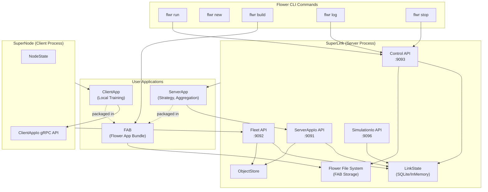
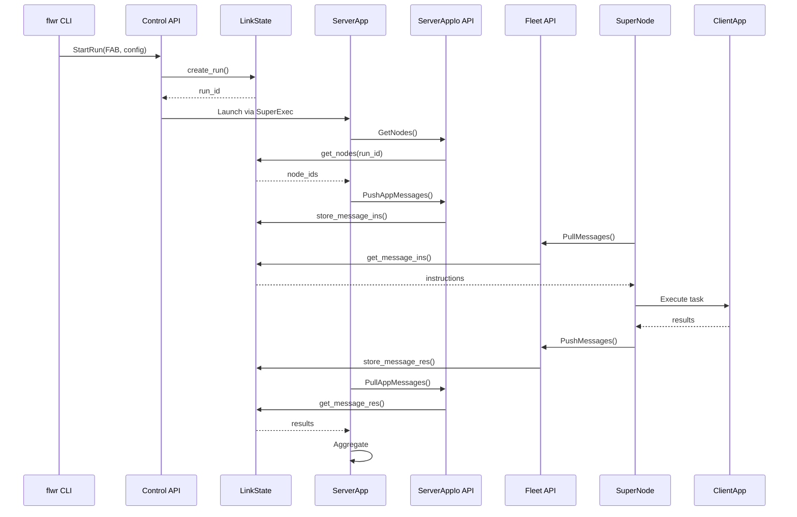
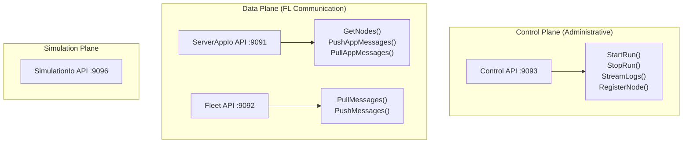
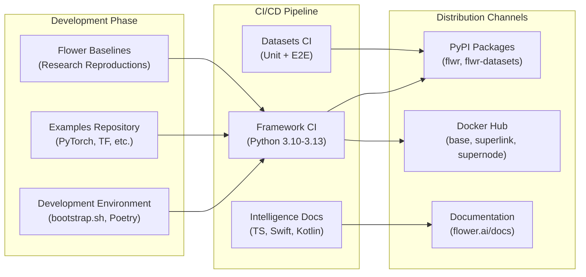

<!-- source: DeepWiki mcp.deepwiki.com · repo adap/flower · page 1 Overview · fetched 2026-10-21 -->

# Overview

Relevant source files

The following files were used as context for generating this wiki page:

- [.gitignore](.gitignore)
- [README.md](README.md)

## Purpose and Scope

This document provides an introduction to the Flower federated AI framework, summarizing its core purpose, design principles, and main architectural components. This overview serves as an entry point to understand how Flower enables distributed machine learning across multiple devices and organizations while maintaining data privacy.

For detailed architectural components and design patterns, see [Architecture](#2). For specific deployment strategies and release processes, see [Deployment](#5). For development environment setup and contribution guidelines, see [Development Guide](#6).

## What is Flower?

Flower (`flwr`) is a framework for building federated AI systems that enables machine learning across distributed datasets without centralizing the data. The framework allows multiple parties to collaboratively train models while keeping their data local and private.

Flower supports federated learning, federated analytics, and federated evaluation across a wide range of machine learning frameworks including PyTorch, TensorFlow, Hugging Face Transformers, scikit-learn, JAX, and many others.

**Sources:** [README.md:25-44]()

## Core Design Principles

Flower is built on four foundational principles that guide its architecture and implementation:

| Principle | Description | Implementation Impact |
|-----------|-------------|----------------------|
| **Customizable** | Federated learning systems vary wildly from use case to use case | Wide range of configuration options and pluggable components |
| **Extendable** | Built with AI research in mind from University of Oxford origins | Components can be extended and overridden for new research |
| **Framework-agnostic** | Different ML frameworks have different strengths | Works with any machine learning framework |
| **Understandable** | Written with maintainability in mind | Encourages community contribution and code readability |

**Sources:** [README.md:26-43]()

## System Architecture Overview

The Flower framework consists of three core runtime components that work together to orchestrate federated learning workflows. SuperLink acts as the central server, SuperNode manages client execution, and user applications (ServerApp and ClientApp) contain the federated learning logic packaged as FAB files.

**Diagram: High-Level Component Architecture**

**Sources:** High-level architecture diagrams (Diagram 1), [README.md:25-44]()

## Key Framework Components

Flower's architecture is organized into several subsystems that work together to enable federated learning:

**Diagram: Federated Learning Execution Flow**

**Sources:** High-level architecture diagrams (Diagram 2)

### Core Runtime Components

| Component | Description | Key Responsibilities |
|-----------|-------------|---------------------|
| **SuperLink** | Central server process hosting multiple gRPC APIs | Orchestrates FL rounds, manages node registry, stores run state in `LinkState`, hosts Control API (`:9093`), Fleet API (`:9092`), ServerAppIo API (`:9091`), and SimulationIo API (`:9096`) |
| **SuperNode** | Client-side process manager | Connects to Fleet API, launches `ClientApp` in isolated subprocess/process, manages local `NodeState`, provides ClientAppIo gRPC API for app communication |
| **SuperExec** | ServerApp process launcher | Manages lifecycle of `ServerApp` processes with subprocess/process isolation on behalf of SuperLink |
| **LinkState** | Central state coordinator | Stores nodes, runs, and messages in SQLite or in-memory backend, provides single source of truth for distributed system state |
| **ObjectStore** | Large object storage | Stores model weights, datasets, and other large objects separately from message metadata using content-addressable storage (SHA256) |

**Sources:** High-level architecture diagrams (Diagram 1)

### Application Layer

| Component | Description | Code Location |
|-----------|-------------|---------------|
| **ServerApp** | Server-side federated learning logic | User-defined, contains strategy implementation and aggregation logic |
| **ClientApp** | Client-side federated learning logic | User-defined, contains local training implementation |
| **FAB** | Flower App Bundle | Packaged application bundle created by `flwr build`, stored in Flower File System (FFS) |

**Sources:** High-level architecture diagrams (Diagram 1), [README.md:25-44]()

### Communication APIs

**Diagram: API Endpoints and Their Roles**

| API | Port | Purpose | Clients |
|-----|------|---------|---------|
| **Control API** | 9093 | Administrative operations, run management, node registration | `flwr` CLI commands |
| **ServerAppIo API** | 9091 | ServerApp communication, node discovery, message push/pull | `ServerApp` processes |
| **Fleet API** | 9092 | SuperNode communication, task distribution | `SuperNode` processes |
| **SimulationIo API** | 9096 | Simulation mode coordination | Simulation runtime |

**Sources:** High-level architecture diagrams (Diagram 1)

### Supporting Subsystems

| Subsystem | Description | Key Components |
|-----------|-------------|----------------|
| **flwr-datasets** | Federated dataset management | `FederatedDataset`, `IidPartitioner`, `DirichletPartitioner`, `NaturalIdPartitioner` |
| **Authentication** | Security layer for APIs | `CliAuthPlugin` (OIDC), `NodeAuthServerInterceptor` (Ed25519), `ControlAuthnPlugin`, `ControlAuthzPlugin` |
| **Flower Intelligence** | Multi-platform on-device AI SDK | `@flwr/flwr` (TypeScript), `FlowerIntelligence` (Swift/Kotlin) |

**Sources:** High-level architecture diagrams (Diagram 5, 6, 7), [README.md:36-39]()

## Framework Integrations

Flower's framework-agnostic design supports a comprehensive range of machine learning libraries and frameworks:

| Category | Supported Frameworks |
|----------|---------------------|
| **Deep Learning** | PyTorch, TensorFlow, PyTorch Lightning, JAX, TFLite |
| **Natural Language Processing** | Hugging Face Transformers |
| **Traditional ML** | scikit-learn, XGBoost, CatBoost |
| **Computer Vision** | MONAI, fastai |
| **Analytics** | Pandas, NumPy |
| **Specialized** | MLX (Apple Silicon), LeRobot (federated robotics) |

Each framework integration provides specialized utilities and examples to streamline development of federated applications within that ecosystem.

**Sources:** [README.md:36-39]()

## Development and Deployment Ecosystem

Flower includes a comprehensive ecosystem for development, testing, and deployment:

**Diagram: Development to Deployment Pipeline**

**Sources:** High-level architecture diagrams (Diagram 3)

### Development Resources

| Resource | Description | Examples |
|----------|-------------|----------|
| **Flower Baselines** | Community-contributed research paper reproductions | FedAvg, FedProx, MOON, DASHA, FedBN, HeteroFL |
| **Quickstart Examples** | Framework-specific tutorials | PyTorch, TensorFlow, Hugging Face, scikit-learn, JAX, MONAI |
| **Advanced Examples** | Production-ready implementations | Embedded devices, vertical FL, LLM fine-tuning, Docker Compose |

**Sources:** [README.md:82-150]()

### Distribution Artifacts

| Artifact Type | Name | Purpose |
|---------------|------|---------|
| **Python Packages** | `flwr`, `flwr-datasets`, `flwr-intelligence` | Core framework, dataset management, AI SDK |
| **Docker Images** | `flwr/base`, `flwr/superlink`, `flwr/supernode`, `flwr/superexec` | Container deployment (Ubuntu/Alpine, Python 3.10-3.13, amd64/arm64) |
| **Documentation** | Multi-language docs on S3 | Framework docs with French, Portuguese, Korean, Chinese translations via Weblate |

**Sources:** High-level architecture diagrams (Diagram 3, 4), [README.md:18-23]()

## Getting Started

To begin using Flower, developers typically:

1. Install the framework: `pip install flwr`
2. Choose a quickstart example matching their preferred ML framework
3. Run the 30-minute federated learning tutorial
4. Explore framework-specific examples and baselines
5. Join the Flower community on Slack for support and collaboration

For detailed installation instructions, see the [Installation Guide](https://flower.ai/docs/framework/how-to-install-flower.html). For CLI usage and runtime components, see [CLI and Runtime Components](#3). For dataset management capabilities, see [Dataset Management](#4).

**Sources:** [README.md:72-91](), [README.md:161-187]()

---

