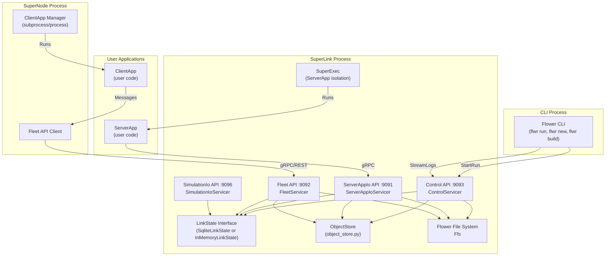
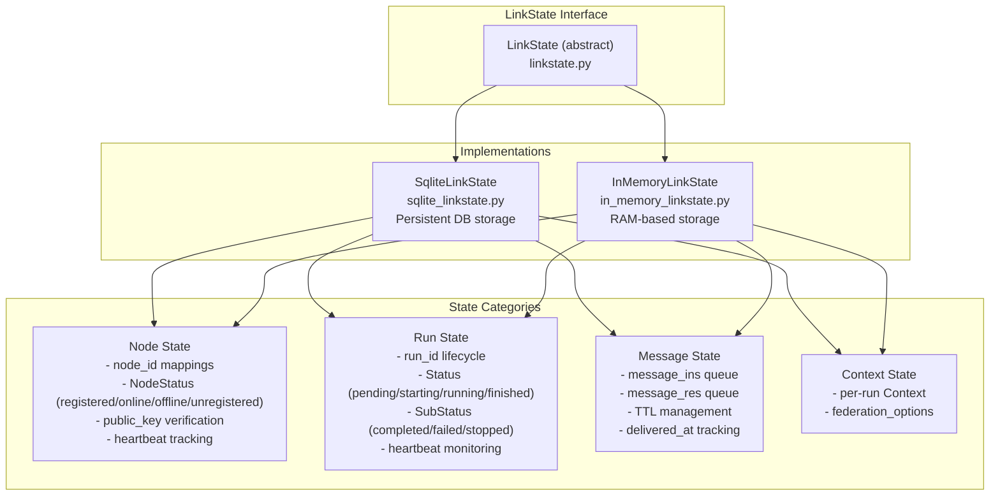
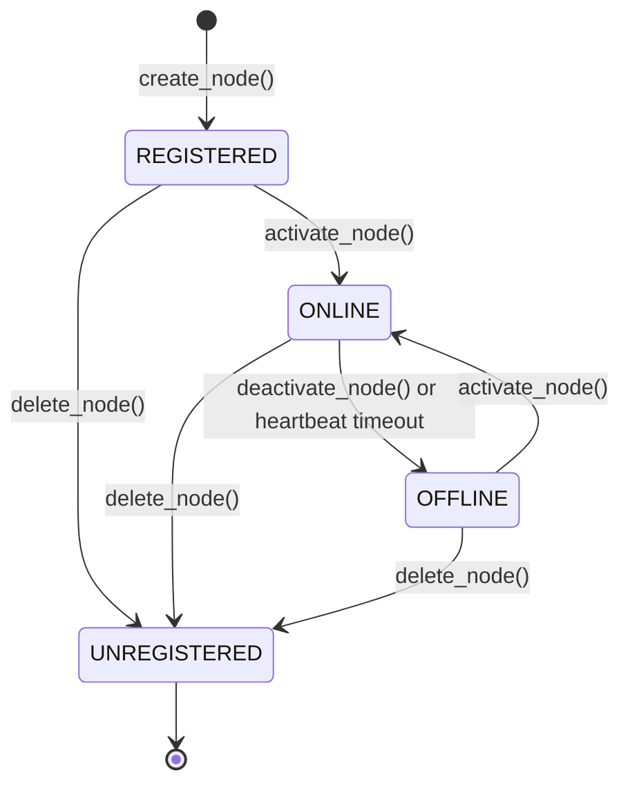
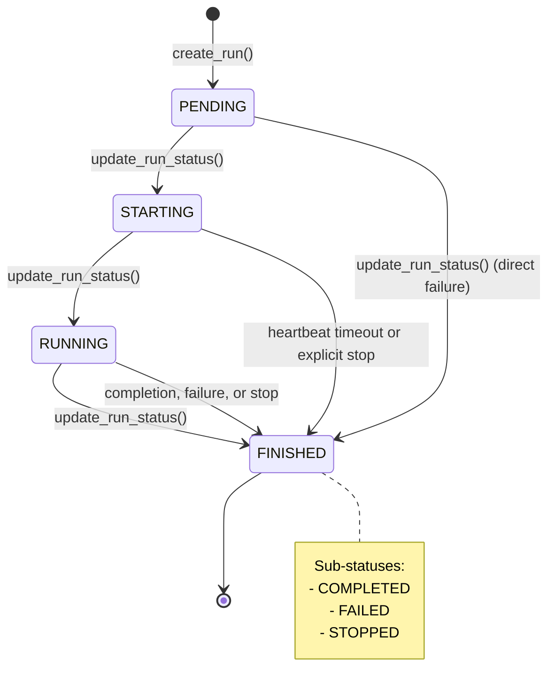
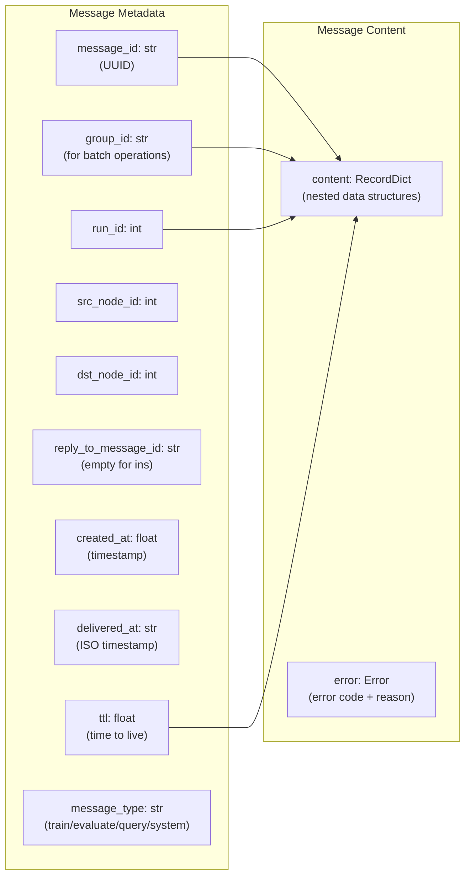
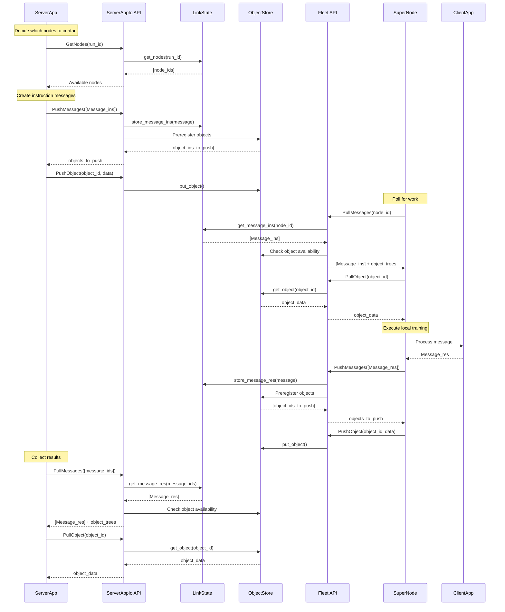
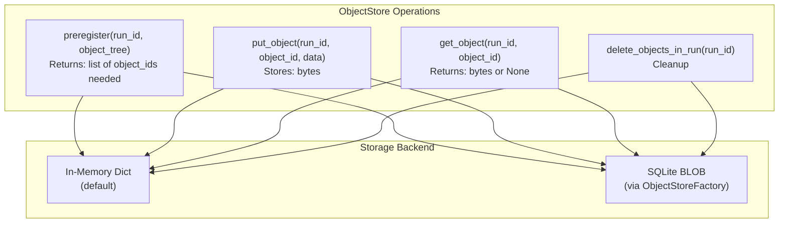
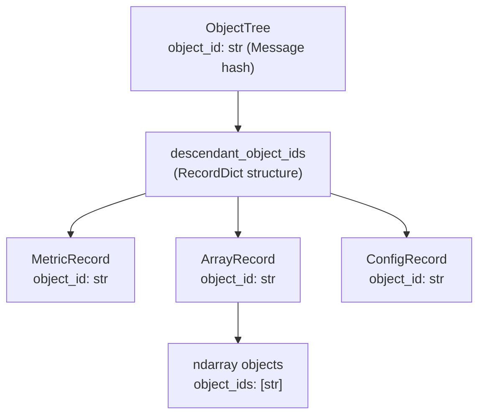
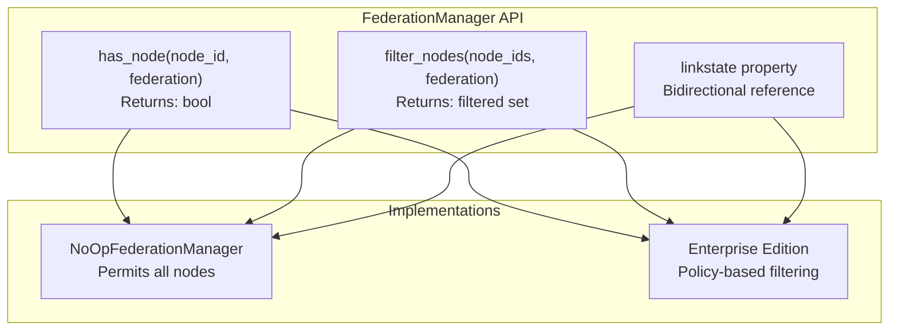
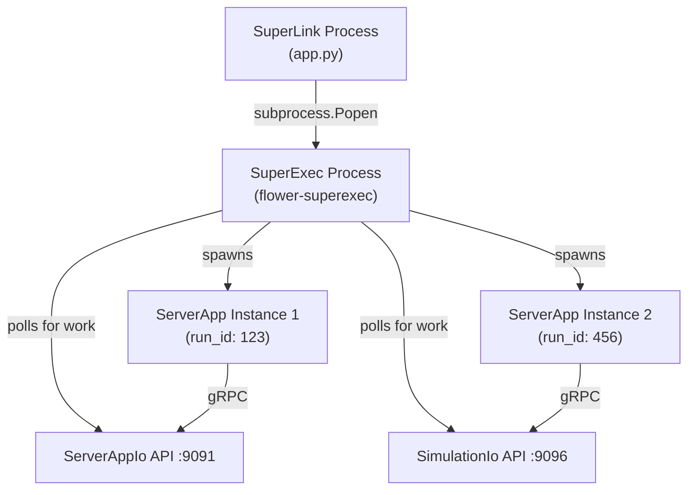

<!-- source: DeepWiki mcp.deepwiki.com · repo adap/flower · page 2 Core Architecture · fetched 2026-10-21 -->

# Core Architecture

<details>
<summary>Relevant source files</summary>

The following files were used as context for generating this wiki page:

- [framework/py/flwr/cli/auth_plugin/__init__.py](framework/py/flwr/cli/auth_plugin/__init__.py)
- [framework/py/flwr/cli/auth_plugin/auth_plugin.py](framework/py/flwr/cli/auth_plugin/auth_plugin.py)
- [framework/py/flwr/cli/auth_plugin/noop_auth_plugin.py](framework/py/flwr/cli/auth_plugin/noop_auth_plugin.py)
- [framework/py/flwr/cli/auth_plugin/oidc_cli_plugin.py](framework/py/flwr/cli/auth_plugin/oidc_cli_plugin.py)
- [framework/py/flwr/cli/build.py](framework/py/flwr/cli/build.py)
- [framework/py/flwr/cli/cli_account_auth_interceptor.py](framework/py/flwr/cli/cli_account_auth_interceptor.py)
- [framework/py/flwr/cli/log.py](framework/py/flwr/cli/log.py)
- [framework/py/flwr/cli/login/login.py](framework/py/flwr/cli/login/login.py)
- [framework/py/flwr/cli/new/new.py](framework/py/flwr/cli/new/new.py)
- [framework/py/flwr/cli/new/new_test.py](framework/py/flwr/cli/new/new_test.py)
- [framework/py/flwr/cli/new/templates/app/code/client.xgboost.py.tpl](framework/py/flwr/cli/new/templates/app/code/client.xgboost.py.tpl)
- [framework/py/flwr/cli/new/templates/app/code/server.xgboost.py.tpl](framework/py/flwr/cli/new/templates/app/code/server.xgboost.py.tpl)
- [framework/py/flwr/cli/new/templates/app/code/task.xgboost.py.tpl](framework/py/flwr/cli/new/templates/app/code/task.xgboost.py.tpl)
- [framework/py/flwr/cli/new/templates/app/pyproject.xgboost.toml.tpl](framework/py/flwr/cli/new/templates/app/pyproject.xgboost.toml.tpl)
- [framework/py/flwr/cli/run/run.py](framework/py/flwr/cli/run/run.py)
- [framework/py/flwr/cli/stop.py](framework/py/flwr/cli/stop.py)
- [framework/py/flwr/cli/utils.py](framework/py/flwr/cli/utils.py)
- [framework/py/flwr/common/constant.py](framework/py/flwr/common/constant.py)
- [framework/py/flwr/server/app.py](framework/py/flwr/server/app.py)
- [framework/py/flwr/server/grid/inmemory_grid_test.py](framework/py/flwr/server/grid/inmemory_grid_test.py)
- [framework/py/flwr/server/superlink/fleet/grpc_rere/fleet_servicer_test.py](framework/py/flwr/server/superlink/fleet/grpc_rere/fleet_servicer_test.py)
- [framework/py/flwr/server/superlink/fleet/grpc_rere/node_auth_server_interceptor_test.py](framework/py/flwr/server/superlink/fleet/grpc_rere/node_auth_server_interceptor_test.py)
- [framework/py/flwr/server/superlink/fleet/vce/vce_api.py](framework/py/flwr/server/superlink/fleet/vce/vce_api.py)
- [framework/py/flwr/server/superlink/fleet/vce/vce_api_test.py](framework/py/flwr/server/superlink/fleet/vce/vce_api_test.py)
- [framework/py/flwr/server/superlink/linkstate/in_memory_linkstate.py](framework/py/flwr/server/superlink/linkstate/in_memory_linkstate.py)
- [framework/py/flwr/server/superlink/linkstate/linkstate.py](framework/py/flwr/server/superlink/linkstate/linkstate.py)
- [framework/py/flwr/server/superlink/linkstate/linkstate_factory.py](framework/py/flwr/server/superlink/linkstate/linkstate_factory.py)
- [framework/py/flwr/server/superlink/linkstate/linkstate_test.py](framework/py/flwr/server/superlink/linkstate/linkstate_test.py)
- [framework/py/flwr/server/superlink/linkstate/sqlite_linkstate.py](framework/py/flwr/server/superlink/linkstate/sqlite_linkstate.py)
- [framework/py/flwr/server/superlink/serverappio/serverappio_servicer_test.py](framework/py/flwr/server/superlink/serverappio/serverappio_servicer_test.py)
- [framework/py/flwr/server/superlink/simulation/simulation_servicer_test.py](framework/py/flwr/server/superlink/simulation/simulation_servicer_test.py)
- [framework/py/flwr/simulation/run_simulation.py](framework/py/flwr/simulation/run_simulation.py)
- [framework/py/flwr/supercore/constant.py](framework/py/flwr/supercore/constant.py)
- [framework/py/flwr/superlink/auth_plugin/__init__.py](framework/py/flwr/superlink/auth_plugin/__init__.py)
- [framework/py/flwr/superlink/auth_plugin/auth_plugin.py](framework/py/flwr/superlink/auth_plugin/auth_plugin.py)
- [framework/py/flwr/superlink/auth_plugin/noop_auth_plugin.py](framework/py/flwr/superlink/auth_plugin/noop_auth_plugin.py)
- [framework/py/flwr/superlink/federation/__init__.py](framework/py/flwr/superlink/federation/__init__.py)
- [framework/py/flwr/superlink/servicer/control/control_grpc.py](framework/py/flwr/superlink/servicer/control/control_grpc.py)
- [framework/py/flwr/superlink/servicer/control/control_servicer_test.py](framework/py/flwr/superlink/servicer/control/control_servicer_test.py)

</details>


## Purpose and Scope

This document provides a comprehensive overview of Flower's core architectural components and how they interact to enable federated learning at scale. It covers the main runtime processes (SuperLink, SuperNode), state management abstractions (LinkState), communication protocols (gRPC APIs), and the message-based coordination system.

For detailed information about specific subsystems, see:
- SuperLink server implementation and APIs: [SuperLink Server Architecture](#2.1)
- SuperNode client implementation and lifecycle: [SuperNode Client Architecture](#2.2)
- State persistence and storage backends: [LinkState and State Management](#2.3)
- Network protocols and API specifications: [Communication Protocols](#2.4)
- Message queuing and object handling: [Message Flow and Object Storage](#2.5)
- Security mechanisms: [Authentication and Authorization](#2.6)

## High-Level System Architecture

Flower's architecture follows a client-server model with three primary runtime processes that communicate through well-defined gRPC APIs. The system is designed around asynchronous message passing, enabling loose coupling between server and client components.

### Main Runtime Processes



**Sources:** 
- [framework/py/flwr/common/constant.py:35-58]()
- [framework/py/flwr/server/app.py:161-466]()

### Component Responsibilities

| Component | Primary Responsibility | Key Classes/Files |
|-----------|----------------------|-------------------|
| **SuperLink** | Server-side orchestration, state coordination | `app.py`, `ControlServicer`, `FleetServicer`, `ServerAppIoServicer` |
| **SuperNode** | Client-side execution, message handling | Fleet client implementations, ClientApp isolation |
| **LinkState** | Persistent state storage (nodes, runs, messages) | `LinkState`, `SqliteLinkState`, `InMemoryLinkState` |
| **Control API** | Run management, node registration, log streaming | `ControlServicer` (port 9093) |
| **ServerAppIo API** | ServerApp communication channel | `ServerAppIoServicer` (port 9091) |
| **Fleet API** | SuperNode communication channel | `FleetServicer` (port 9092) |
| **ObjectStore** | Large object storage (model weights, datasets) | `ObjectStore`, `ObjectStoreFactory` |
| **Ffs** | FAB (Flower App Bundle) storage | `Ffs`, `FfsFactory` |

**Sources:**
- [framework/py/flwr/common/constant.py:35-58]()
- [framework/py/flwr/server/superlink/linkstate/linkstate.py:29-260]()

## Core Components

### LinkState: Central State Coordinator

`LinkState` is the abstract base class that defines Flower's state management interface. It serves as the single source of truth for all operational state, including node registrations, run metadata, and message queues.



#### Key LinkState Methods

The `LinkState` interface defines critical operations organized by entity type:

**Node Management:**
- `create_node(owner_aid, owner_name, public_key, heartbeat_interval)` - Register a new node
- `delete_node(owner_aid, node_id)` - Unregister a node
- `activate_node(node_id, heartbeat_interval)` - Transition to ONLINE status
- `deactivate_node(node_id)` - Transition to OFFLINE status
- `get_nodes(run_id)` - Retrieve active nodes for a federation
- `get_node_info(node_ids, owner_aids, statuses)` - Query node metadata
- `acknowledge_node_heartbeat(node_id, heartbeat_interval)` - Update liveness

**Run Management:**
- `create_run(fab_id, fab_version, fab_hash, override_config, federation, federation_options, flwr_aid)` - Initialize a new run
- `get_run(run_id)` - Retrieve run metadata
- `get_run_status(run_ids)` - Get status for multiple runs
- `update_run_status(run_id, new_status)` - Transition run state
- `acknowledge_app_heartbeat(run_id, heartbeat_interval)` - Update run liveness

**Message Management:**
- `store_message_ins(message)` - Queue an instruction message
- `get_message_ins(node_id, limit)` - Pull messages for a node
- `store_message_res(message)` - Store a response message
- `get_message_res(message_ids)` - Retrieve responses by ID
- `delete_messages(message_ins_ids)` - Clean up message pairs

**Sources:**
- [framework/py/flwr/server/superlink/linkstate/linkstate.py:29-260]()
- [framework/py/flwr/server/superlink/linkstate/sqlite_linkstate.py:74-212]()
- [framework/py/flwr/server/superlink/linkstate/in_memory_linkstate.py:70-101]()

### Node Status Lifecycle

Nodes transition through well-defined states managed by LinkState:



The status constants are defined in `NodeStatus`:
- `REGISTERED = "registered"` - Node created but not yet active
- `ONLINE = "online"` - Node actively participating
- `OFFLINE = "offline"` - Node registered but inactive (heartbeat expired)
- `UNREGISTERED = "unregistered"` - Node permanently removed

**Sources:**
- [framework/py/flwr/supercore/constant.py:38-48]()
- [framework/py/flwr/server/superlink/linkstate/sqlite_linkstate.py:696-749]()
- [framework/py/flwr/server/superlink/linkstate/in_memory_linkstate.py:432-471]()

### Run Status Lifecycle

Runs follow a linear progression with terminal sub-statuses:



Status constants from the `Status` and `SubStatus` classes:
- Main statuses: `PENDING`, `STARTING`, `RUNNING`, `FINISHED`
- Sub-statuses: `COMPLETED`, `FAILED`, `STOPPED`

The system enforces valid state transitions in `update_run_status()` using the `is_valid_transition()` helper function.

**Sources:**
- [framework/py/flwr/common/constant.py:237-259]()
- [framework/py/flwr/server/superlink/linkstate/sqlite_linkstate.py:1016-1110]()
- [framework/py/flwr/server/superlink/linkstate/in_memory_linkstate.py:651-702]()

## gRPC API Services

SuperLink exposes four distinct gRPC services, each with a specific purpose in the federated learning workflow:

### API Service Summary

| API | Port | Primary Clients | Purpose |
|-----|------|----------------|---------|
| **Control API** | 9093 | Flower CLI | Run management, node registration, log streaming |
| **ServerAppIo API** | 9091 | SuperExec (ServerApp) | ServerApp ↔ SuperLink communication |
| **Fleet API** | 9092 | SuperNodes | Node ↔ SuperLink communication |
| **SimulationIo API** | 9096 | Simulation backend | Simulation mode coordination |

Default addresses are defined in constants:
- `CONTROL_API_DEFAULT_SERVER_ADDRESS = "0.0.0.0:9093"`
- `SERVERAPPIO_API_DEFAULT_SERVER_ADDRESS = "0.0.0.0:9091"`
- `FLEET_API_GRPC_RERE_DEFAULT_ADDRESS = "0.0.0.0:9092"`
- `SIMULATIONIO_API_DEFAULT_SERVER_ADDRESS = "0.0.0.0:9096"`

**Sources:**
- [framework/py/flwr/common/constant.py:35-58]()
- [framework/py/flwr/server/app.py:313-425]()

### Control API: Administrative Interface

The `ControlServicer` handles run lifecycle management and administrative operations:

**Key RPC Methods:**
- `StartRun(StartRunRequest)` - Create and initialize a new federated learning run
- `StopRun(StopRunRequest)` - Terminate a running execution
- `ListRuns(ListRunsRequest)` - Query run metadata and status
- `StreamLogs(StreamLogsRequest)` - Stream real-time logs from runs
- `RegisterNode(RegisterNodeRequest)` - Register a SuperNode via CLI
- `UnregisterNode(UnregisterNodeRequest)` - Remove a SuperNode
- `ListNodes(ListNodesRequest)` - Query registered nodes

The Control API requires authentication when account authentication is enabled. Requests are intercepted by `ControlAccountAuthInterceptor` which validates tokens before forwarding to the servicer.

**Sources:**
- [framework/py/flwr/superlink/servicer/control/control_servicer.py:1-300]() (implementation spans multiple methods)
- [framework/py/flwr/superlink/servicer/control/control_grpc.py:1-80]()

### ServerAppIo API: Server Application Communication

The `ServerAppIoServicer` provides the communication channel between ServerApp instances (running in SuperExec) and the SuperLink state:

**Key RPC Methods:**
- `GetNodes(GetNodesRequest)` - Retrieve available nodes for a run
- `PushMessages(PushAppMessagesRequest)` - Send instructions to nodes (message_ins)
- `PullMessages(PullAppMessagesRequest)` - Receive responses from nodes (message_res)
- `UpdateRunStatus(UpdateRunStatusRequest)` - Update run lifecycle state
- `PushAppOutputs(PushAppOutputsRequest)` - Store final run outputs (Context)
- `SendAppHeartbeat(SendAppHeartbeatRequest)` - Signal ServerApp liveness
- `PushObject(PushObjectRequest)` - Upload large objects
- `PullObject(PullObjectRequest)` - Download large objects

Status-based access control: Only runs with status `RUNNING` can push/pull messages. The servicer validates run status before processing requests.

**Sources:**
- [framework/py/flwr/server/superlink/serverappio/serverappio_servicer.py:1-400]() (implementation details)
- [framework/py/flwr/server/superlink/serverappio/serverappio_grpc.py:1-80]()

### Fleet API: Node Communication

The `FleetServicer` handles all communication with SuperNode clients:

**Key RPC Methods:**
- `RegisterNode(RegisterNodeFleetRequest)` - Register a new node (when auth disabled)
- `UnregisterNode(UnregisterNodeFleetRequest)` - Unregister a node (when auth disabled)
- `ActivateNode(ActivateNodeRequest)` - Mark node as online
- `DeactivateNode(DeactivateNodeRequest)` - Mark node as offline
- `PullMessages(PullMessagesRequest)` - Fetch instruction messages
- `PushMessages(PushMessagesRequest)` - Submit result messages
- `GetRun(GetRunRequest)` - Retrieve run metadata
- `GetFab(GetFabRequest)` - Download Flower App Bundle
- `SendNodeHeartbeat(SendNodeHeartbeatRequest)` - Signal node liveness
- `PushObject(PushObjectRequest)` - Upload large objects
- `PullObject(PullObjectRequest)` - Download large objects

When SuperNode authentication is enabled, all requests are intercepted by `NodeAuthServerInterceptor` which validates Ed25519 signatures.

**Sources:**
- [framework/py/flwr/server/superlink/fleet/grpc_rere/fleet_servicer.py:1-500]() (implementation details)
- [framework/py/flwr/server/superlink/fleet/grpc_rere/node_auth_server_interceptor.py:1-200]()

## Message-Based Coordination

Flower's federated learning workflow operates through asynchronous message passing between ServerApp and ClientApps. Messages are queued in LinkState and retrieved independently by each party.

### Message Types and Structure

The `Message` class represents both instructions (ins) and responses (res):



Message types are defined in the `MessageType` class:
- `TRAIN = "train"` - Training round instruction
- `EVALUATE = "evaluate"` - Evaluation request
- `QUERY = "query"` - General query
- `SYSTEM = "system"` - System-level message

**Sources:**
- [framework/py/flwr/common/constant.py:186-196]()
- [framework/py/flwr/common/message.py:1-300]() (Message class definition)

### Message Flow Sequence



**Key observations:**
1. Messages are stored in LinkState with `delivered_at = ""` initially
2. When retrieved via `get_message_ins()`, LinkState marks them as delivered
3. Response messages use `reply_to_message_id` to link back to instructions
4. Large objects are separated from message metadata for efficiency
5. Object trees describe the nested structure of `RecordDict` contents

**Sources:**
- [framework/py/flwr/server/superlink/linkstate/sqlite_linkstate.py:225-278]() (store_message_ins)
- [framework/py/flwr/server/superlink/linkstate/sqlite_linkstate.py:326-387]() (get_message_ins)
- [framework/py/flwr/server/superlink/linkstate/sqlite_linkstate.py:389-460]() (store_message_res)
- [framework/py/flwr/server/superlink/linkstate/sqlite_linkstate.py:462-547]() (get_message_res)

### Message TTL and Cleanup

Messages have a time-to-live (TTL) mechanism to prevent stale data:

- Each message has `metadata.created_at` (timestamp) and `metadata.ttl` (duration in seconds)
- Message is valid until `created_at + ttl > current_time`
- `_check_stored_messages()` validates messages before retrieval
- Expired messages are automatically deleted
- Response TTL cannot exceed the remaining TTL of the instruction it replies to

The validation logic ensures:
```python
# From the implementation
max_allowed_ttl = (
    ins_metadata.created_at + ins_metadata.ttl - res_metadata.created_at
)
if res_metadata.ttl - max_allowed_ttl > MESSAGE_TTL_TOLERANCE:
    # Reject response
```

Where `MESSAGE_TTL_TOLERANCE = 1e-1` accounts for floating-point precision.

**Sources:**
- [framework/py/flwr/server/superlink/linkstate/sqlite_linkstate.py:280-324]() (_check_stored_messages)
- [framework/py/flwr/server/superlink/linkstate/sqlite_linkstate.py:420-439]() (TTL validation in store_message_res)
- [framework/py/flwr/common/constant.py:111]() (MESSAGE_TTL_TOLERANCE)

## Object Storage Architecture

Large data structures (model weights, datasets, gradients) are stored separately from message metadata to avoid bloating the message queue.

### ObjectStore Interface



### Content-Addressable Storage

Objects are identified by SHA-256 hash of their content:

1. When a `Message` or `RecordDict` is created, `get_object_id()` computes its hash
2. Nested objects are traversed to build an object tree
3. `preregister()` is called with the tree to determine which objects need uploading
4. Only objects not already stored are returned in the response
5. Client pushes missing objects using `PushObject` RPC
6. Server verifies object_id matches content hash before storing

This approach provides:
- **Deduplication**: Identical objects are stored once
- **Integrity**: Content verification via hash
- **Referential transparency**: Object IDs are deterministic

**Sources:**
- [framework/py/flwr/supercore/object_store/object_store.py:1-150]() (ObjectStore interface)
- [framework/py/flwr/common/inflatable.py:1-300]() (object_id computation and tree building)

### Object Tree Structure

The `ObjectTree` protobuf message describes nested object hierarchies:



The tree is traversed during push/pull operations to ensure all required objects are available before message delivery.

**Sources:**
- [framework/py/flwr/common/inflatable.py:200-300]() (get_object_tree, iterate_object_tree)
- [framework/py/flwr/proto/message.proto:1-50]() (ObjectTree definition)

## Heartbeat Mechanism

Both nodes and runs require periodic heartbeat signals to indicate liveness. Failure to send heartbeats results in automatic status transitions.

### Node Heartbeat

Nodes send heartbeats via `SendNodeHeartbeat` RPC:

```python
# From constants
HEARTBEAT_DEFAULT_INTERVAL = 30  # seconds
HEARTBEAT_PATIENCE = 2  # number of missed heartbeats tolerated
```

When a heartbeat is received:
1. `acknowledge_node_heartbeat(node_id, heartbeat_interval)` is called
2. `online_until = current_time + HEARTBEAT_PATIENCE * heartbeat_interval`
3. Node status transitions to `ONLINE` if not already
4. `last_activated_at` timestamp is updated

Background check in `_check_and_tag_offline_nodes()`:
- Periodically queries nodes where `online_until <= current_time`
- Transitions them to `OFFLINE` status
- Updates `last_deactivated_at` timestamp

**Sources:**
- [framework/py/flwr/common/constant.py:61-68]() (heartbeat constants)
- [framework/py/flwr/server/superlink/linkstate/sqlite_linkstate.py:779-797]() (_check_and_tag_offline_nodes)
- [framework/py/flwr/server/superlink/linkstate/in_memory_linkstate.py:725-752]() (acknowledge_node_heartbeat)

### Run Heartbeat

ServerApps send heartbeats via `SendAppHeartbeat` RPC:

```python
# Runs are marked as failed when heartbeat stops
RUN_FAILURE_DETAILS_NO_HEARTBEAT = "No heartbeat received from the run."
```

When a run heartbeat is received:
1. `acknowledge_app_heartbeat(run_id, heartbeat_interval)` is called
2. `active_until = current_time + heartbeat_interval` (no patience multiplier for runs)
3. Run continues in `STARTING` or `RUNNING` status

Background check in `_check_and_tag_inactive_run()`:
- Queries runs where `active_until < current_time`
- Transitions them to `FINISHED` with `sub_status = FAILED`
- Sets `details = RUN_FAILURE_DETAILS_NO_HEARTBEAT`

This mechanism ensures that crashed ServerApps don't leave runs in perpetual `RUNNING` state.

**Sources:**
- [framework/py/flwr/common/constant.py:69]() (failure message constant)
- [framework/py/flwr/server/superlink/linkstate/sqlite_linkstate.py:939-959]() (_check_and_tag_inactive_run)
- [framework/py/flwr/server/superlink/linkstate/in_memory_linkstate.py:754-799]() (acknowledge_app_heartbeat)

## Federation Management

The `FederationManager` interface provides multi-tenancy by controlling which nodes can participate in which runs.

### FederationManager Interface



### Integration with LinkState

The FederationManager is injected into LinkState during initialization:

```python
# From LinkStateFactory
def __init__(self, database_path: str, federation_manager: FederationManager):
    super().__init__(database_path)
    federation_manager.linkstate = self  # Bidirectional reference
    self._federation_manager = federation_manager
```

When operations involve node membership checks:
1. `store_message_ins()` calls `federation_manager.has_node()` to validate destination
2. `get_nodes(run_id)` calls `federation_manager.filter_nodes()` to apply policies
3. `_check_stored_messages()` validates that both src and dst nodes remain in federation

The default `NoOpFederationManager` allows all nodes, effectively disabling multi-tenancy:

```python
def has_node(self, node_id: int, federation: str) -> bool:
    return True

def filter_nodes(self, node_ids: set[int], federation: str) -> set[int]:
    return node_ids
```

**Sources:**
- [framework/py/flwr/superlink/federation/federation_manager.py:1-50]() (interface definition)
- [framework/py/flwr/superlink/federation/noop_federation_manager.py:1-40]() (default implementation)
- [framework/py/flwr/server/superlink/linkstate/sqlite_linkstate.py:196-201]() (federation_manager property)
- [framework/py/flwr/server/superlink/linkstate/sqlite_linkstate.py:751-777]() (get_nodes with filtering)

## Process Isolation

User code (ServerApp and ClientApp) runs in isolated processes to prevent crashes from affecting the core infrastructure.

### Isolation Modes

Two isolation modes are supported, configured via command-line argument:

```python
# From constants
ISOLATION_MODE_SUBPROCESS = "subprocess"  # Default for SuperLink
ISOLATION_MODE_PROCESS = "process"         # Alternative
```

When `--isolation=subprocess`:
- SuperLink automatically launches `flower-superexec` as a subprocess
- SuperExec connects to ServerAppIo API (port 9091) or SimulationIo API (port 9096)
- ServerApp runs as a child process of SuperExec
- Crash recovery: SuperExec can restart ServerApp without affecting SuperLink

When `--isolation=process`:
- User manually starts SuperExec process
- Provides flexibility for distributed deployments

**Sources:**
- [framework/py/flwr/common/constant.py:114-115]() (isolation mode constants)
- [framework/py/flwr/server/app.py:428-445]() (subprocess launching logic)

### SuperExec Architecture



SuperExec responsibilities:
1. Poll `ListAppsToLaunch` RPC to discover pending runs
2. Load FAB from Flower File System
3. Launch ServerApp with appropriate isolation
4. Monitor ServerApp process and handle crashes
5. Clean up resources when run completes

**Sources:**
- [framework/py/flwr/server/app.py:428-445]() (SuperExec subprocess logic)
- [framework/py/flwr/cli/run/run.py:1-250]() (CLI run command triggering execution)

## Summary

Flower's core architecture is built around several key principles:

1. **Separation of Concerns**: Distinct APIs (Control, ServerAppIo, Fleet, SimulationIo) handle different aspects of the federated learning workflow
2. **Asynchronous Messaging**: Message queues in LinkState decouple ServerApp from ClientApps, enabling scalability
3. **State Abstraction**: LinkState interface allows switching between SQLite and in-memory backends
4. **Content-Addressable Storage**: Object hashing enables deduplication and integrity verification
5. **Process Isolation**: User code runs in separate processes with crash recovery
6. **Federation Support**: FederationManager enables multi-tenancy and access control
7. **Liveness Monitoring**: Heartbeat mechanism ensures timely failure detection

These components work together to provide a robust, scalable platform for federated learning at scale.

**Sources:**
- [framework/py/flwr/server/app.py:161-466]() (SuperLink initialization)
- [framework/py/flwr/server/superlink/linkstate/linkstate.py:29-260]() (LinkState interface)
- [framework/py/flwr/common/constant.py:1-325]() (system-wide constants)

---

