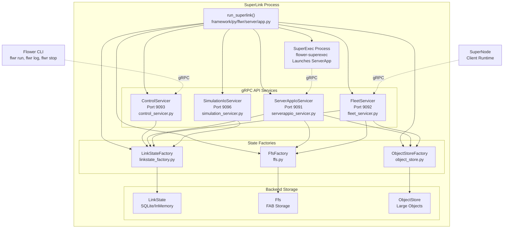
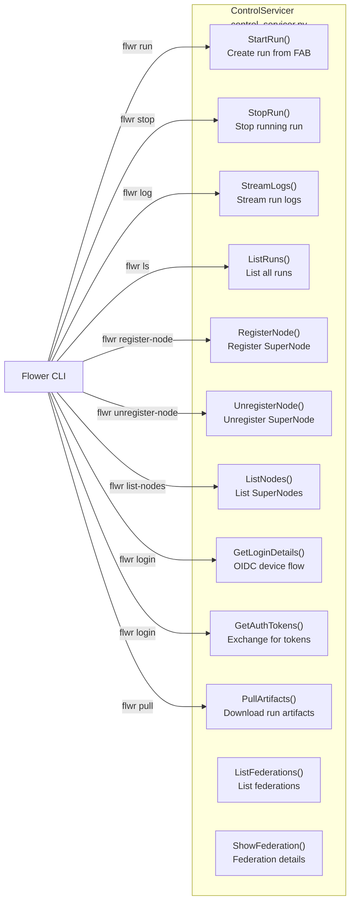
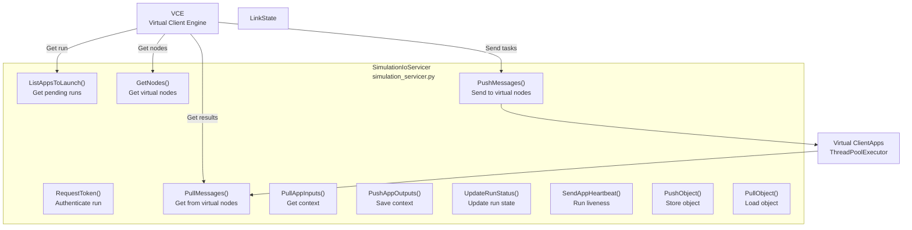
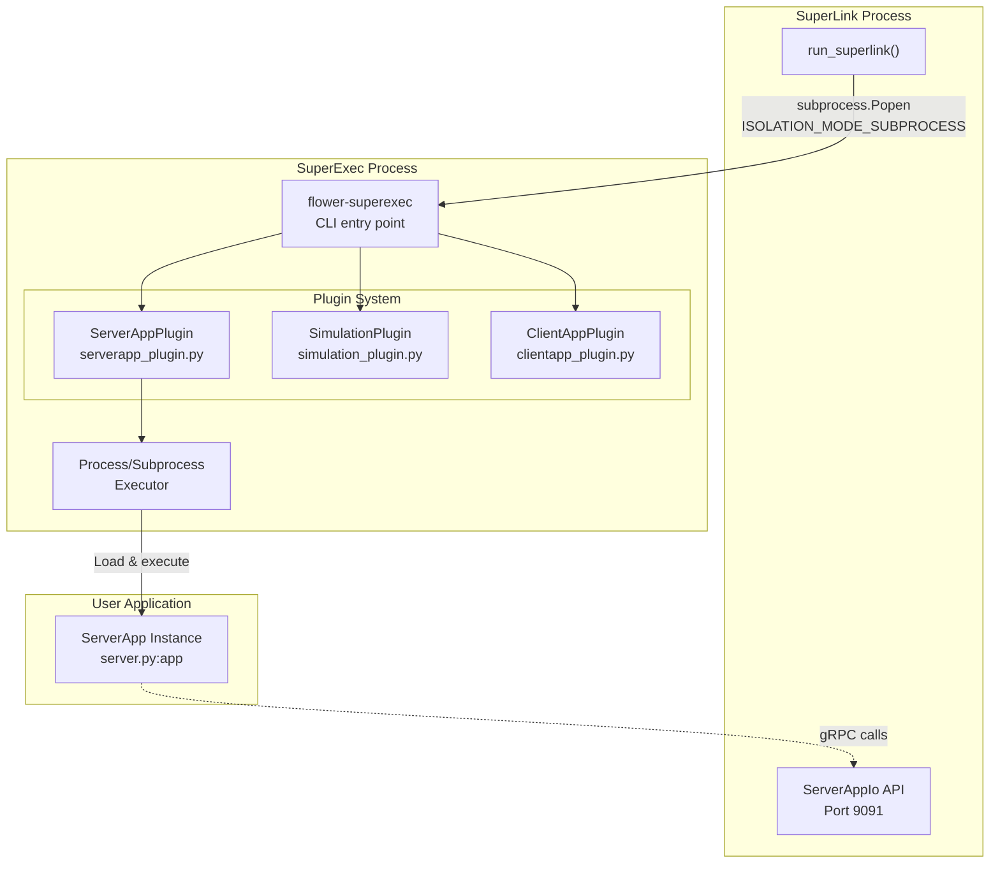
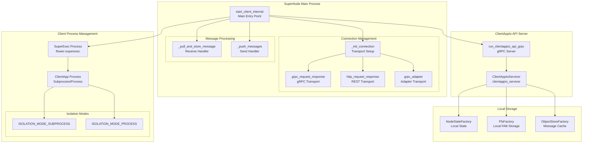
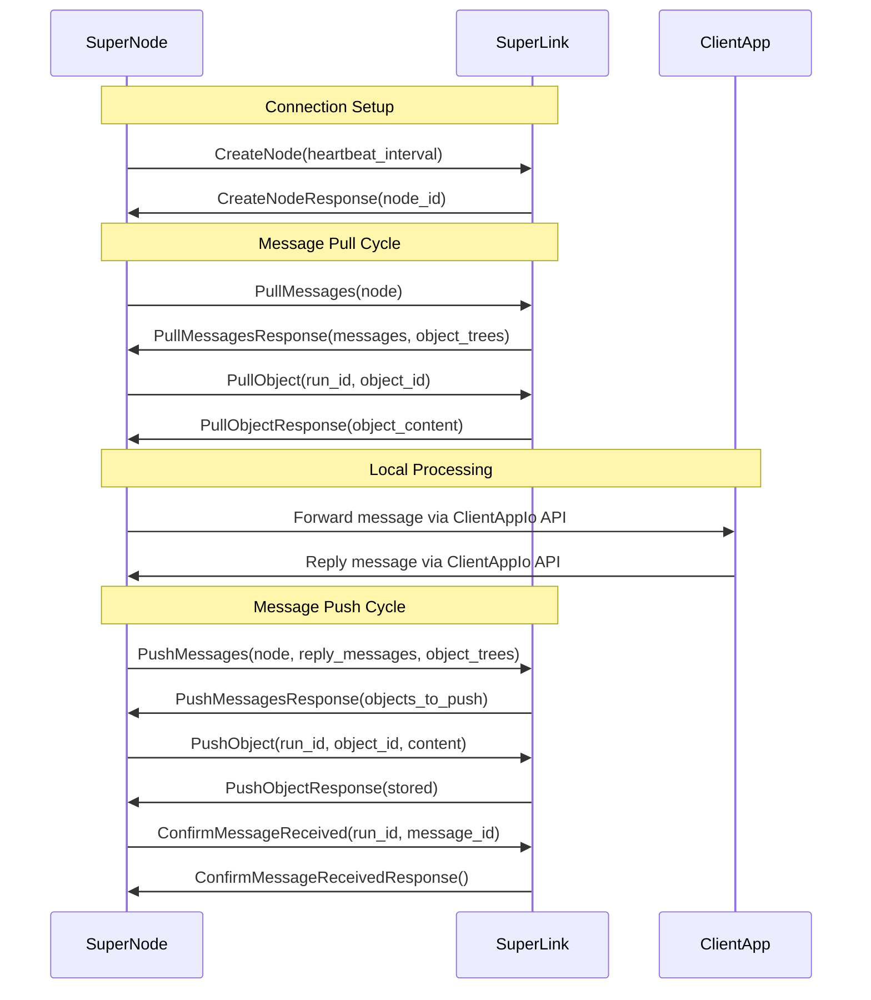

<!-- source: DeepWiki mcp.deepwiki.com · repo adap/flower · page 2.1 SuperLink Server Architecture · fetched 2026-10-21 -->

# SuperLink Server Architecture

<details>
<summary>Relevant source files</summary>

The following files were used as context for generating this wiki page:

- [framework/proto/flwr/proto/control.proto](framework/proto/flwr/proto/control.proto)
- [framework/proto/flwr/proto/federation.proto](framework/proto/flwr/proto/federation.proto)
- [framework/py/flwr/cli/auth_plugin/__init__.py](framework/py/flwr/cli/auth_plugin/__init__.py)
- [framework/py/flwr/cli/auth_plugin/auth_plugin.py](framework/py/flwr/cli/auth_plugin/auth_plugin.py)
- [framework/py/flwr/cli/auth_plugin/noop_auth_plugin.py](framework/py/flwr/cli/auth_plugin/noop_auth_plugin.py)
- [framework/py/flwr/cli/auth_plugin/oidc_cli_plugin.py](framework/py/flwr/cli/auth_plugin/oidc_cli_plugin.py)
- [framework/py/flwr/cli/build.py](framework/py/flwr/cli/build.py)
- [framework/py/flwr/cli/cli_account_auth_interceptor.py](framework/py/flwr/cli/cli_account_auth_interceptor.py)
- [framework/py/flwr/cli/log.py](framework/py/flwr/cli/log.py)
- [framework/py/flwr/cli/login/login.py](framework/py/flwr/cli/login/login.py)
- [framework/py/flwr/cli/new/new.py](framework/py/flwr/cli/new/new.py)
- [framework/py/flwr/cli/new/new_test.py](framework/py/flwr/cli/new/new_test.py)
- [framework/py/flwr/cli/new/templates/app/code/client.xgboost.py.tpl](framework/py/flwr/cli/new/templates/app/code/client.xgboost.py.tpl)
- [framework/py/flwr/cli/new/templates/app/code/server.xgboost.py.tpl](framework/py/flwr/cli/new/templates/app/code/server.xgboost.py.tpl)
- [framework/py/flwr/cli/new/templates/app/code/task.xgboost.py.tpl](framework/py/flwr/cli/new/templates/app/code/task.xgboost.py.tpl)
- [framework/py/flwr/cli/new/templates/app/pyproject.xgboost.toml.tpl](framework/py/flwr/cli/new/templates/app/pyproject.xgboost.toml.tpl)
- [framework/py/flwr/cli/run/run.py](framework/py/flwr/cli/run/run.py)
- [framework/py/flwr/cli/stop.py](framework/py/flwr/cli/stop.py)
- [framework/py/flwr/cli/utils.py](framework/py/flwr/cli/utils.py)
- [framework/py/flwr/common/constant.py](framework/py/flwr/common/constant.py)
- [framework/py/flwr/proto/control_pb2.py](framework/py/flwr/proto/control_pb2.py)
- [framework/py/flwr/proto/control_pb2.pyi](framework/py/flwr/proto/control_pb2.pyi)
- [framework/py/flwr/proto/control_pb2_grpc.py](framework/py/flwr/proto/control_pb2_grpc.py)
- [framework/py/flwr/proto/control_pb2_grpc.pyi](framework/py/flwr/proto/control_pb2_grpc.pyi)
- [framework/py/flwr/proto/federation_pb2.py](framework/py/flwr/proto/federation_pb2.py)
- [framework/py/flwr/proto/federation_pb2.pyi](framework/py/flwr/proto/federation_pb2.pyi)
- [framework/py/flwr/proto/federation_pb2_grpc.py](framework/py/flwr/proto/federation_pb2_grpc.py)
- [framework/py/flwr/proto/federation_pb2_grpc.pyi](framework/py/flwr/proto/federation_pb2_grpc.pyi)
- [framework/py/flwr/server/app.py](framework/py/flwr/server/app.py)
- [framework/py/flwr/server/grid/inmemory_grid_test.py](framework/py/flwr/server/grid/inmemory_grid_test.py)
- [framework/py/flwr/server/superlink/fleet/grpc_rere/fleet_servicer_test.py](framework/py/flwr/server/superlink/fleet/grpc_rere/fleet_servicer_test.py)
- [framework/py/flwr/server/superlink/fleet/grpc_rere/node_auth_server_interceptor_test.py](framework/py/flwr/server/superlink/fleet/grpc_rere/node_auth_server_interceptor_test.py)
- [framework/py/flwr/server/superlink/fleet/vce/vce_api.py](framework/py/flwr/server/superlink/fleet/vce/vce_api.py)
- [framework/py/flwr/server/superlink/fleet/vce/vce_api_test.py](framework/py/flwr/server/superlink/fleet/vce/vce_api_test.py)
- [framework/py/flwr/server/superlink/linkstate/in_memory_linkstate.py](framework/py/flwr/server/superlink/linkstate/in_memory_linkstate.py)
- [framework/py/flwr/server/superlink/linkstate/linkstate.py](framework/py/flwr/server/superlink/linkstate/linkstate.py)
- [framework/py/flwr/server/superlink/linkstate/linkstate_factory.py](framework/py/flwr/server/superlink/linkstate/linkstate_factory.py)
- [framework/py/flwr/server/superlink/linkstate/linkstate_test.py](framework/py/flwr/server/superlink/linkstate/linkstate_test.py)
- [framework/py/flwr/server/superlink/linkstate/sqlite_linkstate.py](framework/py/flwr/server/superlink/linkstate/sqlite_linkstate.py)
- [framework/py/flwr/server/superlink/serverappio/serverappio_servicer_test.py](framework/py/flwr/server/superlink/serverappio/serverappio_servicer_test.py)
- [framework/py/flwr/server/superlink/simulation/simulation_servicer_test.py](framework/py/flwr/server/superlink/simulation/simulation_servicer_test.py)
- [framework/py/flwr/simulation/run_simulation.py](framework/py/flwr/simulation/run_simulation.py)
- [framework/py/flwr/supercore/constant.py](framework/py/flwr/supercore/constant.py)
- [framework/py/flwr/superlink/auth_plugin/__init__.py](framework/py/flwr/superlink/auth_plugin/__init__.py)
- [framework/py/flwr/superlink/auth_plugin/auth_plugin.py](framework/py/flwr/superlink/auth_plugin/auth_plugin.py)
- [framework/py/flwr/superlink/auth_plugin/noop_auth_plugin.py](framework/py/flwr/superlink/auth_plugin/noop_auth_plugin.py)
- [framework/py/flwr/superlink/federation/__init__.py](framework/py/flwr/superlink/federation/__init__.py)
- [framework/py/flwr/superlink/servicer/control/control_grpc.py](framework/py/flwr/superlink/servicer/control/control_grpc.py)
- [framework/py/flwr/superlink/servicer/control/control_servicer.py](framework/py/flwr/superlink/servicer/control/control_servicer.py)
- [framework/py/flwr/superlink/servicer/control/control_servicer_test.py](framework/py/flwr/superlink/servicer/control/control_servicer_test.py)

</details>


This document details the SuperLink server component, which serves as the central orchestration service in the Flower framework. SuperLink manages federated learning runs, coordinates communication between server and client applications, and provides APIs for administrative control.

For information about the client-side SuperNode component, see [SuperNode Client Architecture](#2.2). For details about state management, see [LinkState and State Management](#2.3). For communication protocol details, see [Communication Protocols](#2.4).

## SuperLink Overview

SuperLink is the server-side runtime that hosts multiple gRPC API services for different concerns: administrative control, server application communication, fleet management, and simulation. It integrates with LinkState for persistent state, ObjectStore for large objects, and Ffs for FAB file storage.

### SuperLink Process Architecture



**Sources:** [framework/py/flwr/server/app.py:161-427](), [framework/py/flwr/common/constant.py:36-58]()

The `run_superlink()` function in `framework/py/flwr/server/app.py` initializes all components:

1. **Parses arguments** - database path, port addresses, certificates, authentication config
2. **Creates factory instances** - `LinkStateFactory`, `FfsFactory`, `ObjectStoreFactory`
3. **Starts gRPC servers** - one for each API service (Control, ServerAppIo, Fleet, SimulationIo)
4. **Launches SuperExec** - if isolation mode is subprocess, spawns `flower-superexec` process

Port assignments are defined in [framework/py/flwr/common/constant.py:36-58]():
- Control API: port `9093` (`CONTROL_API_PORT`)
- ServerAppIo API: port `9091` (`SERVERAPPIO_PORT`)
- Fleet API: port `9092` (`FLEETAPI_GRPC_RERE_PORT`)
- SimulationIo API: port `9096` (`SIMULATIONIO_PORT`)

**Sources:** [framework/py/flwr/server/app.py:161-427](), [framework/py/flwr/common/constant.py:36-58]()

## Control API

The `ControlServicer` class implements the Control API, which provides administrative commands for managing runs, nodes, and authentication. The CLI (`flwr` commands) communicates with this API.

### Control API Methods



**Sources:** [framework/py/flwr/superlink/servicer/control/control_servicer.py:88-561]()

The Control API is initialized by `run_control_api_grpc()` in [framework/py/flwr/superlink/servicer/control/control_grpc.py:37-90](). Key responsibilities:

| Method | Purpose | Key Operations |
|--------|---------|---------------|
| `StartRun` | Create new run | Validates FAB, creates run in LinkState, initializes context |
| `StopRun` | Stop active run | Updates run status to STOPPED, deletes messages, cleans up objects |
| `StreamLogs` | Stream run logs | Yields log entries from LinkState until run finishes |
| `ListRuns` | List runs | Returns run metadata for user's account or specific run_id |
| `RegisterNode` | Register SuperNode | Creates node in LinkState with public key (requires NIST EC curve) |
| `UnregisterNode` | Unregister SuperNode | Marks node as unregistered in LinkState |
| `ListNodes` | List SuperNodes | Returns node info filtered by owner account |
| `GetLoginDetails` | Start OIDC login | Delegates to `ControlAuthnPlugin.get_login_details()` |
| `GetAuthTokens` | Complete OIDC login | Exchanges device code for access/refresh tokens |
| `PullArtifacts` | Download artifacts | Returns download URL from `ArtifactProvider` (if configured) |
| `ListFederations` | List federations | Returns federations user is member of |
| `ShowFederation` | Federation details | Returns members, nodes, and runs for a federation |

**Sources:** [framework/py/flwr/superlink/servicer/control/control_servicer.py:107-561]()

### Authentication and Authorization

The Control API supports pluggable authentication/authorization through `ControlAuthnPlugin` and `ControlAuthzPlugin` interfaces. Account information is managed through interceptors:

- **Authentication**: `ControlAccountAuthInterceptor` validates tokens and extracts account info
- **Authorization**: Checks permissions before executing commands
- **Event Logging**: `EventLogPlugin` can audit administrative actions

**Sources:** [framework/py/flwr/superlink/servicer/control/control_servicer.py:91-105](), [framework/py/flwr/server/app.py:227-244]()

## ServerAppIo API

The `ServerAppIoServicer` class implements the ServerAppIo API for communication between SuperLink and ServerApp processes. This API enables the ServerApp (running via SuperExec) to coordinate with SuperLink.

### ServerAppIo API Methods

```mermaid
graph TB
    subgraph ServerAppIoServicer["ServerAppIoServicer<br/>serverappio_servicer.py"]
        ListAppsToLaunch["ListAppsToLaunch()<br/>Get pending runs"]
        RequestToken["RequestToken()<br/>Authenticate run"]
        
        GetNodes["GetNodes()<br/>Get available nodes"]
        PushMessages["PushMessages()<br/>Send instructions"]
        PullMessages["PullMessages()<br/>Get replies"]
        
        PullAppInputs["PullAppInputs()<br/>Get context"]
        PushAppOutputs["PushAppOutputs()<br/>Save context"]
        
        UpdateRunStatus["UpdateRunStatus()<br/>Update run state"]
        SendAppHeartbeat["SendAppHeartbeat()<br/>Run liveness"]
        
        PushObject["PushObject()<br/>Store object"]
        PullObject["PullObject()<br/>Load object"]
        ConfirmMessageReceived["ConfirmMessageReceived()<br/>ACK message"]
    end
    
    ServerApp["ServerApp Process<br/>via SuperExec"]
    LinkState["LinkState"]
    ObjectStore["ObjectStore"]
    
    ServerApp -->|"1. Get run"| ListAppsToLaunch
    ServerApp -->|"2. Auth"| RequestToken
    ServerApp -->|"3. Get nodes"| GetNodes
    ServerApp -->|"4. Send tasks"| PushMessages
    ServerApp -->|"5. Get results"| PullMessages
    ServerApp -->|"Update status"| UpdateRunStatus
    ServerApp -->|"Heartbeat"| SendAppHeartbeat
    
    GetNodes --> LinkState
    PushMessages --> LinkState
    PullMessages --> LinkState
    UpdateRunStatus --> LinkState
    
    PushObject --> ObjectStore
    PullObject --> ObjectStore
```



**Sources:** [framework/py/flwr/server/superlink/serverappio/serverappio_servicer.py:80-571]()

### ServerAppIo Method Details

| Method | Purpose | Run Status Requirement |
|--------|---------|----------------------|
| `ListAppsToLaunch` | Get pending run IDs | Any (scans for PENDING) |
| `RequestToken` | Generate auth token for run | Any |
| `GetNodes` | Get online node IDs for run | RUNNING |
| `PushMessages` | Store instruction messages | RUNNING |
| `PullMessages` | Retrieve reply messages | RUNNING |
| `PullAppInputs` | Get run context (input) | RUNNING |
| `PushAppOutputs` | Save run context (output) | RUNNING or FINISHED |
| `UpdateRunStatus` | Transition run status | Any (validates transition) |
| `SendAppHeartbeat` | Acknowledge run liveness | STARTING or RUNNING |
| `PushObject`/`PullObject` | Transfer serialized objects | RUNNING or FINISHED |
| `ConfirmMessageReceived` | Mark message as received | Any |

**Sources:** [framework/py/flwr/server/superlink/serverappio/serverappio_servicer.py:97-571]()

The ServerAppIo API enforces run status constraints - most operations require the run to be in `RUNNING` state. Status transitions follow the pattern: `PENDING → STARTING → RUNNING → FINISHED`.

**Sources:** [framework/py/flwr/server/superlink/serverappio/serverappio_servicer.py:169-243]()

## Fleet API

The `FleetServicer` class implements the Fleet API for communication between SuperLink and SuperNode clients. This is the primary interface for node registration, message exchange, and object transfer.

### Fleet API Methods

```mermaid
graph TB
    subgraph FleetServicer["FleetServicer<br/>fleet_servicer.py"]
        RegisterNode["RegisterNode()<br/>Register node"]
        ActivateNode["ActivateNode()<br/>Transition to online"]
        DeactivateNode["DeactivateNode()<br/>Transition to offline"]
        UnregisterNode["UnregisterNode()<br/>Unregister node"]
        
        PullMessages["PullMessages()<br/>Get instructions"]
        PushMessages["PushMessages()<br/>Send results"]
        
        GetRun["GetRun()<br/>Get run metadata"]
        GetFab["GetFab()<br/>Get FAB content"]
        
        SendNodeHeartbeat["SendNodeHeartbeat()<br/>Node liveness"]
        
        PushObject["PushObject()<br/>Store object"]
        PullObject["PullObject()<br/>Load object"]
        ConfirmMessageReceived["ConfirmMessageReceived()<br/>ACK message"]
    end
    
    SuperNode["SuperNode Client"]
    LinkState["LinkState"]
    Ffs["Ffs"]
    ObjectStore["ObjectStore"]
    
    SuperNode -->|"1. Register"| RegisterNode
    SuperNode -->|"2. Activate"| ActivateNode
    SuperNode -->|"3. Pull tasks"| PullMessages
    SuperNode -->|"4. Push results"| PushMessages
    SuperNode -->|"Get config"| GetRun
    SuperNode -->|"Get code"| GetFab
    SuperNode -->|"Heartbeat"| SendNodeHeartbeat
    SuperNode -->|"5. Deactivate"| DeactivateNode
    
    RegisterNode --> LinkState
    ActivateNode --> LinkState
    PullMessages --> LinkState
    PushMessages --> LinkState
    GetRun --> LinkState
    GetFab --> Ffs
    
    PushObject --> ObjectStore
    PullObject --> ObjectStore
```



**Sources:** [framework/py/flwr/server/superlink/fleet/grpc_rere/fleet_servicer.py:58-456]()

### Fleet API Method Details

The Fleet API handles the complete SuperNode lifecycle:

**Node Lifecycle Methods:**
- `RegisterNode()` - Creates node entry in LinkState (disabled when node auth enabled)
- `ActivateNode()` - Transitions node from REGISTERED/OFFLINE to ONLINE status
- `DeactivateNode()` - Transitions node from ONLINE to OFFLINE status
- `UnregisterNode()` - Marks node as UNREGISTERED (disabled when node auth enabled)
- `SendNodeHeartbeat()` - Refreshes node's `online_until` timestamp

**Message Exchange Methods:**
- `PullMessages()` - Retrieves instruction messages for node, returns object tree references
- `PushMessages()` - Stores reply messages from node, validates run status
- `ConfirmMessageReceived()` - Acknowledges message processing, triggers cleanup

**Configuration Methods:**
- `GetRun()` - Returns `Run` protobuf with fab_id, fab_version, override_config
- `GetFab()` - Returns FAB content from Ffs storage

**Object Transfer Methods:**
- `PushObject()` - Stores serialized object in ObjectStore
- `PullObject()` - Retrieves serialized object from ObjectStore

**Sources:** [framework/py/flwr/server/superlink/fleet/grpc_rere/fleet_servicer.py:58-456]()

### Node Authentication

The Fleet API supports optional node authentication via `NodeAuthServerInterceptor`. When enabled (`--enable-supernode-auth` flag), the interceptor:

1. Validates Ed25519 signature in gRPC metadata headers
2. Verifies timestamp is within tolerance window
3. Maps public key to node_id via LinkState
4. Blocks RegisterNode/UnregisterNode operations (nodes must be pre-registered via CLI)

**Sources:** [framework/py/flwr/server/superlink/fleet/grpc_rere/node_auth_server_interceptor.py:43-204]()

## SimulationIo API

The `SimulationIoServicer` class implements the SimulationIo API for simulation mode, where ClientApps run within the SuperLink process using the VCE (Virtual Client Engine).

### SimulationIo vs Normal Mode

In normal deployment:
- SuperNodes run on separate machines
- ClientApps execute in isolated SuperNode processes
- Communication via Fleet API (gRPC over network)

In simulation mode:
- ClientApps run within SuperLink process
- Virtual nodes managed by VCE (Virtual Client Engine)
- Communication via SimulationIo API (in-process)

### SimulationIo API Methods



**Sources:** [framework/py/flwr/server/superlink/simulation/simulationio_servicer.py:73-523](), [framework/py/flwr/server/superlink/fleet/vce/vce_api.py:1-456]()

The SimulationIo API is nearly identical to ServerAppIo API but integrates with VCE for in-process virtual node management. The `num-supernodes` federation option controls the number of virtual ClientApps.

**Sources:** [framework/py/flwr/server/superlink/simulation/simulationio_servicer.py:73-523]()

## SuperExec Process Management

SuperExec is the process launcher component that manages ServerApp execution. It runs as a separate process (`flower-superexec`) when isolation mode is subprocess.

### SuperExec Architecture



**Sources:** [framework/py/flwr/server/app.py:428-476](), [framework/py/flwr/supercore/cli/flower_superexec.py:37-103]()

### SuperExec Plugins

SuperExec uses a plugin architecture defined in [framework/py/flwr/superexec/exec_plugin.py:32-103](). Three plugin types are supported:

| Plugin Type | Purpose | Entry Point |
|------------|---------|-------------|
| `ExecPluginType.SERVER_APP` | Execute ServerApp | `run_serverapp()` |
| `ExecPluginType.SIMULATION` | Execute simulation | `run_simulation()` |
| `ExecPluginType.CLIENT_APP` | Execute ClientApp | `run_clientapp()` (for SuperNode-side) |

**Sources:** [framework/py/flwr/common/constant.py:304-319](), [framework/py/flwr/superexec/exec_plugin.py:32-103]()

### ServerApp Execution Flow

1. **SuperLink launches SuperExec**: [framework/py/flwr/server/app.py:434-476]()
   - Builds command: `["flower-superexec", "--insecure", "--appio-api-address", "127.0.0.1:9091", ...]`
   - Spawns subprocess via `subprocess.Popen()`

2. **SuperExec initializes**: [framework/py/flwr/supercore/cli/flower_superexec.py:37-103]()
   - Parses CLI arguments (plugin type, API address, isolation mode)
   - Loads appropriate plugin (e.g., `ServerAppPlugin`)

3. **Plugin execution**: [framework/py/flwr/superexec/exec_plugin.py:105-275]()
   - Polls ServerAppIo API via `ListAppsToLaunch()` for pending runs
   - Loads FAB from Ffs
   - Executes ServerApp in isolated process/subprocess
   - ServerApp communicates back to ServerAppIo API

4. **Lifecycle management**:
   - Token-based authentication for each run
   - Heartbeat mechanism to track liveness
   - Status transitions managed through `UpdateRunStatus()`

**Sources:** [framework/py/flwr/superexec/exec_plugin.py:105-275](), [framework/py/flwr/server/app.py:428-476]()

## State and Storage Integration

SuperLink integrates three storage systems through factory patterns:

### LinkState Factory

The `LinkStateFactory` creates `LinkState` instances for persistent state management:

```python
# framework/py/flwr/server/superlink/linkstate/linkstate_factory.py
class LinkStateFactory:
    def __init__(self, database_path: str, federation_manager: FederationManager):
        if database_path == ":flwr-in-memory:":
            self.state = InMemoryLinkState(federation_manager)
        else:
            self.state = SqliteLinkState(database_path, federation_manager)
```

LinkState stores:
- **Runs**: run_id, fab_hash, status, timestamps
- **Nodes**: node_id, public_key, status, heartbeat info
- **Messages**: message_ins (instructions), message_res (replies)
- **Contexts**: ServerApp state (run_config, node_config)
- **Logs**: Run execution logs with timestamps
- **Tokens**: Run authentication tokens

**Sources:** [framework/py/flwr/server/superlink/linkstate/linkstate_factory.py:33-60](), [framework/py/flwr/server/superlink/linkstate/linkstate.py:29-256]()

### Ffs Factory

The `FfsFactory` creates Ffs (Flower File System) instances for FAB storage:

```python
# framework/py/flwr/supercore/ffs/ffs_factory.py
class FfsFactory:
    def __init__(self, storage_dir: str):
        self.ffs = Ffs(storage_dir)
```

Ffs provides content-addressable storage:
- FAB files stored by SHA256 hash
- Deduplication through hash-based storage
- Metadata extraction from FAB content

**Sources:** [framework/py/flwr/supercore/ffs/ffs_factory.py:23-39]()

### ObjectStore Factory

The `ObjectStoreFactory` creates ObjectStore instances for large serialized objects:

```python
# framework/py/flwr/supercore/object_store/object_store_factory.py
class ObjectStoreFactory:
    def __init__(self, database_path: str = ":flwr-in-memory:"):
        if database_path == ":flwr-in-memory:":
            self.store = InMemoryObjectStore()
        else:
            self.store = SqliteObjectStore(database_path)
```

ObjectStore manages:
- Serialized RecordDict, RecordSet, ParametersRecord objects
- Content-addressable storage by object_id (SHA256 hash)
- Garbage collection of unreferenced objects

**Sources:** [framework/py/flwr/supercore/object_store/object_store_factory.py:24-46]()

### Factory Usage Pattern

All three factories follow the same pattern:

1. **Initialization**: Created once at SuperLink startup with configuration
2. **State method**: Returns singleton instance via `.state()`, `.ffs()`, or `.store()`
3. **Dependency injection**: Passed to servicer constructors
4. **Thread-safe**: Servicers share same backend instance

**Sources:** [framework/py/flwr/server/app.py:304-326]()

## SuperNode Components

SuperNode manages client-side execution, handling ClientApp processes and coordinating with SuperLink through various transport protocols.



### SuperNode Main Loop

The SuperNode's main execution loop is implemented in `start_client_internal()`. This function establishes connections to SuperLink and continuously processes messages between the central orchestrator and local ClientApp processes.

The main loop performs these key operations:
1. **Connection Setup**: Establishes transport connection (gRPC, REST, or gRPC-adapter) to SuperLink's Fleet API
2. **Node Registration**: Registers the SuperNode with SuperLink via `create_node()`
3. **Message Processing**: Continuously pulls messages from SuperLink, stores them locally, and pushes replies back

**Sources:** [framework/py/flwr/supernode/start_client_internal.py:73-230](), [framework/py/flwr/supernode/start_client_internal.py:232-332]()

### ClientApp Execution Management

SuperNode manages ClientApp processes through different isolation modes:

| Isolation Mode | Description | Process Management |
|---|---|---|
| `ISOLATION_MODE_SUBPROCESS` | ClientApp runs in subprocess started by SuperNode | Managed via `flower-superexec` launcher |
| `ISOLATION_MODE_PROCESS` | ClientApp runs in separate isolated process | Direct process isolation |

The SuperExec component (`flower-superexec`) acts as a process launcher that starts and manages ClientApp instances. It communicates with SuperNode's ClientAppIo API to coordinate message flow.

**Sources:** [framework/py/flwr/supernode/start_client_internal.py:167-173](), [framework/py/flwr/supercore/cli/flower_superexec.py:37-61](), [framework/py/flwr/common/constant.py:99-101]()

### ClientAppIo API Server

The `ClientAppIoServicer` provides a gRPC API server that enables communication between SuperNode and ClientApp processes. This API runs on port 9094 and handles:

- Message exchange between SuperNode and ClientApp processes
- FAB (Flower Application Bundle) distribution to ClientApps
- Object serialization and transfer
- Run context and configuration management

The API server is started via `run_clientappio_api_grpc()` and uses the same factory pattern as SuperLink for managing local state, file storage, and object storage.

**Sources:** [framework/py/flwr/supernode/start_client_internal.py:512-537](), [framework/py/flwr/supernode/servicer/clientappio.py]()

## Communication Flow

The communication between SuperLink and SuperNode follows a well-defined protocol for message exchange and object transfer:



**Sources:** [framework/py/flwr/client/grpc_rere_client/connection.py:232-331](), [framework/py/flwr/supernode/start_client_internal.py:335-420]()

This architecture enables scalable federated learning by decoupling client management from central orchestration, while maintaining efficient communication through optimized message passing and object serialization protocols.

---

