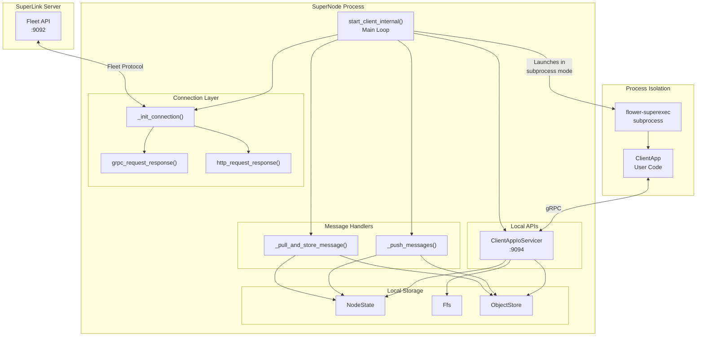
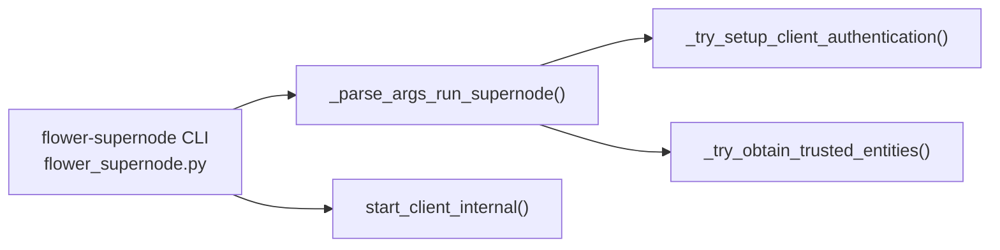
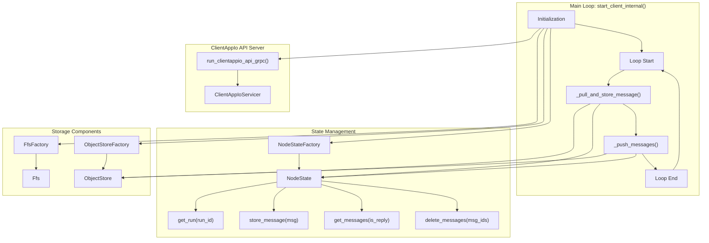
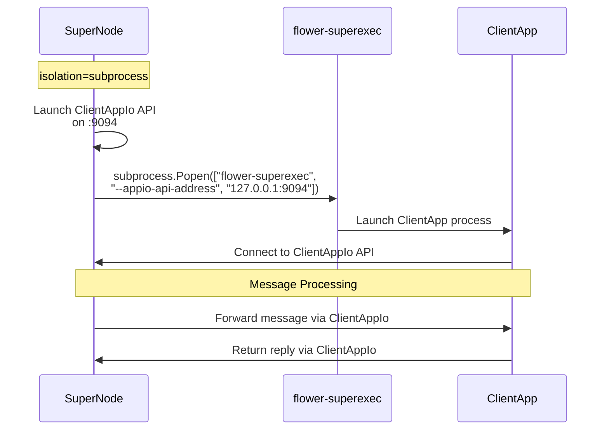
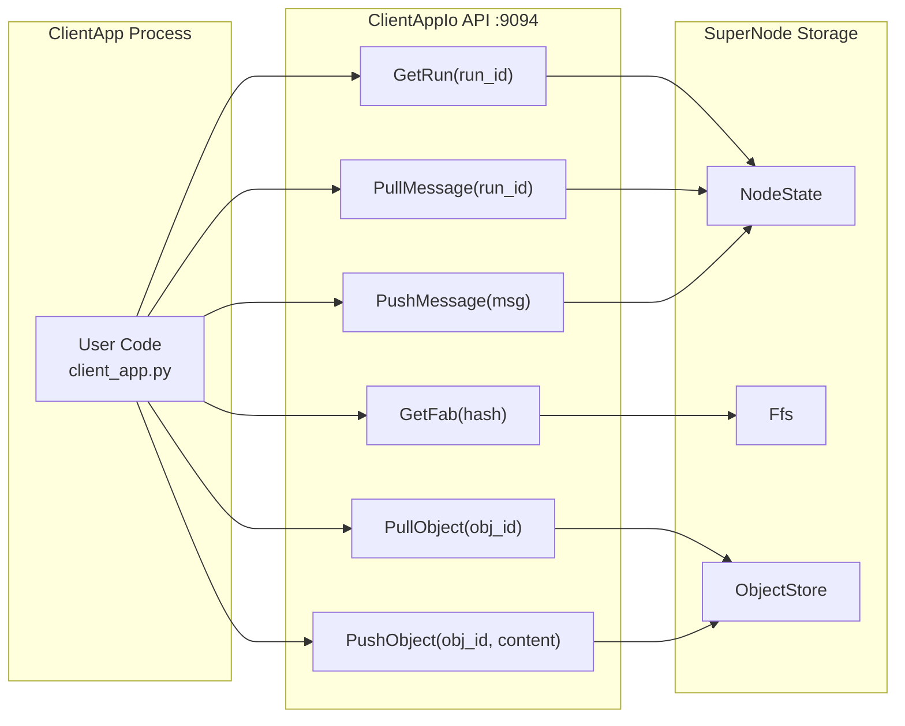
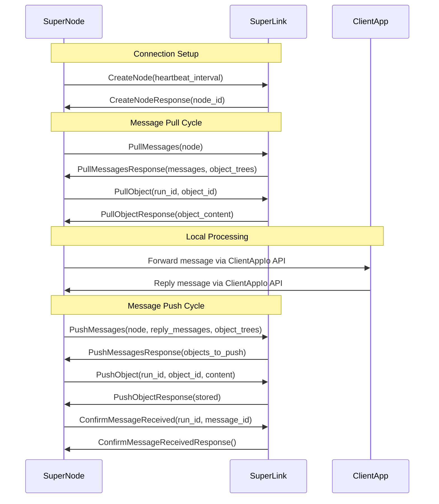

<!-- source: DeepWiki mcp.deepwiki.com · repo adap/flower · page 2.2 SuperNode Client Architecture · fetched 2026-10-21 -->

# SuperNode Client Architecture

<details>
<summary>Relevant source files</summary>

The following files were used as context for generating this wiki page:

- [framework/docs/source/ref-exit-codes/303.rst](framework/docs/source/ref-exit-codes/303.rst)
- [framework/docs/source/ref-exit-codes/304.rst](framework/docs/source/ref-exit-codes/304.rst)
- [framework/docs/source/ref-exit-codes/500.rst](framework/docs/source/ref-exit-codes/500.rst)
- [framework/py/flwr/cli/auth_plugin/__init__.py](framework/py/flwr/cli/auth_plugin/__init__.py)
- [framework/py/flwr/cli/auth_plugin/auth_plugin.py](framework/py/flwr/cli/auth_plugin/auth_plugin.py)
- [framework/py/flwr/cli/auth_plugin/noop_auth_plugin.py](framework/py/flwr/cli/auth_plugin/noop_auth_plugin.py)
- [framework/py/flwr/cli/auth_plugin/oidc_cli_plugin.py](framework/py/flwr/cli/auth_plugin/oidc_cli_plugin.py)
- [framework/py/flwr/cli/build.py](framework/py/flwr/cli/build.py)
- [framework/py/flwr/cli/cli_account_auth_interceptor.py](framework/py/flwr/cli/cli_account_auth_interceptor.py)
- [framework/py/flwr/cli/log.py](framework/py/flwr/cli/log.py)
- [framework/py/flwr/cli/login/login.py](framework/py/flwr/cli/login/login.py)
- [framework/py/flwr/cli/new/new.py](framework/py/flwr/cli/new/new.py)
- [framework/py/flwr/cli/new/new_test.py](framework/py/flwr/cli/new/new_test.py)
- [framework/py/flwr/cli/new/templates/app/code/client.xgboost.py.tpl](framework/py/flwr/cli/new/templates/app/code/client.xgboost.py.tpl)
- [framework/py/flwr/cli/new/templates/app/code/server.xgboost.py.tpl](framework/py/flwr/cli/new/templates/app/code/server.xgboost.py.tpl)
- [framework/py/flwr/cli/new/templates/app/code/task.xgboost.py.tpl](framework/py/flwr/cli/new/templates/app/code/task.xgboost.py.tpl)
- [framework/py/flwr/cli/new/templates/app/pyproject.xgboost.toml.tpl](framework/py/flwr/cli/new/templates/app/pyproject.xgboost.toml.tpl)
- [framework/py/flwr/cli/run/run.py](framework/py/flwr/cli/run/run.py)
- [framework/py/flwr/cli/stop.py](framework/py/flwr/cli/stop.py)
- [framework/py/flwr/cli/utils.py](framework/py/flwr/cli/utils.py)
- [framework/py/flwr/client/grpc_adapter_client/connection.py](framework/py/flwr/client/grpc_adapter_client/connection.py)
- [framework/py/flwr/client/grpc_rere_client/connection.py](framework/py/flwr/client/grpc_rere_client/connection.py)
- [framework/py/flwr/client/grpc_rere_client/node_auth_client_interceptor_test.py](framework/py/flwr/client/grpc_rere_client/node_auth_client_interceptor_test.py)
- [framework/py/flwr/client/rest_client/connection.py](framework/py/flwr/client/rest_client/connection.py)
- [framework/py/flwr/common/constant.py](framework/py/flwr/common/constant.py)
- [framework/py/flwr/common/exit/exit_code.py](framework/py/flwr/common/exit/exit_code.py)
- [framework/py/flwr/compat/client/grpc_client/connection.py](framework/py/flwr/compat/client/grpc_client/connection.py)
- [framework/py/flwr/server/app.py](framework/py/flwr/server/app.py)
- [framework/py/flwr/server/superlink/fleet/grpc_rere/node_auth_server_interceptor.py](framework/py/flwr/server/superlink/fleet/grpc_rere/node_auth_server_interceptor.py)
- [framework/py/flwr/supercore/constant.py](framework/py/flwr/supercore/constant.py)
- [framework/py/flwr/supercore/primitives/asymmetric.py](framework/py/flwr/supercore/primitives/asymmetric.py)
- [framework/py/flwr/supercore/primitives/asymmetric_ed25519.py](framework/py/flwr/supercore/primitives/asymmetric_ed25519.py)
- [framework/py/flwr/supercore/primitives/asymmetric_ed25519_test.py](framework/py/flwr/supercore/primitives/asymmetric_ed25519_test.py)
- [framework/py/flwr/superlink/auth_plugin/__init__.py](framework/py/flwr/superlink/auth_plugin/__init__.py)
- [framework/py/flwr/superlink/auth_plugin/auth_plugin.py](framework/py/flwr/superlink/auth_plugin/auth_plugin.py)
- [framework/py/flwr/superlink/auth_plugin/noop_auth_plugin.py](framework/py/flwr/superlink/auth_plugin/noop_auth_plugin.py)
- [framework/py/flwr/superlink/federation/__init__.py](framework/py/flwr/superlink/federation/__init__.py)
- [framework/py/flwr/superlink/servicer/control/control_grpc.py](framework/py/flwr/superlink/servicer/control/control_grpc.py)
- [framework/py/flwr/supernode/cli/flower_supernode.py](framework/py/flwr/supernode/cli/flower_supernode.py)
- [framework/py/flwr/supernode/start_client_internal.py](framework/py/flwr/supernode/start_client_internal.py)
- [framework/py/flwr/supernode/start_client_internal_test.py](framework/py/flwr/supernode/start_client_internal_test.py)

</details>


This document describes the SuperNode client architecture in the Flower framework. SuperNode is the client-side runtime that manages `ClientApp` execution, handles communication with the SuperLink server, and coordinates local state and object storage.

For information about the SuperLink server architecture, see page 2.1. For details about communication protocols, see page 2.4.

## Architecture Overview

SuperNode is a client-side process that connects to SuperLink's Fleet API, executes `ClientApp` instances in isolated processes, and manages the message flow between local applications and the central server.

**SuperNode High-Level Architecture**



**Sources:** [framework/py/flwr/supernode/start_client_internal.py:90-273](), [framework/py/flwr/common/constant.py:36-47](), [framework/py/flwr/client/grpc_rere_client/connection.py:72-385]()

## SuperNode Entry Point

The SuperNode is launched via the `flower-supernode` CLI command, which invokes `start_client_internal()` as the main entry point.

**SuperNode CLI Entry Point**



The CLI parses command-line arguments including:
- `--superlink`: SuperLink Fleet API address (default: `0.0.0.0:9092`)
- `--isolation`: Isolation mode (`subprocess` or `process`, default: `subprocess`)
- `--transport`: Transport protocol (`grpc-rere`, `rest`, or `grpc-adapter`)
- `--auth-supernode-private-key`: Optional path to private key for node authentication
- `--trusted-entities`: Optional path to YAML file defining trusted FAB signers
- `--node-config`: Node configuration as key-value pairs
- `--clientappio-api-address`: ClientAppIo API address (default: `0.0.0.0:9094`)

**Sources:** [framework/py/flwr/supernode/cli/flower_supernode.py:46-93](), [framework/py/flwr/supernode/cli/flower_supernode.py:96-226](), [framework/py/flwr/common/constant.py:36-47]()

## SuperNode Components

SuperNode consists of several key components that work together to manage client-side execution and communication with SuperLink.

**SuperNode Component Architecture**



**Sources:** [framework/py/flwr/supernode/start_client_internal.py:90-273](), [framework/py/flwr/supernode/nodestate/__init__.py]()

### NodeState Management

The `NodeState` class manages local state for the SuperNode, including:
- Current run information and context
- Message queue for incoming and outgoing messages
- Node ID registration

Key methods:

| Method | Purpose |
|--------|---------|
| `set_node_id(node_id)` | Store the node ID assigned by SuperLink |
| `get_node_id()` | Retrieve the current node ID |
| `store_run(run_info)` | Cache run metadata locally |
| `get_run(run_id)` | Retrieve cached run metadata |
| `store_context(context)` | Store run context including config |
| `store_message(message)` | Add message to local queue |
| `get_messages(is_reply)` | Retrieve messages (request or reply) |
| `delete_messages(message_ids)` | Remove processed messages |

**Sources:** [framework/py/flwr/supernode/start_client_internal.py:208-242](), [framework/py/flwr/supernode/nodestate/__init__.py]()

### SuperNode Main Loop

The `start_client_internal()` function implements the main execution loop:

```python
def start_client_internal(
    *,
    server_address: str,
    node_config: UserConfig,
    root_certificates: bytes | str | None = None,
    insecure: bool | None = None,
    transport: str,
    authentication_keys: tuple | None = None,
    max_retries: int | None = None,
    max_wait_time: float | None = None,
    flwr_path: Path | None = None,
    isolation: str = ISOLATION_MODE_SUBPROCESS,
    clientappio_api_address: str = CLIENTAPPIO_API_DEFAULT_SERVER_ADDRESS,
    health_server_address: str | None = None,
    trusted_entities: dict[str, str] | None = None,
) -> None
```

The main loop:
1. **Initialize factories**: Create `NodeStateFactory`, `FfsFactory`, and `ObjectStoreFactory`
2. **Launch ClientAppIo API server**: Start gRPC server on port 9094
3. **Launch SuperExec** (if isolation mode is subprocess): Start `flower-superexec` process
4. **Establish connection**: Create transport connection to SuperLink's Fleet API
5. **Register/Activate node**: Register with SuperLink and obtain node ID
6. **Message loop**:
   - Pull message from SuperLink via `receive()`
   - Store message and objects via `_pull_and_store_message()`
   - Wait for ClientApp to produce reply
   - Push reply via `_push_messages()`
   - Repeat

**Sources:** [framework/py/flwr/supernode/start_client_internal.py:90-273](), [framework/py/flwr/supernode/start_client_internal.py:179-219]()

### ClientApp Execution and Isolation Modes

SuperNode supports two isolation modes for executing `ClientApp` user code:

| Isolation Mode | Process Model | Lifecycle Management |
|----------------|---------------|---------------------|
| `ISOLATION_MODE_SUBPROCESS` (default) | ClientApp runs in subprocess launched by SuperNode | SuperNode starts `flower-superexec`, which then starts ClientApp |
| `ISOLATION_MODE_PROCESS` | ClientApp runs in independent process | External process connects to SuperNode's ClientAppIo API |

**Subprocess Isolation Mode Flow**



When using `ISOLATION_MODE_SUBPROCESS`, SuperNode launches `flower-superexec` with these arguments:
- `--insecure`: Skip TLS for local communication
- `--appio-api-address`: Address of ClientAppIo API (e.g., `127.0.0.1:9094`)
- `--plugin-type`: Set to `clientapp`
- `--parent-pid`: SuperNode's PID for lifecycle management

**Sources:** [framework/py/flwr/supernode/start_client_internal.py:213-219](), [framework/py/flwr/common/constant.py:114-115]()

### ClientAppIo API Server

The `ClientAppIoServicer` provides a gRPC API for communication between SuperNode and ClientApp processes. This server runs on port 9094 (configurable via `--clientappio-api-address`).

**ClientAppIo API Methods**



The server is created via `run_clientappio_api_grpc()`:

```python
def run_clientappio_api_grpc(
    address: str,
    state_factory: NodeStateFactory,
    ffs_factory: FfsFactory,
    objectstore_factory: ObjectStoreFactory,
    certificates: tuple[bytes, bytes, bytes] | None,
) -> grpc.Server
```

**Sources:** [framework/py/flwr/supernode/start_client_internal.py:597-623](), [framework/py/flwr/supernode/servicer/clientappio.py]()

## Communication Flow

The communication between SuperLink and SuperNode follows a well-defined protocol for message exchange and object transfer:



**Sources:** [framework/py/flwr/client/grpc_rere_client/connection.py:232-331](), [framework/py/flwr/supernode/start_client_internal.py:335-420]()

This architecture enables scalable federated learning by decoupling client management from central orchestration, while maintaining efficient communication through optimized message passing and object serialization protocols.

---

