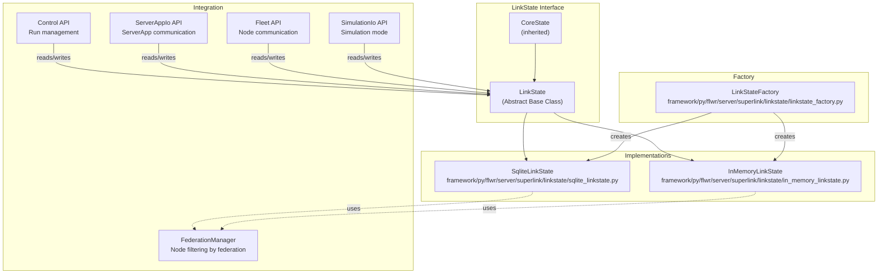
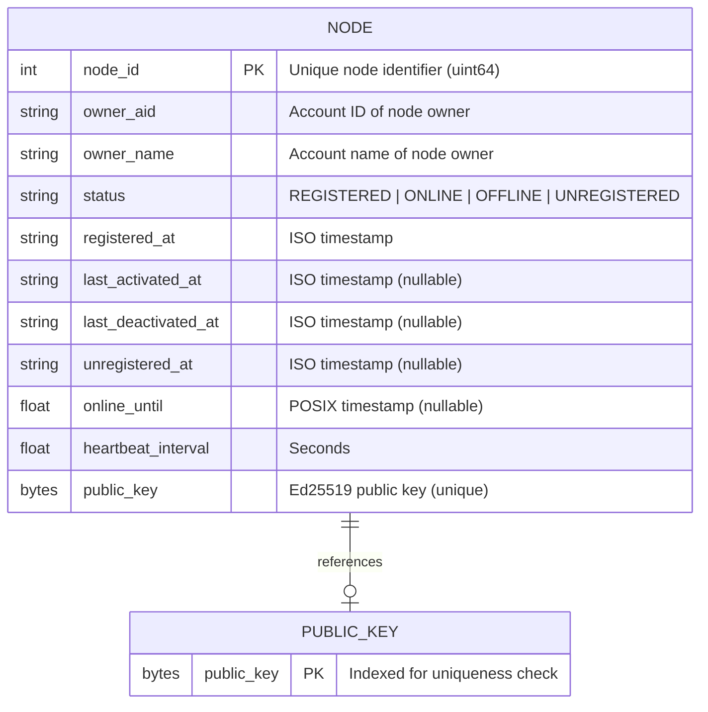
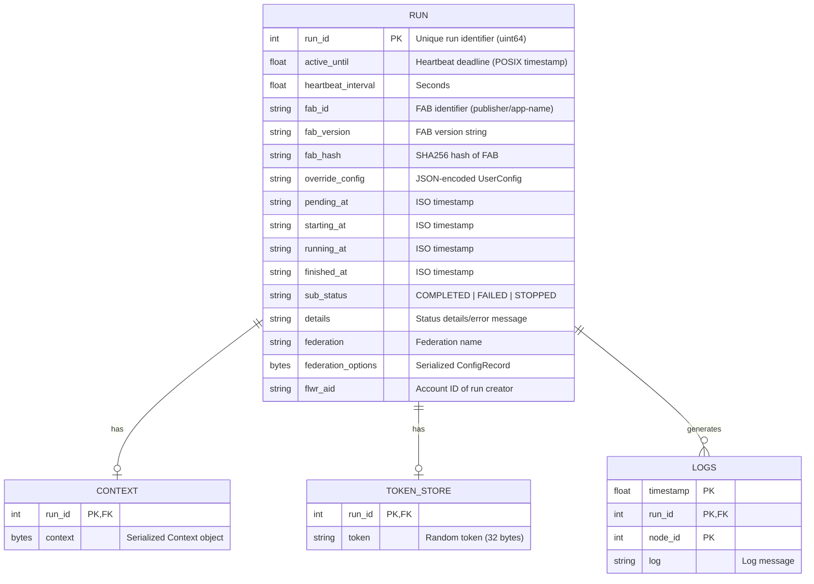
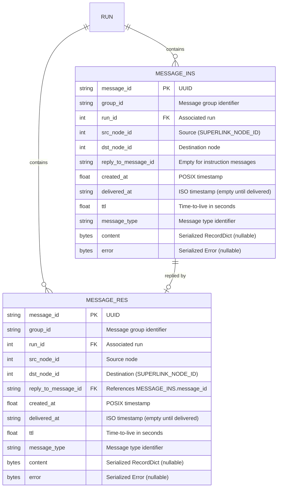
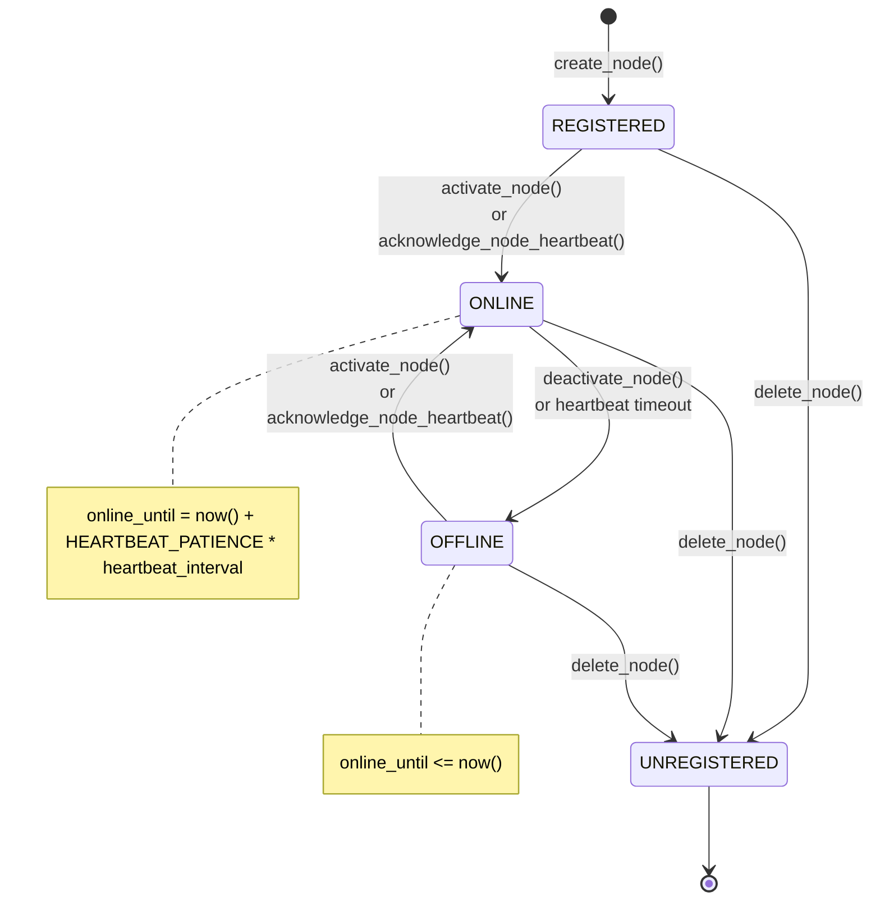
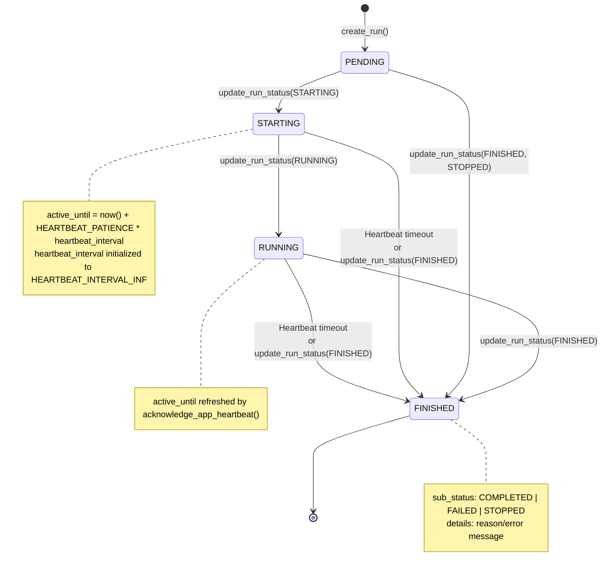
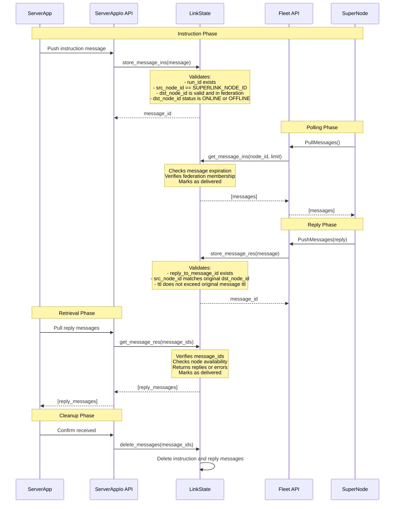
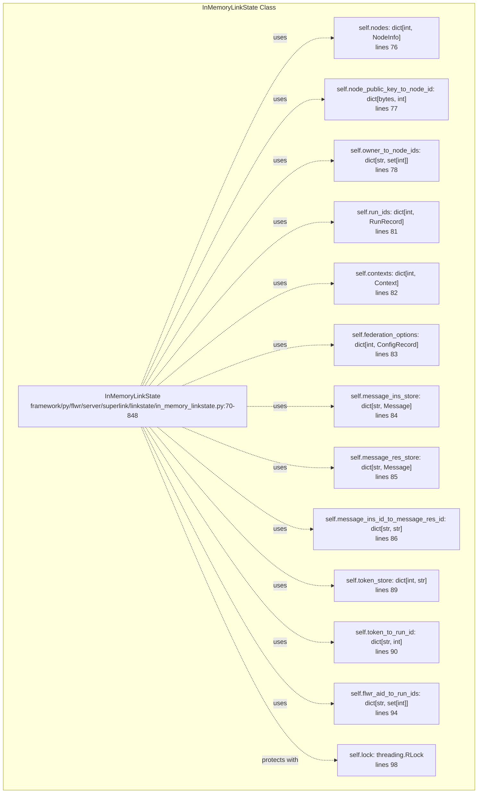
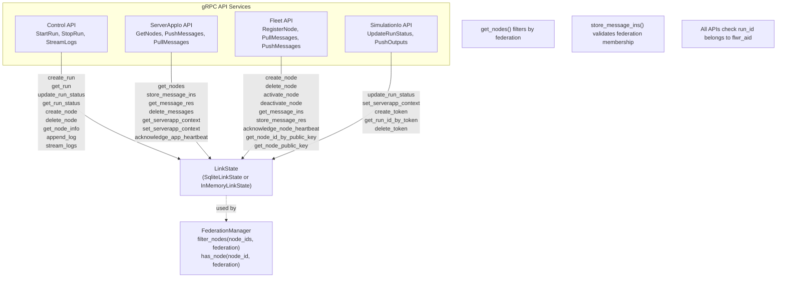
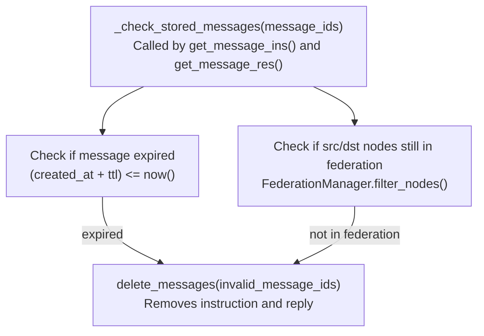

<!-- source: DeepWiki mcp.deepwiki.com · repo adap/flower · page 2.3 LinkState and State Management · fetched 2026-10-21 -->

# LinkState and State Management

<details>
<summary>Relevant source files</summary>

The following files were used as context for generating this wiki page:

- [framework/py/flwr/server/grid/inmemory_grid_test.py](framework/py/flwr/server/grid/inmemory_grid_test.py)
- [framework/py/flwr/server/superlink/fleet/grpc_rere/fleet_servicer_test.py](framework/py/flwr/server/superlink/fleet/grpc_rere/fleet_servicer_test.py)
- [framework/py/flwr/server/superlink/fleet/grpc_rere/node_auth_server_interceptor_test.py](framework/py/flwr/server/superlink/fleet/grpc_rere/node_auth_server_interceptor_test.py)
- [framework/py/flwr/server/superlink/fleet/vce/vce_api.py](framework/py/flwr/server/superlink/fleet/vce/vce_api.py)
- [framework/py/flwr/server/superlink/fleet/vce/vce_api_test.py](framework/py/flwr/server/superlink/fleet/vce/vce_api_test.py)
- [framework/py/flwr/server/superlink/linkstate/in_memory_linkstate.py](framework/py/flwr/server/superlink/linkstate/in_memory_linkstate.py)
- [framework/py/flwr/server/superlink/linkstate/linkstate.py](framework/py/flwr/server/superlink/linkstate/linkstate.py)
- [framework/py/flwr/server/superlink/linkstate/linkstate_factory.py](framework/py/flwr/server/superlink/linkstate/linkstate_factory.py)
- [framework/py/flwr/server/superlink/linkstate/linkstate_test.py](framework/py/flwr/server/superlink/linkstate/linkstate_test.py)
- [framework/py/flwr/server/superlink/linkstate/sqlite_linkstate.py](framework/py/flwr/server/superlink/linkstate/sqlite_linkstate.py)
- [framework/py/flwr/server/superlink/serverappio/serverappio_servicer_test.py](framework/py/flwr/server/superlink/serverappio/serverappio_servicer_test.py)
- [framework/py/flwr/server/superlink/simulation/simulation_servicer_test.py](framework/py/flwr/server/superlink/simulation/simulation_servicer_test.py)
- [framework/py/flwr/simulation/run_simulation.py](framework/py/flwr/simulation/run_simulation.py)
- [framework/py/flwr/superlink/servicer/control/control_servicer_test.py](framework/py/flwr/superlink/servicer/control/control_servicer_test.py)

</details>


## Purpose and Scope

LinkState is the central state management abstraction in Flower's SuperLink server component. It provides a unified interface for managing all persistent and transient state required for federated learning operations, including nodes, runs, messages, contexts, and logs.

This document covers:
- The LinkState abstraction and its implementations (SQLite and in-memory)
- Data models for nodes, runs, and messages
- Core operations for state management
- State transitions and lifecycle management
- Integration with other SuperLink components

For information about how LinkState integrates with communication protocols, see [Communication Protocols](#2.4). For details on message flow and object storage separate from LinkState, see [Message Flow and Object Storage](#2.5).

**Sources:** [framework/py/flwr/server/superlink/linkstate/linkstate.py:1-30]()

## LinkState Architecture Overview



**Description:** LinkState is an abstract interface that extends CoreState. It has two concrete implementations: SqliteLinkState for persistent storage and InMemoryLinkState for transient in-memory storage. LinkStateFactory provides a factory pattern for instantiation. All SuperLink APIs interact with state through the LinkState interface.

**Sources:** [framework/py/flwr/server/superlink/linkstate/linkstate.py:29-30](), [framework/py/flwr/server/superlink/linkstate/sqlite_linkstate.py:193-202](), [framework/py/flwr/server/superlink/linkstate/in_memory_linkstate.py:70-105](), [framework/py/flwr/server/superlink/linkstate/linkstate_factory.py:29-65]()

## Data Model

### Node Data Model



**Description:** Nodes represent SuperNodes in the federation. Each node has a unique `node_id` (generated as random uint64) and `public_key` (Ed25519 for authentication). The `status` field tracks node lifecycle, `online_until` is used for heartbeat-based liveness detection, and `owner_aid` enables multi-tenancy.

**Sources:** [framework/py/flwr/server/superlink/linkstate/sqlite_linkstate.py:74-103](), [framework/py/flwr/server/superlink/linkstate/in_memory_linkstate.py:75-97]()

### Run Data Model



**Description:** Runs represent federated learning executions. The status is derived from timestamp fields (`pending_at`, `starting_at`, `running_at`, `finished_at`) plus `sub_status` and `details`. Heartbeats track run liveness. Each run can have associated context, a security token for simulation mode, and logs.

**Sources:** [framework/py/flwr/server/superlink/linkstate/sqlite_linkstate.py:108-190](), [framework/py/flwr/server/superlink/linkstate/in_memory_linkstate.py:58-95]()

### Message Data Model



**Description:** Messages are the core communication mechanism. `MESSAGE_INS` are instructions from SuperLink to nodes. `MESSAGE_RES` are replies from nodes back to SuperLink. The `reply_to_message_id` field links replies to their original instructions. The `delivered_at` field tracks delivery status, and `ttl` enables automatic expiration.

**Sources:** [framework/py/flwr/server/superlink/linkstate/sqlite_linkstate.py:148-183](), [framework/py/flwr/server/superlink/linkstate/in_memory_linkstate.py:84-86]()

## Node Management Operations

### Node Lifecycle and Status Transitions



**Description:** Nodes progress through four statuses. `REGISTERED` is the initial state after `create_node()`. `ONLINE` indicates the node is actively participating (based on heartbeats). `OFFLINE` means heartbeat timeout occurred. `UNREGISTERED` is the terminal state after `delete_node()`. The `_check_and_tag_offline_nodes()` method automatically transitions nodes from `ONLINE` to `OFFLINE` when `online_until` expires.

**Sources:** [framework/py/flwr/server/superlink/linkstate/sqlite_linkstate.py:615-750](), [framework/py/flwr/server/superlink/linkstate/in_memory_linkstate.py:375-471]()

### Core Node Operations

| Operation | Method | Description |
|-----------|--------|-------------|
| Create | `create_node(owner_aid, owner_name, public_key, heartbeat_interval)` | Registers a new node with a random `node_id` and the provided `public_key`. Raises `ValueError` if the public key is already in use. |
| Delete | `delete_node(owner_aid, node_id)` | Marks a node as `UNREGISTERED`. Validates `owner_aid` matches to prevent unauthorized deletion. |
| Activate | `activate_node(node_id, heartbeat_interval)` | Transitions node from `REGISTERED` or `OFFLINE` to `ONLINE`. Sets `online_until = now() + HEARTBEAT_PATIENCE * heartbeat_interval`. Returns `False` if already online or unregistered. |
| Deactivate | `deactivate_node(node_id)` | Transitions node from `ONLINE` to `OFFLINE`. Sets `online_until = now()`. Returns `False` if not online. |
| Heartbeat | `acknowledge_node_heartbeat(node_id, heartbeat_interval)` | Refreshes `online_until` and transitions to `ONLINE` if not already. This is the primary liveness mechanism. |
| Query | `get_nodes(run_id)` | Returns all `ONLINE` nodes filtered by the run's federation using `FederationManager.filter_nodes()`. |
| Query | `get_node_info(node_ids, owner_aids, statuses)` | Flexible query with AND logic across filters and OR logic within each filter. Automatically checks for offline nodes before returning. |
| Lookup | `get_node_id_by_public_key(public_key)` | Returns `node_id` for a given public key, or `None` if not found or unregistered. |
| Lookup | `get_node_public_key(node_id)` | Returns the public key for a node. Raises `ValueError` if not found or unregistered. |

**Sources:** [framework/py/flwr/server/superlink/linkstate/linkstate.py:137-267](), [framework/py/flwr/server/superlink/linkstate/sqlite_linkstate.py:615-870](), [framework/py/flwr/server/superlink/linkstate/in_memory_linkstate.py:375-547]()

## Run Management Operations

### Run Status Transitions



**Description:** Runs follow a strict lifecycle: `PENDING` → `STARTING` → `RUNNING` → `FINISHED`. Direct transitions to `FINISHED` are allowed from any state with appropriate sub-status. Heartbeat timeouts automatically transition `STARTING` or `RUNNING` runs to `FINISHED` with `sub_status=FAILED` and `details=RUN_FAILURE_DETAILS_NO_HEARTBEAT`. The `_check_and_tag_inactive_run()` method enforces this.

**Sources:** [framework/py/flwr/server/superlink/linkstate/sqlite_linkstate.py:939-1069](), [framework/py/flwr/server/superlink/linkstate/in_memory_linkstate.py:608-702](), [framework/py/flwr/server/superlink/linkstate/utils.py:1-100]()

### Core Run Operations

| Operation | Method | Description |
|-----------|--------|-------------|
| Create | `create_run(fab_id, fab_version, fab_hash, override_config, federation, federation_options, flwr_aid)` | Creates a new run with a random `run_id`. Initial status is `PENDING`. Returns the generated `run_id` or 0 on failure. |
| Query | `get_run(run_id)` | Returns `Run` object with all metadata. Checks for heartbeat timeout before returning. Returns `None` if not found. |
| Query | `get_run_ids(flwr_aid)` | Returns all run IDs if `flwr_aid` is `None`, otherwise returns only runs owned by that account. |
| Query | `get_run_status(run_ids)` | Returns a dict mapping `run_id` to `RunStatus`. Checks for heartbeat timeouts before returning. Only valid run IDs are included. |
| Query | `get_pending_run_id()` | Returns the `run_id` of one run in `PENDING` status, or `None` if none exist. Used by SuperExec to find runs to start. |
| Update | `update_run_status(run_id, new_status)` | Transitions run status. Validates transition is legal using `is_valid_transition()` and `has_valid_sub_status()`. Updates timestamp fields (`starting_at`, `running_at`, `finished_at`). Initializes heartbeat on transition to `STARTING`/`RUNNING`. Returns `False` on validation failure. |
| Heartbeat | `acknowledge_app_heartbeat(run_id, heartbeat_interval)` | Refreshes `active_until = now() + HEARTBEAT_PATIENCE * heartbeat_interval`. Only valid for `STARTING` or `RUNNING` status. |
| Context | `get_serverapp_context(run_id)` | Retrieves the `Context` object for a run. Used by ServerApp to access state. |
| Context | `set_serverapp_context(run_id, context)` | Stores the `Context` object for a run. |
| Options | `get_federation_options(run_id)` | Returns the `ConfigRecord` with federation-specific options (e.g., `num-supernodes` for simulation). |
| Token | `create_token(run_id)` | Generates a random 32-byte token for simulation mode authentication. Returns `None` if run doesn't exist. |
| Token | `get_token(run_id)` | Retrieves the token for a run. Returns `None` if not found. |
| Token | `get_run_id_by_token(token)` | Returns the `run_id` associated with a token, or `None` if invalid. |
| Token | `delete_token(run_id)` | Removes the token for a run. |

**Sources:** [framework/py/flwr/server/superlink/linkstate/linkstate.py:269-425](), [framework/py/flwr/server/superlink/linkstate/sqlite_linkstate.py:872-1231](), [framework/py/flwr/server/superlink/linkstate/in_memory_linkstate.py:550-846]()

## Message Management Operations

### Message Lifecycle



**Description:** Messages follow a strict lifecycle: (1) ServerApp pushes instruction messages via ServerAppIo API, (2) SuperNodes poll for messages via Fleet API, (3) SuperNodes push reply messages back via Fleet API, (4) ServerApp retrieves replies via ServerAppIo API, (5) Messages are deleted after confirmation. The `delivered_at` field tracks whether messages have been delivered, and TTL ensures messages expire appropriately.

**Sources:** [framework/py/flwr/server/superlink/linkstate/sqlite_linkstate.py:225-595](), [framework/py/flwr/server/superlink/linkstate/in_memory_linkstate.py:107-373]()

### Core Message Operations

| Operation | Method | Description |
|-----------|--------|-------------|
| Store Ins | `store_message_ins(message)` | Stores an instruction message from SuperLink to a node. Validates: `run_id` exists, `src_node_id == SUPERLINK_NODE_ID`, `dst_node_id` is valid and in the run's federation. Returns `message_id` or `None` on failure. |
| Get Ins | `get_message_ins(node_id, limit)` | Retrieves undelivered instruction messages for a node. Checks expiration using `_check_stored_messages()`. Marks retrieved messages as delivered. Returns at most `limit` messages (all if `None`). |
| Store Res | `store_message_res(message)` | Stores a reply message from a node to SuperLink. Validates: `reply_to_message_id` exists and is valid, `src_node_id` matches original `dst_node_id`, `ttl` does not exceed original message's expiration time (with `MESSAGE_TTL_TOLERANCE`). Returns `message_id` or `None` on failure. |
| Get Res | `get_message_res(message_ids)` | Retrieves reply messages for given instruction message IDs. Returns: (1) Error messages for invalid/expired instruction messages, (2) Error messages for nodes that went offline, (3) Reply messages if available, (4) Nothing if instruction is valid but no reply yet. Uses helper functions: `verify_message_ids()`, `check_node_availability_for_in_message()`, `verify_found_message_replies()`. Marks replies as delivered. |
| Delete | `delete_messages(message_ins_ids)` | Deletes instruction messages and their associated replies. Used after ServerApp confirms receipt. |
| Count | `num_message_ins()` | Returns count of instruction messages (including delivered but not yet deleted). |
| Count | `num_message_res()` | Returns count of reply messages (including delivered but not yet deleted). |
| Query | `get_message_ids_from_run_id(run_id)` | Returns all instruction message IDs for a given run. Used during cleanup. |
| Validation | `_check_stored_messages(message_ids)` | Internal method that checks for expired messages and messages from nodes removed from federation. Deletes invalid messages automatically. |

**Sources:** [framework/py/flwr/server/superlink/linkstate/linkstate.py:38-136](), [framework/py/flwr/server/superlink/linkstate/sqlite_linkstate.py:225-614](), [framework/py/flwr/server/superlink/linkstate/in_memory_linkstate.py:107-373]()

## Implementation Details

### SQLite Implementation

```mermaid
graph TB
    subgraph "SqliteLinkState Class"
        SqliteLinkState["SqliteLinkState<br/>framework/py/flwr/server/superlink/linkstate/sqlite_linkstate.py:193-1602"]
        SqliteMixin["SqliteMixin<br/>Provides query() method"]
    end
    
    subgraph "Database Schema"
        NodeTable["node table<br/>lines 74-87"]
        RunTable["run table<br/>lines 108-127"]
        MessageInsTable["message_ins table<br/>lines 148-164"]
        MessageResTable["message_res table<br/>lines 167-183"]
        ContextTable["context table<br/>lines 140-146"]
        LogsTable["logs table<br/>lines 129-138"]
        TokenTable["token_store table<br/>lines 185-190"]
        PublicKeyTable["public_key table<br/>lines 90-94"]
    end
    
    subgraph "Helper Functions"
        MessageToDict["message_to_dict()<br/>lines 1485-1519"]
        DictToMessage["dict_to_message()<br/>lines 1522-1561"]
        Int64Uint64["uint64_to_int64()<br/>int64_to_uint64()<br/>SQLite compatibility"]
    end
    
    SqliteLinkState --|inherits| SqliteMixin
    SqliteLinkState -.->|creates| NodeTable
    SqliteLinkState -.->|creates| RunTable
    SqliteLinkState -.->|creates| MessageInsTable
    SqliteLinkState -.->|creates| MessageResTable
    SqliteLinkState -.->|creates| ContextTable
    SqliteLinkState -.->|creates| LogsTable
    SqliteLinkState -.->|creates| TokenTable
    SqliteLinkState -.->|creates| PublicKeyTable
    
    SqliteLinkState -.->|uses| MessageToDict
    SqliteLinkState -.->|uses| DictToMessage
    SqliteLinkState -.->|uses| Int64Uint64
```

**Description:** SqliteLinkState persists all state to SQLite. It inherits from `SqliteMixin` which provides the `query()` method for executing SQL. The implementation handles uint64 to sint64 conversion for SQLite compatibility (since SQLite only supports signed 64-bit integers). The `initialize()` method creates all tables and indexes. The implementation uses parameterized queries to prevent SQL injection and foreign key constraints to maintain referential integrity.

**Key characteristics:**
- **Thread-safe:** Uses SQLite's connection-level locking
- **ACID guarantees:** Transactions ensure consistency
- **Indexing:** Indexes on `online_until`, `owner_aid`, and `status` for efficient queries
- **Automatic cleanup:** `_check_and_tag_offline_nodes()` and `_check_and_tag_inactive_run()` maintain consistency
- **Federation filtering:** Integrates with `FederationManager` to filter nodes by federation

**Sources:** [framework/py/flwr/server/superlink/linkstate/sqlite_linkstate.py:193-1602](), [framework/py/flwr/supercore/sqlite_mixin.py:1-100]()

### In-Memory Implementation



**Description:** InMemoryLinkState stores all state in Python dictionaries and objects. It uses a reentrant lock (`threading.RLock`) to ensure thread safety. The implementation maintains several index structures for efficient lookups (e.g., `node_public_key_to_node_id`, `flwr_aid_to_run_ids`). Unlike SQLite, there are no foreign key constraints—consistency is maintained through application logic.

**Key characteristics:**
- **Fast:** No disk I/O, all operations in memory
- **Transient:** State is lost when process terminates
- **Thread-safe:** All operations protected by `self.lock`
- **No schema migration:** Changes to data structures require code updates
- **Used for:** Testing, simulation mode, temporary deployments

**Sources:** [framework/py/flwr/server/superlink/linkstate/in_memory_linkstate.py:70-848]()

### LinkStateFactory

```mermaid
graph LR
    Client["API Client<br/>(Control/Fleet/ServerAppIo)"]
    Factory["LinkStateFactory<br/>framework/py/flwr/server/superlink/linkstate/linkstate_factory.py:29-65"]
    
    SQLite["SqliteLinkState<br/>(database != ':flwr-in-memory-state:')"]
    InMemory["InMemoryLinkState<br/>(database == ':flwr-in-memory-state:')"]
    
    Client -->|state_factory.state()| Factory
    Factory -->|creates once, returns cached| InMemory
    Factory -->|creates new each call| SQLite
    
    note1["Singleton pattern<br/>for InMemory"]
    note2["New instance<br/>for each call"]
    
    InMemory -.-> note1
    SQLite -.-> note2
```

**Description:** `LinkStateFactory` provides a factory method `state()` that returns the appropriate LinkState implementation based on the `database` parameter. If `database == FLWR_IN_MEMORY_DB_NAME` (`:flwr-in-memory-state:`), it returns a singleton InMemoryLinkState instance. Otherwise, it creates a new SqliteLinkState instance for each call and initializes the database schema. The factory also receives a `FederationManager` instance which is injected into the LinkState implementations.

**Sources:** [framework/py/flwr/server/superlink/linkstate/linkstate_factory.py:29-65]()

## Integration with SuperLink Components



**Description:** All SuperLink APIs interact with LinkState through the abstract interface. Control API manages runs and nodes from the CLI. ServerAppIo API handles ServerApp communication (pushing instructions, pulling results). Fleet API handles SuperNode communication (pulling instructions, pushing results). SimulationIo API provides a subset for simulation mode. The FederationManager is used to filter nodes by federation, ensuring multi-tenancy isolation.

**Sources:** [framework/py/flwr/superlink/servicer/control/control_servicer.py:1-600](), [framework/py/flwr/server/superlink/serverappio/serverappio_servicer.py:1-600](), [framework/py/flwr/server/superlink/fleet/grpc_rere/fleet_servicer.py:1-600](), [framework/py/flwr/server/superlink/simulation/simulationio_servicer.py:1-300]()

## Message Validation and Error Handling

### Message Validation Rules

The following validation rules are enforced when storing messages:

**Instruction Messages (`store_message_ins`):**
1. `message.metadata.run_id` must exist in the `run` table
2. `message.metadata.src_node_id` must equal `SUPERLINK_NODE_ID` (0)
3. `message.metadata.dst_node_id` must be a valid node ID
4. Destination node status must be `ONLINE` or `OFFLINE` (not `REGISTERED` or `UNREGISTERED`)
5. Destination node must be in the run's federation (verified via `FederationManager.has_node()`)
6. Message must pass `validate_message()` checks (TTL > 0, required fields set, etc.)

**Reply Messages (`store_message_res`):**
1. `message.metadata.reply_to_message_id` must reference an existing, valid instruction message
2. Referenced instruction message must not be expired (based on `created_at + ttl`)
3. `message.metadata.src_node_id` must match the `dst_node_id` of the instruction message
4. `message.metadata.ttl` must not exceed the expiration time of the instruction message (within `MESSAGE_TTL_TOLERANCE`)
5. `message.metadata.run_id` must match the instruction message's `run_id`
6. Message must pass `validate_message()` checks

**Sources:** [framework/py/flwr/server/superlink/linkstate/sqlite_linkstate.py:225-460](), [framework/py/flwr/server/superlink/linkstate/in_memory_linkstate.py:107-274](), [framework/py/flwr/server/utils/validator.py:1-200]()

### Automatic Message Cleanup



**Description:** The `_check_stored_messages()` method is called automatically during `get_message_ins()` and `get_message_res()` operations. It validates that messages have not expired and that source/destination nodes are still in the federation. Invalid messages are automatically deleted to maintain consistency. This prevents accumulation of stale messages and ensures federation boundaries are enforced even if node membership changes after message storage.

**Sources:** [framework/py/flwr/server/superlink/linkstate/sqlite_linkstate.py:280-324](), [framework/py/flwr/server/superlink/linkstate/in_memory_linkstate.py:151-178]()

## Logging System

LinkState provides a centralized logging system for run execution:

| Operation | Method | Description |
|-----------|--------|-------------|
| Append | `append_log(run_id, node_id, log_message)` | Appends a log entry with current timestamp. `node_id` can be 0 for SuperLink logs or a node ID for SuperNode logs. |
| Retrieve | `get_serverapp_log(run_id, after_timestamp)` | Returns `(log_message, timestamp)` for the next log after `after_timestamp`, or `(None, 0.0)` if no logs available. Used by `StreamLogs` RPC. |

The logs are stored in the `logs` table (SQLite) or `RunRecord.logs` list (in-memory) with composite primary key `(timestamp, run_id, node_id)`. This enables efficient time-ordered retrieval for log streaming.

**Sources:** [framework/py/flwr/server/superlink/linkstate/sqlite_linkstate.py:1189-1231](), [framework/py/flwr/server/superlink/linkstate/in_memory_linkstate.py:800-846]()

## Thread Safety and Concurrency

### SqliteLinkState Concurrency

- **Connection-level locking:** SQLite provides automatic locking at the database level
- **Transaction isolation:** Uses `with self.conn:` context manager for automatic commit/rollback
- **No explicit locks needed:** SQLite's built-in concurrency control is sufficient for typical workloads
- **Limitation:** Write operations block each other, reducing write throughput under high concurrency

### InMemoryLinkState Concurrency

- **Reentrant lock:** `threading.RLock` protects all data structures
- **Lock granularity:** Most methods acquire `self.lock` or `record.lock` (for per-run operations)
- **Deadlock prevention:** Uses `RLock` to allow reentrant calls
- **Higher throughput:** Can handle more concurrent operations than SQLite in single-process deployments

**Sources:** [framework/py/flwr/server/superlink/linkstate/sqlite_linkstate.py:193-202](), [framework/py/flwr/server/superlink/linkstate/in_memory_linkstate.py:98]()

---

