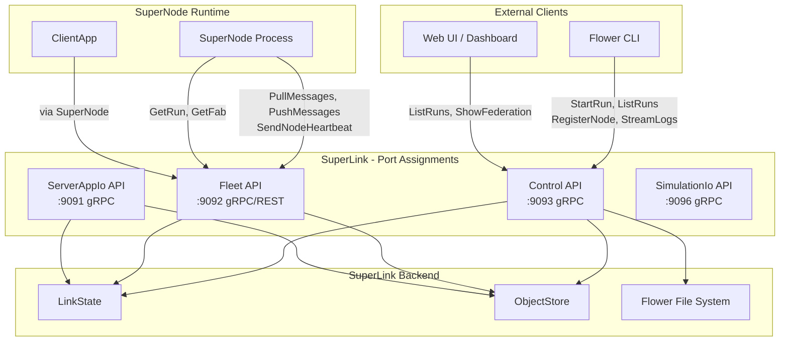
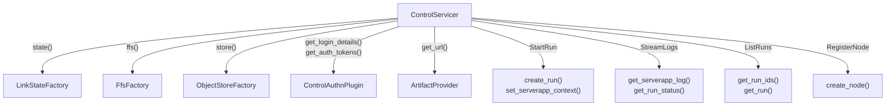
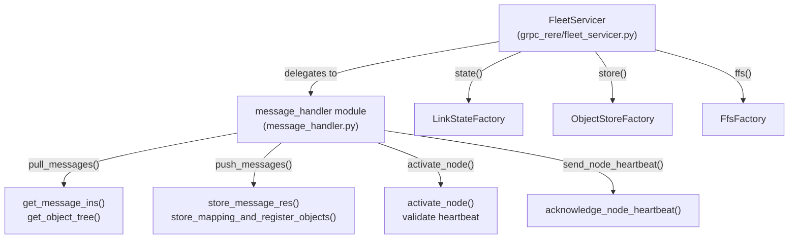
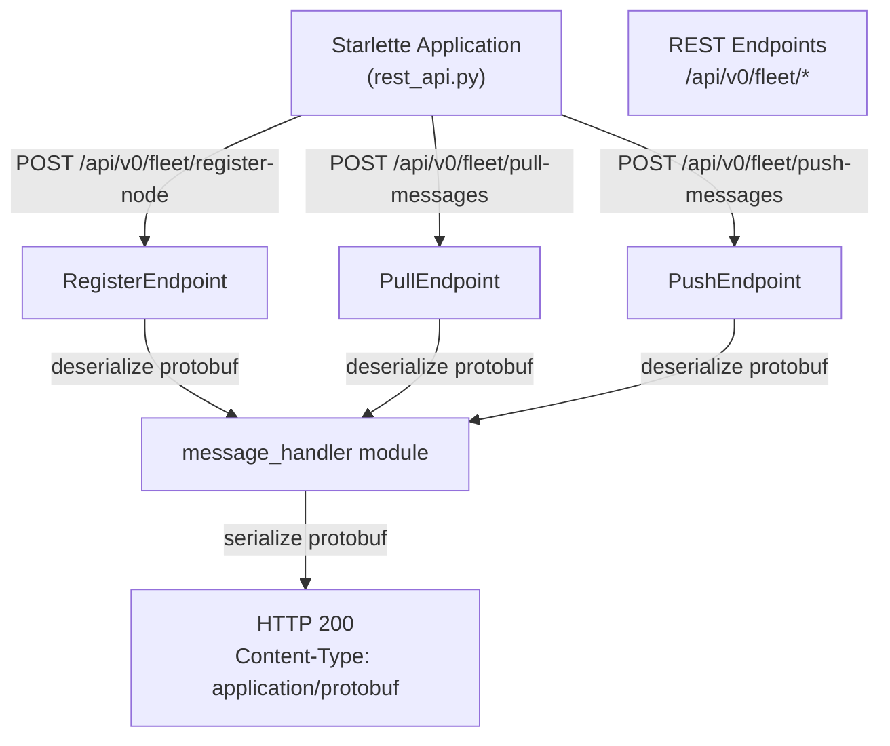
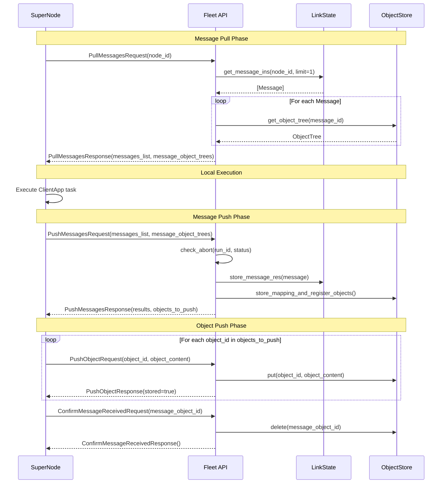
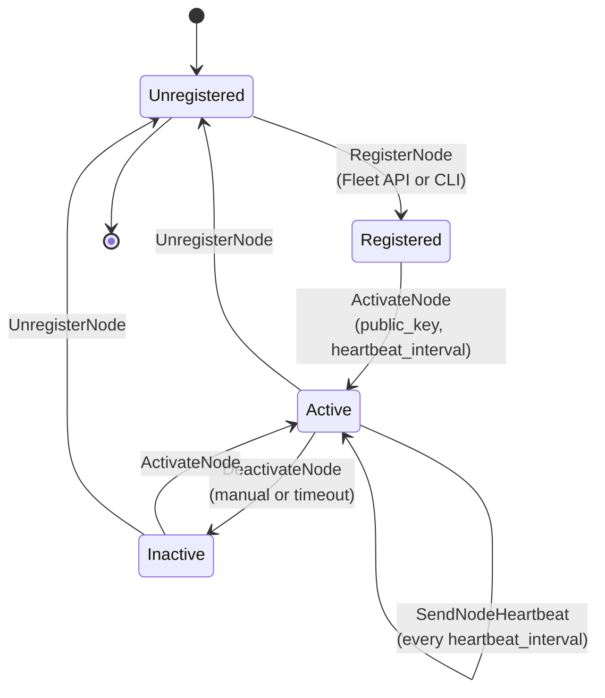
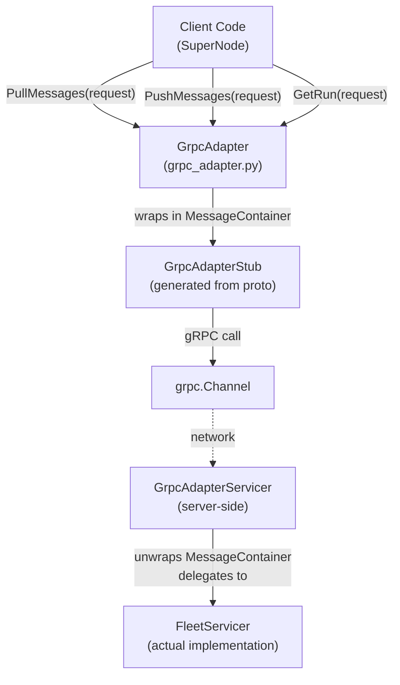
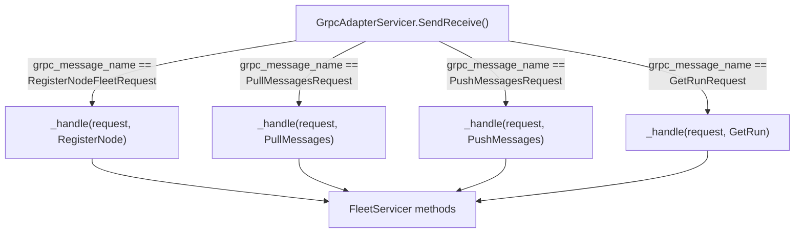

<!-- source: DeepWiki mcp.deepwiki.com · repo adap/flower · page 2.4 Communication Protocols · fetched 2026-10-21 -->

# Communication Protocols

<details>
<summary>Relevant source files</summary>

The following files were used as context for generating this wiki page:

- [framework/proto/flwr/proto/control.proto](framework/proto/flwr/proto/control.proto)
- [framework/proto/flwr/proto/federation.proto](framework/proto/flwr/proto/federation.proto)
- [framework/proto/flwr/proto/fleet.proto](framework/proto/flwr/proto/fleet.proto)
- [framework/py/flwr/client/grpc_rere_client/grpc_adapter.py](framework/py/flwr/client/grpc_rere_client/grpc_adapter.py)
- [framework/py/flwr/proto/control_pb2.py](framework/py/flwr/proto/control_pb2.py)
- [framework/py/flwr/proto/control_pb2.pyi](framework/py/flwr/proto/control_pb2.pyi)
- [framework/py/flwr/proto/control_pb2_grpc.py](framework/py/flwr/proto/control_pb2_grpc.py)
- [framework/py/flwr/proto/control_pb2_grpc.pyi](framework/py/flwr/proto/control_pb2_grpc.pyi)
- [framework/py/flwr/proto/federation_pb2.py](framework/py/flwr/proto/federation_pb2.py)
- [framework/py/flwr/proto/federation_pb2.pyi](framework/py/flwr/proto/federation_pb2.pyi)
- [framework/py/flwr/proto/federation_pb2_grpc.py](framework/py/flwr/proto/federation_pb2_grpc.py)
- [framework/py/flwr/proto/federation_pb2_grpc.pyi](framework/py/flwr/proto/federation_pb2_grpc.pyi)
- [framework/py/flwr/proto/fleet_pb2.py](framework/py/flwr/proto/fleet_pb2.py)
- [framework/py/flwr/proto/fleet_pb2.pyi](framework/py/flwr/proto/fleet_pb2.pyi)
- [framework/py/flwr/proto/fleet_pb2_grpc.py](framework/py/flwr/proto/fleet_pb2_grpc.py)
- [framework/py/flwr/proto/fleet_pb2_grpc.pyi](framework/py/flwr/proto/fleet_pb2_grpc.pyi)
- [framework/py/flwr/server/superlink/fleet/grpc_adapter/grpc_adapter_servicer.py](framework/py/flwr/server/superlink/fleet/grpc_adapter/grpc_adapter_servicer.py)
- [framework/py/flwr/server/superlink/fleet/grpc_rere/fleet_servicer.py](framework/py/flwr/server/superlink/fleet/grpc_rere/fleet_servicer.py)
- [framework/py/flwr/server/superlink/fleet/message_handler/message_handler.py](framework/py/flwr/server/superlink/fleet/message_handler/message_handler.py)
- [framework/py/flwr/server/superlink/fleet/rest_rere/rest_api.py](framework/py/flwr/server/superlink/fleet/rest_rere/rest_api.py)
- [framework/py/flwr/superlink/servicer/control/control_servicer.py](framework/py/flwr/superlink/servicer/control/control_servicer.py)

</details>


## Purpose and Scope

This document describes the communication protocols used in Flower for inter-component communication. It covers the three primary gRPC APIs exposed by the SuperLink server component:

1. **Control API** - Administrative operations (run management, node registration, authentication)
2. **Fleet API** - Node-to-server communication (message exchange, heartbeats, object transfer)
3. **ServerAppIo API** - ServerApp-to-SuperLink communication (documented in [2.1](#2.1))

For details on message queuing and object storage mechanisms, see [2.5](#2.5). For authentication and authorization flows, see [2.6](#2.6).

---

## Architecture Overview

The SuperLink server exposes multiple gRPC/REST APIs on different ports for distinct concerns:



**Communication Protocol Overview**

Sources: [framework/proto/flwr/proto/control.proto](), [framework/proto/flwr/proto/fleet.proto](), [framework/py/flwr/superlink/servicer/control/control_servicer.py:88-611]()

---

## Control API

### Purpose

The Control API provides administrative operations for managing federated learning runs, nodes, and authentication. It is primarily used by the Flower CLI and web dashboards.

**Port**: 9093 (default)  
**Protocol**: gRPC  
**Servicer**: `ControlServicer`

### Protocol Definition

The Control API service is defined in [framework/proto/flwr/proto/control.proto:27-65](). Key characteristics:

- Uses unary RPC calls (request-response pattern)
- Supports streaming for log output (`StreamLogs`)
- All operations require authentication when account auth is enabled

### Endpoints

| Endpoint | Request Type | Response Type | Purpose |
|----------|-------------|---------------|---------|
| `StartRun` | `StartRunRequest` | `StartRunResponse` | Create and start a new federated learning run |
| `StopRun` | `StopRunRequest` | `StopRunResponse` | Stop an active run |
| `StreamLogs` | `StreamLogsRequest` | `StreamLogsResponse` (stream) | Stream logs from a running ServerApp |
| `ListRuns` | `ListRunsRequest` | `ListRunsResponse` | List runs for authenticated account |
| `GetLoginDetails` | `GetLoginDetailsRequest` | `GetLoginDetailsResponse` | Initiate OIDC device flow login |
| `GetAuthTokens` | `GetAuthTokensRequest` | `GetAuthTokensResponse` | Exchange device code for tokens |
| `PullArtifacts` | `PullArtifactsRequest` | `PullArtifactsResponse` | Get download URL for run artifacts |
| `RegisterNode` | `RegisterNodeRequest` | `RegisterNodeResponse` | Register a new SuperNode (via CLI) |
| `UnregisterNode` | `UnregisterNodeRequest` | `UnregisterNodeResponse` | Unregister a SuperNode |
| `ListNodes` | `ListNodesRequest` | `ListNodesResponse` | List all SuperNodes for account |
| `ListFederations` | `ListFederationsRequest` | `ListFederationsResponse` | List federations for account |
| `ShowFederation` | `ShowFederationRequest` | `ShowFederationResponse` | Show details of a specific federation |

Sources: [framework/proto/flwr/proto/control.proto:27-65](), [framework/py/flwr/proto/control_pb2.pyi:34-468]()

### Implementation

The `ControlServicer` class implements all Control API operations:



**ControlServicer Dependencies and Operations**

Key implementation details:

1. **Factory Pattern**: Uses factory objects to obtain state, storage, and authentication instances [framework/py/flwr/superlink/servicer/control/control_servicer.py:91-105]()

2. **Authentication Integration**: All operations extract `flwr_aid` (account ID) from the authenticated context [framework/py/flwr/superlink/servicer/control/control_servicer.py:123-124]()

3. **Run Creation Flow** [framework/py/flwr/superlink/servicer/control/control_servicer.py:107-202]():
   - Validates FAB size and federation membership
   - Stores FAB content in FFS
   - Creates run in LinkState
   - Initializes ServerApp context with node config

4. **Log Streaming** [framework/py/flwr/superlink/servicer/control/control_servicer.py:204-246]():
   - Polls LinkState for new log entries
   - Streams until run reaches `FINISHED` status
   - Cleans up ObjectStore after completion

Sources: [framework/py/flwr/superlink/servicer/control/control_servicer.py:88-611]()

### Request/Response Examples

#### StartRunRequest

```protobuf
message StartRunRequest {
  Fab fab = 1;
  map<string, Scalar> override_config = 2;
  ConfigRecord federation_options = 3;
  string app_id = 4;
  string federation = 5;
}
```

Key fields:
- `fab`: Flower App Bundle containing application code
- `override_config`: User-provided configuration overrides
- `federation_options`: Options like `num-supernodes` for simulation
- `federation`: Target federation name

Sources: [framework/proto/flwr/proto/control.proto:67-73]()

#### StreamLogsResponse

```protobuf
message StreamLogsResponse {
  string log_output = 1;
  double latest_timestamp = 2;
}
```

The server streams log chunks with timestamps. The client uses `after_timestamp` to request only new logs [framework/py/flwr/superlink/servicer/control/control_servicer.py:223-233]().

Sources: [framework/proto/flwr/proto/control.proto:79-82]()

---

## Fleet API

### Purpose

The Fleet API handles all communication between SuperNode clients and the SuperLink server. This includes message exchange, heartbeat monitoring, object transfer, and node lifecycle management.

**Port**: 9092 (default)  
**Protocol**: gRPC or REST  
**Servicer**: `FleetServicer`

### Protocol Definition

The Fleet API service is defined in [framework/proto/flwr/proto/fleet.proto:26-68](). It supports both gRPC and REST transports.

### Endpoints

| Endpoint | Request Type | Response Type | Purpose |
|----------|-------------|---------------|---------|
| `RegisterNode` | `RegisterNodeFleetRequest` | `RegisterNodeFleetResponse` | Register node (when auth disabled) |
| `ActivateNode` | `ActivateNodeRequest` | `ActivateNodeResponse` | Activate registered node |
| `DeactivateNode` | `DeactivateNodeRequest` | `DeactivateNodeResponse` | Deactivate node |
| `UnregisterNode` | `UnregisterNodeFleetRequest` | `UnregisterNodeFleetResponse` | Unregister node (when auth disabled) |
| `SendNodeHeartbeat` | `SendNodeHeartbeatRequest` | `SendNodeHeartbeatResponse` | Send periodic heartbeat |
| `PullMessages` | `PullMessagesRequest` | `PullMessagesResponse` | Pull instructions from server |
| `PushMessages` | `PushMessagesRequest` | `PushMessagesResponse` | Push results to server |
| `GetRun` | `GetRunRequest` | `GetRunResponse` | Get run information |
| `GetFab` | `GetFabRequest` | `GetFabResponse` | Download FAB for run |
| `PushObject` | `PushObjectRequest` | `PushObjectResponse` | Push large object to store |
| `PullObject` | `PullObjectRequest` | `PullObjectResponse` | Pull large object from store |
| `ConfirmMessageReceived` | `ConfirmMessageReceivedRequest` | `ConfirmMessageReceivedResponse` | Confirm message receipt |

Sources: [framework/proto/flwr/proto/fleet.proto:26-68](), [framework/py/flwr/proto/fleet_pb2.pyi:38-293]()

### Implementation

The Fleet API has two implementations: gRPC and REST.

#### gRPC Implementation



**FleetServicer Architecture**

The `FleetServicer` class delegates most logic to the `message_handler` module [framework/py/flwr/server/superlink/fleet/grpc_rere/fleet_servicer.py:64-341](). This separation allows code reuse between gRPC and REST implementations.

Sources: [framework/py/flwr/server/superlink/fleet/grpc_rere/fleet_servicer.py:64-341](), [framework/py/flwr/server/superlink/fleet/message_handler/message_handler.py:1-337]()

#### REST Implementation

The REST API provides an alternative transport for the Fleet API:



**REST API Request Flow**

Key characteristics:
- Endpoints follow pattern `/api/v0/fleet/{method-name}` [framework/py/flwr/server/superlink/fleet/rest_rere/rest_api.py:102]()
- Request/response bodies are protobuf-encoded
- Headers must include `Content-Type: application/protobuf` and `Accept: application/protobuf` [framework/py/flwr/server/superlink/fleet/rest_rere/rest_api.py:259-268]()
- Uses same message handlers as gRPC implementation

Sources: [framework/py/flwr/server/superlink/fleet/rest_rere/rest_api.py:79-269]()

### Message Exchange Flow

The core of federated learning communication happens through `PullMessages` and `PushMessages`:



**Fleet API Message Exchange Protocol**

Key aspects:

1. **Message Limiting**: `PullMessages` returns at most 1 message per call [framework/py/flwr/server/superlink/fleet/message_handler/message_handler.py:142]()

2. **Object Trees**: Messages include object dependency trees for efficient transfer [framework/py/flwr/server/superlink/fleet/message_handler/message_handler.py:146-161]()

3. **Two-Phase Object Transfer**: Large objects are sent separately after message push to optimize network usage [framework/py/flwr/server/superlink/fleet/message_handler/message_handler.py:187-194]()

4. **Run Status Validation**: All operations check run status and abort if run is not in `RUNNING` state [framework/py/flwr/server/superlink/fleet/message_handler/message_handler.py:174-181]()

Sources: [framework/py/flwr/server/superlink/fleet/message_handler/message_handler.py:131-337]()

### Node Lifecycle Management

SuperNodes go through a registration and activation lifecycle:



**SuperNode Lifecycle States**

Registration behavior differs based on authentication mode:

- **Auth Disabled**: Nodes can self-register via Fleet API [framework/py/flwr/server/superlink/fleet/grpc_rere/fleet_servicer.py:80-113]()
- **Auth Enabled**: Nodes must be pre-registered via Control API (CLI) [framework/py/flwr/server/superlink/fleet/grpc_rere/fleet_servicer.py:85-91]()

Heartbeat validation ensures nodes stay active [framework/py/flwr/server/superlink/fleet/message_handler/message_handler.py:314-320]():
- Heartbeat interval must be between `HEARTBEAT_MIN_INTERVAL` and `HEARTBEAT_MAX_INTERVAL`
- Default interval: 60 seconds

Sources: [framework/py/flwr/server/superlink/fleet/grpc_rere/fleet_servicer.py:80-202](), [framework/py/flwr/server/superlink/fleet/message_handler/message_handler.py:75-128]()

---

## GrpcAdapter - Unified Communication Interface

The `GrpcAdapter` provides a unified interface for SuperNode clients to communicate with the Fleet API, abstracting the underlying gRPC transport.

### Architecture



**GrpcAdapter Communication Flow**

### Key Features

1. **Message Container Protocol**: All Fleet API messages are wrapped in a `MessageContainer` [framework/py/flwr/client/grpc_rere_client/grpc_adapter.py:86-96]():
   ```python
   container_req = MessageContainer(
       metadata={
           "flower-package-name": package_name,
           "flower-package-version": package_version,
           "message-module": req_cls.__module__,
           "message-qualname": req_cls.__qualname__,
       },
       grpc_message_name=req_cls.__qualname__,
       grpc_message_content=request.SerializeToString(),
   )
   ```

2. **Version Tracking**: Metadata includes Flower version information for compatibility checking [framework/py/flwr/client/grpc_rere_client/grpc_adapter.py:88-92]()

3. **Control Messages**: The server can send control signals via response metadata, such as shutdown signals [framework/py/flwr/client/grpc_rere_client/grpc_adapter.py:104-115]()

4. **Type Safety**: The adapter validates response types match expected types [framework/py/flwr/client/grpc_rere_client/grpc_adapter.py:118-122]()

Sources: [framework/py/flwr/client/grpc_rere_client/grpc_adapter.py:71-200](), [framework/py/flwr/server/superlink/fleet/grpc_adapter/grpc_adapter_servicer.py:80-124]()

### Server-Side Routing

The `GrpcAdapterServicer` routes messages to appropriate Fleet API handlers:



**Message Routing in GrpcAdapterServicer**

The servicer extracts `grpc_message_name` and routes to the appropriate handler [framework/py/flwr/server/superlink/fleet/grpc_adapter/grpc_adapter_servicer.py:83-123]().

Sources: [framework/py/flwr/server/superlink/fleet/grpc_adapter/grpc_adapter_servicer.py:80-124]()

---

## Protocol Specifications

### Control API Complete Specification

| RPC Method | Pattern | Authentication | Authorization |
|------------|---------|----------------|---------------|
| `StartRun` | Unary | Required | Account must be federation member |
| `StopRun` | Unary | Required | Account must own run |
| `StreamLogs` | Server Streaming | Required | Account must own run |
| `ListRuns` | Unary | Required | Returns only account's runs |
| `GetLoginDetails` | Unary | None | None |
| `GetAuthTokens` | Unary | None | None |
| `PullArtifacts` | Unary | Required | Account must own run |
| `RegisterNode` | Unary | Required | Account validated |
| `UnregisterNode` | Unary | Required | Account must own node |
| `ListNodes` | Unary | Required | Returns only account's nodes |
| `ListFederations` | Unary | Required | Returns account's federations |
| `ShowFederation` | Unary | Required | Account must be federation member |

Sources: [framework/proto/flwr/proto/control.proto:27-65](), [framework/py/flwr/superlink/servicer/control/control_servicer.py:88-561]()

### Fleet API Complete Specification

| RPC Method | Pattern | Run Status Check | Federation Check |
|------------|---------|------------------|------------------|
| `RegisterNode` | Unary | No | No |
| `ActivateNode` | Unary | No | No |
| `DeactivateNode` | Unary | No | No |
| `UnregisterNode` | Unary | No | No |
| `SendNodeHeartbeat` | Unary | No | No |
| `PullMessages` | Unary | No | No |
| `PushMessages` | Unary | Yes (RUNNING) | No |
| `GetRun` | Unary | Yes (RUNNING) | Yes |
| `GetFab` | Unary | Yes (RUNNING) | Yes |
| `PushObject` | Unary | Yes (RUNNING) | No |
| `PullObject` | Unary | Yes (RUNNING) | No |
| `ConfirmMessageReceived` | Unary | Yes (RUNNING) | No |

Notes:
- "Run Status Check" indicates operations that abort if run is not in RUNNING state
- "Federation Check" indicates operations that verify node is part of federation
- All authenticated operations validate node identity via Ed25519 signature

Sources: [framework/proto/flwr/proto/fleet.proto:26-68](), [framework/py/flwr/server/superlink/fleet/message_handler/message_handler.py:131-337]()

### Message Types Reference

#### Common Message Components

```protobuf
// Node identification
message Node {
  uint64 node_id = 1;
  bool anonymous = 2;
}

// Reconnect instruction
message Reconnect {
  uint64 reconnect = 1;  // Seconds to wait before reconnecting
}

// Object tree for efficient transfer
message ObjectTree {
  string object_id = 1;
  repeated string descendants = 2;
}
```

Sources: [framework/proto/flwr/proto/fleet.proto:90-112](), [framework/proto/flwr/proto/node.proto]()

#### PullMessages Request/Response

```protobuf
message PullMessagesRequest {
  Node node = 1;
  repeated string message_ids = 2;  // Optional: specific messages to pull
}

message PullMessagesResponse {
  Reconnect reconnect = 1;
  repeated Message messages_list = 2;
  repeated ObjectTree message_object_trees = 3;
}
```

The response includes both message metadata and object dependency trees for efficient transfer [framework/proto/flwr/proto/fleet.proto:89-98]().

#### PushMessages Request/Response

```protobuf
message PushMessagesRequest {
  Node node = 1;
  repeated Message messages_list = 2;
  repeated ObjectTree message_object_trees = 3;
}

message PushMessagesResponse {
  Reconnect reconnect = 1;
  map<string, uint32> results = 2;  // message_id -> status code
  repeated string objects_to_push = 3;  // Object IDs to push separately
}
```

The response indicates which large objects need to be pushed separately [framework/proto/flwr/proto/fleet.proto:100-110]().

Sources: [framework/proto/flwr/proto/fleet.proto:89-110]()

---

## Error Handling and Status Codes

### gRPC Status Codes

The APIs use standard gRPC status codes:

| Status Code | Usage |
|-------------|-------|
| `OK` | Successful operation |
| `INVALID_ARGUMENT` | Invalid heartbeat interval or malformed request |
| `NOT_FOUND` | Run ID, node ID, or object not found |
| `PERMISSION_DENIED` | Authentication failed or unauthorized access |
| `FAILED_PRECONDITION` | Public key invalid/in use, run in wrong state, or operation not allowed |
| `UNIMPLEMENTED` | Feature disabled (e.g., auth when not configured) |

### Custom Error Messages

The framework defines error message constants:

- `RUN_ID_NOT_FOUND_MESSAGE` - Run does not exist
- `NODE_NOT_FOUND_MESSAGE` - Node does not exist
- `PUBLIC_KEY_ALREADY_IN_USE_MESSAGE` - Public key registered to another node
- `PUBLIC_KEY_NOT_VALID` - Public key format invalid
- `NO_ACCOUNT_AUTH_MESSAGE` - Operation requires authentication but none configured
- `PULL_UNFINISHED_RUN_MESSAGE` - Cannot pull artifacts until run completes

Sources: [framework/py/flwr/common/constant.py](), [framework/py/flwr/superlink/servicer/control/control_servicer.py:28-41]()

### Run Status Validation

Many Fleet API operations validate run status before proceeding:

```python
def check_abort(
    run_id: int,
    abort_statuses: list[Status],
    state: LinkState,
    store: ObjectStore,
) -> str | None:
    """Return abort message if run is in forbidden status."""
    run_status = state.get_run_status({run_id})[run_id]
    if run_status.status in abort_statuses:
        return f"Run {run_id} has status {run_status.status}"
    return None
```

Operations abort if run is in `PENDING`, `STARTING`, or `FINISHED` state [framework/py/flwr/server/superlink/fleet/message_handler/message_handler.py:174-181]().

Sources: [framework/py/flwr/server/superlink/linkstate/linkstate.py](), [framework/py/flwr/server/superlink/fleet/message_handler/message_handler.py:164-196]()

---

