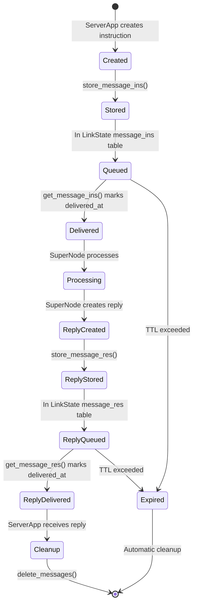
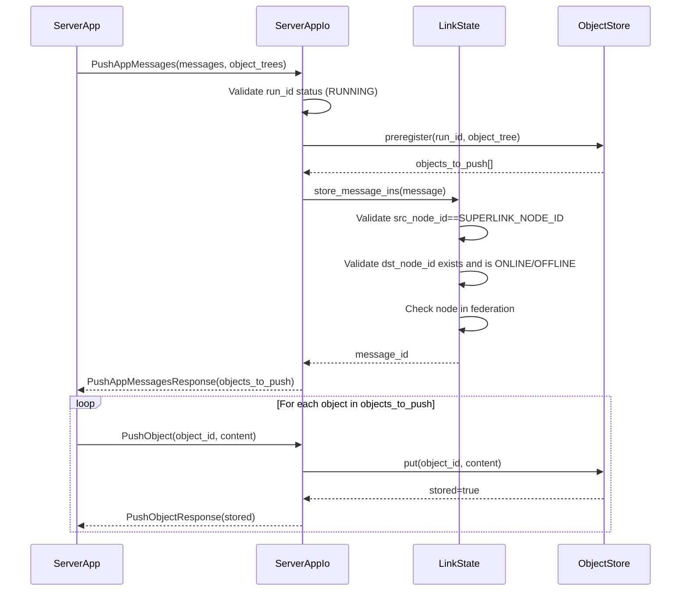
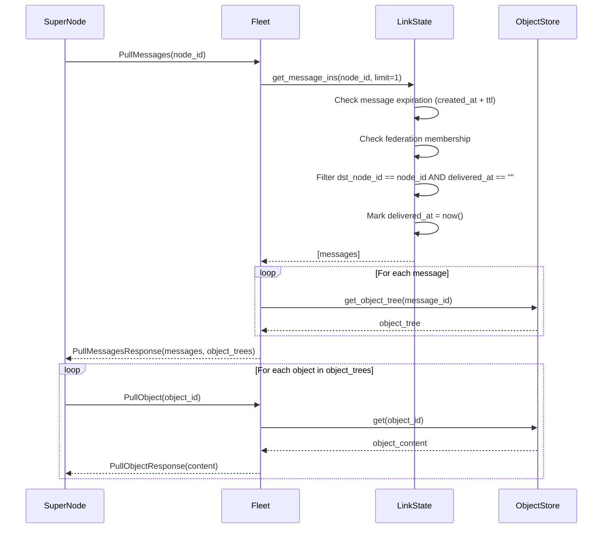
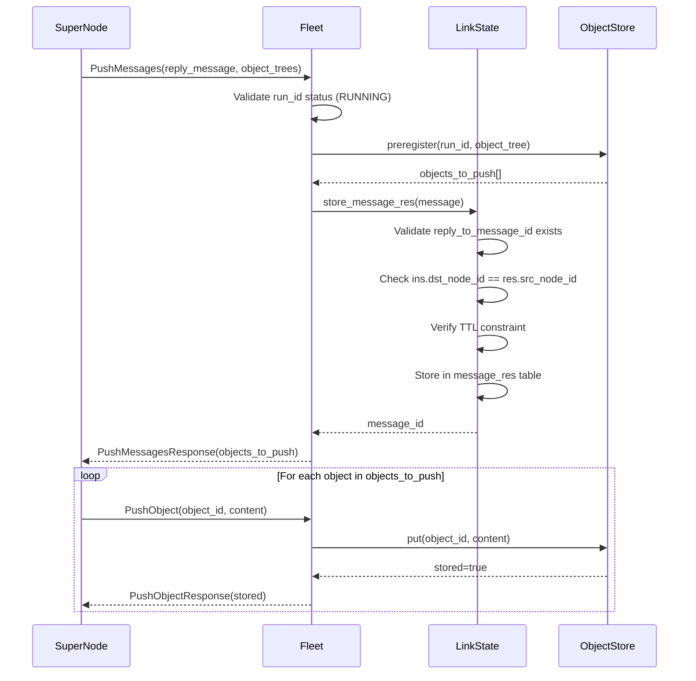
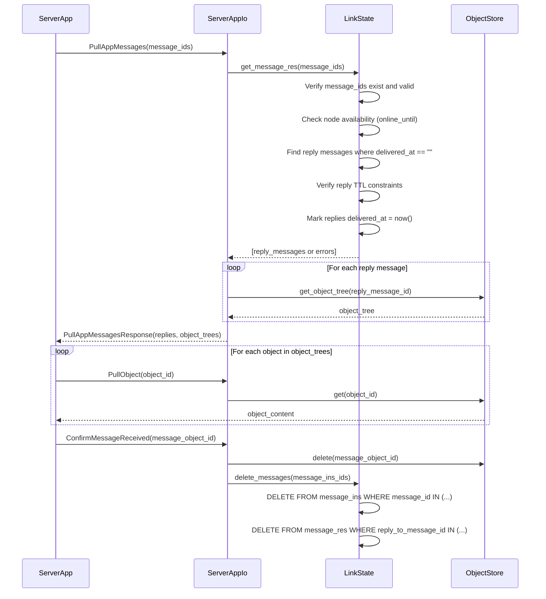
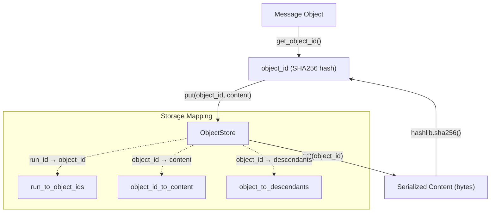
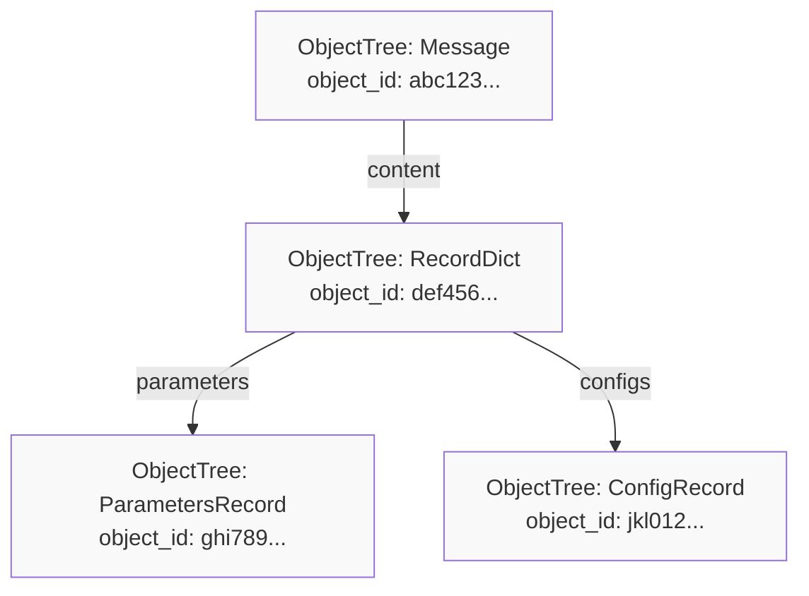
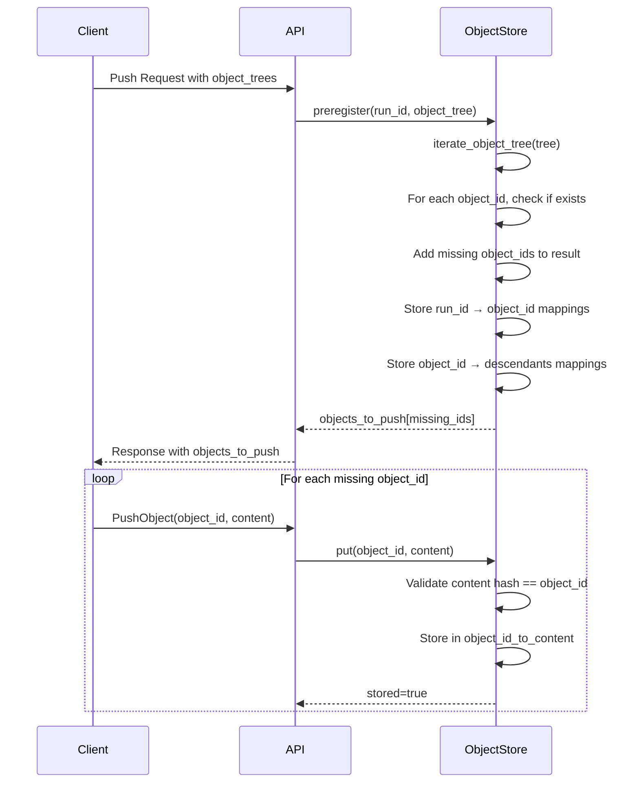
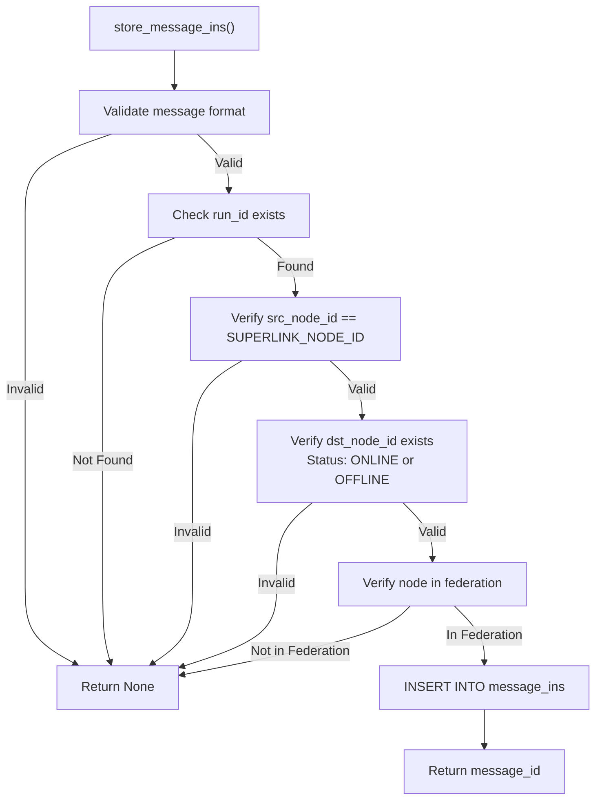
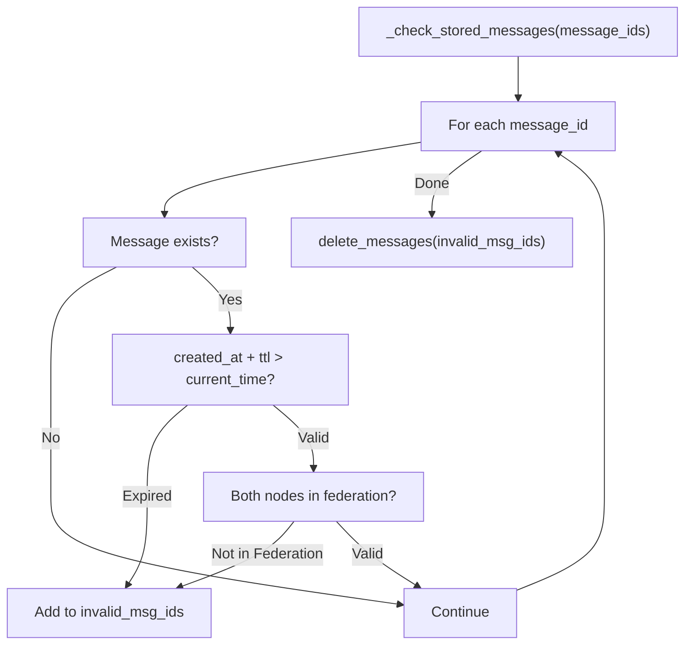

<!-- source: DeepWiki mcp.deepwiki.com · repo adap/flower · page 2.5 Message Flow and Object Storage · fetched 2026-10-21 -->

# Message Flow and Object Storage

<details>
<summary>Relevant source files</summary>

The following files were used as context for generating this wiki page:

- [framework/proto/flwr/proto/fleet.proto](framework/proto/flwr/proto/fleet.proto)
- [framework/py/flwr/client/grpc_rere_client/grpc_adapter.py](framework/py/flwr/client/grpc_rere_client/grpc_adapter.py)
- [framework/py/flwr/proto/fleet_pb2.py](framework/py/flwr/proto/fleet_pb2.py)
- [framework/py/flwr/proto/fleet_pb2.pyi](framework/py/flwr/proto/fleet_pb2.pyi)
- [framework/py/flwr/proto/fleet_pb2_grpc.py](framework/py/flwr/proto/fleet_pb2_grpc.py)
- [framework/py/flwr/proto/fleet_pb2_grpc.pyi](framework/py/flwr/proto/fleet_pb2_grpc.pyi)
- [framework/py/flwr/server/grid/inmemory_grid_test.py](framework/py/flwr/server/grid/inmemory_grid_test.py)
- [framework/py/flwr/server/superlink/fleet/grpc_adapter/grpc_adapter_servicer.py](framework/py/flwr/server/superlink/fleet/grpc_adapter/grpc_adapter_servicer.py)
- [framework/py/flwr/server/superlink/fleet/grpc_rere/fleet_servicer.py](framework/py/flwr/server/superlink/fleet/grpc_rere/fleet_servicer.py)
- [framework/py/flwr/server/superlink/fleet/grpc_rere/fleet_servicer_test.py](framework/py/flwr/server/superlink/fleet/grpc_rere/fleet_servicer_test.py)
- [framework/py/flwr/server/superlink/fleet/grpc_rere/node_auth_server_interceptor_test.py](framework/py/flwr/server/superlink/fleet/grpc_rere/node_auth_server_interceptor_test.py)
- [framework/py/flwr/server/superlink/fleet/message_handler/message_handler.py](framework/py/flwr/server/superlink/fleet/message_handler/message_handler.py)
- [framework/py/flwr/server/superlink/fleet/rest_rere/rest_api.py](framework/py/flwr/server/superlink/fleet/rest_rere/rest_api.py)
- [framework/py/flwr/server/superlink/fleet/vce/vce_api.py](framework/py/flwr/server/superlink/fleet/vce/vce_api.py)
- [framework/py/flwr/server/superlink/fleet/vce/vce_api_test.py](framework/py/flwr/server/superlink/fleet/vce/vce_api_test.py)
- [framework/py/flwr/server/superlink/linkstate/in_memory_linkstate.py](framework/py/flwr/server/superlink/linkstate/in_memory_linkstate.py)
- [framework/py/flwr/server/superlink/linkstate/linkstate.py](framework/py/flwr/server/superlink/linkstate/linkstate.py)
- [framework/py/flwr/server/superlink/linkstate/linkstate_factory.py](framework/py/flwr/server/superlink/linkstate/linkstate_factory.py)
- [framework/py/flwr/server/superlink/linkstate/linkstate_test.py](framework/py/flwr/server/superlink/linkstate/linkstate_test.py)
- [framework/py/flwr/server/superlink/linkstate/sqlite_linkstate.py](framework/py/flwr/server/superlink/linkstate/sqlite_linkstate.py)
- [framework/py/flwr/server/superlink/serverappio/serverappio_servicer_test.py](framework/py/flwr/server/superlink/serverappio/serverappio_servicer_test.py)
- [framework/py/flwr/server/superlink/simulation/simulation_servicer_test.py](framework/py/flwr/server/superlink/simulation/simulation_servicer_test.py)
- [framework/py/flwr/simulation/run_simulation.py](framework/py/flwr/simulation/run_simulation.py)
- [framework/py/flwr/superlink/servicer/control/control_servicer_test.py](framework/py/flwr/superlink/servicer/control/control_servicer_test.py)

</details>


## Purpose and Scope

This page documents the message queuing system and object storage architecture in Flower's SuperLink. It covers how instruction and reply messages flow between ServerApp and SuperNodes through LinkState, how large objects are separated from message metadata for efficient storage and retrieval, and the content-addressable object model using SHA256 hashing.

For information about the LinkState abstraction and its implementations, see [LinkState and State Management](#2.3). For details about the gRPC/REST APIs that transport these messages, see [Communication Protocols](#2.4).

## Message Architecture

### Message Metadata Separation

Flower separates message metadata from message content to enable efficient handling of large objects. The `Message` class contains:
- **Metadata**: Small, queryable fields stored directly in LinkState
- **Content/Error**: Large payloads stored in ObjectStore with content-addressable IDs

#### Key Metadata Fields

| Field | Type | Purpose |
|-------|------|---------|
| `message_id` | string (UUID) | Unique identifier for the message |
| `group_id` | string | Groups related messages together |
| `run_id` | int (uint64) | Associates message with a specific run |
| `src_node_id` | int (uint64) | Source node (0 for SuperLink) |
| `dst_node_id` | int (uint64) | Destination node |
| `reply_to_message_id` | string | Links reply to original message |
| `created_at` | float (timestamp) | Message creation time |
| `delivered_at` | string (ISO datetime) | When message was delivered (empty if not delivered) |
| `ttl` | float (seconds) | Time-to-live for the message |
| `message_type` | string | Type identifier for the message |

Sources: [framework/py/flwr/server/superlink/linkstate/sqlite_linkstate.py:148-183]()

### Time-To-Live (TTL) Management

Messages have a TTL that determines their validity period. The system automatically expires messages when `created_at + ttl ≤ current_time`. Reply messages must have TTL that doesn't exceed the original message's expiration time:

```
ins_metadata.created_at + ins_metadata.ttl ≥ res_metadata.created_at + res_metadata.ttl
```

A tolerance (`MESSAGE_TTL_TOLERANCE`) accounts for floating-point precision issues.

Sources: [framework/py/flwr/server/superlink/linkstate/sqlite_linkstate.py:420-439](), [framework/py/flwr/server/superlink/linkstate/in_memory_linkstate.py:241-261]()

## Message Lifecycle



**Diagram: Message State Transitions**

Sources: [framework/py/flwr/server/superlink/linkstate/sqlite_linkstate.py:225-279](), [framework/py/flwr/server/superlink/linkstate/sqlite_linkstate.py:389-461]()

### Instruction Message Flow (ServerApp → SuperNode)

#### 1. Message Creation and Storage

The ServerApp creates instruction messages and pushes them via the ServerAppIo API:



**Diagram: Instruction Message Push Flow**

Sources: [framework/py/flwr/server/superlink/serverappio/serverappio_servicer.py:165-231](), [framework/py/flwr/server/superlink/linkstate/sqlite_linkstate.py:225-279]()

#### 2. Message Retrieval by SuperNode

SuperNodes pull instruction messages via the Fleet API:



**Diagram: Instruction Message Pull Flow**

Sources: [framework/py/flwr/server/superlink/fleet/message_handler/message_handler.py:131-161](), [framework/py/flwr/server/superlink/linkstate/sqlite_linkstate.py:326-387]()

### Reply Message Flow (SuperNode → ServerApp)

#### 1. Reply Message Storage

After processing, SuperNodes push reply messages:



**Diagram: Reply Message Push Flow**

Sources: [framework/py/flwr/server/superlink/fleet/message_handler/message_handler.py:164-195](), [framework/py/flwr/server/superlink/linkstate/sqlite_linkstate.py:389-461]()

#### 2. Reply Message Retrieval and Cleanup

ServerApp retrieves replies and cleans up both instruction and reply messages:



**Diagram: Reply Message Pull and Cleanup Flow**

Sources: [framework/py/flwr/server/superlink/serverappio/serverappio_servicer.py:235-335](), [framework/py/flwr/server/superlink/linkstate/sqlite_linkstate.py:462-547](), [framework/py/flwr/server/superlink/linkstate/sqlite_linkstate.py:570-594]()

## Object Storage Architecture

### Content-Addressable Model

The `ObjectStore` implements a content-addressable storage system where each object's ID is derived from its content using SHA256 hashing. This ensures:
- **Deduplication**: Identical content always produces the same object_id
- **Integrity**: Content cannot be tampered with without changing the object_id
- **Immutability**: Objects are write-once, read-many



**Diagram: Content-Addressable Object Model**

Sources: [framework/py/flwr/supercore/object_store/in_memory_object_store.py](), [framework/py/flwr/common/inflatable.py]()

### Object Trees

Complex objects containing nested structures (e.g., a Message containing RecordDict containing arrays) are represented as object trees. Each node in the tree has:
- `object_id`: SHA256 hash of the serialized content
- `object_type`: Type identifier (e.g., "Message", "RecordDict", "Array")
- `descendants`: Map of field names to descendant object IDs



**Diagram: Example Object Tree Structure**

Sources: [framework/py/flwr/common/inflatable.py:189-230](), [framework/py/flwr/proto/message.proto]()

### Preregistration and Object Pushing

To optimize network traffic, the system uses a preregistration mechanism:

1. **Preregister**: Client sends object tree structure without content
2. **ObjectStore checks**: Identifies which objects are missing
3. **Client pushes**: Only sends content for missing objects
4. **Confirm receipt**: Client confirms successful delivery



**Diagram: Object Preregistration and Pushing**

Sources: [framework/py/flwr/supercore/object_store/in_memory_object_store.py:76-120](), [framework/py/flwr/supercore/object_store/utils.py:25-78]()

## LinkState Storage Implementation

### SQLite Schema

The SQLite implementation stores messages in two tables:

#### message_ins Table

```sql
CREATE TABLE message_ins(
    message_id              TEXT UNIQUE,
    group_id                TEXT,
    run_id                  INTEGER,
    src_node_id             INTEGER,
    dst_node_id             INTEGER,
    reply_to_message_id     TEXT,
    created_at              REAL,
    delivered_at            TEXT,
    ttl                     REAL,
    message_type            TEXT,
    content                 BLOB NULL,
    error                   BLOB NULL,
    FOREIGN KEY(run_id) REFERENCES run(run_id)
);
```

#### message_res Table

```sql
CREATE TABLE message_res(
    message_id              TEXT UNIQUE,
    group_id                TEXT,
    run_id                  INTEGER,
    src_node_id             INTEGER,
    dst_node_id             INTEGER,
    reply_to_message_id     TEXT,
    created_at              REAL,
    delivered_at            TEXT,
    ttl                     REAL,
    message_type            TEXT,
    content                 BLOB NULL,
    error                   BLOB NULL,
    FOREIGN KEY(run_id) REFERENCES run(run_id)
);
```

**Note**: The `content` and `error` fields store protobuf-serialized data (`ProtoRecordDict` or `ProtoError`), but large objects are stored separately in ObjectStore.

Sources: [framework/py/flwr/server/superlink/linkstate/sqlite_linkstate.py:148-183]()

### In-Memory Storage

The in-memory implementation uses Python dictionaries:

```python
class InMemoryLinkState:
    message_ins_store: dict[str, Message] = {}
    message_res_store: dict[str, Message] = {}
    message_ins_id_to_message_res_id: dict[str, str] = {}
```

This provides the same interface as SQLite but with faster access for simulation scenarios.

Sources: [framework/py/flwr/server/superlink/linkstate/in_memory_linkstate.py:70-100]()

## Message Validation and Constraints

### Instruction Message Validation

When storing instruction messages, the system validates:

1. **Run Existence**: `run_id` must reference a valid run in the database
2. **Source Node**: `src_node_id` must be `SUPERLINK_NODE_ID` (0)
3. **Destination Node**: `dst_node_id` must exist and be in ONLINE or OFFLINE status
4. **Federation Membership**: Both source and destination nodes must belong to the same federation
5. **Message Format**: Message must conform to the expected protobuf schema



**Diagram: Instruction Message Validation Flow**

Sources: [framework/py/flwr/server/superlink/linkstate/sqlite_linkstate.py:225-279]()

### Reply Message Validation

When storing reply messages, additional validations occur:

1. **Original Message Exists**: `reply_to_message_id` must reference a valid instruction message
2. **Node Matching**: `ins.dst_node_id` must equal `res.src_node_id`
3. **TTL Constraint**: Reply TTL cannot exceed original message's remaining time
4. **Message Format**: Reply must conform to expected schema

```python
# TTL validation constraint
max_allowed_ttl = (
    msg_ins["created_at"] + msg_ins["ttl"] - res_metadata.created_at
)
if res_metadata.ttl - max_allowed_ttl > MESSAGE_TTL_TOLERANCE:
    # Reject message
```

Sources: [framework/py/flwr/server/superlink/linkstate/sqlite_linkstate.py:389-461]()

## Message Cleanup and Expiration

### Automatic Expiration

Messages are automatically cleaned up when:
1. **TTL Exceeded**: `created_at + ttl ≤ current_time`
2. **Node Removed from Federation**: Source or destination node is no longer in the federation
3. **Explicit Deletion**: After successful delivery confirmation

The `_check_stored_messages()` method validates message integrity before retrieval:



**Diagram: Message Validation and Cleanup**

Sources: [framework/py/flwr/server/superlink/linkstate/sqlite_linkstate.py:280-324](), [framework/py/flwr/server/superlink/linkstate/in_memory_linkstate.py:151-178]()

### Cascading Deletion

When instruction messages are deleted, their corresponding reply messages are also deleted:

```sql
-- Delete instruction message
DELETE FROM message_ins WHERE message_id IN (?);

-- Delete corresponding reply messages
DELETE FROM message_res WHERE reply_to_message_id IN (?);
```

This ensures no orphaned reply messages remain in the system.

Sources: [framework/py/flwr/server/superlink/linkstate/sqlite_linkstate.py:570-594]()

## Message Delivery Semantics

### At-Most-Once Delivery

The system implements at-most-once delivery semantics:

1. **Initial State**: Message has `delivered_at = ""`
2. **First Retrieval**: System marks `delivered_at = now().isoformat()`
3. **Subsequent Attempts**: Message filtered out (delivered_at != "")

```sql
SELECT message_id FROM message_ins
WHERE dst_node_id == :node_id
  AND delivered_at = ""  -- Only undelivered messages
  AND (created_at + ttl) > CAST(strftime('%s', 'now') AS REAL)
```

This prevents duplicate message delivery to SuperNodes.

Sources: [framework/py/flwr/server/superlink/linkstate/sqlite_linkstate.py:341-377]()

### Error Messages

When message retrieval fails, the system creates synthetic error messages:

| Error Condition | Error Code | Description |
|----------------|------------|-------------|
| Message ID not found | Generic error | Original instruction message not found or expired |
| Reply message expired | Generic error | Reply message existed but TTL exceeded |
| Node offline | Generic error | Destination node offline_until < current_time |

These error messages allow ServerApp to handle failures gracefully without blocking.

Sources: [framework/py/flwr/server/superlink/linkstate/utils.py]()

## Integration with Federation Manager

Messages are filtered by federation membership to enforce isolation between different federations:

```python
# Filter nodes by federation
federation = self.run_ids[message.metadata.run_id].run.federation
filtered = self.federation_manager.filter_nodes(
    {src_node_id, dst_node_id}, federation
)
if len(filtered) != 2:  # Not both nodes in federation
    invalid_msg_ids.add(msg_id)
```

This ensures that messages only flow between nodes in the same logical federation, enabling multi-tenancy and security isolation.

Sources: [framework/py/flwr/server/superlink/linkstate/sqlite_linkstate.py:302-324](), [framework/py/flwr/server/superlink/linkstate/in_memory_linkstate.py:166-178]()

---

