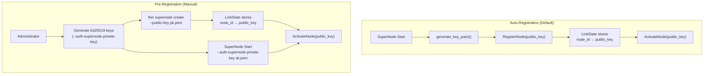
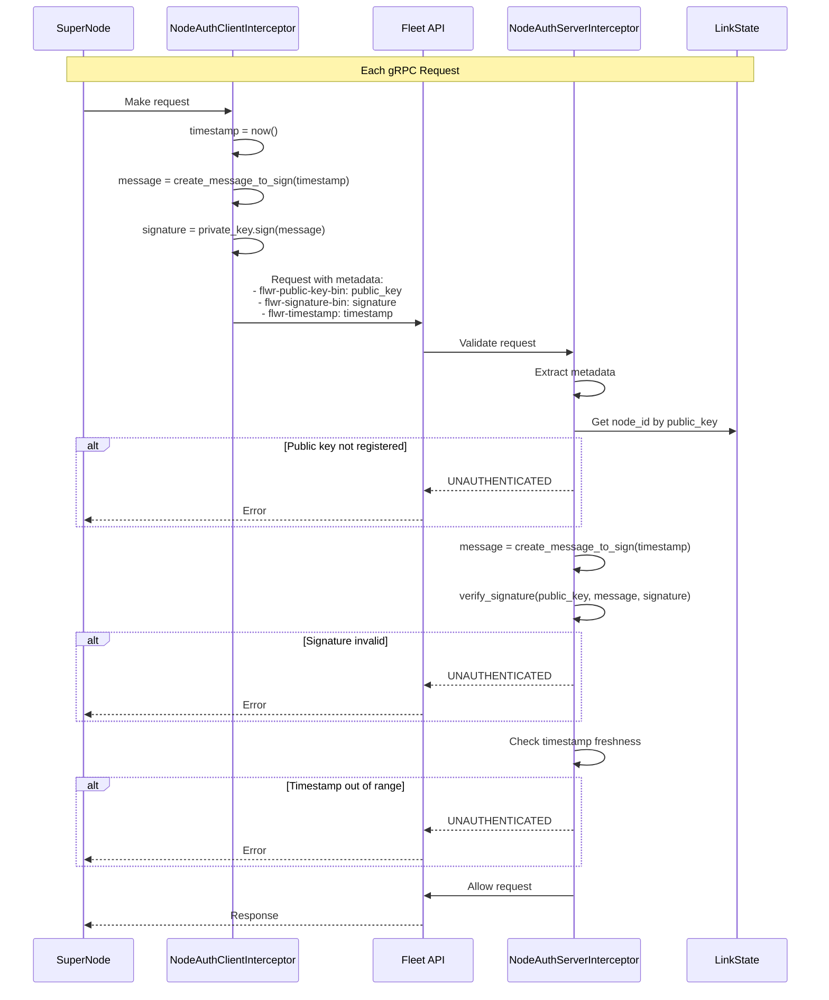
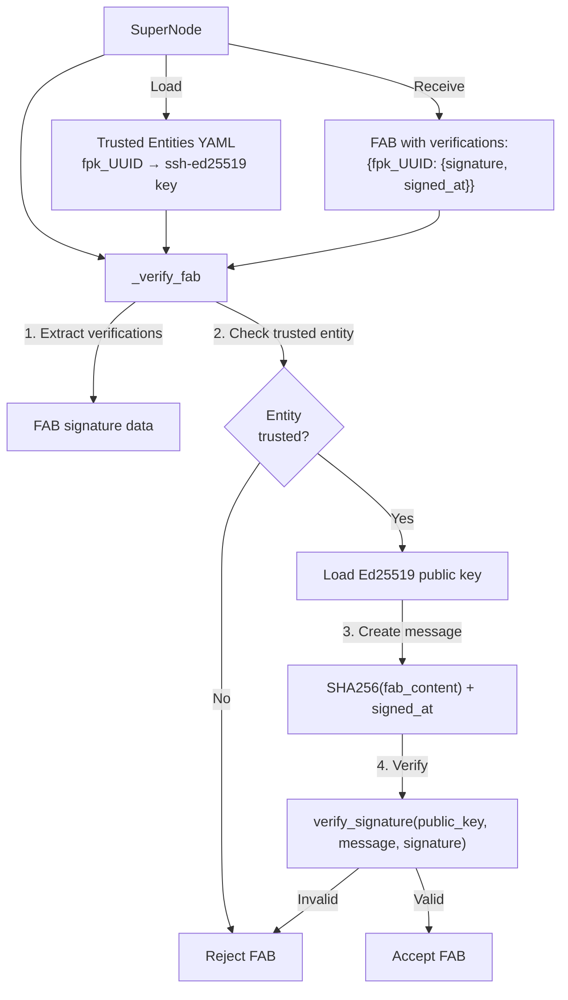
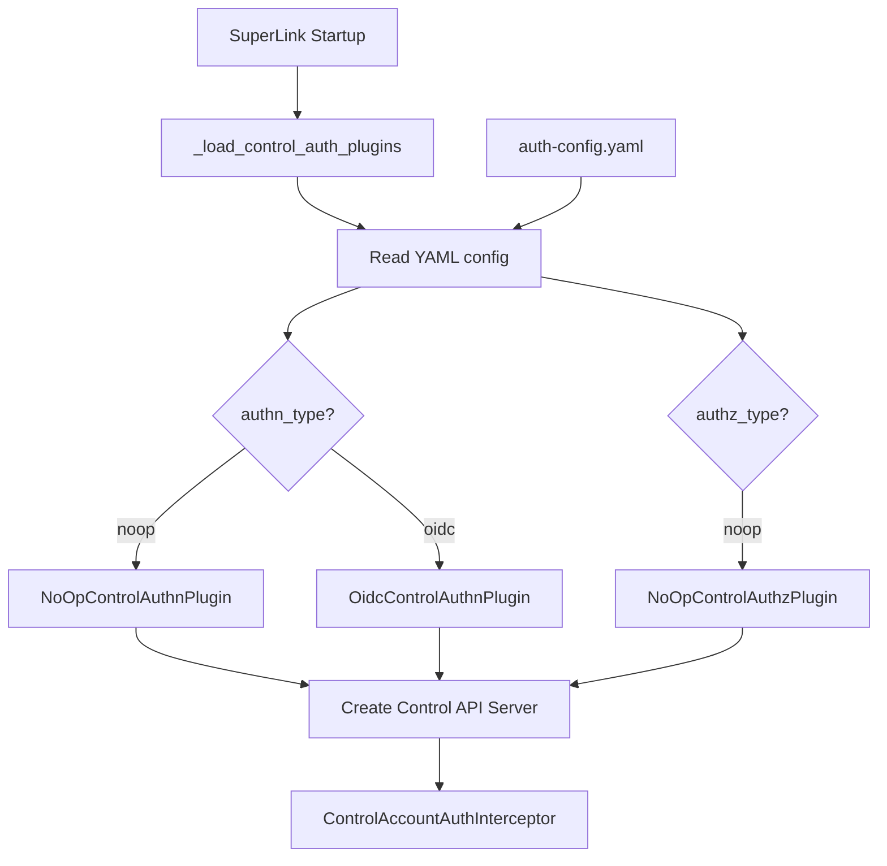

<!-- source: DeepWiki mcp.deepwiki.com · repo adap/flower · page 2.6 Authentication and Authorization · fetched 2026-10-21 -->

# Authentication and Authorization

<details>
<summary>Relevant source files</summary>

The following files were used as context for generating this wiki page:

- [framework/docs/source/ref-exit-codes/303.rst](framework/docs/source/ref-exit-codes/303.rst)
- [framework/docs/source/ref-exit-codes/304.rst](framework/docs/source/ref-exit-codes/304.rst)
- [framework/docs/source/ref-exit-codes/500.rst](framework/docs/source/ref-exit-codes/500.rst)
- [framework/py/flwr/cli/auth_plugin/__init__.py](framework/py/flwr/cli/auth_plugin/__init__.py)
- [framework/py/flwr/cli/auth_plugin/auth_plugin.py](framework/py/flwr/cli/auth_plugin/auth_plugin.py)
- [framework/py/flwr/cli/auth_plugin/noop_auth_plugin.py](framework/py/flwr/cli/auth_plugin/noop_auth_plugin.py)
- [framework/py/flwr/cli/auth_plugin/oidc_cli_plugin.py](framework/py/flwr/cli/auth_plugin/oidc_cli_plugin.py)
- [framework/py/flwr/cli/build.py](framework/py/flwr/cli/build.py)
- [framework/py/flwr/cli/cli_account_auth_interceptor.py](framework/py/flwr/cli/cli_account_auth_interceptor.py)
- [framework/py/flwr/cli/log.py](framework/py/flwr/cli/log.py)
- [framework/py/flwr/cli/login/login.py](framework/py/flwr/cli/login/login.py)
- [framework/py/flwr/cli/new/new.py](framework/py/flwr/cli/new/new.py)
- [framework/py/flwr/cli/new/new_test.py](framework/py/flwr/cli/new/new_test.py)
- [framework/py/flwr/cli/new/templates/app/code/client.xgboost.py.tpl](framework/py/flwr/cli/new/templates/app/code/client.xgboost.py.tpl)
- [framework/py/flwr/cli/new/templates/app/code/server.xgboost.py.tpl](framework/py/flwr/cli/new/templates/app/code/server.xgboost.py.tpl)
- [framework/py/flwr/cli/new/templates/app/code/task.xgboost.py.tpl](framework/py/flwr/cli/new/templates/app/code/task.xgboost.py.tpl)
- [framework/py/flwr/cli/new/templates/app/pyproject.xgboost.toml.tpl](framework/py/flwr/cli/new/templates/app/pyproject.xgboost.toml.tpl)
- [framework/py/flwr/cli/run/run.py](framework/py/flwr/cli/run/run.py)
- [framework/py/flwr/cli/stop.py](framework/py/flwr/cli/stop.py)
- [framework/py/flwr/cli/utils.py](framework/py/flwr/cli/utils.py)
- [framework/py/flwr/client/grpc_adapter_client/connection.py](framework/py/flwr/client/grpc_adapter_client/connection.py)
- [framework/py/flwr/client/grpc_rere_client/connection.py](framework/py/flwr/client/grpc_rere_client/connection.py)
- [framework/py/flwr/client/grpc_rere_client/node_auth_client_interceptor_test.py](framework/py/flwr/client/grpc_rere_client/node_auth_client_interceptor_test.py)
- [framework/py/flwr/client/rest_client/connection.py](framework/py/flwr/client/rest_client/connection.py)
- [framework/py/flwr/common/constant.py](framework/py/flwr/common/constant.py)
- [framework/py/flwr/common/exit/exit_code.py](framework/py/flwr/common/exit/exit_code.py)
- [framework/py/flwr/compat/client/grpc_client/connection.py](framework/py/flwr/compat/client/grpc_client/connection.py)
- [framework/py/flwr/server/app.py](framework/py/flwr/server/app.py)
- [framework/py/flwr/server/superlink/fleet/grpc_rere/node_auth_server_interceptor.py](framework/py/flwr/server/superlink/fleet/grpc_rere/node_auth_server_interceptor.py)
- [framework/py/flwr/supercore/constant.py](framework/py/flwr/supercore/constant.py)
- [framework/py/flwr/supercore/primitives/asymmetric.py](framework/py/flwr/supercore/primitives/asymmetric.py)
- [framework/py/flwr/supercore/primitives/asymmetric_ed25519.py](framework/py/flwr/supercore/primitives/asymmetric_ed25519.py)
- [framework/py/flwr/supercore/primitives/asymmetric_ed25519_test.py](framework/py/flwr/supercore/primitives/asymmetric_ed25519_test.py)
- [framework/py/flwr/superlink/auth_plugin/__init__.py](framework/py/flwr/superlink/auth_plugin/__init__.py)
- [framework/py/flwr/superlink/auth_plugin/auth_plugin.py](framework/py/flwr/superlink/auth_plugin/auth_plugin.py)
- [framework/py/flwr/superlink/auth_plugin/noop_auth_plugin.py](framework/py/flwr/superlink/auth_plugin/noop_auth_plugin.py)
- [framework/py/flwr/superlink/federation/__init__.py](framework/py/flwr/superlink/federation/__init__.py)
- [framework/py/flwr/superlink/servicer/control/control_grpc.py](framework/py/flwr/superlink/servicer/control/control_grpc.py)
- [framework/py/flwr/supernode/cli/flower_supernode.py](framework/py/flwr/supernode/cli/flower_supernode.py)
- [framework/py/flwr/supernode/start_client_internal.py](framework/py/flwr/supernode/start_client_internal.py)
- [framework/py/flwr/supernode/start_client_internal_test.py](framework/py/flwr/supernode/start_client_internal_test.py)

</details>


This document describes the authentication and authorization mechanisms in Flower. The system implements two parallel security models: **account authentication** for administrative operations via the Control API, and **node authentication** for SuperNode identity verification via the Fleet API.

For information about TLS/SSL certificate setup, see the development documentation. For FAB verification mechanics, this document covers the trusted entities system used to verify FAB signatures.

## Overview

Flower implements a dual authentication architecture:

1. **Account Authentication**: OIDC-based authentication for CLI users accessing the Control API (`flwr run`, `flwr login`, `flwr log`, etc.)
2. **Node Authentication**: Ed25519 cryptographic key-based authentication for SuperNodes connecting to the Fleet API

These systems operate independently and serve different purposes in the federated learning workflow.

```mermaid
graph TB
    subgraph "Account Authentication Flow"
        CLI[CLI User]
        CliPlugin[CliAuthPlugin]
        CliInterceptor[CliAccountAuthInterceptor]
        ControlAPI[Control API]
        ControlInterceptor[ControlAccountAuthInterceptor]
        ControlPlugin[ControlAuthnPlugin]
        
        CLI -->|"flwr login"| CliPlugin
        CliPlugin -->|Store tokens| Credentials["~/.flwr/.credentials/<federation>.json"]
        CLI -->|"flwr run/log/stop"| CliInterceptor
        CliInterceptor -->|Load tokens| Credentials
        CliInterceptor -->|Inject in metadata| ControlAPI
        ControlAPI --> ControlInterceptor
        ControlInterceptor --> ControlPlugin
        ControlPlugin -->|Validate tokens| OIDC[OIDC Provider]
    end
    
    subgraph "Node Authentication Flow"
        SuperNode[SuperNode]
        KeyPair["Ed25519 Key Pair<br/>(Private + Public)"]
        NodeClientInt[NodeAuthClientInterceptor]
        FleetAPI[Fleet API]
        NodeServerInt[NodeAuthServerInterceptor]
        LinkState[LinkState]
        
        SuperNode -->|Generate/Load| KeyPair
        SuperNode --> NodeClientInt
        NodeClientInt -->|Sign timestamp| KeyPair
        NodeClientInt -->|"Metadata: public_key, signature, timestamp"| FleetAPI
        FleetAPI --> NodeServerInt
        NodeServerInt -->|Verify signature| LinkState
        LinkState -->|"node_id → public_key mapping"| NodeServerInt
    end
```



**Dual Authentication Model**

Sources: [framework/py/flwr/common/constant.py:126-141](), [framework/py/flwr/common/constant.py:273-291](), [framework/py/flwr/server/app.py:227-243]()

---

## Account Authentication

Account authentication secures administrative operations performed through the CLI. It uses OIDC (OpenID Connect) device flow to authenticate users without requiring client secrets.

### Authentication Flow

```mermaid
sequenceDiagram
    participant User
    participant CLI as flwr CLI
    participant CliPlugin as CliAuthPlugin
    participant Credentials as ~/.flwr/.credentials
    participant ControlAPI as Control API
    participant ControlPlugin as ControlAuthnPlugin
    participant OIDC as OIDC Provider

    Note over User,OIDC: Login Phase (flwr login)
    User->>CLI: flwr login
    CLI->>ControlAPI: GetLoginDetails()
    ControlAPI-->>CLI: authn_type, device_code, verification_uri
    CLI->>CliPlugin: login(details)
    CliPlugin->>User: Display verification URL
    User->>OIDC: Complete device flow
    loop Poll for tokens
        CliPlugin->>ControlAPI: GetAuthTokens(device_code)
        ControlAPI->>OIDC: Check authorization
        OIDC-->>ControlAPI: tokens (if authorized)
    end
    ControlAPI-->>CliPlugin: access_token, refresh_token
    CliPlugin->>Credentials: store_tokens()
    
    Note over User,OIDC: Authenticated Request Phase (flwr run/log/stop)
    User->>CLI: flwr run/log/stop
    CLI->>CliPlugin: load_tokens()
    CliPlugin->>Credentials: Read tokens
    Credentials-->>CliPlugin: access_token, refresh_token
    CLI->>ControlAPI: Request with tokens in metadata
    ControlAPI->>ControlPlugin: validate_tokens()
    ControlPlugin->>OIDC: Validate access_token
    alt Token expired
        ControlPlugin->>OIDC: Refresh token
        OIDC-->>ControlPlugin: New access_token
    end
    ControlPlugin-->>ControlAPI: flwr_aid, account_name
    ControlAPI-->>CLI: Response
```



**Account Authentication Sequence**

Sources: [framework/py/flwr/cli/login/login.py:47-135](), [framework/py/flwr/cli/auth_plugin/oidc_cli_plugin.py:42-96]()

### CLI-Side Components

#### CliAuthPlugin

The abstract base class for CLI authentication plugins defines the interface for handling authentication tokens:

- **`login(login_details, control_stub)`**: Performs the authentication flow and returns credentials
- **`store_tokens(credentials)`**: Persists tokens to the credentials file
- **`load_tokens()`**: Loads tokens from the credentials file
- **`refresh_tokens(control_stub)`**: Refreshes expired access tokens

Implementations:
- `OidcCliPlugin` [framework/py/flwr/cli/auth_plugin/oidc_cli_plugin.py:42-135](): OIDC device flow implementation
- `NoOpCliAuthPlugin` [framework/py/flwr/cli/auth_plugin/noop_auth_plugin.py:19-76](): No-op implementation for federations without authentication

Sources: [framework/py/flwr/cli/auth_plugin/auth_plugin.py:33-100]()

#### CliAccountAuthInterceptor

A gRPC client interceptor that automatically injects authentication tokens into request metadata:

```python
# Pseudocode representation
class CliAccountAuthInterceptor:
    def intercept_unary_unary(self, continuation, client_call_details, request):
        # Load tokens from plugin
        self.auth_plugin.load_tokens()
        
        # Add tokens to metadata
        metadata = [
            ("flwr-oidc-access-token", access_token),
            ("flwr-oidc-refresh-token", refresh_token)
        ]
        
        # Make request with tokens
        return continuation(client_call_details, request)
```

The interceptor handles token refresh transparently when requests fail with `UNAUTHENTICATED` status.

Sources: [framework/py/flwr/cli/cli_account_auth_interceptor.py:22-115]()

#### Credentials Storage

Tokens are stored in `~/.flwr/.credentials/<federation>.json`:

```json
{
  "authn-type": "oidc",
  "flwr-oidc-access-token": "eyJhbGc...",
  "flwr-oidc-refresh-token": "eyJhbGc..."
}
```

The credentials directory is automatically added to `.gitignore` to prevent accidental commits.

Sources: [framework/py/flwr/cli/utils.py:174-223](), [framework/py/flwr/common/constant.py:127-131]()

### Server-Side Components

#### ControlAuthnPlugin

The abstract base class for server-side authentication plugins:

- **`validate_tokens(access_token, refresh_token)`**: Validates tokens and returns account identifiers
- **`refresh_token(refresh_token)`**: Obtains a new access token from a refresh token

Implementations:
- OIDC plugin (in EE): Validates tokens against OIDC provider
- `NoOpControlAuthnPlugin` [framework/py/flwr/superlink/auth_plugin/noop_auth_plugin.py:22-64](): Returns dummy credentials

Sources: [framework/py/flwr/superlink/auth_plugin/auth_plugin.py:18-94]()

#### ControlAccountAuthInterceptor

A gRPC server interceptor that validates incoming authentication tokens:

```python
# Pseudocode representation
class ControlAccountAuthInterceptor:
    def intercept_service(self, continuation, handler_call_details):
        # Extract tokens from metadata
        metadata = handler_call_details.invocation_metadata
        access_token = get_header(metadata, "flwr-oidc-access-token")
        refresh_token = get_header(metadata, "flwr-oidc-refresh-token")
        
        # Validate tokens
        flwr_aid, account_name = authn_plugin.validate_tokens(
            access_token, refresh_token
        )
        
        # Store in context for authorization checks
        context.flwr_aid = flwr_aid
        context.account_name = account_name
        
        return continuation(handler_call_details)
```

If validation fails, the interceptor aborts the request with `UNAUTHENTICATED` status.

Sources: [framework/py/flwr/superlink/servicer/control/control_account_auth_interceptor.py:1-200]() (file not fully shown but referenced)

### Configuration

Account authentication is configured in `pyproject.toml`:

```toml
[tool.flwr.federations.my-federation]
address = "127.0.0.1:9093"
enable-account-auth = true
```

On the SuperLink side, authentication is configured via YAML:

```yaml
authentication:
  authn_type: "oidc"
  # OIDC-specific configuration
  issuer_url: "https://identity.example.com"
  client_id: "flower-cli"
```

The SuperLink loads this configuration via the `--account-auth-config` flag:

```bash
flower-superlink --account-auth-config auth-config.yaml
```

Sources: [framework/py/flwr/server/app.py:479-536](), [framework/py/flwr/cli/utils.py:225-237]()

---

## Node Authentication

Node authentication ensures that only authorized SuperNodes can connect to the Fleet API. It uses Ed25519 cryptographic signatures to verify node identity without requiring a central certificate authority.

### Key Generation and Registration

SuperNodes can either:
1. **Auto-register**: Generate ephemeral key pairs automatically (self-registered nodes)
2. **Pre-register**: Use pre-generated key pairs provided by administrators



**Node Registration Models**

Sources: [framework/py/flwr/client/grpc_rere_client/connection.py:142-151](), [framework/py/flwr/supernode/cli/flower_supernode.py:228-254]()

### Authentication Mechanism

Node authentication uses a challenge-response pattern based on timestamp signing:

1. SuperNode signs current timestamp with its private key
2. SuperNode includes signature, public key, and timestamp in gRPC metadata
3. SuperLink verifies signature using stored public key
4. SuperLink validates timestamp is within acceptable range



**Node Authentication Request Flow**

Sources: [framework/py/flwr/client/grpc_rere_client/node_auth_client_interceptor.py:1-100]() (referenced), [framework/py/flwr/server/superlink/fleet/grpc_rere/node_auth_server_interceptor.py:44-150]()

### NodeAuthClientInterceptor

The client-side interceptor injects authentication metadata into every request:

| Metadata Header | Description | Format |
|----------------|-------------|--------|
| `flwr-public-key-bin` | Node's Ed25519 public key | Binary DER format |
| `flwr-signature-bin` | Signature of timestamp | 64 bytes |
| `flwr-timestamp` | Current timestamp | ISO 8601 string |

The signature is created over a message that combines:
1. The timestamp bytes (ISO 8601 format)
2. A delimiter
3. The public key bytes

Sources: [framework/py/flwr/common/constant.py:137-141](), [framework/py/flwr/supercore/primitives/asymmetric_ed25519.py:137-160]()

### NodeAuthServerInterceptor

The server-side interceptor verifies authentication for each request:

```python
# Pseudocode representation
class NodeAuthServerInterceptor:
    def intercept_service(self, continuation, handler_call_details):
        metadata = handler_call_details.invocation_metadata
        
        # Extract authentication data
        public_key_bytes = get_header(metadata, "flwr-public-key-bin")
        signature = get_header(metadata, "flwr-signature-bin")
        timestamp_str = get_header(metadata, "flwr-timestamp")
        
        # Convert public key
        public_key = bytes_to_public_key(public_key_bytes)
        
        # Lookup node in LinkState
        state = state_factory.state()
        node_id = state.get_node_id_from_public_key(public_key_bytes)
        if node_id is None:
            abort(UNAUTHENTICATED, "Public key not registered")
        
        # Verify timestamp freshness
        timestamp = parse_iso8601(timestamp_str)
        now = current_time()
        diff = now - timestamp
        if not (MIN_TIMESTAMP_DIFF <= diff <= MAX_TIMESTAMP_DIFF):
            abort(UNAUTHENTICATED, "Timestamp out of range")
        
        # Verify signature
        message = create_message_to_sign(timestamp_str, public_key_bytes)
        if not verify_signature(public_key, message, signature):
            abort(UNAUTHENTICATED, "Invalid signature")
        
        return continuation(handler_call_details)
```

**Timestamp Validation Parameters**:
- `MIN_TIMESTAMP_DIFF = -5` seconds (allows for clock skew)
- `MAX_TIMESTAMP_DIFF = 305` seconds (300s tolerance + 5s clock skew)

Sources: [framework/py/flwr/server/superlink/fleet/grpc_rere/node_auth_server_interceptor.py:40-150](), [framework/py/flwr/common/constant.py:140-142]()

### Exempted Methods

Certain Fleet API methods are exempted from authentication to allow initial registration:

- `RegisterNode`: Allows new nodes to register their public keys
- `UnregisterNode`: Allows nodes to remove themselves

All other methods (`ActivateNode`, `DeactivateNode`, `PullMessages`, `PushMessages`, etc.) require authentication.

Sources: [framework/py/flwr/server/superlink/fleet/grpc_rere/node_auth_server_interceptor.py:80-115]()

### Configuration

Enable SuperNode authentication on the SuperLink:

```bash
flower-superlink --enable-supernode-auth
```

Requirements:
- TLS must be enabled (not `--insecure`)
- Fleet API type must be `grpc-rere`
- Cannot be used with simulation mode

On the SuperNode side:

```bash
# Auto-registration (ephemeral keys)
flower-supernode --superlink 127.0.0.1:9092

# Pre-registration (persistent keys)
flower-supernode \
  --superlink 127.0.0.1:9092 \
  --auth-supernode-private-key /path/to/private-key.pem
```

Sources: [framework/py/flwr/server/app.py:252-286](), [framework/py/flwr/supernode/cli/flower_supernode.py:209-254]()

---

## Authorization

Authorization determines what authenticated entities can do. Flower implements authorization through plugins that check permissions after authentication succeeds.

### Account Authorization

The `ControlAuthzPlugin` interface defines authorization checks for Control API operations:

```python
# Pseudocode representation
class ControlAuthzPlugin(ABC):
    @abstractmethod
    def check_start_run(self, flwr_aid: str, federation: str) -> bool:
        """Check if account can start runs in federation."""
        
    @abstractmethod
    def check_stop_run(self, flwr_aid: str, run_id: int) -> bool:
        """Check if account can stop specific run."""
        
    @abstractmethod
    def check_get_logs(self, flwr_aid: str, run_id: int) -> bool:
        """Check if account can view run logs."""
```

The `ControlAccountAuthInterceptor` invokes these checks after authentication:

```python
# Pseudocode representation
def intercept_service(self, continuation, handler_call_details):
    # ... authentication ...
    
    # Authorization check
    method = handler_call_details.method
    if method == "/flwr.proto.Control/StartRun":
        if not authz_plugin.check_start_run(flwr_aid, federation):
            abort(PERMISSION_DENIED, "Not authorized to start runs")
    
    return continuation(handler_call_details)
```

The default `NoOpControlAuthzPlugin` allows all operations.

Sources: [framework/py/flwr/superlink/auth_plugin/auth_plugin.py:97-180](), [framework/py/flwr/superlink/auth_plugin/noop_auth_plugin.py:67-100]()

### Node Authorization

Node authorization is binary: if a node's public key is registered in LinkState and its signature is valid, it can perform all Fleet API operations. There are no fine-grained permissions for nodes.

However, nodes are isolated by:
1. **Run ID**: Nodes can only access messages for runs they're participating in
2. **Node ID**: Messages are addressed to specific nodes

Sources: [framework/py/flwr/server/superlink/fleet/grpc_rere/fleet_servicer.py:1-500]() (referenced)

---

## FAB Verification with Trusted Entities

SuperNodes can verify Flower App Bundles (FABs) before execution using a trusted entities list. This ensures only apps signed by trusted publishers can run.

### Verification Process



**FAB Verification Flow**

Sources: [framework/py/flwr/supernode/start_client_internal.py:625-654]()

### Trusted Entities Configuration

Trusted entities are specified in a YAML file:

```yaml
fpk_a1b2c3d4-5678-90ab-cdef-1234567890ab: "ssh-ed25519 AAAAC3NzaC1lZDI1NTE5AAAAIAbc... publisher1@example.com"
fpk_e5f6g7h8-1234-56cd-ef78-9012345678cd: "ssh-ed25519 AAAAC3NzaC1lZDI1NTE5AAAAIBxyz... publisher2@example.com"
```

Requirements:
- Public key IDs must follow format `fpk_<UUID>`
- Public keys must be Ed25519 in SSH format
- Only `ssh-ed25519` key type is supported

SuperNode configuration:

```bash
flower-supernode \
  --superlink 127.0.0.1:9092 \
  --trusted-entities /path/to/trusted-entities.yaml
```

If a FAB cannot be verified:
1. SuperNode logs an error
2. SuperNode sends an error message back to SuperLink
3. The task is not executed

Sources: [framework/py/flwr/supernode/cli/flower_supernode.py:257-293](), [framework/py/flwr/supernode/start_client_internal.py:347-368]()

### FAB Verification Data Structure

FABs contain verification metadata in their `verifications` dictionary:

```python
{
    "valid_license": "true",  # License validity flag
    "fpk_UUID1": '{"signature": "base64url...", "signed_at": "2024-01-01T00:00:00Z"}',
    "fpk_UUID2": '{"signature": "base64url...", "signed_at": "2024-01-01T00:00:00Z"}'
}
```

Each trusted entity's entry contains:
- `signature`: Base64url-encoded Ed25519 signature
- `signed_at`: ISO 8601 timestamp of signing

The signature is created over:
```
SHA256(fab_content) + signed_at_bytes
```

Sources: [framework/py/flwr/supernode/start_client_internal.py:632-652](), [framework/py/flwr/supercore/primitives/asymmetric_ed25519.py:137-160]()

---

## Authentication Plugin Architecture

Both account and node authentication use plugin architectures for extensibility.

### Plugin Loading



**Plugin Loading on SuperLink**

The SuperLink uses a factory pattern to instantiate plugins:

```python
# From server/app.py
def get_control_authn_plugins() -> dict[str, type[ControlAuthnPlugin]]:
    ee_dict = get_control_authn_ee_plugins()  # EE plugins
    return ee_dict | {AuthnType.NOOP: NoOpControlAuthnPlugin}

def _load_control_auth_plugins(config_path, verify_tls_cert):
    # Load YAML config
    with Path(config_path).open("r") as file:
        config = yaml.safe_load(file)
    
    # Get authentication plugin
    authn_type = config["authentication"]["authn_type"]
    plugins = get_control_authn_plugins()
    authn_plugin = plugins[authn_type](config_path, verify_tls_cert)
    
    # Get authorization plugin  
    authz_type = config["authorization"]["authz_type"]
    plugins = get_control_authz_plugins()
    authz_plugin = plugins[authz_type](config_path, verify_tls_cert)
    
    return authn_plugin, authz_plugin
```

Sources: [framework/py/flwr/server/app.py:140-150](), [framework/py/flwr/server/app.py:479-536]()

### CLI Plugin Loading

The CLI loads authentication plugins based on stored credentials or SuperLink response:

```python
# From cli/utils.py and cli/auth_plugin/__init__.py
def load_cli_auth_plugin(root_dir, federation, federation_config, authn_type=None):
    config_path = get_account_auth_config_path(root_dir, federation)
    
    # Determine auth type
    if authn_type is None:
        authn_type = AuthnType.NOOP
        if account_auth_enabled(federation_config):
            authn_type = retrieve_authn_type(config_path)
    
    # Get plugin class
    auth_plugin_class = get_cli_plugin_class(authn_type)
    return auth_plugin_class(config_path)

def get_cli_plugin_class(authn_type):
    if authn_type == AuthnType.NOOP:
        return NoOpCliAuthPlugin
    if authn_type == AuthnType.OIDC:
        return OidcCliPlugin
    raise ValueError(f"Unsupported authentication type: {authn_type}")
```

Sources: [framework/py/flwr/cli/utils.py:250-275](), [framework/py/flwr/cli/auth_plugin/__init__.py:25-32]()

---

## Security Considerations

### Token Security
- Access tokens are short-lived (typically 5-15 minutes)
- Refresh tokens enable obtaining new access tokens without re-authentication
- Tokens are stored in `~/.flwr/.credentials/` with file system permissions
- Credentials directory is automatically gitignored

### Key Security
- Ed25519 provides 128-bit security level
- Private keys never leave the SuperNode
- Public keys are transmitted with each request (no pre-shared secrets)
- Timestamp-based replay protection (5-minute window)

### Transport Security
- Account authentication requires TLS (enforced by CLI)
- Node authentication requires TLS when enabled
- All authentication metadata is transmitted over gRPC with TLS encryption

### Attack Mitigation
- **Replay attacks**: Timestamp validation with narrow time window
- **Man-in-the-middle**: TLS encryption requirement
- **Key reuse**: Each node can have unique key pair
- **Token theft**: Short-lived access tokens, refresh token rotation

Sources: [framework/py/flwr/common/constant.py:140-142](), [framework/py/flwr/cli/login/login.py:88-96]()

---

## Error Handling

### Common Error Codes

| gRPC Status Code | Scenario | Resolution |
|-----------------|----------|------------|
| `UNAUTHENTICATED` | Invalid/expired tokens | Run `flwr login` to re-authenticate |
| `UNAUTHENTICATED` | Invalid node signature | Check private key and clock synchronization |
| `PERMISSION_DENIED` | Insufficient permissions | Check authorization configuration |
| `UNIMPLEMENTED` | Auth not enabled on SuperLink | Enable authentication in SuperLink config |
| `FAILED_PRECONDITION` | Public key already registered | Use different key or unregister old node |

### Exit Codes

| Exit Code | Name | Description |
|-----------|------|-------------|
| 303 | `SUPERNODE_STARTED_WITHOUT_TLS_BUT_NODE_AUTH_ENABLED` | Node auth requires TLS |
| 304 | `SUPERNODE_INVALID_TRUSTED_ENTITIES` | Invalid trusted entities YAML file |
| 500 | `FLWRCLI_NODE_AUTH_PUBLIC_KEY_INVALID` | Invalid public key in `flwr supernode create` |

Sources: [framework/py/flwr/common/exit/exit_code.py:42-54](), [framework/py/flwr/cli/utils.py:301-410]()

---

## Configuration Reference

### Account Authentication (pyproject.toml)

```toml
[tool.flwr.federations.my-federation]
address = "127.0.0.1:9093"
enable-account-auth = true  # Enable account authentication
insecure = false            # Must be false for auth
root-certificates = "certificates/ca.crt"  # TLS certificates
```

### Account Authentication (SuperLink YAML)

```yaml
authentication:
  authn_type: "oidc"  # or "noop"
  issuer_url: "https://identity.example.com"
  client_id: "flower-cli"
  # Additional OIDC configuration...

authorization:
  authz_type: "noop"  # Future: role-based authorization
```

### Node Authentication (SuperLink)

```bash
flower-superlink \
  --enable-supernode-auth \
  --ssl-certfile server.crt \
  --ssl-keyfile server.key \
  --ssl-ca-certfile ca.crt
```

### Node Authentication (SuperNode)

```bash
# With pre-generated keys
flower-supernode \
  --superlink 127.0.0.1:9092 \
  --root-certificates ca.crt \
  --auth-supernode-private-key private-key.pem

# With trusted entities verification
flower-supernode \
  --superlink 127.0.0.1:9092 \
  --root-certificates ca.crt \
  --trusted-entities trusted-entities.yaml
```

Sources: [framework/py/flwr/server/app.py:691-765](), [framework/py/flwr/supernode/cli/flower_supernode.py:96-226]()

---

