<!-- source: DeepWiki mcp.deepwiki.com · repo adap/flower · page 3 Command-Line Interface · fetched 2026-10-21 -->

# Command-Line Interface

<details>
<summary>Relevant source files</summary>

The following files were used as context for generating this wiki page:

- [framework/py/flwr/cli/auth_plugin/__init__.py](framework/py/flwr/cli/auth_plugin/__init__.py)
- [framework/py/flwr/cli/auth_plugin/auth_plugin.py](framework/py/flwr/cli/auth_plugin/auth_plugin.py)
- [framework/py/flwr/cli/auth_plugin/noop_auth_plugin.py](framework/py/flwr/cli/auth_plugin/noop_auth_plugin.py)
- [framework/py/flwr/cli/auth_plugin/oidc_cli_plugin.py](framework/py/flwr/cli/auth_plugin/oidc_cli_plugin.py)
- [framework/py/flwr/cli/build.py](framework/py/flwr/cli/build.py)
- [framework/py/flwr/cli/cli_account_auth_interceptor.py](framework/py/flwr/cli/cli_account_auth_interceptor.py)
- [framework/py/flwr/cli/log.py](framework/py/flwr/cli/log.py)
- [framework/py/flwr/cli/login/login.py](framework/py/flwr/cli/login/login.py)
- [framework/py/flwr/cli/new/new.py](framework/py/flwr/cli/new/new.py)
- [framework/py/flwr/cli/new/new_test.py](framework/py/flwr/cli/new/new_test.py)
- [framework/py/flwr/cli/new/templates/app/code/client.xgboost.py.tpl](framework/py/flwr/cli/new/templates/app/code/client.xgboost.py.tpl)
- [framework/py/flwr/cli/new/templates/app/code/server.xgboost.py.tpl](framework/py/flwr/cli/new/templates/app/code/server.xgboost.py.tpl)
- [framework/py/flwr/cli/new/templates/app/code/task.xgboost.py.tpl](framework/py/flwr/cli/new/templates/app/code/task.xgboost.py.tpl)
- [framework/py/flwr/cli/new/templates/app/pyproject.xgboost.toml.tpl](framework/py/flwr/cli/new/templates/app/pyproject.xgboost.toml.tpl)
- [framework/py/flwr/cli/run/run.py](framework/py/flwr/cli/run/run.py)
- [framework/py/flwr/cli/stop.py](framework/py/flwr/cli/stop.py)
- [framework/py/flwr/cli/utils.py](framework/py/flwr/cli/utils.py)
- [framework/py/flwr/common/constant.py](framework/py/flwr/common/constant.py)
- [framework/py/flwr/server/app.py](framework/py/flwr/server/app.py)
- [framework/py/flwr/supercore/constant.py](framework/py/flwr/supercore/constant.py)
- [framework/py/flwr/superlink/auth_plugin/__init__.py](framework/py/flwr/superlink/auth_plugin/__init__.py)
- [framework/py/flwr/superlink/auth_plugin/auth_plugin.py](framework/py/flwr/superlink/auth_plugin/auth_plugin.py)
- [framework/py/flwr/superlink/auth_plugin/noop_auth_plugin.py](framework/py/flwr/superlink/auth_plugin/noop_auth_plugin.py)
- [framework/py/flwr/superlink/federation/__init__.py](framework/py/flwr/superlink/federation/__init__.py)
- [framework/py/flwr/superlink/servicer/control/control_grpc.py](framework/py/flwr/superlink/servicer/control/control_grpc.py)

</details>


This document covers the Flower command-line interface (CLI) commands that enable users to create, build, run, and manage Flower applications. The CLI provides commands for application lifecycle management, authentication, and monitoring.

For information about the underlying runtime architecture and communication protocols, see page 2 (Core Architecture). For details about SuperLink and SuperNode components, see pages 2.1 and 2.2.

## Overview

The Flower CLI provides a unified interface for managing the complete lifecycle of federated learning applications. The main `flwr` command serves as the entry point for all user-facing operations.

### Main CLI Command Structure

**Diagram: Flower CLI Command Structure**

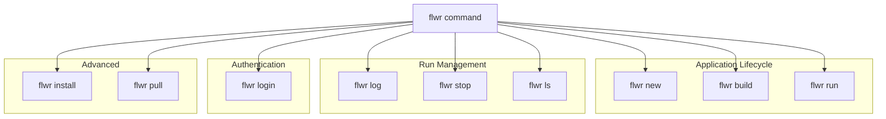

Sources: [framework/py/flwr/cli/run/run.py:1-15](), [framework/py/flwr/cli/new/new.py:1-15](), [framework/py/flwr/cli/build.py:1-15](), [framework/py/flwr/cli/login/login.py:1-15](), [framework/py/flwr/cli/log.py:1-15](), [framework/py/flwr/cli/stop.py:1-15]()

### CLI Command Categories

| Command | Purpose | Primary Use Case |
|---------|---------|------------------|
| `flwr new` | Create new Flower application from template | Starting a new project |
| `flwr build` | Build Flower App Bundle (FAB) | Packaging application for deployment |
| `flwr run` | Execute Flower application | Running federated learning workload |
| `flwr login` | Authenticate to SuperLink | Accessing protected federations |
| `flwr log` | Stream or display run logs | Monitoring execution |
| `flwr stop` | Terminate running application | Stopping active runs |
| `flwr ls` | List runs and nodes | Status checking |
| `flwr install` | Install FAB to SuperLink | Deployment |
| `flwr pull` | Download run artifacts | Retrieving results |

Sources: [framework/py/flwr/cli/run/run.py:58-98](), [framework/py/flwr/cli/new/new.py:266-283](), [framework/py/flwr/cli/build.py:63-76](), [framework/py/flwr/cli/login/login.py:47-63]()

## Core CLI Commands

### flwr new

Creates a new Flower application from built-in templates or downloads remote applications from the Flower Hub.

**Command Signature:**
```
flwr new [APP_NAME] [--framework FRAMEWORK] [--username USERNAME]
```

**Diagram: flwr new Execution Flow**

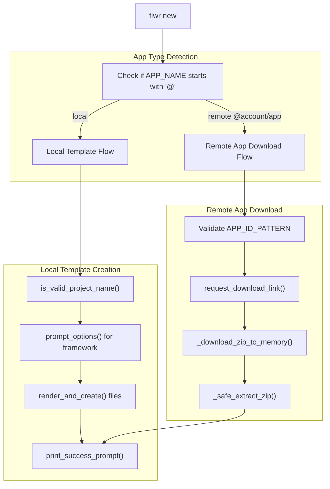

Sources: [framework/py/flwr/cli/new/new.py:266-292](), [framework/py/flwr/cli/new/new.py:198-262]()

**Supported Frameworks:**

The `new` command supports templates for multiple ML frameworks, defined in `MlFramework` enum:
- PyTorch
- TensorFlow
- scikit-learn
- HuggingFace
- JAX
- MLX
- NumPy
- XGBoost
- FlowerTune (for LLM fine-tuning)
- Flower Baseline

Sources: [framework/py/flwr/cli/new/new.py:44-57]()

**Remote App Format:**

Remote apps use the format `@account_name/app_name` or `@account_name/app_name==x.y.z` for version-specific downloads. The pattern is validated using `APP_ID_PATTERN = r"^@(?P<account>[^/]+)/(?P<app>[^/]+)$"`.

Sources: [framework/py/flwr/supercore/constant.py:27-28](), [framework/py/flwr/cli/new/new.py:198-219]()

### flwr build

Builds a Flower App Bundle (FAB) from a Flower application directory. A FAB is a ZIP archive containing the application code, dependencies, and metadata.

**Command Signature:**
```
flwr build [--app PATH]
```

**Diagram: flwr build Process**

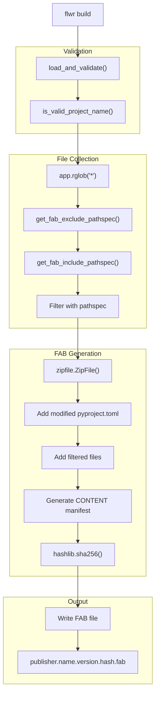

Sources: [framework/py/flwr/cli/build.py:63-132](), [framework/py/flwr/cli/build.py:134-268]()

**File Filtering:**

The build process uses gitignore-style patterns for inclusion and exclusion:

**Include Patterns (FAB_INCLUDE_PATTERNS):**
- `**/*.py` - Python files
- `**/*.toml` - TOML configuration files
- `**/*.md` - Markdown documentation

**Exclude Patterns (FAB_EXCLUDE_PATTERNS):**
- `**/__pycache__/**` - Python cache directories
- `pyproject.toml` - Original config file (modified version is added)
- Additional patterns from `.gitignore` if present

Sources: [framework/py/flwr/common/constant.py:83-93](), [framework/py/flwr/cli/build.py:270-289]()

**FAB Metadata:**

Each FAB includes a `CONTENT` manifest file at `.info/CONTENT` containing:
- File path
- SHA256 hash
- File size in bits

Sources: [framework/py/flwr/cli/build.py:234-255]()

### flwr run

Executes a Flower application either locally via simulation or remotely via SuperLink.

**Command Signature:**
```
flwr run [APP] [FEDERATION] [--run-config KEY=VALUE ...] [--federation-config KEY=VALUE ...] [--stream] [--format FORMAT]
```

**Diagram: flwr run Execution Modes**

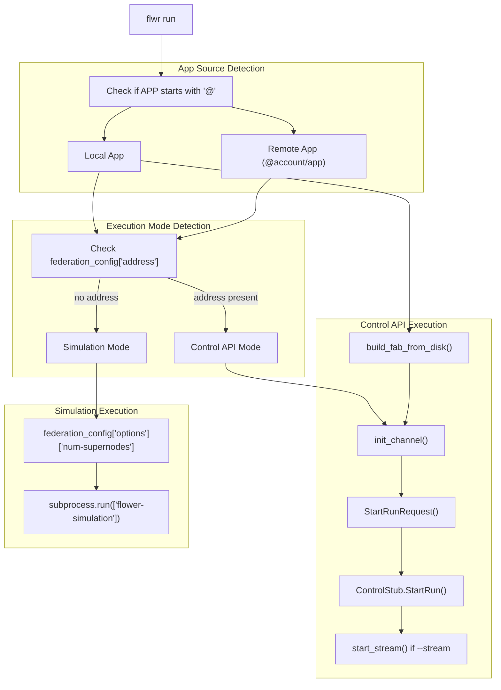

Sources: [framework/py/flwr/cli/run/run.py:58-159](), [framework/py/flwr/cli/run/run.py:161-246](), [framework/py/flwr/cli/run/run.py:248-293]()

**Run Configuration:**

The `--run-config` flag accepts key-value pairs that override values in `pyproject.toml`:

```bash
flwr run . --run-config num-server-rounds=5 local-epochs=3
```

Configuration is parsed by `parse_config_args()` and converted to `ConfigRecord` via `user_config_to_configrecord()`.

Sources: [framework/py/flwr/cli/run/run.py:67-74](), [framework/py/flwr/cli/run/run.py:193-200]()

**Output Formats:**

The `--format` flag supports two output modes defined by `CliOutputFormat`:
- `default` - Human-readable output with colors
- `json` - Machine-parseable JSON output

Sources: [framework/py/flwr/common/constant.py:262-270](), [framework/py/flwr/cli/run/run.py:90-97]()

### flwr login

Authenticates the user to a SuperLink federation using account-based authentication.

**Command Signature:**
```
flwr login [APP] [FEDERATION] [--federation-config KEY=VALUE ...]
```

**Diagram: flwr login Authentication Flow**

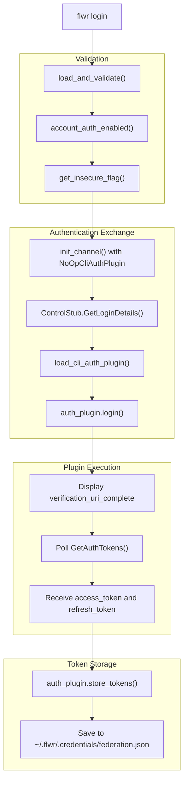

Sources: [framework/py/flwr/cli/login/login.py:47-135](), [framework/py/flwr/cli/auth_plugin/oidc_cli_plugin.py:42-126]()

**Authentication Plugins:**

The login system uses pluggable authentication backends via `CliAuthPlugin`:
- `NoOpCliAuthPlugin` - No authentication (default)
- `OidcCliPlugin` - OpenID Connect device flow

The plugin type is determined by the `authn_type` field in `GetLoginDetailsResponse`.

Sources: [framework/py/flwr/cli/auth_plugin/__init__.py:25-31](), [framework/py/flwr/cli/login/login.py:106-107]()

**Credential Storage:**

Credentials are stored at `~/.flwr/.credentials/<federation>.json` with the following structure:

```json
{
  "authn-type": "oidc",
  "flwr-oidc-access-token": "...",
  "flwr-oidc-refresh-token": "..."
}
```

The credentials directory is automatically added to `.gitignore`.

Sources: [framework/py/flwr/cli/utils.py:174-222](), [framework/py/flwr/common/constant.py:127-131]()

### flwr log

Displays or streams logs from a running or completed Flower application.

**Command Signature:**
```
flwr log RUN_ID [APP] [FEDERATION] [--federation-config KEY=VALUE ...] [--stream/--show]
```

**Diagram: flwr log Streaming Architecture**

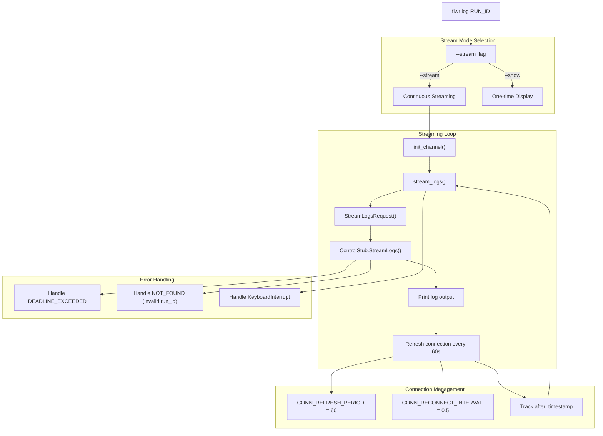

Sources: [framework/py/flwr/cli/log.py:136-197](), [framework/py/flwr/cli/log.py:45-69](), [framework/py/flwr/cli/log.py:71-110]()

**Log Streaming Configuration:**

The log streaming uses two key timing constants:
- `CONN_REFRESH_PERIOD = 60` - How long to maintain a single stream connection (seconds)
- `CONN_RECONNECT_INTERVAL = 0.5` - Delay between reconnection attempts (seconds)

Sources: [framework/py/flwr/common/constant.py:118-119](), [framework/py/flwr/cli/run/run.py:54]()

**Timestamp Tracking:**

The `stream_logs()` function tracks `after_timestamp` to avoid retrieving duplicate logs when reconnecting. The latest timestamp from each response batch is used as the starting point for the next connection.

Sources: [framework/py/flwr/cli/log.py:71-110]()

### flwr stop

Terminates a running Flower application.

**Command Signature:**
```
flwr stop RUN_ID [APP] [FEDERATION] [--federation-config KEY=VALUE ...] [--format FORMAT]
```

**Diagram: flwr stop Execution Flow**

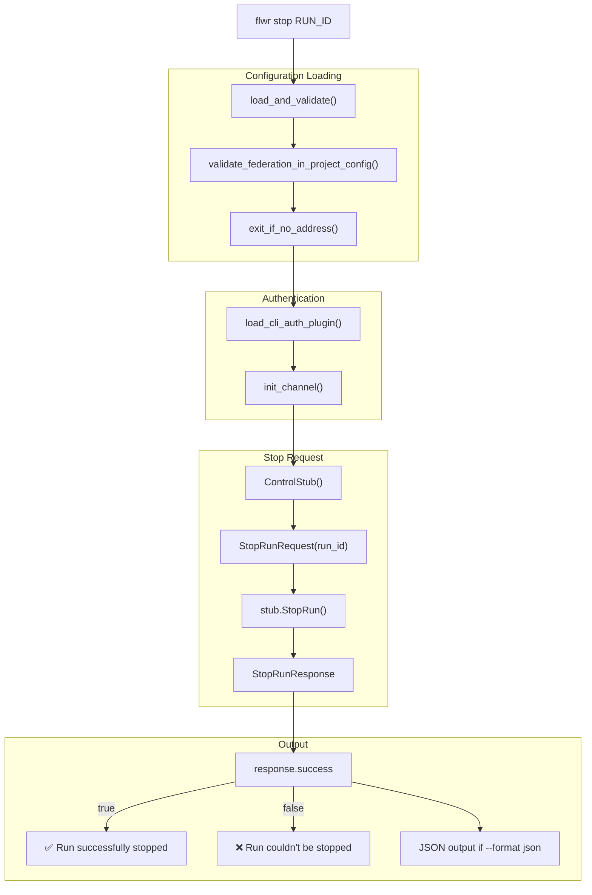

Sources: [framework/py/flwr/cli/stop.py:44-143](), [framework/py/flwr/cli/stop.py:126-143]()

**Response Handling:**

The `StopRunResponse` contains a single boolean field `success` indicating whether the stop operation was successful. The CLI displays appropriate messages and returns exit codes based on this field.

Sources: [framework/py/flwr/cli/stop.py:126-143]()

## Run Management

### Run Lifecycle States

Flower runs progress through a defined set of states managed by the SuperLink's LinkState component.

**Diagram: Run State Transitions**

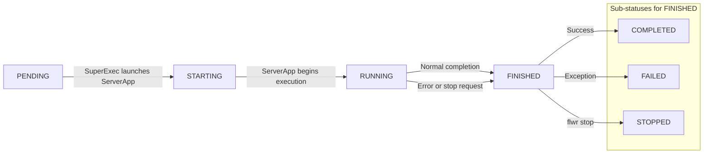

Sources: [framework/py/flwr/common/constant.py:237-259]()

**Status Constants:**

The `Status` class defines run states:
- `PENDING = "pending"` - Run created but not yet started
- `STARTING = "starting"` - ServerApp process being launched
- `RUNNING = "running"` - ServerApp actively executing
- `FINISHED = "finished"` - Run completed (see sub-status)

**Sub-status Constants:**

The `SubStatus` class defines completion outcomes:
- `COMPLETED = "completed"` - Normal successful completion
- `FAILED = "failed"` - Exception or error occurred
- `STOPPED = "stopped"` - Manually terminated via `flwr stop`

Sources: [framework/py/flwr/common/constant.py:237-259]()

### Run Identification

Runs are identified by unique 64-bit integers generated from random bytes:

- `RUN_ID_NUM_BYTES = 8` - Number of bytes for run ID generation

Sources: [framework/py/flwr/common/constant.py:72]()

### Run Heartbeats

The system monitors run health through periodic heartbeats with configurable intervals:

**Heartbeat Configuration Constants:**

| Constant | Default Value | Purpose |
|----------|---------------|---------|
| `HEARTBEAT_DEFAULT_INTERVAL` | 30 seconds | Standard heartbeat interval |
| `HEARTBEAT_CALL_TIMEOUT` | 5 seconds | Timeout for heartbeat RPC |
| `HEARTBEAT_MIN_INTERVAL` | 10 seconds | Minimum allowed interval |
| `HEARTBEAT_MAX_INTERVAL` | 1800 seconds | Maximum allowed interval (30 min) |
| `HEARTBEAT_PATIENCE` | 2 | Number of missed heartbeats before failure |

**Heartbeat Jitter:**

To prevent thundering herd, the actual interval is randomized:
- `HEARTBEAT_BASE_MULTIPLIER = 0.8` - Scale factor applied to base interval
- `HEARTBEAT_RANDOM_RANGE = (-0.1, 0.1)` - Random adjustment range

Sources: [framework/py/flwr/common/constant.py:60-69]()

**Failure Detection:**

If a run fails to send heartbeats, it is marked as failed with:
- `RUN_FAILURE_DETAILS_NO_HEARTBEAT = "No heartbeat received from the run."`

Sources: [framework/py/flwr/common/constant.py:69]()

## FAB (Flower App Bundle) Lifecycle

### FAB Creation

A FAB is created by the `flwr build` command and contains the packaged application.

**Diagram: FAB File Structure**

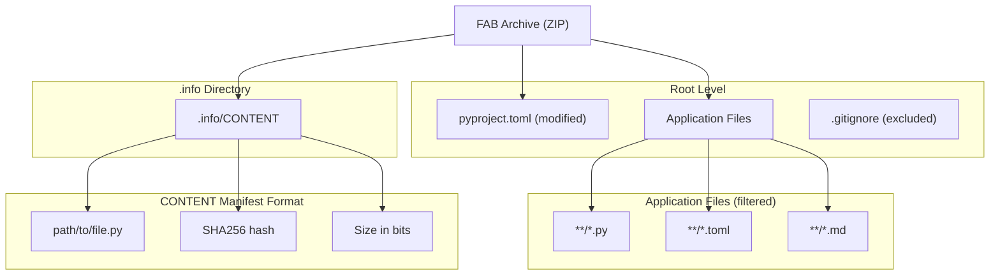

Sources: [framework/py/flwr/cli/build.py:234-268]()

### FAB Constraints

**Size Limit:**

FABs have a maximum size limit to ensure efficient distribution:
- `FAB_MAX_SIZE = 10 * 1024 * 1024` (10 MB)

Sources: [framework/py/flwr/common/constant.py:80]()

**Timestamp Normalization:**

All files in the FAB are assigned a fixed timestamp for deterministic builds:
- `FAB_DATE = (2024, 10, 1, 0, 0, 0)` - October 1, 2024 00:00:00

This ensures that building the same source code multiple times produces identical FAB files (excluding the hash).

Sources: [framework/py/flwr/common/constant.py:78](), [framework/py/flwr/cli/build.py:43-50]()

### FAB Naming Convention

FAB files follow a standardized naming pattern for identification:

**Format:**
```
<publisher>.<name>.<version>.<hash>.fab
```

**Components:**
- `publisher` - From `tool.flwr.app.publisher` in pyproject.toml
- `name` - From `project.name` in pyproject.toml
- `version` - From `project.version` with dots replaced by dashes
- `hash` - First 8 characters of SHA256 hash

**Hash Truncation:**
- `FAB_HASH_TRUNCATION = 8` - Number of hash characters in filename

Sources: [framework/py/flwr/cli/build.py:53-59](), [framework/py/flwr/common/constant.py:79]()

**Example:**
```
flwrlabs.quickstart-pytorch.1-0-0.a3b4c5d6.fab
```

### FAB Configuration Modification

The build process modifies `pyproject.toml` before including it in the FAB:

**Removed Fields:**
- `tool.flwr.federations` - Federation configurations are deployment-specific and excluded from the portable FAB

Sources: [framework/py/flwr/cli/build.py:208-214]()

### FAB Verification

FABs can be verified using the content manifest and hash:

1. **File Integrity:** Each file's SHA256 hash in the CONTENT manifest can be verified against the actual file
2. **FAB Integrity:** The overall FAB hash (used in filename) is the SHA256 of the entire FAB content
3. **Size Validation:** FAB size is checked against `FAB_MAX_SIZE` during build

Sources: [framework/py/flwr/cli/build.py:234-268]()

### FAB Deployment

Once built, FABs can be deployed through multiple mechanisms:

**Local Simulation:**
When `flwr run` is executed without a SuperLink address, the FAB is used directly for local simulation without network transmission.

**Remote Deployment via Control API:**
When `flwr run` targets a SuperLink (with `address` in federation config):
1. FAB is built via `build_fab_from_disk()`
2. FAB bytes are included in `StartRunRequest.fab` field
3. SuperLink receives and stores FAB in FFS (Flower File System)
4. Run ID is returned to client

Sources: [framework/py/flwr/cli/run/run.py:178-205]()

**FAB Protocol Buffers Representation:**

The `Fab` named tuple contains:
- `hash_str: str` - SHA256 hash of FAB content
- `content: bytes` - Raw FAB bytes
- `metadata: dict[str, str]` - Additional metadata

This is serialized to protobuf via `fab_to_proto()` for transmission.

Sources: [framework/py/flwr/cli/run/run.py:180-189]()

## Error Handling

The CLI implements consistent error handling across commands using utility functions.

### gRPC Error Handler

**Diagram: CLI gRPC Error Handling Flow**

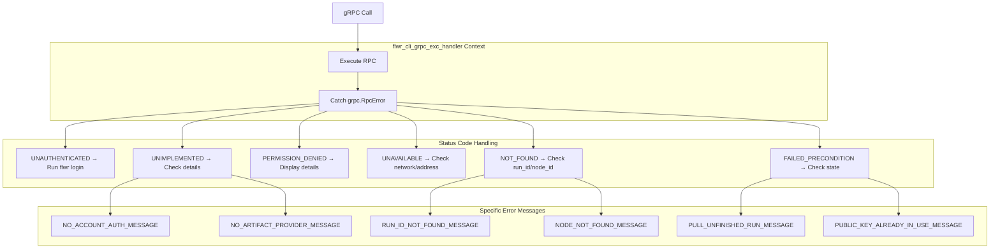

Sources: [framework/py/flwr/cli/utils.py:300-409]()

**Error Message Constants:**

The system defines specific error messages for common failure scenarios:

```python
RUN_ID_NOT_FOUND_MESSAGE = "Run ID not found"
NO_ACCOUNT_AUTH_MESSAGE = "ControlServicer initialized without account authentication"
NO_ARTIFACT_PROVIDER_MESSAGE = "ControlServicer initialized without artifact provider"
PULL_UNFINISHED_RUN_MESSAGE = "Cannot pull artifacts for an unfinished run"
PUBLIC_KEY_ALREADY_IN_USE_MESSAGE = "Public key already in use"
PUBLIC_KEY_NOT_VALID = "The provided public key is not valid"
NODE_NOT_FOUND_MESSAGE = "Node ID not found for account"
```

Sources: [framework/py/flwr/common/constant.py:176-183]()

### Output Format Handling

CLI commands support both human-readable and JSON output formats for integration with automation tools:

**Format Suppression Pattern:**

```python
suppress_output = output_format == CliOutputFormat.JSON
if suppress_output:
    redirect_output(captured_output)
# ... execute command ...
if suppress_output:
    restore_output()
    Console().print_json(json.dumps(payload))
```

This pattern is used in `flwr run` and `flwr stop` commands.

Sources: [framework/py/flwr/cli/run/run.py:100-158](), [framework/py/flwr/cli/stop.py:74-123]()

## Configuration Management

### Project Configuration

Flower applications are configured via `pyproject.toml` (aliased as `FAB_CONFIG_FILE`):

```toml
[project]
name = "my-app"
version = "1.0.0"

[tool.flwr.app]
publisher = "username"

[tool.flwr.app.components]
serverapp = "my_app.server_app:app"
clientapp = "my_app.client_app:app"

[tool.flwr.app.config]
num-server-rounds = 3
local-epochs = 2

[tool.flwr.federations]
default = "local-simulation"

[tool.flwr.federations.local-simulation]
options.num-supernodes = 10

[tool.flwr.federations.remote-federation]
address = "127.0.0.1:9093"
insecure = false
root-certificates = "certificates/ca.crt"
```

Sources: [framework/py/flwr/cli/new/templates/app/pyproject.xgboost.toml.tpl:1-62]()

### Federation Configuration

Federation settings control how applications connect to SuperLink or run in simulation:

**Required Fields:**
- `address` - SuperLink Control API address (for remote execution)
- `options.num-supernodes` - Number of virtual clients (for simulation)

**Optional Fields:**
- `insecure` - Disable TLS (default: false)
- `root-certificates` - Path to CA certificate for TLS
- `enable-account-auth` - Enable authentication (default: false)
- `options` - Additional federation-specific configuration

Sources: [framework/py/flwr/cli/run/run.py:248-268]()

### Command-Line Overrides

Both run config and federation config can be overridden via CLI flags:

**Run Config Override:**
```bash
flwr run . --run-config num-server-rounds=5 local-epochs=3
```

**Federation Config Override:**
```bash
flwr run . my-federation --federation-config address=10.0.0.1:9093 insecure=true
```

These overrides are processed by `parse_config_args()` which converts them to nested dictionaries.

Sources: [framework/py/flwr/cli/run/run.py:67-80]()

## SuperExec Plugin Architecture

The `flower-superexec` command implements a plugin-based architecture for managing different types of application processes. The SuperExec system uses specialized plugins to handle execution of ClientApp, ServerApp, and simulation processes.

### SuperExec Plugin System

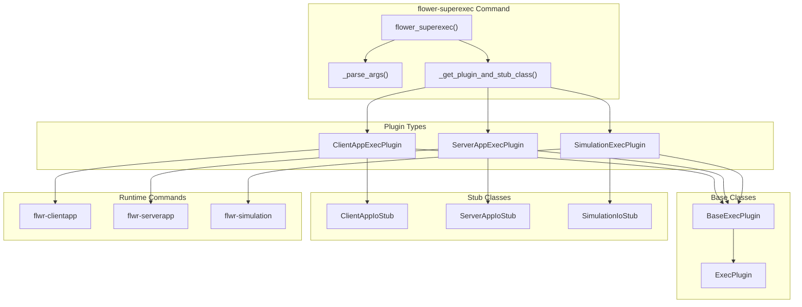

Sources: [framework/py/flwr/supercore/cli/flower_superexec.py:37-116](), [framework/py/flwr/supercore/superexec/plugin/__init__.py:18-28]()

### Plugin Type Constants

The system uses predefined constants to identify plugin types:

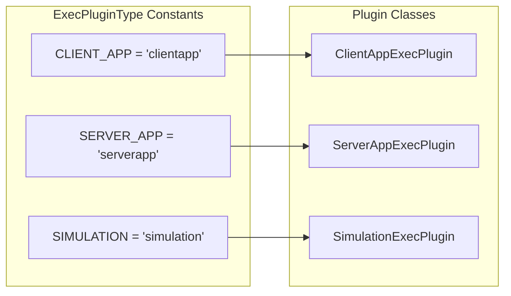

Sources: [framework/py/flwr/common/constant.py:264-280]()

## Client App Execution Models

The Flower framework supports multiple isolation modes for executing client applications, allowing different deployment strategies based on security and resource requirements.

### Isolation Modes

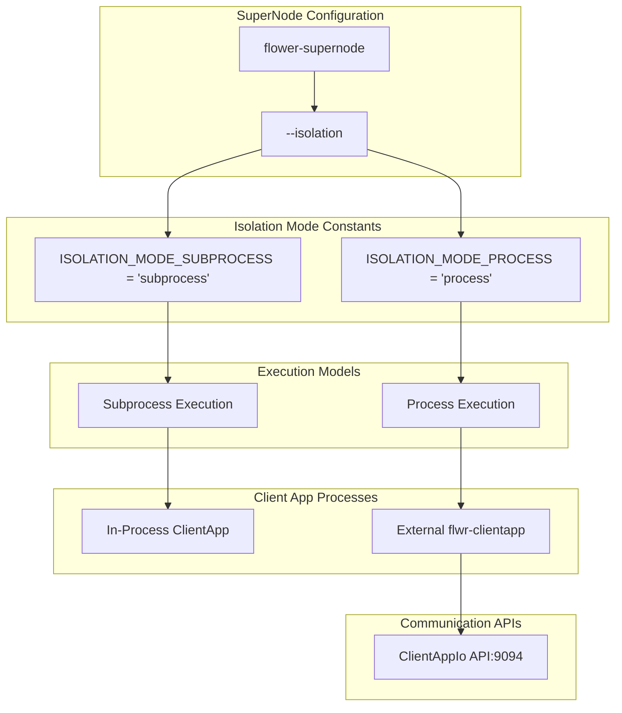

Sources: [framework/py/flwr/common/constant.py:100-101](), [framework/py/flwr/supernode/cli/flower_supernode.py:102-114]()

### ClientApp Execution Flow

| Isolation Mode | Process Management | Communication | Use Case |
|----------------|-------------------|---------------|----------|
| `subprocess` | SuperNode manages subprocess | Direct function calls | Simple deployments, shared dependencies |
| `process` | External process management | gRPC ClientAppIo API | Containerized deployments, isolated dependencies |

Sources: [framework/py/flwr/supernode/cli/flower_supernode.py:110-113]()

## Runtime API Architecture

The runtime components communicate through well-defined APIs with specific port assignments and protocols.

### API Port Mapping

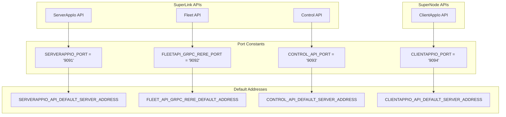

Sources: [framework/py/flwr/common/constant.py:34-56]()

### Transport Layer Configuration

The system supports multiple transport protocols for communication between components:

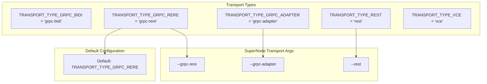

Sources: [framework/py/flwr/common/constant.py:20-30](), [framework/py/flwr/supernode/cli/flower_supernode.py:134-154]()

## Process Lifecycle Management

The SuperExec system manages application process lifecycles through a token-based execution model with parent process monitoring.

### Process Launch Mechanism

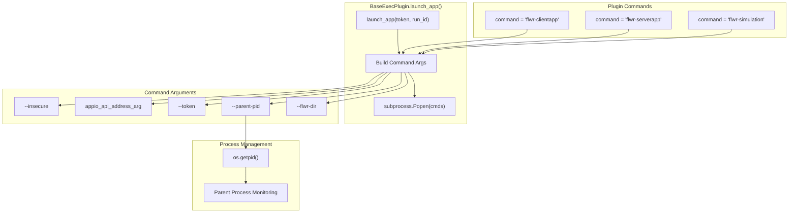

Sources: [framework/py/flwr/supercore/superexec/plugin/base_exec_plugin.py:42-53](), [framework/py/flwr/supercore/superexec/plugin/clientapp_exec_plugin.py:27-28]()

### Token-Based Security

The runtime uses 128-character tokens for secure communication between processes:

- `FLWR_APP_TOKEN_LENGTH = 128` - Standard token length for app authentication

Sources: [framework/py/flwr/common/constant.py:144]()

## Configuration and Environment

Runtime components support various configuration mechanisms including environment variables, command-line arguments, and configuration files.

### Directory Structure

| Constant | Default Value | Purpose |
|----------|---------------|---------|
| `FLWR_DIR` | `.flwr` | Default Flower directory |
| `FLWR_HOME` | Environment variable | Override default directory |
| `APP_DIR` | `apps` | Application directory |

Sources: [framework/py/flwr/common/constant.py:72-79]()

### Logging Configuration

The system supports configurable logging levels through the `FLWR_LOG_LEVEL` environment variable, with support for standard Python logging levels including `DEBUG`, `INFO`, `WARN`, and `ERROR`.

Sources: [framework/docs/source/how-to-configure-logging.rst:8-36]()

---

