<!-- source: DeepWiki mcp.deepwiki.com · repo adap/flower · page 3.1 Flower CLI Commands · fetched 2026-10-21 -->

# Flower CLI Commands

<details>
<summary>Relevant source files</summary>

The following files were used as context for generating this wiki page:

- [framework/py/flwr/cli/auth_plugin/__init__.py](framework/py/flwr/cli/auth_plugin/__init__.py)
- [framework/py/flwr/cli/auth_plugin/auth_plugin.py](framework/py/flwr/cli/auth_plugin/auth_plugin.py)
- [framework/py/flwr/cli/auth_plugin/noop_auth_plugin.py](framework/py/flwr/cli/auth_plugin/noop_auth_plugin.py)
- [framework/py/flwr/cli/auth_plugin/oidc_cli_plugin.py](framework/py/flwr/cli/auth_plugin/oidc_cli_plugin.py)
- [framework/py/flwr/cli/build.py](framework/py/flwr/cli/build.py)
- [framework/py/flwr/cli/cli_account_auth_interceptor.py](framework/py/flwr/cli/cli_account_auth_interceptor.py)
- [framework/py/flwr/cli/log.py](framework/py/flwr/cli/log.py)
- [framework/py/flwr/cli/login/login.py](framework/py/flwr/cli/login/login.py)
- [framework/py/flwr/cli/new/new.py](framework/py/flwr/cli/new/new.py)
- [framework/py/flwr/cli/new/new_test.py](framework/py/flwr/cli/new/new_test.py)
- [framework/py/flwr/cli/new/templates/app/code/client.xgboost.py.tpl](framework/py/flwr/cli/new/templates/app/code/client.xgboost.py.tpl)
- [framework/py/flwr/cli/new/templates/app/code/server.xgboost.py.tpl](framework/py/flwr/cli/new/templates/app/code/server.xgboost.py.tpl)
- [framework/py/flwr/cli/new/templates/app/code/task.xgboost.py.tpl](framework/py/flwr/cli/new/templates/app/code/task.xgboost.py.tpl)
- [framework/py/flwr/cli/new/templates/app/pyproject.xgboost.toml.tpl](framework/py/flwr/cli/new/templates/app/pyproject.xgboost.toml.tpl)
- [framework/py/flwr/cli/run/run.py](framework/py/flwr/cli/run/run.py)
- [framework/py/flwr/cli/stop.py](framework/py/flwr/cli/stop.py)
- [framework/py/flwr/cli/utils.py](framework/py/flwr/cli/utils.py)
- [framework/py/flwr/common/constant.py](framework/py/flwr/common/constant.py)
- [framework/py/flwr/server/app.py](framework/py/flwr/server/app.py)
- [framework/py/flwr/supercore/constant.py](framework/py/flwr/supercore/constant.py)
- [framework/py/flwr/superlink/auth_plugin/__init__.py](framework/py/flwr/superlink/auth_plugin/__init__.py)
- [framework/py/flwr/superlink/auth_plugin/auth_plugin.py](framework/py/flwr/superlink/auth_plugin/auth_plugin.py)
- [framework/py/flwr/superlink/auth_plugin/noop_auth_plugin.py](framework/py/flwr/superlink/auth_plugin/noop_auth_plugin.py)
- [framework/py/flwr/superlink/federation/__init__.py](framework/py/flwr/superlink/federation/__init__.py)
- [framework/py/flwr/superlink/servicer/control/control_grpc.py](framework/py/flwr/superlink/servicer/control/control_grpc.py)

</details>


The Flower CLI provides commands for creating, building, deploying, and managing federated AI applications. This page documents the core user-facing commands: `flwr run`, `flwr new`, `flwr build`, `flwr login`, `flwr log`, and `flwr stop`.

For information about the underlying run lifecycle and state management, see [Run Management (3.2)](#3.2). For details about FAB creation and deployment, see [FAB Lifecycle (3.3)](#3.3).

## Command Overview

The `flwr` CLI provides six primary commands for application development and deployment:

**CLI Command Structure**
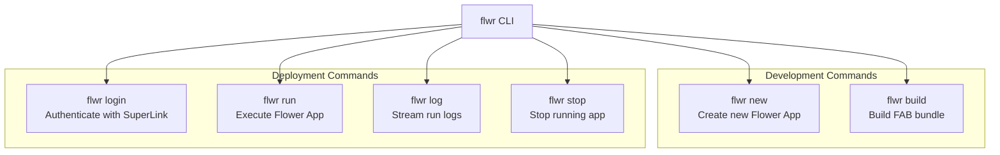

| Command | Purpose | Primary File |
|---------|---------|--------------|
| `flwr new` | Create new Flower App from templates or download from platform | [framework/py/flwr/cli/new/new.py]() |
| `flwr build` | Build Flower App Bundle (FAB) from source | [framework/py/flwr/cli/build.py]() |
| `flwr login` | Authenticate with SuperLink using OIDC | [framework/py/flwr/cli/login/login.py]() |
| `flwr run` | Execute Flower App locally or remotely | [framework/py/flwr/cli/run/run.py]() |
| `flwr log` | Stream or print logs from a run | [framework/py/flwr/cli/log.py]() |
| `flwr stop` | Stop a running Flower App | [framework/py/flwr/cli/stop.py]() |

Sources: [framework/py/flwr/cli/new/new.py:266-465](), [framework/py/flwr/cli/build.py:63-132](), [framework/py/flwr/cli/login/login.py:47-135](), [framework/py/flwr/cli/run/run.py:58-159](), [framework/py/flwr/cli/log.py:136-197](), [framework/py/flwr/cli/stop.py:44-143]()

## flwr new

The `flwr new` command creates a new Flower App from built-in templates or downloads an existing app from the Flower platform.

### Local Template Creation

When creating a local app, `flwr new` generates a complete project structure with framework-specific templates:

**Template Generation Flow**
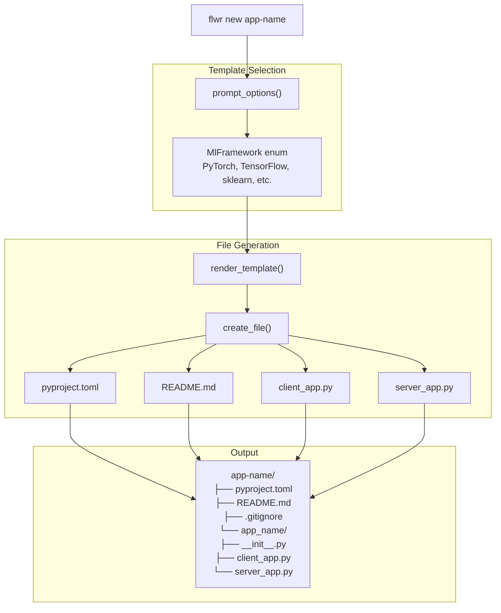

**Available ML Frameworks**

| Framework | Template Value | Additional Files |
|-----------|----------------|------------------|
| PyTorch | `pytorch` | `task.py` |
| TensorFlow | `tensorflow` | `task.py` |
| sklearn | `sklearn` | `task.py` |
| HuggingFace | `huggingface` | `task.py` |
| JAX | `jax` | `task.py` |
| MLX | `mlx` | `task.py` |
| NumPy | `numpy` | `task.py` |
| XGBoost | `xgboost` | `task.py` |
| FlowerTune | `flowertune` | `models.py`, `dataset.py`, `strategy.py` |
| Flower Baseline | `baseline` | `model.py`, `dataset.py`, `strategy.py`, `utils.py`, `LICENSE` |

Sources: [framework/py/flwr/cli/new/new.py:44-58](), [framework/py/flwr/cli/new/new.py:421-456]()

### Remote App Download

The `flwr new` command can download apps from the Flower platform using the format `@account_name/app_name`:

**Remote App Download Flow**
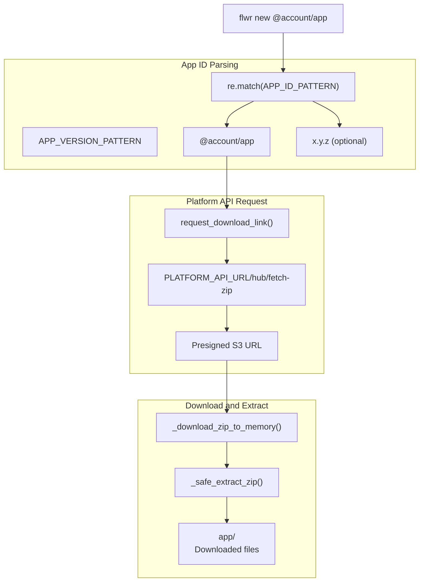

**Remote App ID Format**
- Pattern: `@account_name/app_name[==x.y.z]`
- Version is optional; defaults to latest
- Example: `@flwrlabs/quickstart-pytorch==1.0.0`

Sources: [framework/py/flwr/cli/new/new.py:198-263](), [framework/py/flwr/cli/utils.py:412-441](), [framework/py/flwr/supercore/constant.py:27-29]()

## flwr build

The `flwr build` command creates a Flower App Bundle (FAB) from a Flower App directory. A FAB is a deterministic, reproducible zip archive containing the app's source code and metadata.

**FAB Build Process**
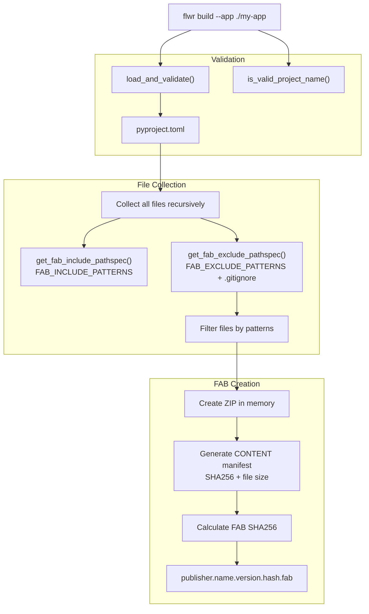

**FAB File Structure**

A FAB contains:
- Filtered source files matching `FAB_INCLUDE_PATTERNS` (e.g., `**/*.py`, `**/*.toml`, `**/*.md`)
- Modified `pyproject.toml` (without `federations` section)
- `.info/CONTENT` manifest with file hashes and sizes

**File Filtering Rules**

| Pattern Type | Constant | Examples |
|--------------|----------|----------|
| Include | `FAB_INCLUDE_PATTERNS` | `**/*.py`, `**/*.toml`, `**/*.md` |
| Exclude | `FAB_EXCLUDE_PATTERNS` | `**/__pycache__/**`, `pyproject.toml` (original) |
| User-defined | `.gitignore` | Custom patterns from app's `.gitignore` file |

**FAB Constraints**
- Maximum size: `FAB_MAX_SIZE` = 10 MB
- Fixed date for deterministic builds: `FAB_DATE` = (2024, 10, 1, 0, 0, 0)
- Hash truncation: First 8 characters of SHA256 for filename

Sources: [framework/py/flwr/cli/build.py:63-132](), [framework/py/flwr/cli/build.py:134-268](), [framework/py/flwr/common/constant.py:75-93]()

## flwr login

The `flwr login` command authenticates the user with a SuperLink using OpenID Connect (OIDC) device flow.

**Authentication Flow**
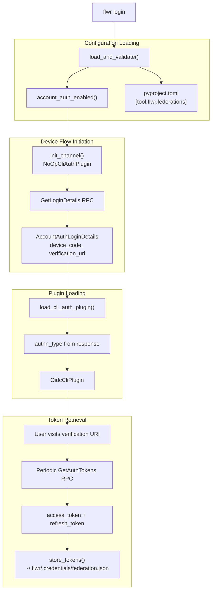

**Credentials Storage**

Credentials are stored in JSON format at `~/.flwr/.credentials/<federation>.json`:

```json
{
  "authn-type": "oidc",
  "flwr-oidc-access-token": "<access_token>",
  "flwr-oidc-refresh-token": "<refresh_token>"
}
```

**OIDC Device Flow Implementation**

The device flow is implemented in `OidcCliPlugin`:
1. Display verification URI to user
2. Poll `GetAuthTokens` RPC with `device_code`
3. Wait for user to complete authentication
4. Receive and store access and refresh tokens

**Key Constants**
- `ACCESS_TOKEN_KEY` = `"flwr-oidc-access-token"`
- `REFRESH_TOKEN_KEY` = `"flwr-oidc-refresh-token"`
- `AUTHN_TYPE_JSON_KEY` = `"authn-type"`

Sources: [framework/py/flwr/cli/login/login.py:47-135](), [framework/py/flwr/cli/auth_plugin/oidc_cli_plugin.py:42-142](), [framework/py/flwr/common/constant.py:126-132]()

## flwr run

The `flwr run` command executes a Flower App either locally in simulation mode or remotely on a deployed SuperLink.

**Run Command Decision Flow**
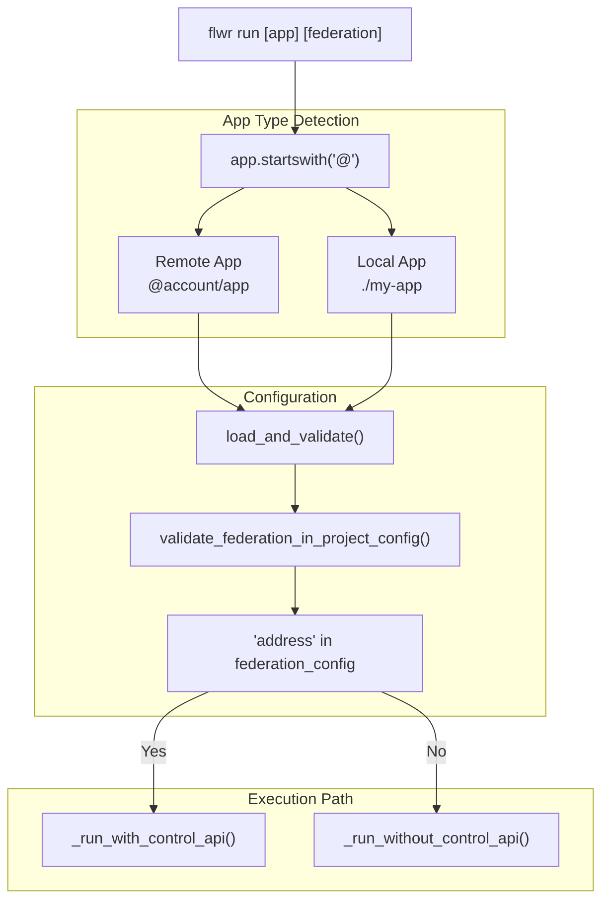

### Remote Deployment with Control API

When `address` is configured, `flwr run` uses the Control API to deploy the app:

**Remote Run Flow**
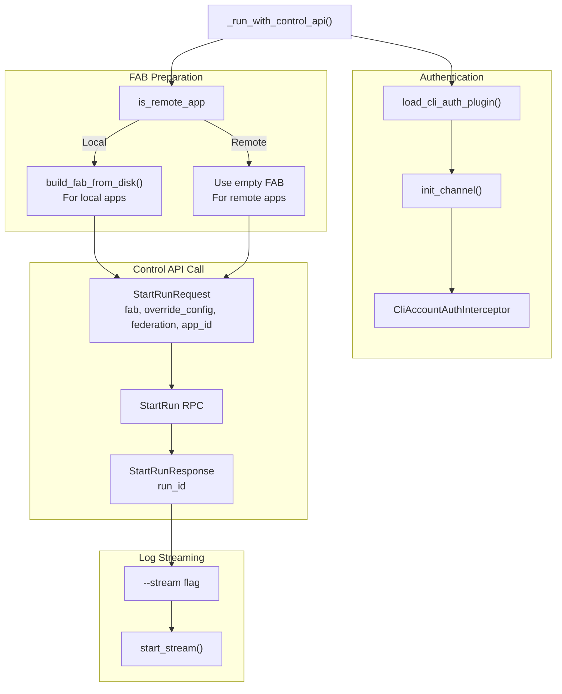

**StartRunRequest Fields**
- `fab`: Serialized FAB (empty for remote apps)
- `override_config`: Run configuration overrides from `--run-config`
- `federation`: Federation name from config
- `federation_options`: Federation-specific options
- `app_id`: Remote app identifier (e.g., `@flwrlabs/quickstart-pytorch`)

Sources: [framework/py/flwr/cli/run/run.py:161-246](), [framework/py/flwr/cli/utils.py:277-298]()

### Local Simulation

When no `address` is configured, `flwr run` launches a local simulation:

**Local Simulation Flow**
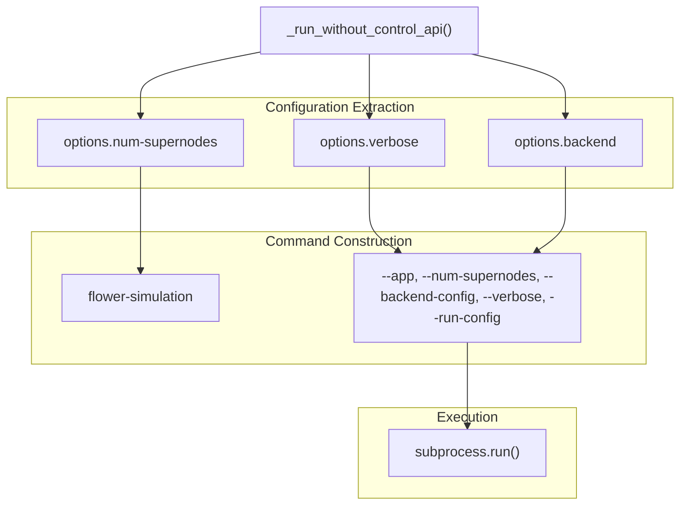

**Required Configuration for Local Simulation**

The `pyproject.toml` must specify `num-supernodes`:

```toml
[tool.flwr.federations.local-simulation]
options.num-supernodes = 10
options.verbose = true
options.backend = {}
```

Sources: [framework/py/flwr/cli/run/run.py:248-294]()

## flwr log

The `flwr log` command streams or prints logs from a running Flower App.

**Log Streaming Architecture**
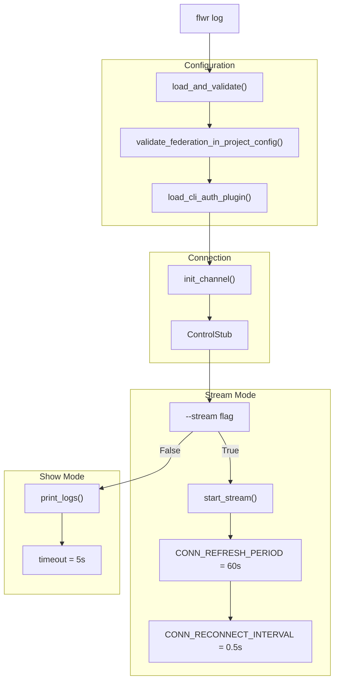

**Log Streaming Implementation**

The `start_stream()` function implements continuous log streaming with periodic connection refresh:

1. Initial timestamp: `after_timestamp = 0.0`
2. Call `stream_logs()` with `StreamLogsRequest(run_id, after_timestamp)`
3. Print each log entry as it arrives
4. Track latest timestamp from response
5. Reconnect after `CONN_REFRESH_PERIOD` (60 seconds)
6. Continue streaming from last timestamp

**StreamLogsRequest Fields**
- `run_id`: The run ID to stream logs for
- `after_timestamp`: Only return logs after this timestamp

**Connection Management Constants**
- `CONN_REFRESH_PERIOD` = 60 seconds (defined in [framework/py/flwr/common/constant.py:118]())
- `CONN_RECONNECT_INTERVAL` = 0.5 seconds
- `LOG_STREAM_INTERVAL` = 0.5 seconds (server-side interval)

Sources: [framework/py/flwr/cli/log.py:45-111](), [framework/py/flwr/cli/log.py:136-197](), [framework/py/flwr/common/constant.py:117-121]()

## flwr stop

The `flwr stop` command stops a running Flower App by sending a `StopRun` request to the Control API.

**Stop Command Flow**
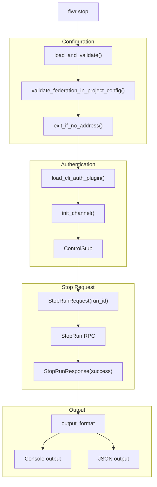

**StopRunResponse Handling**

The response contains a `success` boolean indicating whether the run was stopped:

```python
response: StopRunResponse = stub.StopRun(request=StopRunRequest(run_id=run_id))
if response.success:
    # Run stopped successfully
else:
    # Run couldn't be stopped
```

**JSON Output Format**

When `--format json` is specified, the output is:

```json
{
  "success": true,
  "run-id": 12345
}
```

Sources: [framework/py/flwr/cli/stop.py:44-143](), [framework/py/flwr/cli/stop.py:126-143]()

## Common Patterns

### Configuration Loading

All CLI commands use a consistent configuration loading pattern:

**Configuration Loading Flow**
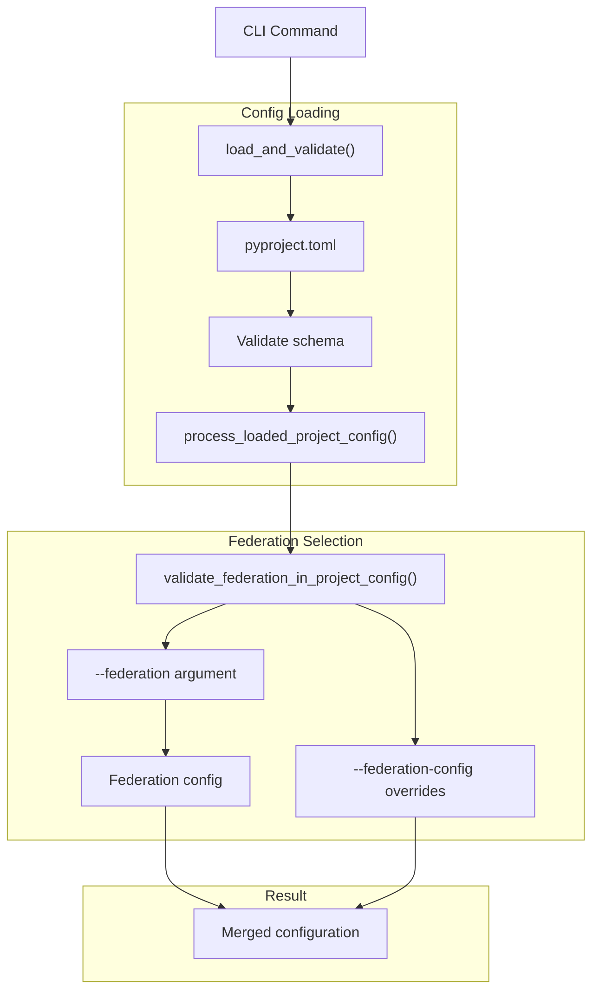

**Configuration File Structure**

The `pyproject.toml` file defines federations:

```toml
[tool.flwr.federations]
default = "local-simulation"

[tool.flwr.federations.local-simulation]
options.num-supernodes = 10

[tool.flwr.federations.remote-deployment]
address = "superlink.example.com:9093"
insecure = false
root-certificates = "./certificates/ca.crt"
enable-account-auth = true
```

Sources: [framework/py/flwr/cli/config_utils.py:1-100](), [framework/py/flwr/cli/run/run.py:121-128]()

### Authentication Plugin Architecture

CLI commands use a plugin architecture for authentication:

**Authentication Plugin System**
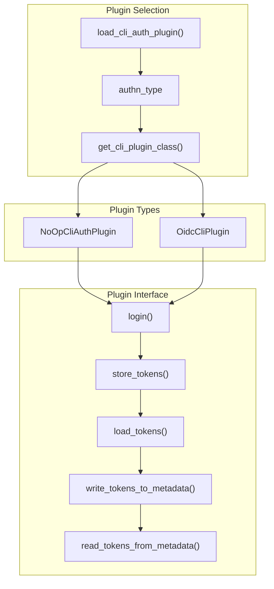

**CliAuthPlugin Interface**

All auth plugins implement the `CliAuthPlugin` abstract base class:
- `login()`: Authenticate and retrieve credentials
- `store_tokens()`: Save credentials to disk
- `load_tokens()`: Load credentials from disk
- `write_tokens_to_metadata()`: Add tokens to gRPC metadata
- `read_tokens_from_metadata()`: Extract tokens from gRPC metadata

**Plugin Implementations**

| Plugin | AuthnType | Purpose |
|--------|-----------|---------|
| `NoOpCliAuthPlugin` | `AuthnType.NOOP` | No authentication |
| `OidcCliPlugin` | `AuthnType.OIDC` | OIDC device flow authentication |

Sources: [framework/py/flwr/cli/auth_plugin/__init__.py:25-32](), [framework/py/flwr/cli/auth_plugin/auth_plugin.py:33-95](), [framework/py/flwr/cli/auth_plugin/oidc_cli_plugin.py:42-142](), [framework/py/flwr/cli/auth_plugin/noop_auth_plugin.py:27-58]()

### gRPC Channel Initialization

All commands that communicate with the Control API use `init_channel()`:

**Channel Initialization Flow**
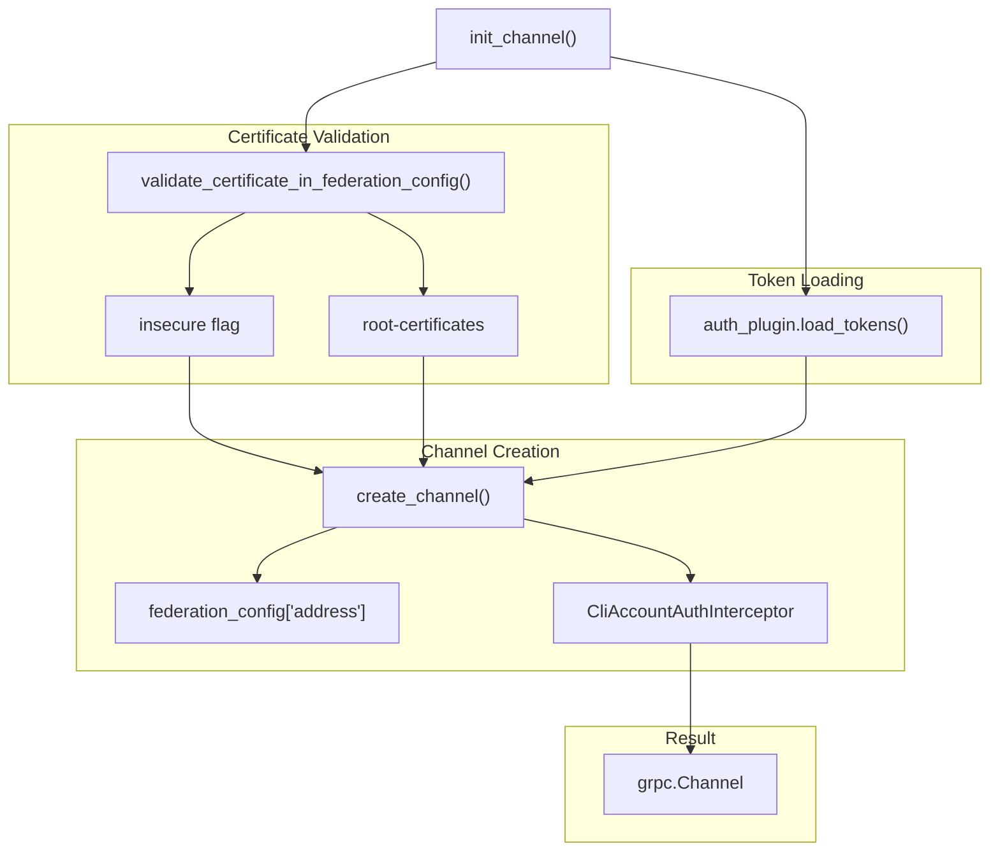

**CliAccountAuthInterceptor**

The `CliAccountAuthInterceptor` intercepts gRPC calls to:
1. Add authentication tokens to request metadata using `write_tokens_to_metadata()`
2. Extract refreshed tokens from response metadata using `read_tokens_from_metadata()`
3. Store refreshed tokens using `store_tokens()`

This enables transparent token refresh without user intervention.

Sources: [framework/py/flwr/cli/utils.py:277-298](), [framework/py/flwr/cli/cli_account_auth_interceptor.py:33-90]()

## Configuration and Environment

CLI commands integrate with environment variables and configuration systems for flexible deployment scenarios.

### Environment Variable Integration

Key environment variables that affect CLI behavior:

| Variable | Purpose | Default |
|----------|---------|---------|
| `FLWR_LOG_LEVEL` | Logging verbosity | `INFO` |
| `FLWR_HOME` | Flower home directory override | `~/.flwr/` |
| `FLWR_TELEMETRY_ENABLED` | Enable telemetry collection | `1` |

### Directory Structure

CLI commands use consistent directory resolution for Flower applications:

**Directory Resolution Logic**
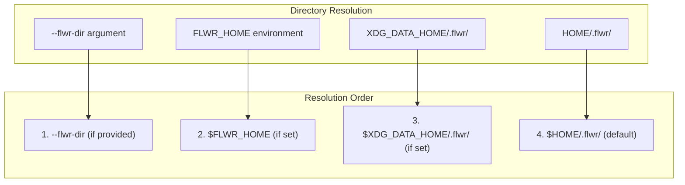

Sources: [framework/py/flwr/supernode/cli/flower_supernode.py:92-100](), [framework/py/flwr/common/constant.py:78-79](), [framework/docs/source/how-to-configure-logging.rst:8-36]()

## Error Handling and Exit Codes

CLI commands use standardized exit codes for consistent error reporting and automation support.

### Common Exit Codes

| Exit Code | Constant | Description |
|-----------|----------|-------------|
| 600 | `COMMON_ADDRESS_INVALID` | Invalid address format |
| 601 | `COMMON_MISSING_EXTRA_REST` | Missing REST dependencies |
| 602 | `COMMON_TLS_NOT_SUPPORTED` | TLS not supported for command |

**TLS Support by Command**
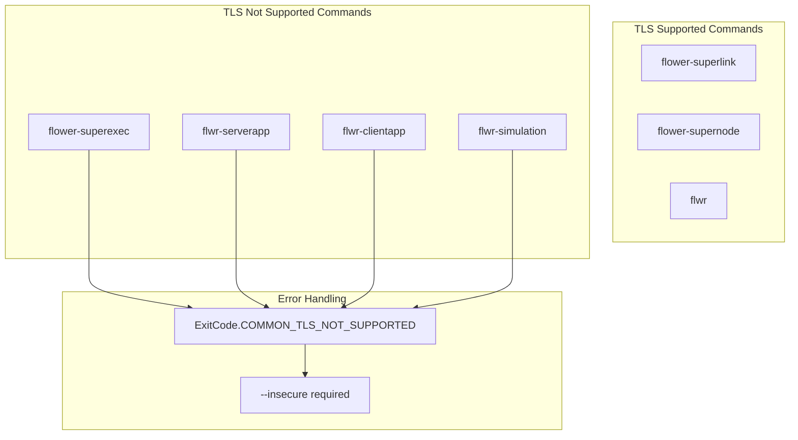

Sources: [framework/py/flwr/supercore/cli/flower_superexec.py:40-44](), [framework/docs/source/ref-exit-codes/602.rst:1-16](), [framework/docs/source/ref-exit-codes/600.rst:1-16]()

---

