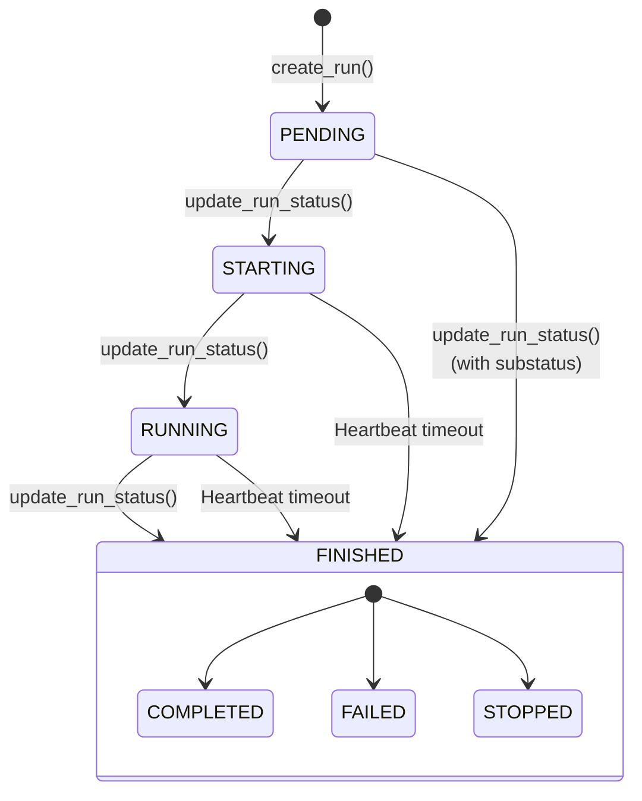
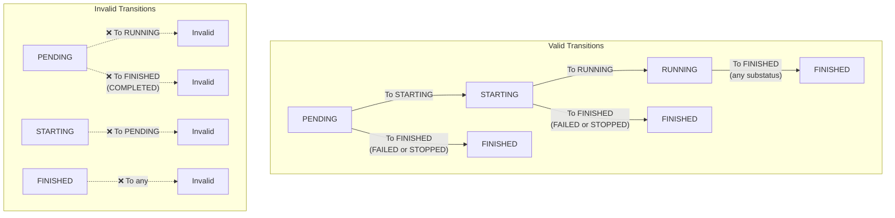
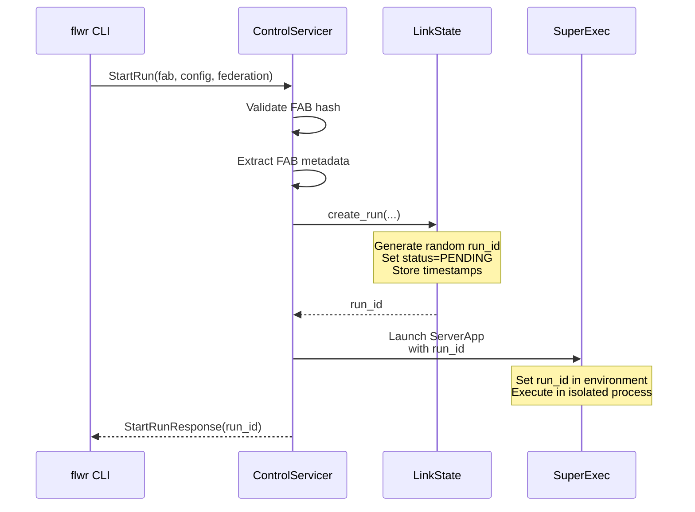
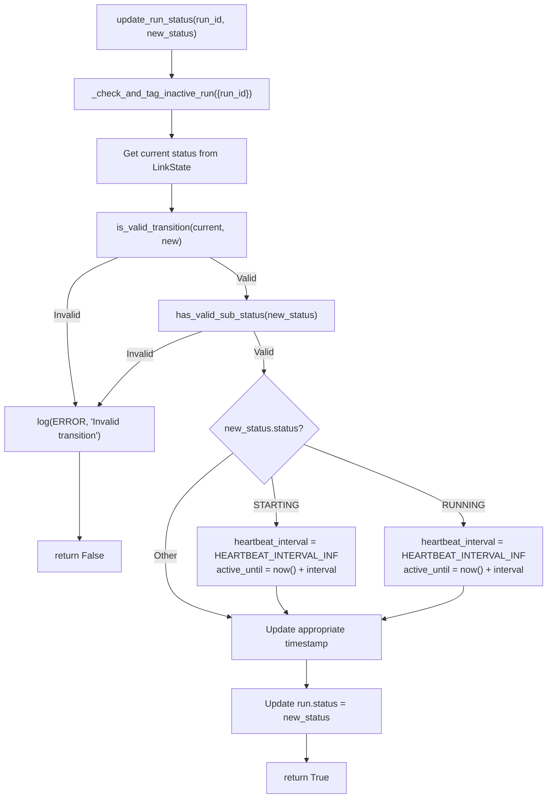
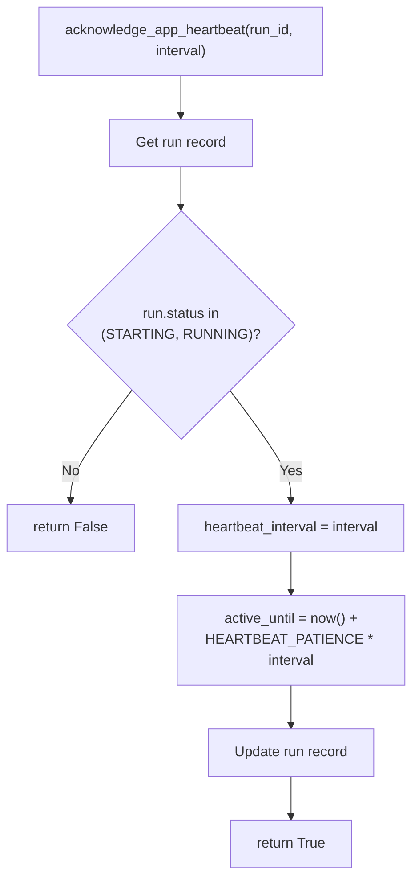
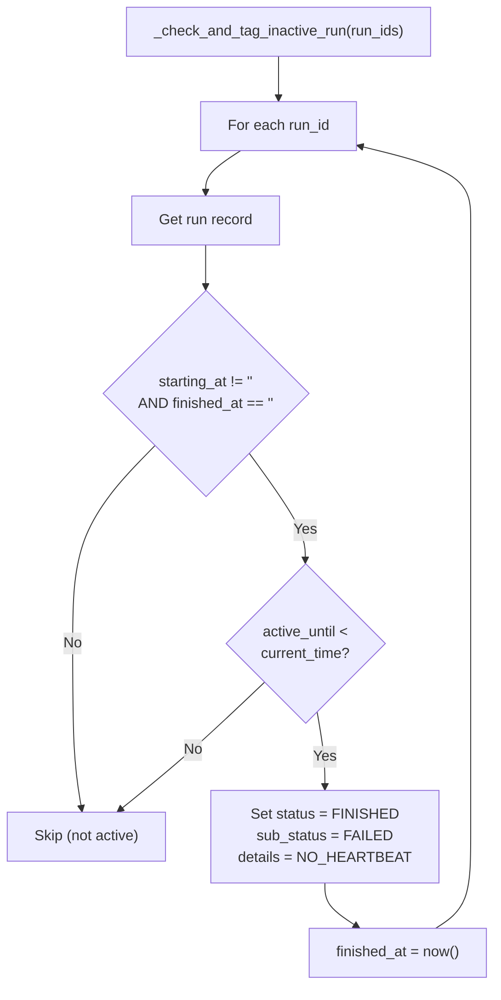
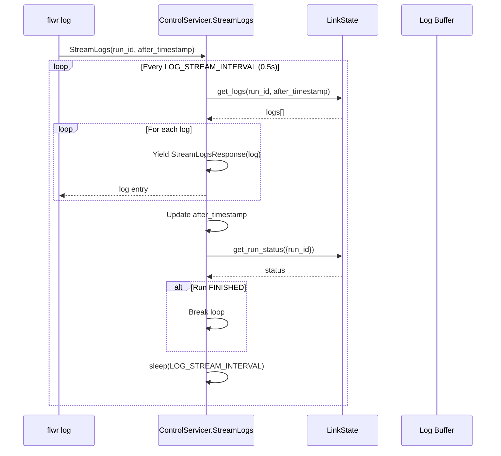
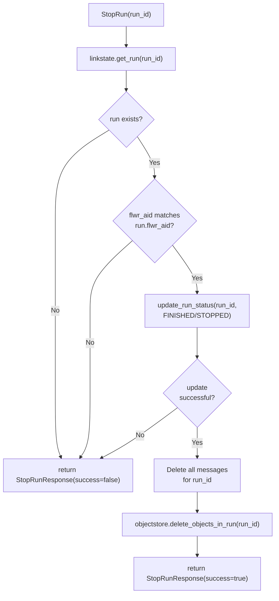
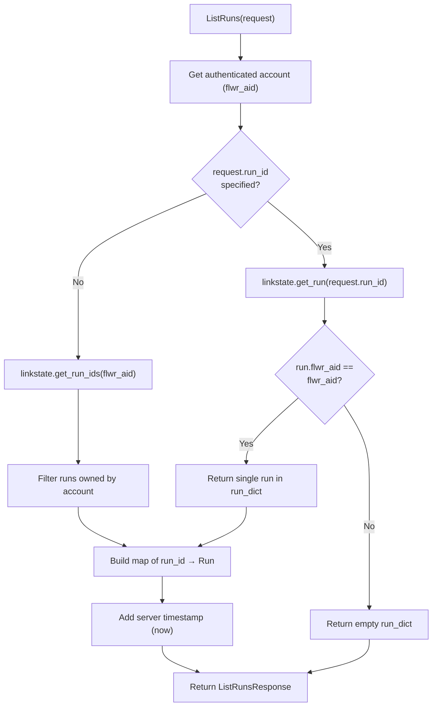

<!-- source: DeepWiki mcp.deepwiki.com · repo adap/flower · page 3.2 Run Management · fetched 2026-10-21 -->

# Run Management

<details>
<summary>Relevant source files</summary>

The following files were used as context for generating this wiki page:

- [framework/py/flwr/cli/auth_plugin/__init__.py](framework/py/flwr/cli/auth_plugin/__init__.py)
- [framework/py/flwr/cli/auth_plugin/auth_plugin.py](framework/py/flwr/cli/auth_plugin/auth_plugin.py)
- [framework/py/flwr/cli/auth_plugin/noop_auth_plugin.py](framework/py/flwr/cli/auth_plugin/noop_auth_plugin.py)
- [framework/py/flwr/cli/auth_plugin/oidc_cli_plugin.py](framework/py/flwr/cli/auth_plugin/oidc_cli_plugin.py)
- [framework/py/flwr/cli/build.py](framework/py/flwr/cli/build.py)
- [framework/py/flwr/cli/cli_account_auth_interceptor.py](framework/py/flwr/cli/cli_account_auth_interceptor.py)
- [framework/py/flwr/cli/log.py](framework/py/flwr/cli/log.py)
- [framework/py/flwr/cli/login/login.py](framework/py/flwr/cli/login/login.py)
- [framework/py/flwr/cli/new/new.py](framework/py/flwr/cli/new/new.py)
- [framework/py/flwr/cli/new/new_test.py](framework/py/flwr/cli/new/new_test.py)
- [framework/py/flwr/cli/new/templates/app/code/client.xgboost.py.tpl](framework/py/flwr/cli/new/templates/app/code/client.xgboost.py.tpl)
- [framework/py/flwr/cli/new/templates/app/code/server.xgboost.py.tpl](framework/py/flwr/cli/new/templates/app/code/server.xgboost.py.tpl)
- [framework/py/flwr/cli/new/templates/app/code/task.xgboost.py.tpl](framework/py/flwr/cli/new/templates/app/code/task.xgboost.py.tpl)
- [framework/py/flwr/cli/new/templates/app/pyproject.xgboost.toml.tpl](framework/py/flwr/cli/new/templates/app/pyproject.xgboost.toml.tpl)
- [framework/py/flwr/cli/run/run.py](framework/py/flwr/cli/run/run.py)
- [framework/py/flwr/cli/stop.py](framework/py/flwr/cli/stop.py)
- [framework/py/flwr/cli/utils.py](framework/py/flwr/cli/utils.py)
- [framework/py/flwr/common/constant.py](framework/py/flwr/common/constant.py)
- [framework/py/flwr/server/app.py](framework/py/flwr/server/app.py)
- [framework/py/flwr/server/grid/inmemory_grid_test.py](framework/py/flwr/server/grid/inmemory_grid_test.py)
- [framework/py/flwr/server/superlink/fleet/grpc_rere/fleet_servicer_test.py](framework/py/flwr/server/superlink/fleet/grpc_rere/fleet_servicer_test.py)
- [framework/py/flwr/server/superlink/fleet/grpc_rere/node_auth_server_interceptor_test.py](framework/py/flwr/server/superlink/fleet/grpc_rere/node_auth_server_interceptor_test.py)
- [framework/py/flwr/server/superlink/fleet/vce/vce_api.py](framework/py/flwr/server/superlink/fleet/vce/vce_api.py)
- [framework/py/flwr/server/superlink/fleet/vce/vce_api_test.py](framework/py/flwr/server/superlink/fleet/vce/vce_api_test.py)
- [framework/py/flwr/server/superlink/linkstate/in_memory_linkstate.py](framework/py/flwr/server/superlink/linkstate/in_memory_linkstate.py)
- [framework/py/flwr/server/superlink/linkstate/linkstate.py](framework/py/flwr/server/superlink/linkstate/linkstate.py)
- [framework/py/flwr/server/superlink/linkstate/linkstate_factory.py](framework/py/flwr/server/superlink/linkstate/linkstate_factory.py)
- [framework/py/flwr/server/superlink/linkstate/linkstate_test.py](framework/py/flwr/server/superlink/linkstate/linkstate_test.py)
- [framework/py/flwr/server/superlink/linkstate/sqlite_linkstate.py](framework/py/flwr/server/superlink/linkstate/sqlite_linkstate.py)
- [framework/py/flwr/server/superlink/serverappio/serverappio_servicer_test.py](framework/py/flwr/server/superlink/serverappio/serverappio_servicer_test.py)
- [framework/py/flwr/server/superlink/simulation/simulation_servicer_test.py](framework/py/flwr/server/superlink/simulation/simulation_servicer_test.py)
- [framework/py/flwr/simulation/run_simulation.py](framework/py/flwr/simulation/run_simulation.py)
- [framework/py/flwr/supercore/constant.py](framework/py/flwr/supercore/constant.py)
- [framework/py/flwr/superlink/auth_plugin/__init__.py](framework/py/flwr/superlink/auth_plugin/__init__.py)
- [framework/py/flwr/superlink/auth_plugin/auth_plugin.py](framework/py/flwr/superlink/auth_plugin/auth_plugin.py)
- [framework/py/flwr/superlink/auth_plugin/noop_auth_plugin.py](framework/py/flwr/superlink/auth_plugin/noop_auth_plugin.py)
- [framework/py/flwr/superlink/federation/__init__.py](framework/py/flwr/superlink/federation/__init__.py)
- [framework/py/flwr/superlink/servicer/control/control_grpc.py](framework/py/flwr/superlink/servicer/control/control_grpc.py)
- [framework/py/flwr/superlink/servicer/control/control_servicer_test.py](framework/py/flwr/superlink/servicer/control/control_servicer_test.py)

</details>


## Purpose and Scope

This document explains the lifecycle management of federated learning runs in Flower, including run creation, status transitions, heartbeat monitoring, and log streaming. A **run** represents a single execution of a Flower application (ServerApp and ClientApps) with specific configuration parameters.

For information about starting runs via the CLI, see [Flower CLI Commands](#3.1). For details about the FAB packaging used with runs, see [FAB Lifecycle](#3.3). For the underlying state storage mechanisms, see [LinkState and State Management](#2.3).

---

## Run Lifecycle Overview

A run progresses through a strict sequence of status states from creation to completion. The SuperLink's LinkState component manages run lifecycle, enforcing valid status transitions and monitoring run health through heartbeats.

### Run Status State Machine



**Sources:** [framework/py/flwr/common/constant.py:237-259](), [framework/py/flwr/server/superlink/linkstate/utils.py:173-221]()

### Run Data Model

A run is represented by the `Run` dataclass containing:

| Field | Type | Description |
|-------|------|-------------|
| `run_id` | `int` | Unique 64-bit identifier (8 random bytes) |
| `fab_id` | `str` | Flower App Bundle identifier |
| `fab_version` | `str` | FAB version string |
| `fab_hash` | `str` | SHA-256 hash of FAB contents |
| `override_config` | `UserConfig` | Configuration overrides for this run |
| `pending_at` | `str` | ISO timestamp when run was created |
| `starting_at` | `str` | ISO timestamp when run entered STARTING |
| `running_at` | `str` | ISO timestamp when run entered RUNNING |
| `finished_at` | `str` | ISO timestamp when run entered FINISHED |
| `status` | `RunStatus` | Current status (status, sub_status, details) |
| `flwr_aid` | `str` | Account ID that owns this run |
| `federation` | `str` | Federation this run belongs to |

**Sources:** [framework/py/flwr/common/typing.py](), [framework/py/flwr/server/superlink/linkstate/sqlite_linkstate.py:108-127]()

---

## Run Status States

### Primary Status Values

The `Status` class defines four primary states:

| Status | Description | Persisted Timestamp |
|--------|-------------|---------------------|
| `PENDING` | Run created but not yet started by SuperExec | `pending_at` |
| `STARTING` | ServerApp process is launching | `starting_at` |
| `RUNNING` | ServerApp is actively executing federated learning | `running_at` |
| `FINISHED` | Run has completed or terminated | `finished_at` |

**Sources:** [framework/py/flwr/common/constant.py:237-247]()

### Sub-Status Values

When a run reaches `FINISHED` status, it must have one of three sub-statuses:

| Sub-Status | Description |
|------------|-------------|
| `COMPLETED` | Run finished successfully |
| `FAILED` | Run terminated due to an error |
| `STOPPED` | Run was manually stopped via StopRun API |

**Sources:** [framework/py/flwr/common/constant.py:250-259]()

### Valid Status Transitions

Status transitions are enforced by the `is_valid_transition()` function, which validates the transition based on current and new status:



**Key Validation Rules:**

1. **From PENDING:** Can transition to STARTING or FINISHED (but only with FAILED or STOPPED sub-status)
2. **From STARTING:** Can transition to RUNNING or FINISHED (any sub-status)
3. **From RUNNING:** Can only transition to FINISHED (any sub-status)
4. **From FINISHED:** Cannot transition to any other state
5. **COMPLETED sub-status:** Only valid when transitioning from RUNNING to FINISHED

**Sources:** [framework/py/flwr/server/superlink/linkstate/utils.py:173-221](), [framework/py/flwr/server/superlink/linkstate/linkstate_test.py:250-316]()

---

## Creating and Starting Runs

### Run Creation Flow



### Creating a Run (LinkState)

The `create_run()` method initializes a new run in PENDING status:

**Method Signature:**
```python
def create_run(
    self,
    fab_id: str | None,
    fab_version: str | None,
    fab_hash: str | None,
    override_config: UserConfig,
    federation: str,
    federation_options: ConfigRecord,
    flwr_aid: str | None,
) -> int
```

**Implementation Details:**

1. **Run ID Generation:** Generates a random 64-bit integer using 8 random bytes via `generate_rand_int_from_bytes(RUN_ID_NUM_BYTES)` [framework/py/flwr/server/superlink/linkstate/utils.py:133-153]()

2. **Initial State:** Sets status to `Status.PENDING` with empty sub-status and `pending_at` timestamp

3. **Heartbeat Initialization:** Sets `active_until=0` and `heartbeat_interval=0` (initialized later when run starts)

4. **Return Value:** Returns the generated `run_id` on success, `0` on failure

**Sources:** [framework/py/flwr/server/superlink/linkstate/sqlite_linkstate.py:872-923](), [framework/py/flwr/server/superlink/linkstate/in_memory_linkstate.py:550-595]()

### Starting a Run (Control API)

The `StartRun` gRPC method in ControlServicer initiates run execution:

**Request Processing:**

1. **FAB Validation:** Verifies FAB hash matches content
2. **Metadata Extraction:** Extracts `fab_id` and `fab_version` from FAB
3. **Configuration Merge:** Combines FAB config with override config
4. **Run Creation:** Calls `linkstate.create_run()` with all parameters
5. **SuperExec Launch:** Triggers ServerApp execution (if not simulation mode)
6. **Response:** Returns `StartRunResponse` with `run_id`

**Sources:** [framework/py/flwr/superlink/servicer/control/control_servicer.py:194-311](), [framework/py/flwr/cli/run/run.py:162-234]()

---

## Status Transitions and Updates

### Updating Run Status

The `update_run_status()` method enforces valid transitions and updates timestamps:

**Method Signature:**
```python
def update_run_status(self, run_id: int, new_status: RunStatus) -> bool
```

**Transition Logic:**



**Timestamp Updates:**

- **STARTING:** Sets `starting_at` to current time
- **RUNNING:** Sets `running_at` to current time
- **FINISHED:** Sets `finished_at` to current time

**Sources:** [framework/py/flwr/server/superlink/linkstate/sqlite_linkstate.py:1143-1224](), [framework/py/flwr/server/superlink/linkstate/in_memory_linkstate.py:651-702]()

### Querying Run Status

Multiple methods retrieve run information:

| Method | Purpose | Return Type |
|--------|---------|-------------|
| `get_run(run_id)` | Get complete run information | `Run \| None` |
| `get_run_status(run_ids)` | Get status for multiple runs | `dict[int, RunStatus]` |
| `get_run_ids(flwr_aid)` | List all run IDs (optionally filtered by account) | `set[int]` |
| `get_pending_run_id()` | Get next pending run to start | `int \| None` |

**Run Status Checking:** All query methods invoke `_check_and_tag_inactive_run()` first to mark timed-out runs as failed before returning results.

**Sources:** [framework/py/flwr/server/superlink/linkstate/sqlite_linkstate.py:961-1006](), [framework/py/flwr/server/superlink/linkstate/in_memory_linkstate.py:628-649]()

---

## Run Monitoring and Heartbeats

### Heartbeat Mechanism

Runs in STARTING or RUNNING status must send periodic heartbeats to prove they are still active. If heartbeats stop, the run is automatically marked as FAILED.

### Heartbeat Data Model

Each run record maintains heartbeat state:

| Field | Type | Description |
|-------|------|-------------|
| `heartbeat_interval` | `float` | Expected interval between heartbeats (seconds) |
| `active_until` | `float` | Timestamp when run expires if no heartbeat received |

**Default Values:**
- Initial: `heartbeat_interval=0`, `active_until=0` (run not started)
- Started: `heartbeat_interval=HEARTBEAT_INTERVAL_INF`, `active_until` set to far future

**Constants:**
- `HEARTBEAT_INTERVAL_INF = 1e300` (effectively infinite for runs that don't implement heartbeats)
- `HEARTBEAT_PATIENCE = 2` (multiplier for timeout tolerance)

**Sources:** [framework/py/flwr/common/constant.py:60-69]()

### Acknowledging Heartbeats

The `acknowledge_app_heartbeat()` method updates the run's active status:

**Method Signature:**
```python
def acknowledge_app_heartbeat(self, run_id: int, heartbeat_interval: float) -> bool
```

**Heartbeat Processing:**



**Heartbeat Expiry Calculation:**
```
active_until = current_timestamp + (HEARTBEAT_PATIENCE × heartbeat_interval)
```

With `HEARTBEAT_PATIENCE=2`, the run has 2× the heartbeat interval before timing out (allows missing one heartbeat).

**Sources:** [framework/py/flwr/server/superlink/linkstate/sqlite_linkstate.py:1226-1255](), [framework/py/flwr/server/superlink/linkstate/in_memory_linkstate.py:754-773]()

### Detecting Failed Runs

The `_check_and_tag_inactive_run()` method automatically marks timed-out runs as failed:

**Failure Detection Logic:**



**Failure Details:**
- `sub_status`: `SubStatus.FAILED`
- `details`: `"No heartbeat received from the run."` (`RUN_FAILURE_DETAILS_NO_HEARTBEAT`)

**When Invoked:** This method is called at the start of:
- `get_run()`
- `get_run_status()`
- `update_run_status()`

**Sources:** [framework/py/flwr/server/superlink/linkstate/sqlite_linkstate.py:939-959](), [framework/py/flwr/server/superlink/linkstate/in_memory_linkstate.py:608-627](), [framework/py/flwr/common/constant.py:69]()

---

## Log Streaming

### Log Collection and Streaming

Run logs are collected in LinkState and streamed to clients via the Control API's `StreamLogs` method.

### Log Storage Schema

Logs are stored in the `logs` table with the following structure:

| Column | Type | Description |
|--------|------|-------------|
| `timestamp` | `REAL` | UNIX timestamp of log entry |
| `run_id` | `INTEGER` | Run that generated this log |
| `node_id` | `INTEGER` | Node that generated this log (1 for SuperLink) |
| `log` | `TEXT` | Log message content |

**Primary Key:** Composite key `(timestamp, run_id, node_id)` ensures uniqueness

**Sources:** [framework/py/flwr/server/superlink/linkstate/sqlite_linkstate.py:129-138]()

### Log Streaming Flow



**Streaming Parameters:**
- `LOG_STREAM_INTERVAL = 0.5` seconds between queries
- `after_timestamp`: Client tracks last seen timestamp to avoid duplicates

**Termination:** Stream ends when run status becomes `FINISHED`

**Sources:** [framework/py/flwr/superlink/servicer/control/control_servicer.py:508-602](), [framework/py/flwr/cli/log.py:58-169](), [framework/py/flwr/common/constant.py:118-121]()

---

## Stopping Runs

### Manual Stop via Control API

The `StopRun` method allows manual termination of a run:

**Stop Run Flow:**



**Stop Run Effects:**

1. **Status Update:** Sets status to `FINISHED` with sub-status `STOPPED`
2. **Message Cleanup:** Deletes all pending messages for the run
3. **Object Cleanup:** Removes all objects in ObjectStore associated with the run
4. **Timestamp:** Sets `finished_at` to current time

**Authorization:** Only the account that created the run can stop it (verified by matching `flwr_aid`)

**Sources:** [framework/py/flwr/superlink/servicer/control/control_servicer.py:429-490]()

### Automatic Failure Detection

Runs automatically fail when:

1. **Heartbeat Timeout:** No heartbeat received within `HEARTBEAT_PATIENCE × heartbeat_interval`
2. **Detection:** Triggered by any run query operation calling `_check_and_tag_inactive_run()`

**Failure vs. Stop Comparison:**

| Aspect | Manual Stop | Automatic Failure |
|--------|-------------|-------------------|
| Trigger | `StopRun` API call | Heartbeat timeout |
| Sub-status | `STOPPED` | `FAILED` |
| Details | Empty string | `"No heartbeat received from the run."` |
| Message cleanup | Yes (immediate) | No (remains until deleted) |
| Authorization | Required (owner only) | Automatic (no auth check) |

**Sources:** [framework/py/flwr/server/superlink/linkstate/sqlite_linkstate.py:939-959](), [framework/py/flwr/superlink/servicer/control/control_servicer.py:429-490]()

---

## Run Querying and Filtering

### Listing Runs

The `ListRuns` Control API method retrieves run information with optional filtering:

**Method Signature:**
```protobuf
message ListRunsRequest {
    optional uint64 run_id = 1;
}

message ListRunsResponse {
    map<uint64, Run> run_dict = 1;
    string now = 2;  // Current server timestamp
}
```

**Filtering Behavior:**

1. **No run_id specified:** Returns all runs for the authenticated account (filtered by `flwr_aid`)
2. **With run_id:** Returns only that specific run (if owned by account)

**Implementation Flow:**



**Account Isolation:** Runs are isolated by `flwr_aid` - accounts can only see their own runs

**Sources:** [framework/py/flwr/superlink/servicer/control/control_servicer.py:370-428](), [framework/py/flwr/server/superlink/linkstate/linkstate_test.py:109-169]()

### Getting Run by ID

Direct run retrieval via `get_run()`:

**Method Signature:**
```python
def get_run(self, run_id: int) -> Run | None
```

**Return Value:**
- `Run` object if run exists
- `None` if run_id not found

**Automatic Failure Check:** Always calls `_check_and_tag_inactive_run({run_id})` before returning, ensuring timed-out runs are marked as FAILED

**Sources:** [framework/py/flwr/server/superlink/linkstate/sqlite_linkstate.py:961-1006](), [framework/py/flwr/server/superlink/linkstate/in_memory_linkstate.py:628-637]()

---

## Implementation Classes and Methods

### LinkState Interface

The `LinkState` abstract base class defines run management methods:

| Method | Purpose |
|--------|---------|
| `create_run(...)` | Initialize a new run in PENDING status |
| `get_run(run_id)` | Retrieve complete run information |
| `get_run_ids(flwr_aid)` | List all run IDs for an account |
| `get_run_status(run_ids)` | Get status for multiple runs |
| `update_run_status(run_id, new_status)` | Transition run to new status |
| `get_pending_run_id()` | Get next pending run to execute |
| `acknowledge_app_heartbeat(run_id, interval)` | Update run heartbeat |
| `get_logs(run_id, after_timestamp)` | Retrieve logs for streaming |
| `insert_logs(logs)` | Store log entries |
| `get_federation_options(run_id)` | Get federation config for run |

**Implementations:**
- `SqliteLinkState`: Persistent storage using SQLite database
- `InMemoryLinkState`: In-memory storage for testing/simulation

**Sources:** [framework/py/flwr/server/superlink/linkstate/linkstate.py:259-315](), [framework/py/flwr/server/superlink/linkstate/sqlite_linkstate.py:193-1456](), [framework/py/flwr/server/superlink/linkstate/in_memory_linkstate.py:70-877]()

### Control API Servicer

The `ControlServicer` class exposes run management via gRPC:

| RPC Method | Purpose |
|------------|---------|
| `StartRun(StartRunRequest)` | Create and start a new run |
| `StopRun(StopRunRequest)` | Stop a running run |
| `ListRuns(ListRunsRequest)` | List runs with optional filtering |
| `StreamLogs(StreamLogsRequest)` | Stream logs for a run |

**Account Authorization:** All methods verify account ownership before performing operations

**Sources:** [framework/py/flwr/superlink/servicer/control/control_servicer.py:40-602]()

### CLI Commands

CLI commands for run management:

| Command | Purpose | Implementation |
|---------|---------|----------------|
| `flwr run` | Start a new run | [framework/py/flwr/cli/run/run.py:58-159]() |
| `flwr log` | Stream logs for a run | [framework/py/flwr/cli/log.py:24-169]() |
| `flwr stop` | Stop a running run | (Implied by Control API) |

**Sources:** [framework/py/flwr/cli/run/run.py](), [framework/py/flwr/cli/log.py]()

---

