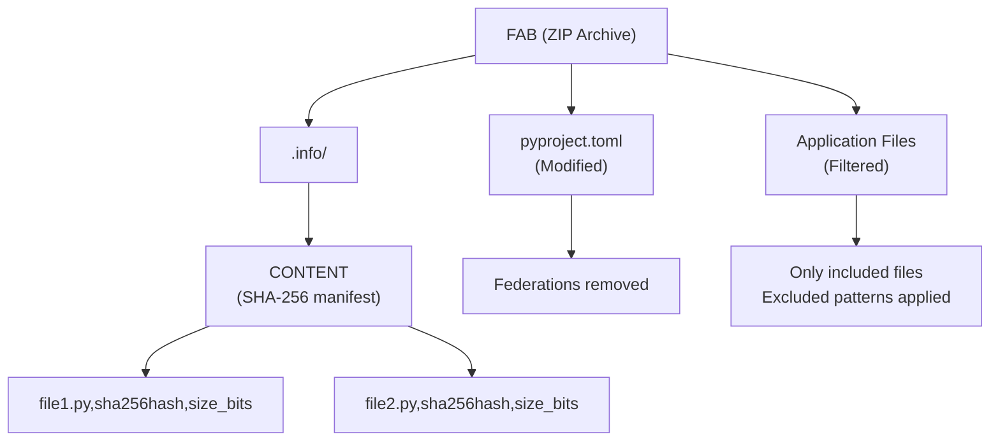
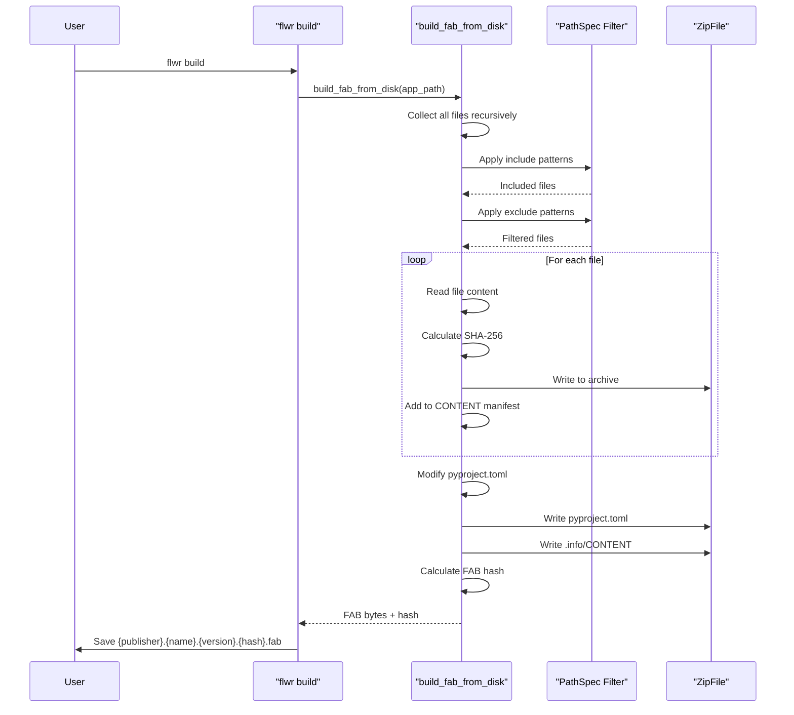
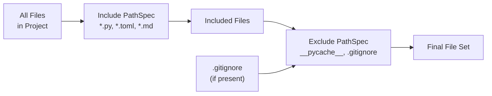
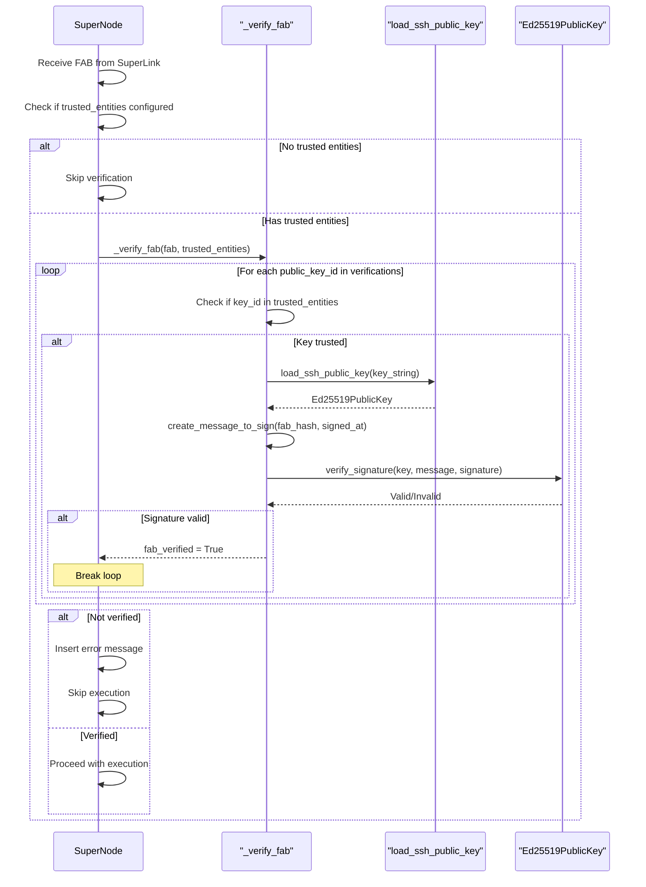
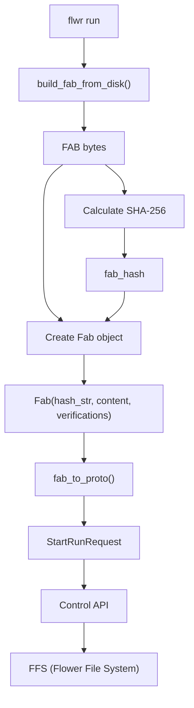
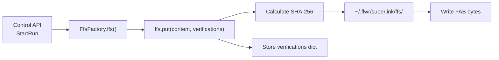
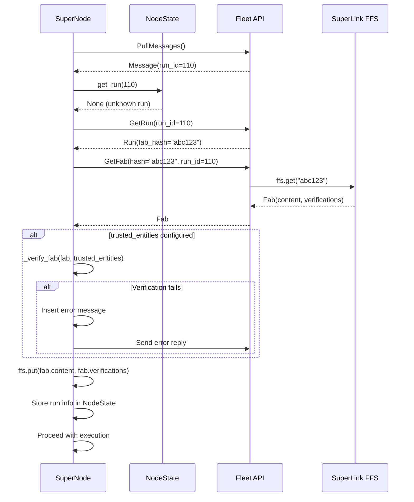

<!-- source: DeepWiki mcp.deepwiki.com · repo adap/flower · page 3.3 FAB (Flower App Bundle) Lifecycle · fetched 2026-10-21 -->

# FAB (Flower App Bundle) Lifecycle

<details>
<summary>Relevant source files</summary>

The following files were used as context for generating this wiki page:

- [framework/docs/source/ref-exit-codes/303.rst](framework/docs/source/ref-exit-codes/303.rst)
- [framework/docs/source/ref-exit-codes/304.rst](framework/docs/source/ref-exit-codes/304.rst)
- [framework/docs/source/ref-exit-codes/500.rst](framework/docs/source/ref-exit-codes/500.rst)
- [framework/py/flwr/cli/auth_plugin/__init__.py](framework/py/flwr/cli/auth_plugin/__init__.py)
- [framework/py/flwr/cli/auth_plugin/auth_plugin.py](framework/py/flwr/cli/auth_plugin/auth_plugin.py)
- [framework/py/flwr/cli/auth_plugin/noop_auth_plugin.py](framework/py/flwr/cli/auth_plugin/noop_auth_plugin.py)
- [framework/py/flwr/cli/auth_plugin/oidc_cli_plugin.py](framework/py/flwr/cli/auth_plugin/oidc_cli_plugin.py)
- [framework/py/flwr/cli/build.py](framework/py/flwr/cli/build.py)
- [framework/py/flwr/cli/cli_account_auth_interceptor.py](framework/py/flwr/cli/cli_account_auth_interceptor.py)
- [framework/py/flwr/cli/log.py](framework/py/flwr/cli/log.py)
- [framework/py/flwr/cli/login/login.py](framework/py/flwr/cli/login/login.py)
- [framework/py/flwr/cli/new/new.py](framework/py/flwr/cli/new/new.py)
- [framework/py/flwr/cli/new/new_test.py](framework/py/flwr/cli/new/new_test.py)
- [framework/py/flwr/cli/new/templates/app/code/client.xgboost.py.tpl](framework/py/flwr/cli/new/templates/app/code/client.xgboost.py.tpl)
- [framework/py/flwr/cli/new/templates/app/code/server.xgboost.py.tpl](framework/py/flwr/cli/new/templates/app/code/server.xgboost.py.tpl)
- [framework/py/flwr/cli/new/templates/app/code/task.xgboost.py.tpl](framework/py/flwr/cli/new/templates/app/code/task.xgboost.py.tpl)
- [framework/py/flwr/cli/new/templates/app/pyproject.xgboost.toml.tpl](framework/py/flwr/cli/new/templates/app/pyproject.xgboost.toml.tpl)
- [framework/py/flwr/cli/run/run.py](framework/py/flwr/cli/run/run.py)
- [framework/py/flwr/cli/stop.py](framework/py/flwr/cli/stop.py)
- [framework/py/flwr/cli/utils.py](framework/py/flwr/cli/utils.py)
- [framework/py/flwr/client/grpc_adapter_client/connection.py](framework/py/flwr/client/grpc_adapter_client/connection.py)
- [framework/py/flwr/client/grpc_rere_client/connection.py](framework/py/flwr/client/grpc_rere_client/connection.py)
- [framework/py/flwr/client/grpc_rere_client/node_auth_client_interceptor_test.py](framework/py/flwr/client/grpc_rere_client/node_auth_client_interceptor_test.py)
- [framework/py/flwr/client/rest_client/connection.py](framework/py/flwr/client/rest_client/connection.py)
- [framework/py/flwr/common/constant.py](framework/py/flwr/common/constant.py)
- [framework/py/flwr/common/exit/exit_code.py](framework/py/flwr/common/exit/exit_code.py)
- [framework/py/flwr/compat/client/grpc_client/connection.py](framework/py/flwr/compat/client/grpc_client/connection.py)
- [framework/py/flwr/server/app.py](framework/py/flwr/server/app.py)
- [framework/py/flwr/server/superlink/fleet/grpc_rere/node_auth_server_interceptor.py](framework/py/flwr/server/superlink/fleet/grpc_rere/node_auth_server_interceptor.py)
- [framework/py/flwr/supercore/constant.py](framework/py/flwr/supercore/constant.py)
- [framework/py/flwr/supercore/primitives/asymmetric.py](framework/py/flwr/supercore/primitives/asymmetric.py)
- [framework/py/flwr/supercore/primitives/asymmetric_ed25519.py](framework/py/flwr/supercore/primitives/asymmetric_ed25519.py)
- [framework/py/flwr/supercore/primitives/asymmetric_ed25519_test.py](framework/py/flwr/supercore/primitives/asymmetric_ed25519_test.py)
- [framework/py/flwr/superlink/auth_plugin/__init__.py](framework/py/flwr/superlink/auth_plugin/__init__.py)
- [framework/py/flwr/superlink/auth_plugin/auth_plugin.py](framework/py/flwr/superlink/auth_plugin/auth_plugin.py)
- [framework/py/flwr/superlink/auth_plugin/noop_auth_plugin.py](framework/py/flwr/superlink/auth_plugin/noop_auth_plugin.py)
- [framework/py/flwr/superlink/federation/__init__.py](framework/py/flwr/superlink/federation/__init__.py)
- [framework/py/flwr/superlink/servicer/control/control_grpc.py](framework/py/flwr/superlink/servicer/control/control_grpc.py)
- [framework/py/flwr/supernode/cli/flower_supernode.py](framework/py/flwr/supernode/cli/flower_supernode.py)
- [framework/py/flwr/supernode/start_client_internal.py](framework/py/flwr/supernode/start_client_internal.py)
- [framework/py/flwr/supernode/start_client_internal_test.py](framework/py/flwr/supernode/start_client_internal_test.py)

</details>


## Purpose and Scope

This document describes the lifecycle of a Flower App Bundle (FAB) from creation to execution. A FAB is a self-contained package format that bundles a Flower application's code, configuration, and metadata into a single distributable unit.

This page covers:
- FAB structure and format specifications
- FAB creation with `flwr build`
- File filtering and content manifest generation
- FAB verification using cryptographic signatures
- FAB deployment to SuperLink and distribution to SuperNodes

For information about running FABs using `flwr run`, see [Run Management](#3.2). For information about creating new Flower Apps, see the CLI documentation.

---

## FAB Structure

A FAB is a ZIP archive with a deterministic structure that enables content verification and reproducible builds.

### Core Components

| Component | Description | Location |
|-----------|-------------|----------|
| `pyproject.toml` | Project configuration with federation settings removed | Root of ZIP |
| `.info/CONTENT` | Manifest listing all files with SHA-256 hashes | `.info/` directory |
| Application Code | Python modules and supporting files | According to project structure |
| Verification Data | Cryptographic signatures (optional) | Stored in `Fab.verifications` dict |

### File Format



**Figure: FAB Internal Structure**

Sources: [framework/py/flwr/cli/build.py:43-268]()

---

## FAB Creation with `flwr build`

### Build Process Overview



**Figure: FAB Build Sequence**

### File Filtering

The build process applies gitignore-style patterns to determine which files to include in the FAB.

**Default Include Patterns:**
```python
FAB_INCLUDE_PATTERNS = (
    "**/*.py",
    "**/*.toml",
    "**/*.md",
)
```

**Default Exclude Patterns:**
```python
FAB_EXCLUDE_PATTERNS = (
    "**/__pycache__/**",
    FAB_CONFIG_FILE,  # Original pyproject.toml excluded
)
```

The filtering logic also respects `.gitignore` files found in the project directory. Files matching exclude patterns take precedence over include patterns.

**Filter Application:**



**Figure: File Filtering Pipeline**

Sources: [framework/py/flwr/common/constant.py:83-93](), [framework/py/flwr/cli/build.py:269-289]()

### Content Manifest Generation

Each file in the FAB is recorded in the `.info/CONTENT` manifest with its SHA-256 hash and size:

```
path/to/file.py,sha256_hexdigest,size_in_bits
another_file.py,sha256_hexdigest,size_in_bits
```

The manifest generation process:

1. For each filtered file, read the content
2. Calculate SHA-256 hash: `hashlib.sha256(content).hexdigest()`
3. Calculate size in bits: `len(content) * 8`
4. Append entry to manifest string
5. Write manifest to `.info/CONTENT` in ZIP

Sources: [framework/py/flwr/cli/build.py:234-255]()

### Size Limits

FABs are subject to a maximum size constraint:

```python
FAB_MAX_SIZE = 10 * 1024 * 1024  # 10 MB
```

If the generated FAB exceeds this limit, the build fails with a `ValueError`. Users must reduce the package size by excluding unnecessary files via `.gitignore` or other exclude patterns.

Sources: [framework/py/flwr/common/constant.py:80](), [framework/py/flwr/cli/build.py:259-265]()

### Deterministic Builds

To ensure reproducibility, all files in the FAB ZIP archive use a fixed timestamp:

```python
FAB_DATE = (2024, 10, 1, 0, 0, 0)  # Fixed date for all FAB files
```

This fixed timestamp ensures that building the same source code multiple times produces byte-identical FABs (assuming no content changes).

Sources: [framework/py/flwr/common/constant.py:78](), [framework/py/flwr/cli/build.py:43-50]()

---

## FAB Verification

FAB verification ensures that applications running on SuperNodes have been cryptographically signed by trusted entities. This security mechanism prevents execution of unauthorized or tampered code.

### Verification Data Structure

FABs carry verification data in the `Fab` dataclass:

```python
class Fab:
    hash_str: str          # SHA-256 of FAB content
    content: bytes         # ZIP archive bytes
    verifications: dict[str, str]  # public_key_id -> verification_json
```

The `verifications` dictionary maps public key IDs to JSON-encoded verification records:

```json
{
  "signature": "base64url_encoded_signature",
  "signed_at": 1234567890
}
```

Sources: [framework/py/flwr/common/typing.py]() (inferred from usage)

### Trusted Entities Configuration

SuperNodes can be configured with a list of trusted entities using a YAML file:

```yaml
fpk_UUID1: ssh-ed25519 <base64-key1> [comment1]
fpk_UUID2: ssh-ed25519 <base64-key2> [comment2]
```

The `fpk_` prefix denotes "Flower Public Key". Public keys must be in OpenSSH format and currently only Ed25519 keys are supported.

SuperNodes load this configuration via the `--trusted-entities` CLI argument:

```bash
flower-supernode --trusted-entities ./trusted_entities.yaml
```

Sources: [framework/py/flwr/supernode/cli/flower_supernode.py:133-143](), [framework/py/flwr/supernode/cli/flower_supernode.py:257-293]()

### Verification Process on SuperNode



**Figure: FAB Verification Sequence**

The verification implementation:

**Key Functions:**

| Function | Location | Purpose |
|----------|----------|---------|
| `_verify_fab()` | [framework/py/flwr/supernode/start_client_internal.py:625-653]() | Main verification logic |
| `create_message_to_sign()` | [framework/py/flwr/supercore/primitives/asymmetric_ed25519.py:141-155]() | Constructs message for verification |
| `verify_signature()` | [framework/py/flwr/supercore/primitives/asymmetric_ed25519.py:127-150]() | Ed25519 signature verification |
| `load_ssh_public_key()` | cryptography library | Loads OpenSSH public key |

**Verification Logic Flow:**

1. **Check Configuration**: If `trusted_entities` is `None` or empty, skip verification
2. **Check License Validity**: Verify `fab.verifications` contains `"valid_license"` key
3. **Iterate Verification Records**: For each `public_key_id` in `fab.verifications`:
   - Check if `public_key_id` exists in `trusted_entities`
   - Load the public key from trusted entities list
   - Parse verification JSON to get `signature` and `signed_at`
   - Create message: `SHA256(fab.content) || signed_at`
   - Verify signature using Ed25519
   - If valid, mark FAB as verified and stop checking
4. **Handle Result**:
   - If verified: Store FAB in FFS and proceed with execution
   - If not verified: Insert error message with `ErrorCode.INVALID_FAB`

Sources: [framework/py/flwr/supernode/start_client_internal.py:625-653](), [framework/py/flwr/supernode/start_client_internal.py:346-368]()

### Verification Error Handling

When FAB verification fails, the SuperNode generates an error message:

```python
FAB_VERIFICATION_ERROR = Error(
    ErrorCode.INVALID_FAB, 
    "The FAB could not be verified."
)
```

This error message is inserted into the NodeState and sent back to the SuperLink as a reply, preventing the run from proceeding.

Sources: [framework/py/flwr/supernode/start_client_internal.py:82](), [framework/py/flwr/supernode/start_client_internal.py:359-368]()

---

## FAB Deployment and Storage

### Upload to SuperLink

When executing `flwr run`, the CLI builds the FAB and uploads it to the SuperLink via the Control API:



**Figure: FAB Upload Flow**

The FAB is transmitted as part of the `StartRunRequest`:

```python
req = StartRunRequest(
    fab=fab_to_proto(fab),
    override_config=user_config_to_proto(parse_config_args(config_overrides)),
    federation=real_federation,
    federation_options=config_record_to_proto(c_record),
    app_id=app_id or "",
)
```

Sources: [framework/py/flwr/cli/run/run.py:178-203]()

### Storage in Flower File System (FFS)

The SuperLink stores FABs in the Flower File System (FFS), a content-addressable storage system.

**FFS Storage Locations:**

| Component | Default Directory | Configuration |
|-----------|------------------|---------------|
| SuperLink FFS | `~/.flwr/superlink/ffs` | `--storage-dir` option |
| SuperNode FFS | `~/.flwr/supernode/ffs` | Hardcoded in code |

The FFS storage process:



**Figure: FFS Storage Process**

**Key Classes and Methods:**

- `FfsFactory`: Factory for creating FFS instances [framework/py/flwr/supercore/ffs.py]() (inferred)
- `Ffs.put(content, verifications)`: Stores FAB content and verification data
- `Ffs.get(hash_str)`: Retrieves FAB by hash

The FFS uses the SHA-256 hash of the FAB content as the storage key, enabling:
- Deduplication: Identical FABs are stored only once
- Content verification: Hash can be recalculated to verify integrity
- Efficient lookup: Direct access by hash

Sources: [framework/py/flwr/server/app.py:306-308](), [framework/py/flwr/supercore/ffs.py]() (inferred from usage)

---

## FAB Distribution to SuperNodes

### Pull Mechanism

SuperNodes pull FABs from the SuperLink when they receive a message for a new run:



**Figure: FAB Distribution Sequence**

### GetFab RPC Call

The `GetFab` RPC is defined in the Fleet API protobuf:

```
message GetFabRequest {
    Node node = 1;
    string hash_str = 2;
    uint64 run_id = 3;
}

message GetFabResponse {
    Fab fab = 1;
}
```

The SuperNode calls this API through the connection wrapper:

```python
def get_fab(fab_hash: str, run_id: int) -> Fab:
    get_fab_request = GetFabRequest(node=node, hash_str=fab_hash, run_id=run_id)
    get_fab_response: GetFabResponse = stub.GetFab(request=get_fab_request)
    return fab_from_proto(get_fab_response.fab)
```

Sources: [framework/py/flwr/client/grpc_rere_client/connection.py:310-315]()

### Caching on SuperNode

Once retrieved, the FAB is stored in the SuperNode's local FFS:

```python
ffs.put(fab.content, fab.verifications)
```

This caching means:
- Subsequent messages from the same run do not require re-downloading the FAB
- The FAB remains available for the duration of the run
- Multiple runs using the same FAB (same hash) are deduplicated

The SuperNode maintains run information in its NodeState:

```python
state.store_run(run_info)  # Stores Run object with fab_hash
state.store_context(run_ctx)  # Stores Context with run configuration
```

Sources: [framework/py/flwr/supernode/start_client_internal.py:370-383]()

---

## FAB Filename Convention

FABs follow a structured naming convention for easy identification:

```
{publisher}.{name}.{version}.{hash}.fab
```

**Components:**

| Component | Source | Example |
|-----------|--------|---------|
| `publisher` | `tool.flwr.app.publisher` in pyproject.toml | `flwrlabs` |
| `name` | `project.name` in pyproject.toml | `hello-world` |
| `version` | `project.version` with dots replaced by dashes | `1-0-0` |
| `hash` | First 8 characters of SHA-256 hash | `a3f5bc21` |
| Extension | Always `.fab` | `.fab` |

**Example:**
```
flwrlabs.hello-world.1-0-0.a3f5bc21.fab
```

The hash truncation constant:

```python
FAB_HASH_TRUNCATION = 8
```

Sources: [framework/py/flwr/cli/build.py:53-59](), [framework/py/flwr/common/constant.py:79]()

---

## Summary

The FAB lifecycle consists of five main phases:

1. **Creation**: `flwr build` packages application code into a ZIP archive with deterministic timestamps, applying include/exclude filters and generating a content manifest
2. **Verification**: Optional cryptographic signing with Ed25519 keys, enabling trust verification on SuperNodes
3. **Deployment**: Upload to SuperLink via Control API's `StartRun` RPC
4. **Storage**: Content-addressable storage in FFS using SHA-256 hash as key
5. **Distribution**: SuperNodes pull FABs on-demand via Fleet API's `GetFab` RPC, verify signatures if configured, and cache locally

This architecture ensures:
- **Reproducibility**: Deterministic builds with fixed timestamps
- **Security**: Cryptographic verification prevents unauthorized code execution
- **Efficiency**: Content-addressable storage with deduplication
- **Reliability**: Hash-based integrity verification at each step

Sources: [framework/py/flwr/cli/build.py:1-290](), [framework/py/flwr/cli/run/run.py:1-294](), [framework/py/flwr/supernode/start_client_internal.py:1-654]()

---

