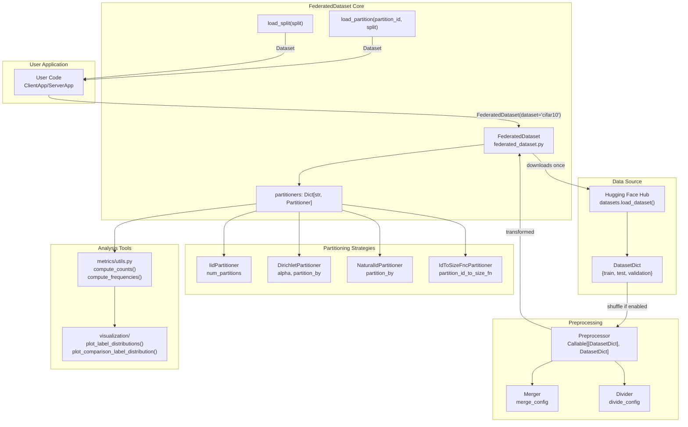
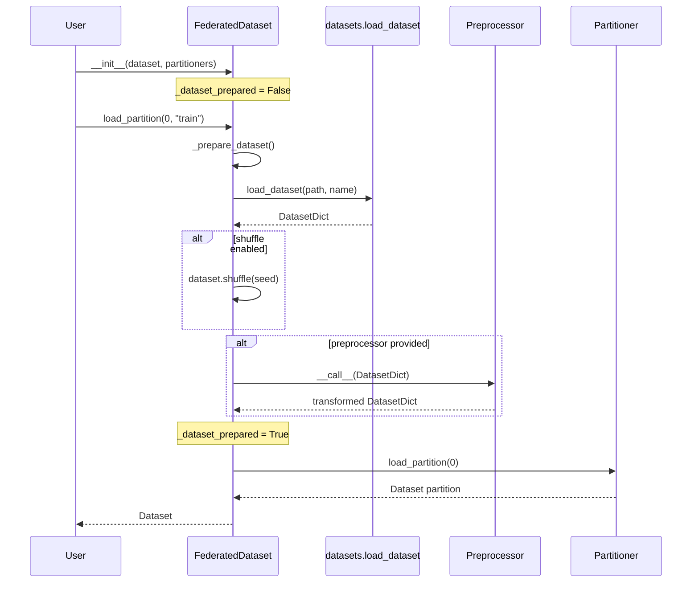
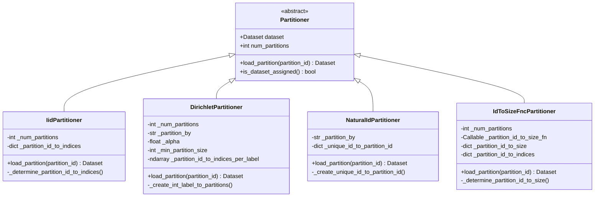
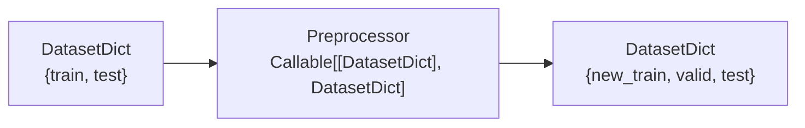
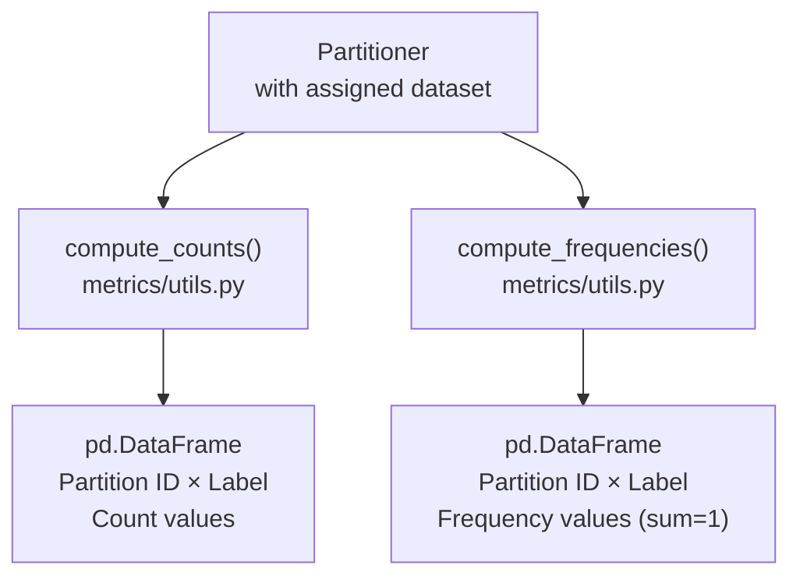

<!-- source: DeepWiki mcp.deepwiki.com · repo adap/flower · page 4 Dataset Management · fetched 2026-10-21 -->

# Dataset Management

<details>
<summary>Relevant source files</summary>

The following files were used as context for generating this wiki page:

- [datasets/flwr_datasets/__init__.py](datasets/flwr_datasets/__init__.py)
- [datasets/flwr_datasets/common/telemetry.py](datasets/flwr_datasets/common/telemetry.py)
- [datasets/flwr_datasets/common/telemetry_test.py](datasets/flwr_datasets/common/telemetry_test.py)
- [datasets/flwr_datasets/common/version.py](datasets/flwr_datasets/common/version.py)
- [datasets/flwr_datasets/federated_dataset.py](datasets/flwr_datasets/federated_dataset.py)
- [datasets/flwr_datasets/federated_dataset_test.py](datasets/flwr_datasets/federated_dataset_test.py)
- [datasets/flwr_datasets/metrics/__init__.py](datasets/flwr_datasets/metrics/__init__.py)
- [datasets/flwr_datasets/metrics/utils.py](datasets/flwr_datasets/metrics/utils.py)
- [datasets/flwr_datasets/metrics/utils_test.py](datasets/flwr_datasets/metrics/utils_test.py)
- [datasets/flwr_datasets/mock_utils_test.py](datasets/flwr_datasets/mock_utils_test.py)
- [datasets/flwr_datasets/partitioner/id_to_size_fnc_partitioner.py](datasets/flwr_datasets/partitioner/id_to_size_fnc_partitioner.py)
- [datasets/flwr_datasets/preprocessor/__init__.py](datasets/flwr_datasets/preprocessor/__init__.py)
- [datasets/flwr_datasets/preprocessor/divider.py](datasets/flwr_datasets/preprocessor/divider.py)
- [datasets/flwr_datasets/preprocessor/divider_test.py](datasets/flwr_datasets/preprocessor/divider_test.py)
- [datasets/flwr_datasets/preprocessor/merger.py](datasets/flwr_datasets/preprocessor/merger.py)
- [datasets/flwr_datasets/preprocessor/merger_test.py](datasets/flwr_datasets/preprocessor/merger_test.py)
- [datasets/flwr_datasets/preprocessor/preprocessor.py](datasets/flwr_datasets/preprocessor/preprocessor.py)
- [datasets/flwr_datasets/utils.py](datasets/flwr_datasets/utils.py)
- [datasets/flwr_datasets/utils_test.py](datasets/flwr_datasets/utils_test.py)
- [datasets/flwr_datasets/visualization/__init__.py](datasets/flwr_datasets/visualization/__init__.py)
- [datasets/flwr_datasets/visualization/bar_plot.py](datasets/flwr_datasets/visualization/bar_plot.py)
- [datasets/flwr_datasets/visualization/comparison_label_distribution.py](datasets/flwr_datasets/visualization/comparison_label_distribution.py)
- [datasets/flwr_datasets/visualization/constants.py](datasets/flwr_datasets/visualization/constants.py)
- [datasets/flwr_datasets/visualization/heatmap_plot.py](datasets/flwr_datasets/visualization/heatmap_plot.py)
- [datasets/flwr_datasets/visualization/label_distribution.py](datasets/flwr_datasets/visualization/label_distribution.py)
- [datasets/flwr_datasets/visualization/utils.py](datasets/flwr_datasets/visualization/utils.py)
- [datasets/pyproject.toml](datasets/pyproject.toml)
- [framework/pyproject.toml](framework/pyproject.toml)

</details>


## Purpose and Scope

This document describes the `flwr-datasets` package, which provides dataset management capabilities for federated learning in Flower. The package handles downloading datasets from Hugging Face Hub, partitioning data across clients with various strategies (IID and non-IID), preprocessing splits, and visualizing data distributions. For information about the core federated learning execution flow, see [Core Architecture](#2). For deployment and release processes, see [Deployment](#5).

Sources: [datasets/pyproject.toml:1-157](), [datasets/flwr_datasets/__init__.py:1-35]()

## Architecture Overview



**FederatedDataset Data Flow**: User creates `FederatedDataset` instance with dataset name and partitioner specifications. The dataset is lazily downloaded from Hugging Face Hub on first access, optionally shuffled, preprocessed to merge/divide splits, then partitioned according to specified strategies. Users load individual partitions via `load_partition()` or entire splits via `load_split()`.

Sources: [datasets/flwr_datasets/federated_dataset.py:1-352](), [datasets/flwr_datasets/__init__.py:1-35]()

## FederatedDataset Class

### Initialization and Lazy Loading

The `FederatedDataset` class is the primary interface for federated dataset management. It implements lazy loading where dataset download and partitioning occur only when data is first accessed.

**Key Parameters**:
- `dataset`: Dataset name in Hugging Face Hub (e.g., `"mnist"`, `"cifar10"`)
- `subset`: Optional subset or version (e.g., `"cropped_digits"` for SVHN)
- `partitioners`: Dictionary mapping split names to `Partitioner` objects or integers (for default IID partitioning)
- `preprocessor`: Optional `Preprocessor` callable or merge configuration dictionary
- `shuffle`: Boolean to randomize sample order (default: `True`)
- `seed`: Random seed for shuffling (default: `42`)



**Lazy Loading Mechanism**: Dataset download and preparation are deferred until the first call to `load_partition()` or `load_split()`. This is controlled by the `_dataset_prepared` flag in [federated_dataset.py:133]().

Sources: [datasets/flwr_datasets/federated_dataset.py:107-138](), [datasets/flwr_datasets/federated_dataset.py:288-328]()

### Core Methods

| Method | Parameters | Returns | Description |
|--------|-----------|---------|-------------|
| `load_partition()` | `partition_id: int`<br/>`split: str \| None` | `Dataset` | Load a single partition from specified split. Split can be omitted if only one partitioner exists. |
| `load_split()` | `split: str` | `Dataset` | Load the full dataset split without partitioning. |
| `partitioners` | - | `Dict[str, Partitioner]` | Property returning dictionary of partitioners with datasets assigned. |

**Split Inference**: When a single partitioner is specified, the `split` parameter in `load_partition()` can be omitted and will be automatically inferred in [federated_dataset.py:176-177]().

**Partition ID Validation**: The method checks partition ID bounds in the partitioner and validates that the requested split exists in [federated_dataset.py:257-266]() and has a corresponding partitioner in [federated_dataset.py:268-276]().

Sources: [datasets/flwr_datasets/federated_dataset.py:139-196](), [datasets/flwr_datasets/federated_dataset.py:197-236](), [datasets/flwr_datasets/federated_dataset.py:238-255]()

### Usage Examples

**Basic IID Partitioning**:
```python
from flwr_datasets import FederatedDataset

# Create 100 IID partitions of MNIST training data
fds = FederatedDataset(dataset="mnist", partitioners={"train": 100})

# Load partition for client 10
partition = fds.load_partition(10)

# Load full test split for centralized evaluation
centralized_test = fds.load_split("test")
```

**Non-IID Partitioning with Dirichlet**:
```python
from flwr_datasets import FederatedDataset
from flwr_datasets.partitioner import DirichletPartitioner

partitioner = DirichletPartitioner(
    num_partitions=10, 
    partition_by="label",
    alpha=0.5, 
    min_partition_size=10
)
fds = FederatedDataset(
    dataset="cifar10", 
    partitioners={"train": partitioner}
)
partition = fds.load_partition(partition_id=0)
```

Sources: [datasets/flwr_datasets/federated_dataset.py:73-104]()

## Partitioning Strategies



**Partitioner Hierarchy**: All partitioners inherit from the abstract `Partitioner` base class and implement `load_partition()` to return a `datasets.Dataset` for the requested partition ID.

Sources: [datasets/flwr_datasets/partitioner/__init__.py:1-36]()

### IidPartitioner

Creates Independent and Identically Distributed (IID) partitions with approximately equal sizes. Samples are distributed uniformly without considering label distribution.

**Initialization**:
- `num_partitions`: Total number of partitions to create

**Partition Size Calculation**: Each partition gets `⌊dataset_size / num_partitions⌋` or `⌈dataset_size / num_partitions⌉` samples. The remainder samples are distributed to the first `dataset_size % num_partitions` partitions.

**Implementation**: Indices are determined in `_determine_partition_id_to_indices()` by creating contiguous ranges starting from index 0.

Sources: [datasets/flwr_datasets/federated_dataset_test.py:150-168](), [datasets/flwr_datasets/utils.py:59-94]()

### DirichletPartitioner

Creates non-IID partitions following a Dirichlet distribution, enabling controlled heterogeneity in label distributions across clients.

**Initialization**:
- `num_partitions`: Number of partitions
- `partition_by`: Column name to partition by (typically `"label"`)
- `alpha`: Concentration parameter controlling heterogeneity (lower = more heterogeneous)
- `min_partition_size`: Minimum samples per partition (default: 10)
- `self_balancing`: Whether to balance partition sizes (default: `True`)

**Alpha Parameter Effect**:
- `alpha → ∞`: Approaches IID distribution
- `alpha = 1.0`: Balanced heterogeneity
- `alpha → 0`: Extreme heterogeneity (few labels per client)

**Partitioning Process**: For each label, samples are divided among partitions according to proportions drawn from `Dirichlet(alpha)`. The process is described in `_create_int_label_to_partitions()`.

Sources: [datasets/flwr_datasets/federated_dataset.py:85-93]()

### NaturalIdPartitioner

Partitions data based on a natural identifier column already present in the dataset (e.g., user ID, device ID, writer ID).

**Initialization**:
- `partition_by`: Column name containing natural IDs

**Use Cases**: Datasets with inherent client identities like FEMNIST (`writer_id`), UCF101 (`video_id`), or Ambient Acoustic Context (`speaker_id`).

**Partition Mapping**: Each unique value in the `partition_by` column maps to one partition ID. The mapping is created in `_create_unique_id_to_partition_id()`.

Sources: [datasets/flwr_datasets/federated_dataset_test.py:449-515]()

### IdToSizeFncPartitioner

Creates partitions with sizes determined by a custom function of the partition ID, enabling power-law or other custom size distributions.

**Initialization**:
- `num_partitions`: Total number of partitions
- `partition_id_to_size_fn`: Callable mapping partition ID to size units

**Size Function Examples**:
- Linear: `lambda x: x` (partition 1 gets 1 unit, partition 2 gets 2 units, etc.)
- Square: `lambda x: x**2` (partition 1 gets 1 unit, partition 2 gets 4 units, etc.)
- Exponential: `lambda x: 2**x`

**Size Normalization**: The function output is normalized to fractions of the total dataset in `_determine_partition_id_to_size()`.

Sources: [datasets/flwr_datasets/partitioner/id_to_size_fnc_partitioner.py:1-146]()

## Data Preprocessing

### Preprocessor Interface



The `Preprocessor` type is a callable that transforms `DatasetDict` objects. It can be a custom function or one of the built-in classes (`Merger`, `Divider`).

**Type Definition**: `Preprocessor = Callable[[DatasetDict], DatasetDict]` in [preprocessor/preprocessor.py:22]()

Sources: [datasets/flwr_datasets/preprocessor/preprocessor.py:1-23]()

### Merger: Combining Splits

The `Merger` class combines multiple existing splits into new splits with custom names.

**Configuration Format**: `Dict[str, Tuple[str, ...]]` where keys are new split names and values are tuples of existing split names to merge.

**Example: Combine Train and Validation**:
```python
from flwr_datasets.preprocessor import Merger

merger = Merger(merge_config={
    "train_and_valid": ("train", "valid"),
    "test": ("test",)
})

# Use with FederatedDataset
fds = FederatedDataset(
    dataset="cifar10",
    partitioners={"train_and_valid": 100},
    preprocessor=merger
)
```

**Shorthand Configuration**: Can pass merge config dictionary directly to `FederatedDataset`:
```python
fds = FederatedDataset(
    dataset="mnist",
    partitioners={"full": 100},
    preprocessor={"full": ("train", "test")}
)
```

This is automatically instantiated as a `Merger` in `_instantiate_merger_if_needed()` at [utils.py:97-103]().

**Validation**: Checks for duplicate splits and verifies that referenced splits exist in [merger.py:96-109]().

Sources: [datasets/flwr_datasets/preprocessor/merger.py:1-110](), [datasets/flwr_datasets/utils.py:97-103]()

### Divider: Splitting into Sub-Splits

The `Divider` class divides existing splits into new sub-splits with custom names and sizes.

**Configuration Formats**:

1. **Single-level dictionary** (requires `divide_split` parameter):
   - Keys: New split names
   - Values: `float` (fractions) or `int` (sample counts)
   
2. **Two-level dictionary** (multi-split division):
   - First level keys: Original split names to divide
   - Second level: Same as single-level format

**Example: Divide Train into Train/Valid**:
```python
from flwr_datasets.preprocessor import Divider

# Using fractions
divider = Divider(
    divide_config={"train": 0.8, "valid": 0.2},
    divide_split="train"
)

# Using sample counts
divider = Divider(
    divide_config={"train": 40000, "valid": 10000},
    divide_split="train"
)

# Multi-split configuration
divider = Divider(
    divide_config={
        "train": {"train": 0.8, "valid": 0.2},
        "test": {"test_a": 0.5, "test_b": 0.5}
    }
)
```

**Parameter `drop_remaining_splits`**: When `True`, splits not specified in `divide_config` are dropped. When `False` (default), they are preserved.

**Validation**: Ensures fractions sum to ≤ 1.0, sample counts don't exceed split size, and no empty datasets are created in [divider.py:261-293]().

Sources: [datasets/flwr_datasets/preprocessor/divider.py:1-384]()

## Utility Functions

### divide_dataset

Divides a single `Dataset` into multiple sub-datasets without using the `FederatedDataset` framework.

**Function Signature**:
```python
def divide_dataset(
    dataset: Dataset, 
    division: List[float] | Tuple[float, ...] | Dict[str, float]
) -> List[Dataset] | DatasetDict
```

**Parameters**:
- `division`: List/tuple of fractions or dictionary mapping names to fractions
- Returns: `List[Dataset]` if division is list/tuple, `DatasetDict` if dictionary

**Example**:
```python
from flwr_datasets.utils import divide_dataset

partition = fds.load_partition(0)

# Using list
train, test = divide_dataset(partition, [0.8, 0.2])

# Using dictionary
splits = divide_dataset(partition, {"train": 0.8, "test": 0.2})
train, test = splits["train"], splits["test"]
```

**Index Range Creation**: Divides dataset by creating contiguous index ranges in `_create_division_indices_ranges()` at [utils.py:171-196]().

Sources: [datasets/flwr_datasets/utils.py:106-169]()

### concatenate_divisions

Creates a centralized dataset by concatenating the same division from all partitions.

**Function Signature**:
```python
def concatenate_divisions(
    partitioner: Partitioner,
    partition_division: List[float] | Tuple[float, ...] | Dict[str, float],
    division_id: int | str
) -> Dataset
```

**Use Case**: Creating centralized test set from federated on-edge test sets.

**Example**:
```python
from flwr_datasets.utils import concatenate_divisions

fds = FederatedDataset(dataset="mnist", partitioners={"train": 100})

# Concatenate test divisions from all 100 partitions
centralized_test = concatenate_divisions(
    partitioner=fds.partitioners["train"],
    partition_division=[0.8, 0.2],
    division_id=1
)
```

**Process**: Iterates through all partitions, divides each according to `partition_division`, extracts the specified division, then concatenates all divisions using `datasets.concatenate_datasets()` at [utils.py:357]().

Sources: [datasets/flwr_datasets/utils.py:263-357]()

## Metrics and Analysis

### Computing Label Distributions



**Purpose**: Analyze label distribution heterogeneity across partitions to understand data imbalance.

Sources: [datasets/flwr_datasets/metrics/__init__.py:1-24]()

### compute_counts

Returns absolute counts of each label in each partition.

**Function Signature**:
```python
def compute_counts(
    partitioner: Partitioner,
    column_name: str,
    verbose_names: bool = False,
    max_num_partitions: int | None = None
) -> pd.DataFrame
```

**Parameters**:
- `column_name`: Column to count (typically `"label"`)
- `verbose_names`: Use string label names if column is `ClassLabel` type
- `max_num_partitions`: Limit number of partitions to analyze

**Output DataFrame**:
- Rows: Partition IDs (index named "Partition ID")
- Columns: Label values or names
- Values: Integer counts

**Zero-Filling**: All possible labels are included even if count is 0, determined from dataset features in [metrics/utils.py:98-106]().

**Example**:
```python
from flwr_datasets.metrics import compute_counts

counts_df = compute_counts(
    partitioner=fds.partitioners["train"],
    column_name="label",
    verbose_names=True
)
# counts_df.loc[5, "airplane"] returns count of "airplane" in partition 5
```

Sources: [datasets/flwr_datasets/metrics/utils.py:25-136]()

### compute_frequencies

Returns relative frequencies (proportions) of each label in each partition. Each row sums to 1.0.

**Function Signature**:
```python
def compute_frequencies(
    partitioner: Partitioner,
    column_name: str,
    verbose_names: bool = False,
    max_num_partitions: int | None = None
) -> pd.DataFrame
```

**Implementation**: Calls `compute_counts()` then divides each row by its sum in [metrics/utils.py:200-204]().

**Example**:
```python
from flwr_datasets.metrics import compute_frequencies

freq_df = compute_frequencies(
    partitioner=fds.partitioners["train"],
    column_name="label"
)
# freq_df.loc[5] returns probability distribution over labels for partition 5
```

Sources: [datasets/flwr_datasets/metrics/utils.py:139-204]()

## Visualization

### plot_label_distributions

Visualizes label distribution across partitions as bar plot or heatmap.

**Function Signature**:
```python
def plot_label_distributions(
    partitioner: Partitioner,
    label_name: str,
    plot_type: str = "bar",
    size_unit: str = "absolute",
    max_num_partitions: int | None = None,
    partition_id_axis: str = "x",
    # ... additional styling parameters
) -> Tuple[Figure, Axes, pd.DataFrame]
```

**Key Parameters**:
| Parameter | Values | Description |
|-----------|--------|-------------|
| `plot_type` | `"bar"`, `"heatmap"` | Visualization style |
| `size_unit` | `"absolute"`, `"percent"` | Count or normalized percentage |
| `partition_id_axis` | `"x"`, `"y"` | Axis for partition IDs |
| `legend` | `bool` | Include legend/colorbar |
| `verbose_labels` | `bool` | Use string label names if available |

**Bar Plot**: Stacked bars showing label distribution per partition. Implementation in [visualization/bar_plot.py:28-124]().

**Heatmap**: 2D grid using seaborn heatmap. Implementation in [visualization/heatmap_plot.py:28-86]().

**Example**:
```python
from flwr_datasets.visualization import plot_label_distributions

fig, ax, df = plot_label_distributions(
    partitioner=fds.partitioners["train"],
    label_name="label",
    plot_type="bar",
    size_unit="percent",
    legend=True,
    verbose_labels=True
)
```

**Data Flow**: Calls `compute_counts()` or `compute_frequencies()` based on `size_unit`, then passes DataFrame to plotting function.

Sources: [datasets/flwr_datasets/visualization/label_distribution.py:35-252]()

### plot_comparison_label_distribution

Compares label distributions across multiple partitioners side-by-side.

**Function Signature**:
```python
def plot_comparison_label_distribution(
    partitioner_list: List[Partitioner],
    label_name: str | List[str],
    plot_type: Literal["bar", "heatmap"] = "bar",
    # ... similar parameters to plot_label_distributions
    titles: List[str] | None = None,
) -> Tuple[Figure, List[Axes], List[pd.DataFrame]]
```

**Use Case**: Comparing effect of different Dirichlet alpha values or partitioning strategies.

**Layout**: Creates subplot with `ncols=len(partitioner_list)`, sharing axes when appropriate based on `size_unit` and `partition_id_axis` in [comparison_label_distribution.py:259-273]().

**Example: Compare Alpha Values**:
```python
from flwr_datasets.visualization import plot_comparison_label_distribution

alpha_list = [10.0, 1.0, 0.1, 0.01]
partitioner_list = []
for alpha in alpha_list:
    fds = FederatedDataset(
        dataset="cifar10",
        partitioners={"train": DirichletPartitioner(
            num_partitions=20, partition_by="label", alpha=alpha
        )}
    )
    partitioner_list.append(fds.partitioners["train"])

fig, axes, dfs = plot_comparison_label_distribution(
    partitioner_list=partitioner_list,
    label_name="label",
    titles=[f"α = {alpha}" for alpha in alpha_list]
)
```

Sources: [datasets/flwr_datasets/visualization/comparison_label_distribution.py:34-224]()

## Integration with Hugging Face Hub

### Dataset Loading

`FederatedDataset` uses `datasets.load_dataset()` internally at [federated_dataset.py:309-311]().

**Supported Datasets**: The codebase includes tested datasets in [utils.py:26-56]():
- Image: MNIST, CIFAR-10, CIFAR-100, Fashion-MNIST, SVHN, Tiny ImageNet
- Tabular: Adult Census, UCI Mushrooms, Iris
- Text: Sentiment140 (Twitter)
- Audio: Speech Commands, TEDLIUM

**Custom Datasets**: Any dataset on Hugging Face Hub can be used by specifying its path.

**Additional Parameters**: Pass keyword arguments to `load_dataset()` via `load_dataset_kwargs`:
```python
fds = FederatedDataset(
    dataset="cifar10",
    partitioners={"train": 100},
    num_proc=4,  # Passed to datasets.load_dataset
    trust_remote_code=True
)
```

**Return Type Validation**: Ensures `load_dataset()` returns `DatasetDict` (not `Dataset` or other types) in [federated_dataset.py:312-318]().

Sources: [datasets/flwr_datasets/federated_dataset.py:309-318](), [datasets/flwr_datasets/utils.py:26-56]()

### Dataset Structure

**DatasetDict Structure**: Container holding multiple `Dataset` splits:
```python
DatasetDict({
    "train": Dataset(...),
    "test": Dataset(...),
    "validation": Dataset(...)  # if present
})
```

**Dataset Features**: Each `Dataset` has a `features` attribute describing column types (e.g., `Image`, `ClassLabel`, `Value`).

**Shuffle Behavior**: If `shuffle=True`, all splits in the `DatasetDict` are shuffled in [federated_dataset.py:319-322]().

**Split Access**: After preprocessing, splits are accessed by key: `self._dataset[split]` in [federated_dataset.py:223]().

Sources: [datasets/flwr_datasets/federated_dataset.py:319-327]()

## Telemetry and Event Tracking

The package includes privacy-respecting telemetry to understand usage patterns.

**Event Types**:
- `LOAD_PARTITION_CALLED`: Triggered on first `load_partition()` call per split
- `LOAD_SPLIT_CALLED`: Triggered on first `load_split()` call per split
- `PLOT_LABEL_DISTRIBUTION_CALLED`: Triggered when visualization functions called
- `PLOT_COMPARISON_LABEL_DISTRIBUTION_CALLED`: Triggered for comparison plots

**Event Information**: Includes dataset name, split name, partitioner type, number of partitions, but no actual data content.

**Opt-Out**: Set environment variable `FLWR_TELEMETRY_ENABLED=0` to disable.

**Implementation**: Events are submitted to ThreadPoolExecutor to avoid blocking in [telemetry.py:144-156]().

**Event Location**: Triggered in `load_partition()` at [federated_dataset.py:183-194]() and `load_split()` at [federated_dataset.py:225-234]().

Sources: [datasets/flwr_datasets/common/telemetry.py:1-225](), [datasets/flwr_datasets/federated_dataset.py:183-194]()

## Testing Infrastructure

### Dataset Mocking

Tests use mocked datasets to avoid actual downloads during CI/CD.

**Mock Functions**:
- `_load_mocked_dataset()`: Creates artificial datasets with specified structure
- `_load_mocked_dataset_dict_by_partial_download()`: Mocks partial downloads for streaming mode

**Mocked Datasets**: Includes CIFAR-100, SVHN, Sentiment140, Speech Commands in [mock_utils_test.py:36-44]().

**Mock Utilities**: Random data generation functions like `_generate_artificial_strings()`, `_generate_random_image_column()`, `_generate_random_audio_column()` create realistic test data.

Sources: [datasets/flwr_datasets/mock_utils_test.py:1-444](), [datasets/flwr_datasets/federated_dataset_test.py:36-44]()

### Parameterized Tests

Tests use `parameterized_class` decorator to run same tests across multiple datasets.

**Test Coverage**:
- `BaseFederatedDatasetsTest`: Tests 21 real and mocked datasets with various split configurations
- `NaturalIdPartitionerIntegrationTest`: Tests FEMNIST, UCF101, Ambient Acoustic Context
- `UtilsTests`: Parameterized division configurations

**Validation**: Tests verify partition sizes, split names, data integrity, and error conditions.

Sources: [datasets/flwr_datasets/federated_dataset_test.py:56-285](), [datasets/flwr_datasets/utils_test.py:25-107]()

---

