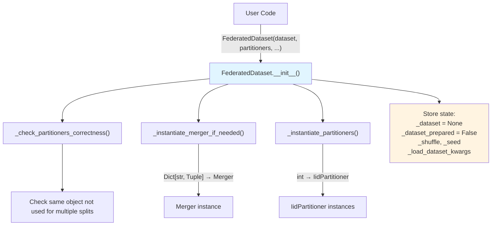
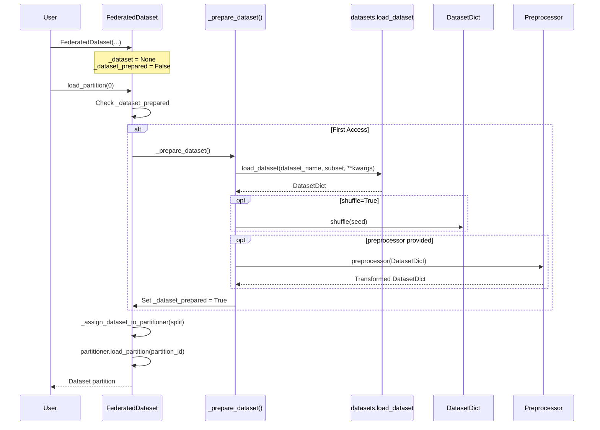
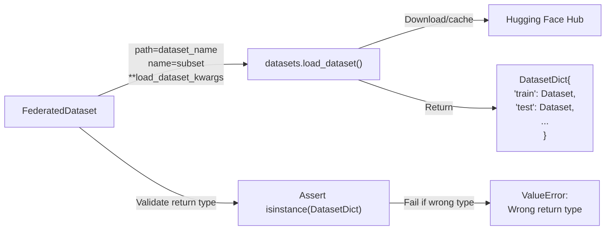
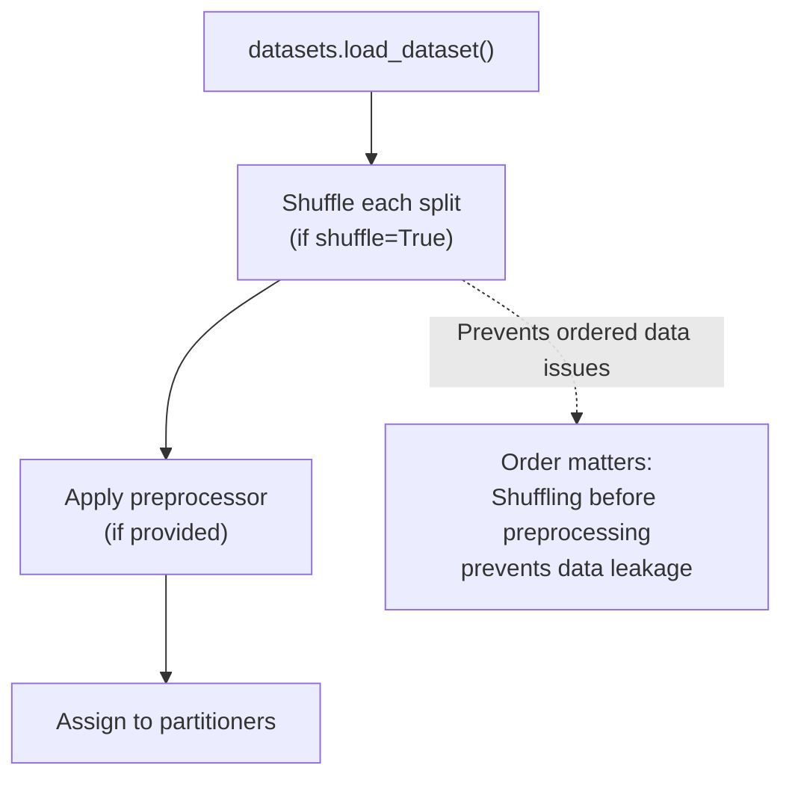
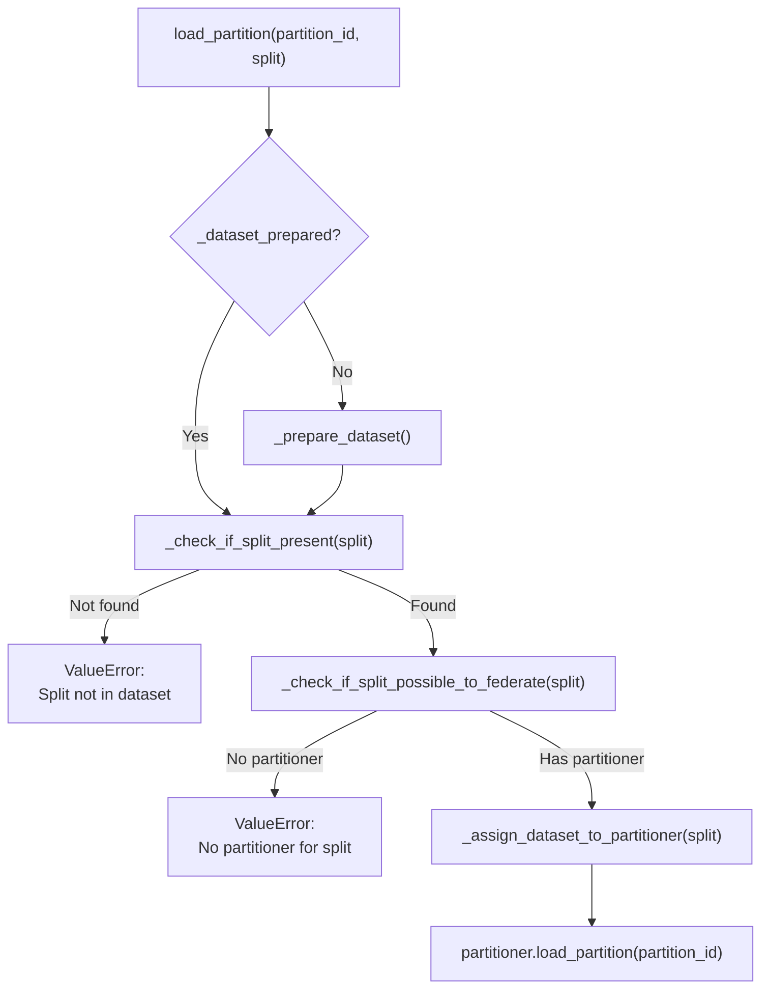

<!-- source: DeepWiki mcp.deepwiki.com · repo adap/flower · page 4.1 FederatedDataset API · fetched 2026-10-21 -->

# FederatedDataset API

<details>
<summary>Relevant source files</summary>

The following files were used as context for generating this wiki page:

- [datasets/flwr_datasets/__init__.py](datasets/flwr_datasets/__init__.py)
- [datasets/flwr_datasets/common/telemetry.py](datasets/flwr_datasets/common/telemetry.py)
- [datasets/flwr_datasets/common/telemetry_test.py](datasets/flwr_datasets/common/telemetry_test.py)
- [datasets/flwr_datasets/common/version.py](datasets/flwr_datasets/common/version.py)
- [datasets/flwr_datasets/federated_dataset.py](datasets/flwr_datasets/federated_dataset.py)
- [datasets/flwr_datasets/federated_dataset_test.py](datasets/flwr_datasets/federated_dataset_test.py)
- [datasets/flwr_datasets/metrics/__init__.py](datasets/flwr_datasets/metrics/__init__.py)
- [datasets/flwr_datasets/metrics/utils.py](datasets/flwr_datasets/metrics/utils.py)
- [datasets/flwr_datasets/metrics/utils_test.py](datasets/flwr_datasets/metrics/utils_test.py)
- [datasets/flwr_datasets/mock_utils_test.py](datasets/flwr_datasets/mock_utils_test.py)
- [datasets/flwr_datasets/partitioner/id_to_size_fnc_partitioner.py](datasets/flwr_datasets/partitioner/id_to_size_fnc_partitioner.py)
- [datasets/flwr_datasets/preprocessor/__init__.py](datasets/flwr_datasets/preprocessor/__init__.py)
- [datasets/flwr_datasets/preprocessor/divider.py](datasets/flwr_datasets/preprocessor/divider.py)
- [datasets/flwr_datasets/preprocessor/divider_test.py](datasets/flwr_datasets/preprocessor/divider_test.py)
- [datasets/flwr_datasets/preprocessor/merger.py](datasets/flwr_datasets/preprocessor/merger.py)
- [datasets/flwr_datasets/preprocessor/merger_test.py](datasets/flwr_datasets/preprocessor/merger_test.py)
- [datasets/flwr_datasets/preprocessor/preprocessor.py](datasets/flwr_datasets/preprocessor/preprocessor.py)
- [datasets/flwr_datasets/utils.py](datasets/flwr_datasets/utils.py)
- [datasets/flwr_datasets/utils_test.py](datasets/flwr_datasets/utils_test.py)
- [datasets/flwr_datasets/visualization/__init__.py](datasets/flwr_datasets/visualization/__init__.py)
- [datasets/flwr_datasets/visualization/bar_plot.py](datasets/flwr_datasets/visualization/bar_plot.py)
- [datasets/flwr_datasets/visualization/comparison_label_distribution.py](datasets/flwr_datasets/visualization/comparison_label_distribution.py)
- [datasets/flwr_datasets/visualization/constants.py](datasets/flwr_datasets/visualization/constants.py)
- [datasets/flwr_datasets/visualization/heatmap_plot.py](datasets/flwr_datasets/visualization/heatmap_plot.py)
- [datasets/flwr_datasets/visualization/label_distribution.py](datasets/flwr_datasets/visualization/label_distribution.py)
- [datasets/flwr_datasets/visualization/utils.py](datasets/flwr_datasets/visualization/utils.py)
- [datasets/pyproject.toml](datasets/pyproject.toml)
- [framework/pyproject.toml](framework/pyproject.toml)

</details>


## Purpose and Scope

This document describes the `FederatedDataset` class, the primary API for loading and partitioning datasets in Flower Datasets. `FederatedDataset` provides a unified interface for downloading datasets from Hugging Face Hub, applying preprocessing transformations, partitioning data across federated clients, and loading individual partitions or full splits.

For details on partitioning strategies (IID, Dirichlet, etc.), see [Partitioning Strategies](#4.2). For information on data preprocessing and visualization utilities, see [Data Preprocessing and Visualization](#4.3).

**Sources:** [datasets/flwr_datasets/federated_dataset.py:1-352](), [datasets/flwr_datasets/__init__.py:1-35]()

---

## Class Architecture

The `FederatedDataset` class orchestrates the entire data pipeline from download to partition access. It follows a lazy loading pattern where datasets are only downloaded and prepared when first accessed via `load_partition()` or `load_split()`.

### FederatedDataset Initialization Flow



**Sources:** [datasets/flwr_datasets/federated_dataset.py:107-138](), [datasets/flwr_datasets/utils.py:59-104]()

---

## Initialization Parameters

The `FederatedDataset` constructor accepts the following parameters:

| Parameter | Type | Description |
|-----------|------|-------------|
| `dataset` | `str` | Name of dataset in Hugging Face Hub (e.g., "cifar10", "mnist") |
| `subset` | `str \| None` | Optional subset/version name (passed to `datasets.load_dataset`) |
| `preprocessor` | `Preprocessor \| dict \| None` | Callable for transforming `DatasetDict` or config dict for `Merger` |
| `partitioners` | `dict[str, Partitioner \| int]` | Mapping of split names to `Partitioner` objects or integers for IID partitioning |
| `shuffle` | `bool` | Whether to randomize sample order before preprocessing (default: `True`) |
| `seed` | `int \| None` | Random seed for shuffling (default: `42`) |
| `**load_dataset_kwargs` | `Any` | Additional arguments passed to `datasets.load_dataset()` |

### Partitioners Parameter

The `partitioners` parameter supports two formats:

1. **Integer shorthand**: `{"train": 100}` creates an `IidPartitioner` with 100 partitions
2. **Explicit Partitioner**: `{"train": DirichletPartitioner(num_partitions=10, alpha=0.5)}`

Multiple splits can be partitioned independently:
```python
partitioners = {
    "train": 100,  # IID with 100 partitions
    "test": DirichletPartitioner(num_partitions=50, alpha=0.3)
}
```

**Important:** Each split must use a distinct `Partitioner` object instance. Reusing the same object raises a `ValueError`.

**Sources:** [datasets/flwr_datasets/federated_dataset.py:39-72](), [datasets/flwr_datasets/utils.py:59-94](), [datasets/flwr_datasets/federated_dataset.py:336-351]()

---

## Lazy Loading Pattern

`FederatedDataset` implements lazy initialization to avoid unnecessary downloads and processing. The dataset is only prepared when `load_partition()`, `load_split()`, or `partitioners` property is first accessed.

### Data Preparation Lifecycle



**Sources:** [datasets/flwr_datasets/federated_dataset.py:139-196](), [datasets/flwr_datasets/federated_dataset.py:288-327]()

---

## Core Methods

### load_partition()

Loads a single partition from a specified split.

**Signature:**
```python
def load_partition(
    self,
    partition_id: int,
    split: str | None = None,
) -> Dataset
```

**Parameters:**
- `partition_id`: Partition index (0 to num_partitions - 1)
- `split`: Name of the split to load from. Optional if only one partitioner is configured.

**Behavior:**
1. Triggers `_prepare_dataset()` if not already prepared
2. Validates split name exists in dataset
3. Validates split has a corresponding partitioner
4. Assigns dataset split to partitioner if not already assigned
5. Calls `partitioner.load_partition(partition_id)`
6. Emits telemetry event on first call per split

**Example:**
```python
fds = FederatedDataset(dataset="cifar10", partitioners={"train": 100})
partition = fds.load_partition(partition_id=42, split="train")
# or omit split if only one partitioner:
partition = fds.load_partition(42)
```

**Sources:** [datasets/flwr_datasets/federated_dataset.py:139-195]()

---

### load_split()

Loads a complete split without partitioning.

**Signature:**
```python
def load_split(self, split: str) -> Dataset
```

**Parameters:**
- `split`: Name of the split (e.g., "train", "test")

**Behavior:**
1. Triggers `_prepare_dataset()` if not already prepared
2. Validates split exists in dataset
3. Returns the full split
4. Emits telemetry event on first call per split

**Example:**
```python
fds = FederatedDataset(dataset="mnist", partitioners={"train": 10})
test_data = fds.load_split("test")  # Full test set
```

**Sources:** [datasets/flwr_datasets/federated_dataset.py:197-236]()

---

### partitioners Property

Returns a dictionary mapping split names to their assigned `Partitioner` objects with datasets already assigned.

**Signature:**
```python
@property
def partitioners(self) -> dict[str, Partitioner]
```

**Behavior:**
1. Triggers `_prepare_dataset()` if not already prepared
2. Assigns dataset splits to all partitioners
3. Returns dictionary of partitioners ready for use

**Usage:**
```python
fds = FederatedDataset(dataset="cifar10", partitioners={"train": 100})
partitioner = fds.partitioners["train"]
num_partitions = partitioner.num_partitions  # 100
```

**Sources:** [datasets/flwr_datasets/federated_dataset.py:238-255]()

---

## Integration with Hugging Face Datasets

`FederatedDataset` is built on top of the Hugging Face `datasets` library, using `datasets.load_dataset()` internally.

### Dataset Loading Configuration



**Additional kwargs** passed through `load_dataset_kwargs` include:
- `num_proc`: Number of processes for parallel loading
- `trust_remote_code`: Allow custom dataset loading scripts
- `cache_dir`: Custom cache location

**Type Validation:** If `load_dataset_kwargs` causes `datasets.load_dataset()` to return anything other than `DatasetDict` (e.g., passing `split="train"` returns a single `Dataset`), a `ValueError` is raised.

**Sources:** [datasets/flwr_datasets/federated_dataset.py:309-318]()

---

## Preprocessing Pipeline

Before partitioning, datasets can be transformed using the `preprocessor` parameter. This enables split renaming, merging, and dividing.

### Preprocessor Types

| Preprocessor | Input Format | Purpose |
|--------------|--------------|---------|
| `Merger` | `dict[str, tuple[str, ...]]` | Combine multiple splits into new splits |
| `Divider` | `dict[str, float/int]` | Split a single split into sub-splits |
| Custom Callable | `Callable[[DatasetDict], DatasetDict]` | Any custom transformation |

### Preprocessing Execution Order



### Example: Using Merger

```python
# Merge train and validation into single split
fds = FederatedDataset(
    dataset="mnist",
    partitioners={"full": 100},
    preprocessor={"full": ("train", "test")}  # Auto-creates Merger
)
```

### Example: Custom Preprocessor

```python
def custom_preprocessor(dataset_dict: DatasetDict) -> DatasetDict:
    # Custom transformation logic
    return DatasetDict({
        "combined": concatenate_datasets([
            dataset_dict["train"],
            dataset_dict["test"]
        ])
    })

fds = FederatedDataset(
    dataset="cifar10",
    partitioners={"combined": 50},
    preprocessor=custom_preprocessor
)
```

**Sources:** [datasets/flwr_datasets/federated_dataset.py:46-50](), [datasets/flwr_datasets/federated_dataset.py:319-324](), [datasets/flwr_datasets/utils.py:97-103]()

---

## Shuffling Behavior

Shuffling occurs **before** preprocessing to prevent data leakage issues.

### Why Shuffle Before Preprocessing?

If a dataset has ordered samples (e.g., all class 0 first, then class 1), and you split without shuffling:
- Original: `train=[class0, class1]`, `test=[class2]`
- After split: `new_train=train[:75%]` gets only class 0 samples
- Result: Class imbalance in new splits

**Solution:** Shuffle first, then preprocess.

**Configuration:**
```python
fds = FederatedDataset(
    dataset="mnist",
    partitioners={"train": 10},
    shuffle=True,  # Default
    seed=42        # Reproducibility
)
```

**Sources:** [datasets/flwr_datasets/federated_dataset.py:58-66](), [datasets/flwr_datasets/federated_dataset.py:298-307]()

---

## Utility Functions

### divide_dataset()

Divides a single `Dataset` into multiple parts.

**Signature:**
```python
def divide_dataset(
    dataset: Dataset,
    division: list[float] | tuple[float, ...] | dict[str, float]
) -> list[Dataset] | DatasetDict
```

**Parameters:**
- `dataset`: Dataset to divide
- `division`: Fractions as list/tuple or named dict

**Returns:**
- `list[Dataset]` if division is list/tuple
- `DatasetDict` if division is dict

**Examples:**
```python
from flwr_datasets import FederatedDataset
from flwr_datasets.utils import divide_dataset

fds = FederatedDataset(dataset="mnist", partitioners={"train": 10})
partition = fds.load_partition(0)

# List format
train, valid = divide_dataset(partition, [0.8, 0.2])

# Dict format
splits = divide_dataset(partition, {"train": 0.8, "valid": 0.2})
train, valid = splits["train"], splits["valid"]
```

**Sources:** [datasets/flwr_datasets/utils.py:106-168]()

---

### concatenate_divisions()

Creates a centralized dataset by concatenating divisions from all partitions.

**Signature:**
```python
def concatenate_divisions(
    partitioner: Partitioner,
    partition_division: list[float] | tuple[float, ...] | dict[str, float],
    division_id: int | str,
) -> Dataset
```

**Use Case:** Create a centralized test set from on-edge validation data.

**Example:**
```python
from flwr_datasets import FederatedDataset
from flwr_datasets.utils import concatenate_divisions

fds = FederatedDataset(dataset="cifar10", partitioners={"train": 100})

# Each client: 80% train, 20% validation
# Concatenate all validation divisions into centralized set
centralized_valid = concatenate_divisions(
    partitioner=fds.partitioners["train"],
    partition_division=[0.8, 0.2],
    division_id=1  # Index 1 = validation
)
```

**Sources:** [datasets/flwr_datasets/utils.py:263-357]()

---

## Internal State Management

### State Variables

| Variable | Type | Purpose |
|----------|------|---------|
| `_dataset_name` | `str` | Hugging Face dataset identifier |
| `_subset` | `str \| None` | Dataset subset/version |
| `_preprocessor` | `Preprocessor \| None` | Transformation function |
| `_partitioners` | `dict[str, Partitioner]` | Split → Partitioner mapping |
| `_shuffle` | `bool` | Whether to shuffle |
| `_seed` | `int \| None` | Random seed |
| `_dataset` | `DatasetDict \| None` | Loaded dataset (None until prepared) |
| `_dataset_prepared` | `bool` | Whether `_prepare_dataset()` has run |
| `_event` | `dict` | Telemetry tracking per split |
| `_load_dataset_kwargs` | `dict` | Extra kwargs for `load_dataset()` |

**Sources:** [datasets/flwr_datasets/federated_dataset.py:118-137]()

---

## Validation and Error Handling

### Split Validation



**Error Scenarios:**
1. **Split not in dataset**: Raised if requested split doesn't exist after preprocessing
2. **No partitioner for split**: Raised if split has no corresponding partitioner
3. **Same partitioner for multiple splits**: Raised at initialization
4. **Wrong return type from load_dataset**: Raised if kwargs cause non-DatasetDict return

**Sources:** [datasets/flwr_datasets/federated_dataset.py:257-276](), [datasets/flwr_datasets/federated_dataset.py:336-351]()

---

## Telemetry Events

`FederatedDataset` emits telemetry events for usage analytics (can be disabled via `FLWR_TELEMETRY_ENABLED=0`):

**Events:**
- `LOAD_PARTITION_CALLED`: First `load_partition()` call per split
- `LOAD_SPLIT_CALLED`: First `load_split()` call per split

**Event Data:**
```python
{
    "federated_dataset_id": id(self),
    "dataset_name": "cifar10",
    "split": "train",
    "partitioner": "DirichletPartitioner",
    "num_partitions": 100
}
```

**Sources:** [datasets/flwr_datasets/federated_dataset.py:183-194](), [datasets/flwr_datasets/federated_dataset.py:225-234](), [datasets/flwr_datasets/common/telemetry.py:108-126]()

---

## Complete Usage Example

```python
from flwr_datasets import FederatedDataset
from flwr_datasets.partitioner import DirichletPartitioner

# Initialize with custom partitioner
partitioner = DirichletPartitioner(
    num_partitions=20,
    partition_by="label",
    alpha=0.5,
    min_partition_size=10
)

fds = FederatedDataset(
    dataset="cifar10",
    partitioners={"train": partitioner},
    shuffle=True,
    seed=42
)

# Load partition for client 0
partition_0 = fds.load_partition(0, "train")

# Load full test split for centralized evaluation
test_data = fds.load_split("test")

# Access partitioner properties
num_partitions = fds.partitioners["train"].num_partitions
```

**Sources:** [datasets/flwr_datasets/federated_dataset.py:73-104]()

---

