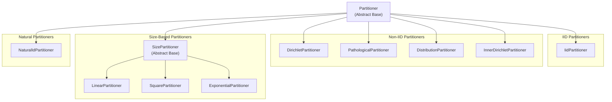
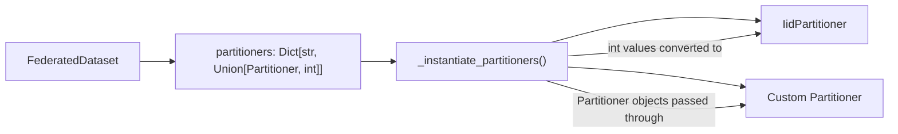
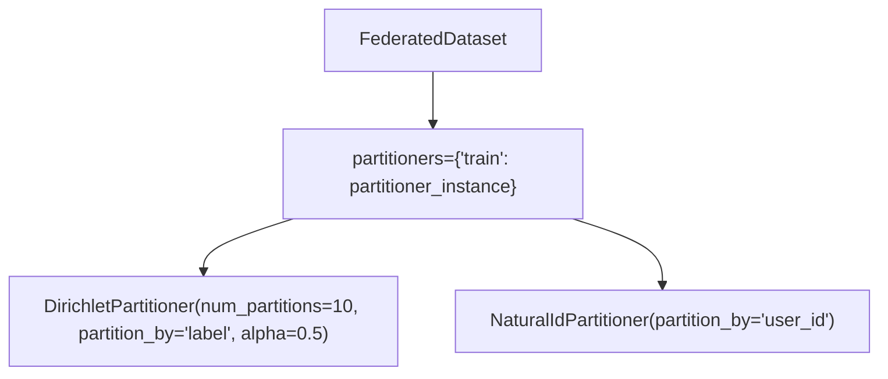
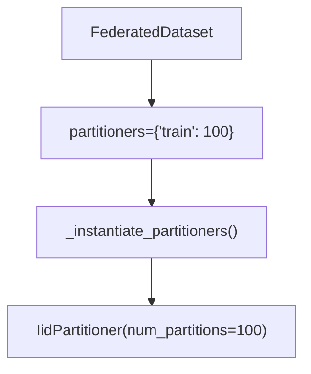
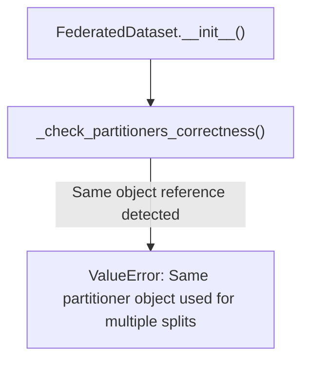
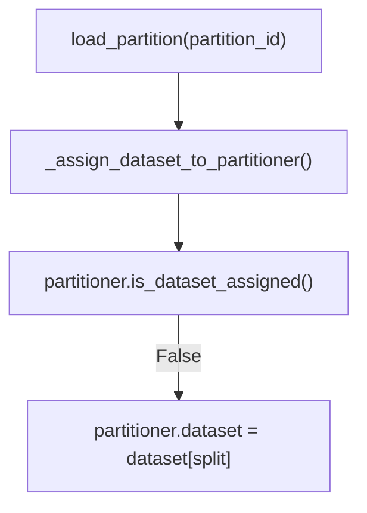
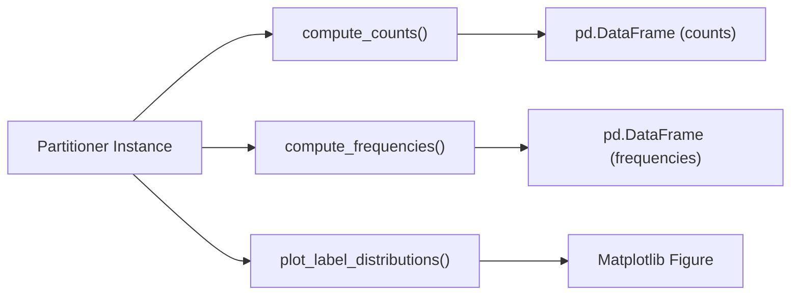

<!-- source: DeepWiki mcp.deepwiki.com · repo adap/flower · page 4.2 Partitioning Strategies · fetched 2026-10-21 -->

# Partitioning Strategies

Relevant source files

The following files were used as context for generating this wiki page:

- [datasets/flwr_datasets/__init__.py](datasets/flwr_datasets/__init__.py)
- [datasets/flwr_datasets/common/telemetry.py](datasets/flwr_datasets/common/telemetry.py)
- [datasets/flwr_datasets/common/telemetry_test.py](datasets/flwr_datasets/common/telemetry_test.py)
- [datasets/flwr_datasets/common/version.py](datasets/flwr_datasets/common/version.py)
- [datasets/flwr_datasets/federated_dataset.py](datasets/flwr_datasets/federated_dataset.py)
- [datasets/flwr_datasets/federated_dataset_test.py](datasets/flwr_datasets/federated_dataset_test.py)
- [datasets/flwr_datasets/metrics/__init__.py](datasets/flwr_datasets/metrics/__init__.py)
- [datasets/flwr_datasets/metrics/utils.py](datasets/flwr_datasets/metrics/utils.py)
- [datasets/flwr_datasets/metrics/utils_test.py](datasets/flwr_datasets/metrics/utils_test.py)
- [datasets/flwr_datasets/mock_utils_test.py](datasets/flwr_datasets/mock_utils_test.py)
- [datasets/flwr_datasets/partitioner/id_to_size_fnc_partitioner.py](datasets/flwr_datasets/partitioner/id_to_size_fnc_partitioner.py)
- [datasets/flwr_datasets/preprocessor/__init__.py](datasets/flwr_datasets/preprocessor/__init__.py)
- [datasets/flwr_datasets/preprocessor/divider.py](datasets/flwr_datasets/preprocessor/divider.py)
- [datasets/flwr_datasets/preprocessor/divider_test.py](datasets/flwr_datasets/preprocessor/divider_test.py)
- [datasets/flwr_datasets/preprocessor/merger.py](datasets/flwr_datasets/preprocessor/merger.py)
- [datasets/flwr_datasets/preprocessor/merger_test.py](datasets/flwr_datasets/preprocessor/merger_test.py)
- [datasets/flwr_datasets/preprocessor/preprocessor.py](datasets/flwr_datasets/preprocessor/preprocessor.py)
- [datasets/flwr_datasets/utils.py](datasets/flwr_datasets/utils.py)
- [datasets/flwr_datasets/utils_test.py](datasets/flwr_datasets/utils_test.py)
- [datasets/flwr_datasets/visualization/__init__.py](datasets/flwr_datasets/visualization/__init__.py)
- [datasets/flwr_datasets/visualization/bar_plot.py](datasets/flwr_datasets/visualization/bar_plot.py)
- [datasets/flwr_datasets/visualization/comparison_label_distribution.py](datasets/flwr_datasets/visualization/comparison_label_distribution.py)
- [datasets/flwr_datasets/visualization/constants.py](datasets/flwr_datasets/visualization/constants.py)
- [datasets/flwr_datasets/visualization/heatmap_plot.py](datasets/flwr_datasets/visualization/heatmap_plot.py)
- [datasets/flwr_datasets/visualization/label_distribution.py](datasets/flwr_datasets/visualization/label_distribution.py)
- [datasets/flwr_datasets/visualization/utils.py](datasets/flwr_datasets/visualization/utils.py)
- [datasets/pyproject.toml](datasets/pyproject.toml)
- [framework/pyproject.toml](framework/pyproject.toml)

This document explains the data partitioning strategies available in Flower Datasets for federated learning scenarios. Partitioning strategies determine how a dataset is divided among clients (edge devices) to simulate heterogeneous data distributions commonly found in federated learning environments.

For information about the main dataset management interface, see [FederatedDataset](#4.1). For visualization and analysis of partitioning results, see the visualization functions in the codebase.

## Overview

Data partitioning is a critical component in federated learning that simulates how data is naturally distributed across different clients in real-world scenarios. The Flower Datasets library provides a comprehensive set of partitioning strategies ranging from simple IID (Independent and Identically Distributed) partitioning to complex non-IID schemes that better reflect realistic data heterogeneity.

## Architecture and Core Components

The partitioning system is built around a hierarchical class structure with the abstract `Partitioner` class as the foundation:

**Partitioner Hierarchy and Specialization**

Sources: [datasets/README.md:39-52]()

### Integration with FederatedDataset

The partitioning strategies integrate with the main `FederatedDataset` class through the `partitioners` parameter, which accepts a dictionary mapping split names to partitioner configurations:

**Partitioner Integration Flow**

Sources: [datasets/flwr_datasets/federated_dataset.py:117](), [datasets/flwr_datasets/utils.py:59-94]()

## Partitioning Strategy Types

### IID Partitioning

The `IidPartitioner` provides uniform random distribution of data across all partitions. Each partition receives approximately the same number of samples with similar label distributions.

**Key Features:**
- Equal partition sizes (with minor variations due to rounding)
- Uniform label distribution across partitions
- Simplest partitioning strategy
- Default choice when integer values are provided to `partitioners`

Sources: [datasets/flwr_datasets/utils.py:79-82]()

### Non-IID Partitioning

#### Dirichlet Partitioning

`DirichletPartitioner` uses the Dirichlet distribution to create realistic heterogeneous data distributions. The `alpha` parameter controls the degree of heterogeneity:

- **High alpha (>1.0)**: More uniform distribution (approaching IID)
- **Low alpha (<1.0)**: Higher heterogeneity with some partitions having very few or no samples of certain classes
- **Very low alpha (<0.1)**: Extreme heterogeneity with most partitions containing only one or few classes

**Parameters:**
- `num_partitions`: Number of partitions to create
- `partition_by`: Column name to partition by (typically labels)
- `alpha`: Concentration parameter controlling heterogeneity
- `min_partition_size`: Minimum samples per partition

Sources: [datasets/README.md:43]()

#### Pathological Partitioning

`PathologicalPartitioner` creates partitions where each partition contains only a limited number of classes, simulating scenarios where clients have access to only specific categories of data.

**Parameters:**
- `num_partitions`: Number of partitions
- `partition_by`: Column for partitioning
- `num_classes_per_partition`: Maximum classes per partition
- `class_assignment_mode`: Strategy for assigning classes to partitions

Sources: [datasets/README.md:46]()

### Natural ID Partitioning

`NaturalIdPartitioner` groups data based on existing natural identifiers in the dataset (e.g., user IDs, device IDs, or other categorical variables that naturally segment the data).

**Use Cases:**
- Datasets with user IDs where each partition represents a different user
- Datasets with speaker IDs for speech recognition tasks
- Any scenario where natural groupings exist in the data

Sources: [datasets/README.md:47](), [datasets/flwr_datasets/federated_dataset_test.py:490-501]()

### Size-Based Partitioning

Size-based partitioners create partitions with specific size distributions:

#### Linear Partitioning
- `LinearPartitioner`: Partition sizes increase linearly
- First partition gets smallest size, last partition gets largest size

#### Square Partitioning  
- `SquarePartitioner`: Partition sizes follow quadratic growth
- Creates more dramatic size differences between partitions

#### Exponential Partitioning
- `ExponentialPartitioner`: Partition sizes grow exponentially
- Results in highly unbalanced partition sizes

Sources: [datasets/README.md:49-51]()

## Partitioner Configuration and Usage

### Direct Partitioner Configuration

**Direct Partitioner Object Configuration**

### Integer Shorthand Configuration

**Integer Shorthand Automatically Creates IidPartitioner**

Sources: [datasets/flwr_datasets/utils.py:79-82]()

## Partitioner Validation and Error Handling

The system includes several validation mechanisms to ensure correct partitioner usage:

### Duplicate Partitioner Prevention

The `FederatedDataset` class validates that the same partitioner object is not used for multiple splits:

**Partitioner Object Validation Flow**

Sources: [datasets/flwr_datasets/federated_dataset.py:341-356]()

### Dataset Assignment Validation

Partitioners must be assigned a dataset before they can load partitions:

**Dataset Assignment Validation**

Sources: [datasets/flwr_datasets/federated_dataset.py:283-291]()

## Metrics and Visualization

The partitioning system integrates with metrics and visualization components to analyze partition quality:

### Partition Analysis Functions

**Partition Analysis and Visualization Pipeline**

Sources: [datasets/flwr_datasets/metrics/utils.py:26-85](), [datasets/flwr_datasets/visualization/label_distribution.py:35-51]()

### Comparison Visualization

Multiple partitioners can be compared using `plot_comparison_label_distribution()`:

Sources: [datasets/flwr_datasets/visualization/comparison_label_distribution.py:34-50]()

## Implementation Details

### Partitioner Instantiation Process

The `_instantiate_partitioners()` function handles the conversion of mixed partitioner specifications:

| Input Type | Output | Process |
|------------|--------|---------|
| `Partitioner` object | Same object | Direct pass-through |
| `int` value | `IidPartitioner(num_partitions=int)` | Automatic instantiation |
| Invalid type | `ValueError` | Type validation error |

Sources: [datasets/flwr_datasets/utils.py:59-94]()

### Lazy Dataset Assignment

Partitioners use lazy loading where the dataset is only assigned when first accessed:

1. `FederatedDataset` instantiation validates partitioner specifications
2. Dataset download and preprocessing occurs on first `load_partition()` or `load_split()` call  
3. Partitioners receive dataset assignment only when needed
4. Subsequent calls reuse the assigned dataset

Sources: [datasets/flwr_datasets/federated_dataset.py:283-291]()

---

