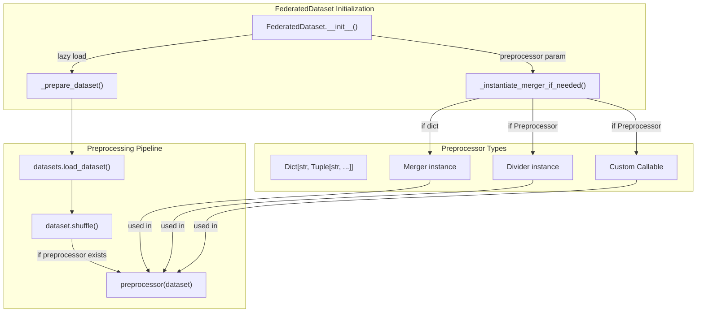
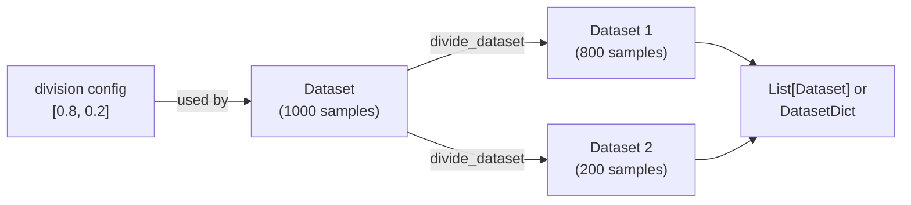
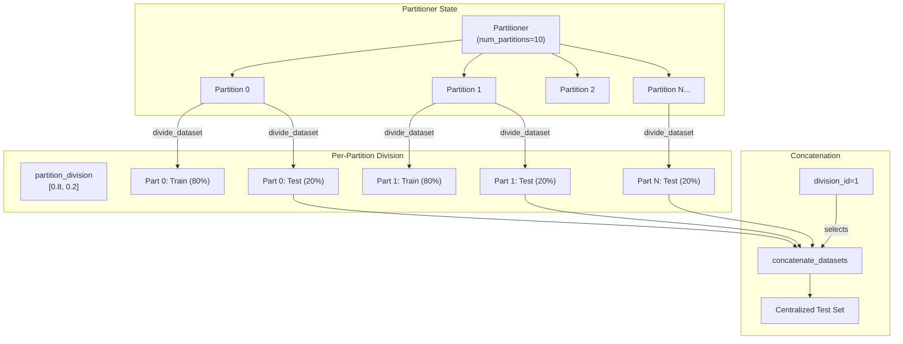
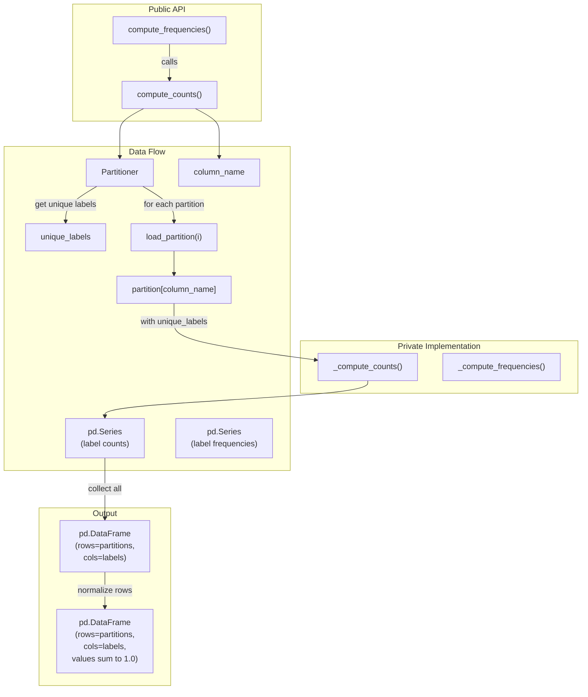
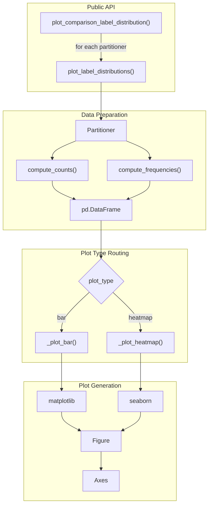
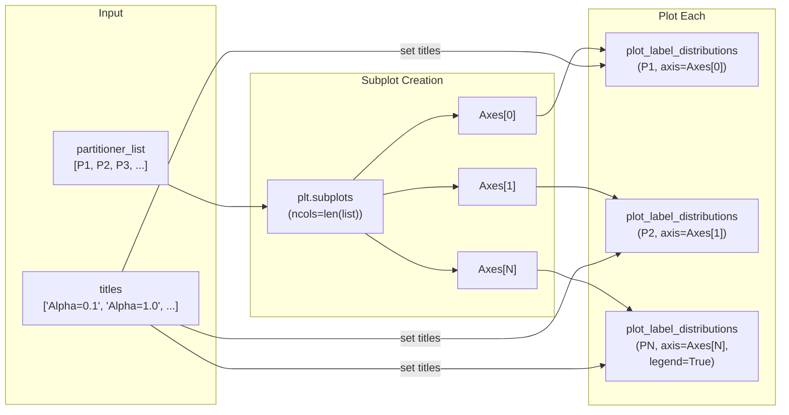

<!-- source: DeepWiki mcp.deepwiki.com · repo adap/flower · page 4.3 Data Preprocessing and Visualization · fetched 2026-10-21 -->

# Data Preprocessing and Visualization

<details>
<summary>Relevant source files</summary>

The following files were used as context for generating this wiki page:

- [datasets/flwr_datasets/__init__.py](datasets/flwr_datasets/__init__.py)
- [datasets/flwr_datasets/common/telemetry.py](datasets/flwr_datasets/common/telemetry.py)
- [datasets/flwr_datasets/common/telemetry_test.py](datasets/flwr_datasets/common/telemetry_test.py)
- [datasets/flwr_datasets/common/version.py](datasets/flwr_datasets/common/version.py)
- [datasets/flwr_datasets/federated_dataset.py](datasets/flwr_datasets/federated_dataset.py)
- [datasets/flwr_datasets/federated_dataset_test.py](datasets/flwr_datasets/federated_dataset_test.py)
- [datasets/flwr_datasets/metrics/__init__.py](datasets/flwr_datasets/metrics/__init__.py)
- [datasets/flwr_datasets/metrics/utils.py](datasets/flwr_datasets/metrics/utils.py)
- [datasets/flwr_datasets/metrics/utils_test.py](datasets/flwr_datasets/metrics/utils_test.py)
- [datasets/flwr_datasets/mock_utils_test.py](datasets/flwr_datasets/mock_utils_test.py)
- [datasets/flwr_datasets/partitioner/id_to_size_fnc_partitioner.py](datasets/flwr_datasets/partitioner/id_to_size_fnc_partitioner.py)
- [datasets/flwr_datasets/preprocessor/__init__.py](datasets/flwr_datasets/preprocessor/__init__.py)
- [datasets/flwr_datasets/preprocessor/divider.py](datasets/flwr_datasets/preprocessor/divider.py)
- [datasets/flwr_datasets/preprocessor/divider_test.py](datasets/flwr_datasets/preprocessor/divider_test.py)
- [datasets/flwr_datasets/preprocessor/merger.py](datasets/flwr_datasets/preprocessor/merger.py)
- [datasets/flwr_datasets/preprocessor/merger_test.py](datasets/flwr_datasets/preprocessor/merger_test.py)
- [datasets/flwr_datasets/preprocessor/preprocessor.py](datasets/flwr_datasets/preprocessor/preprocessor.py)
- [datasets/flwr_datasets/utils.py](datasets/flwr_datasets/utils.py)
- [datasets/flwr_datasets/utils_test.py](datasets/flwr_datasets/utils_test.py)
- [datasets/flwr_datasets/visualization/__init__.py](datasets/flwr_datasets/visualization/__init__.py)
- [datasets/flwr_datasets/visualization/bar_plot.py](datasets/flwr_datasets/visualization/bar_plot.py)
- [datasets/flwr_datasets/visualization/comparison_label_distribution.py](datasets/flwr_datasets/visualization/comparison_label_distribution.py)
- [datasets/flwr_datasets/visualization/constants.py](datasets/flwr_datasets/visualization/constants.py)
- [datasets/flwr_datasets/visualization/heatmap_plot.py](datasets/flwr_datasets/visualization/heatmap_plot.py)
- [datasets/flwr_datasets/visualization/label_distribution.py](datasets/flwr_datasets/visualization/label_distribution.py)
- [datasets/flwr_datasets/visualization/utils.py](datasets/flwr_datasets/visualization/utils.py)
- [datasets/pyproject.toml](datasets/pyproject.toml)
- [framework/pyproject.toml](framework/pyproject.toml)

</details>


This page documents the data preprocessing and visualization capabilities in the `flwr-datasets` package. These tools allow users to transform `DatasetDict` objects by merging or dividing splits, compute metrics on partitioned data, and visualize label distributions across partitions. For information about the core `FederatedDataset` class and how to load partitions, see [FederatedDataset API](#4.1). For details on partitioning strategies, see [Partitioning Strategies](#4.2).

## Preprocessor Architecture

The preprocessing system provides a flexible way to transform `DatasetDict` objects before partitioning. All preprocessors implement the `Preprocessor` protocol, which is a callable that takes a `DatasetDict` and returns a transformed `DatasetDict`.

### Preprocessor Protocol

The `Preprocessor` type is defined as a callable protocol:

```python
Preprocessor = Callable[[DatasetDict], DatasetDict]
```

This allows users to either use built-in preprocessors (`Merger`, `Divider`) or provide custom functions that transform datasets.

**Sources:** [datasets/flwr_datasets/preprocessor/preprocessor.py:1-23]()

### Preprocessor Integration with FederatedDataset



**Sources:** [datasets/flwr_datasets/federated_dataset.py:107-138](), [datasets/flwr_datasets/federated_dataset.py:288-328](), [datasets/flwr_datasets/utils.py:97-103]()

### Merger Preprocessor

The `Merger` class combines multiple existing splits into new splits with custom names. It accepts a configuration dictionary where keys are new split names and values are tuples of existing split names to merge.

**Class:** `Merger`

**Key Methods:**
- `__init__(merge_config: Dict[str, Tuple[str, ...]])` - Initialize with merge configuration
- `__call__(dataset: DatasetDict) -> DatasetDict` - Execute the merge operation
- `resplit(dataset: DatasetDict) -> DatasetDict` - Perform the actual resplitting

**Configuration Format:**

| Key (New Split) | Value (Original Splits) | Result |
|----------------|-------------------------|--------|
| `"new_train"` | `("train", "valid")` | Concatenates train and valid into new_train |
| `"test"` | `("test",)` | Renames test to test (no-op) |

**Example Usage:**

```python
# Create a merger that combines train and valid splits
merger = Merger(merge_config={
    "new_train": ("train", "valid"),
    "test": ("test",)
})
# Apply to dataset
new_dataset = merger(dataset_dict)
```

**Validation Checks:**
- Ensures all referenced split names exist in the dataset [datasets/flwr_datasets/preprocessor/merger.py:83-94]()
- Warns if the same original split is used multiple times [datasets/flwr_datasets/preprocessor/merger.py:96-109]()

**Sources:** [datasets/flwr_datasets/preprocessor/merger.py:1-110]()

### Divider Preprocessor

The `Divider` class splits existing splits into multiple new splits based on fractional or absolute sizes. It supports both single-split and multi-split configurations.

**Class:** `Divider`

**Key Methods:**
- `__init__(divide_config, divide_split, drop_remaining_splits)` - Initialize with division configuration
- `__call__(dataset: DatasetDict) -> DatasetDict` - Execute the division operation
- `resplit(dataset: DatasetDict) -> DatasetDict` - Perform the actual resplitting

**Configuration Types:**

1. **Single-Split Configuration** (with `divide_split` parameter):
```python
divide_config = {"train": 0.8, "valid": 0.2}
divide_split = "train"
# Divides the "train" split into two parts: 80% and 20%
```

2. **Multi-Split Configuration** (nested dictionary):
```python
divide_config = {
    "train": {"train_1": 0.8, "train_2": 0.2},
    "test": {"test_a": 0.5, "test_b": 0.5}
}
# Divides both train and test splits
```

**Size Specification:**

| Type | Example | Interpretation |
|------|---------|----------------|
| `float` | `0.8` | 80% of the split |
| `int` | `1000` | Exactly 1000 samples |

**Parameters:**
- `divide_config` - Configuration specifying how to divide splits
- `divide_split` - Name of split to divide (for single-split config only)
- `drop_remaining_splits` - Whether to drop splits that aren't divided (default: `False`)

**Validation:**
- Checks that fractions sum to ≤ 1.0 [datasets/flwr_datasets/preprocessor/divider.py:266-275]()
- Ensures integer sizes don't exceed dataset length [datasets/flwr_datasets/preprocessor/divider.py:277-292]()
- Prevents creation of empty datasets [datasets/flwr_datasets/preprocessor/divider.py:194-200]()
- Detects duplicate split names [datasets/flwr_datasets/preprocessor/divider.py:207-226]()

**Sources:** [datasets/flwr_datasets/preprocessor/divider.py:1-384]()

## Dataset Division Utilities

The `flwr_datasets.utils` module provides utility functions for dividing datasets on a per-partition basis and for aggregating divisions across partitions.

### divide_dataset Function

The `divide_dataset` function divides a single `Dataset` into multiple parts based on fractions or absolute sizes.



**Function Signature:**
```python
def divide_dataset(
    dataset: Dataset,
    division: Union[List[float], Tuple[float, ...], Dict[str, float]]
) -> Union[List[Dataset], DatasetDict]
```

**Parameters:**
- `dataset` - The dataset to divide
- `division` - Configuration as list/tuple (returns `List[Dataset]`) or dict (returns `DatasetDict`)

**Return Types:**

| Division Type | Return Type | Example |
|--------------|-------------|---------|
| `List[float]` | `List[Dataset]` | `[0.8, 0.2]` → `[train_ds, test_ds]` |
| `Tuple[float, ...]` | `List[Dataset]` | `(0.6, 0.2, 0.2)` → `[train, valid, test]` |
| `Dict[str, float]` | `DatasetDict` | `{"train": 0.8, "test": 0.2}` → `DatasetDict` |

**Validation:**
- All fractions must be > 0 and ≤ 1 [datasets/flwr_datasets/utils.py:222-226]()
- Sum of fractions must not exceed 1.0 [datasets/flwr_datasets/utils.py:228-229]()
- Warns if sum < 1.0 (unused data) [datasets/flwr_datasets/utils.py:230-236]()

**Sources:** [datasets/flwr_datasets/utils.py:106-168]()

### concatenate_divisions Function

The `concatenate_divisions` function creates a centralized dataset by concatenating specific divisions from all partitions. This is useful for creating centralized test sets from federated on-edge test sets.



**Function Signature:**
```python
def concatenate_divisions(
    partitioner: Partitioner,
    partition_division: Union[List[float], Tuple[float, ...], Dict[str, float]],
    division_id: Union[int, str]
) -> Dataset
```

**Parameters:**
- `partitioner` - Partitioner with assigned dataset
- `partition_division` - How to divide each partition
- `division_id` - Which division to extract (`int` for list/tuple, `str` for dict)

**Process:**
1. Iterate through all partitions in the partitioner [datasets/flwr_datasets/utils.py:326-327]()
2. Load each partition [datasets/flwr_datasets/utils.py:327]()
3. Divide the partition using `divide_dataset` [datasets/flwr_datasets/utils.py:334-338]()
4. Extract the specified division [datasets/flwr_datasets/utils.py:335-338]()
5. Concatenate all divisions [datasets/flwr_datasets/utils.py:357]()

**Validation:**
- Raises `ValueError` if all divisions are empty [datasets/flwr_datasets/utils.py:348-352]()
- Warns if some divisions are empty [datasets/flwr_datasets/utils.py:353-356]()

**Sources:** [datasets/flwr_datasets/utils.py:263-357]()

## Metrics Computation

The metrics module provides functions to compute statistics about label distributions across partitions.

### Metrics Computation Architecture



**Sources:** [datasets/flwr_datasets/metrics/utils.py:1-263]()

### compute_counts Function

Computes the absolute count of each unique value in a specified column across all partitions. Returns a DataFrame where rows represent partitions and columns represent unique labels.

**Function Signature:**
```python
def compute_counts(
    partitioner: Partitioner,
    column_name: str,
    verbose_names: bool = False,
    max_num_partitions: Optional[int] = None
) -> pd.DataFrame
```

**Parameters:**
- `partitioner` - Partitioner with assigned dataset
- `column_name` - Column to analyze (e.g., "label")
- `verbose_names` - Use human-readable names if column is `ClassLabel` type
- `max_num_partitions` - Limit number of partitions analyzed

**Return Value:**
A DataFrame with:
- Row index: Partition IDs (named "Partition ID")
- Column index: Unique label values (or verbose names)
- Values: Count of samples for each label in each partition

**Example Output:**

| Partition ID | airplane | automobile | bird | cat | ... |
|--------------|----------|------------|------|-----|-----|
| 0 | 120 | 95 | 10 | 5 | ... |
| 1 | 50 | 150 | 0 | 20 | ... |
| 2 | 200 | 10 | 5 | 5 | ... |

**Implementation Details:**
1. Extract unique labels from dataset [datasets/flwr_datasets/metrics/utils.py:98-106]()
2. For each partition, compute counts with zeros for missing labels [datasets/flwr_datasets/metrics/utils.py:109-113]()
3. Build DataFrame from partition-to-counts mapping [datasets/flwr_datasets/metrics/utils.py:115-118]()
4. Convert to verbose names if requested [datasets/flwr_datasets/metrics/utils.py:120-136]()

**Sources:** [datasets/flwr_datasets/metrics/utils.py:25-137]()

### compute_frequencies Function

Computes the relative frequency (proportion) of each unique value in a specified column across all partitions. Frequencies in each partition sum to 1.0.

**Function Signature:**
```python
def compute_frequencies(
    partitioner: Partitioner,
    column_name: str,
    verbose_names: bool = False,
    max_num_partitions: Optional[int] = None
) -> pd.DataFrame
```

**Parameters:** Same as `compute_counts`

**Return Value:**
A DataFrame with the same structure as `compute_counts`, but values are proportions (0.0 to 1.0) that sum to 1.0 per row.

**Example Output:**

| Partition ID | airplane | automobile | bird | cat | ... |
|--------------|----------|------------|------|-----|-----|
| 0 | 0.52 | 0.41 | 0.04 | 0.02 | ... |
| 1 | 0.23 | 0.68 | 0.00 | 0.09 | ... |
| 2 | 0.91 | 0.05 | 0.02 | 0.02 | ... |

**Implementation:**
1. Call `compute_counts` to get absolute counts [datasets/flwr_datasets/metrics/utils.py:200-202]()
2. Normalize each row to sum to 1.0 [datasets/flwr_datasets/metrics/utils.py:203]()

**Sources:** [datasets/flwr_datasets/metrics/utils.py:139-204]()

### Private Helper Functions

**_compute_counts:** Computes counts for a single partition's labels, ensuring all unique labels are represented (with zeros for missing labels).

**_compute_frequencies:** Converts counts to proportions by dividing by the total count. Handles empty partitions by returning all zeros.

**Sources:** [datasets/flwr_datasets/metrics/utils.py:207-262]()

## Visualization

The visualization module provides functions to plot label distributions across partitions, supporting both bar and heatmap visualizations.

### Visualization Architecture



**Sources:** [datasets/flwr_datasets/visualization/label_distribution.py:1-252](), [datasets/flwr_datasets/visualization/comparison_label_distribution.py:1-288]()

### plot_label_distributions Function

Creates a visualization of label distribution across partitions using either bar or heatmap plots.

**Function Signature:**
```python
def plot_label_distributions(
    partitioner: Partitioner,
    label_name: str,
    plot_type: str = "bar",
    size_unit: str = "absolute",
    max_num_partitions: Optional[int] = None,
    partition_id_axis: str = "x",
    axis: Optional[Axes] = None,
    figsize: Optional[Tuple[float, float]] = None,
    title: str = "Per Partition Label Distribution",
    cmap: Optional[Union[str, mcolors.Colormap]] = None,
    legend: bool = False,
    legend_title: Optional[str] = None,
    verbose_labels: bool = True,
    plot_kwargs: Optional[Dict[str, Any]] = None,
    legend_kwargs: Optional[Dict[str, Any]] = None
) -> Tuple[Figure, Axes, pd.DataFrame]
```

**Key Parameters:**

| Parameter | Type | Options | Description |
|-----------|------|---------|-------------|
| `plot_type` | `str` | `"bar"`, `"heatmap"` | Visualization type |
| `size_unit` | `str` | `"absolute"`, `"percent"` | Absolute counts or percentages |
| `partition_id_axis` | `str` | `"x"`, `"y"` | Axis for partition IDs |
| `max_num_partitions` | `int` | any positive int | Limit partitions displayed |
| `verbose_labels` | `bool` | `True`, `False` | Use human-readable label names |
| `legend` | `bool` | `True`, `False` | Display legend |

**Return Values:**
- `Figure` - Matplotlib figure object
- `Axes` - Matplotlib axes object with the plot
- `pd.DataFrame` - Data used to create the plot

**Plot Type Details:**

**Bar Plot:**
- Stacked bars showing label distribution per partition [datasets/flwr_datasets/visualization/bar_plot.py:82-88]()
- Default colormap: "RdYlGn" [datasets/flwr_datasets/visualization/bar_plot.py:62-63]()
- Legend positioned outside plot area [datasets/flwr_datasets/visualization/bar_plot.py:100-106]()
- Handles overlapping x-tick labels for many partitions [datasets/flwr_datasets/visualization/bar_plot.py:116-122]()

**Heatmap Plot:**
- Uses seaborn heatmap [datasets/flwr_datasets/visualization/heatmap_plot.py:78-83]()
- Default colormap: seaborn light palette "seagreen" [datasets/flwr_datasets/visualization/heatmap_plot.py:58]()
- Annotations controlled by `plot_kwargs["annot"]` [datasets/flwr_datasets/visualization/heatmap_plot.py:60-61]()
- Colorbar (legend) can be enabled/disabled [datasets/flwr_datasets/visualization/heatmap_plot.py:65-73]()

**Sources:** [datasets/flwr_datasets/visualization/label_distribution.py:35-252]()

### plot_comparison_label_distribution Function

Compares label distributions across multiple partitioners by creating side-by-side plots.

**Function Signature:**
```python
def plot_comparison_label_distribution(
    partitioner_list: List[Partitioner],
    label_name: Union[str, List[str]],
    plot_type: Literal["bar", "heatmap"] = "bar",
    size_unit: Literal["percent", "absolute"] = "percent",
    max_num_partitions: Optional[int] = 30,
    partition_id_axis: Literal["x", "y"] = "y",
    figsize: Optional[Tuple[float, float]] = None,
    subtitle: str = "Comparison of Per Partition Label Distribution",
    titles: Optional[List[str]] = None,
    cmap: Optional[Union[str, mcolors.Colormap]] = None,
    legend: bool = False,
    legend_title: Optional[str] = None,
    verbose_labels: bool = True,
    plot_kwargs_list: Optional[List[Optional[Dict[str, Any]]]] = None,
    legend_kwargs: Optional[Dict[str, Any]] = None
) -> Tuple[Figure, List[Axes], List[pd.DataFrame]]
```

**Key Features:**
- Creates subplot grid with one column per partitioner [datasets/flwr_datasets/visualization/comparison_label_distribution.py:156-162]()
- Shared axes for consistent scales [datasets/flwr_datasets/visualization/comparison_label_distribution.py:155-162]()
- Single legend shown on the last subplot [datasets/flwr_datasets/visualization/comparison_label_distribution.py:174-189]()
- Global x/y labels for the entire figure [datasets/flwr_datasets/visualization/comparison_label_distribution.py:215-220]()

**Comparison Logic:**



**Return Values:**
- `Figure` - Matplotlib figure containing all subplots
- `List[Axes]` - List of axes objects (one per partitioner)
- `List[pd.DataFrame]` - List of data DataFrames (one per partitioner)

**Axis Sharing Strategy:**
- For `size_unit="absolute"` and `partition_id_axis="x"`: shares y-axis [datasets/flwr_datasets/visualization/comparison_label_distribution.py:270]()
- For `size_unit="absolute"` and `partition_id_axis="y"`: shares x-axis [datasets/flwr_datasets/visualization/comparison_label_distribution.py:272]()
- For `size_unit="percent"`: no axis sharing (each subplot has 0-100% range)

**Sources:** [datasets/flwr_datasets/visualization/comparison_label_distribution.py:34-288]()

### Visualization Configuration

**Plot Type Constants:**
- Defined in [datasets/flwr_datasets/visualization/constants.py:1-20]()
- `PLOT_TYPES = ("bar", "heatmap")`
- `SIZE_UNITS = ("absolute", "percent")`
- `AXIS_TYPES = ("x", "y")`

**Parameter Validation:**
- Performed by `_validate_parameters()` [datasets/flwr_datasets/visualization/utils.py:21-37]()
- Raises `ValueError` for invalid values

**Default Figure Sizes:**

| Plot Type | Partition ID Axis | Formula |
|-----------|-------------------|---------|
| Bar | `x` | `(6.4, 4.8)` |
| Bar | `y` | `(6.4, sqrt(num_partitions))` |
| Heatmap | `x` | `(3*sqrt(num_partitions), sqrt(num_labels))` |
| Heatmap | `y` | `(3*sqrt(num_labels), sqrt(num_partitions))` |

**Sources:** [datasets/flwr_datasets/visualization/bar_plot.py:126-146](), [datasets/flwr_datasets/visualization/heatmap_plot.py:88-104]()

## Telemetry and Events

The visualization and preprocessing functions emit telemetry events to track usage patterns (with user opt-out via environment variable).

**Event Types:**
- `LOAD_PARTITION_CALLED` - Emitted when `load_partition()` is called [datasets/flwr_datasets/federated_dataset.py:184-194]()
- `LOAD_SPLIT_CALLED` - Emitted when `load_split()` is called [datasets/flwr_datasets/federated_dataset.py:225-234]()
- `PLOT_LABEL_DISTRIBUTION_CALLED` - Emitted when `plot_label_distributions()` is called [datasets/flwr_datasets/visualization/label_distribution.py:195-200]()
- `PLOT_COMPARISON_LABEL_DISTRIBUTION_CALLED` - Emitted when `plot_comparison_label_distribution()` is called [datasets/flwr_datasets/visualization/comparison_label_distribution.py:137-143]()

**Telemetry Control:**
- Controlled by environment variable `FLWR_TELEMETRY_ENABLED` (default: "1")
- Set to "0" to disable telemetry
- Events are sent asynchronously via `ThreadPoolExecutor` to avoid blocking [datasets/flwr_datasets/common/telemetry.py:144-156]()

**Sources:** [datasets/flwr_datasets/common/telemetry.py:1-225]()

## Usage Examples

### Example 1: Merging Splits Before Partitioning

```python
from flwr_datasets import FederatedDataset
from flwr_datasets.preprocessor import Merger

# Merge train and validation into single training set
merger = Merger(merge_config={
    "train": ("train", "valid"),
    "test": ("test",)
})

fds = FederatedDataset(
    dataset="cifar10",
    partitioners={"train": 100},
    preprocessor=merger
)
```

### Example 2: Dividing a Partition into Train/Test

```python
from flwr_datasets import FederatedDataset
from flwr_datasets.utils import divide_dataset

fds = FederatedDataset(dataset="mnist", partitioners={"train": 100})
partition = fds.load_partition(0)

# Split partition into 80% train, 20% test
train, test = divide_dataset(partition, division=[0.8, 0.2])
```

### Example 3: Creating Centralized Test Set from Federated Data

```python
from flwr_datasets import FederatedDataset
from flwr_datasets.utils import concatenate_divisions

fds = FederatedDataset(dataset="mnist", partitioners={"train": 100})

# Each client keeps 80% for training, 20% for local testing
# Concatenate all local test sets into centralized test set
centralized_test = concatenate_divisions(
    partitioner=fds.partitioners["train"],
    partition_division=[0.8, 0.2],
    division_id=1  # Index of test division
)
```

### Example 4: Computing and Visualizing Label Distribution

```python
from flwr_datasets import FederatedDataset
from flwr_datasets.partitioner import DirichletPartitioner
from flwr_datasets.metrics import compute_counts
from flwr_datasets.visualization import plot_label_distributions

# Create non-IID partitioning
partitioner = DirichletPartitioner(
    num_partitions=20,
    partition_by="label",
    alpha=0.3
)
fds = FederatedDataset(
    dataset="cifar10",
    partitioners={"train": partitioner}
)

# Compute counts
counts = compute_counts(
    partitioner=fds.partitioners["train"],
    column_name="label",
    verbose_names=True
)

# Visualize as bar plot
fig, ax, df = plot_label_distributions(
    partitioner=fds.partitioners["train"],
    label_name="label",
    plot_type="bar",
    size_unit="percent",
    legend=True
)
```

### Example 5: Comparing Multiple Partitioning Strategies

```python
from flwr_datasets import FederatedDataset
from flwr_datasets.partitioner import DirichletPartitioner
from flwr_datasets.visualization import plot_comparison_label_distribution

# Create partitioners with different alpha values
partitioner_list = []
alpha_list = [10.0, 1.0, 0.1, 0.01]

for alpha in alpha_list:
    fds = FederatedDataset(
        dataset="cifar10",
        partitioners={
            "train": DirichletPartitioner(
                num_partitions=20,
                partition_by="label",
                alpha=alpha
            )
        }
    )
    partitioner_list.append(fds.partitioners["train"])

# Compare all partitioners side-by-side
fig, axes, dfs = plot_comparison_label_distribution(
    partitioner_list=partitioner_list,
    label_name="label",
    titles=[f"Alpha={a}" for a in alpha_list],
    plot_type="bar",
    size_unit="percent",
    legend=True
)
```

**Sources:** [datasets/flwr_datasets/federated_dataset.py:74-104](), [datasets/flwr_datasets/utils.py:128-151](), [datasets/flwr_datasets/visualization/label_distribution.py:109-194]()

---

