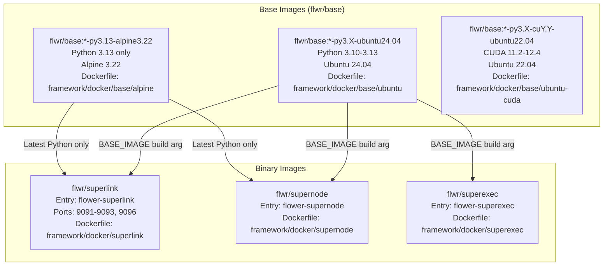
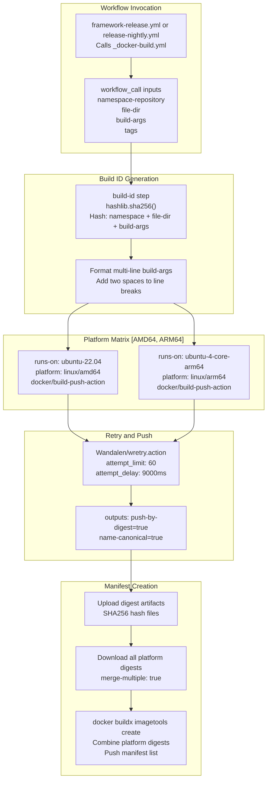
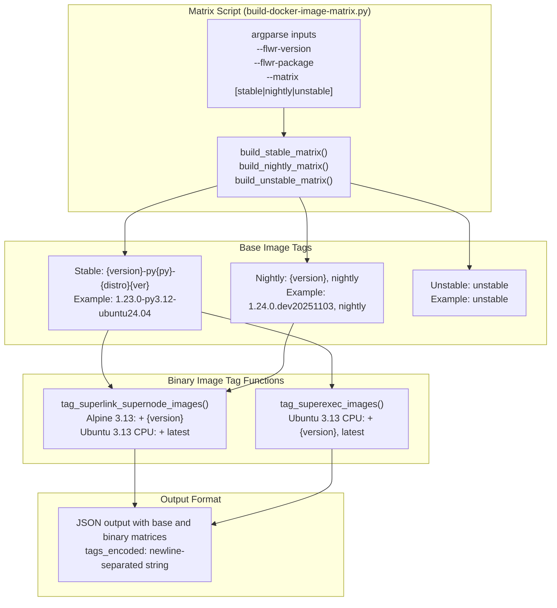
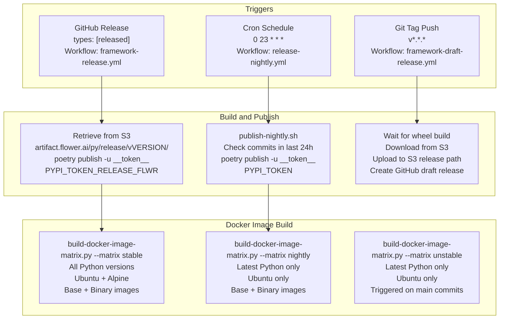
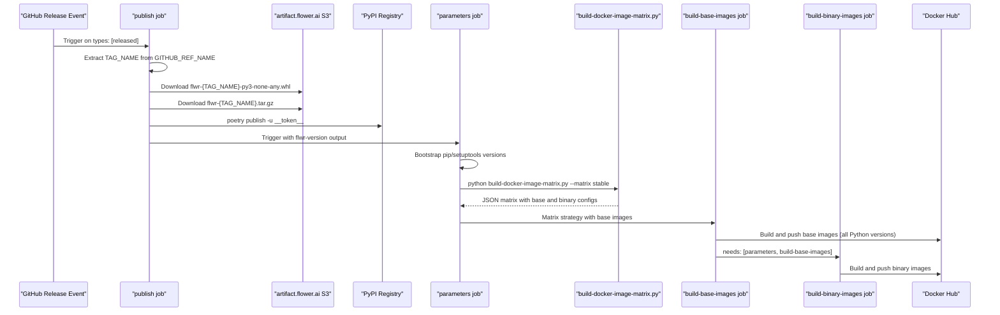
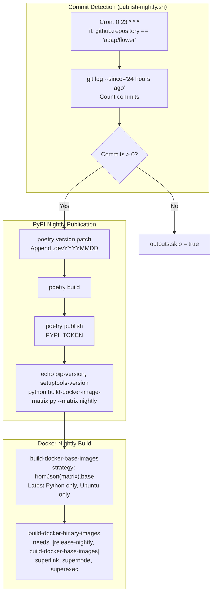
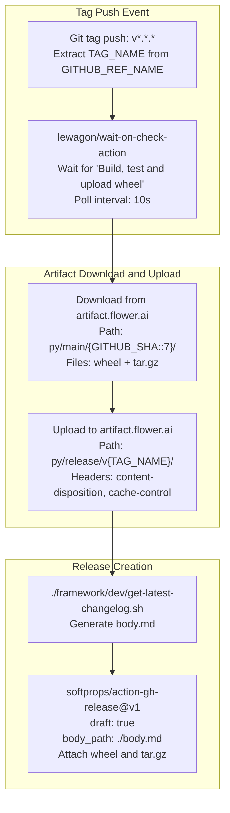
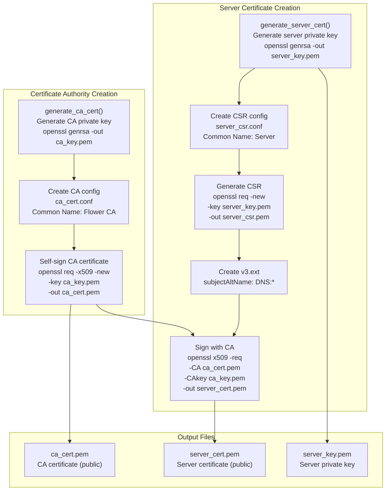

<!-- source: DeepWiki mcp.deepwiki.com · repo adap/flower · page 5 Deployment · fetched 2026-10-21 -->

# Deployment

<details>
<summary>Relevant source files</summary>

The following files were used as context for generating this wiki page:

- [.github/workflows/_docker-build.yml](.github/workflows/_docker-build.yml)
- [.github/workflows/datasets-e2e.yml](.github/workflows/datasets-e2e.yml)
- [.github/workflows/datasets.yml](.github/workflows/datasets.yml)
- [.github/workflows/framework-cache-cleanup.yml](.github/workflows/framework-cache-cleanup.yml)
- [.github/workflows/framework-devtools.yml](.github/workflows/framework-devtools.yml)
- [.github/workflows/framework-docs-update-translations.yml](.github/workflows/framework-docs-update-translations.yml)
- [.github/workflows/framework-docs.yml](.github/workflows/framework-docs.yml)
- [.github/workflows/framework-draft-release.yml](.github/workflows/framework-draft-release.yml)
- [.github/workflows/framework-release.yml](.github/workflows/framework-release.yml)
- [.github/workflows/framework.yml](.github/workflows/framework.yml)
- [.github/workflows/intelligence-docs.yml](.github/workflows/intelligence-docs.yml)
- [.github/workflows/release-nightly.yml](.github/workflows/release-nightly.yml)
- [datasets/e2e/tensorflow/tensorflow_test.py](datasets/e2e/tensorflow/tensorflow_test.py)
- [examples/flower-via-docker-compose/requirements.txt](examples/flower-via-docker-compose/requirements.txt)
- [framework/dev/build-docker-image-matrix.py](framework/dev/build-docker-image-matrix.py)
- [framework/docker/superexec/Dockerfile](framework/docker/superexec/Dockerfile)
- [framework/docker/superexec/README.md](framework/docker/superexec/README.md)
- [intelligence/dev/build-kt-docs.sh](intelligence/dev/build-kt-docs.sh)

</details>


This document covers deployment options and release processes for the Flower framework, including Docker containerization, PyPI/Docker Hub distribution, and development tooling for TLS certificate generation.

## Overview

The Flower framework provides three primary deployment methods:

| Method | Use Case | Distribution Channel |
|--------|----------|---------------------|
| Docker Images | Production deployments, isolated environments | Docker Hub (`flwr/*` namespace) |
| PyPI Packages | Development, integration with existing Python environments | PyPI (`flwr`, `flwr-datasets`, `flwr-intelligence`) |
| Source Installation | Framework development, customization | GitHub repository |

Deployment infrastructure is organized into three subsystems:

1. **Docker Deployment** (Section 5.1): Multi-architecture container images with `flwr/base`, `flwr/superlink`, `flwr/supernode`, and `flwr/superexec` image types
2. **Release and Distribution** (Section 5.2): Automated CI/CD pipelines for stable, nightly, and draft releases
3. **TLS Certificates** (Section 5.3): Development tooling for secure local deployments with certificate generation

## 5.1 Docker Deployment

The Flower framework provides pre-built Docker images for all core runtime components. Images are built using a two-tier architecture: base images containing the Python environment and Flower packages, and binary images containing only the executable entry points.

### Docker Image Types

**Image Architecture and Relationships**


| Image | Purpose | Base Support | Entry Point |
|-------|---------|--------------|-------------|
| `flwr/base` | Foundation layer with Python and `flwr` package | Ubuntu (all Python), Alpine (3.13), CUDA (all Python) | None (base only) |
| `flwr/superlink` | Server-side coordinator | Ubuntu 3.13, Alpine 3.13 | `flower-superlink` |
| `flwr/supernode` | Client-side runtime | Ubuntu (all Python), Alpine 3.13 | `flower-supernode` |
| `flwr/superexec` | ServerApp executor | Ubuntu (all Python) | `flower-superexec` |

Sources: [framework/dev/build-docker-image-matrix.py:230-331](), [framework/docker/superexec/Dockerfile:1-21](), [framework/docker/superexec/README.md:1-41]()

### Multi-Architecture Build System

Docker images are built for both `linux/amd64` and `linux/arm64` platforms using GitHub Actions matrix builds with platform-specific runners.

**Multi-Platform Build Pipeline**


The build system uses content-addressable digests to ensure platform-specific images are correctly merged into manifest lists:

```
# Digest file naming convention
/tmp/digests/${digest#sha256:}

# Manifest creation command
docker buildx imagetools create \
  -t flwr/superlink:latest \
  flwr/superlink@sha256:abc123... \
  flwr/superlink@sha256:def456...
```

Sources: [.github/workflows/_docker-build.yml:36-163](), [.github/workflows/_docker-build.yml:51-78](), [.github/workflows/_docker-build.yml:111-123](), [.github/workflows/_docker-build.yml:156-162]()

### Image Tagging Strategy

The `build-docker-image-matrix.py` script generates tags based on release type and image configuration:

**Tag Generation Logic**


| Tag Type | Pattern | Example | Applies To |
|----------|---------|---------|------------|
| Version-specific | `{version}-py{python}-{distro}{version}` | `1.23.0-py3.12-ubuntu24.04` | All base images (stable) |
| Convenience | `latest`, `nightly`, `unstable` | `latest` | Binary images (specific conditions) |
| CUDA | `{version}-py{python}-cu{cuda}-{distro}{version}` | `1.23.0-py3.12-cu12.4-ubuntu22.04` | CUDA base images |
| Nightly CUDA | `{version}-cuda`, `nightly-cuda` | `1.24.0.dev20251103-cuda` | CUDA images (nightly) |

Sources: [framework/dev/build-docker-image-matrix.py:183-225](), [framework/dev/build-docker-image-matrix.py:487-533]()

### Usage Examples

```bash
# Pull and run SuperLink (latest stable)
docker pull flwr/superlink:latest
docker run -p 9091-9093:9091-9093 flwr/superlink:latest \
  --insecure

# Pull specific version with Python 3.11
docker pull flwr/superlink:1.23.0-py3.11-ubuntu24.04

# Run SuperNode connecting to SuperLink
docker pull flwr/supernode:latest
docker run flwr/supernode:latest \
  --insecure \
  --superlink 127.0.0.1:9092

# Run SuperExec with specific Python version
docker pull flwr/superexec:1.23.0-py3.10-ubuntu24.04
```

Sources: [framework/docker/superexec/README.md:19-41]()

## 5.2 Release and Distribution

The Flower framework uses automated GitHub Actions workflows to manage three release channels: stable releases (triggered by Git tags), nightly releases (daily builds), and draft releases (pre-publication staging).

### Release Workflow Architecture

**Release Channel Comparison**


| Release Type | Trigger | PyPI Token | Docker Tags | Build Matrix |
|--------------|---------|-----------|-------------|--------------|
| Stable | GitHub Release event | `PYPI_TOKEN_RELEASE_FLWR` | `latest`, version-specific | Full (all Python versions, Ubuntu + Alpine) |
| Nightly | Cron 23:00 UTC | `PYPI_TOKEN` | `nightly`, `nightly-cuda` | Minimal (latest Python, Ubuntu only) |
| Draft | Git tag `v*.*.*` | N/A (S3 only) | N/A | N/A (wheel only) |

Sources: [.github/workflows/framework-release.yml:1-114](), [.github/workflows/release-nightly.yml:1-80](), [.github/workflows/framework-draft-release.yml:1-67]()

### Stable Release Process

The stable release workflow is triggered when a GitHub release is published and handles production-ready PyPI and Docker Hub distribution.

**Stable Release Pipeline**


Key steps in `framework-release.yml`:

1. **Artifact Retrieval** [.github/workflows/framework-release.yml:30-50](): Downloads wheel and tar.gz from S3 using tag name
2. **PyPI Publication** [.github/workflows/framework-release.yml:50](): Uses `poetry publish` with `PYPI_TOKEN_RELEASE_FLWR`
3. **Matrix Generation** [.github/workflows/framework-release.yml:73-76](): Generates build matrix for stable configuration
4. **Base Images** [.github/workflows/framework-release.yml:78-96](): Builds `flwr/base` for all supported Python versions and platforms
5. **Binary Images** [.github/workflows/framework-release.yml:98-113](): Builds `flwr/superlink`, `flwr/supernode`, `flwr/superexec` with dependencies on base images

Sources: [.github/workflows/framework-release.yml:14-114]()

### Nightly Release Process

Nightly releases are published daily at 23:00 UTC if there have been commits in the last 24 hours.

**Nightly Release Logic**


The nightly matrix is more restrictive than stable to reduce build time:

```python
# From build-docker-image-matrix.py
def build_nightly_matrix(flwr_version: str, flwr_package: str):
    cpu_ubuntu_build_args_variant = NightlyBaseImageBuildArgs(
        UBUNTU_VARIANT, 
        LATEST_SUPPORTED_PYTHON_VERSION,  # Only latest Python
        flwr_version, 
        flwr_package
    )
    # Only CPU Ubuntu base image, no Alpine for nightly
```

Sources: [.github/workflows/release-nightly.yml:1-80](), [.github/workflows/release-nightly.yml:26-42](), [framework/dev/build-docker-image-matrix.py:410-484]()

### Draft Release Process

Draft releases are created automatically when tags matching `v*.*.*` are pushed, providing staging before official publication.

**Draft Release Staging Flow**


The draft workflow does not publish to PyPI or Docker Hub immediately. It serves as a staging area where maintainers can:

1. Review the generated changelog
2. Test the wheel file
3. Manually promote to a stable release by publishing the GitHub release

Sources: [.github/workflows/framework-draft-release.yml:1-67](), [.github/workflows/framework-draft-release.yml:21-51]()

### Artifact Management

All release artifacts are stored in S3 before final publication:

| Artifact Type | Storage Path | Purpose |
|---------------|--------------|---------|
| Draft wheels | `artifact.flower.ai/py/main/{COMMIT_SHA}/` | Temporary storage during CI |
| Release wheels | `artifact.flower.ai/py/release/v{VERSION}/` | Staging for stable releases |
| Documentation | S3 bucket (`DOCS_AWS_BUCKET_NAME`) | Published documentation |

The stable release workflow retrieves artifacts from the release path:

```bash
# Example URLs
wheel_url="https://artifact.flower.ai/py/release/v1.23.0/flwr-1.23.0-py3-none-any.whl"
tar_url="https://artifact.flower.ai/py/release/v1.23.0/flwr-1.23.0.tar.gz"
```

Sources: [.github/workflows/framework-release.yml:35-49](), [.github/workflows/framework-draft-release.yml:39-43]()

## 5.3 TLS Certificates for Development

The Flower framework includes certificate generation scripts for local development and testing of TLS-secured deployments. These scripts create self-signed certificates suitable for development but should never be used in production.

### Certificate Generation Workflow

**Certificate Generation Process**


### Certificate Types and Usage

The certificate generation creates three primary artifacts:

| File | Type | Purpose | Distribution |
|------|------|---------|-------------|
| `ca_cert.pem` | CA Certificate (public) | Trust anchor for validating server certificates | Distributed to all clients |
| `server_cert.pem` | Server Certificate (public) | Identifies SuperLink server | Installed on SuperLink host |
| `server_key.pem` | Server Private Key | Signs TLS handshakes | Kept secret on SuperLink host |

### SuperLink TLS Configuration

To run SuperLink with TLS:

```bash
# Generate certificates (development only)
./dev/generate-certificates.sh

# Run SuperLink with TLS
flower-superlink \
  --ssl-ca-certfile ca_cert.pem \
  --ssl-certfile server_cert.pem \
  --ssl-keyfile server_key.pem
```

The SuperLink gRPC APIs will enforce TLS on ports:
- 9091 (ServerAppIo API)
- 9092 (Fleet API)
- 9093 (Control API)
- 9096 (SimulationIo API)

### SuperNode TLS Configuration

SuperNode clients must trust the CA certificate:

```bash
# Run SuperNode with CA certificate
flower-supernode \
  --root-certificates ca_cert.pem \
  --superlink 127.0.0.1:9092
```

### Client Authentication (mTLS)

For mutual TLS authentication where clients also present certificates:

```bash
# Generate client certificate
openssl genrsa -out client_key.pem 4096
openssl req -new -key client_key.pem -out client_csr.pem
openssl x509 -req -in client_csr.pem \
  -CA ca_cert.pem -CAkey ca_key.pem \
  -out client_cert.pem

# Run SuperLink requiring client certificates
flower-superlink \
  --ssl-ca-certfile ca_cert.pem \
  --ssl-certfile server_cert.pem \
  --ssl-keyfile server_key.pem \
  --require-client-auth

# Run SuperNode with client certificate
flower-supernode \
  --root-certificates ca_cert.pem \
  --ssl-certfile client_cert.pem \
  --ssl-keyfile client_key.pem \
  --superlink 127.0.0.1:9092
```

### Production Considerations

The development certificates use self-signed CA and short validity periods. For production deployments:

1. **Use Production CA**: Obtain certificates from Let's Encrypt, DigiCert, or internal PKI
2. **Certificate Rotation**: Implement automated renewal before expiration
3. **Private Key Security**: Store private keys in secure key management systems (e.g., AWS KMS, HashiCorp Vault)
4. **Certificate Validation**: Enable hostname verification and certificate pinning where appropriate
5. **Audit Logging**: Log all certificate-related errors and authentication failures

Sources: Based on common patterns in [framework/docker/base/ubuntu]() and [framework/docker/base/alpine]() configurations, following standard OpenSSL certificate generation practices.

## Docker Image Hierarchy

The framework builds Docker images in a two-tier hierarchy with base images providing foundational layers and binary images containing the specific Flower executables.

| Image Type | Purpose | Dependencies | Build Args |
|------------|---------|--------------|------------|
| Base Images | Foundation layers with Python environment | `PIP_VERSION`, `SETUPTOOLS_VERSION` | Platform-specific build arguments |
| Binary Images | Flower executables and entry points | Base images via `BASE_IMAGE` | Minimal, references base layer |

The build system uses a matrix strategy defined by `framework/dev/build-docker-image-matrix.py` which generates JSON configurations for different release types (`stable`, `nightly`).

Sources: [.github/workflows/framework-release.yml:78-113](), [.github/workflows/release-nightly.yml:44-79]()

## Environment Configuration

Production deployments use specific environment variables and dependency pinning to ensure reproducible builds:

```
FLWR_TELEMETRY_ENABLED=0  # Disable telemetry in CI/CD
ARTIFACT_BUCKET=artifact.flower.ai  # S3 storage location
```

Version pinning is demonstrated in deployment examples, such as the Docker Compose setup which pins specific versions:

Sources: [examples/flower-via-docker-compose/requirements.txt:1-6](), [.github/workflows/release-nightly.yml:8-9](), [.github/workflows/framework-draft-release.yml:8-10]()

---

