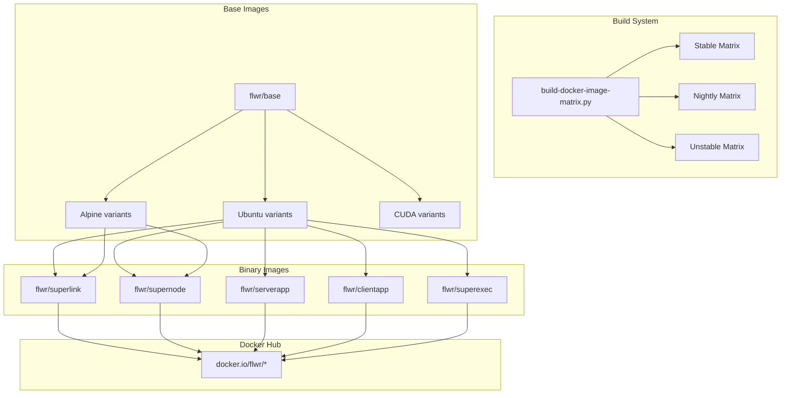
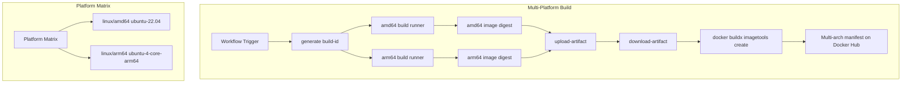
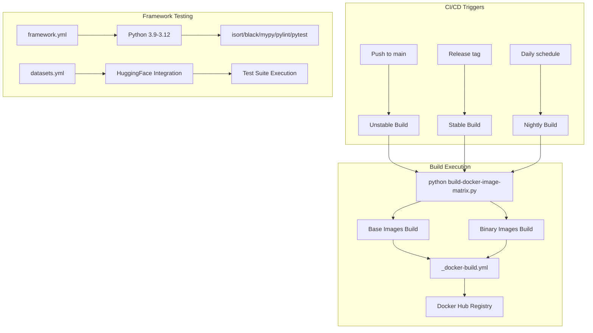

<!-- source: DeepWiki mcp.deepwiki.com · repo adap/flower · page 5.1 Docker Deployment · fetched 2026-10-21 -->

# Docker Deployment

<details>
<summary>Relevant source files</summary>

The following files were used as context for generating this wiki page:

- [.github/workflows/_docker-build.yml](.github/workflows/_docker-build.yml)
- [examples/flower-via-docker-compose/requirements.txt](examples/flower-via-docker-compose/requirements.txt)

</details>


This page documents the Docker image build system and containerized deployment options for the Flower framework. The system provides multi-platform Docker images for various Flower components, enabling consistent deployment across different environments and architectures.

For information about general deployment approaches, see page 5.

## Overview

Flower maintains an automated Docker image build system that produces multi-platform container images for all major framework components. The build system supports different release channels (stable, nightly, unstable) and creates both base images with Flower dependencies and specialized binary images for specific components.

### Docker Image Architecture



Sources:
- [framework/dev/build-docker-image-matrix.py:1-571]()
- [.github/workflows/_docker-build.yml:1-163]()

## Docker Image Build System

The Docker image build system is controlled by the `build-docker-image-matrix.py` script, which generates build configurations for different release types and deployment scenarios.

### Build Matrix Types

| Matrix Type | Trigger | Python Versions | Platforms | Image Variants |
|-------------|---------|-----------------|-----------|----------------|
| `stable` | Release tags | 3.9, 3.10, 3.11, 3.12 | Ubuntu, Alpine, CUDA | Full matrix |
| `nightly` | Daily schedule | 3.12 (latest) | Ubuntu only | Latest variants |
| `unstable` | Main branch commits | 3.12 (latest) | Ubuntu only | Development builds |

### Image Types and Components

#### Base Images (`flwr/base`)

Base images contain the Flower framework and dependencies but no specific entrypoints. They serve as the foundation for binary images.

**Supported Variants:**
- **Ubuntu**: Uses `glibc`, compatible with most ML frameworks
- **Alpine**: Minimal images using `musl`, used only for lightweight deployments
- **CUDA**: Ubuntu-based images with NVIDIA CUDA support

#### Binary Images

Binary images are built from base images and contain specific Flower components with defined entrypoints:

| Image | Purpose | Entrypoint | Base Image Types |
|-------|---------|------------|------------------|
| `flwr/superlink` | Central orchestration component | N/A | Ubuntu, Alpine |
| `flwr/supernode` | Client management component | N/A | Ubuntu, Alpine |
| `flwr/serverapp` | Server application execution | N/A | Ubuntu |
| `flwr/clientapp` | Client application execution | N/A | Ubuntu |
| `flwr/superexec` | Process launcher | `flower-superexec` | Ubuntu |

Sources:
- [framework/dev/build-docker-image-matrix.py:16-18]()
- [framework/dev/build-docker-image-matrix.py:247-364]()
- [framework/docker/superexec/Dockerfile:16-21]()

## Multi-Platform Build Process

The Docker build system uses GitHub Actions to create multi-platform images supporting both `amd64` and `arm64` architectures.

### Build Workflow Architecture



### Build Steps

The build process follows these steps for each platform:

1. **Build ID Generation**: Creates a unique hash from build parameters using `hashlib.sha256()` [.github/workflows/_docker-build.yml:51-78]()
2. **Platform-Specific Builds**: Each architecture is built on dedicated runners [.github/workflows/_docker-build.yml:46-49]()
3. **Image Digest Export**: Build outputs are saved as artifacts [.github/workflows/_docker-build.yml:111-123]()
4. **Manifest Creation**: Multi-platform manifest is created using `docker buildx imagetools` [.github/workflows/_docker-build.yml:156-160]()

Sources:
- [.github/workflows/_docker-build.yml:35-163]()
- [framework/dev/build-docker-image-matrix.py:46-52]()

## Image Tagging Strategy

Different image types use specific tagging strategies to support version management and deployment scenarios.

### SuperLink and SuperNode Images

```python
# Alpine + latest Python -> version tag
if (image.build_args.variant.distro.name == DistroName.ALPINE
    and image.build_args.python_version == LATEST_SUPPORTED_PYTHON_VERSION):
    return image.tags + [image.build_args.flwr_version]

# Ubuntu + latest Python + CPU -> "latest" tag  
elif (image.build_args.variant.distro.name == DistroName.UBUNTU
      and image.build_args.python_version == LATEST_SUPPORTED_PYTHON_VERSION
      and isinstance(image.build_args.variant.extras, CpuVariant)):
    return image.tags + ["latest"]
```

### ServerApp, ClientApp, and SuperExec Images

```python
# Ubuntu + latest Python + CPU -> version + "latest" tags
if (image.build_args.variant.distro.name == DistroName.UBUNTU
    and image.build_args.python_version == LATEST_SUPPORTED_PYTHON_VERSION
    and isinstance(image.build_args.variant.extras, CpuVariant)):
    return image.tags + [image.build_args.flwr_version, "latest"]
```

Sources:
- [framework/dev/build-docker-image-matrix.py:183-244]()

## Deployment Options

The Flower Docker images support multiple deployment patterns depending on your federated learning architecture requirements.

### Component-Based Deployment

Deploy individual Flower components using their dedicated images:

```bash
# Run SuperLink (central orchestrator)
docker run -p 9091:9091 -p 9092:9092 -p 9093:9093 flwr/superlink:latest

# Run SuperNode (client manager) 
docker run -p 9094:9094 flwr/supernode:latest

# Run SuperExec (process launcher)
docker run flwr/superexec:latest --help
```

### Application-Based Deployment  

Use ServerApp and ClientApp images for application-specific deployments:

```bash
# Run ServerApp process
docker run -v /path/to/app:/app flwr/serverapp:latest

# Run ClientApp process  
docker run -v /path/to/app:/app flwr/clientapp:latest
```

### Image Selection Guidelines

| Use Case | Recommended Images | Considerations |
|----------|-------------------|----------------|
| Production deployment | `flwr/superlink`, `flwr/supernode` | Use Alpine variants for minimal footprint |
| Development/Testing | `unstable` tagged images | Latest development features |
| GPU workloads | CUDA variants | Only available for Ubuntu base images |
| ARM devices | Multi-arch manifests | Automatic platform selection |

Sources:
- [framework/docker/superexec/README.md:20-29]()
- [framework/dev/build-docker-image-matrix.py:73-106]()

## Build Configuration Details

The build system supports extensive configuration through build arguments and environment variables to accommodate different deployment scenarios.

### Python Version Support

The build matrix supports multiple Python versions with the latest being the default for simplified builds:

```python
LATEST_SUPPORTED_PYTHON_VERSION = "3.12"
SUPPORTED_PYTHON_VERSIONS = [
    "3.9",
    "3.10", 
    "3.11",
    LATEST_SUPPORTED_PYTHON_VERSION,
]
```

### CUDA Support Configuration

CUDA variants are built for Ubuntu base images with specific CUDA/Ubuntu version combinations:

```python
CUDA_VERSIONS_CONFIG = [
    ("11.2.2", "20.04"),
    ("11.8.0", "22.04"), 
    ("12.1.0", "22.04"),
    ("12.3.2", "22.04"),
]

LATEST_SUPPORTED_CUDA_VERSION = Variant(
    Distro(DistroName.UBUNTU, "22.04"),
    CudaVariant(version="12.4.1"),
)
```

### Build Arguments Structure

The build system generates different argument sets based on the build type:

#### Stable Builds
```python
cpu_build_args = """PYTHON_VERSION={python_version}
FLWR_VERSION={flwr_version}
DISTRO={distro_name}
DISTRO_VERSION={distro_version}
"""

cuda_build_args = cpu_build_args + """CUDA_VERSION={cuda_version}"""
```

#### Nightly Builds  
```python
cpu_build_args = """PYTHON_VERSION={python_version}
FLWR_VERSION={flwr_version}
FLWR_PACKAGE={flwr_package}
DISTRO={distro_name}
DISTRO_VERSION={distro_version}
"""
```

#### Unstable Builds
```python
cpu_build_args = """PYTHON_VERSION={python_version}
FLWR_VERSION_REF={flwr_version_ref}
DISTRO={distro_name}
DISTRO_VERSION={distro_version}
"""
```

Sources:
- [framework/dev/build-docker-image-matrix.py:46-52]()
- [framework/dev/build-docker-image-matrix.py:73-82]()
- [framework/dev/build-docker-image-matrix.py:256-415]()

## CI/CD Integration

The Docker build system integrates with Flower's CI/CD pipeline through GitHub Actions workflows that trigger builds based on different events.

### Workflow Integration



### Framework Testing Pipeline

The Docker builds are supported by comprehensive testing workflows that ensure image quality:

**Framework Testing** (`framework.yml`):
- Tests across Python 3.9-3.12 [.github/workflows/framework.yml:43]()
- Code quality checks: `isort`, `black`, `mypy`, `pylint`, `pytest` [framework/dev/test.sh:18-64]()
- Protocol buffer compilation verification [.github/workflows/framework.yml:62-63]()

**Dataset Testing** (`datasets.yml`):
- HuggingFace datasets integration testing [.github/workflows/datasets.yml:50-63]()
- Caching of HuggingFace datasets [.github/workflows/datasets.yml:50-55]()

Sources:
- [.github/workflows/framework.yml:1-70]()
- [.github/workflows/datasets.yml:1-66]()
- [framework/dev/test.sh:1-109]()

## Example: Docker Compose Deployment

A comprehensive example of using Docker with Flower is available in the `examples/flower-via-docker-compose` directory. This example demonstrates:

1. Setting up a federated learning environment with multiple clients
2. Configuring resource limits to simulate device heterogeneity
3. Integrating monitoring tools
4. Visualizing system and application metrics

### Running the Example

To run the example:

1. Generate a Docker Compose configuration:
   ```bash
   python helpers/generate_docker_compose.py
   ```

2. Build and start the containers:
   ```bash
   docker-compose up
   ```

3. Access the Grafana dashboard at `http://localhost:3000` to monitor the system

This example provides a starting point for building your own Docker-based Flower deployments.

Sources:
- [examples/flower-via-docker-compose/README.md:48-62]()
- [examples/flower-via-docker-compose/README.md:65-146]()

## Best Practices

When deploying Flower with Docker, consider these best practices:

1. **Resource Planning**: Carefully allocate resources based on the complexity of your model and dataset size

2. **Monitoring Integration**: Include monitoring to track both system performance and training metrics

3. **Network Configuration**: Ensure proper network configuration to allow communication between server and clients

4. **Volume Mounting**: Mount volumes for data persistence and to avoid rebuilding images when code changes

5. **Adaptive Training**: Adjust training parameters based on client capabilities to accommodate heterogeneity

6. **Data Sampling**: For memory-constrained devices, consider using a subset of data to prevent out-of-memory errors

Sources:
- [examples/flower-via-docker-compose/README.md:148-159]()
- [examples/flower-via-docker-compose/README.md:28-38]()

## Conclusion

Docker deployment provides a flexible and powerful way to run Flower in various environments while managing device heterogeneity. By containerizing Flower components, you can ensure consistent behavior across different platforms and easily scale your federated learning system.

For more advanced deployment scenarios, consider exploring the integration of Flower with orchestration platforms like Kubernetes or cloud services that support container deployments.

---

