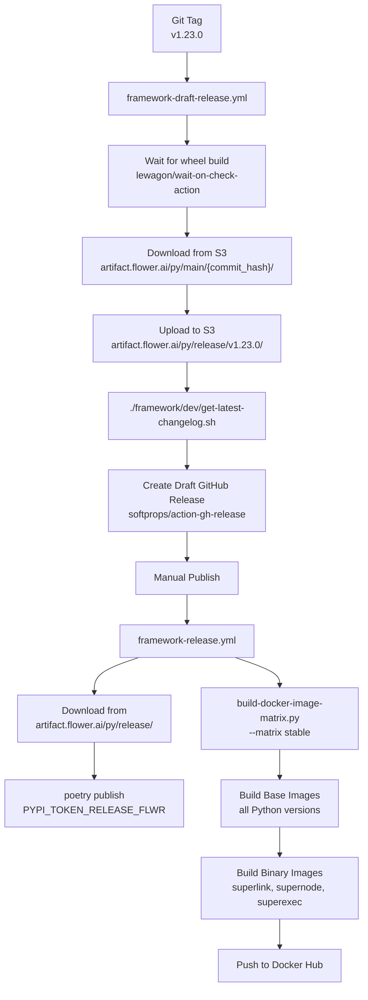
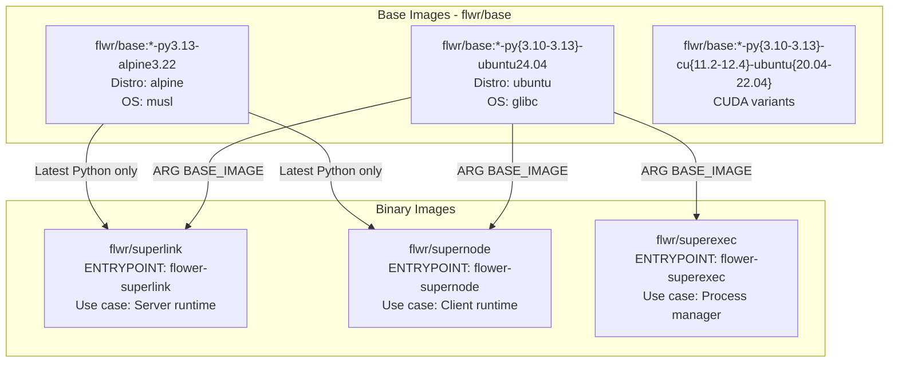
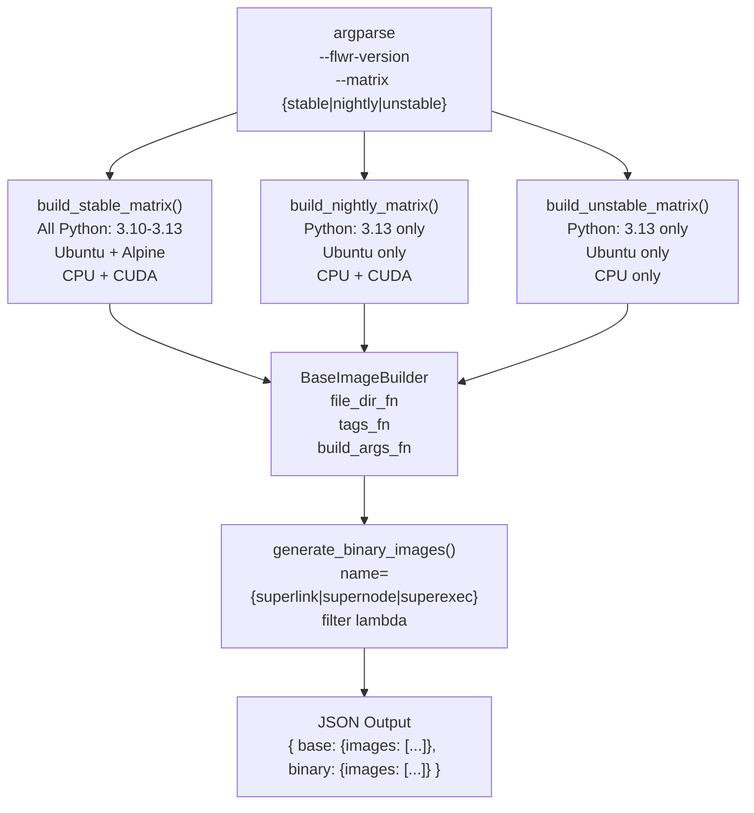
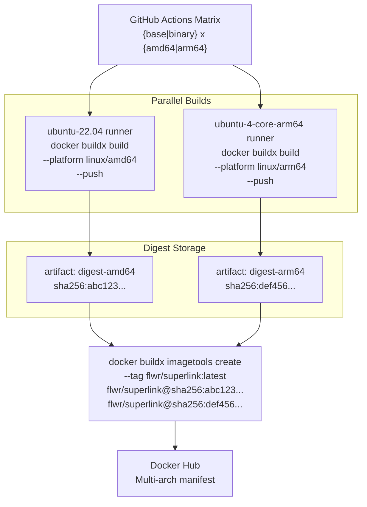
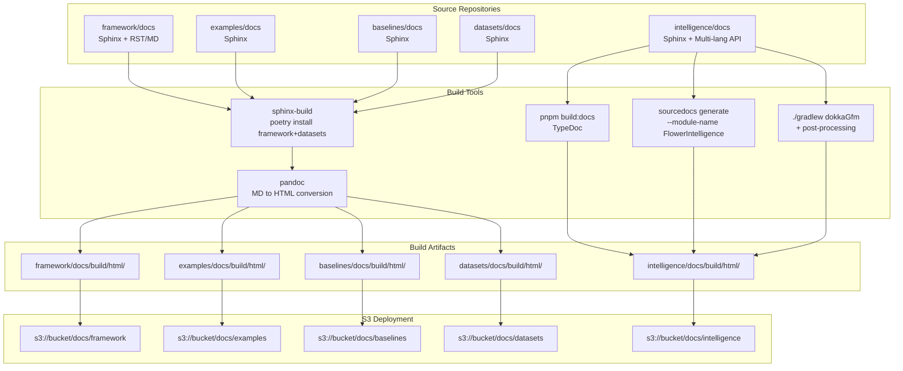
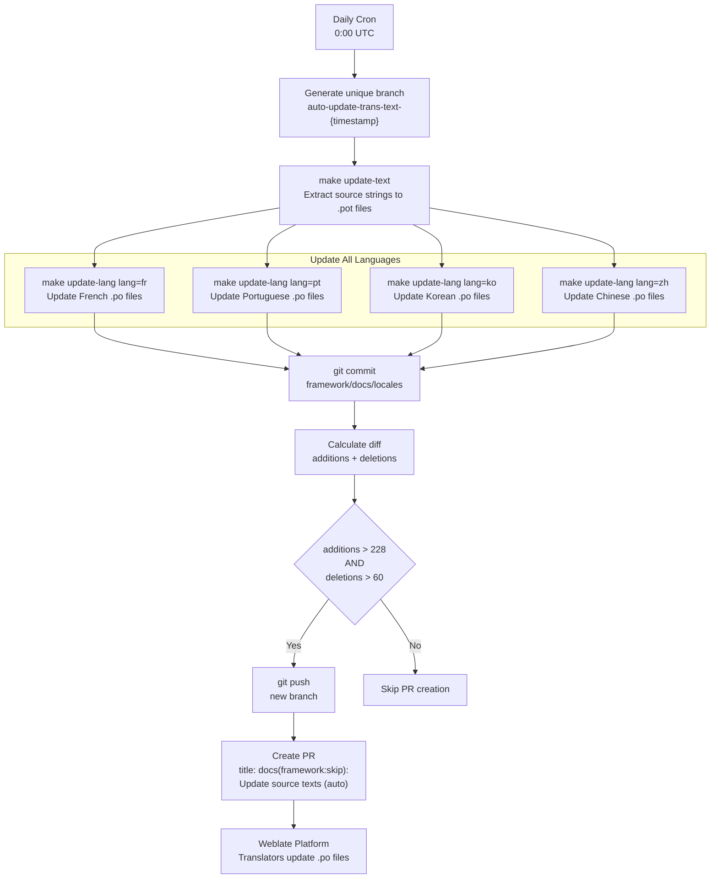
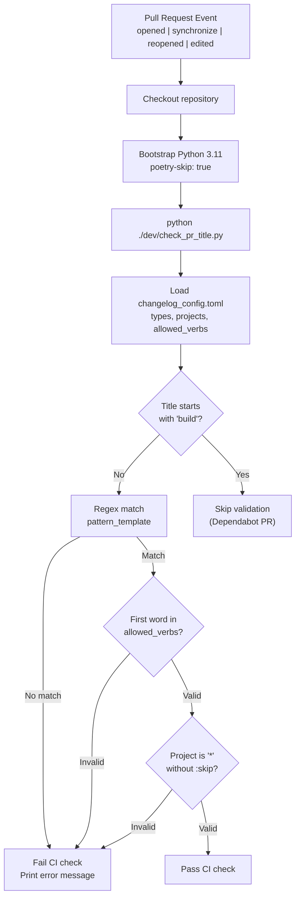

<!-- source: DeepWiki mcp.deepwiki.com · repo adap/flower · page 5.2 Release and Distribution · fetched 2026-10-21 -->

# Release and Distribution

<details>
<summary>Relevant source files</summary>

The following files were used as context for generating this wiki page:

- [.github/PULL_REQUEST_TEMPLATE.md](.github/PULL_REQUEST_TEMPLATE.md)
- [.github/workflows/datasets-e2e.yml](.github/workflows/datasets-e2e.yml)
- [.github/workflows/datasets.yml](.github/workflows/datasets.yml)
- [.github/workflows/framework-cache-cleanup.yml](.github/workflows/framework-cache-cleanup.yml)
- [.github/workflows/framework-devtools.yml](.github/workflows/framework-devtools.yml)
- [.github/workflows/framework-docs-update-translations.yml](.github/workflows/framework-docs-update-translations.yml)
- [.github/workflows/framework-docs.yml](.github/workflows/framework-docs.yml)
- [.github/workflows/framework-draft-release.yml](.github/workflows/framework-draft-release.yml)
- [.github/workflows/framework-release.yml](.github/workflows/framework-release.yml)
- [.github/workflows/framework.yml](.github/workflows/framework.yml)
- [.github/workflows/intelligence-docs.yml](.github/workflows/intelligence-docs.yml)
- [.github/workflows/pr_check.yml](.github/workflows/pr_check.yml)
- [.github/workflows/release-nightly.yml](.github/workflows/release-nightly.yml)
- [CONTRIBUTING.md](CONTRIBUTING.md)
- [datasets/e2e/tensorflow/tensorflow_test.py](datasets/e2e/tensorflow/tensorflow_test.py)
- [dev/changelog_config.toml](dev/changelog_config.toml)
- [dev/check_pr_title.py](dev/check_pr_title.py)
- [framework/dev/build-docker-image-matrix.py](framework/dev/build-docker-image-matrix.py)
- [framework/docker/superexec/Dockerfile](framework/docker/superexec/Dockerfile)
- [framework/docker/superexec/README.md](framework/docker/superexec/README.md)
- [framework/docs/source/ref-changelog.md](framework/docs/source/ref-changelog.md)
- [intelligence/dev/build-kt-docs.sh](intelligence/dev/build-kt-docs.sh)

</details>


## Purpose and Scope

This document describes the release and distribution mechanisms for Flower framework components, including:
- Release channels (stable, nightly, unstable)
- PyPI package publishing workflows
- Docker image build matrices and multi-architecture distribution
- Documentation deployment pipeline
- Artifact storage and retrieval processes
- Changelog management and PR title enforcement

For information about deploying Docker containers in production, see [Docker Deployment](#5.1). For development environment setup and CI/CD testing pipelines, see [CI/CD Pipeline](#6.2).

## Release Channels

Flower maintains three distinct release channels, each with different build configurations and target audiences:

| Channel | Trigger | Frequency | Python Versions | Build Scope |
|---------|---------|-----------|-----------------|-------------|
| **Stable** | GitHub Release | On-demand | 3.10, 3.11, 3.12, 3.13 | PyPI + Full Docker Matrix |
| **Nightly** | Cron Schedule | Daily 23:00 UTC | 3.13 only | PyPI + Minimal Docker Matrix |
| **Unstable** | Main Branch Push | Per commit | 3.13 only | Docker only (no PyPI) |

### Stable Release Workflow

Stable releases are initiated when a maintainer creates a GitHub release with a version tag matching the pattern `v*.*.*` (e.g., `v1.23.0`).

**Diagram: Stable Release Pipeline**



**Draft Creation Phase** ([`.github/workflows/framework-draft-release.yml:12-67`]()):

1. **Wait for Wheel Build**: Uses `lewagon/wait-on-check-action` to wait for the "Build, test and upload wheel" check to complete
2. **Download Artifacts**: Retrieves wheel and tarball from main branch artifact path
3. **Upload to Release Path**: Copies artifacts to versioned release directory in S3
4. **Extract Changelog**: Runs `./framework/dev/get-latest-changelog.sh` to extract relevant version section
5. **Create Draft**: Uses `softprops/action-gh-release` with `draft: true`

**Publication Phase** ([`.github/workflows/framework-release.yml:15-51`]()):

```bash
# Version extraction
TAG_NAME=$(echo "${GITHUB_REF_NAME}" | cut -c2-)

# Artifact download
wheel_url="https://artifact.flower.ai/py/release/v${TAG_NAME}/flwr-${TAG_NAME}-py3-none-any.whl"
tar_url="https://artifact.flower.ai/py/release/v${TAG_NAME}/flwr-${TAG_NAME}.tar.gz"

# PyPI publication
python -m poetry publish -u __token__ -p ${{ secrets.PYPI_TOKEN_RELEASE_FLWR }}
```

Sources: [`.github/workflows/framework-draft-release.yml:1-67`](), [`.github/workflows/framework-release.yml:1-114`]()

### Nightly Release Workflow

Nightly releases execute automatically via cron schedule `"0 23 * * *"` (daily at 23:00 UTC).

**Key Differences from Stable**:
- Skips if no commits in last 24 hours ([`.github/workflows/release-nightly.yml:32-34`]())
- Version format: `{base_version}.dev{YYYYMMDD}` (e.g., `1.24.0.dev20251103`)
- Minimal Docker build matrix: latest Python version only, Ubuntu only
- Docker tags: `nightly`, `nightly-cuda`, and versioned dev tag

**Workflow Steps** ([`.github/workflows/release-nightly.yml:26-42`]()):

```bash
# Check for commits and publish
RESULT=$(./dev/publish-nightly.sh)
if [ "$RESULT" == "There were no commits in the last 24 hours." ]; then
  echo "skip=true" >> $GITHUB_OUTPUT
fi

# Generate build matrix
NAME=$(poetry version | awk {'print $1'})
VERSION=$(poetry version -s)
python dev/build-docker-image-matrix.py \
  --flwr-version "${VERSION}" \
  --matrix nightly \
  --flwr-package "${NAME}" > matrix.json
```

Sources: [`.github/workflows/release-nightly.yml:1-80`]()

### Unstable Release Workflow

Unstable builds are triggered on every push to the `main` branch. These are Docker-only releases that do not publish to PyPI.

**Configuration** ([`framework/dev/build-docker-image-matrix.py:337-404`]()):
- Python version: `LATEST_SUPPORTED_PYTHON_VERSION` (3.13)
- Distro: Ubuntu 24.04 only
- Variants: CPU and CUDA
- Tags: `unstable`, `unstable-cuda`

```python
def build_unstable_matrix(flwr_version_ref: str):
    cpu_ubuntu_build_args_variant = UnstableBaseImageBuildArgs(
        UBUNTU_VARIANT, LATEST_SUPPORTED_PYTHON_VERSION, flwr_version_ref
    )
    
    cpu_base_image = BaseImage(
        file_dir_fn=lambda args: f"{DOCKERFILE_ROOT}/base/{args.variant.distro.name.value}",
        tags_fn=lambda _: ["unstable"],
        # ...
    )
```

Sources: [`framework/dev/build-docker-image-matrix.py:337-404`]()

## Docker Image Build System

### Image Hierarchy and Types

The Docker image system follows a two-tier architecture: base images containing the Flower framework installation, and binary images that specify the entrypoint for specific Flower components.

**Diagram: Docker Image Type Hierarchy**



**Base Image Distribution Philosophy** ([`framework/dev/build-docker-image-matrix.py:1-19`]()):

1. **Ubuntu Images**: Used where users may install additional dependencies (ML frameworks). Ubuntu uses `glibc`, which is compatible with most precompiled ML framework binaries.
2. **Alpine Images**: Used only for minimal images (e.g., SuperLink) where no extra dependencies are expected. Limited use due to `musl` libc dependency compilation complexity.
3. **CUDA Images**: Based on Ubuntu for ML framework compatibility. Support multiple CUDA versions.

Sources: [`framework/dev/build-docker-image-matrix.py:1-534`](), [`framework/docker/superexec/Dockerfile:1-21`]()

### Build Matrix Generation

The `build-docker-image-matrix.py` script generates JSON build matrices consumed by GitHub Actions workflow matrix strategy.

**Diagram: Matrix Generation Code Flow**



**Stable Matrix Configuration** ([`framework/dev/build-docker-image-matrix.py:230-331`]()):

```python
# CPU variants
cpu_build_args = """PYTHON_VERSION={python_version}
FLWR_VERSION={flwr_version}
DISTRO={distro_name}
DISTRO_VERSION={distro_version}
"""

cpu_build_args_variants = [
    StableBaseImageBuildArgs(UBUNTU_VARIANT, python_version, flwr_version)
    for python_version in SUPPORTED_PYTHON_VERSIONS  # [3.10, 3.11, 3.12, 3.13]
] + [
    StableBaseImageBuildArgs(
        ALPINE_VARIANT, LATEST_SUPPORTED_PYTHON_VERSION, flwr_version
    )
]

# CUDA variants
cuda_build_args_variants = [
    StableBaseImageBuildArgs(variant, python_version, flwr_version)
    for variant in CUDA_VARIANTS
    for python_version in SUPPORTED_PYTHON_VERSIONS
]
```

**Binary Image Distribution Rules** ([`framework/dev/build-docker-image-matrix.py:298-329`]()):

| Image | Alpine | Ubuntu (all Python) | Ubuntu (latest Python) |
|-------|--------|---------------------|------------------------|
| `superlink` | ✓ | ✗ | ✓ |
| `supernode` | ✓ | ✓ | ✓ |
| `superexec` | ✗ | ✓ | ✗ |

```python
binary_images = (
    # superlink: Alpine + Ubuntu (latest Python only)
    generate_binary_images(
        "superlink",
        base_images,
        tag_superlink_supernode_images,
        lambda image: image.build_args.python_version == LATEST_SUPPORTED_PYTHON_VERSION
            and isinstance(image.build_args.variant.extras, CpuVariant),
    )
    # supernode: All Python on Ubuntu + Alpine (latest Python)
    + generate_binary_images(
        "supernode",
        base_images,
        tag_superlink_supernode_images,
        lambda image: (
            image.build_args.variant.distro.name == DistroName.UBUNTU
            and isinstance(image.build_args.variant.extras, CpuVariant)
        )
        or (
            image.build_args.variant.distro.name == DistroName.ALPINE
            and image.build_args.python_version == LATEST_SUPPORTED_PYTHON_VERSION
        ),
    )
    # superexec: All Python on Ubuntu
    + generate_binary_images(
        "superexec",
        base_images,
        tag_superexec_images,
        lambda image: image.build_args.variant.distro.name == DistroName.UBUNTU,
    )
)
```

Sources: [`framework/dev/build-docker-image-matrix.py:230-331`]()

### Tag Assignment Strategy

Docker image tags are computed dynamically based on build arguments using tag functions.

**Tag Function Logic** ([`framework/dev/build-docker-image-matrix.py:183-225`]()):

```python
def tag_superlink_supernode_images(image: BaseImage) -> List[str]:
    """
    Compute the Docker image tags based on its build arguments.
    
    - Alpine + latest Python: append flwr_version
    - Ubuntu + latest Python + CPU: append "latest"
    - Otherwise: return original tags
    """
    if (
        image.build_args.variant.distro.name == DistroName.ALPINE
        and image.build_args.python_version == LATEST_SUPPORTED_PYTHON_VERSION
    ):
        return image.tags + [image.build_args.flwr_version]
    elif (
        image.build_args.variant.distro.name == DistroName.UBUNTU
        and image.build_args.python_version == LATEST_SUPPORTED_PYTHON_VERSION
        and isinstance(image.build_args.variant.extras, CpuVariant)
    ):
        return image.tags + ["latest"]
    else:
        return image.tags

def tag_superexec_images(image: BaseImage) -> List[str]:
    """
    For Ubuntu + latest Python + CPU: append flwr_version and "latest"
    """
    if (
        image.build_args.variant.distro.name == DistroName.UBUNTU
        and image.build_args.python_version == LATEST_SUPPORTED_PYTHON_VERSION
        and isinstance(image.build_args.variant.extras, CpuVariant)
    ):
        return image.tags + [image.build_args.flwr_version, "latest"]
    else:
        return image.tags
```

**Resulting Tag Examples**:

| Image | Base Tags | Additional Tags | Final Tags |
|-------|-----------|-----------------|------------|
| `superlink` | `1.23.0-py3.13-ubuntu24.04` | `latest` | `1.23.0-py3.13-ubuntu24.04`, `latest` |
| `superlink` | `1.23.0-py3.13-alpine3.22` | `1.23.0` | `1.23.0-py3.13-alpine3.22`, `1.23.0` |
| `superexec` | `1.23.0-py3.13-ubuntu24.04` | `1.23.0`, `latest` | `1.23.0-py3.13-ubuntu24.04`, `1.23.0`, `latest` |
| `supernode` | `nightly-py3.13-ubuntu24.04` | `nightly` | `nightly-py3.13-ubuntu24.04`, `nightly` |

Sources: [`framework/dev/build-docker-image-matrix.py:183-225`](), [`framework/docker/superexec/README.md:20-40`]()

### Multi-Architecture Build Process

Docker images are built for both `linux/amd64` and `linux/arm64` architectures using GitHub Actions matrix strategy.

**Diagram: Multi-Arch Build and Manifest Creation**



**Why Digest-Based Pushing**: Using digests instead of tags during parallel builds prevents race conditions where two runners might try to push to the same tag simultaneously. The manifest creation step combines the digests under the final tag name.

Sources: High-level architecture diagram from context

## PyPI Package Publishing

### Package Distribution

Flower distributes multiple packages on PyPI:

| Package | Path | Description | Extras |
|---------|------|-------------|--------|
| `flwr` | `framework/` | Core framework | `simulation`, `rest` |
| `flwr-datasets` | `datasets/` | Federated dataset utilities | `audio`, `vision` |
| `flwr-intelligence` | `intelligence/` | Multi-platform AI SDK | N/A |

### Publishing Workflow

**Stable Release Publishing** ([`.github/workflows/framework-release.yml:22-50`]()):

```bash
# Extract version from tag (v1.23.0 -> 1.23.0)
TAG_NAME=$(echo "${GITHUB_REF_NAME}" | cut -c2-)
echo "flwr-version=$TAG_NAME" >> "$GITHUB_OUTPUT"

# Construct artifact URLs
wheel_name="flwr-${TAG_NAME}-py3-none-any.whl"
tar_name="flwr-${TAG_NAME}.tar.gz"

wheel_url="https://artifact.flower.ai/py/release/v${TAG_NAME}/${wheel_name}"
tar_url="https://artifact.flower.ai/py/release/v${TAG_NAME}/${tar_name}"

# Download to dist/ directory
mkdir -p dist
curl $wheel_url --output dist/$wheel_name
curl $tar_url --output dist/$tar_name

# Publish using Poetry
python -m poetry publish -u __token__ -p ${{ secrets.PYPI_TOKEN_RELEASE_FLWR }}
```

**Nightly Release Publishing** ([`.github/workflows/release-nightly.yml:26-42`]()):

```bash
# Run publish script
RESULT=$(./dev/publish-nightly.sh)
if [ "$RESULT" == "There were no commits in the last 24 hours." ]; then
  echo "skip=true" >> $GITHUB_OUTPUT
fi

# Extract package info for matrix generation
NAME=$(poetry version | awk {'print $1'})  # "flwr" or "flwr-nightly"
VERSION=$(poetry version -s)  # "1.24.0.dev20251103"
```

Sources: [`.github/workflows/framework-release.yml:22-50`](), [`.github/workflows/release-nightly.yml:26-42`]()

### Artifact Storage Architecture

**S3 Bucket Structure**:
```
artifact.flower.ai/
├── py/
│   ├── main/
│   │   └── {commit_hash::7}/              # Short hash (7 chars)
│   │       ├── flwr-{version}-py3-none-any.whl
│   │       └── flwr-{version}.tar.gz
│   └── release/
│       └── v{version}/                     # Full version (e.g., v1.23.0)
│           ├── flwr-{version}-py3-none-any.whl
│           └── flwr-{version}.tar.gz
```

**Artifact Upload Process** ([`.github/workflows/framework-draft-release.yml:39-51`]()):

```bash
# Download from main branch path
wheel_url="https://artifact.flower.ai/py/main/${GITHUB_SHA::7}/${wheel_name}"
tar_url="https://artifact.flower.ai/py/main/${GITHUB_SHA::7}/${tar_name}"

curl $wheel_url --output $wheel_name
curl $tar_url --output $tar_name

# Upload to release path
aws s3 cp --content-disposition "attachment" --cache-control "no-cache" \
  ./${{ env.WHEEL_NAME }} \
  s3://artifact.flower.ai/py/release/v${{ env.TAG_NAME }}/${{ env.WHEEL_NAME }}

aws s3 cp --content-disposition "attachment" --cache-control "no-cache" \
  ./${{ env.TAR_NAME }} \
  s3://artifact.flower.ai/py/release/v${{ env.TAG_NAME }}/${{ env.TAR_NAME }}
```

Sources: [`.github/workflows/framework-draft-release.yml:28-51`]()

## Documentation Build and Deployment

### Documentation Component Structure

Flower documentation consists of multiple independent component docs, each built and deployed separately.

**Diagram: Documentation Build Pipeline**



Sources: [`.github/workflows/framework-docs.yml:1-51`](), [`.github/workflows/intelligence-docs.yml:1-178`]()

### Framework Documentation Build

**Build Process** ([`.github/workflows/framework-docs.yml:28-50`]()):

```bash
# Install dependencies
cd framework
python -m poetry add ../datasets
python -m poetry install

# Build all component docs
./dev/build-docs.sh ${{ github.ref == 'refs/heads/main' && github.repository == 'adap/flower' && !github.event.pull_request.head.repo.fork }}

# Deploy if on main branch
if [[ "$IS_MAIN_BRANCH" == "true" ]]; then
  cp -r doc/build/html/v* framework/docs/build/html
  
  aws s3 sync --delete --exclude ".*" --exclude "v/*" --cache-control "no-cache" \
    ./framework/docs/build/html/ s3://bucket/docs/framework
  
  aws s3 sync --delete --exclude ".*" --exclude "v/*" --cache-control "no-cache" \
    ./baselines/docs/build/html/ s3://bucket/docs/baselines
  
  aws s3 sync --delete --exclude ".*" --exclude "v/*" --cache-control "no-cache" \
    ./examples/docs/build/html/ s3://bucket/docs/examples
  
  aws s3 sync --delete --exclude ".*" --exclude "v/*" --cache-control "no-cache" \
    ./datasets/docs/build/html/ s3://bucket/docs/datasets
fi
```

**Cache Control Strategy**:
- Main docs: `--cache-control "no-cache"` (always fetch latest from S3)
- Versioned docs: Excluded from sync (`--exclude "v/*"`) to preserve version-specific URLs

Sources: [`.github/workflows/framework-docs.yml:28-50`]()

### Intelligence Multi-Language Documentation

Intelligence SDK documentation requires building docs for three languages: TypeScript, Swift, and Kotlin.

**TypeScript Documentation** ([`.github/workflows/intelligence-docs.yml:40-69`]()):

```bash
# Setup Node.js and pnpm
npm install -g pnpm

# Install and build
cd intelligence/ts
pnpm i
pnpm build:docs --readme none --name "TypeScript API"

# Add TOC for Sphinx
echo -e '\n```{toctree}\n:hidden:\n:maxdepth: 2\n:glob:\n\n*/*\n```' \
  >> intelligence/docs/source/ts-api-ref/index.md
```

**Swift Documentation** ([`.github/workflows/intelligence-docs.yml:80-98`]()):

```bash
# Install SourceDocs
brew install sourcedocs

# Generate docs
sourcedocs generate \
  --module-name FlowerIntelligence \
  -- -scheme Flwr -destination 'platform=macOS'

# Move and transform
mkdir -p intelligence/docs/source/swift-api-ref
cp -r Documentation/Reference/* intelligence/docs/source/swift-api-ref/
mv intelligence/docs/source/swift-api-ref/README.md \
   intelligence/docs/source/swift-api-ref/index.md

# Update heading
sed -i.bak '1 s/^# .*/# Swift API/' intelligence/docs/source/swift-api-ref/index.md

# Add TOC
echo -e '\n```{toctree}\n:hidden:\n:maxdepth: 2\n:glob:\n\n*/*\n```' \
  >> intelligence/docs/source/swift-api-ref/index.md
```

**Kotlin Documentation** ([`intelligence/dev/build-kt-docs.sh:1-70`]()):

```bash
cd kt
./gradlew dokkaGfm

# Copy generated docs
mkdir -p ../docs/source/kt-api-ref
cp -r flwr/build/dokka/dokkaGfm/flwr/ai.flower.intelligence/* \
      ../docs/source/kt-api-ref/

cd ../docs/source/kt-api-ref

# Post-process markdown files
find . -type f -name "*.md" | while read -r file; do
  # Replace navigation breadcrumbs
  sed -E 's|^//\[flwr\]([^)]+)/\[ai\.flower\.intelligence\]([^)]+)|[Kotlin API](../index.md)|' \
    "$file" > "$file.tmp" && mv "$file.tmp" "$file"
  
  # Remove androidJvm markers
  sed -E 's/\[androidJvm\]<br>//g' "$file" > "$file.tmp" && mv "$file.tmp" "$file"
  sed -E '/^\[androidJvm\\\]$/d' "$file" > "$file.tmp" && mv "$file.tmp" "$file"
  sed -E 's/androidJvm//g' "$file" > "$file.tmp" && mv "$file.tmp" "$file"
  sed -E 's/\[\]\\//g' "$file" > "$file.tmp" && mv "$file.tmp" "$file"
done

# Transform package-level index
sed -E 's/^# Package-level declarations$/# Kotlin API/' index.md > index.md.tmp
mv index.md.tmp index.md

# Add TOC
echo -e '\n```{toctree}\n:hidden:\n:maxdepth: 2\n:glob:\n\n*/*\n```' \
  >> index.md
```

**Deployment** ([`.github/workflows/intelligence-docs.yml:147-177`]()):

```bash
# Download all language doc artifacts
# (uploaded by separate build jobs)

# Build unified docs
cd intelligence/docs
make html

# Deploy to S3
aws s3 sync --delete --exclude ".*" --exclude "v/*" --cache-control "no-cache" \
  ./intelligence/docs/build/html/ \
  s3://bucket/docs/intelligence
```

Sources: [`.github/workflows/intelligence-docs.yml:40-177`](), [`intelligence/dev/build-kt-docs.sh:1-70`]()

## Translation Management

### Automated Translation Updates

Flower uses Weblate for collaborative translation management, with automated daily updates to extract source strings and update translation files.

**Diagram: Translation Update Workflow**



Sources: [`.github/workflows/framework-docs-update-translations.yml:1-88`]()

### Translation Workflow Implementation

**Scheduled Trigger** ([`.github/workflows/framework-docs-update-translations.yml:3-6`]()):
```yaml
on:
  schedule:
    - cron: "0 0 * * *"  # Daily at midnight UTC
  workflow_dispatch:      # Also allow manual trigger
```

**Update Process** ([`.github/workflows/framework-docs-update-translations.yml:40-50`]()):

```bash
cd framework/docs

# Extract translatable strings from source
make update-text

# Update .po files for each language
for langDir in locales/*; do
  if [ -d "$langDir" ]; then
    lang=$(basename $langDir)
    echo "Updating language $lang"
    make update-lang lang=$lang
  fi
done
```

**Diff Threshold Logic** ([`.github/workflows/framework-docs-update-translations.yml:60-68`]()):

```bash
# Calculate changes
additions=$(git diff --numstat HEAD^1 | awk '{s+=$1} END {print s}')
deletions=$(git diff --numstat HEAD^1 | awk '{s+=$2} END {print s}')

echo "Additions: $additions"
echo "Deletions: $deletions"

# Only create PR if significant changes
if [[ $additions -gt 228 ]] && [[ $deletions -gt 60 ]]; then
  # Push branch and create PR
fi
```

**Rationale**: The `update-lang` command generates minimal formatting changes even without doc updates (~228 additions, ~60 deletions). The threshold filters these out to prevent unnecessary PRs.

**PR Format** ([`.github/workflows/framework-docs-update-translations.yml:85-86`]()):
```yaml
title: "docs(framework:skip): Update source texts for translations (auto)"
body: "This PR is auto-generated to update text and language files."
```

The `:skip` flag ensures these automated PRs don't appear in the changelog.

Sources: [`.github/workflows/framework-docs-update-translations.yml:1-88`]()

### Supported Languages

Translations are maintained for:

| Language | Code | Locale Path |
|----------|------|-------------|
| French | `fr` | `framework/docs/locales/fr/` |
| Portuguese | `pt` | `framework/docs/locales/pt/` |
| Korean | `ko` | `framework/docs/locales/ko/` |
| Chinese | `zh` | `framework/docs/locales/zh/` |

Sources: [`.github/workflows/framework-docs-update-translations.yml:42-50`]()

## PR Title Enforcement and Changelog

### PR Title Format Validation

All pull requests must adhere to a strict title format enforced by automated CI checks.

**Pattern Structure** ([`dev/changelog_config.toml:18`]()):
```toml
pattern_template = "^({types})\\(({projects})(?::({scope}))?\\): ([A-Z][^\\n]*[^\\.\\n])$"
```

**Component Definitions**:

| Component | Valid Values | Example |
|-----------|--------------|---------|
| `<type>` | `ci`, `docs`, `feat`, `fix`, `refactor`, `break` | `feat` |
| `<project>` | `framework`, `baselines`, `datasets`, `examples`, `benchmarks`, `glossary`, `intelligence`, `*` | `framework` |
| `<scope>` | `skip` (optional) | `:skip` |
| `<subject>` | Capitalized imperative verb + description, no trailing punctuation | `Add flwr build CLI command` |

**Format Examples**:
- Valid: `feat(framework): Add flwr build CLI command`
- Valid with skip: `refactor(framework:skip): Improve internal module structure`
- Invalid: `feat(framework): add new feature` (not capitalized)
- Invalid: `feat(*): Update multiple projects` (missing `:skip` flag)
- Invalid: `feat(framework): Add new feature.` (trailing punctuation)

Sources: [`dev/changelog_config.toml:1-18`](), [`dev/check_pr_title.py:23-75`]()

### Validation Implementation

**Diagram: PR Title Check Flow**



**Check Script Logic** ([`dev/check_pr_title.py:42-75`]()):

```python
# Load configuration
with pathlib.Path("changelog_config.toml").open("rb") as file:
    config = tomllib.load(file)

types = "|".join(config["type"])
projects = "|".join(config["project"]) + "|\\*"
scope = config["scope"]
allowed_verbs = config["allowed_verbs"]

pattern = pattern_template.format(types=types, projects=projects, scope=scope)
match = re.search(pattern, pr_title)

valid = True
error = "it doesn't have the correct format"

# Special case for Dependabot
if pr_title.startswith("build"):
    sys.exit(0)

if not match:
    valid = False
else:
    # Validate imperative verb
    if match.group(4).split()[0] not in allowed_verbs:
        valid = False
        error = "the <PR_SUBJECT> doesn't start with a verb in the imperative mood"
    # Validate * requires :skip
    elif match.group(2) == "*" and match.group(3) is None:
        valid = False
        error = "the <PR_PROJECT> cannot be '*' without using the ':skip' flag"

if not valid:
    print(f"PR title `{pr_title}` is invalid, {error}.")
    print("A PR title should be of the form:")
    print("\t<PR_TYPE>(<PR_PROJECT>): <PR_SUBJECT>")
    sys.exit(1)
```

Sources: [`dev/check_pr_title.py:22-75`](), [`.github/workflows/pr_check.yml:14-28`]()

### Allowed Verbs

The configuration file defines 982 allowed imperative verbs ([`dev/changelog_config.toml:20-982`]()). Key categories include:

| Category | Examples |
|----------|----------|
| Common Actions | `Add`, `Remove`, `Update`, `Fix`, `Improve`, `Refactor` |
| Build/Release | `Build`, `Publish`, `Release`, `Deploy`, `Package` |
| Code Structure | `Implement`, `Introduce`, `Migrate`, `Deprecate`, `Extract` |
| Documentation | `Document`, `Clarify`, `Explain`, `Describe` |
| Testing | `Test`, `Mock`, `Validate`, `Verify` |

Sources: [`dev/changelog_config.toml:20-982`]()

### Changelog Maintenance

The changelog is manually maintained in [`framework/docs/source/ref-changelog.md`]().

**Structure** ([`framework/docs/source/ref-changelog.md:1-262`]()):

```markdown
# Changelog

## Unreleased

## v1.23.0 (2025-11-03)

### Thanks to our contributors

We would like to give our special thanks to all the contributors who made 
the new version of Flower possible (in `git shortlog` order):

`Adam Tupper`, `Alan Yi`, ...

### What's new?

- **Feature description** ([#5953](https://github.com/adap/flower/pull/5953), ...)
  
  Detailed explanation of the feature...

- **Another feature** ([#5950](https://github.com/adap/flower/pull/5950))

### Incompatible changes

- **Breaking change description** ([#5997](https://github.com/adap/flower/pull/5997))
  
  Explanation with migration guidance...
```

**Changelog Extraction** ([`.github/workflows/framework-draft-release.yml:53-56`]()):

```bash
# Extract section for current version
./framework/dev/get-latest-changelog.sh > body.md
cat body.md

# Use as GitHub release body
uses: softprops/action-gh-release@v1
with:
  body_path: ./body.md
```

This script extracts everything between the version header and the next version header, providing the release notes for the draft GitHub release.

Sources: [`framework/docs/source/ref-changelog.md:1-262`](), [`.github/workflows/framework-draft-release.yml:53-66`]()

## CI/CD Integration

### Path-Based Workflow Triggering

GitHub Actions workflows use path filters to optimize CI resource usage by only running when relevant files change.

**Framework Workflow Path Filter** ([`.github/workflows/framework.yml:19-39`]()):

```yaml
jobs:
  changes:
    runs-on: ubuntu-22.04
    outputs:
      framework: ${{ steps.filter.outputs.framework }}
      ex_bench: ${{ steps.filter.outputs.ex_bench }}
    steps:
      - uses: dorny/paths-filter@v3
        with:
          filters: |
            framework:
              - 'framework/**/*'
              - '.github/workflows/framework.yml'
            ex_bench:
              - 'examples/**/*'
              - 'benchmarks/**/*'
              - 'dev/test.sh'
```

**Conditional Job Execution** ([`.github/workflows/framework.yml:54-75`]()):

```yaml
test_core:
  needs: changes
  steps:
    - name: Bootstrap
      if: ${{ needs.changes.outputs.framework == 'true' || needs.changes.outputs.ex_bench == 'true' }}
      uses: ./.github/actions/bootstrap
    
    - name: Lint + Test
      if: ${{ needs.changes.outputs.framework == 'true' }}
      run: ./framework/dev/test.sh
    
    - name: Check benchmarks and examples
      if: ${{ needs.changes.outputs.ex_bench == 'true' }}
      run: ./dev/test.sh
```

Sources: [`.github/workflows/framework.yml:19-75`]()

### Test Matrix Strategy

**Python Version Matrix** ([`.github/workflows/framework.yml:44-51`]()):

```yaml
test_core:
  strategy:
    matrix:
      python: ['3.10', '3.11', '3.12', '3.13']
  name: Python ${{ matrix.python }}
  
  steps:
    - uses: ./.github/actions/bootstrap
      with:
        python-version: ${{ matrix.python }}
```

**Datasets E2E Framework Matrix** ([`.github/workflows/datasets-e2e.yml:28-36`]()):

```yaml
frameworks:
  strategy:
    matrix:
      include:
        - directory: pytorch
        - directory: tensorflow
        - directory: scikit-learn
  
  defaults:
    run:
      working-directory: datasets/e2e/${{ matrix.directory }}
```

Sources: [`.github/workflows/framework.yml:44-51`](), [`.github/workflows/datasets-e2e.yml:23-53`]()

### Cache Management

To optimize CI performance, GitHub Actions caches are maintained for Poetry dependencies.

**Hugging Face Dataset Caching** ([`.github/workflows/datasets.yml:51-56`]()):

```yaml
- name: Cache Hugging Face datasets
  uses: actions/cache@v3
  with:
    path: ~/.cache/huggingface
    key: hf-datasets-v1
    restore-keys: hf-datasets-
```

**Manual Cache Cleanup** ([`.github/workflows/framework-cache-cleanup.yml:38-62`]()):

```bash
gh extension install actions/gh-actions-cache

REPO=${{ github.repository }}
LATEST_KEY=pythonloc-${{ matrix.directory }}-${{ env.pythonLocation }}-${{ hashFiles(format('./e2e/{0}/pyproject.toml', matrix.directory)) }}

# Get all cache keys for this directory
cacheKeys=$(gh actions-cache list -R $REPO | grep "${{ matrix.directory }}" | cut -f 1)

# Delete stale caches
for cacheKey in $cacheKeys; do
  if [ "$cacheKey" != "$LATEST_KEY" ]; then
    echo "Deleting old cache: $cacheKey"
    gh actions-cache delete "$cacheKey" --confirm
  fi
done
```

This workflow can be manually triggered to clean up stale caches and free CI storage.

Sources: [`.github/workflows/datasets.yml:51-56`](), [`.github/workflows/framework-cache-cleanup.yml:1-63`]()

## Summary

The Flower release and distribution system provides:

1. **Multi-Channel Release Strategy**: Stable (comprehensive), Nightly (daily bleeding-edge), Unstable (main branch testing)
2. **Comprehensive Artifact Distribution**: PyPI packages and multi-architecture Docker images (amd64/arm64)
3. **Automated Documentation Pipeline**: Multi-component docs with multi-language SDK support
4. **Translation Management**: Weblate integration with automated daily updates
5. **Strict Quality Enforcement**: PR title validation, imperative verb checking, changelog management
6. **Optimized CI/CD**: Path-based filtering, matrix strategies, cache management

The entire pipeline is orchestrated through GitHub Actions workflows, ensuring reproducible releases across all distribution channels with appropriate testing and validation at each stage.

**Key Workflows**:
- [`.github/workflows/release-nightly.yml`]() - Daily nightly releases
- [`.github/workflows/framework-release.yml`]() - Stable release publication
- [`.github/workflows/framework-draft-release.yml`]() - Release draft creation
- [`framework/dev/build-docker-image-matrix.py`]() - Docker build matrix generation
- [`.github/workflows/framework-docs.yml`]() - Framework documentation
- [`.github/workflows/intelligence-docs.yml`]() - Multi-language SDK docs
- [`dev/check_pr_title.py`]() - PR title validation
- [`.github/workflows/pr_check.yml`]() - PR validation workflow

---

