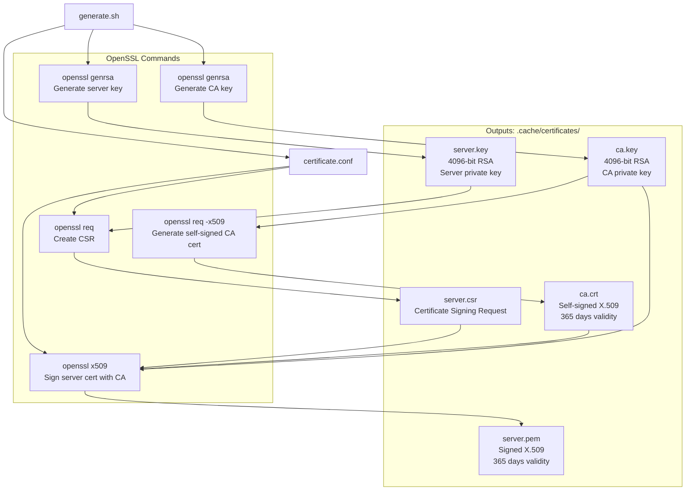
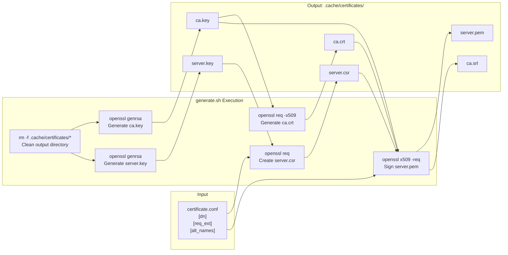
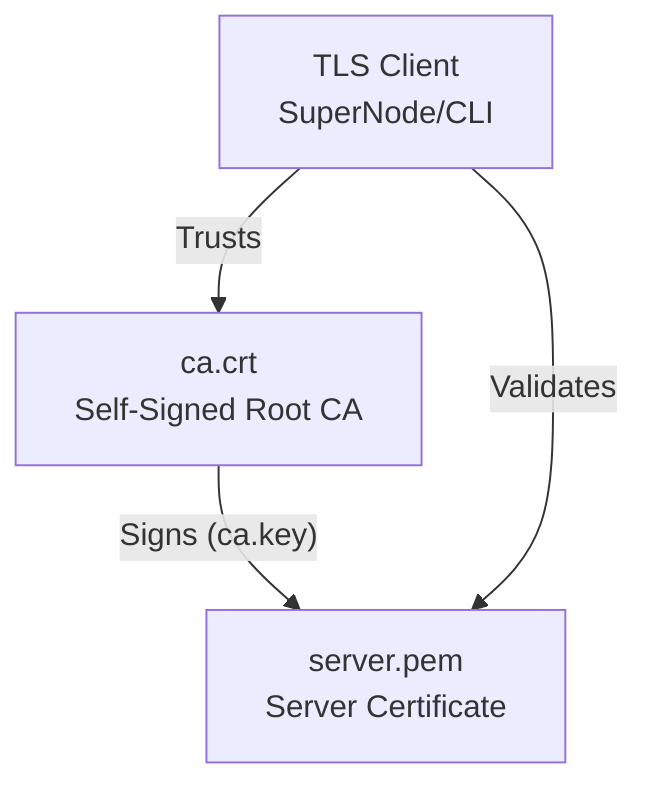

<!-- source: DeepWiki mcp.deepwiki.com · repo adap/flower · page 5.3 TLS Certificates for Development · fetched 2026-10-21 -->

# TLS Certificates for Development

<details>
<summary>Relevant source files</summary>

The following files were used as context for generating this wiki page:

- [dev/certificates/certificate.conf](dev/certificates/certificate.conf)
- [dev/certificates/generate.sh](dev/certificates/generate.sh)

</details>


## Purpose and Scope

This document describes the certificate generation system for local Flower development environments. The scripts in `dev/certificates/` create self-signed TLS certificates that enable encrypted gRPC/REST communication between SuperLink server components and SuperNode clients during development.

For production deployment configurations, see [Docker Deployment](#5.1). For authentication mechanisms that layer on top of TLS, see [Authentication and Authorization](#2.6).

## Overview

Flower's development certificate system generates a complete public key infrastructure (PKI) for local testing:

1. **Certificate Authority (CA)** - A self-signed root certificate that signs server certificates
2. **Server Certificate** - A certificate for localhost that enables TLS on SuperLink gRPC APIs
3. **Certificate Signing Request (CSR)** - An intermediate artifact used to generate the server certificate

The primary script [`dev/certificates/generate.sh`](dev/certificates/generate.sh:1-56)() orchestrates the entire certificate generation process using OpenSSL commands.

**Sources:** [dev/certificates/generate.sh:1-56]()

## Certificate Generation Flow

The following diagram illustrates the complete certificate generation pipeline:



**Sources:** [dev/certificates/generate.sh:1-56]()

## Certificate Authority Generation

The CA certificate serves as the trust anchor for all development certificates. The script generates the CA in two steps:

### CA Private Key

[`dev/certificates/generate.sh:25`](dev/certificates/generate.sh:25-25)() generates a 4096-bit RSA private key:

```bash
openssl genrsa -out $CERT_DIR/ca.key 4096
```

Output: `.cache/certificates/ca.key`

### CA Certificate

[`dev/certificates/generate.sh:26-32`](dev/certificates/generate.sh:26-32)() creates a self-signed X.509 certificate valid for 365 days:

```bash
openssl req \
    -new \
    -x509 \
    -key $CERT_DIR/ca.key \
    -sha256 \
    -subj "/C=DE/ST=HH/O=CA, Inc." \
    -days 365 -out $CERT_DIR/ca.crt
```

| Parameter | Value | Purpose |
|-----------|-------|---------|
| `-x509` | N/A | Generate self-signed certificate (not a CSR) |
| `-key` | `ca.key` | Private key to sign the certificate |
| `-sha256` | N/A | Use SHA-256 hash algorithm |
| `-days` | 365 | Certificate validity period |
| `-subj` | `/C=DE/ST=HH/O=CA, Inc.` | Distinguished Name for the CA |

Output: `.cache/certificates/ca.crt`

**Sources:** [dev/certificates/generate.sh:24-32]()

## Server Certificate Generation

The server certificate enables TLS on SuperLink's gRPC APIs. Generation occurs in three steps:

### Server Private Key

[`dev/certificates/generate.sh:35`](dev/certificates/generate.sh:35-35)() generates the server's 4096-bit RSA private key:

```bash
openssl genrsa -out $CERT_DIR/server.key 4096
```

Output: `.cache/certificates/server.key`

### Certificate Signing Request (CSR)

[`dev/certificates/generate.sh:38-42`](dev/certificates/generate.sh:38-42)() creates a CSR using the configuration file:

```bash
openssl req \
    -new \
    -key $CERT_DIR/server.key \
    -out $CERT_DIR/server.csr \
    -config "$CERT_CONFIG_FILE"
```

The CSR includes:
- Distinguished Name from `certificate.conf` [dn] section
- Subject Alternative Names (SANs) from [req_ext] and [alt_names] sections

Output: `.cache/certificates/server.csr`

### Signed Server Certificate

[`dev/certificates/generate.sh:45-55`](dev/certificates/generate.sh:45-55)() signs the CSR with the CA certificate:

```bash
openssl x509 \
    -req \
    -in $CERT_DIR/server.csr \
    -CA $CERT_DIR/ca.crt \
    -CAkey $CERT_DIR/ca.key \
    -CAcreateserial \
    -out $CERT_DIR/server.pem \
    -days 365 \
    -sha256 \
    -extfile "$CERT_CONFIG_FILE" \
    -extensions req_ext
```

| Parameter | Value | Purpose |
|-----------|-------|---------|
| `-req` | N/A | Process a CSR (not self-signed) |
| `-CA` | `ca.crt` | CA certificate to sign with |
| `-CAkey` | `ca.key` | CA private key |
| `-CAcreateserial` | N/A | Auto-generate serial number file |
| `-extfile` | `certificate.conf` | Extensions configuration file |
| `-extensions` | `req_ext` | Section containing SAN extensions |

Output: `.cache/certificates/server.pem`

**Sources:** [dev/certificates/generate.sh:34-55]()

## Certificate Configuration

The [`dev/certificates/certificate.conf`](dev/certificates/certificate.conf:1-21)() file defines certificate properties using OpenSSL configuration format:

### Distinguished Name Section

```
[dn]
C = DE
ST = HH
O = Flower
CN = localhost
```

| Field | Value | Description |
|-------|-------|-------------|
| C | DE | Country (Germany) |
| ST | HH | State (Hamburg) |
| O | Flower | Organization |
| CN | localhost | Common Name |

**Sources:** [dev/certificates/certificate.conf:8-12]()

### Subject Alternative Names (SANs)

The `[req_ext]` and `[alt_names]` sections specify valid hostnames/IPs for the certificate:

```
[req_ext]
subjectAltName = @alt_names

[alt_names]
DNS.1 = localhost
IP.1 = ::1
IP.2 = 127.0.0.1
```

This configuration allows the certificate to validate connections to:
- `localhost` (DNS name)
- `::1` (IPv6 loopback)
- `127.0.0.1` (IPv4 loopback)

SANs are critical for modern TLS because browsers and gRPC clients reject certificates that don't include SANs matching the connection hostname.

**Sources:** [dev/certificates/certificate.conf:14-21]()

## Certificate Generation Process

The following diagram shows the relationship between configuration, commands, and outputs:



**Sources:** [dev/certificates/generate.sh:1-56](), [dev/certificates/certificate.conf:1-21]()

## Script Execution

### Running the Script

Execute the certificate generation script from the repository root:

```bash
./dev/certificates/generate.sh
```

The script automatically:
1. Changes directory to repository root [dev/certificates/generate.sh:5]()
2. Creates `.cache/certificates/` if it doesn't exist [dev/certificates/generate.sh:15]()
3. Removes existing certificates [dev/certificates/generate.sh:22]()
4. Generates all certificates sequentially

### Custom Configuration

Pass a custom configuration file as the first argument:

```bash
./dev/certificates/generate.sh /path/to/custom.conf
```

The script defaults to `./dev/certificates/certificate.conf` if no argument is provided [dev/certificates/generate.sh:12]().

**Sources:** [dev/certificates/generate.sh:1-12]()

## Output File Structure

After execution, the `.cache/certificates/` directory contains:

| File | Type | Purpose | Key Size | Validity |
|------|------|---------|----------|----------|
| `ca.key` | Private Key | CA signing key | 4096-bit RSA | N/A |
| `ca.crt` | Certificate | CA root certificate | N/A | 365 days |
| `ca.srl` | Serial Number | CA serial tracking | N/A | N/A |
| `server.key` | Private Key | Server private key | 4096-bit RSA | N/A |
| `server.csr` | CSR | Certificate signing request | N/A | N/A |
| `server.pem` | Certificate | Server certificate | N/A | 365 days |

### Certificate Chain

The trust chain for TLS connections:



**Sources:** [dev/certificates/generate.sh:1-56]()

## Usage in Development Workflows

The generated certificates enable TLS for local SuperLink deployments:

### SuperLink Configuration

SuperLink gRPC APIs (Control, Fleet, ServerAppIo, SimulationIo) can be configured to use TLS with:
- Server certificate: `.cache/certificates/server.pem`
- Server private key: `.cache/certificates/server.key`

### SuperNode/CLI Configuration

SuperNode clients and CLI tools need to trust the CA:
- CA certificate: `.cache/certificates/ca.crt`

This allows clients to validate the SuperLink server's certificate during TLS handshake.

### Testing TLS Connections

Verify certificate functionality using OpenSSL:

```bash
openssl s_client -connect localhost:9092 \
    -CAfile .cache/certificates/ca.crt
```

Replace `9092` with the appropriate port (9091 for ServerAppIo, 9093 for Control, etc.).

**Sources:** [dev/certificates/generate.sh:1-56]()

## Certificate Security Considerations

### Development-Only Usage

These certificates are intended **only for local development** because:

1. **Known CA private key**: The CA key is generated locally and not protected by a passphrase [dev/certificates/generate.sh:7]() (CA_PASSWORD is unused)
2. **Self-signed**: No external CA validates the certificate chain
3. **Short validity**: 365-day validity is insufficient for long-term deployments
4. **Public configuration**: Certificate details are committed to the repository

### Production Deployments

For production environments:
- Use certificates from a trusted CA (Let's Encrypt, DigiCert, etc.)
- Implement proper key management and rotation
- Use longer validity periods or automated renewal (e.g., cert-manager in Kubernetes)
- Follow organizational PKI policies

**Sources:** [dev/certificates/generate.sh:7-32]()

## File Location Reference

| Component | Path | Description |
|-----------|------|-------------|
| Generation script | `dev/certificates/generate.sh` | Main certificate generation script |
| Configuration | `dev/certificates/certificate.conf` | OpenSSL configuration for CSR/cert |
| Output directory | `.cache/certificates/` | All generated certificates and keys |
| CA key | `.cache/certificates/ca.key` | Root CA private key (4096-bit RSA) |
| CA certificate | `.cache/certificates/ca.crt` | Root CA certificate (X.509) |
| CA serial | `.cache/certificates/ca.srl` | CA serial number tracking |
| Server key | `.cache/certificates/server.key` | Server private key (4096-bit RSA) |
| Server CSR | `.cache/certificates/server.csr` | Server certificate signing request |
| Server certificate | `.cache/certificates/server.pem` | Server certificate (X.509) |

The `.cache/` directory is typically gitignored, ensuring certificates don't accidentally get committed to version control.

**Sources:** [dev/certificates/generate.sh:9-55](), [dev/certificates/certificate.conf:1-21]()

---

