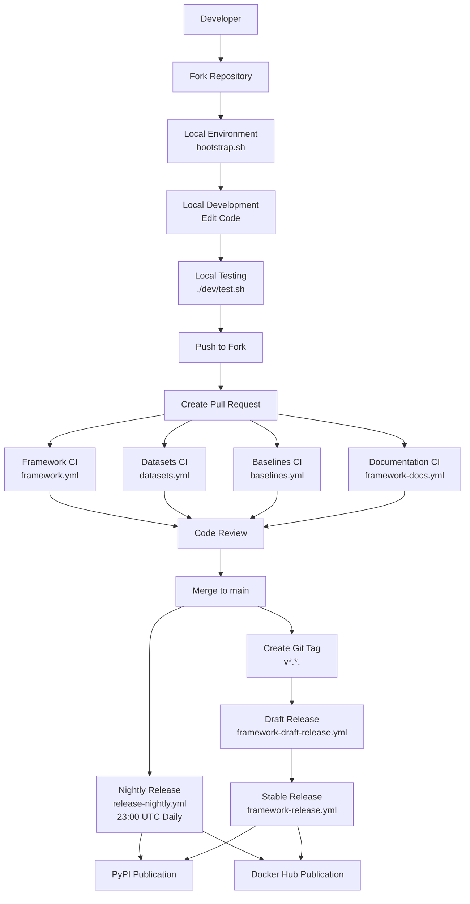
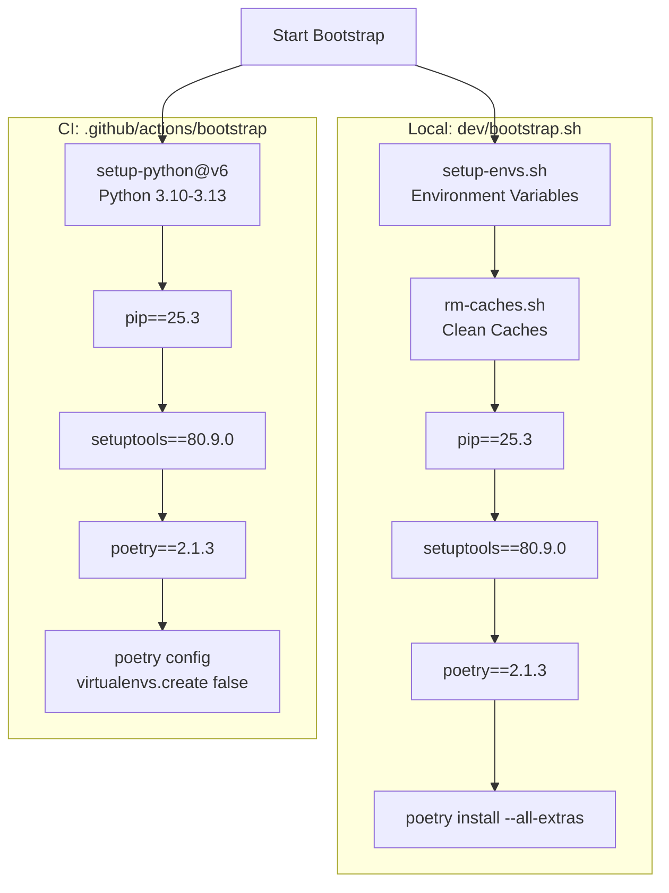
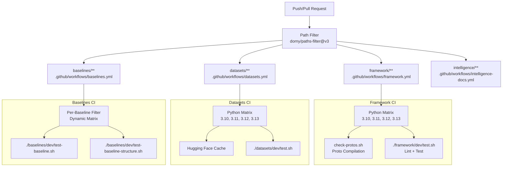
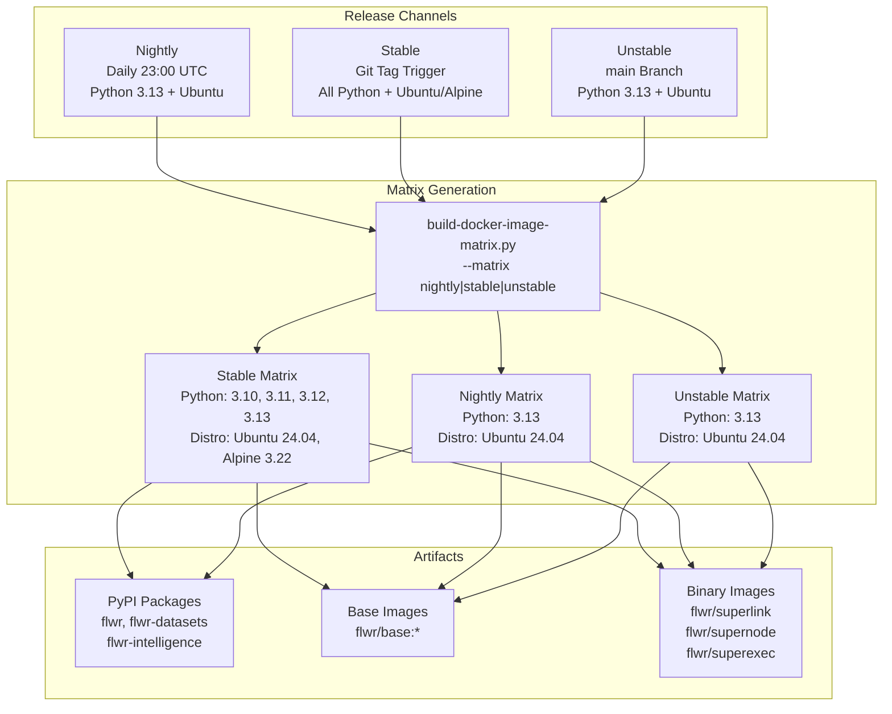
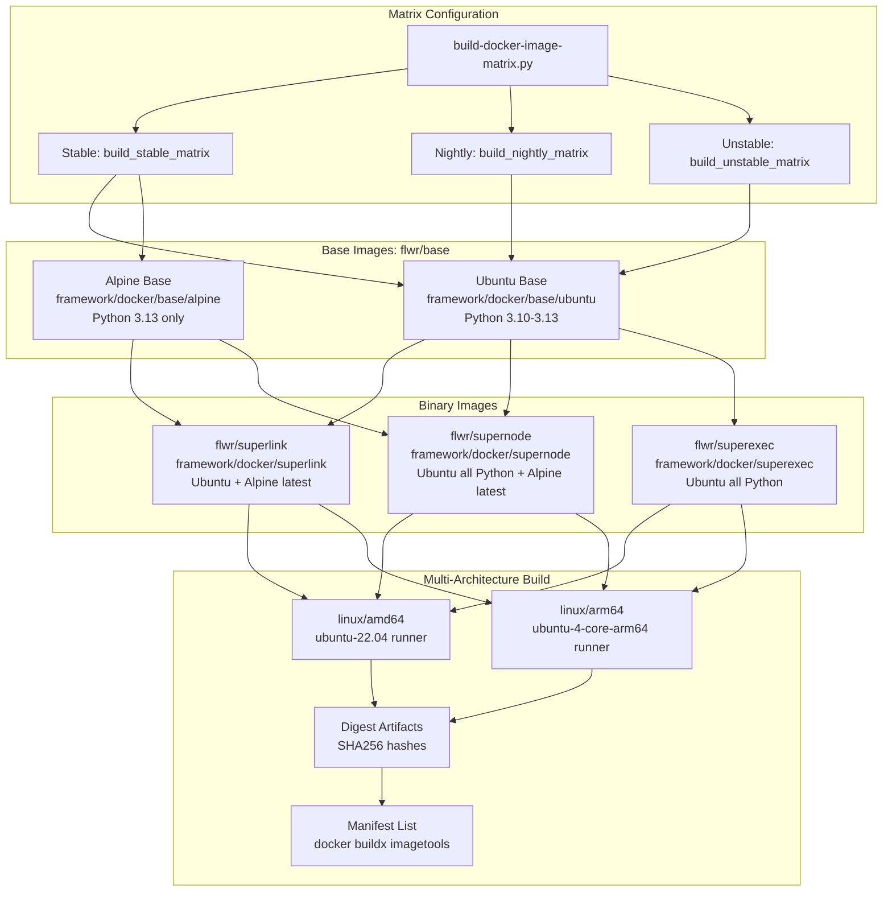
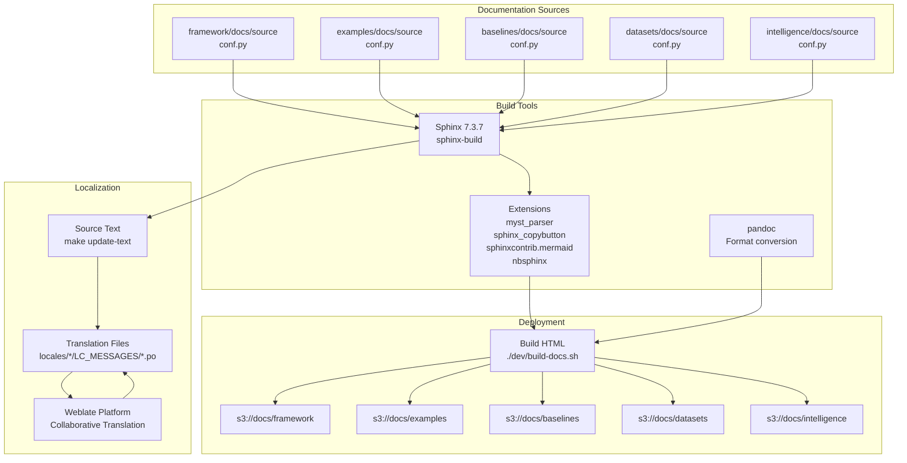
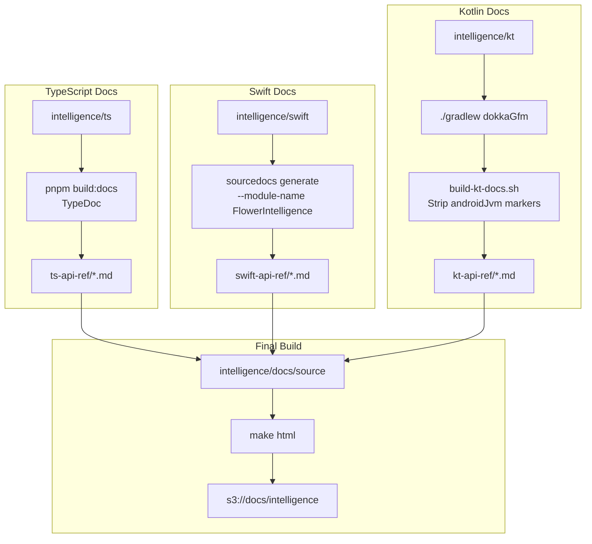
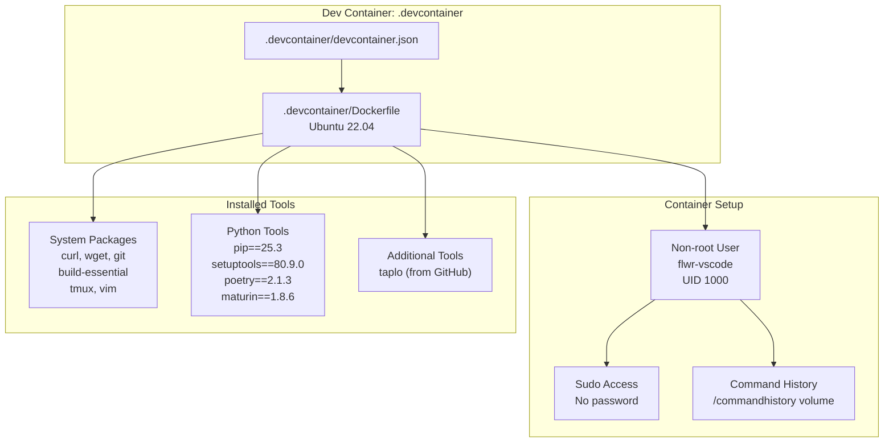
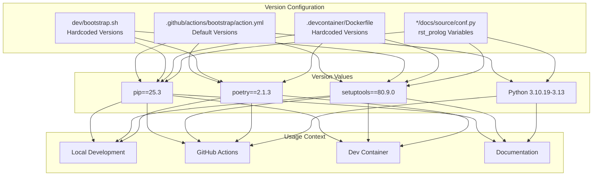

<!-- source: DeepWiki mcp.deepwiki.com · repo adap/flower · page 6 Development Workflow · fetched 2026-10-21 -->

# Development Workflow

<details>
<summary>Relevant source files</summary>

The following files were used as context for generating this wiki page:

- [.devcontainer/Dockerfile](.devcontainer/Dockerfile)
- [.github/actions/bootstrap/action.yml](.github/actions/bootstrap/action.yml)
- [.github/workflows/baselines.yml](.github/workflows/baselines.yml)
- [.github/workflows/datasets-e2e.yml](.github/workflows/datasets-e2e.yml)
- [.github/workflows/datasets.yml](.github/workflows/datasets.yml)
- [.github/workflows/deprecated_baselines.yml](.github/workflows/deprecated_baselines.yml)
- [.github/workflows/framework-cache-cleanup.yml](.github/workflows/framework-cache-cleanup.yml)
- [.github/workflows/framework-devtools.yml](.github/workflows/framework-devtools.yml)
- [.github/workflows/framework-docs-update-translations.yml](.github/workflows/framework-docs-update-translations.yml)
- [.github/workflows/framework-docs.yml](.github/workflows/framework-docs.yml)
- [.github/workflows/framework-draft-release.yml](.github/workflows/framework-draft-release.yml)
- [.github/workflows/framework-release.yml](.github/workflows/framework-release.yml)
- [.github/workflows/framework.yml](.github/workflows/framework.yml)
- [.github/workflows/intelligence-docs.yml](.github/workflows/intelligence-docs.yml)
- [.github/workflows/release-nightly.yml](.github/workflows/release-nightly.yml)
- [baselines/docs/source/conf.py](baselines/docs/source/conf.py)
- [baselines/flwr_baselines/dev/bootstrap.sh](baselines/flwr_baselines/dev/bootstrap.sh)
- [baselines/flwr_baselines/dev/setup-defaults.sh](baselines/flwr_baselines/dev/setup-defaults.sh)
- [baselines/flwr_baselines/dev/venv-create.sh](baselines/flwr_baselines/dev/venv-create.sh)
- [baselines/flwr_baselines/dev/venv-delete.sh](baselines/flwr_baselines/dev/venv-delete.sh)
- [baselines/flwr_baselines/dev/venv-reset.sh](baselines/flwr_baselines/dev/venv-reset.sh)
- [baselines/flwr_baselines/flwr_baselines/publications/adaptive_federated_optimization/main.py](baselines/flwr_baselines/flwr_baselines/publications/adaptive_federated_optimization/main.py)
- [datasets/e2e/tensorflow/tensorflow_test.py](datasets/e2e/tensorflow/tensorflow_test.py)
- [dev/bootstrap.sh](dev/bootstrap.sh)
- [dev/update-html-themes.py](dev/update-html-themes.py)
- [examples/docs/source/conf.py](examples/docs/source/conf.py)
- [framework/dev/build-docker-image-matrix.py](framework/dev/build-docker-image-matrix.py)
- [framework/docker/superexec/Dockerfile](framework/docker/superexec/Dockerfile)
- [framework/docker/superexec/README.md](framework/docker/superexec/README.md)
- [framework/docs/source/conf.py](framework/docs/source/conf.py)
- [intelligence/dev/build-kt-docs.sh](intelligence/dev/build-kt-docs.sh)

</details>


This document describes the development workflow for contributing to the Flower framework, including environment setup, testing, continuous integration, and release processes. It provides an overview of the tools, scripts, and automation that developers use when working on the codebase.

For detailed instructions on setting up your development environment, see [Development Environment Setup](#6.1). For information on the CI/CD pipeline architecture, see [CI/CD Pipeline](#6.2). For testing practices, see [Testing Strategy](#6.3). For contribution guidelines and pull request workflows, see [Contributing Guidelines](#6.4).

## Development Lifecycle Overview

The Flower development workflow follows a standard fork-and-pull model with automated testing and validation at multiple stages. The process involves local development, continuous integration checks, and automated releases through multiple channels.



**Development Lifecycle Workflow**

Sources: [.github/workflows/framework.yml:1-76](), [.github/workflows/release-nightly.yml:1-80](), [.github/workflows/framework-release.yml:1-114](), [dev/bootstrap.sh:1-18]()

## Bootstrap Process

The development environment is bootstrapped using specific versions of Python build tools. The bootstrap process is standardized across local development and CI environments through the `bootstrap.sh` script and the `bootstrap` GitHub Action.



**Bootstrap Process with Specific Tool Versions**

The bootstrap process ensures consistent tool versions across all environments:

| Tool | Version | Purpose |
|------|---------|---------|
| `pip` | 25.3 | Package installer |
| `setuptools` | 80.9.0 | Build system |
| `poetry` | 2.1.3 | Dependency management |
| Python | 3.10-3.13 | Runtime versions (CI matrix) |

Sources: [dev/bootstrap.sh:1-18](), [.github/actions/bootstrap/action.yml:1-56]()

## Continuous Integration Matrix

The CI pipeline uses path-based filtering to optimize build times. Different workflows are triggered based on which files are modified, and tests run across multiple Python versions.



**CI Pipeline Path-Based Filtering and Test Matrix**

Sources: [.github/workflows/framework.yml:19-76](), [.github/workflows/datasets.yml:1-67](), [.github/workflows/baselines.yml:1-90]()

### Framework CI Workflow

The framework CI workflow (`framework.yml`) is the primary validation pipeline for core Flower code changes:

1. **Path Filtering**: Determines if framework or example/benchmark code changed
2. **Python Matrix**: Tests against Python 3.10, 3.11, 3.12, and 3.13
3. **Proto Check**: Verifies gRPC protocol buffer files are up-to-date via `check-protos.sh`
4. **Lint and Test**: Runs `./framework/dev/test.sh` which executes:
   - `isort` (import sorting)
   - `black` (code formatting)
   - `docformatter` (docstring formatting)
   - `mypy` (type checking)
   - `pylint` (linting)
   - `flake8` (style checking)
   - `pytest` (unit tests)

Sources: [.github/workflows/framework.yml:41-76]()

### Baselines CI Workflow

The baselines CI uses dynamic path filtering to test only modified baselines, reducing unnecessary build time for large monorepo changes:

1. **Dynamic Filter Generation**: Creates a filter for each baseline directory using `find` and `dorny/paths-filter@v3`
2. **Fork Protection**: Limits changes from forks to a single baseline at a time
3. **Per-Baseline Testing**: Runs tests only for modified baselines
4. **Structure Validation**: Verifies baseline directory structure compliance

Sources: [.github/workflows/baselines.yml:19-90]()

## Release Channels

Flower maintains three release channels with different build matrices and schedules:



**Release Channels and Build Matrix Strategy**

| Channel | Trigger | Schedule | Python Versions | Distributions | Tag Pattern |
|---------|---------|----------|-----------------|---------------|-------------|
| **Nightly** | Schedule | Daily 23:00 UTC | 3.13 only | Ubuntu 24.04 | `<version>.dev<YYYYMMDD>`, `nightly` |
| **Stable** | Git Tag | Manual | 3.10, 3.11, 3.12, 3.13 | Ubuntu 24.04, Alpine 3.22 | `<version>`, `latest` |
| **Unstable** | Push to main | Continuous | 3.13 only | Ubuntu 24.04 | `unstable` |

Sources: [.github/workflows/release-nightly.yml:1-80](), [.github/workflows/framework-release.yml:1-114](), [framework/dev/build-docker-image-matrix.py:1-534]()

### Nightly Release Process

The nightly release workflow automatically publishes development builds:

1. **Commit Check**: Verifies commits in last 24 hours via `./dev/publish-nightly.sh`
2. **PyPI Publication**: Publishes nightly version to PyPI with token authentication
3. **Matrix Generation**: Calls `build-docker-image-matrix.py --matrix nightly`
4. **Base Images**: Builds `flwr/base` images with nightly Flower version
5. **Binary Images**: Builds `flwr/superlink`, `flwr/supernode`, `flwr/superexec` on base images
6. **Multi-arch**: Builds for `linux/amd64` and `linux/arm64` using separate runners

Sources: [.github/workflows/release-nightly.yml:11-80]()

### Stable Release Process

Stable releases are triggered by creating a Git tag matching `v*.*.*`:

1. **Tag Creation**: Developer creates tag like `v1.24.0`
2. **Draft Release**: `framework-draft-release.yml` creates GitHub release draft
3. **Artifact Download**: Retrieves wheel and tar.gz from S3 artifact bucket
4. **Changelog Extraction**: Runs `./framework/dev/get-latest-changelog.sh`
5. **Release Approval**: Manual review and publish of draft release
6. **PyPI Publication**: `framework-release.yml` publishes to PyPI
7. **Docker Build**: Full matrix build (all Python versions, Ubuntu + Alpine)

Sources: [.github/workflows/framework-draft-release.yml:1-67](), [.github/workflows/framework-release.yml:1-114]()

## Docker Image Build Strategy

The Docker image build process uses a two-stage approach with base and binary images, and employs digest-based pushing for multi-architecture support.



**Docker Image Build Architecture**

The `build-docker-image-matrix.py` script generates build configurations for three release types:

- **`build_stable_matrix()`**: Full matrix with all Python versions (3.10-3.13), both Ubuntu and Alpine for base images, comprehensive binary image builds
- **`build_nightly_matrix()`**: Latest Python only (3.13), Ubuntu base images, nightly tags
- **`build_unstable_matrix()`**: Latest Python only (3.13), Ubuntu base images, unstable tags

Image tagging follows a hierarchical pattern:
- Specific tags: `1.24.0-py3.12-ubuntu24.04`
- Convenience tags: `latest`, `nightly`, `unstable`
- CUDA tags: `nightly-cuda` (for GPU support)

Sources: [framework/dev/build-docker-image-matrix.py:1-534]()

## Documentation Build Process

Documentation is built using Sphinx and deployed to S3. The build process handles multiple documentation sites (framework, examples, baselines, datasets, intelligence) with support for versioning and translations.



**Documentation Build and Deployment Pipeline**

The documentation uses common Sphinx configuration across all documentation sites:

| Configuration | Value | File Reference |
|---------------|-------|----------------|
| Theme | `furo` | [framework/docs/source/conf.py:289]() |
| Python Version | 3.10 | Bootstrap default |
| Release Version | 1.24.0 | [framework/docs/source/conf.py:95]() |
| Locale Directory | `../locales` | [framework/docs/source/conf.py:84]() |
| Supported Languages | en, fr, pt, ko, zh | Translation workflow |

Documentation deployment is triggered on merge to `main` and uses AWS CLI to sync built HTML to S3:
```bash
aws s3 sync --delete --exclude ".*" --exclude "v/*" --cache-control "no-cache" \
  ./framework/docs/build/html/ s3://<bucket>/docs/framework
```

Sources: [framework/docs/source/conf.py:1-377](), [.github/workflows/framework-docs.yml:1-51]()

## Intelligence Multi-Platform Documentation

The Intelligence SDK requires building documentation for multiple languages (TypeScript, Swift, Kotlin) before final Sphinx build:



**Intelligence Documentation Multi-Language Build Process**

The Intelligence documentation build requires:
- **TypeScript**: Node.js 22.14.0, pnpm, TypeDoc
- **Swift**: Xcode 16.2, Swift 6.0.0, SourceDocs (via Homebrew)
- **Kotlin**: JDK 17, Gradle, Dokka plugin

Each language generates Markdown files that are post-processed and combined into a unified Sphinx documentation site.

Sources: [.github/workflows/intelligence-docs.yml:1-178](), [intelligence/dev/build-kt-docs.sh:1-70]()

## Development Container Support

Flower provides a VSCode Dev Container configuration for consistent development environments:



**Dev Container Configuration**

The dev container provides:
1. **Isolated Environment**: Ubuntu 22.04 base with all required tools pre-installed
2. **Non-root User**: `flwr-vscode` user with UID 1000 for permission compatibility
3. **Persistent History**: Command history preserved across container rebuilds via volume mount
4. **Tool Versions**: Same versions as CI for consistency (pip 25.3, setuptools 80.9.0, poetry 2.1.3)

Sources: [.devcontainer/Dockerfile:1-42]()

## Testing Infrastructure

Testing is organized by component with dedicated test scripts:

| Component | Test Script | Test Types |
|-----------|-------------|------------|
| Framework | `./framework/dev/test.sh` | Lint + Unit tests |
| Datasets | `./datasets/dev/test.sh` | Formatting + Unit + E2E |
| Baselines | `./baselines/dev/test-baseline.sh <name>` | Baseline-specific tests |
| Baselines Structure | `./baselines/dev/test-baseline-structure.sh <name>` | Directory structure validation |
| DevTools | `./framework/dev/test-tool.sh` | Tool-specific tests |

E2E tests for datasets verify integration with ML frameworks:
- PyTorch: [datasets/e2e/pytorch/pytorch_test.py:1-102]()
- TensorFlow: [datasets/e2e/tensorflow/tensorflow_test.py:1-102]()
- scikit-learn: Tests under `datasets/e2e/scikit-learn/`

Sources: [.github/workflows/framework.yml:70-72](), [.github/workflows/datasets.yml:66](), [.github/workflows/baselines.yml:84-89](), [datasets/e2e/tensorflow/tensorflow_test.py:1-102]()

## Version Management

Tool versions are centrally managed and synchronized across all environments:



**Centralized Version Management**

Version synchronization ensures:
- Identical tool versions between local development and CI
- Reproducible builds across different environments
- Documentation reflects actual version requirements
- Simplified version updates (change in fewer places)

When updating versions, the following files must be modified:
1. [.github/actions/bootstrap/action.yml:6-15]() - Default input values
2. [dev/bootstrap.sh:12-14]() - Script hardcoded versions
3. [.devcontainer/Dockerfile:31-34]() - Container hardcoded versions
4. [framework/docs/source/conf.py:97-105]() - Documentation variables (rst_prolog)

Sources: [.github/actions/bootstrap/action.yml:1-56](), [dev/bootstrap.sh:1-18](), [.devcontainer/Dockerfile:1-42](), [framework/docs/source/conf.py:97-105]()

---

