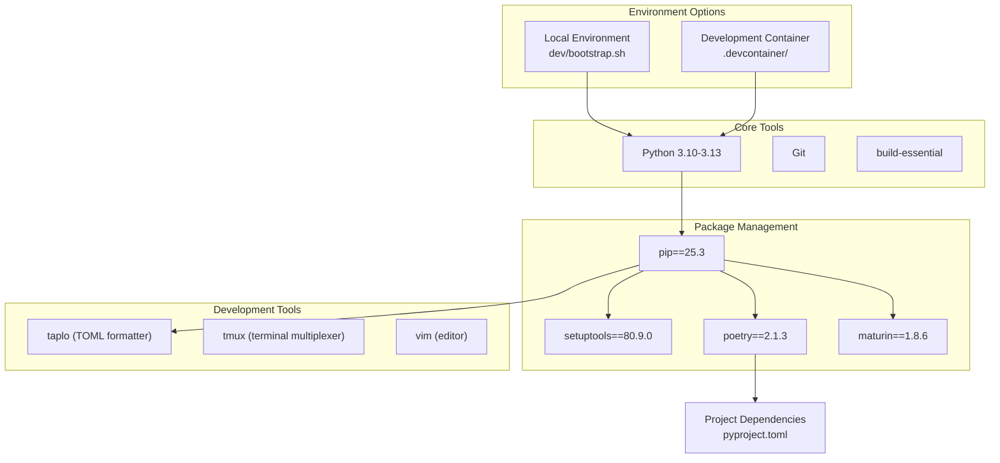
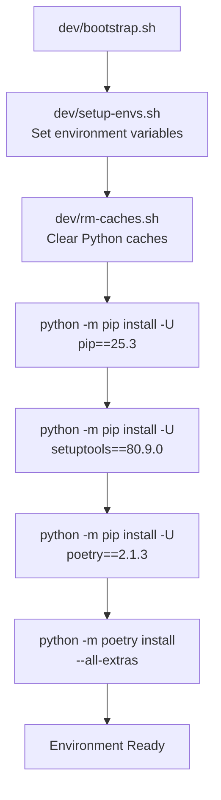
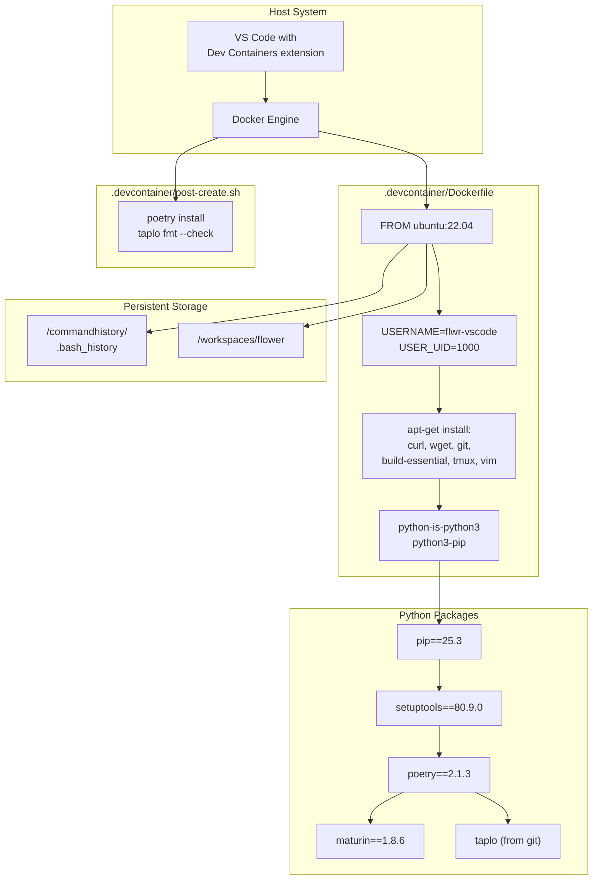
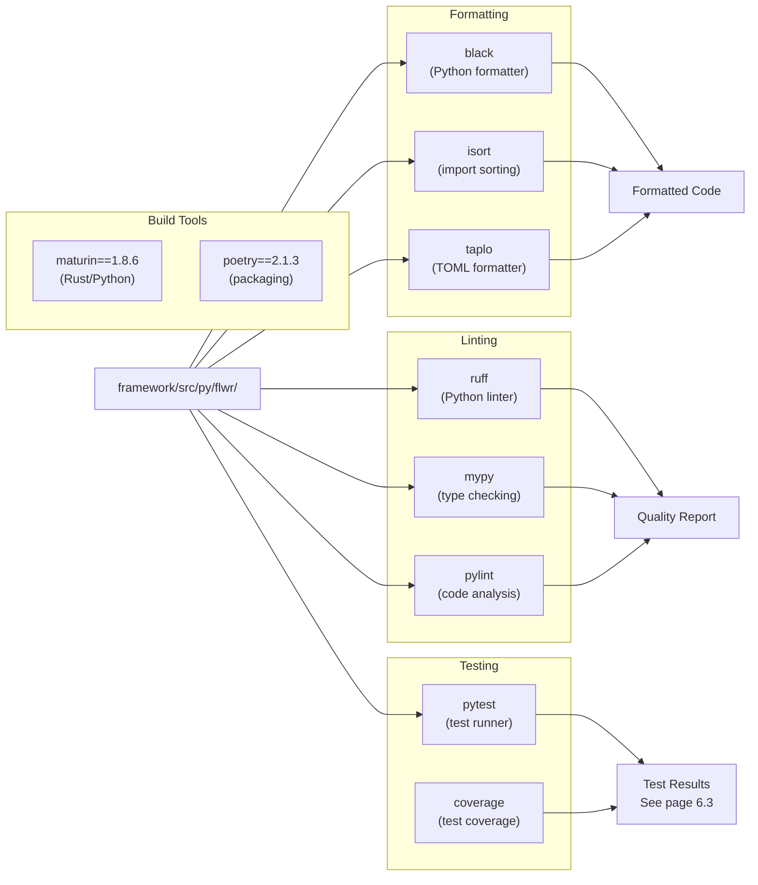

<!-- source: DeepWiki mcp.deepwiki.com · repo adap/flower · page 6.1 Development Environment Setup · fetched 2026-10-21 -->

# Development Environment Setup

<details>
<summary>Relevant source files</summary>

The following files were used as context for generating this wiki page:

- [.devcontainer/Dockerfile](.devcontainer/Dockerfile)
- [.github/actions/bootstrap/action.yml](.github/actions/bootstrap/action.yml)
- [.github/workflows/baselines.yml](.github/workflows/baselines.yml)
- [.github/workflows/deprecated_baselines.yml](.github/workflows/deprecated_baselines.yml)
- [baselines/docs/source/conf.py](baselines/docs/source/conf.py)
- [baselines/flwr_baselines/dev/bootstrap.sh](baselines/flwr_baselines/dev/bootstrap.sh)
- [baselines/flwr_baselines/dev/setup-defaults.sh](baselines/flwr_baselines/dev/setup-defaults.sh)
- [baselines/flwr_baselines/dev/venv-create.sh](baselines/flwr_baselines/dev/venv-create.sh)
- [baselines/flwr_baselines/dev/venv-delete.sh](baselines/flwr_baselines/dev/venv-delete.sh)
- [baselines/flwr_baselines/dev/venv-reset.sh](baselines/flwr_baselines/dev/venv-reset.sh)
- [baselines/flwr_baselines/flwr_baselines/publications/adaptive_federated_optimization/main.py](baselines/flwr_baselines/flwr_baselines/publications/adaptive_federated_optimization/main.py)
- [dev/bootstrap.sh](dev/bootstrap.sh)
- [dev/update-html-themes.py](dev/update-html-themes.py)
- [examples/docs/source/conf.py](examples/docs/source/conf.py)
- [framework/docs/source/conf.py](framework/docs/source/conf.py)

</details>


This document covers the setup of local development environments for contributing to the Flower federated AI framework. It includes both traditional local setup and containerized development approaches, dependency management, and verification steps.

For information about testing and CI/CD pipelines, see [Testing and CI/CD](#6.2). For contribution guidelines and code review processes, see [Contributing Guidelines](#6.3).

## Prerequisites

The Flower development environment requires several system-level dependencies and tools to be installed before beginning the setup process.

### System Requirements

| Component | Requirement | Purpose |
|-----------|-------------|---------|
| Python | 3.10 - 3.13 | Core runtime for Flower framework |
| Git | Latest stable | Source code management |
| Build tools | `build-essential` (Linux) | Compilation of native dependencies |
| curl/wget | Latest | Package downloads |

The default Python version used across the project is `3.10.19`, as specified in [.github/actions/bootstrap/action.yml:6]() and [framework/docs/source/conf.py:103-104]().

### Development Tools Overview



Sources: [.devcontainer/Dockerfile:31-34](), [dev/bootstrap.sh:12-14](), [.github/actions/bootstrap/action.yml:6-15](), [framework/docs/source/conf.py:102-103]()

## Local Development Setup

The primary method for setting up a local development environment uses the bootstrap script located in the `dev` directory.

### Bootstrap Process



The bootstrap script [dev/bootstrap.sh:1-18]() performs several critical setup steps:

1. **Environment Variables**: Configures development-specific environment variables via [dev/setup-envs.sh:6]()
2. **Cache Cleanup**: Removes any existing build caches (`.mypy_cache`, `__pycache__`, etc.) via [dev/rm-caches.sh:9]()
3. **Package Manager Setup**: Installs specific versions of `pip`, `setuptools`, and `poetry` [dev/bootstrap.sh:12-14]()
4. **Dependency Installation**: Uses Poetry to install all project dependencies with extras [dev/bootstrap.sh:17]()

### Usage

```bash
# Navigate to repository root
cd /path/to/flower

# Run bootstrap script
./dev/bootstrap.sh
```

Sources: [dev/bootstrap.sh:1-18]()

## Development Container Setup

For consistent development environments across different systems, Flower provides a development container configuration using Docker and VS Code dev containers defined in [.devcontainer/devcontainer.json:1-24]().

### Container Architecture



### Container Configuration

The development container [.devcontainer/Dockerfile:1-42]() includes:

- **Base OS**: Ubuntu 22.04 LTS [.devcontainer/Dockerfile:1]()
- **Non-root User**: `flwr-vscode` with UID 1000 and sudo access [.devcontainer/Dockerfile:4-16]()
- **Persistent History**: Command history at `/commandhistory/.bash_history` preserved across rebuilds [.devcontainer/Dockerfile:20-24]()
- **System Dependencies**: Build tools, Git, curl, tmux, vim [.devcontainer/Dockerfile:28-29]()
- **Python Environment**: Python 3 with pip, setuptools, poetry, maturin [.devcontainer/Dockerfile:31-38]()

### Container Usage

```bash
# Open in VS Code (with Dev Containers extension)
code .

# VS Code will prompt to reopen in container
# Or use Command Palette: "Dev Containers: Reopen in Container"
```

The container automatically runs [.devcontainer/post-create.sh:1-33]() after creation, which:
1. Installs project dependencies via `poetry install`
2. Sets up the TOML formatter `taplo`
3. Verifies formatting of configuration files

Sources: [.devcontainer/Dockerfile:1-42](), [.devcontainer/devcontainer.json:1-24](), [.devcontainer/post-create.sh:1-33]()

## Dependency Management

Flower uses Poetry as the primary dependency management tool, with specific version pinning for reproducible builds.

### Package Version Matrix

| Tool | Local Dev | CI/CD | Dev Container | Baselines |
|------|-----------|--------|---------------|-----------|
| pip | 25.3 | 25.3 | 25.3 | 25.3 |
| setuptools | 80.9.0 | 80.9.0 | 80.9.0 | 80.9.0 |
| poetry | 2.1.3 | 2.1.3 | 2.1.3 | 2.3.1 |
| Python | 3.10.19 (default) | 3.10-3.13 (matrix) | 3.10.19 | 3.10.19 |

Version references:
- Framework: [dev/bootstrap.sh:12-14](), [.github/actions/bootstrap/action.yml:6-15]()
- Baselines: [baselines/flwr_baselines/dev/bootstrap.sh:9-11]()
- Container: [.devcontainer/Dockerfile:31-34]()

### Poetry Configuration

Poetry is configured with specific settings for the development environment:

```bash
# Disable virtual environment creation (CI/CD and container environments)
python -m poetry config virtualenvs.create false

# Install all dependencies including development extras (framework)
python -m poetry install --all-extras

# For baselines development
python -m poetry install  # Installs dependencies from baselines/flwr_baselines/pyproject.toml
```

The CI/CD bootstrap action [.github/actions/bootstrap/action.yml:42-46]() disables Poetry's virtual environment creation since workflows run in isolated environments. The local [dev/bootstrap.sh:17]() and container [.devcontainer/post-create.sh:27]() setups use Poetry's default virtual environment handling.

### Dependency Categories

The project organizes dependencies in `pyproject.toml` files:
- **Core dependencies**: Required for basic framework functionality
- **Development dependencies**: Testing, linting, and development tools
- **Optional extras**: Simulation capabilities, specific integrations
- **Build dependencies**: Tools required for package building and distribution

Sources: [dev/bootstrap.sh:17](), [.github/actions/bootstrap/action.yml:42-46](), [.devcontainer/post-create.sh:27]()

## Development Tools and Configuration

The development environment includes several tools for code quality and development productivity.

### Code Quality Tools



These tools are installed as development dependencies via Poetry and invoked through various scripts in the `dev/` directory.

### Environment Variables

The development environment uses several environment variables for configuration:

| Variable | Purpose | Default/Usage |
|----------|---------|---------------|
| `FLWR_TELEMETRY_ENABLED` | Disable telemetry in CI/CD | `0` [.github/workflows/baselines.yml:16]() |
| `PYENV_ROOT` | pyenv installation directory | `$HOME/.pyenv` [baselines/flwr_baselines/dev/setup-defaults.sh:21]() |
| `PATH` | Include local Python tools | `~/.local/bin` [.devcontainer/Dockerfile:41]() |

Sources: [.github/workflows/baselines.yml:16](), [.devcontainer/Dockerfile:41](), [baselines/flwr_baselines/dev/setup-defaults.sh:20-27]()

## Verification and Testing

After setting up the development environment, verify the installation by running basic commands and tests.

### Environment Verification Steps

1. **Python and Tool Versions**:
   ```bash
   python --version  # Should show 3.9-3.12
   poetry --version  # Should show 2.1.3
   pip --version     # Should show 24.1.2
   ```

2. **Framework Import Test**:
   ```bash
   python -c "import flwr; print(flwr.__version__)"
   ```

3. **Development Tools Test**:
   ```bash
   # Run basic linting
   ruff check framework/src/py/flwr/
   
   # Run type checking
   mypy framework/src/py/flwr/
   
   # Run formatting check
   black --check framework/src/py/flwr/
   ```

### Project Structure Verification

The properly set up development environment should have access to key project directories:

| Directory | Purpose |
|-----------|---------|
| `framework/` | Core Flower framework code |
| `baselines/` | Research baselines and examples |
| `datasets/` | Federated dataset utilities |
| `dev/` | Development scripts and utilities |
| `examples/` | Usage examples and tutorials |

Sources: [.gitignore:1-9](), [baselines/flwr_baselines/dev/bootstrap.sh:1-15]()

---

