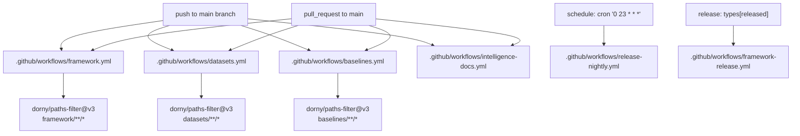
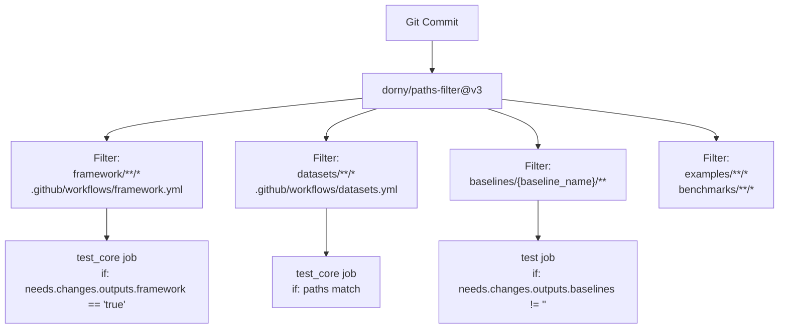
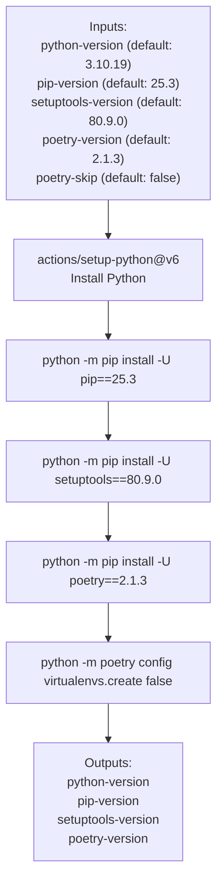
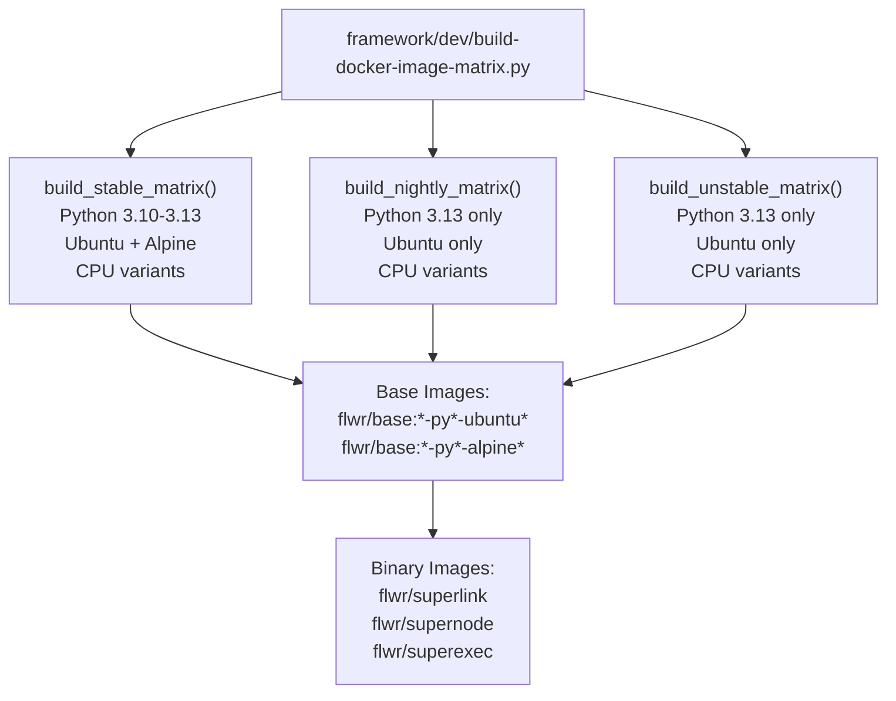
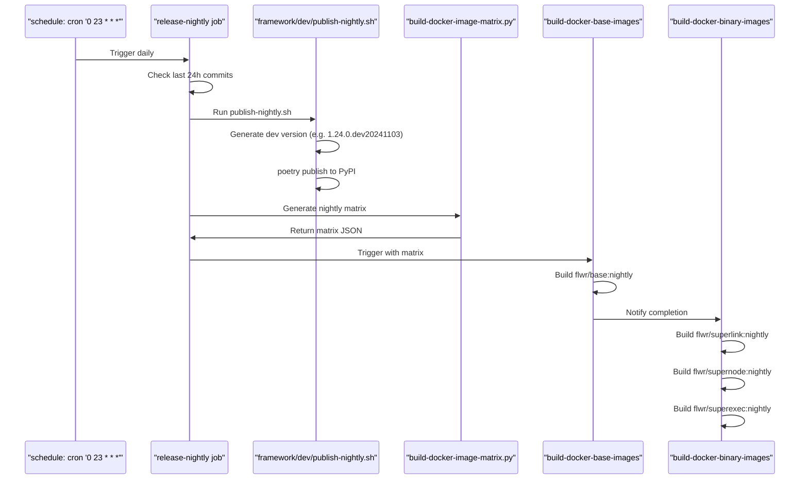
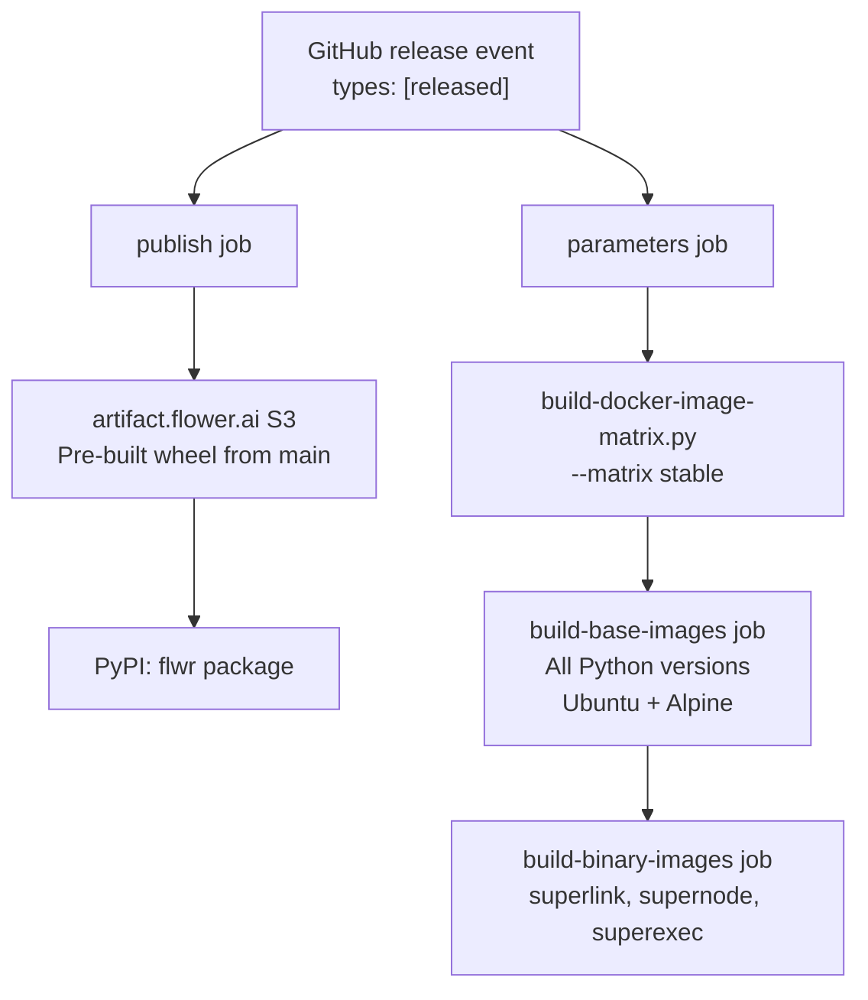
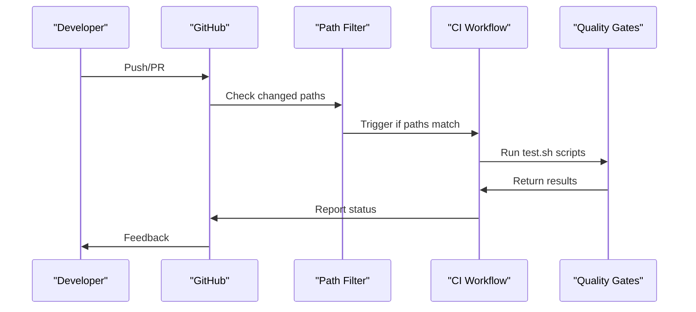

<!-- source: DeepWiki mcp.deepwiki.com · repo adap/flower · page 6.2 CI/CD Pipeline · fetched 2026-10-21 -->

# CI/CD Pipeline

<details>
<summary>Relevant source files</summary>

The following files were used as context for generating this wiki page:

- [.devcontainer/Dockerfile](.devcontainer/Dockerfile)
- [.github/actions/bootstrap/action.yml](.github/actions/bootstrap/action.yml)
- [.github/workflows/baselines.yml](.github/workflows/baselines.yml)
- [.github/workflows/datasets-e2e.yml](.github/workflows/datasets-e2e.yml)
- [.github/workflows/datasets.yml](.github/workflows/datasets.yml)
- [.github/workflows/deprecated_baselines.yml](.github/workflows/deprecated_baselines.yml)
- [.github/workflows/framework-cache-cleanup.yml](.github/workflows/framework-cache-cleanup.yml)
- [.github/workflows/framework-devtools.yml](.github/workflows/framework-devtools.yml)
- [.github/workflows/framework-docs-update-translations.yml](.github/workflows/framework-docs-update-translations.yml)
- [.github/workflows/framework-docs.yml](.github/workflows/framework-docs.yml)
- [.github/workflows/framework-draft-release.yml](.github/workflows/framework-draft-release.yml)
- [.github/workflows/framework-release.yml](.github/workflows/framework-release.yml)
- [.github/workflows/framework.yml](.github/workflows/framework.yml)
- [.github/workflows/intelligence-docs.yml](.github/workflows/intelligence-docs.yml)
- [.github/workflows/release-nightly.yml](.github/workflows/release-nightly.yml)
- [baselines/docs/source/conf.py](baselines/docs/source/conf.py)
- [baselines/flwr_baselines/dev/bootstrap.sh](baselines/flwr_baselines/dev/bootstrap.sh)
- [baselines/flwr_baselines/dev/setup-defaults.sh](baselines/flwr_baselines/dev/setup-defaults.sh)
- [baselines/flwr_baselines/dev/venv-create.sh](baselines/flwr_baselines/dev/venv-create.sh)
- [baselines/flwr_baselines/dev/venv-delete.sh](baselines/flwr_baselines/dev/venv-delete.sh)
- [baselines/flwr_baselines/dev/venv-reset.sh](baselines/flwr_baselines/dev/venv-reset.sh)
- [baselines/flwr_baselines/flwr_baselines/publications/adaptive_federated_optimization/main.py](baselines/flwr_baselines/flwr_baselines/publications/adaptive_federated_optimization/main.py)
- [datasets/e2e/tensorflow/tensorflow_test.py](datasets/e2e/tensorflow/tensorflow_test.py)
- [dev/bootstrap.sh](dev/bootstrap.sh)
- [dev/update-html-themes.py](dev/update-html-themes.py)
- [examples/docs/source/conf.py](examples/docs/source/conf.py)
- [framework/dev/build-docker-image-matrix.py](framework/dev/build-docker-image-matrix.py)
- [framework/docker/superexec/Dockerfile](framework/docker/superexec/Dockerfile)
- [framework/docker/superexec/README.md](framework/docker/superexec/README.md)
- [framework/docs/source/conf.py](framework/docs/source/conf.py)
- [intelligence/dev/build-kt-docs.sh](intelligence/dev/build-kt-docs.sh)

</details>


This document explains the continuous integration and continuous deployment (CI/CD) pipelines implemented in the Flower framework using GitHub Actions. It covers the workflow structure, path-based filtering, matrix build strategies, Docker image generation, and release processes.

For information about development environment setup, see [Development Environment Setup](#6.1). For testing strategies and quality checks, see [Testing Strategy](#6.3).

## Overview

The Flower CI/CD pipeline consists of multiple GitHub Actions workflows that automate building, testing, and deploying components:

- **Component-specific workflows** for framework, datasets, baselines, and intelligence
- **Path-based filtering** to trigger only relevant workflows on file changes
- **Matrix strategies** for testing across Python versions 3.10-3.13
- **Automated Docker image building** with multi-architecture support (amd64/arm64)
- **Dual release channels** for nightly and stable releases
- **Documentation generation and deployment** to S3

## GitHub Actions Workflows

### Workflow Architecture

The CI/CD pipeline uses multiple GitHub Actions workflows organized by component and purpose.

**Diagram: GitHub Actions Workflow Trigger Flow**



Sources: [.github/workflows/framework.yml:3-9](), [.github/workflows/datasets.yml:3-17](), [.github/workflows/baselines.yml:3-9](), [.github/workflows/intelligence-docs.yml:3-15](), [.github/workflows/release-nightly.yml:4-5](), [.github/workflows/framework-release.yml:4-5]()

### Core Workflows

| Workflow File | Trigger | Purpose | Python Versions |
|---------------|---------|---------|-----------------|
| `framework.yml` | Push/PR to main | Tests framework core code | 3.10, 3.11, 3.12, 3.13 |
| `datasets.yml` | Push/PR to main | Tests flwr-datasets package | 3.10, 3.11, 3.12, 3.13 |
| `baselines.yml` | Push/PR to main | Tests modified baselines | 3.10 |
| `intelligence-docs.yml` | Push/PR to main | Builds TS/Swift/Kotlin docs | 3.10 |
| `release-nightly.yml` | Daily at 23:00 UTC | Publishes nightly builds | 3.13 |
| `framework-release.yml` | GitHub release | Publishes stable releases | 3.10, 3.11, 3.12, 3.13 |

Sources: [.github/workflows/framework.yml:1-76](), [.github/workflows/datasets.yml:1-67](), [.github/workflows/baselines.yml:1-90](), [.github/workflows/intelligence-docs.yml:1-178](), [.github/workflows/release-nightly.yml:1-80](), [.github/workflows/framework-release.yml:1-114]()

### Concurrency Control

All workflows implement concurrency control to cancel outdated builds and conserve resources:

```yaml
concurrency:
  group: ${{ github.workflow }}-${{ github.ref == 'refs/heads/main' && github.run_id || github.event.pull_request.number || github.ref }}
  cancel-in-progress: true
```

This configuration groups workflow runs by workflow name and either the run ID (for main branch) or pull request number, canceling in-progress runs when a new commit is pushed.

Sources: [.github/workflows/framework.yml:11-13](), [.github/workflows/datasets.yml:19-21]()

## Path-Based Filtering

### Path Filter Configuration

The workflows use `dorny/paths-filter@v3` action to conditionally execute jobs based on changed files. This minimizes unnecessary builds and test runs.

**Diagram: Path Filter Pattern Matching**



Sources: [.github/workflows/framework.yml:19-39](), [.github/workflows/datasets.yml:7-17](), [.github/workflows/baselines.yml:26-54]()

### Framework Workflow Path Filtering

The `framework.yml` workflow defines two filter sets:

```yaml
filters: |
  framework:
    - 'framework/**/*'
    - '.github/workflows/framework.yml'
  ex_bench:
    - 'examples/**/*'
    - 'benchmarks/**/*'
    - 'dev/test.sh'
    - '.github/workflows/framework.yml'
```

The `changes` job outputs boolean flags that control downstream job execution:

```yaml
outputs:
  framework: ${{ steps.filter.outputs.framework }}
  ex_bench: ${{ steps.filter.outputs.ex_bench }}
```

Jobs then conditionally run based on these outputs:

```yaml
- name: Lint + Test
  if: ${{ needs.changes.outputs.framework == 'true' }}
  run: ./framework/dev/test.sh
```

Sources: [.github/workflows/framework.yml:31-39](), [.github/workflows/framework.yml:21-23](), [.github/workflows/framework.yml:70-72]()

### Baselines Dynamic Path Detection

The baselines workflow dynamically generates path filters for each baseline directory:

```bash
FILTER=""
while read -d $'\0' BASELINES_PATH; do
    DIR=$(basename $BASELINES_PATH)
    FILTER+=$(echo "$DIR: ${BASELINES_PATH}/**\n")
done < <(find baselines -maxdepth 1 \
    -name ".*" -prune -o \
    -path "baselines/docs" -prune -o \
    -path "baselines/dev" -prune -o \
    -path "baselines/baseline_template" -prune -o \
    -path "baselines/flwr_baselines" -prune -o \
    -type d -print0)
```

This generates filter patterns like:

```
fedavg: baselines/fedavg/**
fednova: baselines/fednova/**
```

The workflow then uses a matrix strategy to test only changed baselines:

```yaml
strategy:
  matrix:
    baseline: ${{ fromJSON(needs.changes.outputs.baselines) }}
```

Sources: [.github/workflows/baselines.yml:28-54](), [.github/workflows/baselines.yml:68-70]()

## Matrix Strategies

### Python Version Matrix

The framework and datasets workflows test across multiple Python versions using GitHub Actions matrix strategies:

```yaml
strategy:
  matrix:
    python: ['3.10', '3.11', '3.12', '3.13']

name: Python ${{ matrix.python }}

steps:
  - uses: ./.github/actions/bootstrap
    with:
      python-version: ${{ matrix.python }}
```

This creates four parallel jobs, one for each Python version. The runner uses `ubuntu-22.04` which includes cached Python versions for faster execution.

Sources: [.github/workflows/framework.yml:44-61](), [.github/workflows/datasets.yml:29-46]()

### E2E Framework Matrix

The `datasets-e2e.yml` workflow tests integration with different ML frameworks:

```yaml
strategy:
  matrix:
    include:
      - directory: pytorch
      - directory: tensorflow
      - directory: scikit-learn
```

Each matrix entry runs tests in the corresponding directory under `datasets/e2e/`:

```yaml
defaults:
  run:
    working-directory: datasets/e2e/${{ matrix.directory }}
```

Sources: [.github/workflows/datasets-e2e.yml:28-41]()

### Baseline Testing Matrix

The baselines workflow uses a dynamic matrix populated by path filtering:

```yaml
needs: changes
if: ${{ needs.changes.outputs.baselines != '' && toJson(fromJson(needs.changes.outputs.baselines)) != '[]' }}
strategy:
  matrix:
    baseline: ${{ fromJSON(needs.changes.outputs.baselines) }}
```

This only runs tests for baselines with file changes, reducing CI time for pull requests.

Sources: [.github/workflows/baselines.yml:64-70]()

## Bootstrap Action

### Reusable Environment Setup

The `.github/actions/bootstrap` action provides consistent Python environment setup across all workflows.

**Diagram: Bootstrap Action Steps**



Sources: [.github/actions/bootstrap/action.yml:1-56]()

### Bootstrap Script

The `dev/bootstrap.sh` script provides local development environment setup equivalent to the CI bootstrap action:

```bash
# Upgrade/install specific versions of `pip`, `setuptools`, and `poetry`
python -m pip install -U pip==25.3
python -m pip install -U setuptools==80.9.0
python -m pip install -U poetry==2.1.3

# Use `poetry` to install project dependencies
python -m poetry install --all-extras
```

This ensures developers can replicate the CI environment locally.

Sources: [dev/bootstrap.sh:11-17]()

### Version Consistency

The bootstrap action outputs version information for use in downstream jobs:

```yaml
outputs:
  python-version:
    description: "Version range or exact version of Python or PyPy"
    value: ${{ steps.versions.outputs.python-version }}
  pip-version:
    description: "Installed version of pip"
    value: ${{ steps.versions.outputs.pip-version }}
```

These outputs are used in Docker build jobs to ensure images use matching tool versions.

Sources: [.github/actions/bootstrap/action.yml:20-32](), [.github/workflows/release-nightly.yml:16-19]()

## Docker Image Building

### Build Matrix Generation

The `build-docker-image-matrix.py` script generates JSON build matrices for GitHub Actions. The script supports three matrix types: `stable`, `nightly`, and `unstable`.

**Diagram: Docker Build Matrix Flow**



Sources: [framework/dev/build-docker-image-matrix.py:1-534]()

### Base Image Variants

The matrix generator defines base image variants for different distributions and Python versions:

```python
UBUNTU_VARIANT = Variant(
    Distro(DistroName.UBUNTU, "24.04"),
    CpuVariant(),
)

ALPINE_VARIANT = Variant(
    Distro(DistroName.ALPINE, "3.22"),
    CpuVariant(),
)

SUPPORTED_PYTHON_VERSIONS = [
    "3.10",
    "3.11",
    "3.12",
    LATEST_SUPPORTED_PYTHON_VERSION,  # 3.13
]
```

Sources: [framework/dev/build-docker-image-matrix.py:85-52]()

### Binary Image Generation

Binary images (superlink, supernode, superexec) are built from base images:

```python
def generate_binary_images(
    name: str,
    base_images: List[BaseImage],
    tags_fn: Optional[Callable] = None,
    filter: Optional[Callable] = None,
) -> List[Dict[str, Any]]:
    filter = filter or (lambda _: True)
    
    return [
        new_binary_image(name, image, tags_fn) for image in base_images if filter(image)
    ]
```

For example, `superexec` images are only built on Ubuntu:

```python
generate_binary_images(
    "superexec",
    base_images,
    tag_superexec_images,
    lambda image: image.build_args.variant.distro.name == DistroName.UBUNTU,
)
```

Sources: [framework/dev/build-docker-image-matrix.py:170-180](), [framework/dev/build-docker-image-matrix.py:323-328]()

### Multi-Architecture Builds

The `_docker-build.yml` reusable workflow builds images for both `amd64` and `arm64` architectures. It uses digest-based pushing and manifest creation:

1. Build images separately for each architecture on platform-specific runners
2. Push images with content-based digests
3. Create multi-arch manifest lists combining both architectures

The workflow uses different GitHub Actions runners for each architecture:
- `ubuntu-22.04` for amd64 builds
- `ubuntu-4-core-arm64` for arm64 builds

Sources: [.github/workflows/_docker-build.yml:1-100]()

### Docker Image Tags

The matrix generator creates tag strategies for different image types:

```python
def tag_superlink_supernode_images(image: BaseImage) -> List[str]:
    """Tag strategy for superlink and supernode images."""
    if (
        image.build_args.variant.distro.name == DistroName.ALPINE
        and image.build_args.python_version == LATEST_SUPPORTED_PYTHON_VERSION
    ):
        return image.tags + [image.build_args.flwr_version]
    elif (
        image.build_args.variant.distro.name == DistroName.UBUNTU
        and image.build_args.python_version == LATEST_SUPPORTED_PYTHON_VERSION
        and isinstance(image.build_args.variant.extras, CpuVariant)
    ):
        return image.tags + ["latest"]
```

This creates tags like:
- `flwr/superlink:1.24.0-py3.13-ubuntu24.04`
- `flwr/superlink:latest` (for Ubuntu with latest Python)
- `flwr/superlink:1.24.0` (for Alpine with latest Python)

Sources: [framework/dev/build-docker-image-matrix.py:183-225]()

## Release Pipelines

### Nightly Release Workflow

The `release-nightly.yml` workflow runs daily at 23:00 UTC and publishes nightly builds to PyPI and Docker Hub.

**Diagram: Nightly Release Pipeline**



Sources: [.github/workflows/release-nightly.yml:1-80]()

The workflow skips execution if no commits were made in the last 24 hours:

```bash
RESULT=$(./dev/publish-nightly.sh)
if [ "$RESULT" == "There were no commits in the last 24 hours." ]; then
  echo "skip=true" >> $GITHUB_OUTPUT
fi
```

Sources: [.github/workflows/release-nightly.yml:31-34]()

### Stable Release Workflow

The `framework-release.yml` workflow triggers on GitHub release creation (tag pattern `v*.*.*`).

**Diagram: Stable Release Pipeline**



Sources: [.github/workflows/framework-release.yml:1-114]()

The workflow downloads pre-built artifacts from S3:

```bash
TAG_NAME=$(echo "${GITHUB_REF_NAME}" | cut -c2-)
wheel_name="flwr-${TAG_NAME}-py3-none-any.whl"
tar_name="flwr-${TAG_NAME}.tar.gz"

wheel_url="https://${{ env.ARTIFACT_BUCKET }}/py/release/v${TAG_NAME}/${wheel_name}"
tar_url="https://${{ env.ARTIFACT_BUCKET }}/py/release/v${TAG_NAME}/${tar_name}"

curl $wheel_url --output dist/$wheel_name
curl $tar_url --output dist/$tar_name
```

Then publishes to PyPI:

```bash
python -m poetry publish -u __token__ -p ${{ secrets.PYPI_TOKEN_RELEASE_FLWR }}
```

Sources: [.github/workflows/framework-release.yml:36-50]()

### Release Matrix Differences

| Matrix Type | Python Versions | Distributions | Build Speed |
|-------------|----------------|---------------|-------------|
| **stable** | 3.10, 3.11, 3.12, 3.13 | Ubuntu + Alpine | Comprehensive |
| **nightly** | 3.13 only | Ubuntu only | Fast |
| **unstable** | 3.13 only | Ubuntu only | Fastest |

The stable matrix builds all combinations for maximum compatibility, while nightly and unstable matrices focus on the latest Python version for faster builds.

Sources: [framework/dev/build-docker-image-matrix.py:230-484]()

## Continuous Integration Execution Flow

### Workflow Triggers and Concurrency

All CI workflows implement sophisticated concurrency control and path-based filtering:



The concurrency configuration prevents resource waste by canceling outdated builds:

```yaml
concurrency:
  group: ${{ github.workflow }}-${{ github.ref == 'refs/heads/main' && github.run_id || github.event.pull_request.number || github.ref }}
  cancel-in-progress: true
```

Sources: [.github/workflows/framework.yml:11-13](), [.github/workflows/datasets.yml:19-21](), [.github/workflows/baselines.yml:11-13]()

---

