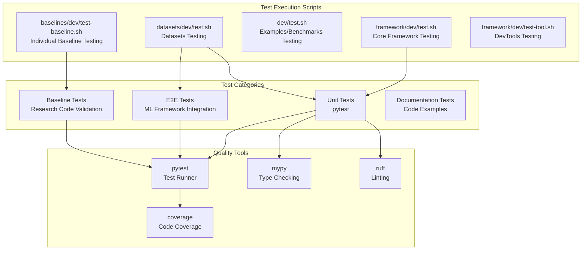
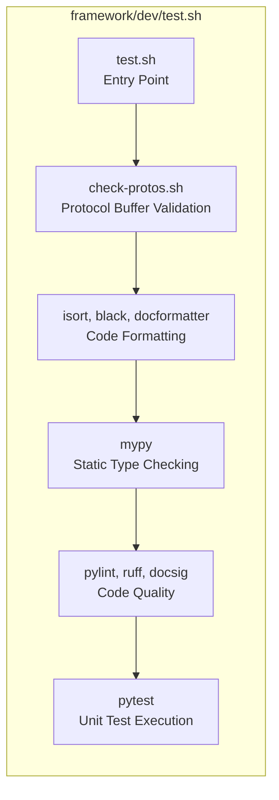
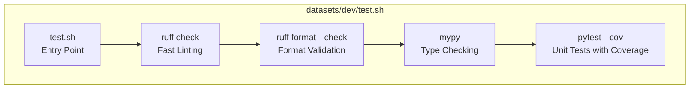
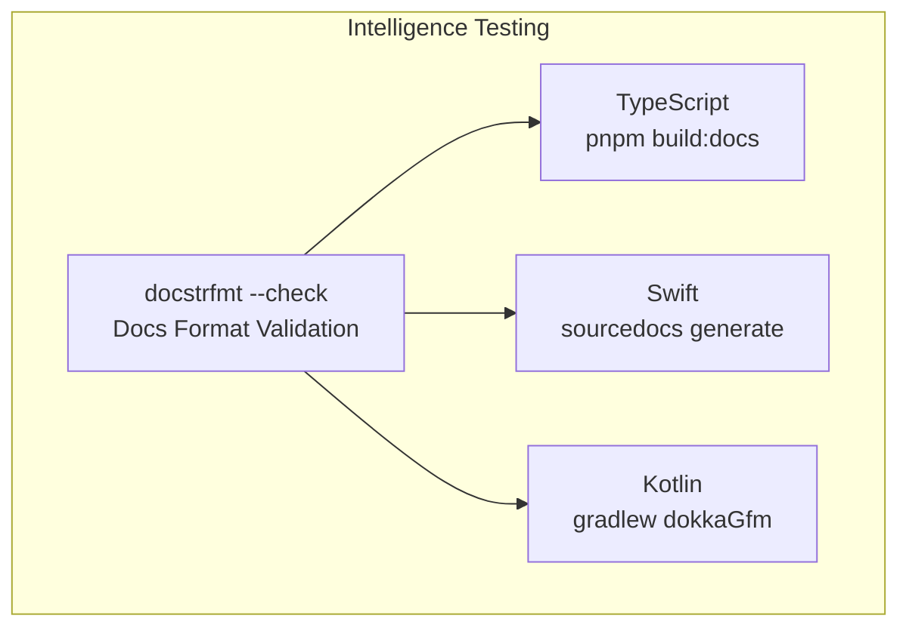
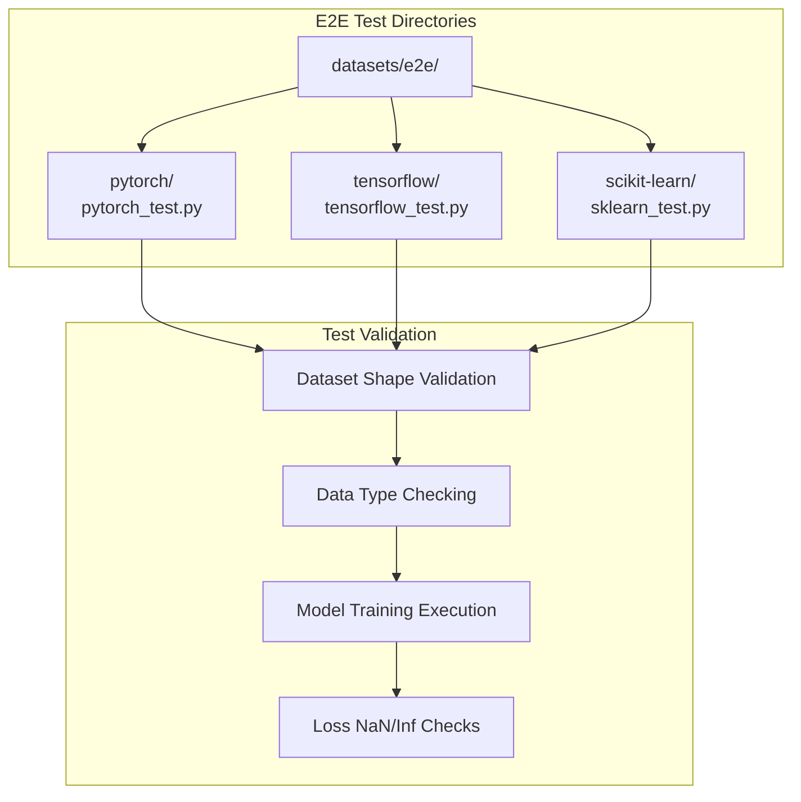
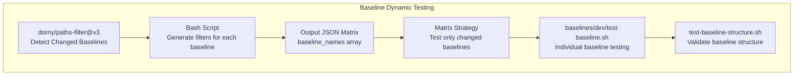
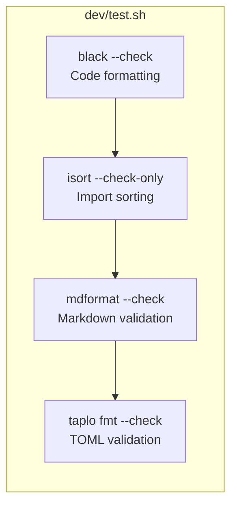
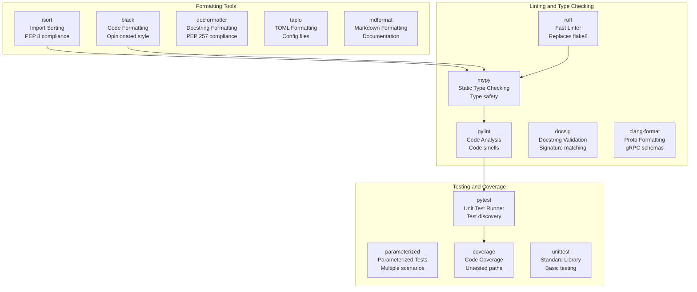
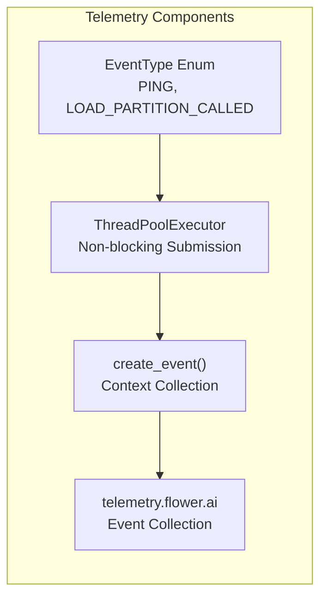
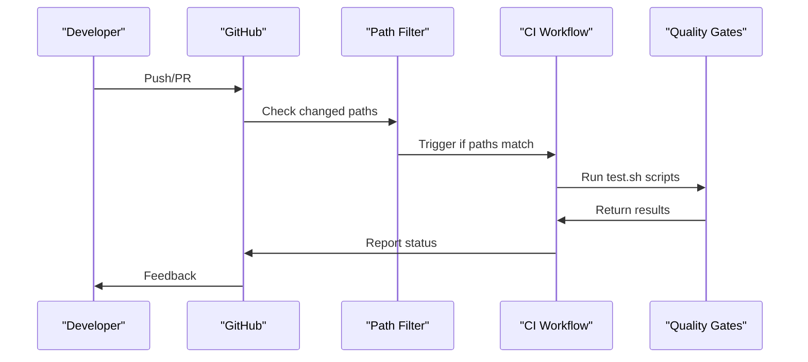

<!-- source: DeepWiki mcp.deepwiki.com · repo adap/flower · page 6.3 Testing Strategy · fetched 2026-10-21 -->

# Testing Strategy

<details>
<summary>Relevant source files</summary>

The following files were used as context for generating this wiki page:

- [.github/workflows/datasets-e2e.yml](.github/workflows/datasets-e2e.yml)
- [.github/workflows/datasets.yml](.github/workflows/datasets.yml)
- [.github/workflows/framework-cache-cleanup.yml](.github/workflows/framework-cache-cleanup.yml)
- [.github/workflows/framework-devtools.yml](.github/workflows/framework-devtools.yml)
- [.github/workflows/framework-docs-update-translations.yml](.github/workflows/framework-docs-update-translations.yml)
- [.github/workflows/framework-docs.yml](.github/workflows/framework-docs.yml)
- [.github/workflows/framework-draft-release.yml](.github/workflows/framework-draft-release.yml)
- [.github/workflows/framework-release.yml](.github/workflows/framework-release.yml)
- [.github/workflows/framework.yml](.github/workflows/framework.yml)
- [.github/workflows/intelligence-docs.yml](.github/workflows/intelligence-docs.yml)
- [.github/workflows/release-nightly.yml](.github/workflows/release-nightly.yml)
- [datasets/e2e/tensorflow/tensorflow_test.py](datasets/e2e/tensorflow/tensorflow_test.py)
- [framework/dev/build-docker-image-matrix.py](framework/dev/build-docker-image-matrix.py)
- [framework/docker/superexec/Dockerfile](framework/docker/superexec/Dockerfile)
- [framework/docker/superexec/README.md](framework/docker/superexec/README.md)
- [intelligence/dev/build-kt-docs.sh](intelligence/dev/build-kt-docs.sh)

</details>


This document covers the comprehensive testing strategy and infrastructure used in the Flower federated AI framework. It explains the unit testing, end-to-end (E2E) testing, baseline testing approaches, and the testing infrastructure that ensures code reliability and correctness across all framework components.

For information about the CI/CD pipeline that executes these tests, see [CI/CD Pipeline](6.2). For development environment setup, see [Development Environment Setup](6.1). For contributing guidelines, see [Contributing Guidelines](6.4).

## Overview

The Flower framework implements a comprehensive multi-layered testing strategy that encompasses:

- **Unit testing** with pytest across framework core, datasets, and intelligence components
- **End-to-end (E2E) testing** to validate cross-component integration and real ML framework workflows
- **Baseline testing** with dynamic path detection for federated learning research baselines
- **Code quality validation** through linting, formatting, type checking, and docstring validation
- **Multi-version testing** across Python versions 3.10-3.13 to ensure compatibility
- **Coverage reporting** to track test completeness and identify untested code paths

## Testing Architecture

Testing Component Architecture:



Sources: [.github/workflows/framework.yml:1-76](), [.github/workflows/datasets.yml:1-67](), [.github/workflows/datasets-e2e.yml:1-53]()

## Unit Testing

### Framework Core Unit Tests

The framework core uses pytest for comprehensive unit testing of all server and client components. Tests are executed through `framework/dev/test.sh`.

**Framework Test Execution Flow:**



The framework test suite validates:
- **Core Server Components**: SuperLink, ServerAppIo, Fleet API, Control API
- **Core Client Components**: SuperNode, ClientApp execution, node authentication
- **State Management**: LinkState implementations (SQLite, in-memory)
- **Communication Protocols**: gRPC message flow, serialization, object storage
- **Authentication**: OIDC device flow, Ed25519 node authentication
- **CLI Commands**: `flwr run`, `flwr build`, `flwr login`, etc.

**Python Version Matrix:**

| Python Version | Ubuntu Runner | Test Scope |
|---------------|---------------|------------|
| 3.10 | ubuntu-22.04 | Full test suite |
| 3.11 | ubuntu-22.04 | Full test suite |
| 3.12 | ubuntu-22.04 | Full test suite |
| 3.13 | ubuntu-22.04 | Full test suite |

Sources: [.github/workflows/framework.yml:41-76](), [framework/dev/test.sh:1-109]()

### Datasets Unit Tests

The datasets package testing focuses on partitioning strategies, FederatedDataset API, and HuggingFace integration.

**Datasets Test Execution:**



The datasets test suite covers:
- **FederatedDataset API**: Dataset loading, partition access, split handling
- **Partitioning Strategies**: IidPartitioner, DirichletPartitioner, NaturalIdPartitioner
- **Preprocessors**: Merger, Divider, custom preprocessing pipelines
- **Visualization Tools**: Label distribution plotting, metrics computation
- **HuggingFace Integration**: Dataset downloading, caching, authentication

**HuggingFace Cache Management:**

The datasets tests use GitHub Actions caching to avoid redundant downloads:

```yaml
- uses: actions/cache@v3
  with:
    path: ~/.cache/huggingface
    key: hf-datasets-v1
    restore-keys: hf-datasets-
```

Sources: [.github/workflows/datasets.yml:27-67](), [datasets/dev/test.sh:1-50]()

### Intelligence Components Testing

Intelligence SDK components (TypeScript, Swift, Kotlin) have specialized testing and documentation generation workflows.

**Intelligence Documentation and Testing:**



Sources: [.github/workflows/intelligence-docs.yml:25-128]()

## End-to-End Testing

### Datasets E2E Tests

The datasets package includes comprehensive E2E tests that validate integration with real ML frameworks (PyTorch, TensorFlow, scikit-learn). These tests ensure the FederatedDataset API works correctly with actual training workflows.

**E2E Test Framework Matrix:**



**TensorFlow E2E Test Example:**

The TensorFlow E2E tests validate complete integration from FederatedDataset to model training:

```python
# datasets/e2e/tensorflow/tensorflow_test.py demonstrates:
# 1. FederatedDataset creation with partitioners
fds = FederatedDataset(dataset="cifar10", partitioners={"train": 100})

# 2. Partition loading
partition = fds.load_partition(partition_id, "train")

# 3. TensorFlow dataset conversion
tf_dataset = partition.to_tf_dataset(
    columns="img", 
    label_cols="label",
    batch_size=batch_size,
    shuffle=False
)

# 4. Model training validation
model.fit(tf_dataset, epochs=1, verbose=0)

# 5. Loss validation (not NaN or Inf)
last_loss = history.history['loss'][-1]
self.assertFalse(np.isnan(last_loss))
```

**E2E Test Matrix Configuration:**

| Framework | Test Directory | Dataset | Validation |
|-----------|---------------|---------|------------|
| PyTorch | `datasets/e2e/pytorch/` | CIFAR-10 | DataLoader, Tensor types, training |
| TensorFlow | `datasets/e2e/tensorflow/` | CIFAR-10 | tf.data.Dataset, training, loss |
| scikit-learn | `datasets/e2e/scikit-learn/` | CIFAR-10 | NumPy arrays, model fitting |

**E2E Test Execution:**

Tests run with Python 3.10.19 and use parameterized testing for multiple datasets:

```python
@parameterized_class([
    {"dataset_name": "cifar10", "test_split": "test"},
    {"dataset_name": "cifar10", "test_split": "test"},
])
class FdsToTensorFlow(unittest.TestCase):
    # Test dataset shape validation
    def test_create_partition_dataset_shape(self) -> None:
        batch_size = 16
        dataset = self._create_tensorflow_dataset(batch_size)
        batch = next(iter(dataset))
        images = batch[0]
        self.assertEqual(tuple(images.shape),
                        (batch_size, *self.expected_img_shape_after_transform))
```

Sources: [.github/workflows/datasets-e2e.yml:1-53](), [datasets/e2e/tensorflow/tensorflow_test.py:1-102]()

## Baseline Testing

### Dynamic Baseline Testing

The baselines repository contains federated learning research implementations. Testing uses dynamic path detection to only test modified baselines, optimizing CI execution time.

**Baseline Test Flow:**



**Baseline Detection Logic:**

The workflow generates filters dynamically for each baseline directory:

```bash
# Extract baseline names from baselines/ directories
baseline_names=$(ls -d baselines/*/ | xargs -n 1 basename)

# Generate path filter for each baseline
for baseline in $baseline_names; do
  filters+="baseline_$baseline:\n"
  filters+="  - 'baselines/$baseline/**'\n"
done
```

**Baseline Test Validation:**

Each baseline is tested independently with:
- **Structure Validation**: Ensures required files exist (`pyproject.toml`, `README.md`, etc.)
- **Code Quality**: Formatting and linting with black, isort, mypy
- **Dependency Management**: Poetry lock file validation
- **Documentation**: README completeness and code examples

**Example Baseline Test Script:**

```bash
# baselines/dev/test-baseline.sh
cd "$baseline_dir"

# Install dependencies
python -m poetry install

# Run formatting checks
python -m poetry run black --check .
python -m poetry run isort --check-only .

# Run type checking
python -m poetry run mypy .

# Run tests if they exist
python -m poetry run pytest
```

Sources: [.github/workflows/baselines.yml:26-90]()

### Examples and Benchmarks Testing

Examples and benchmarks undergo validation to ensure they remain functional as the framework evolves.

**Examples Test Coverage:**



The examples test validates:
- **Code Formatting**: Consistent style across all examples
- **Import Organization**: Alphabetically sorted imports
- **Documentation Quality**: Properly formatted README files
- **Configuration Files**: Valid TOML syntax in pyproject.toml

Sources: [.github/workflows/framework.yml:73-76](), [dev/test.sh:1-35]()

## Testing Tool Chain

### Code Quality and Testing Tools

The framework employs a comprehensive suite of code quality and testing tools consistently applied across all components.

**Tool Categories and Usage:**



**Tool Configuration by Component:**

| Component | Formatting | Linting | Type Checking | Testing |
|-----------|------------|---------|---------------|---------|
| **Framework Core** | isort, black, docformatter | pylint, ruff, docsig | mypy (strict) | pytest, coverage |
| **Datasets** | ruff format | ruff check | mypy | pytest, coverage |
| **Examples** | black, isort | - | - | - |
| **Baselines** | black, isort | mypy, pylint | mypy | pytest |
| **Intelligence** | docstrfmt | - | TypeScript/Swift/Kotlin | - |

Sources: [framework/dev/test.sh:18-108](), [datasets/dev/test.sh:9-49](), [dev/test.sh:10-34]()

### Test Execution Scripts

Each component has dedicated testing scripts that enforce consistent quality standards and execute tests.

**Framework Core Testing Script:**

`framework/dev/test.sh` executes the complete test suite for the core framework:

```bash
#!/bin/bash
set -e
cd "$( cd "$( dirname "${BASH_SOURCE[0]}" )" >/dev/null 2>&1 && pwd )"/../

# 1. Protocol Buffer validation
echo "Running check-protos.sh"
./dev/check-protos.sh

# 2. Import sorting
echo "Running isort"
python -m isort --check-only src/py

# 3. Code formatting
echo "Running black"
python -m black --check src/py

# 4. Docstring formatting
echo "Running docformatter"
python -m docformatter --check src/py

# 5. Static type checking
echo "Running mypy"
python -m mypy src/py

# 6. Code linting
echo "Running pylint"
python -m pylint src/py

# 7. Unit tests with coverage
echo "Running pytest"
python -m pytest --cov=flwr --cov-report=term-missing
```

**Datasets Testing Script:**

`datasets/dev/test.sh` focuses on ruff-based linting and pytest with coverage:

```bash
#!/bin/bash
set -e
cd "$( cd "$( dirname "${BASH_SOURCE[0]}" )" >/dev/null 2>&1 && pwd )"/../

# 1. Fast linting with ruff
echo "Running ruff check"
python -m ruff check flwr_datasets

# 2. Format checking
echo "Running ruff format"
python -m ruff format --check flwr_datasets

# 3. Type checking
echo "Running mypy"
python -m mypy flwr_datasets

# 4. Unit tests with coverage
echo "Running pytest"
python -m pytest --cov=flwr_datasets --cov-report=term-missing
```

**Test Script Summary:**

| Script | Purpose | Test Stages | Coverage |
|--------|---------|-------------|----------|
| `framework/dev/test.sh` | Framework core validation | 7 stages: proto, format, lint, type, test | pytest --cov |
| `datasets/dev/test.sh` | Datasets package testing | 4 stages: lint, format, type, test | pytest --cov |
| `framework/dev/test-tool.sh` | DevTools testing | 5 stages: format, type, lint, test | pytest --cov |
| `baselines/dev/test-baseline.sh` | Individual baseline testing | 4 stages: format, type, lint, test | pytest |
| `dev/test.sh` | Examples/benchmarks validation | 4 stages: format, markdown, toml | No unit tests |

Sources: [framework/dev/test.sh:1-109](), [datasets/dev/test.sh:1-50](), [dev/test.sh:1-35](), [framework/dev/test-tool.sh:1-71]()

## Test Coverage and Reporting

### Coverage Configuration

The framework uses `pytest-cov` to track test coverage and identify untested code paths.

**Coverage Execution:**

```bash
# Framework core coverage
python -m pytest --cov=flwr --cov-report=term-missing src/py

# Datasets coverage
python -m pytest --cov=flwr_datasets --cov-report=term-missing flwr_datasets

# Coverage output shows:
# - Percentage of code covered by tests
# - Line numbers not covered by tests
# - Module-level coverage breakdown
```

**Coverage Reports:**

```
Name                              Stmts   Miss  Cover   Missing
---------------------------------------------------------------
flwr/server/superlink/linkstate    245     12    95%    89-92, 156-159
flwr/client/node_state             156      8    95%    45, 78-82
flwr/common/message                189      0   100%
```

### Test Pattern Examples

**Parameterized Testing:**

The E2E tests use `parameterized` for testing multiple scenarios:

```python
from parameterized import parameterized_class, parameterized

@parameterized_class([
    {"dataset_name": "cifar10", "test_split": "test"},
    {"dataset_name": "mnist", "test_split": "test"},
])
class FdsToTensorFlow(unittest.TestCase):
    dataset_name = ""
    test_split = ""
    
    @parameterized.expand([
        ("not_nan", np.isnan),
        ("not_inf", np.isinf),
    ])
    def test_train_model_loss_value(self, name, condition_func):
        # Test that loss is not NaN or Inf after training
        model.fit(dataset, epochs=1)
        last_loss = history.history['loss'][-1]
        self.assertFalse(condition_func(last_loss))
```

**Fixture Usage:**

Tests use pytest fixtures for setup and teardown:

```python
@pytest.fixture
def setup_linkstate():
    """Create a temporary database for testing."""
    with tempfile.TemporaryDirectory() as temp_dir:
        db_path = Path(temp_dir) / "test.db"
        state = SqliteLinkState(database_path=str(db_path))
        yield state
        state.close()

def test_create_run(setup_linkstate):
    """Test run creation in LinkState."""
    state = setup_linkstate
    run_id = state.create_run(None, None, "test-fab", {})
    assert run_id > 0
```

Sources: [datasets/e2e/tensorflow/tensorflow_test.py:26-98]()

## Testing Best Practices

### Test Organization

Tests are organized by component and test type:

```
framework/
├── src/py/flwr/              # Source code
└── tests/                    # Unit tests mirror source structure
    ├── server/
    ├── client/
    └── common/

datasets/
├── flwr_datasets/            # Source code
├── flwr_datasets_test/       # Unit tests
└── e2e/                      # E2E integration tests
    ├── pytorch/
    ├── tensorflow/
    └── scikit-learn/

baselines/
└── <baseline_name>/
    ├── <baseline_name>/      # Source code
    └── tests/                # Baseline-specific tests
```

### Writing Tests

**Unit Test Guidelines:**

1. **Test Isolation**: Each test should be independent and not rely on other tests
2. **Descriptive Names**: Test names should clearly describe what is being tested
3. **Arrange-Act-Assert**: Structure tests with clear setup, execution, and validation phases
4. **Mocking**: Use mocks to isolate the unit under test from dependencies
5. **Coverage**: Aim for high code coverage but focus on meaningful test scenarios

**E2E Test Guidelines:**

1. **Real Dependencies**: Use actual ML frameworks and datasets
2. **Complete Workflows**: Test end-to-end scenarios from data loading to model training
3. **Validation**: Check data shapes, types, and training outcomes
4. **Performance**: Ensure tests complete in reasonable time (timeout: 10 minutes)

### Running Tests Locally

**Run all framework tests:**
```bash
cd framework
./dev/test.sh
```

**Run datasets tests:**
```bash
cd datasets
./dev/test.sh
```

**Run E2E tests:**
```bash
cd datasets/e2e/tensorflow
python -m poetry install
python -m unittest discover -p '*_test.py'
```

**Run specific test file:**
```bash
python -m pytest tests/server/test_linkstate.py -v
```

**Run with coverage:**
```bash
python -m pytest --cov=flwr --cov-report=html
```

Sources: [.github/workflows/framework.yml:41-76](), [.github/workflows/datasets-e2e.yml:43-52]()

## Telemetry and Monitoring

### Telemetry Infrastructure

The framework includes optional telemetry collection for usage analytics and error reporting.



Sources: [datasets/flwr_datasets/common/telemetry.py:108-225]()

The telemetry system is controlled by environment variables:
- `FLWR_TELEMETRY_ENABLED=0` - Disables telemetry collection
- `FLWR_TELEMETRY_LOGGING=1` - Enables telemetry debug logging

Sources: [datasets/flwr_datasets/common/telemetry.py:32-34](), [.github/workflows/framework.yml:16](), [.github/workflows/datasets.yml:24]()

## Continuous Integration Execution Flow

### Workflow Triggers and Concurrency

All CI workflows implement sophisticated concurrency control and path-based filtering:



The concurrency configuration prevents resource waste by canceling outdated builds:

```yaml
concurrency:
  group: ${{ github.workflow }}-${{ github.ref == 'refs/heads/main' && github.run_id || github.event.pull_request.number || github.ref }}
  cancel-in-progress: true
```

Sources: [.github/workflows/framework.yml:11-13](), [.github/workflows/datasets.yml:19-21](), [.github/workflows/baselines.yml:11-13]()

---

